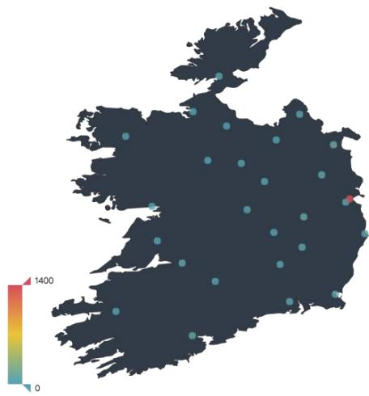
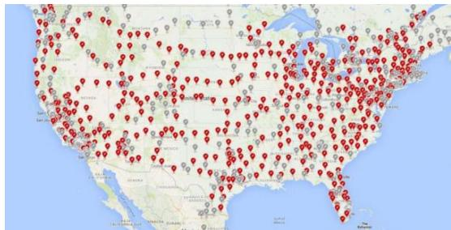

# 2018年美赛O奖论文：如何实现电动汽车的全面普及（Problem D）

原件为竞赛论文。补充：文中的阅读练习及“参考解答”为整理时增加，原件图文保留出处。

来源：2018 MCM/ICM Problem D O奖论文（Team #82794）。整理自识别文本，保留原文结构与核心内容。

## Summary Sheet

**How to achieve the full adoption of all-electric vehicles**

We construct two models to facilitate the construction of the Tesla network from a macro perspective, a double-layer complex network to measure the network topology and a SI epidemic model based on the evaluation index system (SI-EI) to identify the key factors in the building process.

The double-layer complex network can be used to determine the number, location and distribution of charging stations. People are divided into long-distance and short-distance travelers. The number of charging stations are determined mainly by Vehicle Density, Daily Mileage and Range Anxiety:
(1) the outer layer is to study the demands of long-distance travelers for supercharge stations, with introduced Weighted Betweenness to measure whether a city is a traffic hub, which is the reference to arrange the location;
(2) the inner layer is to study the demands of the remaining three cases, and arrange location according to Vehicle Density. The distribution is based on the number of the above four cases. We introduce Reachable Level, Permeability and Long-distance travel demand rate into SI-EI model to measure daily infection rate $\lambda$, and apply the traditional SI model to determine the key factors.

For problem 1, there are 8.08 million destination charging stations and 2.16 million supercharge stations in the final network architecture. It takes 108 years to reach fully automobile electrification for constructed networks while it takes 36 years to construct networks.

For problem 2, we choose Ireland. There are 78 thousand destination charging stations and 20.8 thousand supercharge stations in the final network architecture. The optimal investment plan is to establish a 2:1 ratio between the scale of the site and the present required scale, and to establish charging stations by mixing the ratio of the city to the rural area to 3:2. The conclusion is mainly building destination charging stations when Permeability is less than 30%, and building supercharge stations in cities when Permeability is less than 50% but more than 30%, otherwise building supercharge stations in roads.

For problem 3, we build a classification system to have a weak traffic network.

For problem 4, technology that would hinder EVs' spread include: car-share, ride-share services and hyperloop. While technology that would boost EVs' spread include: self-driving cars, rapid battery-swap stations for electric cars, and flying cars.

## Contents

1. Overview
    1.1 Background
    1.2 Restatement of Problem
    1.3 Illustration
2. Notations
3. Assumptions and Justification
4. Double-Layer Complex Network
    4.1 Model Overview and Analysis
    4.2 Inner Layer: Distribution of Charging Stations over a County
        4.2.1 Distribution of Destination Charging Stations over a County
        4.2.2 Distribution of Supercharging Stations over a County
    4.3 Outer Layer: Distribution of Charging Stations from County to County
5. SI epidemic model based on the evaluation index system
    5.1 Model Overview and Analysis
    5.2 Establishment of Evaluation Index System
        5.2.1 Analysis of User's Demands
        5.2.2 The Measure of Index
    5.3 SI Epidemic Model
6. Application and Analysis
    6.1 Task 1: Explore the network of Tesla charging stations in the United States
        6.1.1 The number and distribution of charging stations
        6.1.2 Prediction
    6.2 Task 2: Analysis the network of Tesla built in Ireland
        6.2.1 2a: The number, placement and distribution of charging stations and key factors
        6.2.2 2b: Our proposed charging station plan
        6.2.3 2c: Our proposed growth plan timeline
        6.2.4 Analysis of key factors
    6.3 Task 3: A weak traffic network classification system
    6.4 Task 4: The impact of technology on EVs' spread
7. Sensitivity Analysis
8. Comment on Heavy Trucks
9. Analysis of the Model
    9.1 Strengths
    9.2 Weaknesses
10. Task 5: Handout
Appendices

## 1 Overview

### 1.1 Background

The world is fascinated by reducing the use of fossil fuels, including gasoline for vehicles. Whether motivated by the environment or by the economics, consumers are starting to migrate to electric vehicles. The migration from gasoline and diesel vehicles to electric vehicles is not simple and can’t happen overnight. The location and convenience of charging stations is critical as early adopters and eventually mainstream consumers volunteer to switch. When nations plan this transition, they need to do:

*   Build a sufficient number of vehicle charging stations in all the right places;
*   Consider the final network of charging stations
*   Consider the growth and evolution of the network of charging stations over time.

As nations seek to develop policies that promote the migration towards electric vehicles, they will need to design a plan that works best for their individual country.

知识点：[文献综述与研究背景撰写方法](../../../topics/数学建模/wenxian_zongshu.md)、[问题重述与分析（Problem Restatement and Analysis）](../../../topics/数学建模/wenti_chongshu.md)、[任务分解与目标明确](../../../topics/数学建模/renwu_fenjie.md)

### 1.2 Restatement of Problem

We need to determine the final architecture of the charging network to support the full adoption of all-electric vehicles. And we will identify the key factors that will be important as they plan their timeline for an eventual ban or dramatic reduction of gasoline and diesel vehicles.

Our specific tasks are the following:

*   Explore the current and growing network of Tesla charging stations in the United States.
*   Select one of the following nations (South Korea, Ireland, or Uruguay). Build the network considering the number and distribution of charging stations, determine the growth plan and propose the timeline for the full evolution to electric vehicles in this country. And identify the key factors.
*   Identify the key factors that trigger the selection of different approaches to growing the network in different countries. Discuss the feasibility of creating a classification system that would help a nation determine the general growth model.
*   Comment on how other transportation options might impact our analyses of the increasing use of electric vehicles with the development of technology.
*   Prepare a one-page handout written for the leaders of a wide range of countries who are attending an international energy summit.

# 2018年美赛O奖论文：如何实现电动汽车的全面普及（Problem D）

本文档整理了《2018年美赛O奖论文：如何实现电动汽车的全面普及》习题部分第2部分（原稿第5–7页对应内容，实际识别内容为Section 1.3至4.2.1开头）。由识别工具读取并整理。

## 一、符号说明与假设

知识点：[问题重述与分析（Problem Restatement and Analysis）](../../../topics/数学建模/wenti_chongshu.md)、[任务分解与目标明确](../../../topics/数学建模/renwu_fenjie.md)、[非技术性文稿撰写（如致世界医学会的信函、新闻发布会声明）](../../../topics/数学建模/fei_jishu_wengao.md)

### 选择 1

题干：关于充电设施的基础概念与模型假设，以下哪项描述符合原文设定？

- A. 特斯拉仅提供一种类型的充电设施。
- B. 县级区域仅由城市组成，不包含乡村。
- C. 模型中的充电站包含多个充电器，以计算具体分布。
- D. 模型假设全面转向电动汽车后系统稳定，用户不会在燃油车和电动车之间转换。

答案：D。
知识点：[一般假设及其合理性说明（Assumptions and Justifications）](../../../topics/数学建模/jiaben_shezhi.md)

### 填空 1

题干：表1列出了本文使用的符号和记号。请根据原文填写缺失的描述。

| Symbol | Description |
| :--- | :--- |
| $\lambda$ | The daily contact rate |
| $i$ | The current number of EVs |
| $M_{sum}$ | The total number of traditional vehicles and EVs |
| $D$ | The total satisfaction |

答案：见上表。
补充：这些符号将在后续章节中进一步定义。

## 二、双层复杂网络模型构建

知识点：[符号说明与术语定义（Nomenclature / Symbols and Definitions）](../../../topics/数学建模/fuhao_shuoming.md)

### 简答 1

题干：为什么作者提出使用“双层复杂网络”（Double-Layer Complex Network）来建模全国范围内的充电站分布？

答案：
1. **宏观视角需求**：由于我们要为一个国家建立充电站网络，应站在国家层面考虑问题。不同县之间存在地形、民俗等许多差异。
2. **现有研究局限**：现有文献[1-3]主要研究特定城市，如每条街道的充电站数量等微观方法。这种方法不适用于本题所涉及的全国性宏观问题。
3. **抽象本质**：我们需要把握问题的本质并进行抽象，因此提出了双层复杂网络，即全球充电站网络（global network）和充电站分布网络（network of charging station’s distribution）。

知识点：[数学建模的基本步骤（问题分析、模型假设、建立、求解、检验、推广）](../../../topics/数学建模/jianmo_buzhou.md)、[任务分解与目标明确](../../../topics/数学建模/renwu_fenjie.md)

### 选择 2

题干：以美国为例，双层复杂网络的宏观结构旨在讨论什么层面的问题？

- A. 单个充电站的具体地理坐标定位。
- B. 不同城市分配的充电站数量（宏观视角）。
- C. 每个家庭内部的充电设备配置。
- D. 电力公司的电网负荷分配细节。

答案：B。
知识点：[多重网络/多层网络构建（Multiplex/Multi-layer Network）](../../../topics/数学建模/duoceng_wangluo.md)、[任务分解与目标明确](../../../topics/数学建模/renwu_fenjie.md)

### 简答 2

题干：内层网络（Inner Layer）主要针对哪类人群？其设计的主要特征是什么？

答案：
1. **目标人群**：活动范围在一个县内的人。
2. **人群特征**：活动范围狭窄，每日耗电量较少。
3. **建设策略**：因此，主要建设目的地充电站（destination charging stations）是合理的。
4. **例外情况**：仍有两类人需要超级充电站（supercharging stations）：
   - 活动范围在县内，但总是忘记给车辆充电的人。
   - 途经该县的长途旅行者。

知识点：[任务分解与目标明确](../../../topics/数学建模/renwu_fenjie.md)、[问题重述与分析（Problem Restatement and Analysis）](../../../topics/数学建模/wenti_chongshu.md)、[数学建模的基本步骤（问题分析、模型假设、建立、求解、检验、推广）](../../../topics/数学建模/jianmo_buzhou.md)

### 计算 1

题干：根据原文公式(1)-(3)，推导某县 $t$ 时刻总负载 $TL(t, \tau)$ 的计算逻辑。

已知公式：
$$
L (S _ {i}, t, \tau) = f (S _ {i}, \tau) \times \phi (S _ {i}) \times N _ {s u m} \times \mu ((P, t, \tau) | _ {S _ {i}}), i = 1, 2, \dots , 6\tag{1}
$$

$$
h \mathbf {j} (S _ {i})
$$

$$
\phi (S _ {i}) = g (D _ {i}) d D _ {i}, i = 1, 2, \dots , 6\tag{2}
$$

$$
T L (t, \tau) = \sum_ {S _ {i} \in t t _ {\tau}} (L (S _ {i}, t, \tau))\tag{3}
$$

答案：
总负载 $TL(t, \tau)$ 是对该县内所有子区域 $S_i$ 的局部负载 $L(S_i, t, \tau)$ 求和。
其中，局部负载 $L$ 由四个因子决定：
1. $f(S_i, \tau)$：可能与时间或特定条件相关的函数。
2. $\phi(S_i)$：通过积分 $g(D_i) d D_i$ 得到，反映某种密度或概率分布。
3. $N_{sum}$：传统车辆与电动车的总数。
4. $\mu((P, t, \tau) | _ {S _ {i}})$：在特定子区域 $S_i$ 的条件概率或比率。

# 2018年美赛O奖论文：如何实现电动汽车的全面普及（Problem D）（习题）

本资料整理自2018年美国大学生数学建模竞赛（MCM/ICM）获得Outstanding Winner（O奖）的论文《How to Achieve Full Adoption of Electric Vehicles》中关于目的地充电站和超级充电站数量与位置分布的模型推导部分。

## 一、符号定义

知识点：[符号说明与术语定义（Nomenclature / Symbols and Definitions）](../../../topics/数学建模/fuhao_shuoming.md)、[一般假设及其合理性说明（Assumptions and Justifications）](../../../topics/数学建模/jiaben_shezhi.md)、[模型参数的确定（基于数据拟合或实验选择）](../../../topics/数学建模/canshu_queding.md)

### 符号 1

- $S_i$ is the $i$th user group, and the six user groups are divided according to the difference of daily mileage of electric vehicles(EVs).
- $L(S_i, t, \tau)$ is the total number of destination charging stations $S_i$ need in time $t$ of workday $\tau$.
- $f(S_i, \tau)$ is the probability distribution of the users in user group $S_i$ in workdays and is equal to the ratio of charging users to total users of user group $S_i$ during workday $\tau$.
- $N_{sum}$ is the holding number of EVs in our researching area.
- $\mu((P, t, \tau)|_{s_i})$ is the expected value for a single user in user class $S_i$ charged during workday $\tau$ at time $t$.
- $\phi(S_i)$ is the ratio of the number of users in user group $S_i$ to $N_{sum}$.
- $g(D_i)$ is the probability density function that daily driving distance of a single user in user group $S_i$ obeys.
- $tt_\tau$ is the set of user group that have charged during the workday $\tau$.
- $TL(t, \tau)$ is the total number of destination charging stations needed in time $t$ of workday $\tau$.
- There is no doubt that we should use $DTL = \max \sum TL(t, \tau)$ as the required number of destination charging stations.

## 二、目的地充电站的数量与位置

知识点：[符号说明与术语定义（Nomenclature / Symbols and Definitions）](../../../topics/数学建模/fuhao_shuoming.md)

### 计算 1：目的地充电站总数

根据上述符号，目的地充电站的总需求量为：

$$
DTL = \max \sum_{t, \tau} TL(t, \tau)
$$

其中，求和是对所有时间 $t$ 和工作日 $\tau$ 进行的，取最大值以覆盖峰值需求。

知识点：[任务分解与目标明确](../../../topics/数学建模/renwu_fenjie.md)

### 计算 2：目的地充电站在各城市的分布

#### 1. 目的地充电站的位置

分配到每个县的目的地充电站数量与该县的车辆密度成正比。

$$
DTL_{i} = \frac{DTL \times CD_{i}}{\sum_{i} CD}\tag{4}
$$

where $DTL_{i}$ is the number of charging stations required for the $i$th city, $DTL$ is the number of charging stations required for the whole country, $CD_{i}$ is the traffic density of the $i$th city.

#### 2. 城市、郊区与农村之间的分布

我们对数量和位置的研究基于车辆密度，而城市、郊区和农村地区的主要区别也是车辆密度，因此基于车辆密度比例分配目的地充电站的数量是合理的。

知识点：[问题重述与分析（Problem Restatement and Analysis）](../../../topics/数学建模/wenti_chongshu.md)、[任务分解与目标明确](../../../topics/数学建模/renwu_fenjie.md)、[模型参数的确定（基于数据拟合或实验选择）](../../../topics/数学建模/canshu_queding.md)

### 计算 3：超级充电站的数量与位置

#### 1. 超级充电站的数量

假设比例为 $a$ 的人总是忘记在家充电，那么他们需要超级充电站。里程焦虑被定义为驾驶员担心因电池耗尽而被困以及由此导致的行程延误 [5]。考虑到目的地充电站的里程焦虑应大于快充站的里程焦虑，我们引入一个损伤因子 $rd$，其含义是人们想要使用超级充电站时相对于想要使用目的地充电站时的最大剩余容量比率。我们需要设置的超级充电站数量可以表示为：

$$
STL = DTL \times a \times rd\tag{5}
$$

#### 2. 超级充电站的位置

这与目的地充电站的位置类似，因此不再重复。

#### 3. 城市、郊区与农村之间的分布

这与目的地充电站在城市、郊区和农村之间的分布类似，因此不再重复。

## 三、长途旅行者的超级充电站分布

由于长途旅行者倾向于在沿途各县的中心休息，可以预测重要城市对超级充电站的需求量大。因此，我们需要在这些重要城市设置站点以满足需求。

城市的重要性可以通过介数中心性（Betweenness）来衡量。

$$
B_{i} = \sum_{1 \leq j < l \leq N, j \neq i \neq l} \frac{n_{jl}(i)}{n_{jl}}\tag{6}
$$

where, $n_{jl}(i)$ is the number of the shortest paths between $\nu_{j}$ and $\nu_{l}$ which also passes $\nu_{i},$ $n_{jl}$ is the number of the shortest paths between $\nu_{j}$ and $\nu_{l}.$

Given that the network we have constructed is a weighted graph, the attribute of a node is its number of vehicles, and the attribute of an edge is the distance between two adjacent cities. Now we introduce two coefficients to construct Weighted Betweenness. Thus, we get our final Weighted Betweenness WB to measure the importance of cities.

$$
WB_{i} = B_{i} \times \eta_{1} \times \eta_{2}\tag{7}
$$

where $\eta_{1}$ is the ratio of the sum of the population of the cities connected to the city to the total population, $\eta_{2}$ is the ratio of the sum of the length of the edge between the city and all of its surrounding cities to the total length of the edge.

知识点：[任务分解与目标明确](../../../topics/数学建模/renwu_fenjie.md)、[配送地点选址模型（公平原则与效率原则）](../../../topics/数学建模/peisong_xuanzhi.md)、[多重网络/多层网络构建（Multiplex/Multi-layer Network）](../../../topics/数学建模/duoceng_wangluo.md)

### 1. The number of supercharging stations

Let us estimate the number of supercharging stations needed for long-distance travelers. We assume that long-distance travelers charge mainly during the twelve hours daytime, charging thirty minutes each time and traveling an average of $L$ miles per day. $\rho$ is a factor used to prevent the rush hour from being in short supply. The Range Anxiety, $E_R$, is set at 130 miles, which means that travelers are expected to charge when they spend 130 miles.

$$
STL = \frac{w \times N_{sum} \times L \times \rho}{24 E_{R}} \tag{8}
$$

知识点：[人口密度修正系数与新公式](../../../topics/数学建模/renkou_midu.md)、[符号说明与术语定义（Nomenclature / Symbols and Definitions）](../../../topics/数学建模/fuhao_shuoming.md)

### 2. The location of supercharging stations

Then we divide supercharging stations into two types, one around the city and the other on the road between the two counties. We should try our best to put the supercharging stations in the city, which not only meets the requirements of long-distance travelers but also reduces the construction cost. Here we mainly consider the supercharging stations around the city, and we will continue to discuss the supercharging station on the road between the two counties later. We set the ratio of the supercharging stations on the road to the overall supercharging stations as $\beta$.

$$
STL_{c_i} = \Sigma \frac{W B_{i}}{W B_{i}} \times STL \times (1 - \beta) \tag{9}
$$

知识点：[配送地点选址模型（公平原则与效率原则）](../../../topics/数学建模/peisong_xuanzhi.md)、[TSP 模型（旅行商问题）规划配送路线](../../../topics/数学建模/tsp_moxing.md)

### 3. Distribution between urban, suburban, and rural areas

We have discussed above that the supercharging station here is built in the urban area, as for the supercharging stations built in the suburban and rural areas, they will be discussed in the outer network.

## 4.3 Outer Layer: Distribution of Charging Stations from County to County

The main target of the chargers between counties is those who travel long distances, whose EV may out of battery before they arrive at their destinations. Thus they need the charging stations. However they wish they could arrive in a certain time, so compared with destination charging stations, they need supercharging stations more. From this we know, stations between counties should be supercharging stations.

There are three types of routes in the outer layer, as is shown in Figure 4:

- The direct route between cities in the same county.
- The direct route between cities in neighboring counties.
- The route between cities that aren’t in adjacent counties passes through the big cities who located between these cities.

It is worth mentioning that different countries have different standards for the classification of cities. We will study the number and location of supercharging stations as follows.

知识点：[任务分解与目标明确](../../../topics/数学建模/renwu_fenjie.md)、[一般假设及其合理性说明（Assumptions and Justifications）](../../../topics/数学建模/jiaben_shezhi.md)

### 1. The number of supercharging stations

The network of the outer layer is a complete graph. We test all the edges in the complete graph. The calculation of the number of supercharging stations between two cities is as follows:

$$
K_{ij} = \frac{L}{E_{R}} \times \frac{N_{i} + N_{j}}{N_{sum}} \times K_{sum} \times \beta \tag{10}
$$

where, $L$ is the distance between two cities; $E_{R}$ is Range Anxiety; $N_{i} (i = 1, 2, . . .)$ is the number of EVs in the $i$th city; $N_{sum}$ is the number of EVs in all cities; $K_{ij}$ is the number of supercharging stations between the $i$th city and the $j$th city; $K_{sum}$ is the number of supercharging stations in all cities; $\beta$ is the scale factor.

知识点：[人口密度修正系数与新公式](../../../topics/数学建模/renkou_midu.md)、[符号说明与术语定义（Nomenclature / Symbols and Definitions）](../../../topics/数学建模/fuhao_shuoming.md)

### 2. The location of supercharging stations

According to the experience of life, people will choose the shortest path to reach their destination. And based on the interpretation and analysis of $E_{R}$, supercharging station should be placed on the shortest path between the two cities and the distance to the nearest supercharging station is 130 miles.

## 5 SI epidemic model based on the evaluation index system

知识点：[配送地点选址模型（公平原则与效率原则）](../../../topics/数学建模/peisong_xuanzhi.md)、[TSP 模型（旅行商问题）规划配送路线](../../../topics/数学建模/tsp_moxing.md)

### 5.1 Model Overview and Analysis

In life, people decide whether to use traditional vehicles or electric vehicles based on their satisfaction with electric vehicles which is mainly measured by the number and location of charging stations. Thus we established a evaluation index system to measure people’s satisfaction.

When a person is very satisfied with electric vehicles, he will tell his friends and family around the advantages of electric vehicles, so that people around him have a certain probability of being convinced by him, that is, turning to the use of electric vehicles. According to the above analysis, we have established a SI epidemic model based on the evaluation index system.

知识点：[传统 SEIR 流行病模型（Susceptible-Exposed-Infectious-Recovered）](../../../topics/数学建模/seir_moxing.md)、[一般假设及其合理性说明（Assumptions and Justifications）](../../../topics/数学建模/jiaben_shezhi.md)、[符号说明与术语定义（Nomenclature / Symbols and Definitions）](../../../topics/数学建模/fuhao_shuoming.md)

### 5.2 Establishment of Evaluation Index System

Before establishing evaluation index system, we need to analyse people’s specific demands. In the following, we first classify people according to the length of their journey and analyse the demands of different types of people. Then establish the evaluation index system according to people’s demands.

#### 5.2.1 Analysis of User’s Demands

Based on people’s preferences, people are divided into two types: those who prefer longdistance travel (LT) and those who prefer short excursions (SE).

- Long trips often cross several counties and will definitely need supercharging station during the travel, so it’s more important for LT that the number and location of supercharging station along the way.
- SE’s basic necessities of life are mostly in their own county. SE is divided into people who won’t forget to charge (NFC) and who will forget to charge (FC). NFC’s daily life does not require supercharging station, they only need a sufficient number of destination charging stations to meet the daily charging demands. FC may require supercharging stations in the city in case forgotten to charge EVs in time, so the number of supercharging stations in the city is more important to FCs than NFCs.

## 5.2.2 The Measure of Index

The measure of the level of satisfaction with the number of destination charging stations is the following:

$$
D N L = \frac {D T L _ {n o w}}{D T L \times P T}\tag{11}
$$

where DNL is the satisfaction level with the number of destination charging stations, $DTL_{now}$ is the number of destination charging stations now, DTL is the total number of destination charging stations when every gas vehicle has been replaced by an electric one and every gas station has been replaced with a charging station, PT is the permeability.

To measure the level of satisfaction with the number of supercharging stations, we have proposed the following formula:

$$
S N L = \frac {S T L _ {c\_now}}{S T L _ {c} \times P T}\tag{12}
$$

where, SNL is the satisfaction level with the number of destination charging stations in city, $STL_{c\_now}$ is the number of supercharging stations in city now, $STL_c$ is the total number of destination charging stations when every gas vehicle has been replaced by an electric one and every gas station has been replaced with a charging station in city, also, PT is the permeability.

Permeability is the current proportion of EVs to all vehicles which can be calculated as follows:

$$
P T = \frac {i}{M _ {s u m}}\tag{13}
$$

where, i is the current number of EVs while $M_{sum}$ is the total number of traditional vehicles and EVs.

Satisfaction level with the location of a supercharging station on a long road is indicated by RL, which means reachable level, that is the reachable probability of multiple counties to county B from county A route. If County A and County B are far apart and there are not enough supercharging stations on the road for charging, they are not reachable, otherwise they are reachable.

Overall satisfaction can be measured as follows:

$$
D = w \times P C + (1 - w) \times (a \times \frac {S T L _ {c\_now}}{S T L _ {c} \times P T} + \frac {D T L _ {n o w}}{D T L \times P T})\tag{14}
$$

Where, D is the total satisfaction, w is the percentage of the number of LT, a is the ratio of the number of FC to SE, RL is the Reachable Level.

知识点：[影响因素评估指标体系构建（温度、湿度、经济、教育等）](../../../topics/数学建模/yingxiang_zhibiao.md)、[一般假设及其合理性说明（Assumptions and Justifications）](../../../topics/数学建模/jiaben_shezhi.md)、[符号说明与术语定义（Nomenclature / Symbols and Definitions）](../../../topics/数学建模/fuhao_shuoming.md)

### 5.3 SI Epidemic Model

In the SI epidemic model, people who use EVs are equivalent to those patients in the SI model. People who use traditional vehicles are equivalent to healthy people in the SI model, and those who are healthy will use EVs because of the encouragement of the people around them , that is, they will become patients.

As is shown in Figure 6 , the dots whose color is the deepest represent patients while the dots whose color is the lightest represent healthy people. The depth of the dots’color on behalf of people’s satisfaction to EVs. The ratio of the number of LT to that of overall w and the ratio of the number of CSE to that of SE a can be calculated as:

$$
w = P T \times x\tag{15}
$$

$$
a = P T \times y\tag{16}
$$

where $PT$ is the permeability, x is the number of LT to all when every gas vehicle replaced by an electric one and every gas station replaced with a charging station, y is the number of CSE to that of SE when every gas vehicle replaced by an electric one and every gas station replaced with a charging station. Then put formula (15) and formula (16) into (14).

In this epidemic model, $\lambda$ is the number of people who own vehicles that make efficient use of EVs (enough to convert people from a traditional vehicle user to an EV user) every day, which can be referred to as the daily contact rate. The parameter $\lambda$ can be calculated as:

$$
\lambda = \frac {(D - X) P}{D}\tag{17}
$$

where X is a threshold value. When the total satisfaction level $D = X ,$ people are neutral about EVs and traditional vehicles; When $D > X ,$ people tend to choose EVs; When $D < X ,$ people tend to choose a traditional vehicle. P is the total number of people with vehicles that come in contact with each person who uses the EVs every day.

$$
\frac {d i}{d t} = \lambda i (1 - i), i (0) = i _ {0}\tag{18}
$$

where i is the current number of $\mathrm { E V s , }$ $\lambda$ is the daily contact rate, $i_0$ is the initial value of EVs.

# 6 Application and Analysis

## 6.1 Task 1: Explore the network of Tesla charging stations in the United States

知识点：[传统 SEIR 流行病模型（Susceptible-Exposed-Infectious-Recovered）](../../../topics/数学建模/seir_moxing.md)、[模型参数的确定（基于数据拟合或实验选择）](../../../topics/数学建模/canshu_queding.md)、[问题重述与分析（Problem Restatement and Analysis）](../../../topics/数学建模/wenti_chongshu.md)

### 6.1.1 The number and distribution of charging stations

#### 1. Destination charging stations

**• The number of destination charging stations**

We consulted for information and learned the current total population of the United States is 323.1 million, the per capita consumption of vehicle is 0.766 and the daily mileage expectation is 43.4. We regard these data as the value of parameters in the formula 1, and get the answer $DTL = 8 . 0 8 m i l l i o n .$

**• The distribution of destination charging stations**

Based on the model name, the distribution of destination charging stations is the same as the radio of urban, suburban, and rural areas. The result is as shown in Table 3.

#### 2. Supercharging stations

**• The number of supercharging stations**

The number of supercharging stations is shown in Table 2.

| type | | number(million) |
| :--- | :--- | :--- |
| destination charging stations | | 8.08 |
| supercharging stations | long-distance traveling people | 1.62 |
| | short-distance traveling people | 0.54 |

*Table 2: the number of charging stations*

**• The distribution of supercharging stations**

According to the formula 9, when $\beta=0.3$, we get the distribution as follows:

| areas | urban areas | suburban areas | rural areas |
| :--- | :--- | :--- | :--- |
| destination charging stations | 0.8 | 0.15 | 0.05 |
| supercharging stations | 0.725 | 0.1125 | 0.1625 |

*Table 3: the distribution of supercharging stations*

知识点：[模型参数的确定（基于数据拟合或实验选择）](../../../topics/数学建模/canshu_queding.md)、[文献综述与研究背景撰写方法](../../../topics/数学建模/wenxian_zongshu.md)、[任务分解与目标明确](../../../topics/数学建模/renwu_fenjie.md)

### 6.1.2 Prediction

We can assume that when a complete switch to all-electric happens, the system is stable and neither will people convert to gasoline vehicle users nor will people convert to EV users.

Assuming that the level of satisfaction D is the threshold at this time, this assumption is reasonable because vehicle companies will surely pursue their own maximum profits under the premise of maintaining system stability which will keep the satisfaction at the lowest level of satisfaction.

# 6.2 Task 2: Analysis the network of Tesla built in Ireland

## 6.2.1 2a: The number, placement and distribution of charging stations and key factors

The determination of the number and distribution of charging stations is consistent with task 1, and we apply the collected data about Ireland to get the result.

知识点：[数学建模的基本步骤（问题分析、模型假设、建立、求解、检验、推广）](../../../topics/数学建模/jianmo_buzhou.md)、[任务分解与目标明确](../../../topics/数学建模/renwu_fenjie.md)

### Table 4: the distribution of destination charging stations

| areas | urban areas | suburban areas | rural areas |
| :--- | :--- | :--- | :--- |
| destination charging stations | 0.7 | 0.2 | 0.1 |
| supercharging stations | 0.7 | 0.125 | 0.175 |

知识点：[模型参数的确定（基于数据拟合或实验选择）](../../../topics/数学建模/canshu_queding.md)、[任务分解与目标明确](../../../topics/数学建模/renwu_fenjie.md)

### Table 5: the number of charging stations

| type | number (thousand) |
| :--- | :--- |
| destination charging stations | 78.0 |
| supercharging stations - long-distance traveling people | 15.6 |
| supercharging stations - short-distance traveling people | 5.2 |

We will focus on determining the location below.

In order to simplify the problem, we have selected 27 big cities in Ireland, with a total population of 80% of the total population of the country.

知识点：[配送地点选址模型（公平原则与效率原则）](../../../topics/数学建模/peisong_xuanzhi.md)、[问题重述与分析（Problem Restatement and Analysis）](../../../topics/数学建模/wenti_chongshu.md)

### 1. The location of destination charging stations

Apply the ratio of vehicle possession to equation 4 to get the number of distribution for each city:

Based on the assumption that the demographic difference in small cities is not obvious because of the small population, we randomly allocate the remaining destination chargers to the more open areas of the map (the remaining small cities that we did not consider).

知识点：[配送地点选址模型（公平原则与效率原则）](../../../topics/数学建模/peisong_xuanzhi.md)、[一般假设及其合理性说明（Assumptions and Justifications）](../../../topics/数学建模/jiaben_shezhi.md)

### 2. The location of super charging stations

#### For short-distance travelers

In equation 5, let $a = 0.3$, $rd = 0.25$ to get the number of distribution for each city.

#### For long-distance travelers

We use weighted mediators to measure the importance of nodes in the network, according to the importance. By equation 9 and equation 10, we can get the number of distribution for each city and the number of distribution on each road as:

知识点：[TSP 模型（旅行商问题）规划配送路线](../../../topics/数学建模/tsp_moxing.md)、[问题重述与分析（Problem Restatement and Analysis）](../../../topics/数学建模/wenti_chongshu.md)

### Reasonableness Analysis

Because the Tesla network in Ireland is in its infancy, it is difficult to verify the validity of our results. We study the relatively more mature Tesla network in the United States. The figure below is a mixture of the betweenness, the vehicle density and the shortest path based on the 309 major metropolitan areas in the United States. The lighter places indicate the higher proportion of the destination charging stations and the supercharging stations. We can easily identify the coastal cities of Boston, Los Angeles, New York and Miami though not fortified traffic but with a large population. We can speculate that the reason for their distribution is primarily our study of vehicle density. While for Peoria, Las Cruces, Jackson, Little Rock and other cities with relatively small population but the traffic fortress of the city, their distribution is mainly due to our study of the weighted mediation.

Moreover, the main highlight in the picture is the best route to place super-charging stations for long-distance travelers. And we can observe that our highlight area distribution is in good agreement with the current Tesla network density distribution in the United States, proving that our model works well.

## 6.2.2 2b: Our proposed charging station plan

知识点：[参数合理性验证](../../../topics/数学建模/canshu_heli_xing.md)、[文献综述与研究背景撰写方法](../../../topics/数学建模/wenxian_zongshu.md)、[模型优缺点分析（Strengths and Weaknesses）](../../../topics/数学建模/youque_dian.md)

### 1. Chargers distribution ordering trade-off

Based on the second Model, we consider three cases: build all city-based chargers first, or all rural chargers, or mix of both. The main difference among them is that different locations affect $\lambda$ in $E_q(18)$. We consider $\lambda$ change with the growth of PT according to equation (17), and get the change of PT with time $t$ in different situations, as is shown in Figure 13.

**Result Analysis:** We can see that hybrid construction achieves the 100% permeability rate the fastest, and even faster when the two are roughly proportional to 3: 2. This is consistent with the idea of using population density measures in our model. The collected data show that the proportion of urbanization in Ireland is 63.2%, so the model results are in line with real life.

知识点：[模型参数的确定（基于数据拟合或实验选择）](../../../topics/数学建模/canshu_queding.md)、[人口密度修正系数与新公式](../../../topics/数学建模/renkou_midu.md)、[模型验证方法概述（随机模型与确定性模型验证）](../../../topics/数学建模/moxing_yanzheng.md)

### 2. Cars first or Stations first

The minimum number of charging stations to be built is such that $\lambda$ is exactly equal to the threshold, otherwise the permeability of the EV ($PT$) will continue to decrease. We have changed the ratio of the number of charging stations in the case of building the chargers first to that in the case of building chargers in response to vehicle purchases several times. The result is shown in Figure 14.

**Result Analysis:** The main difference between the two cases is the rate of reaching 100% permeability and the up-front capital wasted by building supercharging stations. We can simply assume that the saving of capital is linear with the PT speed, so we concluded that it is wise to build the chargers first, and that it is optimal to build a site size that is 2: 1 to now. Therefore, we can draw the conclusion of the optimal investment plan: to establish a 2: 1 ratio between the scale of the site and the present required scale, and to establish charging stations by mixing the ratio of the city to the rural area to 3: 2.

## 6.2.3 2c: Our proposed growth plan timeline

Based on the analysis of the SI-EI model, the main task of different periods is changed, it can be seen in the Figure 15.

## 6.2.4 Analysis of key factors

Based on the above analysis, now we study the key factors.

1. In Task 2a, we mainly explore the final Tesla network topology. The key factors that shaped the development of our plan is the ratio of the total number of charging stations over the country to that in each city.

# 2018年美赛O奖论文：如何实现电动汽车的全面普及（Problem D）

## 6.3 Task 3: A weak traffic network classification system

This question requires us to create a classification system that would help a nation determine the general growth model, we consider to create a classification system which include the country who has a weak traffic network. The underdevelopment may be due to the special geography or underdeveloped economy, which makes it difficult to establish a nationwide road system.

This question requires us to determine the general growth model, so we don’t consider country-specific details, and the only difference between classification system with others is that there is little need to consider the need to establish charging stations for long-distance travelers. Building roadways between neighboring cities is the key factor that trigger the selection of different approaches to growing the network.

Now our proposed plan for growing and evolving the network of chargers doesn’t work. Therefore, we should greatly reduce the weight of betweenness index in the first model, which will simplify the problem to mainly relying on the proportion of the number of vehicles in the region to allocate charging stations. Considering people’s satisfaction with the EVs network, the satisfaction of long-haul travelers is relatively more difficult to meet previously. Now that we don’t need to take them into consideration, it is more simple and fast to migrate away from gasoline and diesel vehicles to all EVs.

## 6.4 Task 4: The impact of technology on EVs’ spread

知识点：[任务分解与目标明确](../../../topics/数学建模/renwu_fenjie.md)、[模型优缺点分析（Strengths and Weaknesses）](../../../topics/数学建模/youque_dian.md)、[一般假设及其合理性说明（Assumptions and Justifications）](../../../topics/数学建模/jiaben_shezhi.md)

### Technology that would hinder EVs’ spread: vehicle-share, ride-share services and hyperloop

As these three technologies evolve, the per-capita holding of vehicles will fall (that is, some owners sell their EVs), but as more people use new technologies, some may find it inconvenient to buy a vehicle again. These qualities are in line with the SIS model, so our SI model becomes a SIS model. The phenomenon will lead to a decline in the popularity rate of EVs. Therefore, it is necessary to dynamically adjust the construction of the EVs network based on the decreasing proportion.

知识点：[传统 SEIR 流行病模型（Susceptible-Exposed-Infectious-Recovered）](../../../topics/数学建模/seir_moxing.md)、[确定模型的定点与稳定性分析](../../../topics/数学建模/dingdian_wending.md)

### Technology that would boost EVs’ spread: self-driving cars, rapid battery-swap stations for EVs, and flying cars

These three technologies will increase the attractiveness of EVs. The $\lambda$ in our SI model will increase, as well as the penetration and popularity rate of EVs. They can also expand the demand of charging stations and accelerate the conversion to full EVs.

## 7 Sensitivity Analysis

We have conducted a sensitivity analysis of the SI-EI model: setting $i(0) = 0.01$ and studying the change of the proportion of $i$ when $\lambda$ is 0.3, 0.27 and 0.33 respectively over time.

We’ve found that the proportion of $i$ is less sensitive to $\lambda$ when the system is in its early and late stages while it is sensitive in mid-term stage. For example, when $t = 15$, the proportion of the three of $i$ is about 0.4, 0.5 and 0.6. This discovery is of practical significance, which means the mid-term stage is the rapid growth stage of permeability in which we can take steps to increase people’s satisfaction level thus increase $\lambda$ and speed up the rate of penetration.

## 8 Comment on Heavy Trucks

Heavy trucks generally need to travel a long way, as well as their huge traction, which result in that their demand for supercharging stations is greater than that of personal vehicles and they are not suitable for charging in cities. When a country’s road transport industry is developed, attention should be given to improving the satisfaction of truck drivers and the number of supercharging stations in rural areas and suburban areas.

## 9 Analysis of the Model

知识点：[敏感性分析方法（Sensitivity Analysis，单参数与多参数变动）](../../../topics/数学建模/minganxing_fenxi.md)、[传统 SEIR 流行病模型（Susceptible-Exposed-Infectious-Recovered）](../../../topics/数学建模/seir_moxing.md)、[问题重述与分析（Problem Restatement and Analysis）](../../../topics/数学建模/wenti_chongshu.md)

### 9.1 Strengths

1. The model of double-layer complex network appropriates problem’s requirements, Analysis network construction from a macroscopic perspective is different from a great deal of analysis on the power and street layout or other micro perspective in the field and greatly simplifies the problem.

2. The SI-EI model cleverly assimilated the idea of the traditional SI model and combined with the evaluation index system to study the permeability from a novel perspective.

3. The selection of Weighted Betweeness is very appropriate, well identified a major traffic hub city, so that the charging station distribution more reasonable.

知识点：[多重网络/多层网络构建（Multiplex/Multi-layer Network）](../../../topics/数学建模/duoceng_wangluo.md)、[确定模型的定点与稳定性分析](../../../topics/数学建模/dingdian_wending.md)、[模型优缺点分析（Strengths and Weaknesses）](../../../topics/数学建模/youque_dian.md)

### 9.2 Weaknesses

The layout of the charging stations is only accurate to the amount allocated to the city because of the large differences among cities and the difficulty in collecting the data, and with more detailed data we can get a more accurate distribution.

## 任务 5：讲义

世界着迷于减少化石燃料的使用，包括汽车用汽油。无论是出于环境还是经济动机，消费者都开始转向电动汽车。我们应当考虑影响我们计划的关键因素，以便更快更好地建设这一网络。

知识点：[文献综述与研究背景撰写方法](../../../topics/数学建模/wenxian_zongshu.md)、[模型优缺点分析（Strengths and Weaknesses）](../../../topics/数学建模/youque_dian.md)、[数学建模的基本步骤（问题分析、模型假设、建立、求解、检验、推广）](../../../topics/数学建模/jianmo_buzhou.md)

### 1. 从最终网络拓扑的角度

我们应当对最终网络的拓扑结构作出更准确的预测，这主要包括对充电站数量、位置和分布的考虑。这些指标是衡量网络建设过程优劣的最重要参考。更好的预测可以提升渗透率、节省更多的网络建设资金并获得最大的社会效益。

知识点：[TSP 模型（旅行商问题）规划配送路线](../../../topics/数学建模/tsp_moxing.md)、[物资配送与制造速度模型（药物每日需求与总量计算）](../../../topics/数学建模/wuzi_peisong.md)

### 2. 从网络建设过程的投资角度

我们应当在网络建设过程中保持尽可能高的投资效率。为确定最优比例，应当考虑当前城乡充电站的比例，并结合本国的城镇化率。此外，提前建设超大规模充电站对加速电动汽车的渗透极为有帮助。尽管这会造成前期资本的浪费，但后期速度带来的收益远大于此处的浪费。

知识点：[影响因素评估指标体系构建（温度、湿度、经济、教育等）](../../../topics/数学建模/yingxiang_zhibiao.md)、[多目标优化模型（药物相对充足阶段的配送策略）](../../../topics/数学建模/duo_mubiao_youhua.md)

### 3. 从网络建设过程的阶段角度

我们应当确保充电站的建设最能满足人们的需求。影响整体满意度的主导人群在不同阶段有所不同。我们初步推测，一般而言，目的地充电站应在初始建设阶段建设；面向短途出行者的超级充电站应在中期阶段建设；面向长途出行者的超级充电站应在后期阶段建设。

以上是对网络建设关键因素的整体考虑。我们认为将燃油车禁售日期设定在 40 年后最为合理。各国领导人应根据本国的具体情况，确定最适合自己的方式。祝愿各位早日实现汽车全面电动化！

## 参考文献

[1] Wu, Lixia. Research on the Layout Planning of Charging Station for Electric Vehicle in the City [D]. Chongqing Jiaotong University, Chongqing, China: Wu Lixia, 2017.

[2] Wu, Lian. Locating Electric Vehicles Refueling Stations Based On The Generalized Coverage [D]. Huazhong University of Science and Technology: Wu Lian, 2016.

[3] Fang, Lu. The location-sizing problem of electric vehicle charging station deployment based on queuing theory [D]. Beijing Jiaotong University: Fang Lu, 2015.

[4] Xu, Hao. Studies on Optimal Charging Station Placing and Orderly Charging Strategy for Large-Scale Electric Vehicles into Grid [D]. Huazhong University of Science and Technology: Xu Hao, 2015.

[5] Fei, Wu, Ramteen, Sioshansi. A stochastic flow-capturing model to optimize the location of fast-charging stations with uncertain electric vehicle flows [J]. Transportation Research, 2017, (53): 354-376.

[6] County https://en.wikipedia.org/wiki/County

[7] City https://en.wikipedia.org/wiki/City

## 附录

以下是我们模型中使用的仿真程序。

一些补充文字，输入 C++ 源代码：

知识点：[文献综述与研究背景撰写方法](../../../topics/数学建模/wenxian_zongshu.md)、[任务分解与目标明确](../../../topics/数学建模/renwu_fenjie.md)
