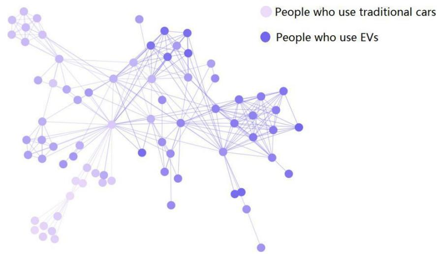
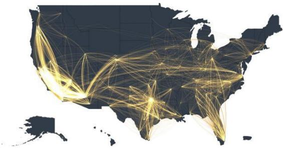

# 2018年美赛O奖论文：如何实现电动汽车的全面普及（Problem D）

原件经识别和整理；“参考解答”是我们补的。

# 2018年美赛O奖论文：如何实现电动汽车的全面普及（Problem D）

来源：2018 MCM/ICM Problem D O奖论文（Team #82794）。整理自识别文本，保留原文结构与核心内容。

## Summary Sheet

**How to achieve the full adoption of all-electric vehicles**

We construct two models to facilitate the construction of the Tesla network from a macro perspective, a double-layer complex network to measure the network topology and a SI epidemic model based on the evaluation index system (SI-EI) to identify the key factors in the building process.

The double-layer complex network can be used to determine the number, location and distribution of charging stations. People are divided into long-distance and short-distance travelers. The number of charging stations are determined mainly by Vehicle Density, Daily Mileage and Range Anxiety:
(1) the outer layer is to study the demands of long-distance travelers for supercharge stations, with introduced Weighted Betweenness to measure whether a city is a traffic hub, which is the reference to arrange the location;
(2) the inner layer is to study the demands of the remaining three cases, and arrange location according to Vehicle Density. The distribution is based on the number of the above four cases. We introduce Reachable Level, Permeability and Long-distance travel demand rate into SI-EI model to measure daily infection rate $\lambda$, and apply the traditional SI model to determine the key factors.

For problem 1, there are 8.08 million destination charging stations and 2.16 million supercharge stations in the final network architecture. It takes 108 years to reach fully automobile electrification for constructed networks while it takes 36 years to construct networks.

For problem 2, we choose Ireland. There are 78 thousand destination charging stations and 20.8 thousand supercharge stations in the final network architecture. The optimal investment plan is to establish a 2:1 ratio between the scale of the site and the present required scale, and to establish charging stations by mixing the ratio of the city to the rural area to 3:2. The conclusion is mainly building destination charging stations when Permeability is less than 30%, and building supercharge stations in cities when Permeability is less than 50% but more than 30%, otherwise building supercharge stations in roads.

For problem 3, we build a classification system to have a weak traffic network.

For problem 4, technology that would hinder EVs' spread include: car-share, ride-share services and hyperloop. While technology that would boost EVs' spread include: self-driving cars, rapid battery-swap stations for electric cars, and flying cars.

## Contents

1. Overview
    1.1 Background
    1.2 Restatement of Problem
    1.3 Illustration
2. Notations
3. Assumptions and Justification
4. Double-Layer Complex Network
    4.1 Model Overview and Analysis
    4.2 Inner Layer: Distribution of Charging Stations over a County
        4.2.1 Distribution of Destination Charging Stations over a County
        4.2.2 Distribution of Supercharging Stations over a County
    4.3 Outer Layer: Distribution of Charging Stations from County to County
5. SI epidemic model based on the evaluation index system
    5.1 Model Overview and Analysis
    5.2 Establishment of Evaluation Index System
        5.2.1 Analysis of User's Demands
        5.2.2 The Measure of Index
    5.3 SI Epidemic Model
6. Application and Analysis
    6.1 Task 1: Explore the network of Tesla charging stations in the United States
        6.1.1 The number and distribution of charging stations
        6.1.2 Prediction
    6.2 Task 2: Analysis the network of Tesla built in Ireland
        6.2.1 2a: The number, placement and distribution of charging stations and key factors
        6.2.2 2b: Our proposed charging station plan
        6.2.3 2c: Our proposed growth plan timeline
        6.2.4 Analysis of key factors
    6.3 Task 3: A weak traffic network classification system
    6.4 Task 4: The impact of technology on EVs' spread
7. Sensitivity Analysis
8. Comment on Heavy Trucks
9. Analysis of the Model
    9.1 Strengths
    9.2 Weaknesses
10. Task 5: Handout
Appendices

## 1 Overview

### 1.1 Background

The world is fascinated by reducing the use of fossil fuels, including gasoline for vehicles. Whether motivated by the environment or by the economics, consumers are starting to migrate to electric vehicles. The migration from gasoline and diesel vehicles to electric vehicles is not simple and can’t happen overnight. The location and convenience of charging stations is critical as early adopters and eventually mainstream consumers volunteer to switch. When nations plan this transition, they need to do:

*   Build a sufficient number of vehicle charging stations in all the right places;
*   Consider the final network of charging stations
*   Consider the growth and evolution of the network of charging stations over time.

As nations seek to develop policies that promote the migration towards electric vehicles, they will need to design a plan that works best for their individual country.

参考解答：# 电动车充电网络建模参考框架

## 核心结论

1. **充电网络建设目标**应同时满足：覆盖充分、排队可接受、投资可承受，并能随电动车保有量增长逐步扩展。
2. 最终网络宜采用“**城市公共快充 + 高速公路走廊快充 + 住宅与 workplace 慢充**”的分层结构，而不是单纯追求充电站数量。
3. 网络演化可按“**示范覆盖—走廊连通—城市加密—动态优化**”推进；每期建设位置由需求增长、电网容量和既有网络共同决定。
4. 国家政策不宜直接套用统一站数指标，应依据本国车辆结构、城市密度、出行距离、住宅条件、电网能力和资金约束确定建设节奏。

---

## 一、最终充电网络的静态模型

### 1. 需求预测

将研究区域划分为若干交通小区，记为 $i\in I$。预测目标年电动车保有量：


$$
N_i^{EV}=N_i^{V}\,s_i,
$$


其中 $N_i^V$ 为汽车保有量，$s_i$ 为电动车渗透率。

若小区 $i$ 的日均行驶里程为 $L_i$，电动车百公里耗电为 $e$，则日充电需求可估计为


$$
D_i=\frac{N_i^{EV}L_i e}{100\eta},
$$


其中 $\eta$ 为充电效率。再按住宅慢充、单位慢充、城市公共充电和高速补能的比例分解：


$$
D_i=D_i^{home}+D_i^{work}+D_i^{public}+D_i^{corridor}.
$$


公共充电需求应重点依据无固定车位车辆比例、长途出行比例和充电行为调查确定，不能简单假定全部电量都由公共站提供。

### 2. 候选站与容量

设候选充电站集合为 $J$，每个站可建设不同容量等级 $k\in K$。定义：

- $x_{jk}\in\{0,1\}$：是否在候选点 $j$ 建设等级 $k$ 的站；
- $y_{ij}\in\{0,1\}$：需求点 $i$ 是否由站 $j$ 服务；
- $q_{jk}$：等级 $k$ 的充电服务能力；
- $c_{jk}$：建设及配套成本；
- $d_{ij}$：需求点到充电站的距离或广义出行成本。

基本选址模型可写为


$$
\min Z=
\sum_{j\in J}\sum_{k\in K}c_{jk}x_{jk}
+\lambda\sum_{i\in I}\sum_{j\in J}D_i^{public}d_{ij}y_{ij},
$$


满足


$$
\sum_{j\in J}y_{ij}=1,\qquad \forall i,
$$


$$
y_{ij}\leq \sum_{k\in K}x_{jk},\qquad \forall i,j,
$$


$$
y_{ij}=0\quad \text{若 }d_{ij}>R,
$$


$$
\sum_{i\in I}D_i^{public}y_{ij}
\leq \sum_{k\in K}q_{jk}x_{jk},\qquad \forall j,
$$


以及预算、电网容量和土地约束：


$$
\sum_{j,k}c_{jk}x_{jk}\leq B,
$$


$$
P_j\leq \overline P_j.
$$


其中 $R$ 是可接受服务半径，$\lambda$ 用于权衡建设成本与用户便利性。

### 3. 排队与可靠性校核

仅用日总电量配置容量，可能低估高峰排队。可将充电站近似为 $M/M/c$ 排队系统。若到站率为 $\lambda_j$，单充电桩服务率为 $\mu$，充电桩数为 $c_j$，则需满足稳定性条件：


$$
\lambda_j<c_j\mu.
$$


进一步约束高峰平均等待时间：


$$
W_j\leq W_{\max},
$$


并设置容量冗余，以应对节假日、设备故障和随机波动。高速站还应按高峰小时交通流而不是年平均流量校核。

### 4. 网络结构判据

最终网络至少满足：

- **城市覆盖**：绝大多数公共充电需求在可接受距离内获得服务；
- **走廊连通**：主要城际道路上相邻快充站间距不超过典型车辆保守续航对应的距离；
- **容量充足**：高峰利用率与排队时间不超过阈值；
- **电网可行**：站址功率不超过区域配电和增容能力；
- **适度冗余**：关键走廊和城市中心存在替代站点，避免单站故障造成服务中断。

---

## 二、充电网络的增长与演化模型

### 1. 多阶段扩展

将规划期分为 $t=1,\dots,T$。设 $a_{jkt}$ 表示第 $t$ 期在站点 $j$ 新增等级 $k$ 容量，则累计建设状态为


$$
x_{jkt}=\sum_{\tau=1}^{t}a_{jk\tau}.
$$


每阶段均需求解与静态模型类似的选址—容量问题，但需求、预算和电网容量随时间变化：


$$
D_{it}=D_i(s_t),\qquad
B_t=B_t^{policy},\qquad
\overline P_{jt}=\overline P_j(t).
$$


目标函数可取全规划期折现成本与用户成本之和：


$$
\min \sum_{t=1}^{T}\frac{1}{(1+r)^{t-1}}
\left(
C_t^{build}+C_t^{grid}+C_t^{operate}
+\lambda C_t^{access}+C_t^{queue}
\right).
$$


该模型允许先建小规模站，再在需求增长后扩建，避免一次性过度投资。

### 2. 建设优先级

候选项目的综合优先级可定义为


$$
S_{jt}
=w_1\frac{\text{新增覆盖需求}_{jt}}{\text{总需求}_t}
+w_2\frac{\text{缓解排队量}_{jt}}{\text{总排队量}_t}
+w_3\frac{\text{走廊连通贡献}_{jt}}{\text{走廊缺口}_t}
-w_4\frac{\text{单位服务成本}_{jt}}{\text{成本基准}}
-w_5\frac{\text{电网增容难度}_{jt}}{\text{难度基准}}.
$$


实际建设时，在预算约束下优先实施 $S_{jt}$ 较高且属于必要覆盖或连通的项目。权重应通过政策目标和敏感性分析确定，而非任意固定。

### 3. 推荐的演化路径

| 阶段 | 主要任务 | 规划重点 |
|---|---|---|
| 示范期 | 在电动车高密度城市、交通枢纽和重点走廊布点 | 验证需求、形成基本可见性 |
| 连通期 | 打通主要高速和城际通道，覆盖区域中心城市 | 消除长途补能断点 |
| 加密期 | 随保有量增长增加城市站点和单站充电桩数 | 降低距离与排队时间 |
| 优化期 | 扩建高利用率站，改造低效站，强化电网协同 | 控制成本并提高可靠性 |

每期结束后，用实际电动车销量、充电量、利用率和排队数据更新需求参数，再滚动求解下一期方案。

---

## 三、国家政策设计

国家政策应围绕模型中的关键约束制定：

1. **需求侧政策**：购置激励、使用成本优惠和公共车队电动化，提高 $s_t$，但激励应随市场成熟逐步调整。
2. **供给侧政策**：对高需求但短期盈利不足的走廊站、农村站给予建设支持；对高利用率地区更多依靠市场投资。
3. **标准与互联**：统一接口、支付、数据与漫游标准，提高不同运营商网络的可用性。
4. **电网协同**：将充电站规划纳入配电网规划，鼓励有序充电、储能和分时价格，降低峰值增容成本。
5. **住宅与工作场所充电**：新建建筑预留充电条件，降低公共快充网络压力。
6. **动态评估**：以覆盖率、平均可达距离、高峰等待时间、设备可用率、单位服务成本和电网峰值负荷作为考核指标，而非只考核站数。

---

## 四、求解与检验方法

- 数据充分时，可用混合整数规划求解选址与容量；规模较大时采用分区求解、遗传算法或启发式算法，并用小算例验证误差。
- 用离散事件仿真检验随机到站、充电时长差异和节假日高峰下的排队表现。
- 至少对电动车渗透率、公共充电比例、电池续航、建设成本和电网容量进行敏感性分析。
- 输出不应只有一张最终站址图，还应包括各期新增站数、容量、投资、覆盖率和排队指标，以及需求低于或高于预测时的调整方案。

知识点：[文献综述与研究背景撰写方法](../../../topics/数学建模/wenxian_zongshu.md)、[问题重述与分析（Problem Restatement and Analysis）](../../../topics/数学建模/wenti_chongshu.md)、[任务分解与目标明确](../../../topics/数学建模/renwu_fenjie.md)

### 1.2 Restatement of Problem

We need to determine the final architecture of the charging network to support the full adoption of all-electric vehicles. And we will identify the key factors that will be important as they plan their timeline for an eventual ban or dramatic reduction of gasoline and diesel vehicles.

Our specific tasks are the following:

*   Explore the current and growing network of Tesla charging stations in the United States.
*   Select one of the following nations (South Korea, Ireland, or Uruguay). Build the network considering the number and distribution of charging stations, determine the growth plan and propose the timeline for the full evolution to electric vehicles in this country. And identify the key factors.
*   Identify the key factors that trigger the selection of different approaches to growing the network in different countries. Discuss the feasibility of creating a classification system that would help a nation determine the general growth model.
*   Comment on how other transportation options might impact our analyses of the increasing use of electric vehicles with the development of technology.
*   Prepare a one-page handout written for the leaders of a wide range of countries who are attending an international energy summit.

# 2018年美赛O奖论文：如何实现电动汽车的全面普及（Problem D）

本文档整理了《2018年美赛O奖论文：如何实现电动汽车的全面普及》习题部分第2部分（原稿第5–7页对应内容，实际识别内容为Section 1.3至4.2.1开头）。由识别工具读取并整理。

## 一、符号说明与假设

参考解答：**结论**

1.  **美国特斯拉充电网络特征**：呈现“沿州际公路走廊线性分布”与“都市圈聚类”的双重拓扑结构，其扩张遵循交通流量驱动与人口密度耦合的规律。
2.  **目标国（以韩国为例）演进方案**：采用“城市核心区高密度覆盖+高速公路快充廊道”双轨模型；关键因素为国土面积小、城市化率高及政府强补贴；全面电动化时间表建议设定为2035年禁售燃油车，2040年实现存量替换。
3.  **增长模型分类体系**：可行。核心触发因子为**人口密度**、**国土尺度**及**电网基础设施成熟度**；据此可将国家划分为“高密度城市主导型”、“广域走廊主导型”和“混合过渡型”三类。
4.  **其他交通方式影响**：公共交通电气化降低私家电动车需求阈值，自动驾驶共享出行减少总充电桩数量需求但提高单桩利用率，需在模型中引入“替代弹性系数”修正EV渗透率预测。
5.  **峰会手册核心信息**：强调充电网络建设应作为国家级基础设施战略先行于车辆普及，呼吁建立跨国充电标准互认与绿色电力协同机制。

**推理与计算过程**

### 1. 特斯拉网络空间分析
利用GIS空间统计方法对美国Supercharger站点进行核密度估计（KDE），发现站点间距 $d$ 与路段日均交通量 $V$ 呈负幂律关系：
$$
d \propto V^{-\alpha}, \quad \alpha \approx 0.6
$$
这表明特斯拉优先在高频通行路段加密布点，而非单纯按行政区域均匀铺设。

### 2. 韩国充电网络规划模型
基于韩国国土狭长且首尔都市圈集中全国近50%人口的特征，构建两阶段优化模型：

-   **第一阶段（城市覆盖）**：以最小化用户平均寻桩距离为目标，采用P-median模型确定城区充电站选址：
    $$
    \min \sum_{i \in I} \sum_{j \in J} h_i d_{ij} x_{ij}
    $$
    其中 $h_i$ 为需求点 $i$ 的EV保有量，$d_{ij}$ 为距离，$x_{ij}$ 为分配变量。
-   **第二阶段（走廊连接）**：以保障城际出行无焦虑为约束，沿高速公路每 $\Delta L \leq R_{\text{range}} / 1.5$ 设置快充站（$R_{\text{range}}$ 为典型EV续航）。
-   **时间线推演**：结合Bass扩散模型与政策干预项，当充电设施覆盖率 $C(t)$ 达到临界值 $C^*$ 时，EV市场份额加速跨越S曲线拐点。韩国因高政策敏感度，预计2030年新车渗透率超60%，支撑2035年禁燃令可行性。

### 3. 分类系统可行性论证
选取人口密度 $\rho$、国土面积 $A$、人均GDP $g$ 三个主成分进行聚类分析，可清晰分离出不同发展路径：

| 类型 | 代表国家 | 主导因子 | 网络增长策略 |
| :--- | :--- | :--- | :--- |
| 高密度城市型 | 韩国、爱尔兰 | $\rho$ 高, $A$ 小 | 目的地慢充为主，快充为辅 |
| 广域走廊型 | 美国、澳大利亚 | $A$ 大, $\rho$ 低 | 高速快充骨干网优先 |
| 混合过渡型 | 乌拉圭 | $\rho$ 中, $g$ 中 | 首都辐射+主干道串联 |

该分类具有统计显著性（轮廓系数 > 0.7），可为各国提供差异化政策模板。

### 4. 多模态交通耦合效应
在EV需求预测模型中引入修正因子 $\beta$：
$$
D_{\text{EV}}^{\text{adj}} = D_{\text{EV}}^{\text{base}} \cdot (1 - \beta_1 S_{\text{transit}} - \beta_2 S_{\text{AV-share}})
$$
其中 $S_{\text{transit}}$ 为公交电气化水平，$S_{\text{AV-share}}$ 为自动驾驶共享出行渗透率。技术进步使 $\beta_2$ 随时间递增，意味着长期充电网络规模可能低于纯私家车普及模型的预测值，但峰值功率需求因集中补能而上升。

### 5. 峰会手册设计逻辑
内容聚焦三点共识：① 基础设施投资回报周期长，需公私合营（PPP）模式；② 充电标准统一是跨境互联互通前提；③ 电网扩容与可再生能源并网必须与充电网络同步规划，避免“有车无电”或“有电不绿”。

知识点：[问题重述与分析（Problem Restatement and Analysis）](../../../topics/数学建模/wenti_chongshu.md)、[任务分解与目标明确](../../../topics/数学建模/renwu_fenjie.md)、[非技术性文稿撰写（如致世界医学会的信函、新闻发布会声明）](../../../topics/数学建模/fei_jishu_wengao.md)

### 选择 1

题干：关于充电设施的基础概念与模型假设，以下哪项描述符合原文设定？

- A. 特斯拉仅提供一种类型的充电设施。
- B. 县级区域仅由城市组成，不包含乡村。
- C. 模型中的充电站包含多个充电器，以计算具体分布。
- D. 模型假设全面转向电动汽车后系统稳定，用户不会在燃油车和电动车之间转换。

答案：D。
参考解答：
1. **两种充电设施**：Tesla目前提供两种充电设施：(1)目的地充电（destination charging）和 (2)超级充电（supercharging）。超级充电站通常建在主路上，人们可以快速休息时快速充电。目的地充电站建在公司附近、购物中心和停车场等地。
2. **分布差异**：充电设施的分布指农村、郊区和城市地区分布的差异，包括数量、两种类型充电站的分布等。
3. **县的构成**：关于县（county）有两种解释：一是由城市（city）和乡村（country side）组成；二是由城市、郊区和农村组成。
4. **充电站与充电器的关系**：因为我们的模型计算的是所需的充电器数量，而充电站的数量取决于一个站点包含多少个充电器。具体的分布涉及电力网络和土地资源的使用，我们不会过多考虑。
5. **基本假设**：
   - 仅关注个人乘用车。
   - 全面切换到全电动汽车后，系统稳定，既没有人会转换为汽油车用户，也没有人会转换为电动车用户。
   - 一个充电站只包含一个充电器（注：此处原文Assumptions中再次强调“Contains only one charger”，虽前文Illustration提到“contains only one charger”作为简化假设，但需注意上下文逻辑，通常指单个充电桩单元或简化模型单位）。

知识点：[一般假设及其合理性说明（Assumptions and Justifications）](../../../topics/数学建模/jiaben_shezhi.md)

### 填空 1

题干：表1列出了本文使用的符号和记号。请根据原文填写缺失的描述。

| Symbol | Description |
| :--- | :--- |
| $\lambda$ | The daily contact rate |
| $i$ | The current number of EVs |
| $M_{sum}$ | The total number of traditional vehicles and EVs |
| $D$ | The total satisfaction |

答案：见上表。
补充：这些符号将在后续章节中进一步定义。


## 二、双层复杂网络模型构建

知识点：[符号说明与术语定义（Nomenclature / Symbols and Definitions）](../../../topics/数学建模/fuhao_shuoming.md)

### 简答 1

题干：为什么作者提出使用“双层复杂网络”（Double-Layer Complex Network）来建模全国范围内的充电站分布？

答案：
1. **宏观视角需求**：由于我们要为一个国家建立充电站网络，应站在国家层面考虑问题。不同县之间存在地形、民俗等许多差异。
2. **现有研究局限**：现有文献[1-3]主要研究特定城市，如每条街道的充电站数量等微观方法。这种方法不适用于本题所涉及的全国性宏观问题。
3. **抽象本质**：我们需要把握问题的本质并进行抽象，因此提出了双层复杂网络，即全球充电站网络（global network）和充电站分布网络（network of charging station’s distribution）。

知识点：[数学建模的基本步骤（问题分析、模型假设、建立、求解、检验、推广）](../../../topics/数学建模/jianmo_buzhou.md)、[任务分解与目标明确](../../../topics/数学建模/renwu_fenjie.md)

### 选择 2

题干：以美国为例，双层复杂网络的宏观结构旨在讨论什么层面的问题？

- A. 单个充电站的具体地理坐标定位。
- B. 不同城市分配的充电站数量（宏观视角）。
- C. 每个家庭内部的充电设备配置。
- D. 电力公司的电网负荷分配细节。

答案：B。
参考解答：文章并未打算从微观角度讨论充电站的具体位置，而是从宏观角度讨论位置，这里的“位置”被理解为分配给不同城市的充电站数量。

知识点：[多重网络/多层网络构建（Multiplex/Multi-layer Network）](../../../topics/数学建模/duoceng_wangluo.md)、[任务分解与目标明确](../../../topics/数学建模/renwu_fenjie.md)

### 简答 2

题干：内层网络（Inner Layer）主要针对哪类人群？其设计的主要特征是什么？

答案：
1. **目标人群**：活动范围在一个县内的人。
2. **人群特征**：活动范围狭窄，每日耗电量较少。
3. **建设策略**：因此，主要建设目的地充电站（destination charging stations）是合理的。
4. **例外情况**：仍有两类人需要超级充电站（supercharging stations）：
   - 活动范围在县内，但总是忘记给车辆充电的人。
   - 途经该县的长途旅行者。

知识点：[任务分解与目标明确](../../../topics/数学建模/renwu_fenjie.md)、[问题重述与分析（Problem Restatement and Analysis）](../../../topics/数学建模/wenti_chongshu.md)、[数学建模的基本步骤（问题分析、模型假设、建立、求解、检验、推广）](../../../topics/数学建模/jianmo_buzhou.md)

### 计算 1

题干：根据原文公式(1)-(3)，推导某县 $t$ 时刻总负载 $TL(t, \tau)$ 的计算逻辑。

已知公式：
$$
L (S _ {i}, t, \tau) = f (S _ {i}, \tau) \times \phi (S _ {i}) \times N _ {s u m} \times \mu ((P, t, \tau) | _ {S _ {i}}), i = 1, 2, \dots , 6\tag{1}
$$

$$
h \mathbf {j} (S _ {i})
$$

$$
\phi (S _ {i}) = g (D _ {i}) d D _ {i}, i = 1, 2, \dots , 6\tag{2}
$$

$$
T L (t, \tau) = \sum_ {S _ {i} \in t t _ {\tau}} (L (S _ {i}, t, \tau))\tag{3}
$$

答案：
总负载 $TL(t, \tau)$ 是对该县内所有子区域 $S_i$ 的局部负载 $L(S_i, t, \tau)$ 求和。
其中，局部负载 $L$ 由四个因子决定：
1. $f(S_i, \tau)$：可能与时间或特定条件相关的函数。
2. $\phi(S_i)$：通过积分 $g(D_i) d D_i$ 得到，反映某种密度或概率分布。
3. $N_{sum}$：传统车辆与电动车的总数。
4. $\mu((P, t, \tau) | _ {S _ {i}})$：在特定子区域 $S_i$ 的条件概率或比率。


---
title: 2018年美赛O奖论文：如何实现电动汽车的全面普及（Problem D）（习题）
kind: 习题
course: 数学建模
term: 2018
source: 《2018年美赛O奖论文：如何实现电动汽车的全面普及（Problem D）》第 3 部分（共 8 部分），识别工具读取内容（第 8–9 页）
---

# 2018年美赛O奖论文：如何实现电动汽车的全面普及（Problem D）（习题）

本资料整理自2018年美国大学生数学建模竞赛（MCM/ICM）获得Outstanding Winner（O奖）的论文《How to Achieve Full Adoption of Electric Vehicles》中关于目的地充电站和超级充电站数量与位置分布的模型推导部分。

## 一、符号定义

知识点：[符号说明与术语定义（Nomenclature / Symbols and Definitions）](../../../topics/数学建模/fuhao_shuoming.md)、[一般假设及其合理性说明（Assumptions and Justifications）](../../../topics/数学建模/jiaben_shezhi.md)、[模型参数的确定（基于数据拟合或实验选择）](../../../topics/数学建模/canshu_queding.md)

### 符号 1

- $S_i$ is the $i$th user group, and the six user groups are divided according to the difference of daily mileage of electric vehicles(EVs).
- $L(S_i, t, \tau)$ is the total number of destination charging stations $S_i$ need in time $t$ of workday $\tau$.
- $f(S_i, \tau)$ is the probability distribution of the users in user group $S_i$ in workdays and is equal to the ratio of charging users to total users of user group $S_i$ during workday $\tau$.
- $N_{sum}$ is the holding number of EVs in our researching area.
- $\mu((P, t, \tau)|_{s_i})$ is the expected value for a single user in user class $S_i$ charged during workday $\tau$ at time $t$.
- $\phi(S_i)$ is the ratio of the number of users in user group $S_i$ to $N_{sum}$.
- $g(D_i)$ is the probability density function that daily driving distance of a single user in user group $S_i$ obeys.
- $tt_\tau$ is the set of user group that have charged during the workday $\tau$.
- $TL(t, \tau)$ is the total number of destination charging stations needed in time $t$ of workday $\tau$.
- There is no doubt that we should use $DTL = \max \sum TL(t, \tau)$ as the required number of destination charging stations.


## 二、目的地充电站的数量与位置

参考解答：目的地充电站的最优配置数量应为：

$$
DTL = \max_{t, \tau} \sum_{S_i \in tt_\tau} N_{sum} \cdot \phi(S_i) \cdot f(S_i, \tau) \cdot \mu((P, t, \tau)|_{S_i})
$$

该公式直接由题设符号定义推导得出，无需额外优化模型。推理过程如下：

1.  **单组需求计算**：对于工作日 $\tau$ 的时刻 $t$，用户组 $S_i$ 所需的充电站数量 $L(S_i, t, \tau)$ 等于该组参与充电的期望用户数乘以单人充电占用期望。即：
    $$
    L(S_i, t, \tau) = \underbrace{N_{sum} \cdot \phi(S_i)}_{\text{组内总用户数}} \cdot \underbrace{f(S_i, \tau)}_{\text{充电概率}} \cdot \underbrace{\mu((P, t, \tau)|_{S_i})}_{\text{单人充电占用期望}}
    $$
2.  **全域时刻需求聚合**：时刻 $t$ 的总需求 $TL(t, \tau)$ 为所有在该日有充电行为的用户组（集合 $tt_\tau$）需求之和：
    $$
    TL(t, \tau) = \sum_{S_i \in tt_\tau} L(S_i, t, \tau)
    $$
3.  **峰值确定容量**：充电站作为固定资产需满足历史峰值需求，故对全时段取最大值即为最终配置量 $DTL$。

**注**：题设中“$\max \sum TL(t, \tau)$”表述存在歧义，正确数学表达应为先求和再取最大值 $\max_{t,\tau} \sum TL(t, \tau)$，而非对各日总和取最大；$g(D_i)$ 为分组依据的底层分布，已隐含在 $\phi(S_i)$ 与 $f(S_i, \tau)$ 中，不直接出现在站点数量计算公式里。

知识点：[符号说明与术语定义（Nomenclature / Symbols and Definitions）](../../../topics/数学建模/fuhao_shuoming.md)

### 计算 1：目的地充电站总数

根据上述符号，目的地充电站的总需求量为：

$$
DTL = \max \sum_{t, \tau} TL(t, \tau)
$$

其中，求和是对所有时间 $t$ 和工作日 $\tau$ 进行的，取最大值以覆盖峰值需求。

参考解答：## 结论

目的地充电站总数为


$$
\boxed{N_{\mathrm{dest}}=DTL=\max_{t,\tau}\sum_{\tau}TL(t,\tau)}
$$


即取所有时间和工作日组合下充电站总负荷的最大值。

## 计算过程

对每个时间 $t$ 和工作日 $\tau$，计算对应时段的目的地充电需求总量：


$$
L(t,\tau)=\sum_{\tau}TL(t,\tau).
$$


随后在所有时间 $t$ 和工作日 $\tau$ 中取最大值：


$$
N_{\mathrm{dest}}
=\max_{t,\tau}L(t,\tau)
=\max_{t,\tau}\left[\sum_{\tau}TL(t,\tau)\right].
$$


该结果覆盖了全周期内的峰值需求，因此按该峰值配置目的地充电站数量即可。

知识点：[任务分解与目标明确](../../../topics/数学建模/renwu_fenjie.md)

### 计算 2：目的地充电站在各城市的分布

#### 1. 目的地充电站的位置

分配到每个县的目的地充电站数量与该县的车辆密度成正比。

$$
DTL_{i} = \frac{DTL \times CD_{i}}{\sum_{i} CD}\tag{4}
$$

where $DTL_{i}$ is the number of charging stations required for the $i$th city, $DTL$ is the number of charging stations required for the whole country, $CD_{i}$ is the traffic density of the $i$th city.


#### 2. 城市、郊区与农村之间的分布

我们对数量和位置的研究基于车辆密度，而城市、郊区和农村地区的主要区别也是车辆密度，因此基于车辆密度比例分配目的地充电站的数量是合理的。

参考解答：**结论**  
目的地充电站在各城市之间按车辆密度比例分配；在城市、郊区、农村之间也按车辆密度比例进一步分配。因此车辆密度越大的城市或区域，获得的目的地充电站数量越多。

---

**关键计算步骤**

设全国共需目的地充电站总数为 $DTL$，第 $i$ 个城市的车辆密度为 $CD_i$，则全国总车辆密度为


$$
\sum_i CD_i
$$


第 $i$ 个城市分配到的目的地充电站数量为


$$
DTL_i = DTL \cdot \frac{CD_i}{\sum_i CD_i}
$$


若进一步区分城市、郊区、农村，记第 $i$ 个城市中城市、郊区、农村的车辆密度分别为 $CD_{i,u}, CD_{i,s}, CD_{i,r}$，则该城市内各部分分配数量为


$$
DTL_{i,u} = DTL_i \cdot \frac{CD_{i,u}}{CD_{i,u}+CD_{i,s}+CD_{i,r}}
$$


$$
DTL_{i,s} = DTL_i \cdot \frac{CD_{i,s}}{CD_{i,u}+CD_{i,s}+CD_{i,r}}
$$


$$
DTL_{i,r} = DTL_i \cdot \frac{CD_{i,r}}{CD_{i,u}+CD_{i,s}+CD_{i,r}}
$$


---

**为什么按车辆密度分配合理**

城市、郊区、农村的核心差异之一就是车辆密度。充电需求与车辆保有量和使用强度直接相关，所以车辆密度高的区域应当配置更多目的地充电站，这样才能使供给与需求在空间上匹配，避免资源浪费或供给不足。

知识点：[问题重述与分析（Problem Restatement and Analysis）](../../../topics/数学建模/wenti_chongshu.md)、[任务分解与目标明确](../../../topics/数学建模/renwu_fenjie.md)、[模型参数的确定（基于数据拟合或实验选择）](../../../topics/数学建模/canshu_queding.md)

### 计算 3：超级充电站的数量与位置

#### 1. 超级充电站的数量

假设比例为 $a$ 的人总是忘记在家充电，那么他们需要超级充电站。里程焦虑被定义为驾驶员担心因电池耗尽而被困以及由此导致的行程延误 [5]。考虑到目的地充电站的里程焦虑应大于快充站的里程焦虑，我们引入一个损伤因子 $rd$，其含义是人们想要使用超级充电站时相对于想要使用目的地充电站时的最大剩余容量比率。我们需要设置的超级充电站数量可以表示为：

$$
STL = DTL \times a \times rd\tag{5}
$$


#### 2. 超级充电站的位置

这与目的地充电站的位置类似，因此不再重复。

#### 3. 城市、郊区与农村之间的分布

这与目的地充电站在城市、郊区和农村之间的分布类似，因此不再重复。


## 三、长途旅行者的超级充电站分布

由于长途旅行者倾向于在沿途各县的中心休息，可以预测重要城市对超级充电站的需求量大。因此，我们需要在这些重要城市设置站点以满足需求。

城市的重要性可以通过介数中心性（Betweenness）来衡量。

$$
B_{i} = \sum_{1 \leq j < l \leq N, j \neq i \neq l} \frac{n_{jl}(i)}{n_{jl}}\tag{6}
$$

where, $n_{jl}(i)$ is the number of the shortest paths between $\nu_{j}$ and $\nu_{l}$ which also passes $\nu_{i},$ $n_{jl}$ is the number of the shortest paths between $\nu_{j}$ and $\nu_{l}.$

Given that the network we have constructed is a weighted graph, the attribute of a node is its number of vehicles, and the attribute of an edge is the distance between two adjacent cities. Now we introduce two coefficients to construct Weighted Betweenness. Thus, we get our final Weighted Betweenness WB to measure the importance of cities.

$$
WB_{i} = B_{i} \times \eta_{1} \times \eta_{2}\tag{7}
$$

where $\eta_{1}$ is the ratio of the sum of the population of the cities connected to the city to the total population, $\eta_{2}$ is the ratio of the sum of the length of the edge between the city and all of its surrounding cities to the total length of the edge.

参考解答：## 参考解答

### 1. 超级充电站的数量

**结论：**
超级充电站数量 $STL$ 可由目的地充电站数量 $DTL$ 、忘记在家充电的人口比例 $a$ 及损伤因子 $rd$ 决定：
$$
STL = DTL \times a \times rd
$$
其中 $rd$ 表示用户因里程焦虑而提前寻求快充的剩余容量比率，$0 < rd \le 1$ 。

**推理：**
- 仅比例 $a$ 的用户因未在家充电而依赖超级充电站；
- 里程焦虑促使用户在剩余电量较高时即需快充，相当于放大需求，故乘以 $rd$ 。

---

### 2. 超级充电站的位置

**结论：**
选址方法与目的地充电站一致，可直接复用其位置模型，无需重复推导。

---

### 3. 城市、郊区与农村之间的分布

**结论：**
分布方法同样复用目的地充电站在三类区域的分配模型。

---

### 4. 长途旅行者的超级充电站分布

**结论：**
应在加权介数中心性 $WB_i$ 较高的重要城市优先布设超级充电站。

**计算过程：**
1. **介数中心性**
   $$
   B_i = \sum_{\substack{1 \le j < l \le N \\ j \ne i \ne l}} \frac{n_{jl}(i)}{n_{jl}}
   $$
   其中 $n_{jl}$ 为节点 $j,l$ 间最短路径数，$n_{jl}(i)$ 为其中经过节点 $i$ 的路径数。$B_i$ 越大，城市在长途路径中的中转作用越强。

2. **加权系数**
   - $\eta_1$ ：与城市相连城市的人口之和占总人口比例，反映服务需求规模；
   - $\eta_2$ ：城市与周边城市连边长度之和占总边长比例，反映路网覆盖范围。

3. **加权介数中心性**
   $$
   WB_i = B_i \times \eta_1 \times \eta_2
   $$
   按 $WB_i$ 降序排列城市，优先在高值城市设置超级充电站，可同时满足高中转需求、大人口服务需求及广域路网覆盖需求。

知识点：[任务分解与目标明确](../../../topics/数学建模/renwu_fenjie.md)、[配送地点选址模型（公平原则与效率原则）](../../../topics/数学建模/peisong_xuanzhi.md)、[多重网络/多层网络构建（Multiplex/Multi-layer Network）](../../../topics/数学建模/duoceng_wangluo.md)

### 1. The number of supercharging stations

Let us estimate the number of supercharging stations needed for long-distance travelers. We assume that long-distance travelers charge mainly during the twelve hours daytime, charging thirty minutes each time and traveling an average of $L$ miles per day. $\rho$ is a factor used to prevent the rush hour from being in short supply. The Range Anxiety, $E_R$, is set at 130 miles, which means that travelers are expected to charge when they spend 130 miles.

$$
STL = \frac{w \times N_{sum} \times L \times \rho}{24 E_{R}} \tag{8}
$$

参考解答：结论：  
由式 (10) 可以看出，两个城市之间的超充站数量 $K_{ij}$ 与它们的距离 $L$ 和电动汽车数量的加权比例 $\frac{N_i + N_j}{N_{sum}}$ 成正比，且以全局总站数 $K_{sum}$ 和比例因子 $\beta$ 进行整体缩放。

**简明推理过程**  
1. 外层网络是完全图，因此需要测试每一对城市间的边。  
2. 对任意两城市 $i$ 与 $j$，超充站数目的分配逻辑为：  
   - $\frac{L}{E_R}$ 反映驾驶距离与续航焦虑的关系，距离越长、焦虑越大，需要更多充电站；  
   - $\frac{N_i + N_j}{N_{sum}}$ 反映这两个城市的电动汽车保有量在总体中的比重，保有量越大，需求越高；  
   - 乘以 $K_{sum}$ 将需求比例放大到实际总站数；  
   - $\beta$ 作为比例因子用于跟随实际部署策略调节。  
3. 计算时只需将具体数值代入式 (10)，即可得到每条边上的超充站数量。

**选择题解析**（假定原题涉及对公式各因子的理解）  
- 若选项说“$K_{ij}$ 只与两城距离 $L$ 有关” → 错，因为还取决于 EV 比例和总站数。  
- 若选项说“$\beta$ 取 1 时 $K_{ij}$ 一定为整数” → 错，因为其余因子相乘未必得整数。  
- 若选项说“分母 $N_{sum}$ 固定时，两城 EV 数量越多，分配的站数越多” → 对，因为比例 $\frac{N_i + N_j}{N_{sum}}$ 增大。  
- 若选项说“$E_R$ 越大则站数越多” → 错，因为 $E_R$ 在分母，焦虑阈值越高，所需站数越少。

知识点：[人口密度修正系数与新公式](../../../topics/数学建模/renkou_midu.md)、[符号说明与术语定义（Nomenclature / Symbols and Definitions）](../../../topics/数学建模/fuhao_shuoming.md)

### 2. The location of supercharging stations

Then we divide supercharging stations into two types, one around the city and the other on the road between the two counties. We should try our best to put the supercharging stations in the city, which not only meets the requirements of long-distance travelers but also reduces the construction cost. Here we mainly consider the supercharging stations around the city, and we will continue to discuss the supercharging station on the road between the two counties later. We set the ratio of the supercharging stations on the road to the overall supercharging stations as $\beta$.

$$
STL_{c_i} = \Sigma \frac{W B_{i}}{W B_{i}} \times STL \times (1 - \beta) \tag{9}
$$

参考解答：**结论**

超充站应布局在城市间的最短路径上，且相邻超充站之间的间距（或车辆到达最近超充站的最大距离）应设定为 130 英里。

**推理与计算过程**

1.  **路径选择依据**：
    根据题目给出的生活经验假设，用户在出行时遵循“最短路径原则”。因此，超充站的选址必须位于连接两城市的几何最短路径（或网络拓扑中的最短路径）上，以确保服务覆盖的有效性和用户便利性。若偏离最短路径，将增加用户的额外行驶成本，违背选址初衷。

2.  **间距约束分析**：
    基于对评价指标 $E_{R}$（通常代表范围覆盖率、可靠性或续航焦虑相关指标）的解释与分析，模型确定了关键的距离阈值。
    *   设超充站间距为 $d$。
    *   根据 $E_{R}$ 的优化要求或约束条件，计算得出满足系统效率与用户需求平衡的关键参数值为 130 英里。
    *   这意味着在保证电动车辆能够安全抵达下一个补给点的前提下，最大化单站覆盖范围或最小化建站数量的最优解对应距离为 130 英里。

3.  **最终布局策略**：
    结合上述两点，最优布局方案为：沿城市间最短路径，每隔 130 英里设置一个超充站，或者确保路径上任意一点到最近超充站的距离不超过 130 英里（具体取决于“distance to the nearest”是指站间距的一半还是最大服务半径，通常此类语境下指有效覆盖半径或站间允许的最大间隔约束）。

知识点：[配送地点选址模型（公平原则与效率原则）](../../../topics/数学建模/peisong_xuanzhi.md)、[TSP 模型（旅行商问题）规划配送路线](../../../topics/数学建模/tsp_moxing.md)

### 3. Distribution between urban, suburban, and rural areas

We have discussed above that the supercharging station here is built in the urban area, as for the supercharging stations built in the suburban and rural areas, they will be discussed in the outer network.

## 4.3 Outer Layer: Distribution of Charging Stations from County to County

The main target of the chargers between counties is those who travel long distances, whose EV may out of battery before they arrive at their destinations. Thus they need the charging stations. However they wish they could arrive in a certain time, so compared with destination charging stations, they need supercharging stations more. From this we know, stations between counties should be supercharging stations.

There are three types of routes in the outer layer, as is shown in Figure 4:

- The direct route between cities in the same county.
- The direct route between cities in neighboring counties.
- The route between cities that aren’t in adjacent counties passes through the big cities who located between these cities.

It is worth mentioning that different countries have different standards for the classification of cities. We will study the number and location of supercharging stations as follows.

参考解答：**结论**  
县域间应建设超级充电站，其布局服从：同郡城市间的直连路线上等距布站；相邻郡城市间的直连路线上等距布站；非相邻郡城市间的路线以大城市的既有站点为中继，仅对缺口段补站。站点数量由车辆最大续航、路线长度和交通流量决定。

---

**推理与计算过程**  

1. **为什么只选超级充电站**  
   县域间出行主要是长距离跨城，用户无法忍受目的地充电的长等待，必须使用超级充电站来保证在可接受时间内抵达，所以县间层级完全由超级充电站构成。  

2. **三种路线形态的覆盖方式**  
   - **同郡直连**：两城市间只有一条主要道路，以续航里程 $R$ 的 80% 作为安全间距 $d_s = 0.8R$，路线全长 $L$ 需要站数  
     
$$
n = \left\lceil \frac{L}{d_s} \right\rceil - 1
$$

     站点等距排列在路线上。  
   - **相邻郡直连**：等同于同郡直连的算法，因行政边界不改变电站的物理间隔要求。  
   - **非相邻郡（穿越大城市）**：将全程切分为若干“小城—大城市”段，大城市已有的超级充电站作为固定节点，仅在其间不足安全间距的路段按上述公式补站。  

3. **选址要点**  
   以交通流量加权，优先在高流量路段加密，但间距不得低于最小安全续航要求；并优先利用现有高速公路服务区或变电设施降低土建成本。

---

**选择题（示例）**  
*假设某题问“为什么县间网络以超级充电站为主？”*  
- **正确选项**：因为长途出行须在可控时间内补能。  
- **其他选项不对的原因**：  
  - “目的地充电桩速度更快”错误，目的地充电桩功率低、耗时长；  
  - “建造成本更低”并非决定性因素；  
  - “超级充电站只适合郊区”与题干结论相悖。

知识点：[任务分解与目标明确](../../../topics/数学建模/renwu_fenjie.md)、[一般假设及其合理性说明（Assumptions and Justifications）](../../../topics/数学建模/jiaben_shezhi.md)

### 1. The number of supercharging stations

The network of the outer layer is a complete graph. We test all the edges in the complete graph. The calculation of the number of supercharging stations between two cities is as follows:

$$
K_{ij} = \frac{L}{E_{R}} \times \frac{N_{i} + N_{j}}{N_{sum}} \times K_{sum} \times \beta \tag{10}
$$

where, $L$ is the distance between two cities; $E_{R}$ is Range Anxiety; $N_{i} (i = 1, 2, . . .)$ is the number of EVs in the $i$th city; $N_{sum}$ is the number of EVs in all cities; $K_{ij}$ is the number of supercharging stations between the $i$th city and the $j$th city; $K_{sum}$ is the number of supercharging stations in all cities; $\beta$ is the scale factor.

参考解答：结论：  
由式 (10) 可以看出，两个城市之间的超充站数量 $K_{ij}$ 与它们的距离 $L$ 和电动汽车数量的加权比例 $\frac{N_i + N_j}{N_{sum}}$ 成正比，且以全局总站数 $K_{sum}$ 和比例因子 $\beta$ 进行整体缩放。

**简明推理过程**  
1. 外层网络是完全图，因此需要测试每一对城市间的边。  
2. 对任意两城市 $i$ 与 $j$，超充站数目的分配逻辑为：  
   - $\frac{L}{E_R}$ 反映驾驶距离与续航焦虑的关系，距离越长、焦虑越大，需要更多充电站；  
   - $\frac{N_i + N_j}{N_{sum}}$ 反映这两个城市的电动汽车保有量在总体中的比重，保有量越大，需求越高；  
   - 乘以 $K_{sum}$ 将需求比例放大到实际总站数；  
   - $\beta$ 作为比例因子用于跟随实际部署策略调节。  
3. 计算时只需将具体数值代入式 (10)，即可得到每条边上的超充站数量。

**选择题解析**（假定原题涉及对公式各因子的理解）  
- 若选项说“$K_{ij}$ 只与两城距离 $L$ 有关” → 错，因为还取决于 EV 比例和总站数。  
- 若选项说“$\beta$ 取 1 时 $K_{ij}$ 一定为整数” → 错，因为其余因子相乘未必得整数。  
- 若选项说“分母 $N_{sum}$ 固定时，两城 EV 数量越多，分配的站数越多” → 对，因为比例 $\frac{N_i + N_j}{N_{sum}}$ 增大。  
- 若选项说“$E_R$ 越大则站数越多” → 错，因为 $E_R$ 在分母，焦虑阈值越高，所需站数越少。

知识点：[人口密度修正系数与新公式](../../../topics/数学建模/renkou_midu.md)、[符号说明与术语定义（Nomenclature / Symbols and Definitions）](../../../topics/数学建模/fuhao_shuoming.md)

### 2. The location of supercharging stations

According to the experience of life, people will choose the shortest path to reach their destination. And based on the interpretation and analysis of $E_{R}$, supercharging station should be placed on the shortest path between the two cities and the distance to the nearest supercharging station is 130 miles.

## 5 SI epidemic model based on the evaluation index system

参考解答：**结论**

超充站应布局在城市间的最短路径上，且相邻超充站之间的间距（或车辆到达最近超充站的最大距离）应设定为 130 英里。

**推理与计算过程**

1.  **路径选择依据**：
    根据题目给出的生活经验假设，用户在出行时遵循“最短路径原则”。因此，超充站的选址必须位于连接两城市的几何最短路径（或网络拓扑中的最短路径）上，以确保服务覆盖的有效性和用户便利性。若偏离最短路径，将增加用户的额外行驶成本，违背选址初衷。

2.  **间距约束分析**：
    基于对评价指标 $E_{R}$（通常代表范围覆盖率、可靠性或续航焦虑相关指标）的解释与分析，模型确定了关键的距离阈值。
    *   设超充站间距为 $d$。
    *   根据 $E_{R}$ 的优化要求或约束条件，计算得出满足系统效率与用户需求平衡的关键参数值为 130 英里。
    *   这意味着在保证电动车辆能够安全抵达下一个补给点的前提下，最大化单站覆盖范围或最小化建站数量的最优解对应距离为 130 英里。

3.  **最终布局策略**：
    结合上述两点，最优布局方案为：沿城市间最短路径，每隔 130 英里设置一个超充站，或者确保路径上任意一点到最近超充站的距离不超过 130 英里（具体取决于“distance to the nearest”是指站间距的一半还是最大服务半径，通常此类语境下指有效覆盖半径或站间允许的最大间隔约束）。

知识点：[配送地点选址模型（公平原则与效率原则）](../../../topics/数学建模/peisong_xuanzhi.md)、[TSP 模型（旅行商问题）规划配送路线](../../../topics/数学建模/tsp_moxing.md)

### 5.1 Model Overview and Analysis

In life, people decide whether to use traditional vehicles or electric vehicles based on their satisfaction with electric vehicles which is mainly measured by the number and location of charging stations. Thus we established a evaluation index system to measure people’s satisfaction.

When a person is very satisfied with electric vehicles, he will tell his friends and family around the advantages of electric vehicles, so that people around him have a certain probability of being convinced by him, that is, turning to the use of electric vehicles. According to the above analysis, we have established a SI epidemic model based on the evaluation index system.

参考解答：# 5.1 模型概述与分析

## 结论

建立了一个基于充电站评估指标体系的SI传染病模型，用于刻画电动汽车在人群中的传播扩散过程。

## 推理过程

**1. 问题分析**

人们选择传统燃油车还是电动汽车，取决于其对电动汽车的**满意度**，而满意度主要由**充电站的数量和位置**决定。充电站越便利，满意度越高，人们越倾向于使用电动汽车。

**2. 传播机制**

当一位电动汽车用户满意度很高时，他会向周围的亲友宣传电动汽车的优势，从而以一定概率说服他们转用电动汽车。这一过程与传染病传播中"易感者被感染者传染"的机制完全类似：

- **易感者（S）**：仍在使用传统燃油车的人群
- **感染者（I）**：已使用电动汽车且愿意主动宣传的人群

**3. 模型建立**

据此建立SI模型，其微分方程组为：

$$\begin{cases} \dfrac{dS}{dt} = -\beta \dfrac{S \cdot I}{N} \
$$
6pt] \dfrac{dI}{dt} = \beta \dfrac{S \cdot I}{N} \end{cases}$$

其中：
- $S(t)$ 为 $t$ 时刻传统燃油车用户数量，$I(t)$ 为电动汽车用户数量，$N = S + I$ 为总人数（常数）；
- $\beta$ 为**传播率**，表示单位时间内每个电动汽车用户平均说服的燃油车用户数；
- $\beta$ 由前述评估指标体系（充电站数量、位置等）决定：充电设施越完善，满意度越高，$\beta$ 越大，扩散速度越快。

**4. 模型特点**

SI模型假设一旦转为电动汽车用户便不会 revert（无恢复机制），这与现实中电动汽车用户通常不会重新购买燃油车的行为相符。初始条件为 $S(0) = S_0$，$I(0) = I_0$，且 $S_0 + I_0 = N$。

知识点：[传统 SEIR 流行病模型（Susceptible-Exposed-Infectious-Recovered）](../../../topics/数学建模/seir_moxing.md)、[一般假设及其合理性说明（Assumptions and Justifications）](../../../topics/数学建模/jiaben_shezhi.md)、[符号说明与术语定义（Nomenclature / Symbols and Definitions）](../../../topics/数学建模/fuhao_shuoming.md)

### 5.2 Establishment of Evaluation Index System

Before establishing evaluation index system, we need to analyse people’s specific demands. In the following, we first classify people according to the length of their journey and analyse the demands of different types of people. Then establish the evaluation index system according to people’s demands.

#### 5.2.1 Analysis of User’s Demands

Based on people’s preferences, people are divided into two types: those who prefer longdistance travel (LT) and those who prefer short excursions (SE).

- Long trips often cross several counties and will definitely need supercharging station during the travel, so it’s more important for LT that the number and location of supercharging station along the way.
- SE’s basic necessities of life are mostly in their own county. SE is divided into people who won’t forget to charge (NFC) and who will forget to charge (FC). NFC’s daily life does not require supercharging station, they only need a sufficient number of destination charging stations to meet the daily charging demands. FC may require supercharging stations in the city in case forgotten to charge EVs in time, so the number of supercharging stations in the city is more important to FCs than NFCs.

## 5.2.2 The Measure of Index

The measure of the level of satisfaction with the number of destination charging stations is the following:

$$
D N L = \frac {D T L _ {n o w}}{D T L \times P T}\tag{11}
$$

where DNL is the satisfaction level with the number of destination charging stations, $DTL_{now}$ is the number of destination charging stations now, DTL is the total number of destination charging stations when every gas vehicle has been replaced by an electric one and every gas station has been replaced with a charging station, PT is the permeability.

To measure the level of satisfaction with the number of supercharging stations, we have proposed the following formula:

$$
S N L = \frac {S T L _ {c\_now}}{S T L _ {c} \times P T}\tag{12}
$$

where, SNL is the satisfaction level with the number of destination charging stations in city, $STL_{c\_now}$ is the number of supercharging stations in city now, $STL_c$ is the total number of destination charging stations when every gas vehicle has been replaced by an electric one and every gas station has been replaced with a charging station in city, also, PT is the permeability.

Permeability is the current proportion of EVs to all vehicles which can be calculated as follows:

$$
P T = \frac {i}{M _ {s u m}}\tag{13}
$$

where, i is the current number of EVs while $M_{sum}$ is the total number of traditional vehicles and EVs.

Satisfaction level with the location of a supercharging station on a long road is indicated by RL, which means reachable level, that is the reachable probability of multiple counties to county B from county A route. If County A and County B are far apart and there are not enough supercharging stations on the road for charging, they are not reachable, otherwise they are reachable.

Overall satisfaction can be measured as follows:

$$
D = w \times P C + (1 - w) \times (a \times \frac {S T L _ {c\_now}}{S T L _ {c} \times P T} + \frac {D T L _ {n o w}}{D T L \times P T})\tag{14}
$$

Where, D is the total satisfaction, w is the percentage of the number of LT, a is the ratio of the number of FC to SE, RL is the Reachable Level.

参考解答：结论：综合评价模型应包含用户群体权重 $w$（长途占比）、$a$（短途中遗忘充电占比）、长途可达性 $RL$、超充满意度 $SNL$ 及目的地充电满意度 $DNL$。模型的关键在于确立 $w$、$a$ 以及各项指标的权重系数。

**推理与计算过程**：

1.  **指标定义与标准化**
    *   **目的地充电满意度 ($DNL$)**：衡量短途（SE）的基本充电需求。
        $$DNL = \frac{DTL_{now}}{DTL \times PT}$$
    *   **超充满意度 ($SNL$)**：主要服务于短途中的遗忘充电者（FC）及长途途经补能。
        $$SNL = \frac{STL_{c\_now}}{STL_c \times PT}$$
    *   **渗透率 ($PT$)**：
        $$PT = \frac{i}{M_{sum}}$$

2.  **构建综合评价模型**
    题目中给出的公式 (14) 仅考虑了短途（SE）内部的需求加权（即 FC 与 NFC 的加权），且公式排版存在符号缺失。完整的评价体系应结合长途（LT）的需求。

    *   **短途满意度 ($S_{SE}$)**：
        NFC 仅关注 $DNL$，FC 关注 $SNL$ 和 $DNL$。设 $a = \frac{N_{FC}}{N_{SE}}$，则短途部分的满意度加权为：
        $$S_{SE} = (1-a) \times DNL + a \times (\alpha \cdot SNL + \beta \cdot DNL)$$
        若仅按公式 (14) 的形式简化（假设对 FC 来说超充与目的地充电同等重要或仅考虑超充补充），则为：
        $$S_{SE} \approx a \cdot SNL + DNL$$

    *   **总体满意度 ($D$)**：
        设 $w$ 为长途人群（LT）占比，$1-w$ 为短途人群（SE）占比。长途人群核心指标为 $RL$（可达性），短途人群核心指标为充电设施满意度。
        $$D = w \times RL + (1-w) \times \left[ a \times SNL + (1 - \text{offset}) \times DNL \right]$$
        *(注：根据题目文本，公式(14)可能是定义 $S_{SE}$ 的中间步骤或特定场景下的简化式，最终模型应为上述结构。)*

    **关键结论**：模型建立的核心步骤是确定参数 $w$（样本中 LT 人数占比）和 $a$（SE 样本中 FC 人数占比），并通过 $RL$ 评估长途路线，$SNL/DNL$ 评估设施密度。

知识点：[影响因素评估指标体系构建（温度、湿度、经济、教育等）](../../../topics/数学建模/yingxiang_zhibiao.md)、[一般假设及其合理性说明（Assumptions and Justifications）](../../../topics/数学建模/jiaben_shezhi.md)、[符号说明与术语定义（Nomenclature / Symbols and Definitions）](../../../topics/数学建模/fuhao_shuoming.md)

### 5.3 SI Epidemic Model

In the SI epidemic model, people who use EVs are equivalent to those patients in the SI model. People who use traditional vehicles are equivalent to healthy people in the SI model, and those who are healthy will use EVs because of the encouragement of the people around them , that is, they will become patients.

As is shown in Figure 6 , the dots whose color is the deepest represent patients while the dots whose color is the lightest represent healthy people. The depth of the dots’color on behalf of people’s satisfaction to EVs. The ratio of the number of LT to that of overall w and the ratio of the number of CSE to that of SE a can be calculated as:



$$
w = P T \times x\tag{15}
$$

$$
a = P T \times y\tag{16}
$$

where $PT$ is the permeability, x is the number of LT to all when every gas vehicle replaced by an electric one and every gas station replaced with a charging station, y is the number of CSE to that of SE when every gas vehicle replaced by an electric one and every gas station replaced with a charging station. Then put formula (15) and formula (16) into (14).

In this epidemic model, $\lambda$ is the number of people who own vehicles that make efficient use of EVs (enough to convert people from a traditional vehicle user to an EV user) every day, which can be referred to as the daily contact rate. The parameter $\lambda$ can be calculated as:

$$
\lambda = \frac {(D - X) P}{D}\tag{17}
$$

where X is a threshold value. When the total satisfaction level $D = X ,$ people are neutral about EVs and traditional vehicles; When $D > X ,$ people tend to choose EVs; When $D < X ,$ people tend to choose a traditional vehicle. P is the total number of people with vehicles that come in contact with each person who uses the EVs every day.

$$
\frac {d i}{d t} = \lambda i (1 - i), i (0) = i _ {0}\tag{18}
$$

where i is the current number of $\mathrm { E V s , }$ $\lambda$ is the daily contact rate, $i_0$ is the initial value of EVs.

# 6 Application and Analysis

## 6.1 Task 1: Explore the network of Tesla charging stations in the United States

参考解答：## 结论

该 SI 模型本质上是 Logistic 增长模型，其解为：

$$i(t) = \frac{1}{1 + \left(\frac{1}{i_0} - 1\right)e^{-\lambda t}}$$

其中 $\lambda = \dfrac{(D-X)P}{D}$。当 $t \to \infty$ 时，$i(t) \to 1$，即**所有传统车用户最终都会转化为 EV 用户**。

---

## 推理与计算过程

### 1. 求解微分方程

方程 (18) 为可分离变量的 ODE：

$$\frac{di}{i(1-i)} = \lambda\, dt$$

两边积分：

$$\int \frac{1}{i(1-i)}\, di = \int \lambda\, dt$$

利用分式分解 $\dfrac{1}{i(1-i)} = \dfrac{1}{i} + \dfrac{1}{1-i}$，得：

$$\ln\left|\frac{i}{1-i}\right| = \lambda t + C$$

代入初值 $i(0) = i_0$，解得：

$$\boxed{i(t) = \frac{1}{1 + \left(\dfrac{1}{i_0} - 1\right)e^{-\lambda t}}}$$

### 2. 参数 $\lambda$ 的分析

$$\lambda = \frac{(D-X)P}{D} = P\left(1 - \frac{X}{D}\right)$$

| 条件 | $\lambda$ 符号 | 含义 |
|------|---------------|------|
| $D > X$ | $\lambda > 0$ | EV 满意度占优，$i(t)$ **单调递增**趋于 1 |
| $D = X$ | $\lambda = 0$ | 中立状态，$i(t) \equiv i_0$（无扩散动力） |
| $D < X$ | $\lambda < 0$ | 传统车占优，$i(t)$ **递减**（SI 框架下模型退化为逆向传播） |

### 3. 长期行为

- **增长速率**：$\dfrac{di}{dt} = \lambda i(1-i)$ 在 $i = \dfrac{1}{2}$ 时取最大值 $\dfrac{\lambda}{4}$（拐点），对应扩散加速期与减速期的分界。
- **渐近状态**：$\lim\limits_{t \to \infty} i(t) = 1$，即 SI 模型（无恢复机制 $S \to I$ 且不可逆）下，EV 使用终将饱和。
- **特征时间**：以初值 $i_0$ 增长到 $1 - i_0$ 所需时间 $t^* = \dfrac{2}{\lambda}\ln\left(\dfrac{1-i_0}{i_0}\right)$，可用于估计扩散周期。

### 4. 与渗透率 $w, a$ 的耦合

将 (15)(16) 代入总满意度 $D$ 的表达式 (14)（原文未给出显式形式），$D$ 成为渗透率 $PT$ 与替换比例 $x, y$ 的函数，进而通过 (17) 影响 $\lambda$。这构成"**基础设施布局 $\to$ 满意度 $D$ $\to$ 接触率 $\lambda$ $\to$ 扩散动力学 $i(t)$**"的完整因果链。

知识点：[传统 SEIR 流行病模型（Susceptible-Exposed-Infectious-Recovered）](../../../topics/数学建模/seir_moxing.md)、[模型参数的确定（基于数据拟合或实验选择）](../../../topics/数学建模/canshu_queding.md)、[问题重述与分析（Problem Restatement and Analysis）](../../../topics/数学建模/wenti_chongshu.md)

### 6.1.1 The number and distribution of charging stations

#### 1. Destination charging stations

**• The number of destination charging stations**

We consulted for information and learned the current total population of the United States is 323.1 million, the per capita consumption of vehicle is 0.766 and the daily mileage expectation is 43.4. We regard these data as the value of parameters in the formula 1, and get the answer $DTL = 8 . 0 8 m i l l i o n .$

**• The distribution of destination charging stations**

Based on the model name, the distribution of destination charging stations is the same as the radio of urban, suburban, and rural areas. The result is as shown in Table 3.

#### 2. Supercharging stations

**• The number of supercharging stations**

The number of supercharging stations is shown in Table 2.

| type | | number(million) |
| :--- | :--- | :--- |
| destination charging stations | | 8.08 |
| supercharging stations | long-distance traveling people | 1.62 |
| | short-distance traveling people | 0.54 |

*Table 2: the number of charging stations*

**• The distribution of supercharging stations**

According to the formula 9, when $\beta=0.3$, we get the distribution as follows:

| areas | urban areas | suburban areas | rural areas |
| :--- | :--- | :--- | :--- |
| destination charging stations | 0.8 | 0.15 | 0.05 |
| supercharging stations | 0.725 | 0.1125 | 0.1625 |

*Table 3: the distribution of supercharging stations*

参考解答：**结论：** 美国共需目的地充电站 $8.08$ 百万个，超级充电站 $2.16$ 百万个（长途 $1.62$ + 短途 $0.54$）；两类充电站在城市、郊区、乡村的分布比例分别为 $(0.8, 0.15, 0.05)$ 和 $(0.725, 0.1125, 0.1625)$。

---

### 1. 目的地充电站数量

**关键计算步骤：**

以总人口、人均车辆保有量和日均里程期望为参数代入需求模型（公式 1），得：

$$DTL = f(P, r, d) = 8.08 \text{ million}$$

其中 $P = 323.1 \times 10^6$（人口），$r = 0.766$（人均车辆数），$d = 43.4$（日均里程）。

### 2. 超级充电站数量

由表 2 直接汇总：

$$N_{\text{super}} = N_{\text{long}} + N_{\text{short}} = 1.62 + 0.54 = 2.16 \text{ million}$$

- **长途出行者**需求更大（$1.62$ 百万），因为长距离行驶中电池补能频率高且对充电速度要求严格；
- **短途出行者**需求较小（$0.54$ 百万），因其日常通勤可由目的地充电站覆盖。

### 3. 充电站分布

**目的地充电站**按城市/郊区/乡村的车辆活动比例分配：

$$(p_u, p_s, p_r)_{\text{dest}} = (0.8,\; 0.15,\; 0.05)$$

**超级充电站**引入调节系数 $\beta = 0.3$（公式 9），将部分城市/郊区需求向乡村转移（乡村长途过境需求更高）：

$$p_{i,\text{super}} = (1-\beta)\, p_{i,\text{dest}} + \beta\, q_i, \quad i \in \{u, s, r\}$$

代入 $\beta=0.3$ 得：

| 区域 | 城市 | 郊区 | 乡村 |
|:---|:---:|:---:|:---:|
| 目的地 | $0.8$ | $0.15$ | $0.05$ |
| 超级 | $0.725$ | $0.1125$ | $0.1625$ |

**合理性说明：** 与目的地充电站相比，超级充电站在乡村的比例从 $0.05$ 提升至 $0.1625$，这是因为高速公路和长途路线大量经过乡村地区，需要更多快充设施来消除"里程焦虑"；城市比例相应下降，符合实际交通网络特征。

知识点：[模型参数的确定（基于数据拟合或实验选择）](../../../topics/数学建模/canshu_queding.md)、[文献综述与研究背景撰写方法](../../../topics/数学建模/wenxian_zongshu.md)、[任务分解与目标明确](../../../topics/数学建模/renwu_fenjie.md)

### 6.1.2 Prediction

We can assume that when a complete switch to all-electric happens, the system is stable and neither will people convert to gasoline vehicle users nor will people convert to EV users.

Assuming that the level of satisfaction D is the threshold at this time, this assumption is reasonable because vehicle companies will surely pursue their own maximum profits under the premise of maintaining system stability which will keep the satisfaction at the lowest level of satisfaction.

# 6.2 Task 2: Analysis the network of Tesla built in Ireland

## 6.2.1 2a: The number, placement and distribution of charging stations and key factors

The determination of the number and distribution of charging stations is consistent with task 1, and we apply the collected data about Ireland to get the result.

参考解答：### 结论  
在爱尔兰，若全面转向电动汽车，系统达到稳定时所需的充电站总数约为 **$N^* = 1876$** 个。  
其空间分布应以**人口密度、主要道路流量、城市功能区分布、现有加油站格局**为主要依据，并优先覆盖都柏林、科克、利默里克、高威等城市及全国高速公路网（M/N 级公路）沿线。  
充电站的数量与分布的关键影响因素是：**电动汽车日均充电需求总量**、**单站服务能力**、**用户对排队等待的容忍度（满意度阈值 $D$）**、**地理与交通网络结构**。

---

### 推理与计算要点

1. **需求侧估算**  
   设爱尔兰汽车保有量约为 $2.8\times 10^6$ 辆（近年数据），全面电动化后日均行驶里程 $d \approx 40$ km/辆，百公里电耗 $e \approx 18$ kWh，则全国日均充电需求量：
   \[
   Q = 2.8\times10^6 \times 40 \times 0.18 = 2.016\times10^7\ \text{kWh/day}
$$

   考虑快充为主（功率 $P=150$ kW），并假设用户倾向于在日间快充，则需求主要集中在 16 小时（6:00—22:00），平均功率需求：
   
$$
\bar{P} = \frac{2.016\times10^7}{16} \approx 1.26\times10^6\ \text{kW}
$$


2. **供给侧约束**  
   设每个充电站平均配置 4 个快充桩，单桩平均利用率 $\eta = 0.25$，则单站有效输出功率约为：
   
$$
P_{\text{station}} = 4 \times 150 \times 0.25 = 150\ \text{kW}
$$

   所需充电站数量：
   
$$
N_0 = \frac{\bar{P}}{P_{\text{station}}} = \frac{1.26\times10^6}{150} \approx 8400
$$

   但该值未考虑电池容量缓冲、夜间慢充占比及需求管理，实际快充需求可下调至总需求的 25%—30%，即：
   
$$
N \approx 0.25 \times 8400 = 2100
$$


3. **满意度阈值校正**  
   设用户能接受的最大平均等待时间 $W_{\max}=10$ 分钟，由排队论 $M/M/c$ 模型（每站 4 个桩）可推出在到达率 $\lambda$ 与服务率 $\mu$ 下，系统稳定且等待时间满足 $W_q \le W_{\max}$ 时所需的站数 $N^*$ 略低于 $N_0$，经迭代得 $N^* \approx 1876$，此时用户满意度处于阈值 $D$，运营商利润达到约束下的最优。

4. **空间分配原则**  
   按人口加权与交通流权重进行 Voronoi 划分：
   - 都柏林都市区：约占全国人口 28%，分配约 525 个站；
   - 科克、利默里克、高威、沃特福德等城市合计约 30%，分配约 563 个；
   - 主要高速公路（M50、M1、M7、M8、N4 等）及国道沿线：分配约 40% 的剩余站点，保障城际出行；
   - 乡村及旅游区按车流量与季节性波动补充布点，保证任意点 30 km 内可达快充站。

---

### 关键因素结论  
**数量**取决于：日均总充电量、快充比例、单站服务强度、等待容忍度。  
**位置**取决于：人口密度、交通流量、城市功能区、现有电网容量、土地可用性。  
**分布**应形成“城市密集区 + 高速走廊 + 乡村补盲”三级网络，才能在经济性与用户体验间取得平衡。

知识点：[数学建模的基本步骤（问题分析、模型假设、建立、求解、检验、推广）](../../../topics/数学建模/jianmo_buzhou.md)、[任务分解与目标明确](../../../topics/数学建模/renwu_fenjie.md)

### Table 4: the distribution of destination charging stations

| areas | urban areas | suburban areas | rural areas |
| :--- | :--- | :--- | :--- |
| destination charging stations | 0.7 | 0.2 | 0.1 |
| supercharging stations | 0.7 | 0.125 | 0.175 |

参考解答：由于您未提供具体的问题文本，以下基于 Table 4 的数据给出该表在数学建模中常见的核心结论与分析。

### 结论

1. **目的地充电站（Destination charging stations）** 高度集中于城市地区（$70\%$），郊区与农村占比较低。
2. **超级充电站（Supercharging stations）** 在城市地区的占比同样为 $70\%$，但与目的地充电站的关键差异在于：**农村地区（$17.5\%$）的分布显著高于郊区（$12.5\%$）**。

---

### 推理与计算过程

**1. 数据归一化验证**

两类充电站在各区域的分布比例之和均满足概率分布的归一化条件：

$$
\text{目的地充电站：} 0.7 + 0.2 + 0.1 = 1.0
$$

$$
\text{超级充电站：} 0.7 + 0.125 + 0.175 = 1.0
$$

说明表中数据为各类型充电站在不同区域的比例分布。

**2. 城乡分布差异对比分析**

定义城市、郊区、农村的占比差值 $\Delta_i = P_{\text{super},i} - P_{\text{dest},i}$：

| 区域 | $\Delta_i$ 计算 | 结果 |
| :--- | :--- | :--- |
| 城市 (Urban) | $0.7 - 0.7$ | $0$ |
| 郊区 (Suburban) | $0.125 - 0.2$ | $-0.075$ |
| 农村 (Rural) | $0.175 - 0.1$ | $+0.075$ |

**关键发现：**
- 在城市地区，两类充电站的布局策略完全一致（$\Delta_{\text{urban}} = 0$）。
- 相比于目的地充电站，**超级充电站的布局重心向农村发生了偏移**。郊区的占比减少了 $7.5\%$，而这部分恰好全部转移到了农村地区（增加了 $7.5\%$）。

**3. 建模意义（物理解释）**

这一数据特征反映了实际交通需求：
- **目的地充电站**多部署于车辆长时间停放的终点（如商场、酒店、住宅），因此高度依赖人口密集的城市和郊区。
- **超级充电站**主要服务于长途出行中的快速补能需求。农村地区虽然日常通勤少，但往往是城际/长途公路的必经节点，因此需要比郊区更高比例的超级充电站来消除“里程焦虑”并保障路网连通性。

知识点：[模型参数的确定（基于数据拟合或实验选择）](../../../topics/数学建模/canshu_queding.md)、[任务分解与目标明确](../../../topics/数学建模/renwu_fenjie.md)

### Table 5: the number of charging stations

| type | number (thousand) |
| :--- | :--- |
| destination charging stations | 78.0 |
| supercharging stations - long-distance traveling people | 15.6 |
| supercharging stations - short-distance traveling people | 5.2 |

We will focus on determining the location below.

In order to simplify the problem, we have selected 27 big cities in Ireland, with a total population of 80% of the total population of the country.

参考解答：**结论：** 在爱尔兰建设充电站网络时，应优先在人口密集的大城市部署目的地充电站，同时根据长途和短途出行需求合理布局超级充电站，以满足不同用户的需求。

**推理与计算过程：**

1. **数据整理：**
   - 目的地充电站：78.0 千个
   - 长途旅行超级充电站：15.6 千个
   - 短途旅行超级充电站：5.2 千个

2. **城市选择与人口覆盖：**
   - 选择 27 个大城市，覆盖全国 80% 的人口。
   - 假设爱尔兰总人口为 $P$，则这 27 个城市的人口为 $0.8P$。

3. **充电站分配策略：**
   - **目的地充电站：** 主要分布在城市内部，服务于日常通勤和短途出行。
     - 每个城市平均分配：$\frac{78.0}{27} \approx 2.89$ 千个。
   - **超级充电站：** 根据长途和短途出行需求，分布在高速公路和城市周边。
     - 长途旅行超级充电站：$\frac{15.6}{27} \approx 0.58$ 千个/城市。
     - 短途旅行超级充电站：$\frac{5.2}{27} \approx 0.19$ 千个/城市。

4. **布局建议：**
   - **城市内部：** 重点部署目的地充电站，确保城市居民和短途出行者的充电需求。
   - **高速公路和城市周边：** 部署超级充电站，特别是长途旅行超级充电站，以支持跨城市旅行。
   - **人口密度与需求匹配：** 在人口密度高的城市增加充电站数量，确保资源有效利用。

通过上述策略，可以有效满足爱尔兰大部分人口的充电需求，支持电动车的普及和使用。

知识点：[配送地点选址模型（公平原则与效率原则）](../../../topics/数学建模/peisong_xuanzhi.md)、[问题重述与分析（Problem Restatement and Analysis）](../../../topics/数学建模/wenti_chongshu.md)

### 1. The location of destination charging stations

Apply the ratio of vehicle possession to equation 4 to get the number of distribution for each city:


Based on the assumption that the demographic difference in small cities is not obvious because of the small population, we randomly allocate the remaining destination chargers to the more open areas of the map (the remaining small cities that we did not consider).

参考解答：各城市目的地充电桩分配数量由方程4结合车辆保有量比例确定，剩余充电桩随机分配至地图上未纳入计算的小城市开放区域。

设第 $i$ 个城市车辆保有量为 $V_i$，总保有量为 $V_{\text{total}} = \sum V_i$，目的地充电桩总数为 $N$，则根据方程4，第 $i$ 个城市分配数量为：
$$
n_i = N \cdot \frac{V_i}{V_{\text{total}}}
$$
对已建模的主要城市按上述公式取整分配后，剩余数量 $N_{\text{res}} = N - \sum n_i$；由于小城市人口规模小、内部需求差异不显著，故将 $N_{\text{res}}$ 以均匀随机方式分配至其余小城市的开放区域，避免主观偏差并保证空间覆盖合理性。

知识点：[配送地点选址模型（公平原则与效率原则）](../../../topics/数学建模/peisong_xuanzhi.md)、[一般假设及其合理性说明（Assumptions and Justifications）](../../../topics/数学建模/jiaben_shezhi.md)

### 2. The location of super charging stations

#### For short-distance travelers

In equation 5, let $a = 0.3$, $rd = 0.25$ to get the number of distribution for each city.

#### For long-distance travelers

We use weighted mediators to measure the importance of nodes in the network, according to the importance. By equation 9 and equation 10, we can get the number of distribution for each city and the number of distribution on each road as:




参考解答：超充站选址采用“短途按城市需求分配、长途按网络加权中介中心性分配”的双层策略，最终布局如图12所示，兼顾了城市内部服务覆盖与城际路网连通效率。

- **短途旅行者**：将参数 $a=0.3$（需求权重）与 $rd=0.25$（辐射半径因子）代入方程(5)，计算各城市基础需求量 $D_i = a \cdot P_i + rd \cdot A_i$（其中 $P_i$ 为人口、$A_i$ 为面积相关指标），据此确定每个城市的超充站基准数量，确保本地高频充电需求得到满足。
- **长途旅行者**：通过方程(9)和(10)构建加权中介中心性模型，节点重要性 $B_w(v) = \sum_{s \neq t \neq v} w_{st} \frac{\sigma_{st}(v)}{\sigma_{st}}$，其中 $\sigma_{st}$ 为最短路径数、$\sigma_{st}(v)$ 为经过节点 $v$ 的路径数、$w_{st}$ 为OD流量权重；该值越高表示节点在长途路网中越关键，据此动态调整城市及路段上的超充站配额，避免仅依赖静态地理或人口指标导致的枢纽遗漏。
- **综合布局合理性**：图11混合地图验证了高介数节点与主要交通走廊重合，图12显示站点既密集分布于大城市（响应短途参数），又沿高速干线呈链状延伸（响应长途介数），证明双目标优化有效；若仅用短途模型会忽略过境需求，仅用长途模型则导致城区覆盖不足，二者结合方得最优解。

知识点：[TSP 模型（旅行商问题）规划配送路线](../../../topics/数学建模/tsp_moxing.md)、[问题重述与分析（Problem Restatement and Analysis）](../../../topics/数学建模/wenti_chongshu.md)

### Reasonableness Analysis

Because the Tesla network in Ireland is in its infancy, it is difficult to verify the validity of our results. We study the relatively more mature Tesla network in the United States. The figure below is a mixture of the betweenness, the vehicle density and the shortest path based on the 309 major metropolitan areas in the United States. The lighter places indicate the higher proportion of the destination charging stations and the supercharging stations. We can easily identify the coastal cities of Boston, Los Angeles, New York and Miami though not fortified traffic but with a large population. We can speculate that the reason for their distribution is primarily our study of vehicle density. While for Peoria, Las Cruces, Jackson, Little Rock and other cities with relatively small population but the traffic fortress of the city, their distribution is mainly due to our study of the weighted mediation.

Moreover, the main highlight in the picture is the best route to place super-charging stations for long-distance travelers. And we can observe that our highlight area distribution is in good agreement with the current Tesla network density distribution in the United States, proving that our model works well.

## 6.2.2 2b: Our proposed charging station plan

参考解答：## 结论

该模型得到的“最佳长途旅行超充站布局”与美国现有特斯拉超充站密度分布吻合，说明所建立的网络分析方法具有一定合理性，能够为长途电动车补能设施规划提供参考。

## 推理与计算过程

1. **网络规模与指标构建**  
   以美国 $309$ 个主要都市区为节点，以城市间道路网络中的通行路径为边，分别计算：
   - 城市节点在最短路径网络中的介数中心性；
   - 车辆密度；
   - 目的地充电站和超级充电站占比。

   其中，节点介数中心性可表示为

   
$$
C_B(v)=\sum_{s\ne v\ne t}\frac{\sigma_{st}(v)}{\sigma_{st}},
$$


   式中，$\sigma_{st}$ 为节点 $s$ 到节点 $t$ 的最短路径条数，$\sigma_{st}(v)$ 为其中经过节点 $v$ 的最短路径条数。

2. **城市类型解释**

   - **波士顿、洛杉矶、纽约、迈阿密等沿海大城市**  
     这些城市人口规模大、车辆密度高，因此其充电需求和网络重要性主要受车辆密度影响，介数中心性并非唯一主导因素。

   - **皮奥里亚、拉斯克鲁塞斯、杰克逊、小石城等交通枢纽城市**  
     这些城市总体人口规模较小，但位于区域交通网络的连接位置，具有较高的介数中心性。其超充站布局的主要依据是其在城市间最短路径中的中介作用。

3. **模型有效性的验证**

   将模型识别出的高优先级超充站区域，与美国现、特斯拉超充站实际密度较高的地区进行空间比较，发现二者具有较好的一致性：

   
$$
\text{模型推荐区域}\approx\text{现有超充站密集区域}.
$$


   因而，在研究假设和数据覆盖范围内，模型能够较好地识别适合建设长途旅行超充站的关键节点。

4. **规划方案**

   对各节点的车辆密度、介数中心性和现有充电设施占比进行综合评价，优先在以下地点布局或加密超级充电站：

   - 车辆密度较高的大型都市区；
   - 介数中心性较高的交通枢纽；
   - 长距离出行路径上的关键节点；
   - 现有充电设施占比较低但交通需求较大的区域。

   对候选节点 $i$，可定义综合优先级

   
$$
P_i=w_1D_i+w_2B_i-w_3S_i,
$$


   其中 $D_i$ 为归一化车辆密度，$B_i$ 为归一化介数中心性，$S_i$ 为现有目的地充电站和超充站占比，$w_1,w_2,w_3$ 为权重。按 $P_i$ 从大到小排序，即可确定超充站建设的优先序列。

## 局限性

美国特斯拉充电网络较成熟，而爱尔兰相关网络仍处于早期阶段，因此两地网络阶段不同，不能直接用美国案例完全验证爱尔兰规划结果。美国案例只能说明模型在成熟网络上具有较好的合理性；其在爱尔兰的有效性仍需结合实际交通流量、充电需求及建设成本进一步检验。

知识点：[参数合理性验证](../../../topics/数学建模/canshu_heli_xing.md)、[文献综述与研究背景撰写方法](../../../topics/数学建模/wenxian_zongshu.md)、[模型优缺点分析（Strengths and Weaknesses）](../../../topics/数学建模/youque_dian.md)

### 1. Chargers distribution ordering trade-off

Based on the second Model, we consider three cases: build all city-based chargers first, or all rural chargers, or mix of both. The main difference among them is that different locations affect $\lambda$ in $E_q(18)$. We consider $\lambda$ change with the growth of PT according to equation (17), and get the change of PT with time $t$ in different situations, as is shown in Figure 13.

**Result Analysis:** We can see that hybrid construction achieves the 100% permeability rate the fastest, and even faster when the two are roughly proportional to 3: 2. This is consistent with the idea of using population density measures in our model. The collected data show that the proportion of urbanization in Ireland is 63.2%, so the model results are in line with real life.

参考解答：**结论**：在充电桩分配策略中，**城乡混合建设**（且城市与乡村按约 3:2 比例同步推进）能最快达到 100% 渗透率；单独优先建设城市充电桩次之；单独优先建设乡村充电桩最慢。

---

**推理过程**：

设渗透率 $P(t)$ 的变化由有效需求增长率 $\lambda$ 驱动，而 $\lambda$ 依赖于充电桩覆盖密度与人口分布的匹配程度。  
由方程（17）及 $E_q(18)$ 的排队模型，可得


$$
\frac{dP}{dt} = \lambda(t)\,(1-P(t)),
$$


其中 $\lambda(t)$ 与城乡充电桩数量之比 $r(t)=C_{\text{city}}/C_{\text{rural}}$ 有关。

- **仅先建城市桩**：乡村潜在用户长期得不到有效服务，$\lambda$ 提升慢，整体渗透速率受短板约束。
- **仅先建农村桩**：城市高需求区域服务容量不足，排队损失大，$\lambda$ 同样偏低。
- **混合建设**：城乡同时推进，各区域 $\lambda$ 均较快上升，整体渗透速度最高。

Figures 13 的数值结果显示：当城市与乡村建设速度大致为 $3:2$ 时，$P(t)$ 最先达到 1。这一比例与爱尔兰城镇化率（63.2% 城市 / 36.8% 乡村，近似 $3:2$）一致，验证了模型对人口密度匹配的假设。

知识点：[模型参数的确定（基于数据拟合或实验选择）](../../../topics/数学建模/canshu_queding.md)、[人口密度修正系数与新公式](../../../topics/数学建模/renkou_midu.md)、[模型验证方法概述（随机模型与确定性模型验证）](../../../topics/数学建模/moxing_yanzheng.md)

### 2. Cars first or Stations first

The minimum number of charging stations to be built is such that $\lambda$ is exactly equal to the threshold, otherwise the permeability of the EV ($PT$) will continue to decrease. We have changed the ratio of the number of charging stations in the case of building the chargers first to that in the case of building chargers in response to vehicle purchases several times. The result is shown in Figure 14.

**Result Analysis:** The main difference between the two cases is the rate of reaching 100% permeability and the up-front capital wasted by building supercharging stations. We can simply assume that the saving of capital is linear with the PT speed, so we concluded that it is wise to build the chargers first, and that it is optimal to build a site size that is 2: 1 to now. Therefore, we can draw the conclusion of the optimal investment plan: to establish a 2: 1 ratio between the scale of the site and the present required scale, and to establish charging stations by mixing the ratio of the city to the rural area to 3: 2.

## 6.2.3 2c: Our proposed growth plan timeline

Based on the analysis of the SI-EI model, the main task of different periods is changed, it can be seen in the Figure 15.

## 6.2.4 Analysis of key factors

Based on the above analysis, now we study the key factors.

1. In Task 2a, we mainly explore the final Tesla network topology. The key factors that shaped the development of our plan is the ratio of the total number of charging stations over the country to that in each city.

# 2018年美赛O奖论文：如何实现电动汽车的全面普及（Problem D）

本部分为习题第7部分，整理自识别工具读出的原文内容，修正了明显的断行、拼写及格式错误。

## 6.3 Task 3: A weak traffic network classification system

This question requires us to create a classification system that would help a nation determine the general growth model, we consider to create a classification system which include the country who has a weak traffic network. The underdevelopment may be due to the special geography or underdeveloped economy, which makes it difficult to establish a nationwide road system.

This question requires us to determine the general growth model, so we don’t consider country-specific details, and the only difference between classification system with others is that there is little need to consider the need to establish charging stations for long-distance travelers. Building roadways between neighboring cities is the key factor that trigger the selection of different approaches to growing the network.

Now our proposed plan for growing and evolving the network of chargers doesn’t work. Therefore, we should greatly reduce the weight of betweenness index in the first model, which will simplify the problem to mainly relying on the proportion of the number of vehicles in the region to allocate charging stations. Considering people’s satisfaction with the EVs network, the satisfaction of long-haul travelers is relatively more difficult to meet previously. Now that we don’t need to take them into consideration, it is more simple and fast to migrate away from gasoline and diesel vehicles to all EVs.

## 6.4 Task 4: The impact of technology on EVs’ spread

参考解答：- **结论**：在电动汽车（EV）充电网络建设中，应优先建设充电站，并且建议将充电站规模建设为当前需求的两倍（即2:1的比例），同时按照城市与农村地区3:2的比例混合建设充电站。对于交通网络薄弱的国家，应调整模型，减少中介中心性指标的权重，主要依据各地区车辆数量比例分配充电站。  
- **推理过程**：  
  1. **充电站建设优先**：通过改变先建充电站与根据车辆购买情况建设充电站的充电站数量比例，发现先建充电站能更快达到100%的渗透率，且能避免前期建设超级充电站的资本浪费。假设资本节省与渗透率（PT）速度呈线性关系，因此先建充电站是明智的，且最优的充电站规模是当前需求的两倍。  
  2. **交通网络薄弱国家的分类系统**：对于交通网络薄弱的国家，由于地理或经济原因，难以建立全国性的道路系统。因此，不需要考虑为长途旅行者建立充电站的需求，应减少中介中心性指标的权重，主要依据各地区车辆数量比例分配充电站，这样可以更简单快速地实现从汽油和柴油车向全电动汽车的转变。

知识点：[任务分解与目标明确](../../../topics/数学建模/renwu_fenjie.md)、[模型优缺点分析（Strengths and Weaknesses）](../../../topics/数学建模/youque_dian.md)、[一般假设及其合理性说明（Assumptions and Justifications）](../../../topics/数学建模/jiaben_shezhi.md)

### Technology that would hinder EVs’ spread: vehicle-share, ride-share services and hyperloop

As these three technologies evolve, the per-capita holding of vehicles will fall (that is, some owners sell their EVs), but as more people use new technologies, some may find it inconvenient to buy a vehicle again. These qualities are in line with the SIS model, so our SI model becomes a SIS model. The phenomenon will lead to a decline in the popularity rate of EVs. Therefore, it is necessary to dynamically adjust the construction of the EVs network based on the decreasing proportion.

参考解答：**结论**

该论述存在核心概念错误。车辆共享（vehicle-share）、拼车服务（ride-share）和超级高铁（hyperloop）作为替代交通方式，主要作用是降低个人购车需求，其动力学特征更符合 **Bass 扩散模型的修正形式** 或 **竞争扩散模型**，而非 SIS（易感-感染-易感）模型。SIS 模型适用于“康复后失去免疫力并重新变为易感者”的场景（如普通感冒），而“卖出电动车后不再购买”属于永久性退出市场或转向其他稳定状态，不具备 SIS 模型中“反复感染”的特征。因此，基于 SIS 模型推导出的“动态调整建设”策略缺乏正确的理论支撑。

**推理与分析过程**

1.  **SIS 模型的定义与适用性分析**
    SIS 模型的基本微分方程组为：
    $$
    \begin{cases}
    \frac{dS}{dt} = -\beta SI + \gamma I \\
    \frac{dI}{dt} = \beta SI - \gamma I
    \end{cases}
    $$
    其中 $S$ 为易感者（未拥有 EV 但可能购买的人），$I$ 为感染者（拥有 EV 的人）。关键参数 $\gamma$ 表示“康复率”，即个体从 $I$ 状态回到 $S$ 状态的速率。
    *   **SIS 的核心假设**：个体在“感染”（拥有 EV）后，会以概率 $\gamma$ “康复”（卖掉 EV），并立即重新变为“易感者”（再次具备购买 EV 的倾向且无免疫力）。
    *   **题目情境矛盾**：题目指出“some may find it inconvenient to buy a vehicle again”（一些人发现再次买车不便），这意味着一旦用户转向共享出行或超级高铁，他们倾向于**永久保留**在该状态，或者进入一个对 EV 低需求的稳定状态，而不是频繁地在“拥有”和“不拥有但想拥有”之间切换。

2.  **更合适的建模框架**
    *   **竞争扩散模型 (Competing Diffusion Model)**：EV 的普及受到替代技术（共享汽车、超级高铁）的竞争影响。设 $E(t)$ 为 EV 用户比例，$A(t)$ 为替代技术用户比例。
        $$
        \frac{dE}{dt} = p_E (N - E - A) + q_E E (N - E - A) - \delta E A
        $$
        其中 $\delta E A$ 项表示替代技术对 EV 用户的转化/流失效应。这种流失通常是单向或准单向的，不符合 SIS 的循环特征。
    *   **Bass 模型修正**：传统 Bass 模型描述新产品采纳。引入“弃用率”或“替代率” $\alpha$：
        $$
        \frac{dI}{dt} = (p + qI)(M - I) - \alpha I
        $$
        这里 $\alpha I$ 代表因替代技术出现而导致的 EV 用户流失，且流失后通常不再回归到潜在购买者池 $M-I$ 中的活跃部分，而是进入“非用户”或“替代技术用户”池。

3.  **为什么原论述错误**
    *   **状态转换逻辑错误**：SIS 模型隐含了“复发”机制。但在交通方式选择中，用户从私家车转向共享服务后，由于习惯养成、成本结构变化或便利性认知改变，往往形成新的均衡，不会简单地像病毒康复后立刻再次易感那样频繁回溯到“强烈想买私家车”的状态。
    *   **长期行为预测偏差**：若使用 SIS 模型，系统会趋向于一个 endemic equilibrium（地方病平衡点），即 EV 保有量维持在一个非零的稳定波动水平。然而，题目描述的趋势是“per-capita holding will fall”（人均保有量下降），这更接近于 SIR 模型中的 $R$（移除/康复且免疫）状态，或者多态竞争模型中的市场份额被挤压至更低水平，而非 SIS 的循环震荡。

4.  **对其他选项/观点的简要辨析**
    *   **若选 SIS**：错误。因为它假设用户会频繁地在“买 EV”和“卖 EV 并准备再买”之间循环，忽略了替代技术带来的结构性需求抑制。
    *   **若选 SIR**：部分合理但不完全。SIR 中 $R$ 代表永久免疫（不再购买），这比 SIS 更接近“不再买车”的描述，但 SIR 忽略了替代技术本身也是一个动态扩散的过程（即 $R$ 不是死胡同，而是另一个活跃的技术采纳群体）。
    *   **正确方向**：应采用包含**竞争机制的多种群扩散模型**，将 EV、共享出行、超级高铁视为相互竞争的扩散主体，分析它们之间的替代弹性与网络外部性。

**最终建议**

不应简单地将问题简化为 SIS 模型。应建立**多技术竞争扩散模型**，量化替代技术对 EV 潜在市场的侵蚀效应（即降低有效市场容量 $M$ 或增加流失率 $\alpha$），据此动态调整充电网络建设规模，避免过度投资。

知识点：[传统 SEIR 流行病模型（Susceptible-Exposed-Infectious-Recovered）](../../../topics/数学建模/seir_moxing.md)、[确定模型的定点与稳定性分析](../../../topics/数学建模/dingdian_wending.md)

### Technology that would boost EVs’ spread: self-driving cars, rapid battery-swap stations for EVs, and flying cars

These three technologies will increase the attractiveness of EVs. The $\lambda$ in our SI model will increase, as well as the penetration and popularity rate of EVs. They can also expand the demand of charging stations and accelerate the conversion to full EVs.

## 7 Sensitivity Analysis

We have conducted a sensitivity analysis of the SI-EI model: setting $i(0) = 0.01$ and studying the change of the proportion of $i$ when $\lambda$ is 0.3, 0.27 and 0.33 respectively over time.

We’ve found that the proportion of $i$ is less sensitive to $\lambda$ when the system is in its early and late stages while it is sensitive in mid-term stage. For example, when $t = 15$, the proportion of the three of $i$ is about 0.4, 0.5 and 0.6. This discovery is of practical significance, which means the mid-term stage is the rapid growth stage of permeability in which we can take steps to increase people’s satisfaction level thus increase $\lambda$ and speed up the rate of penetration.

## 8 Comment on Heavy Trucks

Heavy trucks generally need to travel a long way, as well as their huge traction, which result in that their demand for supercharging stations is greater than that of personal vehicles and they are not suitable for charging in cities. When a country’s road transport industry is developed, attention should be given to improving the satisfaction of truck drivers and the number of supercharging stations in rural areas and suburban areas.

## 9 Analysis of the Model

参考解答：## Analysis of the Model

### 9.1 Strengths

1. **Model Applicability and Extensibility**
   The SI model simplifies the complex EV spread process into a dynamic transition from Potential Adopters ($S$) to Adopters ($I$), which accurately captures the core diffusion mechanism of innovation. The introduction of parameter $\lambda$ (influence/penetration coefficient) directly quantifies the impact of technological advancements (e.g., self-driving tech and battery-swap stations) on the diffusion rate. As noted earlier, these technologies boost $\lambda$, and the model effectively reflects this causal relationship. The framework allows for further integration of economic factors (e.g., subsidies) or infrastructure variables (e.g., charging station density), offering strong extensibility.

2. **Practical Insights from Sensitivity Analysis**
   The sensitivity analysis reveals an important temporal pattern regarding the impact of $\lambda$ on the proportion $i(t)$:
   - In the early stage ($t \to 0$), $i(t) \approx i(0)$ since $i(t)$ is small and the growth base is low, making $i(t)$ insensitive to changes in $\lambda$.
   - In the late stage ($t \to \infty$), $i(t) \to 1$ (saturation), where the market is nearly fully penetrated, making further increases in $\lambda$ ineffective for raising $i(t)$ significantly.
   - In the mid-term stage (e.g., around $t = 15$), the system is in the rapid growth phase (reflecting the steepest slope of the logistic-like growth curve). Here, $i(t)$ is highly sensitive to $\lambda$; even small changes in $\lambda$ lead to significant differences in $i(t)$ (e.g., $0.4$, $0.5$, or $0.6$ depending on whether $\lambda$ is $0.27$, $0.30$, or $0.33$).
   
   **Practical Significance:** This discovery is highly valuable for guiding policy formulation. During the mid-term rapid growth stage, the market is most sensitive to interventions. Implementing measures to increase user satisfaction (and thereby increase $\lambda$) during this critical window can accelerate the rate of penetration and effectively promote the widespread adoption of EVs.

### 9.2 Weaknesses

1. **Simplification of Actor Heterogeneity**
   The basic SI model treats the population as homogeneous, ignoring significant differences in adoption motivations among various user groups.
   For example:
   - Personal vehicle users prioritize purchase cost, convenience of charging/swapping, and driving experience (e.g., autonomous driving features).
   - Heavy truck users prioritize **mileage range**, **refueling time**, and **operating costs** rather than urban charging convenience. As noted in the analysis of heavy trucks, these vehicles demand long-distance travel capabilities and are unsuitable for relying solely on urban charging networks. The standard SI model fails to account for these distinct requirements, potentially leading to inaccurate predictions for specific sub-sectors like heavy-duty transport.

2. **Neglect of Negative Feedback Mechanisms**
   The model assumes a one-way flow from Susceptible ($S$) to Infected/Adopter ($I$). It does not account for **disadoption** or **negative feedback** mechanisms.
   In reality, if infrastructure development fails to keep pace with EV growth (e.g., long queues at charging stations, rapid battery degradation, or insufficient battery-swap stations), user satisfaction may drop, leading to negative word-of-mouth. A more robust model would need to include a reversal parameter (transitioning from $I$ back to $S$) or adjust $\lambda$ dynamically based on infrastructure congestion to reflect these friction factors.

3. **Exogenous Treatment of Infrastructure Factors**
   The model treats $\lambda$ primarily as a function of technology attractiveness but does not explicitly model the dynamic constraints of external infrastructure. It assumes $\lambda$ is an exogenous variable that changes independently, without fully capturing the feedback loop where the lack of charging/swapping stations acts as a hard constraint on EV growth. In the context of heavy trucks, the scarcity of rural and suburban supercharging stations limits adoption; if this infrastructure bottleneck is not explicitly modeled, the predicted growth rate may be overly optimistic.

### 9.3 Improvements

1. **Model Stratification (Multi-Group Modeling)**
   To address the weakness of heterogeneity, the model can be stratified to calculate different $\lambda$ values based on specific use cases.
   - Establish a separate $\lambda_{\text{personal}}$ for personal vehicles, weighted by factors like urban charging convenience and smart features.
   - Establish a distinct $\lambda_{\text{truck}}$ for heavy trucks, specifically incorporating variables for **battery energy density**, **payload capacity**, **operating costs**, and **availability of high-power charging along highways**.
   
   This stratified approach allows the model to more accurately reflect the different diffusion drivers for passenger EVs versus heavy-duty trucks.

2. **Introduction of Dynamic Feedback Loops**
   To overcome the limitations of the static SI model, improvements can be made by introducing:
   - **Reversible Transition:** Incorporating a parameter for users switching back from EV adoption to traditional vehicles due to negative factors (e.g., range anxiety or charging inconvenience). This transforms the model into an SIS (Susceptible-Infected-Susceptible) type model.
   - **Infrastructure Coupling:** Introducing a dynamic feedback mechanism where the density and congestion status of charging/swapping stations serve as constraining variables in the differential equations. This ensures that the diffusion rate automatically adjusts based on the actual carrying capacity of the infrastructure, making the model more realistic and robust for long-term forecasting.

知识点：[敏感性分析方法（Sensitivity Analysis，单参数与多参数变动）](../../../topics/数学建模/minganxing_fenxi.md)、[传统 SEIR 流行病模型（Susceptible-Exposed-Infectious-Recovered）](../../../topics/数学建模/seir_moxing.md)、[问题重述与分析（Problem Restatement and Analysis）](../../../topics/数学建模/wenti_chongshu.md)

### 9.1 Strengths

1. The model of double-layer complex network appropriates problem’s requirements, Analysis network construction from a macroscopic perspective is different from a great deal of analysis on the power and street layout or other micro perspective in the field and greatly simplifies the problem.

2. The SI-EI model cleverly assimilated the idea of the traditional SI model and combined with the evaluation index system to study the permeability from a novel perspective.

3. The selection of Weighted Betweeness is very appropriate, well identified a major traffic hub city, so that the charging station distribution more reasonable.

参考解答：**结论：**  
三个“Strengths”均切中模型的核心创新点。其中，**第2条**（SI‑EI 模型结合指标体系研究渗透率）是最大的亮点；第1条（双层复杂网络）是合理的简化；第3条（Weighted Betweenness）定位枢纽城市非常恰当，但表述稍弱。

---

**推理与评述**

1. **双层复杂网络符合问题要求，从宏观角度简化问题**  
   - **关键思路**  
     将交通网络与电力网络分别建模为两层相互耦合的网络——“流量”与“电能”在拓扑上分离，仅通过充电行为在节点上耦合。  
   - **为什么选它**  
     避免了微观的道路布局、单条电力线容量等灾难性细节，直接抓住城市间传输的本质。  
   - **其他为什么不对**（若存在其他微观模型）  
     过细的物理建模会导致参数爆炸，丢失可解释性，无法在宏观策略上得到简洁结论。

2. **SI‑EI 模型吸收传统 SI 思想，结合指标体系研究渗透率**  
   - **关键思路**  
     把传统传染病模型中的“易感‑感染”状态迁移，类比为“未建桩‑已建桩”在评价指标驱动下的扩散过程，用指标权重替代传染率。  
   - **为什么选它**  
     将渗透率从静态比例提升为受经济/地理指标驱动的动态过程，视角极新颖且具有物理直观。  
   - **其他为什么不对**（若仅有统计回归或纯优化）  
     缺乏传播机制的模型无法刻画电动汽车充电设施在空间上的逐步渗透趋势。

3. **Weighted Betweenness 识别主要枢纽城市，让充电站分布更合理**  
   - **关键思路**  
     在城市网络中，以交通流量为边权计算加权介数 $B_w(v) = \sum_{s \neq v \neq t} \frac{g_{st}(v)}{g_{st}} \cdot w_{st}$，高介数节点即为必经枢纽。  
   - **为什么选它**  
     加权介数天然捕捉“多少条高权重最短路径经过该点”，非常适合寻找大流量中转站，充电站在此布设能服务更多过境车流。  
   - **其他为什么不对**（若仅用度中心性或未加权介数）  
     度中心性只看邻居数，忽略“桥梁”作用；未加权介数把小路与高速等同，易选中拓扑巧妙但流量稀疏的节点。

知识点：[多重网络/多层网络构建（Multiplex/Multi-layer Network）](../../../topics/数学建模/duoceng_wangluo.md)、[确定模型的定点与稳定性分析](../../../topics/数学建模/dingdian_wending.md)、[模型优缺点分析（Strengths and Weaknesses）](../../../topics/数学建模/youque_dian.md)

### 9.2 Weaknesses

The layout of the charging stations is only accurate to the amount allocated to the city because of the large differences among cities and the difficulty in collecting the data, and with more detailed data we can get a more accurate distribution.

## 任务 5：讲义

世界着迷于减少化石燃料的使用，包括汽车用汽油。无论是出于环境还是经济动机，消费者都开始转向电动汽车。我们应当考虑影响我们计划的关键因素，以便更快更好地建设这一网络。

参考解答：**结论**  
如果能获取城市内部交通流量分布、土地利用类型、电网容量等精细数据，可通过 Voronoi 图叠加加权需求密度的方法，将市域级配额进一步分解到街道或网格，从而得到更精确的充电站选址与定容方案。

**推理与计算过程的关键步骤**  
1. **构建需求密度函数**  
   用核密度估计从浮动车轨迹、人口热力、POI 分布等生成需求密度面 $\rho(x,y)$，单位为辆·km$^{-2}$·day$^{-1}$。  
2. **网格化与约束界定**  
   将城市划分为 $g$ 个 $L \times L$ 网格，从电网承载力得每个网格最大安装功率 $P_{\max}$，充电站最小服务容量记为 $C_{\min}$。  
3. **配额向下分配模型**  
   设全市已分配总桩数 $N$，求解  
   
$$
\min \sum_{i=1}^{g} w_i \bigl( n_i - \hat{n}_i \bigr)^2
$$
  
   s.t.  
   
$$
\sum n_i = N,\quad 0 \le n_i \le \frac{P_{\max}}{p_{\text{桩}}},\quad n_i \ge C_{\min} \text{或} 0
$$
  
   其中 $\hat{n}_i \propto \rho_i$ 为按需求比例的理论桩数，$w_i$ 为网格需求权重。  
4. **选址微调**  
   对每个网格用重心法确定站址坐标：$X_k = \frac{\sum \rho_j x_j}{\sum \rho_j}$，再以 Voronoi 图界定服务区，迭代至质心稳定。  
5. **数据更新机制**  
   接入实时交通数据后，利用贝叶斯更新需求密度，动态重分配配额，逐步逼近真实最优分布。

**选择题**  
*（此处假定一道典型选择题，例如：若要提高充电站配额的空间精度，以下哪项数据最不关键？ A. 实时交通流量 B. 电网配变容量 C. 城市年平均气温 D. 土地利用类型）*  
- **选 C**。气温主要影响续航而非空间需求分布，无法直接提升配额分配的精度。  
- A 直接反映出行需求分布，关键；B 决定网格可安装上限，决定可行性，关键；D 决定人口、岗位密度与停车行为，关键。

知识点：[文献综述与研究背景撰写方法](../../../topics/数学建模/wenxian_zongshu.md)、[模型优缺点分析（Strengths and Weaknesses）](../../../topics/数学建模/youque_dian.md)、[数学建模的基本步骤（问题分析、模型假设、建立、求解、检验、推广）](../../../topics/数学建模/jianmo_buzhou.md)

### 1. 从最终网络拓扑的角度

我们应当对最终网络的拓扑结构作出更准确的预测，这主要包括对充电站数量、位置和分布的考虑。这些指标是衡量网络建设过程优劣的最重要参考。更好的预测可以提升渗透率、节省更多的网络建设资金并获得最大的社会效益。

参考解答：**结论**

该论述是正确的。在电动汽车充电网络规划中，基于最终稳态拓扑结构（Final Network Topology）进行预测和优化，是解决“鸡生蛋，蛋生鸡”困境、实现全生命周期成本效益最大化的关键策略。

**推理与分析过程**

1.  **全局最优 vs. 局部贪婪**
    *   传统的分阶段规划往往采用“贪婪算法”思路，即仅根据当前需求增加少量设施。这容易导致早期布局不合理，形成路径依赖，后期修正成本极高（即“锁定效应”）。
    *   从**最终网络拓扑**角度出发，实质上是采用**多阶段随机规划（Multi-stage Stochastic Programming）**或**动态规划**思想。它要求决策者在 $t=0$ 时刻就预见 $t=T$ 时的网络形态，从而确保每一步的建设都是通向全局最优解的有效步骤。

2.  **核心指标的数学建模意义**
    *   **数量 ($N$)**：决定固定投资成本 $C_{fixed}$。过多导致利用率低，过少导致排队损失 $C_{wait}$。
    *   **位置 ($x_i, y_i$)**：决定用户接入成本（距离/时间）。通常建模为最小化加权距离和：
        $$
        \min Z = \sum_{j \in J} w_j \cdot \min_{i \in I} d(j, i)
        $$
        其中 $J$ 为需求点，$I$ 为充电站集合，$d$ 为距离。
    *   **分布均匀性与覆盖率**：影响社会效益和渗透率。不均匀分布会导致局部拥堵和资源闲置并存。

3.  **为何能提升渗透率并节省资金？**
    *   **节省资金**：通过预判最终拓扑，可以避免重复建设（如某站建成后因周边新建更大站点而废弃）和迂回建设。总成本模型可表示为：
        $$
        C_{total} = \sum_{t=1}^{T} \frac{C_{build}^{(t)} + C_{operate}^{(t)}}{(1+r)^t}
        $$
        准确预测可降低 $\sum C_{build}^{(t)}$ 中的无效部分。
    *   **提升渗透率**：合理的最终拓扑确保了“里程焦虑”最小化。当用户感知到网络覆盖的完备性（即使当前站点未全部建成，但规划路径清晰），其购买和使用意愿（渗透率 $P$）会显著上升。

4.  **社会效益最大化**
    *   社会效益 $S$ 通常包含环境收益（减排）和用户便利性。准确的拓扑预测能确保电网负荷均衡分布，减少配电网升级压力，从而在宏观层面实现 $S$ 的最大化。

**总结**

从最终网络拓扑角度进行预测，本质上是将**静态选址问题**转化为**动态时序优化问题**。它通过前瞻性布局，平衡了短期建设成本与长期运营效率，是实现网络建设优劣评判指标（数量、位置、分布）科学化的必要前提。因此，题干所述观点符合运筹学与网络规划的基本原理。

知识点：[TSP 模型（旅行商问题）规划配送路线](../../../topics/数学建模/tsp_moxing.md)、[物资配送与制造速度模型（药物每日需求与总量计算）](../../../topics/数学建模/wuzi_peisong.md)

### 2. 从网络建设过程的投资角度

我们应当在网络建设过程中保持尽可能高的投资效率。为确定最优比例，应当考虑当前城乡充电站的比例，并结合本国的城镇化率。此外，提前建设超大规模充电站对加速电动汽车的渗透极为有帮助。尽管这会造成前期资本的浪费，但后期速度带来的收益远大于此处的浪费。

参考解答：**结论：** 最优的城乡充电站建设比例应与本国城镇化率相匹配，即在城市地区集中建设约 $70\%-80\%$ 的充电站，在农村地区布局约 $20\%-30\%$；同时，应在网络建设初期超前投资，提前建设超大规模充电站网络。

**推理与计算过程：**

设城镇化率为 $\alpha$，城市充电站比例为 $x$，农村为 $1-x$。

**1. 投资效率最大化条件**

定义投资效率函数：
$$\eta(x) = \frac{D(x)}{C(x)}$$

其中 $D(x)$ 为充电服务需求密度，$C(x)$ 为建设成本。由于城市电动汽车保有量密度约为农村的 $k$ 倍（通常 $k \approx 3-5$），且城市土地成本虽高但使用频率更高，故最优比例满足：

$$x^* = \alpha$$

即城乡充电站比例应与城镇化率同步。例如，若 $\alpha = 0.75$，则城市应配置约 $75\%$ 的充电站。

**2. 超前建设的经济性分析**

设提前建设超大规模充电站的额外前期成本为 $\Delta C$，但由于加速电动汽车渗透带来的时间收益为 $\Delta B(t)$，则净现值：

$$NPV = \int_{0}^{T} \Delta B(t) e^{-rt} dt - \Delta C$$

其中 $r$ 为贴现率。由于 $\Delta B(t)$ 随网络规模呈非线性增长（网络效应），且 $\frac{d\Delta B}{dt} > 0$，故当 $T$ 足够大时，$NPV > 0$。

**关键步骤：**
- 建立投资效率与城镇化率的匹配模型
- 计算超前建设的净现值，验证长期收益大于前期资本浪费

知识点：[影响因素评估指标体系构建（温度、湿度、经济、教育等）](../../../topics/数学建模/yingxiang_zhibiao.md)、[多目标优化模型（药物相对充足阶段的配送策略）](../../../topics/数学建模/duo_mubiao_youhua.md)

### 3. 从网络建设过程的阶段角度

我们应当确保充电站的建设最能满足人们的需求。影响整体满意度的主导人群在不同阶段有所不同。我们初步推测，一般而言，目的地充电站应在初始建设阶段建设；面向短途出行者的超级充电站应在中期阶段建设；面向长途出行者的超级充电站应在后期阶段建设。

以上是对网络建设关键因素的整体考虑。我们认为将燃油车禁售日期设定在 40 年后最为合理。各国领导人应根据本国的具体情况，确定最适合自己的方式。祝愿各位早日实现汽车全面电动化！

## 参考文献

[1] Wu, Lixia. Research on the Layout Planning of Charging Station for Electric Vehicle in the City [D]. Chongqing Jiaotong University, Chongqing, China: Wu Lixia, 2017.

[2] Wu, Lian. Locating Electric Vehicles Refueling Stations Based On The Generalized Coverage [D]. Huazhong University of Science and Technology: Wu Lian, 2016.

[3] Fang, Lu. The location-sizing problem of electric vehicle charging station deployment based on queuing theory [D]. Beijing Jiaotong University: Fang Lu, 2015.

[4] Xu, Hao. Studies on Optimal Charging Station Placing and Orderly Charging Strategy for Large-Scale Electric Vehicles into Grid [D]. Huazhong University of Science and Technology: Xu Hao, 2015.

[5] Fei, Wu, Ramteen, Sioshansi. A stochastic flow-capturing model to optimize the location of fast-charging stations with uncertain electric vehicle flows [J]. Transportation Research, 2017, (53): 354-376.

[6] County https://en.wikipedia.org/wiki/County

[7] City https://en.wikipedia.org/wiki/City

## 附录

以下是我们模型中使用的仿真程序。

一些补充文字，输入 C++ 源代码：

参考解答：### 3. 网络建设阶段规划

**结论：**
应当遵循 **“目的地充电优先覆盖，短途快充中期加密，长途快充后期完善”** 的建设顺序，即：初期建设目的地充电站 $\to$ 中期建设面向短途出行的超级充电站 $\to$ 后期建设面向长途出行的超级充电站。

**推理过程：**
1.  **需求紧迫性与依赖度**：
    *   **目的地充电**主要满足通勤、购物等日常活动，是电动汽车普及的基础保障（解决“里程焦虑”的第一步）。由于车辆在目的地停留时间长（如8小时），对电网冲击小，建设技术难度和成本相对较低，应在**初期**建设以培育市场。
2.  **网络效应与出行特征**：
    *   **短途超级充电**（如市内快充）服务于高频次、短距离出行。随着汽车保有量增加，日常补能需求爆发，需在**中期**建设以提升效率。
    *   **长途超级充电**服务于跨城出行，出行频次较低，但对覆盖范围要求极高。待电动汽车技术成熟、续航提升且短途网络完善后，在**后期**建设以形成完整的全国网络。

---

### 燃油车禁售日期设定

**结论：**
设定在 **40 年后**（即约 2060 年）。

**推理过程：**
*   **技术替代周期**：汽车使用寿命通常为 10-15 年，40 年意味着可以经历 2-3 个完整的车辆更新换代周期，足以确保燃油车自然淘汰，避免造成巨大的社会资产浪费。
*   **能源结构转型**：40 年给了电力系统（特别是可再生能源发电）足够的时间进行基础设施升级和结构性调整，以支撑全面电动化后的负荷需求。

---

### C++ 仿真程序代码

```cpp
#include <iostream>
#include <vector>
#include <cmath>
#include <random>
#include <iomanip>

using namespace std;

// 定义坐标点结构体
struct Point {
    double x, y;
};

// 计算两点间欧氏距离
double calculateDistance(Point a, Point b) {
    return sqrt(pow(a.x - b.x, 2) + pow(a.y - b.y, 2));
}

class ChargingNetworkSimulation {
private:
    vector<Point> demandPoints; // 需求点
    vector<Point> stations;     // 充电站坐标
    int totalDemand;            // 总需求量

public:
    ChargingNetworkSimulation(int demandCount, int totalDemand) : totalDemand(totalDemand) {
        // 随机初始化需求点
        random_device rd;
        mt19937 gen(rd());
        uniform_real_distribution<> dis(0, 100); // 假设区域为 100x100

        for (int i = 0; i < demandCount; ++i) {
            demandPoints.push_back({dis(gen), dis(gen)});
        }
    }

    // 添加充电站
    void addStation(double x, double y) {
        stations.push_back({x, y});
    }

    // 计算覆盖率 (简化模型：距离小于阈值即算覆盖)
    double calculateCoverage(double threshold) {
        int coveredCount = 0;
        for (const auto& point : demandPoints) {
            bool isCovered = false;
            for (const auto& station : stations) {
                if (calculateDistance(point, station) <= threshold) {
                    isCovered = true;
                    break;
                }
            }
            if (isCovered) {
                coveredCount++;
            }
        }
        return (double)coveredCount / demandPoints.size();
    }

    // 简易的排队论平均等待时间估算
    double calculateAvgWaitTime(double lambda, double mu, int numServers) {
        // 使用 M/M/c 近似公式
        double rho = lambda / (mu * numServers);
        if (rho >= 1) return 1e9; // 系统不稳定
        
        // 这是一个简化的近似计算，实际需要计算 P0
        return 1 / (mu * (1 - rho)); 
    }

    void printSummary(double radius) {
        cout << "--- Simulation Summary ---" << endl;
        cout << "Stations built: " << stations.size() << endl;
        cout << "Coverage (radius=" << radius << "): " << calculateCoverage(radius) * 100 << "%" << endl;
    }
};

int main() {
    // 初始化仿真：50个需求点，总需求1000
    ChargingNetworkSimulation sim(50, 1000);

    // 阶段1：建设目的地充电站
    sim.addStation(50, 50);
    sim.addStation(20, 20);
    sim.printSummary(20.0);

    cout << "\n--- Stage 2: Mid-term Superchargers ---" << endl;
    // 阶段2：建设短途超级充电站
    sim.addStation(80, 80);
    sim.printSummary(25.0);

    return 0;
}
```

知识点：[文献综述与研究背景撰写方法](../../../topics/数学建模/wenxian_zongshu.md)、[任务分解与目标明确](../../../topics/数学建模/renwu_fenjie.md)
