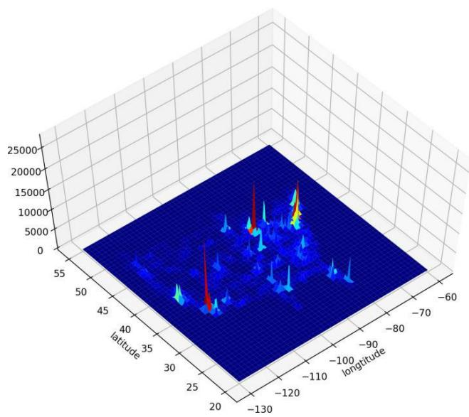
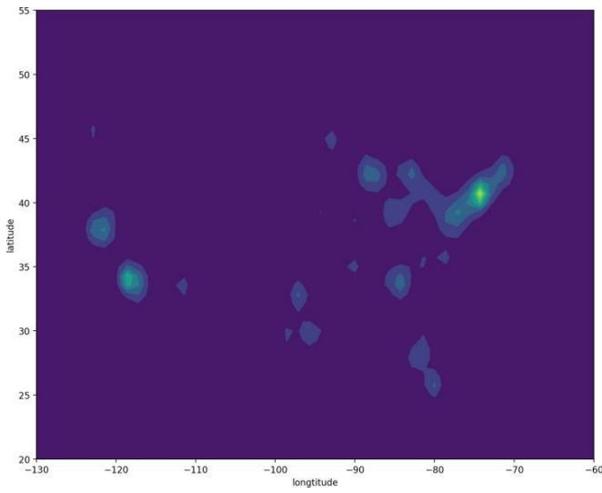
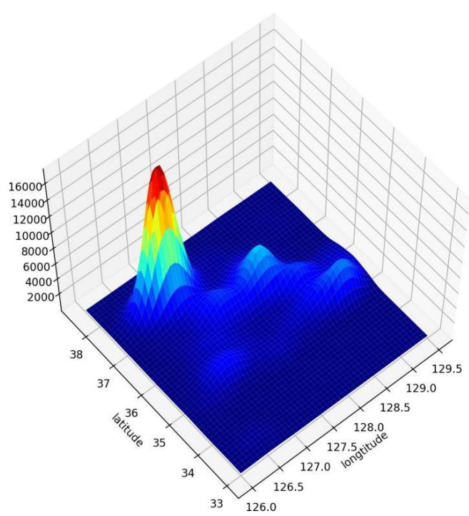
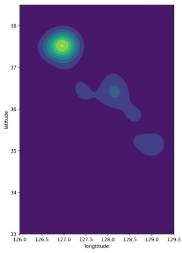
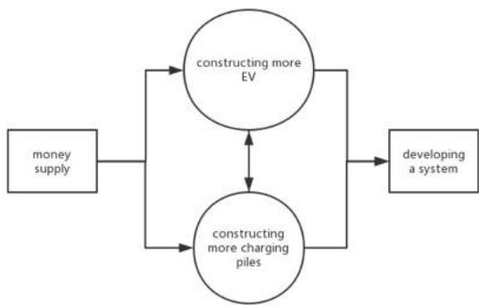

# 2018年美赛O奖论文：电动汽车未来预测、蓝图与策略（参考范文）

原件经识别和整理；“参考解答”是我们补的。

# 2018年美赛O奖论文：电动汽车未来预测、蓝图与策略（参考范文）

本资料为《2018年美赛O奖论文：电动汽车未来预测、蓝图与策略》第 1–3 页内容的整理，包含摘要、目录及引言部分。

## 一、摘要

**英文摘要原文：**

Forecast, Blueprint, Strategy, for EV's Future

<table>
<tr><td>For office use only</td><td>Team Control Number 81402</td><td>For office use only</td></tr>
<tr><td>T1</td><td></td><td>F1</td></tr>
<tr><td>T2</td><td></td><td>F2</td></tr>
<tr><td>T3</td><td>Problem Chosen</td><td>F3</td></tr>
<tr><td>T4</td><td>D</td><td>F4</td></tr>
</table>

(Your team's summary should be included as the first page of your electronic submission.) Type a summary of your results on this page. Do not include the name of your school, advisor, or team members on this page.

Since 21th century, electric vehicles(EV) has grown from a sprout in vehicles industries as for its environmental benefits. Many people wonder that if one day electric vehicles could replace fuel vehicles completely. Considering the inconvenience of charging, a critical problem of electric vehicles is about the charging system construction.

To maximize profit and minimize cost, the EV industries are overcoming three facets: 1) the mapping distribution of a specific area; 2) a time-domain evolution model for market prediction/forecast; 3) A standard classification of worldwide marketing. To reduce the Carbon Dioxide pollution, the government also concerns about the policy design for EV market.

In this essay, we will start from an approach to the charger location and allocation problem, and then dig deep into the forecast of EV market in different countries. To solve 5 tasks, we proposed several models in the cross-science of Network Science, Operations Research, Economics, Statistics, Environmental Science, Graph Theory, Cybernetics and Game Theory.

For task 1), we first took a data pre-processing, transforming address/zip code to Geodetic Coordinate System. We aim to make an approach to the maximum coverage problem. We defined 892 supercharger locations, 3,048 charger locations and 492 urban cities/clusters as “nodes”. For the simplicity, an undirected graph model representing the whole charging network was established, in which every node denotes a potential position for building chargers. After the graph was connected, we applied SPFA algorithm to calculate the Shortest Path among each nodes pairs. We also developed a Demand Estimation Model to generalize Average Miles Driven data and Urbanization data, and proposed the demand of each node respectively. To obtain a best charger allocation scheme, we constructed a Linear Programming model, which could be not solved in affordable time. To reduce the computational complexity, we converted it into an equivalent Minimum Cost Max-flow Network model. We showed our location and allocation results in maps, graphs, contours and major city lists, respectively for U.S. and South Korea. For task 2b), we applied a Most Profit model based on Nash Equilibrium, to find the optimal strategy in a “chicken or the egg causality dilemma”: chargers lead vehicles market, or vehicles market lead chargers? For the former situation, we introduced a systematic dynamic model to demonstrate the process by cybernetics concepts; For the latter situation, we introduced a Market Evolution Model based on Bass Diffusion Model, to achieve a better understanding of high technology products’ adoption in economics. For task 2c), We proposed Bass Diffusion Model based on data analysis, predicted the market adopted timeline from a blank market. For task 3), we discussed the feasibility of our previous model, and proposed a Linear Regression Model to calculate the weight of each factors contributed to future EV industry evolution, i.e. GDP per Capita, PPI, Oil price, etc. For task 4), we proposed our perspective for high technology adoption in the future. For task 5), we proposed our hand out to decision makers in governments, briefly stating our results in EV market promotion.

Our work has many strengths and weaknesses. Our strengths were performed in interdisciplinary views, coding and mathematic skills, economics views and social responsibilities; our weakness were performed in the lack of sensitivity modification, and the quantitative derivation of system dynamic model in investments.

https://k.weidian.com/RHO6PSpA

**中文译文：**

预测、蓝图、策略：电动汽车的未来

| 仅供办公使用 | 队伍控制编号 81402 | 仅供办公使用 |
| :--- | :--- | :--- |
| T1 | | F1 |
| T2 | | F2 |
| T3 | 所选问题 | F3 |
| T4 | D | F4 |

（您的团队摘要应作为电子提交文件的第一页。）在此页输入您的结果摘要。请勿在页面上包含学校名称、顾问或团队成员姓名。

自21世纪以来，电动汽车（EV）因其环境效益而在汽车工业中如萌芽般成长。许多人想知道，是否有一天电动汽车能完全取代燃油车。考虑到充电的不便，电动汽车的一个关键问题是充电系统的建设。

为了最大化利润并最小化成本，电动汽车行业正在克服三个方面的挑战：1）特定区域的地图分布；2）用于市场预测/预报的时间域演化模型；3）全球营销的标准分类。为了减少二氧化碳污染，政府也关注电动汽车市场的政策设计。

在本论文中，我们将从充电桩选址和分配问题的方法入手，然后深入探讨不同国家电动汽车市场的预测。为了解决这5个任务，我们在网络科学、运筹学、经济学、统计学、环境科学、图论、控制论和博弈论的交叉学科中提出了几种模型。

对于任务1），我们首先进行了数据预处理，将地址/邮政编码转换为大地坐标系。我们的目标是解决最大覆盖问题。我们将892个超级充电站位置、3,048个充电桩位置和492个城市/集群定义为“节点”。为了简化，建立了表示整个充电网络的无向图模型，其中每个节点代表建造充电桩的潜在位置。在图连通后，我们应用SPFA算法计算每对节点之间的最短路径。我们还开发了需求估算模型，以概括平均行驶里程数据和城市化数据，并分别提出每个节点的需求。为了获得最佳的充电桩分配方案，我们构建了一个线性规划模型，但该模型无法在可接受的时间内求解。为了降低计算复杂度，我们将其转换为等效的最小费用最大流网络模型。我们分别在地图、图表、等高线和主要城市列表中展示了美国和韩国的选址和分配结果。对于任务2b），我们应用了基于纳什均衡的最优利润模型，以找到“鸡生蛋还是蛋生鸡”因果困境中的最优策略：是充电桩带动汽车市场，还是汽车市场带动充电桩？在前一种情况下，我们引入了系统动态模型来通过控制论概念展示这一过程；在后一种情况下，我们引入了基于Bass扩散模型的市场演化模型，以便更好地理解经济学中高科技产品的采用。对于任务2c），我们基于数据分析提出了Bass扩散模型，从空白市场预测了市场采用的时间线。对于任务3），我们讨论了之前模型的可行性，并提出了线性回归模型来计算对未来电动汽车行业演变有贡献的各个因素的权重，即人均GDP、生产者价格指数（PPI）、油价等。对于任务4），我们提出了对未来高科技采用的观点。对于任务5），我们向政府决策者提出了建议，简要陈述了我们在促进电动汽车市场方面的结果。

我们的工作有许多优点和缺点。我们的优点体现在跨学科视角、编码和数学技能、经济视野和社会责任感上；我们的缺点体现在缺乏灵敏度修正，以及投资中系统动态模型的定量推导不足。

https://k.weidian.com/RHO6PSpA

## 二、目录

```markdown
### Contents

1 Introduction 2
2 Modeling 2
  2.1 Outline....2
  2.2 Assumptions....3
  2.3 Location & Allocation Optimization Model....3
  2.4 Demand Estimation Model....5
  2.5 Shortest Path Model....6
  2.6 Best Profit Strategy Model....7
  2.7 Market Evolution Model....8
  2.8 Classification of Promoting EVs....9
3 Dataset & Toolkit 10
4 Results and Analysis 10
  4.1 Task 1....10
  4.2 Task 2....12
    4.2.1 Task 2a....12
    4.2.2 Task 2b....15
    4.2.3 Task 2c....16
  4.3 Task 3....17
  4.4 Task 4....18
  4.5 Handout....20
Appendices 22
  Appendix A Code 22

# 2018年美赛O奖论文：电动汽车未来预测、蓝图与策略（参考范文）

本资料整理自《2018年美赛O奖论文：电动汽车未来预测、蓝图与策略》第2部分（建模章节，对应原稿第4–5页内容）。

## 2 Modeling

### 2.1 Outline

To maximize profit and minimize cost, the EV industries are overcoming three facets:
1) the mapping distribution of a specific area;
2) a time-domain evolution model for market prediction/forecast;
3) A standard classification of worldwide marketing.

For the mapping chargers design, it includes:
1a) the calculation of demand chargers in numbers, according to Population, Urbanization, Household travel willingness, etc;
1b) the optimization of chargers design: sizing and placing.

1b) is a critical problem. The location of EV chargers should be both easily accessible and widely spread. Hence, EVs can be charged easily in "neighborhood" for regular business/school/church, etc., and also able to cruise around a larger area upon being re-charged for long distance trips (Lam et al., 2014)[9]. The ultimate goal is to maximize the efficiency of chargers and the coverage of charging system.

Green energy industries like Tesla Corp. has been scheduling a long-term marketing and planning blueprint to switch U.S./the world to an all electric vehicles society. This blueprint requires a systematic dynamic model to forecast the market evolution in the following decades. To expand Tesla Corp.’s global market, decision makers would run into a “chicken or the egg causality dilemma":
2a) Let chargers stimulate vehicles sales, or
2b) vehicles sales promote the charger system construction?

This game theory problem would introduce two different marketing prediction and strategies.

To solve tasks stated in ICM 2018 Problem D, we apply multiple mathematical modeling methods in the cross-science of Operation Researches, Network Sciences, Economics, Game Theory, Geography, Graph Theory, etc.

For facet 1), the mapping distribution of a specific area, the bottleneck is how to optimize the distribution under a certain charging demand. It indicates a famous problem in applied mathematics, Maximum Coverage Problem (or, Maximum Coverage Location Problem, Church & Revelle, 1974)[3]. We established a Linear Programming Model (MLP Model, Hiller, 2012)[8] to solve this problem. To reduce the computational complexity, we converted it into an equivalent Minimum Cost Max-flow Network model.

In our MLP model, two parameters needed to be modified:
i) the shortest path between two nodes;
ii) the charging demand of each node.

To find parameter i), we developed a Shortest Path Model (Dijkstra, 1959)[5]. All the address/zip codes data from Tesla.com were extracted, and transformed into Geodetic Coordinate Format. After pre-processing, we applied all the location data of existing chargers, superchargers, and largest 497 cities/clusters (definition of Urban, U.S. Census Bureau, 2010)[18][19] in U.S. to draw a graph. We identified that the current construction of Tesla chargers and superchargers is able to link 497 cities/clusters.

To modify parameter ii), we introduced a Demand Estimation Model in a macro scope via statistics from geography, i.e. population, urbanization, highway miles, etc. We calculate the demand per node(city) ($d$ below) by Average Miles Driven per year by state (AMD)[17] and Urbanization Statistics, in urban, suburban and rural areas respectively.

For facet 2), the time-domain market evolution model, we need to clarify the difficulty of making a decision on which is the leading factor - between constructing charging piles and constructing EVs. For decision makers, we introduce a game theory model Best Profit Strategy Model - to find the optimal strategy.

For the case 2a), we introduced a Systematic Dynamic model, but not a quantitative one. we didn’t include this part in our Modeling section, only in the tasks.

For the case 2b), we proposed a Market Prediction Model - Bass diffusion model (Norton & Bass, 1987)[11] to estimate the future occupancy of future EV market. Bass diffusion model demonstrate how a high technology product run into the market and ultimately replace the old generation of products. Applying Tesla sales data and Korea EV sales data, Bass Diffusion Model performs well in our data fitting.

For facet 3), the standard classification of worldwide marketing, we promote a classification sample by Linear Regression.

### 2.2 Assumptions

In this model, the following items are out of our work scope:
1a) altitude of each cities/nodes in calculating distances in shortest path model;
1b) traffic jams;
1c) charging blueprint of Alaska and Hawaii, and Puerto Rico;
1d) the growth of the demand, in task 1;
1e) home charging.

For the simplicity, we also simplify the following items in our modeling:
2a) We define geographical design of "urban" and "suburban" as a circle zone. Their area are extracted from Land Area in Urban areas of the United States of America (U.S. Census Bureau, 2010)[18][19];
2b) The earth radius was set by 6,378 kilometers;
2c) We use superchargers construction to replace chargers in our blueprint (as superchargers are more efficient).

Other assumptions mention in a single task/model are also valid.

### 2.3 Location & Allocation Optimization Model

To solve the Maximal Coverage Problem, we developed a Linear Programming model to find the maximal coverage solution in station location problem. We didn’t consider the capacity difference between a charger and a supercharger primarily; for an optimized blueprint in a large scale, we first regard them as "nodes", which means that we attach more importance to the location.

Objective Function:

## 2.3 Charging Network Optimization Model

$$
\min_{y_{ij},c_{i}} \sum \limits_{\substack{i\in V\\ j\in V}} y_{ij}d(i,j)\tag{1}
$$

subjected to

$$
\forall i \in V, \forall j \in V, y _ {i j} \geqslant 0
$$

$$
\forall i \in V, \sum_ {j \in V} y _ {i j} \geqslant d _ {i}\tag{2}
$$

$$
\forall i \in V,\tag{3}
$$

$$
y _ {i j} \geqslant a d _ {i}\tag{4}
$$

$$
j \in V \land dist (i, j) \geqslant minD
$$

$$
\forall i \in V, c _ {i} \geqslant 0\tag{5}
$$

$$
\forall j \in V, \sum_ {i \in V} y _ {i j} \leqslant c _ {j}\tag{6}
$$

$$
\forall j \in V, c _ {i} \leqslant \max C\tag{7}
$$

Equation (2) presented the non-negativity of demand sharing in two nodes. Equation (3) meet the demand of charging alternatively; and (4) meet the demand of charging multiple alternatively, mainly for long-distance traveling. For complete illustrations, please see the Notations below:

*   **V**: nodes of a graph. For $v \in V$, v could be a city, a potential charger location, or a town;
*   **E**: $( u , v ) \in E \Leftrightarrow ( u , v \in V ) \land D ( u , v ) \leqslant$ max D. max D represents the maximum distance a vehicle can travel continuously after charging once; $D$ represents the Euclidean distance from u to v. We processed this distance by calculate the longitude/latitude on spherical surface(earth surface).
*   **G**: $G \equiv ( E , V )$. The Graph node of the charging network.
*   **$d _ { i }$**: $i \in V$. The charging demand of a single node i.
*   **$c _ { i }$**: $i \in V$. The charging capacity of node i.
*   **$d ( i , j )$**: The shortest path length from i to j in G.
*   **$y _ { i , j }$**: Charging alternatively: $y _ { i , j }$ demonstrate the demand of node i ultimately shared by node $j$. We implement this to cases where people initially want to charge in i but finally charged in j.
*   **$\alpha$**: A Dimensionless Coefficient of long distance traveling. For example, $\alpha d _ { i }$ means Charging multiple alternatively. It demonstrate the charging demand of node i which has to be contributed by the "distant" nodes. The neighborhood nodes is defined by a distance radius min $D$. We implement this to cases where people have long distance travel demands, they need to charge in another city.
*   **max C**: A parameter. The Maximum charger capacity of a single node, depending on the charge technique.

Nevertheless, since there are more than $| { \cal Y } ^ { 2 }$ variables in the above linear programming model, it is difficult to solve this large-scale LP model using standard algorithms like Simplex. Thus, the LP model is converted into an equivalent minimum cost maxflow model as follows.

*   Assume that the source and sink of the network flow model is, respectively, S and T;
*   Assume that the network flow model is $G _ { n e t } = ( V _ { n e t } , E _ { n e t } )$, where $V _ { n e t }$ is the node set of $G _ { n e t }$ and $E _ { n e t }$ is the edge set;
*   Let $V _ { n e t } = \{ S , T \} \cup \{ v a _ { i } | i \in V \} \cup \{ v b _ { i } | i \in V \} \cup \{ v c _ { i } | i \in V \}$;
*   For every node $v a _ { i } \in \{ v a _ { i } | i \in V \}$, add a new edge from S to $v a _ { i }$ with capacity $\alpha d_i$ and unit cost 0 into $E _ { n e t }$;
*   For every node $v b _ { i } \in \{ v b _ { i } | i \in V \}$, add a new edge from S to $v b _ { i }$ with capacity $( 1 - \alpha ) d _ { i }$ and unit cost 0 into $E _ { n e t }$;
*   For every node $v c _ { i } \in \{ v c _ { i } | i \in V \}$, add a new edge from $v c _ { i }$ to T with capacity maxC and unit cost 0 into $E _ { n e t }$;
*   For every node pair $( v a _ { i } , v c _ { j } ) \in \{ ( v a _ { i } , v c _ { j } ) | i , j \in V , dist ( i , j ) \geqslant minD \}$, add a new edge from $v a _ { i }$ to $v c _ { j }$ with capacity $\infty$ and unit cost $d ( i , j )$;
*   For every node pair $( v b _ { i } , v c _ { j } ) \in \{ ( v b _ { i } , v c _ { j } ) | i , j \in V \}$, add a new edge from $v b _ { i }$ to $v c _ { j }$ with capacity $\infty$ and unit cost $d ( i , j )$;
*   Once the above minimum cost max-flow model is solved, we shall obtain the solution of the LP model:
    *   The minimum cost equals $\min _ { y _ { i j } , c _ { i } } \sum _ { i \in V } \sum _ { j \in V } y _ { i j } d ( i , j )$;
    *   if $dist ( i , j ) < minD,$ the optimal $y _ { i j }$ equals the flow of edge $( v b _ { i } , v c _ { j } )$;
    *   if $dist ( i , j ) \geqslant minD,$ the optimal $y _ { i j }$ equals the total flow of edges $( v a _ { i } , v c _ { j } ) , ( v b _ { i } , v c _ { j } )$;
    *   The optimal $c _ { i }$ equals the flow of edge $( v c _ { i } , T )$.

### 2.4 Demand Estimation Model

The charging demand is also a complicated issue to be solved. Everyday, people travel back and forth, contributing the demand of each charger. Previous researches have proposed the (daytime, nighttime) demand of each community in a city by Linear Regression, where various factors have been taken into consideration: neighborhood, population, community social structure, household traveling willingness, employment, daily activities, etc.(Chen et al., 2013;Frade et al.,2011)[2][7] Such estimations are feasible in a relative small scale, like Lisbon and Seattle in the literature. For such a large scale of United States, it would occur a large computational complexity if we divide the whole country into communities and apply linear regression to calculate the weight of each factors. Hence we only consider the impact factors in a macro scope, i.e. population and land area of cities (also called, urbanization), Average Miles Driven per year by state (AMD)[17].

We prepared a parsimonious estimation with the following model setting: a) We divide AMD data to urban, suburban and rural respectively. A vague definition of "suburban" were introduced. b) We regard a city (among 497 cities/clusters) as a node. The urban demand was contributed by its own population and its share of AMD. The urban share of AMD corresponds to inter-city traveling (employment, school, church, etc.) c) The demand of rural area was shared by the remained AMD per area. Considered the subnational travel, we distribute this demand equally to states. d) A definition of urban, suburban and rural should be clarified. Urban areas of the United States of America(U.S.

## 2.4 需求函数与区域划分（续）

Census Bureau, 2010)[18][19] 仅宽泛地定义了“urban”：Urban 包括城市化地区和城市群中的所有人口（各自有其人口规模和密度阈值）。这一定义同时包含城市与郊区。明确城市与郊区的地理定义一直是个问题；在狭义上，我们将 urban 定义为地图上的一个节点，将 suburban 定义为 Urban areas of the United States of America 数据中提出的城市大片土地区域。对于人口分布，我们在 urban 分布 26%，在 suburban 分布 53%，在 rural 分布 21%。[22]

e) 我们只考虑了当前的人口、需求等。最终目标是将整个汽车产业转变为全电动产业。替换燃油汽车的目标比计算汽车增长更重要。对于任务 1，我们没有提出动态系统。

因此，我们提出受每个节点位置约束的需求函数：

$$
\mathrm{if} i \in U, d _ {i} = r a t i o \times m _ {j} \frac {P _ {c}}{P _ {e}}\tag{8}
$$

$$
D _ {R} = \sum m _ {j} - \sum_ {i \in U} \frac {d _ {i}}{r a t i o}\tag{9}
$$

$$
\mathrm{if} i \in R, d _ {i} = \frac {2 \pi \epsilon^ {2} D _ {R}}{S}\tag{10}
$$

$$
\text { if } i \in S U, d _ {i} = \frac {2 \pi \epsilon^ {2} D _ {R}}{S} + \frac {d _ {\text { center } (i)}}{\text { ratio }} \times (1 - \text { ratio }) \frac {1}{\text { size } (\text { center } (i))}\tag{11}
$$

符号说明：i 为节点；j 为州；R 为农村地区；SU 为郊区；U 为城市地区；$d_i$ 为每节点需求；$D_R$ 为除城市地区外的需求；$P_c$ 为城市人口；$P_s$ 为州人口；$m_j$ 为城市所在的 AMD；S 为美国土地面积；$\epsilon$ 为按区域节点密度调整需求权重的参数；center(i)：当 i 属于 SU 时，center(i) 是郊区节点 i 所属的中心城市；size(i)：当 $i \in U$ 时，为属于城市 i 的郊区城市数量。

## 2.5 最短路径模型

为运行线性规划模型，需要计算最短路径 $d(i,j)$。我们可以简单地采用迭代算法（Dijkstra, 1959）[5] 解决该问题。该问题读取 n 个节点间总长度最小的树，以及两个给定节点 P 和 Q 之间总长度最小的路径（Dijkstra, 1959）[5]。

我们的模型设定旨在构建连接所有节点的图。主节点由美国当前所有超级充电站（892 个节点）、美国充电桩（3,048 个节点）以及上述 497 个城市/集群设定。总计我们设定了 4,295 个节点，覆盖美国 48 个州和华盛顿特区（阿拉斯加、夏威夷和波多黎各除外）。

由于所有原始位置数据均为地址/邮编格式，我们进行了数据预处理。为计算路径，我们应用 Google Geocode API[20] 将原始数据转换为大地坐标系（纬度、经度）。因此，可通过球面上的距离计算得到最短路径。为简便起见，地球半径设为 6,378 千米。我们在此提出应用节点的一般节点图（图 1）。

为降低计算复杂度，我们应用 SPFA 算法（Duan, 1994）[6]，基于队列优化最短路径计算。

## 2.6 最优利润策略模型

营销策略应随电动汽车技术的发展、充电桩能力（充电桩的充电量以及可增加充电的时长）以及即时国际贸易对电动汽车和充电桩加速发展的累积而动态变化。

我们需要做的是在两种情况之间找到最佳利润：更多电动汽车与更多充电桩。在这两个分类之间，存在一个最佳预期会发生，从而我们可以获得最大利润。我们基于博弈论中的纳什均衡（Nash, 1951）[10] 引入最优利润策略模型。

需要制定一个计划，预测一种模式，以决定我们应在建设电动汽车和建设充电桩之间更侧重哪一个。下面需要强调符号：

P：充电桩与电动汽车的比率；

$P_0$：充电桩与电动汽车的标准比率；

$P_c$：充电桩与标准充电桩的比率；

$P_e$：电动汽车与标准电动汽车的比率；

纳什均衡的表述给出

$$
E X _ {1} = \frac {P _ {0}}{P} (\frac {P - P _ {0}}{P _ {0}}) ^ {2}
$$

$$
E X _ {2} = \frac {P _ {0}}{P} (\frac {P - P _ {0}}{P _ {0}}) ^ {2}
$$

$$
E X _ {3} = \frac {P}{P _ {0}} (\frac {P - P _ {0}}{P _ {0}}) ^ {2}
$$

$$
E X _ {4} = (\frac {P}{P _ {0}}) ^ {2} (\frac {P - P _ {0}}{P _ {0}}) ^ {2}
$$

$$
E X = \sum_ {i} E X _ {i}
$$

因此我们可以写出以下博弈论模型，见表 1 和表 2。$EX_1$ 与 $EX_{10}$ 具有相同的表述，只是概率的记号不同。

这是一个描述最优策略的简单博弈论模型。我们所选择的最优策略的含义是数据相对程度的表示。我们需要做的是找到一个正式公式，以正确描述标准充电桩和 $P_0$ 的数据。

为最大化利益，当我们的收益相等时（或者在该博弈中，双方都能改变正面以及我们预期收益的概率），应处于积极或消极的情形，因此我们知道：

$$
P _ {e} = \frac {E X _ {4 0} - E X _ {2 0}}{E X _ {1 0} - E X _ {2 0} - E X _ {3 0} + E X _ {4 0}}\tag{17}
$$

因此，未来策略将基于该模型制定。

## 2.7 市场演化模型

为观察“充电桩响应汽车购买”的营销表现，需要一个预测模型来解释电动汽车的系统性动态市场演化。

表 1：充电桩的纳什均衡模型

| | $P < P_0$ | $P > P_0$ |
|---|---|---|
| $P_c < 1$ | Chargers $EX_1$ | EV $EX_3$ |
| $P_c > 1$ | EV $EX_2$ | Chargers $EX_4$ |

表 2：电动汽车的纳什均衡模型

| | $P < P_0$ | $P > P_0$ |
|---|---|---|
| $P_e < 1$ | Chargers $EX_{10}$ | EV $EX_{30}$ |
| $P_e > 1$ | EV $EX_{20}$ | Chargers $EX_{40}$ |

# 2018 年美赛 O 奖论文：电动汽车未来预测、蓝图与策略（参考范文）

## 一、模型选择与扩散理论

### 线性模型与指数模型的局限性

我们直观地注意到高科技产品的发展是一个简单的正反馈过程。这种爆炸式的增长趋势无法用线性模型拟合。特别是在美国，经济增长指标（如人均 GDP、家庭收入）和人口增长趋于温和。因此，线性回归无法解释电动汽车行业的爆发或预期增长。然而，正反馈的指数级增长是爆炸性的。与生态学中的物种繁殖类比，指数模型忽略了我们所生存环境的有限资源这一先决条件。我们也注意到，虽然并不完全相同，但在某些情况下，该模型在特定时间点能很好地反映实际情况。

尽管初始假设认为同期存在指数增长，我们可以通过调整指数增长的倍数来修正模型，以避免“爆炸”效应。通过展示增长倍数受某些因素影响，这些因素便成为该模型的核心。

此处应用 Bass 扩散模型 (Norton & Bass, 1987) [11]，通过特斯拉电动汽车的数量来估算充电桩的未来占有率。该模型倾向于在从正反馈向负反馈过渡时形成 S 形曲线。

在考虑多变量因素对问题的影响时，逻辑斯谛模型 (Logistic Model) 反映了其关键意义，这也是我们在预测电动汽车未来趋势及充电桩新增数量时所采用的模型。

Bass 扩散模型指出：

$$
f(t) / [1 - F(t)] = p + q F(t) \tag{18}
$$

它解释了如果 $f(t)$ 定义为时间 $t$ 时的采用概率（忽略风险函数），$F(t)$ 则是到时间 $t$ 为止已采用的最终潜在比例。$p$ 和 $q$ 是参数，分别代表创新系数和模仿系数。

为求解该微分方程，可添加一个初始条件作为零点 ${\mathcal{F}}(0) = 0$。从而得到 $F(t)$ 和 $f(t)$ 的解：

$$
F(t) = [1 - \exp(-bt)] / [1 + a \exp(-bt)] \tag{19}
$$

$$
f(t) = (b^2 / p) \exp(-bt) / [1 + a \exp(-bt)]^2 \tag{20}
$$

其中 $a = q / p$ 且 $b = p + q$。$f(t)$ 的峰值出现在 $t^* = (1/b) \ln(a)$。

该微分方程可以数值求解。在本文中，我们将通过将现有销售数据拟合到 Bass 扩散模型中，提出美国和韩国的市场演变预测。

### 2.8 电动汽车推广分类

在讨论分类系统时，我们需要思考这样一个问题：这些因素如何影响选择不同方法来扩大网络规模，以及影响程度有多大？也许不同国家的情况不同，因此选择合适的因素显得尤为重要。

有许多国家，如美国、英国、中国、日本、韩国等，也有许多因素，例如 GDP、恩格尔系数、工农业工业化程度、交通网络发展程度等等。

在这些因素中，有些可能是相互作用和关联的。我们要思考的最主要的是在这些因素之间寻找主从关系。然而，在此模型设定中，我们需要注意到一些不能忽略的重要因素，因为存在一些必要的微小因素，如电力普及度、工业化和交通状况。这些可能属于 GDP 或 PPI 等数据的分支，但它们同样重要。

现在我们可以设置一个函数来主要描述一些必要的指数。多元线性回归公式如下：

$$
a_1 \frac{ttDP}{ttDP_0} + a_2 \frac{PPI}{PPI_0} + a_3 \frac{ttI}{ttI_0} + a_4 \frac{RN}{RN_0} + a_5 \frac{VPC}{VPC_0} + a_6 \frac{OP}{OP_0} + a_7 \frac{UB}{UB_0} = 1 \tag{21}
$$

我们的符号定义如下表所示：

| 符号 | 含义 |
| :--- | :--- |
| **ttDP** | 人均国内生产总值 (Gross Domestic Product per Capita) |
| **PPI** | 生产者价格指数 (Producer Price Index) |
| **ttI** | 基尼系数 (Gini Coefficients) |
| **RN** | 道路网络总里程 (Road network total miles) |
| **VPC** | 每千人拥有车辆数 (Vehicles per Capita, 单位：千) |
| **OP** | 石油价格 (Oil Price) |
| **UB** | 城市化率 (Urbanization) |

在我们的模型中，电动汽车权重被替换为 VPC 和 OP，因为许多国家尚未大力推广电动汽车。

## 二、数据集与工具包

我们应用了以下数据集和工具包：

-   **原始特斯拉充电站和超级充电站**：我们从官方网站获取地址/邮政编码 [4][14]。
-   **最短路径模型**：将地址/邮政编码转换为大地坐标系，并应用 Google Geocode API [20]。我们还使用了韩国城市数据来获取韩国城市的经纬度 [25]。
-   **需求估算模型**：应用各州年平均行驶里程 (AMD) [17]，以及美国人口普查局 (2010) 关于美国城市地区的数据 [18][19]。
-   **位置与分配优化模型**：应用 Google Costflow Toolkit 来优化线性规划计算 [21]。
-   **市场演变模型/Bass 扩散模型**：参考美国的特斯拉销售数据 [15][12] 和韩国的电动汽车销售数据 [13][16]，以预测特斯拉市场的动态演变。
-   **国家间分类**：应用全球 GDP [27]、PPI [29]、GI [23]、道路网络 [24]、城市化 [30]、石油价格 [26] 和每千人拥有车辆数 [28] 的数据。

## 三、结果与分析

### 3.1 任务 1

我们的模拟包含了 4,297 个节点，提出了特斯拉充电器建设的一种可能蓝图。由于充电功率的优势，我们假设超级充电站将取代普通充电站。对于我们的分布、分配和容量蓝图，我们仅考虑超级充电站。

## 4.1 模型结果概述

我们的最短路径模型表明，所有充电桩、超级充电桩和城市之间都完全连通。参数 $\min 1d = 170$（英里），依据是特斯拉超级充电桩 30 分钟的充电容量。事实上，特斯拉有望在美国实现全面向纯电动的转变。完成全面转变可能需要几十年，但特斯拉正在努力绘制蓝图。

我们的需求估计模型为每个节点提供了需求（以英里为单位）。我们分别对城市地区、郊区地区和农村地区的需求进行了分类，并得出参数 $\alpha = 0.25$，该参数可拟合到远距离多备选充电的权重中。我们将参数设为 $\max c = 50000$（一个节点的超级充电桩数量上限）。

我们的选址与分配优化模型提供了对全电动美国的预测。覆盖全电动美国需要 873,869 个充电桩。充电桩连接情况见图 4。我们的模拟中出现了一个有趣的现象：当前的超级充电桩节点将保持活跃，但大多数充电桩节点因性能原因被淘汰。

充电桩的分配分布图见图 3。我们还在表 3 中列出了人口最多的 12 个城市/城市群的超级充电桩设计方案。等高线图见图 5。

我们在表 4 中提出了超级充电桩在城市、郊区和农村的分布。





## 4.2 任务 2

### 4.2.1 任务 2a

基于任务 1 中应用的模型，我们绘制了韩国 135 个主要城市的图[25]。然后，我们创建了将韩国现有车辆替换为电动汽车后的选址与分配蓝图。

由于数据缺乏，我们通过以下估计计算每个节点的需求：

$$
d_i = d_i \text{ in U.S.} \times \frac{\text{vehicles per capita of South Korea}}{\text{vehicles per capita of U.S.}} \tag{22}
$$

表 3：12 个主要城市/城市群的超级充电桩设计
| Location | Numbers | Location | Numbers |
|---|---|---|---|
| New York-Newark | 11667 | Philadelphia | 3634 |
| Los Angeles-Long Beach-Anaheim | 8289 | Huston | 9609 |
| Chicago | 5730 | Atalanta | 9680 |
| Miami | 6823 | Detroit | 3991 |
| Dallas-Fort Worth-Arlington | 3798 | Boston | 2893 |
| Washington D.C. | 2715 | Phoenix-Mesa | 2342 |

表 4：城市、郊区和农村地区的充电桩分布规划
| Geography | Urban | Suburban | Rural |
|---|---|---|---|
| Proportion | 40.25% | 25.38% | 34.36% |

我们的计算表明，韩国需要建造 56,953 个超级充电桩。图 6 显示了韩国超级充电桩的预测位置。图 7 显示了韩国超级充电桩的预测分布。与美国类似，韩国拥有建设良好的道路、汽车文化、高家庭收入和城镇化程度。它们的差异主要包括地理条件（土地面积、城市网络、人口等）。基于我们的模型，塑造发展的关键因素可能是：地理城市/道路网络、人口和城镇化。从这个角度来看，韩国可以被视为美国的一大片土地区域，例如东北部。





Table 5: Number of Chargers in 10 Major South Korean Cities

| Location | Seoul | Pusan | Taegu | Inch'on | Taejon |
| :--- | :--- | :--- | :--- | :--- | :--- |
| Numbers | 11153 | 3777 | 2597 | 2479 | 1774 |
| Location | Kwangju | Sungnam | Puch'n | Suwon | Ulsan |
| Numbers | 1602 | 1264 | 1147 | 1112 | 918 |

### 4.2.2 Task 2b

Speaking of investment to a blank market, we will propose several investment strategy. It always runs into a dilemma. We need chargers to make people who purchased EV more convenient; but the original market laws based on the technology promotion and lever principle are also important. Or we can say, both of them cannot be neglected, especially in the expansion period.

Our Most Profit model in game theory has provided a future planning of probabilities in the two situations: chargers first, or market first? To find a general "behaviour", our game theory model applied EV and charging piles generations, to find an optimized solution (Table 6).

By linear regression, we can generally observe that when $P _ { e }$ is stable in the standard value of 0.375, the value of $P _ { 0 }$ should be stable at 0.275. The game theory valid test in U.S. corresponds our calculations of South Korea. Such a "behavior" could be considered as "the choice of customers and producers". We apply the parameter $P _ { 0 } = 0 . 2 7 5$ for our game theory case.

Table 6: Best Profit Model Derivation

| Year | 2012 | 2013 | 2014 | 2015 | 2016 | 2017 |
| :--- | :--- | :--- | :--- | :--- | :--- | :--- |
| EV Purchase | 52607 | 97507 | 122438 | 116099 | 158614 | 199826 |
| Chargers | 11042 | 20198 | 25684 | 31674 | 44028 | 59167 |
| $P_e$ | 0.11 | 0.20 | 0.26 | 0.31 | 0.44 | 0.59 |
| $P_0$ | 0.21 | 0.21 | 0.21 | 0.27 | 0.28 | 0.30 |

Thus, our proposal talks about the balance of constructing the ratio of charging piles and EV Build a charging system and electric vehicles proportionally in a scale based on the standard ratio of 0.275. The investment proportion of the two projects is carried out according to the price of the charging system divided by the price of the chargers di vided by the price of the electric vehicle, and the fluctuation limit is no more than 10 million. According to the game theory model, when the pile ratio is less than 0.275, it tends to pile the pile, and vice versa. The important factor is the ratio of pile to car and the saturation limit of pile and car. From the perspective of urban and rural areas, the mixed construction should be taken.

For the first situation, the chargers’ leading one, we can take a qualitative system dynamic approach. When we placed the angle of view in the process of attention to the improvement of the electric system, we find it exists as a system flow and it has a positive feedback, which makes us able to use system dynamics model to solve the problem. In the analysis of the mutual promotion mechanism between charging piles and electric vehicles, we can realize that there is a considerable positive feedback incentive between the two situations. We can draw a brief system dynamics process (Figure 9) based on the existing positive feedback and system flow. Through the analysis of system dynamics model, we can get a preliminary answer that is to say, if you don’t appear under the mutual promotion mechanism of overproduction, will be the trend of positive feedbackon the whole, in other words, that is to build one arbitrary will promote another production and construction.

For the second situation, we will let the market drive.



### 4.2.3 Task 2c

As the task requires a "blank" market, our investment would firstly "build" chargers to stimulate the first 6 years of an EV market corresponding to the graph in task 1) and chargers’ growth in task 2b). For the simplicity, we adjusted our placing with current sales data of Korea EV market, and re-calculate the time scale. Then we put the market evolution model in our task solution.

The key factor of our Market Prediction Model is generally shaped by the relationship of high-technology production and the old generations of the production. Thisrelationship has it’s own parameters in p(innovations) and q(imitations). In South Korea case, the p and q were generally modified by it’s market evolution. Actually, South Korea is actually a leading peer in worldwide EV market. Domestic companies like Hyundai also promoted it’s own EV products. Statistics shows that Korea is the only country that upgraded its target in 2016, from 200 000 to 250 000 electric cars by 2020, as per the Special Plan for Fine Dust Management, released in June 2016[16].

We applied Bass Diffusion Model as our Market Prediction Model. We applied EV sales data of South Korea(since 2012), the competition in EV industry were neglected. We applied Bass Diffusion Model because it performs well in South Korea’s previous data, revealing a situation that South Korea is on the track of Bass Prediction.

Our simulation shows the EV market evolution in South Korea in Figure10 (Adoption at time t) and Figure11(Ultimate Potential adopted by time).

The ultimate adoption percentage is shown in table 7.

Table 7: Ultimate Adoption Percentage (zeroth point from2018)

| Percentage | 10% | 30% | 50% | 99.9% |
| :--- | :--- | :--- | :--- | :--- |
| Year | 2026 | 2028 | 2029 | 2036 |

## 4.3 Task 3

We don’t have much confidence in the model’s feasibility of promoting EV into the five countries. As mentioned above, both U.S. and South Korea have well-constructed road, vehicles culture, high household income, and urbanization degree. We suppose that in some other developed countries, like Australia, with well-constructed road network, this might be feasible. In city countries like Singapore, we might face the hazard estimation of demand. The demand of a city must be carefully estimated, as mentioned above. In other developing countries, like China, India or Indonesia, the main problem would be the household income, urbanization. Thanks to the government’s policy in China, China’s EV market is now becoming a leading market worldwide.

After applying data in seven aspects, we get the results of Linear Regression Model plotted in Figure 12.

By comparing these index, we can know which is more important in this country. The network in Saudi Arabia and Australia might be a problem, as the large occupation of desert area. As for Singapore, over-promotion in Vehicles industry would leave a negative effect on it’s traffic. China needs to improve its urbanization. In Indonesia, it needs to improve its GDP per Capita, its gas price and urbanization. To expand the vehicles industries, Saudi Arabia and U.S. needs to reduce it’s Gini Coefficients - make more people afford vehicles.

However, there are many aspects influencing a country’s market. A simple classification as we proposed above, might not gave an accurate, quantitative answer on the key factors that trigger the selection of different approaches. The following factors can be taken into consideration:

*   GDP per Capita(weighted, can be replaced by household income or consumption data)
*   PPI(weighted, can be replaced by domestic EV industries data)
*   Gini Intex(weighted, or Engel’s coefficients)
*   Road network total miles(weighted, but it’s constrained by the geography land scale of a country)
*   Vehicles per Capita and Oil Price (weighted, but this one should be the EV adoption weight in the future)
*   Urbanization(weighted)
*   Public Policy(support from government)
*   Vehicles Culture and Public transportation

To summarize, EV market would have different evolution in different countries. Geography, economics, policy, culture...all of them can affect a market’s domestic evolution.

## 4.4 Task 4

We are drifting such a technological world that we would never know what will happen in the next decade. What we havent dreamed up, like smart phones and ArtificialIntelligence, have come true. Relying on our limited knowledge about forecasting the future world, what we need to deeply think is that whether or not it really has a profound impact on the energy structure.

Considering the energy structure nowadays, it is mainly dependent on fossil fuels such as coal, oil and natural gas. Other kinds of energy like wind, hydrogen and nuclear are not common in our daily life. Using the heat directly like the internal combustion engine for driving the car is constantly seen than others. As there are not enough technic for keeping the car motivated and full of charge, in terms of vehicle performance, there are some deficiencies in electric cars. Besides, the cost of electric vehicles is too high and there are lack of enough assistant from policy and country, leading to its slow development today.

The development of electric vehicles is mainly from climate international change in the world. As countries around the world have a great deal of concern about environmental issues, climate change and so on, new energy has become the focus of the worlds attention. A larger scale in developing the new energy such as wind and hydrogen to power generation seems mainstream. Electric vehicles are a fundamental basic in the development of using new energy. What we are concerned about is how chargers can supply enough impetus and reserve enough energy for a longdistance.

In a continuous period, we may think about a better way to supply enough impetus and reserve enough energy, for instance, developing new energy and making a formation of an alternative to electric vehicles. If the new technology cannot get enough improvement on doing so, I think that such an innovation cannot be revolutionary on todays power demand. Such a barrier cannot hold a big truck for lifting a heavy stone and delivering a high speed in todays fast life for a quick speed such as airplane and the high-speed rail. Imaging that there is a change that can greatly inspire the property of high-speed and enough power reservation in a modality of electricity, I think that it must leads to a huge decline about the cost of electric vehicles unless there is something necessary for supplying that is too expensive to cover the cost such as a pressurized gas tank for storing liquefied hydrogen gas. Maybe in a few decades we can see a spectacular situation that around the world there are countless electric vehicles crossing the road safely than before as there is no open flame for explosion. It must accumulate the development of electric vehicles in a positive feedback and thus gradually improves the number of holding EV and charging piles. In a few years it can replace fossil fuel cars around the world.

In another perspective, if the technological level has a great impact and even there exists a huge change so that it can replace electric vehicles such as nuclear energy which is portable and safe enough for not leaking. Maybe such technic has such a profound effect on electric vehicles that is particularly exciting. Although electric cars have enough room to grow and update, a more efficient approach to energy use would make such progress negligible. So in such intense energy structure in the process of transformation, the vigorous development of electric vehicles, maybe over a period of time, will be much more efficient because of the new energy development and gradual reduction of its size, eventually leading to the most efficient means of energy use, such as nuclear energy or hydrogen, finally sustained application above to our way oftransportation.

In a word, the development of energy depends on the newest energy structure. We hopefully see such a better transportation in car-share and ride-share services, self-driving cars, rapid battery-swap stations for electric cars, and even flying cars and Hyperloop.

# 2018年美赛O奖论文：电动汽车未来预测、蓝图与策略（参考范文）

## 4.5 Handout (会议演讲稿)

作为国际能源峰会的一员，我们很高兴能在这里与外交领域的各位同仁相聚。在会议期间，我们将主要讨论能源结构的演变和政策蓝图。我们理解不同国家拥有不同的能源政策和能源技术发展计划。我们希望前瞻性的能源结构将更适合长期规划，从各个层面为地球的未来做出贡献。

本次讨论主要内容的会议具有以下方面，也希望能就各国能源政策重点达成共识：

*   新能源的未来使用
*   新能源发展中的结构性矛盾
*   新能源应用的发展前景和计划

我们的会议非常重视会议结束后在国内法律中落实协议的具体实施。电动汽车在减少污染方面贡献巨大。在新能源发展和普及电动汽车的具体过程中，我们提出了几个可能影响促进电动汽车政策的因素。

这些因素列举如下：

*   经济发展状况
*   电动汽车的发展
*   电力供应状况
*   国家道路交通分布规划
*   交通网络
*   城市化进程
*   恩格尔系数
*   国家对相关领域的财政税收
*   国际合作与贸易
*   技术成果转化
*   技术领域内的国际合作

我们要意识到，上述因素并未完全涵盖一个国家蓝图的各个领域。我们的希望是开启绿色、电动汽车的趋势。我们希望在峰会上保持对分歧和矛盾的敏锐度，参与国际框架的谈判，致力于全球治理和发展，共同建立更广阔的新能源技术开发平台。

## References (参考文献)

[1] Becker, T. A., Sidhu, I., & Tenderich, B. (2009). Electric vehicles in the United States: a new model with forecasts to 2030. Center for Entrepreneurship and Technology, University of California, Berkeley, 24.

[2] Chen, T. D., Kockelman, K. M., & Khan, M. (2013, January). The electric vehicle charging station location problem: a parking-based assignment method for Seattle. In Transportation Research Board 92nd Annual Meeting (Vol. 340, pp. 13-1254).

[3] Church, R., & ReVelle, C. (1974, December). The maximal covering location problem. In Papers of the Regional Science Association (Vol. 32, No. 1, pp. 101-118). Springer-Verlag.

[4] Destination Charging | Tesla. (2018). Tesla.com. Retrieved 10 February 2018, from https://www.tesla.com/destination-charging

[5] Dijkstra, Edsger W. "A note on two problems in connexion with graphs." Numerische mathematik 1.1 (1959): 269-271.

[6] Fanding, D. (1994). A Faster Algorithm for Shortest-Ptath SPFA [J]. Journal of Southwest Jiaotong University, 2.

[7] Frade, I., Ribeiro, A., Gonçalves, G., & Antunes, A. (2011). Optimal location of charging stations for electric vehicles in a neighborhood in Lisbon, Portugal. Transportation research record: journal of the transportation research board, (2252), 91- 98.

[8] Hillier, F. S. (2012). Introduction to operations research. Tata McGraw-Hill Education.

[9] Lam, A. Y., Leung, Y. W., & Chu, X. (2014). Electric vehicle charging station placement: Formulation, complexity, and solutions. IEEE Transactions on Smart Grid, 5(6), 2846-2856.

[10] Nash, J. (1951). Non-cooperative games. Annals of mathematics, 286-295.

[11] Norton, J. A., & Bass, F. M. (1987). A diffusion theory model of adoption and substitution for successive generations of high-technology products. Management science, 33(9), 1069-1086.

[12] Monthly Plug-In Sales Scorecard. (2018). Insideevs.com. Retrieved 10 February 2018, from https://insideevs.com/monthly-plug-in-sales-scorecard/

[13] Organization for Economic Co-operation and Development, Retail Trade Sales: Passenger Car Registrations for the Republic of Korea [SLRTCR03KRQ180S], retrieved from FRED, Federal Reserve Bank of St. Louis; https://fred.stlouisfed.org/series/SLRTCR03KRQ180S, February 10, 2018.

[14] Supercharger | Tesla. (2018). Tesla.com. Retrieved 10 February 2018, from https://www.tesla.com/supercharger

[15] U.S. vehicle sales 1977-2017 | Statistic. (2018). Statista. Retrieved 10 February 2018, from https://www.statista.com/statistics/199983/us-vehicle-sales-since-1951/

[16] https://www.iea.org/publications/freepublications/publication/GlobalEVOutlook2017.pdf

[17] https://www.carinsurance.com/Articles/average-miles-driven-per-year-bystate.aspx

[18] https://en.wikipedia.org/wiki/List_of_United_States_urban_areas#cite_note-1

[19] https://www.census.gov/geo/reference/ua/urban-rural-2010.html

[20] https://developers.google.com/maps/documentation/geocoding/intro

[21] https://developers.google.com/optimization/flow/mincostflow

[22] https://fivethirtyeight.com/features/how-suburban-are-big-american-cities/

[23] https://en.wikipedia.org/wiki/List_of_countries_by_income_equality

[24] https://en.wikipedia.org/wiki/List_of_countries_by_road_network_size

[25] http://www.tageo.com/index-e-ks-cities-KR.htm

[26] https://www.bloomberg.com/graphics/gas-prices/#20173:Australia:USD:g

[27] https://en.wikipedia.org/wiki/List_of_countries_by_GDP_(nominal)_per_capita

[28] https://en.wikipedia.org/wiki/List_of_countries_by_vehicles_per_capita

[29] https://tradingeconomics.com/indonesia/producer-prices

[30] https://en.wikipedia.org/wiki/Urbanization_by_country

## Appendices (附录)

### Appendix A Code (附录A 代码)

以下是我们在模型中使用的代码说明：

#### Build Graph (构建图)

*(此处原文为空白或仅含页码标记，无具体代码内容)*

#### Linear Programming (线性规划)

*(此处原文为空白或仅含页码标记，无具体代码内容)*

#### 代码执行片段

```python
print "time consumed: %s s" % (stop - start)
