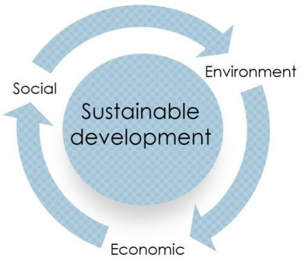
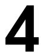
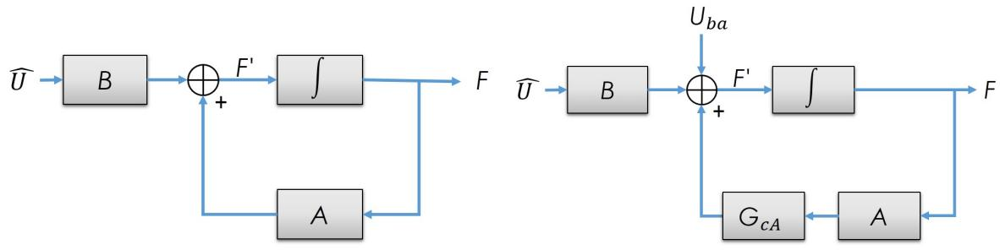

# 《数学建模》2015年美国大学生数学建模竞赛（MCM/ICM）特等奖论文集（Problem D）

原件经识别和整理；“参考解答”是我们补的。

## 摘要

### 2015 Mathematical Contest in Modeling (ICM) Summary Sheet (Attach a copy of this page to your solution paper.)

### Sustainability? Responsibility!

Sustainability is a comprehensive concept to describe a pattern of development without losing coordination or over consuming resources. Our research is divided into three steps: assessing and forecasting sustainability, formulating development plan, and involving external factors.

Firstly, an Entropy-GE Matrix is adopted to create a measurement of sustainability and a state equation constructed from Lanchester's Equation is employed to forecast trends of sustainability. We set up a Sustainable Development Indicator system and normalize data of indicators. Aiming at assessing comprehensive performances, we adopt an Entropy-GE Matrix to establish concepts of Development Index (DI), Cooperation Index (CI) and a final score. Based on Lanchester's Equation, we furthermore construct a state equation to forecast sustainability. In our result of 10 countries' rankings on sustainability in 2013, America occupies the first place with a score 0.161 while Congo is the last with a score 1.142. As for another result, we obtain a 20-year forecast for three sample countries (America, China, Congo).

Secondly, we study on effectiveness of control elements $c$, $b$ in control matrices and utilize a dynamic programming method to design a 20-year plan for Congo. Using the concept of state space from control engineering, we convert effects of a plan on sustainable development into effects of control matrices on the state equation. In a case study on Congo, the control variate method is adopted to analyze effectiveness of $c_i$, $b_i$, and dynamic programming is applied to obtain a 20-year optimal plan. With the plan, DI and CI of Congo will dramatically increase in following 20 years. In order to specify our plan, development activities and their effectiveness scores are studied. In the plan for Congo, an economic activity of technical support is strongly recommended.

Thirdly, effects from external factors are considered in our model. By adding an external control matrix consists of Gaussian random numbers to the state equation, we can simulate effects of external factors on sustainable development of Congo. In the result, although external perturbation can cause fluctuation on performances, our plan can still guarantee a rising trend of sustainable development.

Finally, we analyze the stability of our model with a OAT/OFAT method and its result demonstrates that our model can undergo disturbance in a certain extent. Besides, we conclude the strength and weakness of our model.

## 目录

1. Introduction 1
2. Assumption 2
3. A Model for Sustainability 2
   3.1 Sustainable Development Indicators (SDI) 3
   3.2 A Measurement of Sustainability 3
       3.2.1 Data Normalization 4
       3.2.2 The Comprehensive Performance 5
       3.2.3 Development Index and Coordination Index 6
       3.2.4 A GE-Matrix to Score Sustainability 7
   3.3 A Forecast on Sustainability 8
       3.3.1 Mechanism of Lanchester's Equation 8
       3.3.2 Our State Equation 8
   3.4 Results 9
       3.4.1 Country Rankings 9
       3.4.2 A 20-Year Forecast 9
4. A Sustainable Development Plan 10
   4.1 Adding Control into the State Equation 11
       4.1.1 Direct and Indirect Control Matrices 11
       4.1.2 Effectiveness of Control Elements 12
   4.2 A Dynamic Programming Solution 13
   4.3 Development Activities in Practice 13
   4.4 A Case Study on Congo 14
       4.4.1 Adjusting Control Elements 14
       4.4.2 20-year Forecasts with(out) Plan-controlling 15
       4.4.3 The Plan in Practice 16
5. External Effects 17
   5.1 Adding a Perturbation Matrix to State Equation 17
   5.2 A Revised Forecast on Congo 17
6. Stability Analysis 18
7. Strength and Weakness 19
   7.1 Strength 19
       7.1.1 Hierarchy 19
       7.1.2 Quantification 19
       7.1.3 Intersectionality 19
   7.2 Weakness 20

References 21

### Introduction

The concept of Sustainable Development (SD) was derived from forest management in early 12th to 16th centuries[1]. In recent decades, with the continuous development of modern society, the concept of SD evolved and was broadened. It was not until 1987 had this concept been defined by the United Nations World Commission on Environment and Development in its report *Our Common Future* defines sustainable development. The report defines: "Sustainable development is development that meets the needs of the present without compromising the ability of future generations to meet their own needs". While this is the most commonly used definition, it is not the only one. A pragmatic version with economic nuances was formulated by the OECD Environment Committee which considers that sustainable development means "maximizing the net benefit of the economic development, while maintaining the dimensions of quality and production at the level of the resources over time". To measure the progress of sustainability, sets of Sustainable Development Indicators (SDI) have been created by many organizations include World Bank, World Resource Institute, Worldwatch Institute etc[4]. At present, problems like over increased population, poverty, shortage of energy resources, and environmental pollution remain to be crucial global issues. Without effective ways to solve these problems, they will finally cause disasters to earth environment and lead to human society collapse. Hence, SD has its unprecedented significance in today’s world.

To create a more sustainable world, the International Conglomerate of Money (ICM) is interested in investing developing countries. Therefore, following tasks are to be accomplished:

A measurement to characterize sustainability of a country is needed. By considering various factors like environmental quality and social status, the model should clearly extinguish sustainable countries from unsustainable ones.

A 20 year sustainable development plan should be created to help a Least Developed Country (LDC) to gain a more sustainable future.

The effect our 20-year plan has on the sustainability measure of the selected country should be evaluated.

According to existent materials, various sets of SDIs have been created by different countries, organizations, as well as researchers. Among them, the most well-known one is the standard published by Eurostat aims at monitoring the progress towards sustainable development strategy in EU countries. Over 100 Indicators used are divided into three categories: social, environmental and economic[5], as shown in Figure 1. Other studies also consider wider perspectives, for example, cultural diversity and cultural well-being by Jelena Zlatar etc. in 2014. However, there is still not a global consensus of indicators used to measure SD. In line with various SDIs, studies use models and measurements to comment on sustainability of a country or a region. For instance, Liu Dan constructs an evaluation index system of resource-based city sustainable development using a BP neural network model and a genetic algorithm. Jiali Huang uses eco-

To give advises for future policies and investments to improve sustainability, researchers have done many qualitative analysis. Anthony Crabbe concludes three strategies: charitable strategy, network strategy and social business strategy to enhance regional sustainability. Vatroslav Zovko elaborate impacts GNI index and education have on future development[10]. However, most of the previous work lack quantitative analysis; therefore the advises they provide could not give decision makers strong and clear instructions on policy making and plan designing. On this stage, a better model for development planning is valueable.

Considering the existent research, our research focus on sustainability measurement, sustainability forecast, as well as sustainability control and adjustment. Detail work is as follow:

1) We create our own system of Sustainable Development Indicators and provide with a measurement of sustainability based on the entropy theory and the GE-Matrix.

2) We also conduct a way to forecast sustainability using Lanchester’s Equation and theory of the state equation.

3) We study the control and adjustment a plan can have on the sustainability by doing further deduction on the state equation and acase study on Congo.

4) Further work in our research focuses on effects from external influence of the system.

### Assumption

We assume that effects of external factors on our model obey the Gaussian Distribution.

We made this assumption based on reality, because the kinds of external effects considered in our study (e.g. climate change, international aids) seldom have abnormal strong impacts on the original model. Under this assumption, we can easily quantify the external effects in our study.

### A Model for Sustainability

In this section, we first set up a system of Sustainable Development Indicators (SDI). Subsequently, we provide a complete measurement to score a country’s sustainability. Next, we provide a method to forecast sustainability. Finally, the results of country rankings and a 20-year forecast are demonstrated.

---
title: 《数学建模》2015年美国大学生数学建模竞赛（MCM/ICM）特等奖论文集（Problem D）第3部分
kind: 课件
course: 数学建模
term: 2015-MCM-ICM
source: 《数学建模》2015年美国大学生数学建模竞赛（MCM/ICM）特等奖论文集（Problem D）
---

# 《数学建模》2015年美国大学生数学建模竞赛（MCM/ICM）特等奖论文集（Problem D）第3部分

本资料为2015年MCM/ICM Problem D特等奖论文的第3部分整理，主要涵盖可持续发展指标（SDI）的构建原则与体系，以及可持续性的测量方法，包括数据标准化、熵权法及发展指数与协调指数的定义。

## 一、可持续发展指标（SDI）的构建

### 选择原则

为了对可持续发展进行全面描述，使用了一系列被称为可持续发展指标（Sustainable Development Indicators, SDI）的指标。由于全球对于如何选取SDI尚无共识，因此我们基于以下三个原则进行选择：

1. **全面性**：指标应尽可能全面，包含对可持续性最有效的各个部分。
2. **可控性与可行性**：指标最好能够通过政府政策和可行计划进行控制和调节。
3. **已有验证优先**：在现有研究中已被证明合理的指标具有优先权。

### 指标体系结构

基于上述三个原则，我们构建了包含3个层级的指标组，如表1所示。

*   **第一层级**：包含三个广泛认可的方面，即环境（Environmental）、社会（Social）和经济（Economic）。
*   **第二层级**：包含9个子方面，每个大方面下有三个子方面。
    *   在选择子方面时，我们考虑了当今每个方面下最受关注的三个全球性问题。
    *   由于经济方面只有两个层级，其子方面的选择方式结合了第三层指标的选择方式。
*   **第三层级**：最终确定第三层指标，从以下三个资源中识别：
    1.  Eurostat确定的超过100个指标，重点关注12个头条指标。这些指标已用于监测欧盟可持续发展战略超过10年[11]。
    2.  Liyin Shen构建的52个国际指标，用于评估可持续城市化。其可靠性已通过作者对中国案例的研究得到测试[12]。
    3.  Jelena Zlatar从2001年至2012年的研究中总结的37个指标，涵盖环境、社会和經濟方面[6]。

在筛选过程中，我们选择了出现两次且属于同一子方面的指标。此外，为了方便决策者，我们也考虑了那些虽未出现两次但可通过政策轻易控制的指标，例如教育支出占GDP的比例。最终，我们构建了一个SDI系统，作为模型的基础。

Table 1: Indicator system for sustainable development

| Level 1 | Level 2 | Level 3 |
| :--- | :--- | :--- |
| Environment | Population | Population growth |
| | | Population density |
| | | The aging rate |
| | Resources | Forest rents in GDP |
| | | Energy use per capita |
| | Pollution | $CO_{2}$ emission per capita |
| Social | Health | Life expectancy |
| | | Mortality rate |
| | | Health expenditure per capita |
| | Education | Tertiary school enrollment rate |
| | | Education spend in GDP |
| | Livelihood | Depth of the food deficit |
| | | Improved water source with access |
| | | Household expenditure per capita |
| Economic | Per Capita GDP | - |
| | Inflation | - |
| | Tertiary industry rate | - |

## 二、可持续性的测量

我们提供了一套完整的可持续性测量方法。首先介绍数据标准化方法，然后采用熵权法确定指标权重并计算环境、社会和经济方面的综合表现。随后，定义了发展指数（Development Index）和协调指数（Coordination Index）来描述国家的可持续发展状况。最后，使用GE矩阵对可持续性进行评分。

### 数据标准化

考虑到SDI数据在不同尺度上测量，有必要将它们标准化到一个概念上的共同尺度。因此，所有研究中的数据在使用模型前都需要进行调整。

我们要研究的17个指标在标准化时可以分为三类：对可持续性产生正面影响的正向指标（positive indicators），对可持续性产生负面影响的负向指标（negative indicators），以及特殊指标。

在我们的模型中，假设考虑 $n$ ($n=17$) 个指标和 $m$ 个样本国家。在下文中，$x_{ij}$ ($x_{ij} > 0$) 代表样本国家 $j$ 在第 $i$ 个指标上的原始值，其中 $i=1, 2, ..., n$ 且 $j=1, 2, ..., m$。$r_{ij}$ 表示 $x_{ij}$ 相对于指标 $i$ 在所有样本中的最佳值的接近程度。

#### 1. 正向指标

对于正向指标，数值越大越好。因此，得到以下方程：

$$
r_{ij} = \frac{x_{ij}}{\max_{j}(x_{ij})}
$$

其中 $\max_{j}(x_{ij})$ 是正向指标 $i$ 的最佳值，即在所有 $m$ 个样本国家中指标 $i$ 的最大值。

#### 2. 负向指标

相反，对于负向指标，绝对值越小越好。因此，我们有：

$$
r_{ij} = \frac{\min_{j}(x_{ij})}{x_{ij}}
$$

其中 $\min_{j}(x_{ij})$ 是负向指标 $i$ 的最佳值，即在所有 $m$ 个样本国家中指标 $i$ 的最小值。

#### 3. 标准化值

基于公式 (3.2.1)-(3.2.2)，我们得到正或负指标 $i$ 对于样本 $j$ 的标准化值 $f_{ij}$：

$$
f_{ij} = \frac{r_{ij}}{\sum_{j=1}^{m} r_{ij}}
$$

However, there are special indicators which can not be categorized into positive or negative indicators. One condition is that the best value of the indicator is a fixed one or original values of the indicator are negative or 0. When the value is 0, we replace it with 0.0001, which has little impact on the final result. The other condition is that the normalized value of one indicator is effected by other indicators. There are 3 special indicators in our SDI system and their normalization processes are as follows:

### 1) Inflation (annual %)

Because the value of inflation can be negative (equivalent to deflation in a positive value) and the best value of inflation is 0, its normalization equation can be expressed as:

$$
f _ { I N F } = 1 - \frac {| I N F |}{| I N F | _ {\mathrm{max}}}
$$

where $f _ { I N F }$ is the normalized value of inflation; INF is the original value of inflation; $| I N F | _ { \operatorname* { m a x } }$ is the maximum absolute value among all samples.

### 2) Population Density (per/km$^2$)

According to research by Alberto Martilli$^{[13]}$, both overhigh and overlow population density harm social development, and are negative to environment and energy efficiency. The proper population density should be 60-100 per/ km$^2$. Another study from Hao Hu, Karima Nigmatulina$^{[14]}$ also suggests that when population density is under 100 per/ $\mathrm { k m ^ { 2 } }$, the diseases transmission can be cut into a lower speed. The normalization equation is:

$$
f _ { D P } = 1 - \left| \frac {D P - D P _ { A P}}{| \Delta D P | _ {\mathrm{max}}} \right|
$$

where $f _ { D P }$ characterizes the normalized value of population density; $D P$ is the original value of population density; $D P _ { A P }$ is the best value of population density; $| \Delta D P | _ { \operatorname* { m a x } }$ represents the maximum absolute difference between $D P$ and $D P _ { A P }$

### 3) Population Growth (%)

On referring to J.V. Ross’s research$^{[15]}$, population growth is related to population density and its normalized way is:

$$
f _ { P G } = \left\{ \begin{array}{l l} \frac {1}{| P G - | \frac {D P - D P _ { A P}}{D P} | | + 1} & D P \leq D P _ { A P} \\ \frac {1}{| P G + | \frac {D P - D P _ { A P}}{D P} | | + 1} & D P > D P _ { A P} \end{array} \right.
$$

where $f _ { P G }$ is the normalized value of population growth and P G is its original value.

## 3.2.2 The Comprehensive Performance

The Entropy Method is derived from thermodynamics and is later introduced to telecommunication method to determine the weight of a group of indicators which are used for evaluation [16]

The Entropy Method suits for our study because our original data of indicators are trivial therefore hard to analyze. By adopting a Entropy Method, we can process the data (after normalization) into three main variables, representing environmental, social, and economic aspects; hence the analysis on data can be easier to approach and clearer to understand.

To start with, the entropy value $H _ { i }$ of indicator i is obtained by Equation (3.2.2)

$$
\begin{array}{c} {H _ {i} = - k \sum_ {j = 1} ^ {m} f _ {i j} \cdot \ln f _ {i j}} \\ {\mathrm{where} \quad i = 1, 2, 3,..., n; \quad k = \frac {1}{\ln m}} \end{array}
$$

Accordingly, we determine the weight $w _ { i }$ of indicator i by Equation (3.2.2)

$$
w _ { i } = \frac {1 - H _ { i }}{\sum_ {i = 1} ^ {n} (1 - H _ { i })}
$$

Hence, the comprehensive performance of sample $j$ by considering indicators 1 to n can be defined as

$$
F _ { j } = \sum_ {i = 1} ^ {n} w _ { i } \cdot f _ { i j }
$$

Since our SDI system set up in Section 2.1 has three main aspects, we accordingly get three $F$s to describe the comprehensive performance of a country ($j$ omitted in the equation) on environmental (en), social (so), and economic (ec) aspects. Descriptions are shown in Equation (1)

$$
\begin{array}{l l} F _ { e n } = \sum_ {i = 1} ^ {n _ { e n }} w _ { i (e n)} \cdot f _ { i j (e n)} & i = 1, 2,..., n _ { e n } \\ F _ { s o } = \sum_ {i = 1} ^ {n _ { s o }} w _ { i (s o)} \cdot f _ { i j (s o)} & i = 1, 2,..., n _ { s o } \\ F _ { e c } = \sum_ {i = 1} ^ {n _ { e c }} w _ { i (e c)} \cdot f _ { i j (e c)} & i = 1, 2,..., n _ { e c } \end{array}\tag{1}
$$

## 3.2.3 Development Index and Coordination Index

Sustainable development is a concept which requires both development and coordination. To be coordinated requires a country to improve itself not only in one aspect but in all aspects at the same time. In our model, we use a Development Index (DI) to depict a overall development status and a Coordination Index (CI) to depict the consistency and coordination of development among environmental (en), social (so), and economic (ec) aspects. Both index are based on comprehensive performance on aspects (en, so, ec). It is only when DI and CI are both high can we consider a country to be a sustainable one.

Here we define Development Index (DI) to be

$$
\begin{array}{c} D I = \mathbf { C F } \\ where \quad \mathbf { C } = \left[ \begin{array}{l} \gamma_ { 1 } \\ \gamma_ { 2 } \\ \gamma_ { 3 } \end{array} \right] ^ { T } ; \quad \mathbf { F } = \left[ \begin{array}{l} F _ { e n } \\ F _ { s o } \\ F _ { e c } \end{array} \right] \end{array}\tag{2}
$$

The parameters $\gamma _ { 1 } , \gamma _ { 2 }$ , and $\gamma _ { 3 }$ in C show weight of $F _ { e n } , F _ { s o } , F _ { e c }$ when composing DI.

### 3.2.4 A GE-Matrix to Score Sustainability

The GE-Matrix (McKinsey Matrix) is originally used in evaluating competitiveness and attractiveness of a company in a two-dimensional frame. The matrix can provide company with management and development strategies. Here we consider to use GE-Matrix to depict sustainability of countries.

Although there are difference between companies and countries in operation, management, and profit perspectives, a fairly reasonable analogy can still be made. On the one hand, company attractiveness describes the strength of a company to make profit; correspondingly, country Development Index describes strength of a country on development. On the other hand, both company competitiveness and country Coordination Index reflect a well-rounded capacity. Hence, a GE-Matrix is adopted. Figure $2^{[12]}$ shows the matrix we adopt. Both DI and CI can be classified:

Table 2: Classification of DI and CI

| DI | Development level |
| :--- | :--- |
| 0-0.5 | Weak development |
| 0.5-0.8 | Medium development |
| 0.8-1 | Strong development |

| CI | Coordination level |
| :--- | :--- |
| 0-0.5 | Weak coordination |
| 0.5-0.8 | Medium coordination |
| 0.8-1 | Strong coordination |

With DI value $y$ and CI value $x$ of a country in any given year, we can determine a position $(x, y)$ in our GE-Matrix. The distance between $(x, y)$ and the best position $(1, 1)$ is regarded as our sustainability score of a country in one year. The lower the score is, the more sustainable a country is.

### 3.3 A Forecast on Sustainability

We provide a method to forecast sustainability of a country by using Lanchester’s Equation. Initially, the mechanism of Lanchester’s Equation is introduced. Later, we develop this equation into our own use and provide with a state equation.

#### 3.3.1 Mechanism of Lanchester’s Equation

Lanchester’s Equation is originally used in combat to assess loss of soldiers from both sides$^{[19]}$. It is a nonlinear first order differential equation which can obtain dynamic changes of the system under different war strategies. The equation is described as

$$
\left\{ \begin{array}{l l} \frac {d x}{d t} = - a y - \alpha x + u (t) \\ \frac {d y}{d t} = - b x - \beta y + v (t) \end{array} \right.
$$

where $a$ and $b$ are attack strength from one side to the other; $\alpha$ and $\beta$ are loss of soldiers due to reasons other than attacks; $u(t)$ and $v(t)$ represent supplement of soldiers.

#### 3.3.2 Our State Equation

We know that Lanchester’s Equation provides a model for war, but we "buy" it a new coat of peace in our model. We use it to obtain the dynamic process of sustainability and forecast sustainability changes. This new coat fits well since Lanchester’s Equation can provide an equation to characterize not only effect on self aspect, but also effects of interaction among all aspects and effects from outside of the system.

Take the social aspect from our SDI system as an example, it contains 3 second level aspects (health, education, livelihood) and 8 third level indicators (life expectancy, education spend, health expenditure etc.). All the third level indicators reflect citizen’s living quality in a country. However, the living quality will also be effected by environment (forest coverage, co2 emission etc.) and country economics (inflation, GDP per capita etc.). Lanchester’s Equation embodies the interaction among environmental, social, and economic aspects clearly.

Moreover, there are effects from outside of a country like ICM provided programs and aids. Therefore, we compare outsider effects on country sustainability $\hat { U } _ { i } ( t )$ to soldier supplement in original Lanchester’s Equation. We use fitting method to get coefficient $\beta _ { i }$. We therefore get our Lanchester’s Equation equation

$$
\left\{ \begin{array}{l} \frac {d F _ {e n} (t)}{d t} = \alpha_ {1 1} F _ {e n} (t) + \alpha_ {1 2} F _ {s o} (t) + \alpha_ {1 3} F _ {e c} (t) + \beta_ {1} \hat {U} _ {1} (t) \\ \frac {d F _ {s o} (t)}{d t} = \alpha_ {2 1} F _ {e n} (t) + \alpha_ {2 2} F _ {s o} (t) + \alpha_ {2 3} F _ {e c} (t) + \beta_ {2} \hat {U} _ {2} (t) \\ \frac {d F _ {e c} (t)}{d t} = \alpha_ {3 1} F _ {e n} (t) + \alpha_ {3 2} F _ {s o} (t) + \alpha_ {3 3} F _ {e c} (t) + \beta_ {3} \hat {U} _ {3} (t) \end{array} \right.
$$

Using denotation ways from state space theory, we get the state equation

$$
\frac {d \mathbf {F}}{d t} = \mathbf {A} \mathbf {F} + \mathbf {B} \hat {\mathbf {U}}
$$

$$
w h e r e \quad \mathbf {F} = \left[ \begin{array}{l} F _ {e n} \\ F _ {s o} \\ F _ {e c} \end{array} \right] \quad \mathbf {A} = \left[ \begin{array}{l l l} \alpha_ {1 1} & \alpha_ {1 2} & \alpha_ {1 3} \\ \alpha_ {2 1} & \alpha_ {2 2} & \alpha_ {3 2} \\ \alpha_ {3 1} & \alpha_ {3 2} & \alpha_ {3 3} \end{array} \right] \quad \mathbf {B} = \left[ \begin{array}{l} \beta_ {1} \\ \beta_ {2} \\ \beta_ {3} \end{array} \right] \quad \hat {\mathbf {U}} = \left[ \begin{array}{l} \hat {U} _ {1} \\ \hat {U} _ {2} \\ \hat {U} _ {3} \end{array} \right] ^ {\mathbf {T}}\tag{4}
$$

In Equation (3.3.2)-(4), $F_x(x=en,so,ec)$ denotes the comprehensive performance of a country on aspect $x$. $F$ is comprehensive performance to measure sustainability of a country; $A$ is a system matrix which describes interaction among the three aspects; elements in $\hat{U}$ describe effects from outside of a country; $B$ is an input matrix to control a country's capacity on adjusting to outside effects. In our first stage study, $B\hat{U}$ is ignored.

On adopting Equation (4), we convert discrete time $T$ to continuous time $t$.

$$
t = kT \qquad k = 1, 2, 3, \ldots n
$$

That is to say, we can obtain continuous data from original inputting discrete data. Hence, the dynamic change of sustainability and possible future value of comprehensive performance $F$ on environmental, social, and economic aspects can be got.

## 3.4 Results

### 3.4.1 Country Rankings

We acquired original data from World Bank Database[20]. The data cover all 17 indicators in our SDI system. Ten sample countries are selected from 5 different continents and covers both developed countries and developing countries. Based on our model in Section 2.2, sustainability scores of sample countries in year 2013 are calculated. The rankings are shown in Table 3. The lower the score is, the more sustainable a country is; hence the United States ranks the highest among all the countries, and Congo ranks the lowest.

Table 3: 2013 Sustainability rankings of 10 countries

| Rank | Country | $F_{en}$ | $F_{so}$ | $F_{ec}$ | DI | CI | Score |
|---|---|---|---|---|---|---|---|
| 1 | U.S. | 0.378 | 0.343 | 0.439 | 0.876 | 0.897 | 0.161 |
| 2 | U.K. | 0.164 | 0.277 | 0.386 | 0.625 | 0.672 | 0.499 |
| 3 | Brazil | 0.085 | 0.050 | 0.056 | 0.144 | 0.761 | 0.889 |
| 4 | China | 0.122 | 0.213 | 0.035 | 0.279 | 0.408 | 0.932 |
| 5 | South Africa | 0.147 | 0.053 | 0.057 | 0.195 | 0.494 | 0.951 |
| 6 | Bangladesh | 0.015 | 0.012 | 0.006 | 0.025 | 0.635 | 1.041 |
| 7 | Central Africa | 0.020 | 0.015 | 0.005 | 0.030 | 0.521 | 1.082 |
| 8 | Cambodia | 0.022 | 0.010 | 0.007 | 0.030 | 0.517 | 1.084 |
| 9 | Nepal | 0.023 | 0.016 | 0.004 | 0.032 | 0.478 | 1.100 |
| 10 | Congo | 0.023 | 0.014 | 0.003 | 0.031 | 0.396 | 1.142 |

### 3.4.2 A 20-Year Forecast

We use data from 2009-2013 to forecast the comprehensive performances on environmental, social, and economic aspects for different countries based on the model introduced in section 2.3. An analytical-least square method and function ODE45 are used to determine the coefficients in our forecast model. We therefore picked three countries (the US, China, Congo) as representatives of countries from three classes: countries already have good performances, countries which have a low performance but is improving, and countries which maintain a low performance now and in future. A 20-year prediction of three sample countries are shown in Figures 3-4.

In Figure 3, comprehensive performances on environmental, social and economic aspects of the US, China and Congo are embodied. We can discover that the economic performance of China will rise largely in 20 years comparing to others.

A comprehensive view of our 20-year prediction is shown in Figure 4 under the frame of a GE-Matrix. On referring to classification ways in Table 2, we notice that the United States has a strong performance in coordination and a medium performance in development at present; in 20 years, its development will be strengthen while its coordination will remain a high standard. Moreover, we noticed that China is developing towards an imbalanced direction. Its coordination remains weak in 2029. As for Congo, situation worse in 2029 since both index will go towards zero.

Therefore, countries like China should adjust its policies towards a better direction rather than focusing on economic development; countries like Congo needs more aids on all aspects.

### A Sustainable Development Plan

In this section, we create a model to describe a sustainable development plan on a country by adding control elements into the state equation. The optimal result of the model is obtained by using dynamic programming. At last, we do a case study on Congo.

# 4.1 Adding Control into the State Equation

本文档整理了《数学建模》2015年美国大学生数学建模竞赛（MCM/ICM）特等奖论文集（Problem D）第 7 部分关于状态方程中加入控制矩阵的内容，包括直接控制、间接控制矩阵的定义及有效性分析方法。

## 一、直接和间接控制矩阵

### 小节 1：离散化状态方程

为了将计划中的控制效果加入系统矩阵 $A$，首先对原始状态方程进行离散化处理。原始状态方程如下：

$$
\frac {d \mathbf {F}}{d t} = \frac {\mathbf {F _ {k + 1}} - \mathbf {F _ {k}}}{T}
$$

因此，状态方程被转换为：

$$
\left[ \begin{array}{c} F _ {e n} \\ F _ {s o} \\ F _ {e c} \end{array} \right] _ {k + 1} = \left[ \begin{array}{c c c} 1 + \alpha_ {1 1} T & \alpha_ {1 2} T & \alpha_ {1 3} T \\ \alpha_ {2 1} T & 1 + \alpha_ {2 2} T & \alpha_ {3 2} T \\ \alpha_ {3 1} T & \alpha_ {3 2} T & 1 + \alpha_ {3 3} T \end{array} \right] \left[ \begin{array}{c} F _ {e n} \\ F _ {s o} \\ F _ {e c} \end{array} \right] _ {k} + \left[ \begin{array}{c} \beta_ {1} \\ \beta_ {2} \\ \beta_ {3} \end{array} \right] \left[ \hat {U} _ {1}   \hat {U} _ {2}   \hat {U} _ {3} \right] _ {k}
$$

这等价于：

$$
\mathbf {F} _ {\mathrm{k+1}} = \bar {\mathbf {A}} \mathbf {F} _ {\mathrm{k}} + \mathbf {B} \hat {\mathbf {U}} _ {\mathrm{k}}\tag{5}
$$

上述离散方程清楚地表明，系统矩阵 $\bar{\mathbf{A}}$ 和输入矩阵 $\mathbf{B}$ 都对综合性能 $F_i$ 有影响。此外，$F_i$ 的值大于零；同时，值越大，结果越有利。总体而言，我们可以通过控制 $\bar{\mathbf{A}}$ 来控制一个国家的可持续发展趋势，并通过控制 $\mathbf{B}$ 来控制一个国家应对外部影响的能力。

### 小节 2：引入可持续发展计划

可持续发展计划用于改变一个国家的可持续发展趋势，因此，在加入计划后的状态方程的数学描述创建如下：

$$
\mathbf {F} ^ {\prime} = \left(\mathbf {G _ {c A}} \mathbf {A F} + \mathbf {U _ {b A}}\right) + \mathbf {B} \hat {\mathbf {U}}\tag{6}
$$

图 5-6 分别是执行计划前后 $\mathbf {F^{\prime}}$ 变化的流程图。

$\mathbf {G _ {c A }}$ 是一个间接控制矩阵，因为计划可以通过使用 $\mathbf {G _ {c A }}$ 来间接地对系统矩阵 $A$ 施加影响。在此，我们忽略 $\mathbf {G _ {c A }}$ 中对 $A$ 有耦合效应的元素。因此：

$$
\mathbf {G} _ {\mathbf {c A}} = \left[ \begin{array}{l l l} c _ {1} & 0 & 0 \\ 0 & c _ {2} & 0 \\ 0 & 0 & c _ {3} \end{array} \right]\tag{7}
$$

其中 $c_i$ 是来自计划的间接控制元素。$c_i$ 的性质如表 4 所示。

**表 4：根据 $c_i$ 和 $\alpha_{ij}$ 的计划效应**

| | $c_i < 1$ | $c_i > 1$ |
| :--- | :--- | :--- |
| $\alpha_{ij} < 1$ | 计划减少原有的负面影响 | 计划增强原有的负面影响 |
| $\alpha_{ij} > 1$ | 计划减少原有的正面影响 | 计划增强原有的正面影响 |

$\mathbf {U _ {b A }}$ 代表来自计划的直接控制。通过直接控制，只关注某一方面的计划或政策仅对该方面产生影响。因此，$\mathbf {U _ {b A }}$ 等于综合性能 $F$ 的一个比例。该比例由直接控制矩阵 $\mathbf {G _ {b A }}$ 表征，如下所示：

$$
\mathbf {U} _ {\mathbf {b A}} = \mathbf {G} _ {\mathbf {b A}} \mathbf {F} = \left[ \begin{array}{l l l} b _ {1} & 0 & 0 \\ 0 & b _ {2} & 0 \\ 0 & 0 & b _ {3} \end{array} \right] \left[ \begin{array}{l} F _ {e n} \\ F _ {s o} \\ F _ {e c} \end{array} \right]\tag{8}
$$

最终，加入控制计划后的状态方程表示为：

$$
\mathbf {F} ^ {\prime} = \left(\mathbf {G} _ {\mathrm{cA}} \mathbf {A} + \mathbf {G} _ {\mathrm{bA}}\right) \mathbf {F} + \mathbf {B} \hat {\mathbf {U}} = \mathbf {G} _ {\mathrm{A}} \mathbf {F} + \mathbf {B} \hat {\mathbf {U}}\tag{9}
$$

## 二、控制元素的有效性

### 小节 1：控制变量法分析

6 个控制元素 $b_i$ 和 $c_i$ 在对可持续性能 $\mathbf{F}$ 施加影响时相互作用，因此很难观察到单个元素造成的影响。我们使用控制变量法来讨论当每个控制元素在一定程度变化时，对综合性能 $(F_{en}, F_{so}, F_{ec})$ 和可持续性评分的影响。这种讨论为计划求解提供了基础。

### 小节 2：特殊情况与正常条件

在 ICM 不提供任何援助的特殊条件下，间接控制矩阵 $\mathbf {G _ {c A }}$ 变为单位矩阵，直接控制矩阵 $\mathbf {U _ {b A }}$ 变为零矩阵。因此，这两个矩阵不影响系统矩阵 $A$，状态方程（公式 6）变得与没有计划的方程（公式 5）相同。

在具有援助的正常条件下，我们通过设置以下参数来讨论 $c_i$：

$$
\left\{ \begin{array}{l} c _ {i} = 1 \pm k \cdot p \\ c _ {j} = 1, \quad i \neq j \\ b _ {i} = 0 \end{array} \right.
$$

其中 $k$ 代表区间量；$p$ 代表区间长度。我们通过设置以下参数来讨论 $b_i$：

$$
\left\{ \begin{array}{l} b _ {i} = k \cdot p \cdot \alpha_ {j j} \\ b _ {j} = 0, \quad i \neq j \\ c _ {i} = 1 \end{array} \right.
$$

## 4.2 A Dynamic Programming Solution

In order to give the result of an optimal 20-year plan, we have to choose a suitable method to solve our model. Our plan making problem is indeed a multistage decision making problem; therefore, a dynamic programming algorithm is adopted.

1) Stage and stage variables $n$

We divide the 20-year plan into 4 stages; every 5 years is a stage $n$. $k$ represents the time unit of year.

2) State variables $S$

The state variables are $F_{en}, F_{so}, F_{ec}$. Index DI and CI can be calculated via them.

3) Decision variables $X$

Decision variables are expressed as $\mathbf{G_A} = \mathbf{G_{cA}} + \mathbf{G_{bA}}$, which includes control elements $c_i$ and $b_i\ (i=1,2,3)$. Value range of control elements are determined by effectiveness analysis on them.

4) Strategy

A strategy is a set of decisions. Expressed as $\{\mathbf{G_A}(1), \mathbf{G_A}(2), \mathbf{G_A}(3), \mathbf{G_A}(4)\}$.

5) State transition function

The state transition function in stage $i$ is $F' = G_A(i)F + B\hat{U}$. In addition, initial values of state variables in stage $n$ equals to final values of state variables in stage $n-1$.

6) Value function $V$

A value function is a quantitative indicator of how good the process is. Here value function $V_n$ represents a sum of every year sustainability scores in stage $n$.

$$
V = \sum_{n=1}^{4} V_n = \sum_{n=1}^{4} \sum_{k=1}^{5} Score_{nk}(s_n, x_n)
$$

represents the value function of the entire process.

## 4.3 Development Activities in Practice

Concrete policies and aids are crucial for an effective sustainable development plan, while all of them should consider both development and coordination at the same time. So when creating a 20-year sustainable development plan, the effectiveness of specific development activities should be evaluated first. Only in this way can we clarify how the plan acts in matrix $\mathbf{G_A}$ and $B$, and whether it performs well or badly. There are many development activities bringing direct or indirect benefits through programs, policies, and aids which can be provided by ICM.

Sharifzadegan and Gollar[22] used the method of Strategic Environmental Assessment (SEA) to assess a strategic plan and different development activities. With the help of this research we can obtain Table 5 which reveals development activities and their score of effectiveness in detail.

Table 5: Development activities and their scores of effectiveness

| 类别 | development activities | score |
|---|---|---|
| environmental | The reduction of air pollution in the civic and residential areas | 0.20 |
| environmental | Protecting the agricultural lands and forests | 0.23 |
| environmental | The reduction of air pollution | 0.13 |
| environmental | Transferring the obtrusive industries to the industrial towns | 0.13 |
| environmental | Preventing from contamination of the water resources | 0.17 |
| environmental | No damaging to the protected areas | 0.13 |
| social | Strengthening the infrastructure | 0.04 |
| social | Improve the sewage disposal | 0.12 |
| social | Create sustainable communities and recognize urban growth | 0.18 |
| social | Renewal of informal settlements | 0.26 |
| social | Accessibility to public transportation systems | 0.12 |
| social | Control housing and offer residential use | 0.07 |
| social | Improve road infrastructures and built new roads | 0.14 |
| social | Guarantee water supply by new water supply company and pipes | 0.07 |
| economic | Transferring the obtrusive industries to the industrial towns | 0.19 |
| economic | Using the huge social and accumulated capital for the expansion of the employment | 0.13 |
| economic | Investment in local companies | 0.16 |
| economic | Technical support | 0.23 |
| economic | Provide measures to amend by the home occupation and cottage industry regulations | 0.10 |
| economic | Finances this organization | 0.19 |

In order to give concrete form of a plan using the development activities in the table, a series of work should be done:

Step 1 We can analyze the effects each one of control elements $b_i, c_i$ have on the comprehensive performance $F$ using method in section 3.1.2.

Step 2 Subsequently we use dynamic programming as indicated in section 3.2 to determine the optimal value of control elements $b_i, c_i$.

Step 3 The importance rankings of environmental, social and economic aspects and the score of activities under each aspect can collectively determine the activities' strength in the plan.

## 4.4 A Case Study on Congo

In this part, we will do a case study on Congo (Democratic Republic of the Congo), one of the Least Developed Countries (LDC). According to our previous result in Figure 4, Congo's Development Index and the Coordination Index are nearly going to be zero by 2029. (Congo is in a deep crisis!) Thus, receiving aids from ICM will be like clutching at straws for Congo.

To start with, we give quantitative analysis on effects control elements have in a Congo case. Subsequently we obtain a new 20-year forecast with a plan-controlling for Congo and compare it with the forecast without plan. Finally, some practical development activities are provided within the plan.

### 4.4.1 Adjusting Control Elements

By using data collected from the World Bank Database[20] and adopting a control variate method introduced in section 3.1.2, we can get effects each control element has on comprehensive performances as well as DI and CI of Congo. Partial results are shown in Figures 7-10.

## 4.4.1 灵敏度分析结果

图 7-8 显示了当 $c_1$ 变化 $\pm 5\%$ 和 $\pm 10\%$，以及 $b_1$ 变化 $\pm 2\%$ 和 $\pm 4\%$ 时，参数对发展指数（Development Index, DI）的影响。我们可以观察到，$b_1$ 对 DI 的影响比 $c_1$ 更大。此外，$c_1$ 和 $b_1$ 都对 DI 产生正向影响，即当 $c_1$ 或 $b_1$ 增加时，DI 也随之增加。

从图 9-10 中，可以清晰地比较间接控制元素 $c_i$ 之间以及直接控制元素 $b_i$ 之间的影响。在三个 $c_i$ 中，$c_2$ 对 DI 的影响最大；在三个 $b_i$ 中，$b_1$ 的影响最大。而在所有 6 个元素中，只有 $c_2$ 对 DI 产生负向影响。

### 4.4.2 有/无规划下的 20 年预测

利用第 3.2 节介绍的动态规划方法，并基于我们添加了控制元素的模型，我们对刚果未来 20 年的可持续性进行了全新的预测，并与第 2.4.2 节中的原始预测进行了对比。有无规划的详细预测对比见图 11-12。

在图 11 中，实线表示有规划时的表现预测，虚线表示无规划时的预测。经过 20 年的规划控制后，各项表现均有显著提升。根据图 12，添加规划后，发展方向发生了彻底转变。若无规划，预测到 2029 年刚果的指数将接近于零；然而，若有规划，预计到 2033 年刚果将在发展和协调两方面达到中等水平。

### 4.4.3 实践中的规划

采用第 3.3 节提到的步骤应用于刚果案例，我们发现经济因素对刚果的可持续发展最为重要，社会因素次之。因此，在我们的规划中推荐了以下发展活动（选自表 5，见表 6）：

**表 6：刚果可持续发展规划的活动建议**

| 推荐等级 | 发展活动 |
| :--- | :--- |
| 1 | 技术支持 (ec) |
| 2 | 资助该组织 (ec) 非正规定居点更新 (so) |
| 3 | 创建可持续社区和城市增长 (so) 保护农田和森林 (en) 防止水资源污染 (en) |

## 外部效应

### 5.1 在状态方程中添加扰动矩阵

虽然一个国家可以接受 ICM 的援助以改善其可持续性，但该国家也可能受到外部不确定因素的影响。一些外部因素（如外国投资、全球化）对可持续性产生积极影响；另一些因素（如气候变化、自然灾害）则产生消极影响。

在公式 (6) 中，外部效应由外部效应矩阵 $\hat{\mathbf{B}}\mathbf{U}$ 描述。$\hat{\mathbf{B}}\mathbf{U}$ 通常被视为一个随机矩阵；其元素服从正态分布，其中 $\mu = 0$，$\sigma$ 由效应程度决定。由于 $\hat{\mathbf{B}}\mathbf{U}$ 第 $i$ 行的元素与 $F_i$ 成正比，这里我们设

$$
\hat{\mathbf{B}}\mathbf{U} = \hat{\mathbf{A}}\mathbf{F}
$$

其中 $\hat{\mathbf{A}}$ 是 $\mathbf{F}$ 的扰动矩阵；$\hat{\mathbf{A}}$ 中的元素 $\hat{\alpha}_{ij}$ 为扰动增量，且 $\hat{\alpha}_{ij} \sim N(0, \sigma)$。因此，得到状态方程的最终表达式为

$$
\mathbf{F}' = (\mathbf{G}_{c}\mathbf{A} + \mathbf{G}_{b}\mathbf{A} + \hat{\mathbf{A}})\mathbf{F} \tag{10}
$$

### 5.2 修正后的刚果预测

通过设定 $\sigma = 0.4$，我们可以获得对刚果的修正预测。修正后的控制元素见表 7。添加外部扰动影响后的刚果新预测结果见图 13。

**表 7：刚果 20 年最优控制方案**

| 控制元素 | 2014~2018 | 2019~2023 | 2024~2028 | 2029~2033 |
| :--- | :---: | :---: | :---: | :---: |
| $c_1$ | 0.05 | 0.05 | 0.05 | 0.05 |
| $c_2$ | -0.1 | 0 | 0.05 | 0.1 |
| $c_3$ | 0.5 | 0.4 | 0.4 | 0.35 |
| $b_1$ | -0.1 | -0.08 | -0.04 | -0.02 |
| $b_2$ | 0.05 | 0.02 | 0 | -0.03 |
| $b_3$ | 0.5 | 0.5 | 0.5 | 0.45 |

在图 13 中，某些年份的表现剧烈波动，这表明外部因素增加了预测的难度。当 $\sigma = 0.4$ 时，整体表现的上升趋势依然良好，这证明我们对刚果的发展规划仍然是有利的。然而，当 $\sigma \geq 0.5$ 时，某些表现会降至负值并发生剧烈波动。总之，我们的刚果发展规划只能在一定程度上承受外部效应。

## 稳定性分析

显然，一个国家的发展模式总是在变化，线性时不变系统（Linear Time-invariant Systems）虽然能够揭示趋势，但无法完全描述 SDI 的变化。因此，我们对模型进行稳定性分析。

在第 3 节中，使用灵敏度分析来评估控制元素 $b_i$ 和 $c_i$ 的有效性。采用类似的处理方式，我们可以使用灵敏度分析来评估模型的稳定性。我们在系统参数 $\alpha_{ij}$ 中添加扰动，并观察输出如何偏离预期。这里使用了 OAT/OFAT（一次一因子）方法。不确定性 $D_{ij}$ 由 $\alpha_{ij}$ 通过以下公式推导得出：

$$
D_{mij} = \frac{1}{k} \sum_{k} \left| \frac{F_m(\alpha_{ij}, k) - F_m(\alpha'_{ij}, k)}{F_m(\alpha_{ij}, k)} \right| \qquad m = en, so, ec \tag{11}
$$

以 $\alpha_{12}$ 为例，我们设置 $\alpha_{ij} = (1 + \eta)\alpha'_{ij}$，其中 $(\eta = -0.3, -0.25, \dots, 0.03)$，且 $k = 2014, 2015, \dots, 2018$，得到如图 14 所示的灵敏度分析结果。

显然，虽然 $\alpha_{12}$ 的变化会导致输出的偏差，但当 $\alpha_{12}$ 的变化变大时，偏差趋于稳定。当 $\alpha_{12}$ 的变化率低于 30% 时，输出的变化小于 11%。这表明我们的模型在一定程度上具有承受扰动或计算误差的稳定性。

### Strength and Weakness

### 7.1 Strength

#### 7.1.1 Hierarchy

We embody the concept, sustainability of a country, in three specific indexes. They are environmental, social and economic, which can be regarded as the second level. Far more, every index in the second level consist of several indexes with statistical significance like life expectancy, inflation and forest coverage rate from World Bank Data. These data serves as the third level. More statistical data we collect, more correctly will we estimate a country.

#### 7.1.2 Quantification

Our model standardizes statistical data with different dimension. Then, two scientific index called DI and CI are made to illustrate a country’s development and coordination degree. They can provide information which suggests organizations what they should pay attention to and how to deal with it. Meanwhile, countries can also be ranked by them and countries in crisis will come into notice.

#### 7.1.3 Intersectionality

To describe the process of adjusting a country in poor into good condition is a difficult task. We creatively use the Principle of Control to represent adjustment measures. The input of system can be regarded as a country’s initial situation while the output as situation after adjustment. The changes in controlling matrix are equivalent to assistance and policies. Environmental factors play a role as nonhomogeneous item.

### 7.2 Weakness

We’d better conduct more sufficient quantitative analysis on how specific strategies are connected with the direct changes on the abstract performance of sustainability. This requires us to collect more research data on a wider range.

### References

[1] Ina Ehnert: Sustainable Human Resource Management: A Conceptual and Exploratory Analysis from a Paradox Perspective; Springer, 2009; pp. 35-36

[2] Brundtland Commission (1987). "Report of the World Commission on Environment and Development". United Nations.

[3] Danut Mosteanu, Elisabeta-Emilia HALMAGHI. The Sustainable Development-Human Development. Management and Economics, 2014, 73(1):106-113.

[4] Paula Bocarova, Stanislav Kolosta. Assessment of sustainable development in the EU 27 using aggregated SD index. Ecological Indicators, 2015, 73(48):699-705.

[5] Viorel Cornescu, Roxana Adam. Considerations regarding the role of indicators used in the analysis and assessment of sustainable development in the E.U. Procedia Economics and Finance, 2014(8):10-16.

[6] Zeljka Tonkovic, Jelena Zlatar. Sustainable Development in Island Communities: The Case Study of Postira. European Countryside, 2014(3):254-269.

[7] Liu Dan. Resource-based city sustainable development ability evaluation method utilizing BP neural network. Journal of Chemical and Pharmaceutical Research, 2014, 8(6):488-494.

[8] Jiali Huang, Bobert Ulanowicz. Ecological Network Analysis for Economic Systems: Growth and Development and Implications for Sustainable Development. PLOS ONE, 2014, 9(6):1-9.

[9] Anthony Crabbe. Three Strategies for Sustainable Design in the Developing World. Design Issue, 2012, 28(2):6-12.

[10] Vatroslav Zovko. EXPLORATION OF THE FUTURE - A KEY TO SUSTAINABLE DEVELOPMENT. Interdisciplinary Description of Complex Systems, 2013, 11(1):98-107.

[11] E.U. Eurostat Sustainable Development Indicators. [2015-2-6]. http://ec.europa.eu/eurostat/web/sdi/indicators.

[12] Liyin Shen, Jingyang Zhou, Martin Skitmore, Bo Xia. Application of a hybrid Entropy-McKinsey Matrix method in evaluating sustainable urbanization: A China case study. Cities, 2015(42):186-194.

[13] Alberto Martilli. An idealized study of city structure, urban climate, energy consumption, and air quality. Urban Climate, 2014(10):430-466.

[14] Hao Hu, Karima Nigmatulina, Philip Eckhoff. The scaling of contact rates with population density for the infectious disease models. Mathematical Biosciences, 2014(244):125-134.

[15] J.V.Ross. A note on density dependence in population models. Ecological Modelling, 2009(20):3274-3474.

[16] Zhihong Zhou, Yi Yun, Jingnan Sun. Entropy method for determination of weight of evaluating indicators in fuzzy synthetic evaluation for water quality assessment. Journal of Environment Sciences, 2006, 18(5):1020-1023.

[17] CI Zhang, W. . Evaluation of urban sustainable development based on entropy. Journal of Xiamen University: Arts & Social Sciences, 2004 162(2), 105–119.

[18] Li, Y., Zhang, K. S., Song, N., Chen, L. Comparison of Two Analytical Approaches in the Assessment of Urban Sustainable Development. Huanjing Kexue yu Jishu, 2012,35(8), 199–205.

[19] Yan Cheng, Jin Zhou, Zhenwei Wang. Variational Iteration Solution for a Class of Lanchester Equation. Mathematics in Practice and Theory, 2013.1, 43(1):233-237.

[20] World Bank. World Bank Open Data: free and open access to data about development in countries around the globe. [2015-2-6]. http://data.worldbank.org/.

[21] M.H.Sharigzadegan, P.J.Gollar, H.Azizi. Assessing the strategic plan of tehran by sustainable development approach, using the method of "Strategic Environmental Assessment (SEA)". Procedia Engineering, 2011(21):186-195.

[22] J. Campbell, et al. (2008), Photosynthetic Control of Atmospheric Carbonyl Sulfide During the Growing Season, Science 322: 1085-1088
