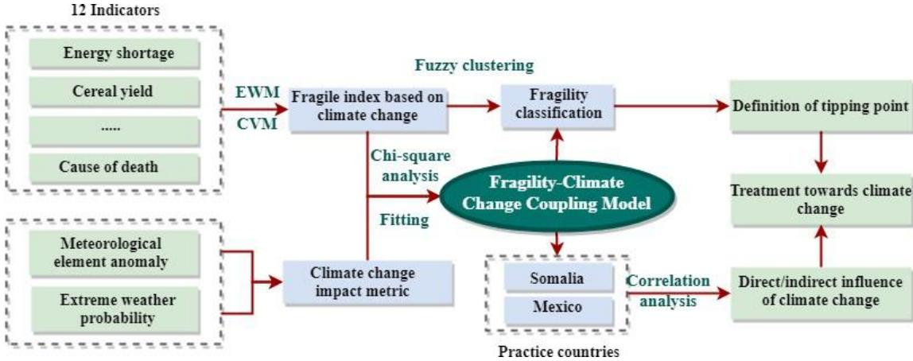

# 《数学建模》2018年MCM/ICM E题O奖论文：Climate counts! Less Fragility & better Countries

原件经识别和整理；“参考解答”是我们补的。

## 2018 MCM/ICM Summary Sheet

### Climate counts! Less Fragility & better Countries

#### Abstract

With the rapid increase of the climate change influence, considerable attention has been attached to so-called 'fragile' country. In order to measure the impact of climate change and propose reasonable state interventions, we establish the Fragile-Climate Change Coupling Model and other models based on the theory of country fragility and climate change.

In task 1, for the sake of numeric measurement of the climate change's influence, we introduce the anomaly of meteorological elements and the extreme weather probability, which make up the climate change index (CCI). Furthermore, 12 indicators closely related to the climate change from three aspects are selected primarily, and then entropy weight method (EWM) and coefficient of variation method (CVM) are applied to integrate the indexes into the fragility index based on the climate change (FCI). Moreover, fuzzy cluster analysis (FCA) is employed to clarify countries into four: impregnable, stable, vulnerable, and fragile.

In task 2, we select Somalia as a research object and analyze the correlation between its CCI and the 12 indexes in the fragile state index (FSI) to reveal the impact of climate change. The result indicates that the economic fragility is sensitive to CCI. Meanwhile, the social fragility has less reaction to climate change, and climate change has potential effect on politics.

In task 3, the Chi-square analysis and fitting method are employed to reflect the specific function relationship between FCI and CCI, by which we establish the Fragile-Climate Change Coupling Model. Thus, it comes to us that with the increase of climate change in Mexico, the fragility rises up correspondingly. We define the country tipping point in the light of the result of fuzzy cluster, and build up the climate change prediction model by utilizing the second exponential smoothing method. The conclusion is that a country reaches the tipping point when the CCI of the country drops down to 58.72, and it will probably fall into fragile country. When the other indexes reach their own critical points, it should also be vigilant.

In task 4, on the basis of three perspectives of fragility, we propose some human interventions aimed at the twelve fragility indicators. They are listed as follows: strengthen infrastructure construction, reuse of resources, improve the covering rate of gardening, return arable land to the water and so on. Then we establish the Intervention Cost Prediction Model, which is composed of the cost of intervention of economic recession, ecosystem sustainability, society habitability, and opportunity cost.

In task 5, we propose some modifications to apply our model into smaller or larger states. With the appropriate alteration of indicators of fragility and climate change, our models have high stability and extensive applicability.

Key Words: Climate change, Fragility, EWM, Fuzzy clustering

### Content

1. Introduction
   1.1 Background
   1.2 Our work
2. Assumptions and Justification
3. Notations
4. The Fragility Measurement on Climate Change
   4.1 Climate change index (CCI)
   4.2 Fragility index based on climate change
   4.3 Fragility identification
5. Fragility Analysis of Somalia
   5.1 Climate characteristics
   5.2 Correlation between CCI and FSI
6. Fragility-Climate Change Coupling Model
   6.1 Climate characteristics of Mexico
   6.2 Fragility-climate change correlation
   6.3 Definition of tipping point
7. Human Intervention and Cost Prediction
8. Modifications of our model
   8.1 Smaller states
   8.2 Larger states
9. Sensitivity Analysis
10. Strengths and Weaknesses
    10.1 Strengths
    10.2 Weaknesses

References

### 1. Introduction

#### 1.1 Background

When it comes to climate change, many studies can be referred to since people think more highly of the impacts climate change exerts on environment, economic and society. According to the Fifth Assessment Report (AR5)[1] from the Intergovernmental Panel on Climate Change (IPCC), climate change refers to the changes in climate state. The reasons account for that may be natural internal processes or external forces, like volcano eruption, or continuous human activities which result in the composition changes of atmosphere.

Moreover, the effects of climate change are likely to aggravate the breakdown of social and governmental structures, leading to fragile states consequently. Fragility is also be defined in AR5, which involves with various concepts and factors including the sensitivity towards harm and the lack of response or adaptability.

As a fragile country, it's economic, society and population will be more sensitive to the climate shocks such as extreme meteorological disaster, rising sea level, increasing global temperature and decreasing arable land. Correlating with poor governance and social fragmentation, environmental instability will trigger violent conflict undoubtedly[2].

#### 1.2 Our work

In order to find out the way that climate change effects on regional fragility, we are required to establish an evaluation index model which determines a country's fragility. By selecting appropriate evaluation indicators, we endow target weights and combine those low indicators to realize some comprehensive indexes. Subsequently, the established model will be applied to various countries to test its applicability and modifications will be proposed to improve it.

We will proceed as follows for the sake of tackling these problems:

State assumptions and make notations. Ignoring some insignificant impacts, we will narrow the core of our approaches towards regional fragility and climate change. Then we will list some notations which are important for us to clarify our model and determine their definitions.

Establish an evaluation index model which illustrates the fragility and measures the effects of climate change simultaneously. We will apply the fuzzy clustering method to expound a state's fragility, like fragile, vulnerable, or stable. How the climate change affect fragility is also needed.

Apply our model to one of the 10 most fragile states and another state not in that and investigate their actual influence factors. Then we will define a tipping point to judge when a country reaches it.

Introduce the human intervention. Human activities can do a favor to prevent a country becoming more delicate, which can be predicted from the results of our model. Subsequently, we propose some modifications to apply our model to some smaller or larger states.

# 2018年MCM/ICM E题O奖论文：Climate counts! Less Fragility & better Countries（第2部分）

kind: 课件
course: 数学建模
source: 《数学建模》教材，2018年MCM/ICM E题O奖论文《Climate counts! Less Fragility & better Countries》第4–6页识别内容

## 敏感性分析与模型评估

在定义了评估标准之后，我们评估模型的可靠性并进行敏感性分析。随后，我们将讨论我们模型的优缺点。

整个建模过程如下所示：

### 假设与合理性说明

为了简化给定的问题并使其更适用于模拟现实生活条件，我们做出以下基本假设，每个假设都有合理的理由支持。

我们假设国家作为一个整体单位，不考虑国家内部地区的差异。这一假设是我们进行深入研究的前提。对于一些领土广阔的国家，气候条件随纬度变化，不同地区的发展不平衡。

我们假设所有国家都对气候变化做出积极反应，并采取人为干预措施来降低国家的脆弱性，忽略那些被动的国家。

### 符号说明

我们在表1中列出本文使用的符号和注释。

**表1 符号说明**

| Symbols | Definition |
| :--- | :--- |
| ERI | Economic recession index (经济衰退指数) |
| ESI | Ecosystem sustainability index (生态系统可持续性指数) |
| SHI | Social habitability index (社会宜居性指数) |
| FCI | Fragility index based on the climate change (基于气候变化的脆弱性指数) |
| CCI | Climate change index (气候变化指数) |
| C | Pearson's contingency coefficient (皮尔逊列联系数) |
| TC | Total cost of human intervention (人为干预总成本) |

### 气候变化下的脆弱性测量

经济合作与发展组织（OECD）认为，如果一个国家缺乏管理人口和领土等基本国家职能的能力，缺乏政治能力或政治意愿去发展与社会的建设性相互促进关系，那么该国被视为脆弱国家[3]。

国家政策与制度评估（CPIA）是最广泛使用的评估系统之一，由四个集群组成：经济管理、结构政策、社会包容与公平政策以及公共部门管理与机构。这四个集群允许进一步细化，并可扩展为20个标准（现已减少至12个标准）[4]。

#### 气候变化指数（CCI）

正如最近的研究显示[1]，气候变化的核心影响主要集中在温度变暖、降水异常、海平面上升以及极端天气天数上。

##### 温度、降水、海平面指标

由于经度、纬度和海拔的不同，一个国家的气候特征如温度、降水或海平面差异很大。因此，我们定义年平均温度异常 $d_{1}$、年平均降水异常 $d_{2}$ 和年平均海平面异常 $d_{3}$，以及温度的年标准差 $\sigma_{1}$、降水的年标准差 $\sigma_{2}$ 和海平面的年标准差 $\sigma_{3}$ 来描述气候变化。

回顾气象学的基本知识，气候的狭义概念是天气的平均状态。世界气象组织（WMO）规定，气候因素30年的统计均值和变率可以代表原生气候的基本特征。

我们假设温度、降水和海平面指数服从分段分布。当一个国家的年度异常值 $d_i$ 超过30年的标准差 $\sigma_i$ 时，气候正在发生变化，其规模取决于它们的差异。因此，我们有：

$$
\varphi _ { i } = \left\{ \begin{array}{l l} e ^ {a | d _ {i} |} - 1 & 0 \leq | d _ {i} | <   \sigma_ {i} \\ b | d _ {i} | + c & \sigma_ {i} \leq | d _ {i} | <   2 \sigma_ {i} \\ h \ln (| d _ {i} |) + k & 2 \sigma_ {i} \leq | d _ {i} | <   5 \sigma_ {i} \end{array} \right.
$$

其中 $\varphi _ { 1 } , ~ \varphi _ { 2 }$ 和 $\varphi _ { 3 }$ 分别代表温度 $T$、降水 $P$ 和海平面 $L$ 的指标。由于函数是连续的，相同临界点的值是等价的。因此，我们将给出边界条件。

$$
\left\{ \begin{array}{l} e ^ {a \sigma_ {i}} - 1 = b \sigma_ {i} + c = 0 . 1 \\ 2 b \sigma_ {i} + c = h \ln (2 \sigma_ {i}) + k = 0 . 5 \\ h \ln (5 \sigma_ {i}) + k = 1 \end{array} \right.
$$

如图3所示，当年度异常值 $d _ { i }$ 在一个标准差 $\sigma _ { i }$ 内变化时，这是合理且常见的，因为存在微观扰动，因此该函数服从指数分布，并迅速趋向于气候变化，设定临界值 $\varphi _ { i } = 0 . 1$。随着年度异常值的增加，速度会逐渐减慢，从线性形状（设定临界值 $\varphi _ { i } = 0 . 5$），变为对数分布。于是我们有：

$$
\varphi_ {i} = \left\{ \begin{array}{l l} e ^ {\frac {\ln 1 . 1}{\sigma_ {i}} | d _ {i} |} - 1 & 0 \leq | d _ {i} | <   \sigma_ {i} \\ \frac {0 . 4}{\sigma_ {i}} | d _ {i} | - 0. 3 & \sigma_ {i} \leq | d _ {i} | <   2 \sigma_ {i} \\ \frac {0 . 5}{\ln 2 . 5} \ln (\frac {| d _ {i} |}{5 \sigma_ {i}}) + 1 & 2 \sigma_ {i} \leq | d _ {i} | <   5 \sigma_ {i} \end{array} \right.
$$

如图4所示，在全球变暖的背景下，极端天气灾害主要体现在高温和暴雨[6]。因此，结合温度和降水指标，我们可以构建极端天气指数 $E$。

# 《数学建模》2018年MCM/ICM E题O奖论文：Climate counts! Less Fragility & better Countries 第3部分

本文档整理自《数学建模》教材中收录的2018年美国大学生数学建模竞赛（MCM/ICM）E题获Outstanding Winner奖的论文《Climate counts! Less Fragility & better Countries》第3部分（原文第7-9页，对应模型构建章节）。内容涉及气候概率分布、气候变化影响指标（CCI）及基于气候变化的脆弱性指数构建。

## 4.1 Climate Change Impact Metric Construction

### 4.1.1 Temperature and Precipitation Distribution Model

假设一个国家一年的温度和降水服从正态分布，这一假设将在后文得到验证。我们可以推导出温度概率密度函数为：

$$
f (t) = \frac {1}{\sqrt {2 \pi} \sigma_ {i}} \exp (- \frac {(t - \mu_ {i}) ^ {2}}{2 \sigma_ {i} ^ {2}})\tag{4}
$$

其中 $f ( t )$ 是温度的概率密度函数，$t$ 是某地区的日平均温度，$\mu _ { i }$ 是年平均温度。

接着定义：当异常值超过两倍标准差时，天气被视为异常。由此可得异常温度的概率 $P ( t )$。同理，降水有相应的概率函数 $P ( p )$：

$$
P (t) = \int_ {\mu_ {i} + 2 \sigma_ {i}} ^ {\infty} f (t) d t, P (p) = \int_ {\mu_ {i} + 2 \sigma_ {i}} ^ {\infty} f (p) d p\tag{5}
$$

随后，计算极端天气指数 $E$：

$$
E = P (t) + P (p) = \int_ {\mu_ {i} + 2 \sigma_ {i}} ^ {\infty} f (t) d t + \int_ {\mu_ {i} + 2 \sigma_ {i}} ^ {\infty} f (p) d p\tag{6}
$$

因此，为了简化模型同时保持模型的有效性，我们选择温度异常、降水异常、海平面变化以及极端灾害天数作为关注点，以分析气候变化的影响。随后，对这些指数进行加权并整合为一个综合指标，该指标被认为能够代表气候变化的程度。由于难以衡量这些因子的实际比例，我们假设它们同等重要。

$$
C C I = \frac {1}{m} (T + P + \lambda L + E) \times 1 0 0\tag{7}
$$

其中 CCI 是气候变化影响指标，$T$, $P$, $L$, $E$ 分别是温度、降水、海平面和极端天气的评价指数。

考虑到内陆国家不受海洋影响，我们需要区分内陆国家和沿海国家。因此，我们有：

$$
\left\{ \begin{array}{l l} \lambda = 1, m = 4 & \text { coastal   or   island   country } \\ \lambda = 0, m = 3 & \text { landlocked   country } \end{array}\right.\tag{8}
$$

### 4.2 Fragility index based on climate change

#### 4.2.1 Primary indicator system

由于世界银行已有其评估体系，其选择的评估标准是从宏观和综合的角度出发的。为了建立气候变化与国家脆弱性之间的强关联，在解释环境压力与冲突之间联系的叙述基础上[5]，我们从三个层面定义了脆弱性评价指标。

##### (1) Economic recession

- **能源短缺 $X _ { 1 }$ (kwh per capita)**：当一个国家遭受气候冲击时，由于基础设施薄弱，该国对气候变化将更加敏感。因此，我们引入总电力与人口的比例来反映能源短缺情况。

- **谷物产量 $X _ { 2 }$ (kg per hectare)**：农业可能是对气候变化最敏感的部门之一。我们选择粮食生产来表示农业对气候变化的反应。该指标的值与脆弱性成反比。

- **洪水灾害经济损失 $X _ { 3 }$ (% of GDP)**：全球变暖可能加强水文循环，平均降水量趋于增加。洪水灾害会导致山洪暴发、农田被淹、基础设施破坏和人员伤亡。因此，我们引入洪水灾害经济损失占GDP的比例来表示灾害的影响。

- **干旱灾害经济损失 $X _ { 4 }$ (% of GDP)**：尽管某些地区的降水量可能增加，但由于全球平均气温上升，实际蒸发量也会同时增加。因此，我们定义干旱灾害经济损失占GDP的比例来象征干旱的压力。

##### (2) Ecosystem sustainability

- **森林面积 $X _ { 5 }$ (% of land area)**：森林生产力是判断树木生长和生态系统功能的主要因素之一。气候变化对森林的影响主要集中在温度压力等方面。因此，我们引入森林面积占国土总面积的比例来表示一个国家的森林覆盖率。

- **年度淡水资源 $X _ { 6 }$ (cubic meters per capita)**：淡水资源是人类生存的物质基础。气候变化可能导致地下水位下降和河流干涸。因此，定义人均年淡水占有量来说明气候变化的影响。

- **耕地面积 $X _ { 7 }$ (hectares per person)**：随着平均气温显著上升，冰川融化不可避免，导致海平面上升。直观的结果是耕地的减少。因此，我们引入人均耕地面积来描述其对气候冲击的反应。

- **温室气体排放 $X _ { 8 }$ (metric tons per capita)**：众所周知，温室气体排放与气候变化相互作用。因此，我们将人均温室气体排放量确定为气候变化的影响因素之一。

- **本土生物多样性 $X _ { 9 }$**：一些物种因无法适应新的生活环境而面临灭绝危险。因此，我们引入受威胁的本土物种数量作为生物多样性的反映，以应对气候变化。

##### (3) Society habitability

- **净迁移率 $X _ { 1 0 }$**：由于自然资源负担日益加重，气候变化的影响威胁着人类的自给自足能力。因此，我们定义净迁移率作为评价指标。

# 2018年MCM/ICM E题O奖论文：Climate counts! Less Fragility & better Countries（第4部分）

本资料整理自2018年MCM/ICM E题O奖论文的第4部分（共8部分），主要涵盖指标权重确定方法（熵权法、变异系数法）、模糊聚类分析以及脆弱性识别模型的构建过程。

## 一、指标权重确定方法

### 4.2.2 Weight of indicators

#### a. Entropy weight method

基于上述定义的评价指标，我们进一步确定这些指标的权重，从而形成一级指标的组合。回顾熵权法（EWM），我们将进行标准化处理，使得每个变量经过变换后的最优值和最差值分别为1和0。评价指标为 $X_1, X_2, X_3, \dots, X_k$，其中 $X_i = \{ x_{i1}, x_{i2}, \dots, x_{in} \}$。其中，$k$ 和 $n$ 分别是全球定义的评价指标数量和主权国家的数量，此处 $k=12$。

对于成本型指标，国家的脆弱性与指标值成正比。然而，对于收益型指标，值越高，国家越不脆弱。因此，我们有如下标准化公式：

$$
\left\{ \begin{array}{l} y _ { i j } = \frac {x _ {i j} - \min (x _ {i})}{\max (x _ {i}) - \min (x _ {i})} \\ v _ {y} = \frac {\max (x _ {y}) - x}{\max (x _ {i}) - \min (x _ {i})} \end{array} \right. \quad j = 1, 2, \dots , n \tag{9}
$$

其中 $y_{ij}$ 是每个国家每个评价指标的标准化值，$\max(x_i)$ 和 $\min(x_i)$ 是评价指标 $X_i$ 的最大值和最小值。
$$
\operatorname* { m a x } ( x _ { i } ) = \operatorname* { m a x } \left\{ x _ { i 1 } , x _ { i 2 } , . . . , x _ { i n } \right\} , ~ \operatorname* { m i n } ( x _ { i } ) = \operatorname* { m i n } \left\{ x _ { i 1 } , x _ { i 2 } , . . . , x _ { i n } \right\}
$$

标准化后，我们用 $y_{ij}$ 替换 $x_{ij}$ 以体现国家的脆弱性。接着引入：

$$
p = y _ {i j} / \sum_ {j = 1} ^ {n} y _ {i j} \tag{10}
$$

根据信息论中自信息和熵的概念，我们可以计算每个评价指标的信息熵 $E_i$，从而得到：

$$
E _ {i} = - \ln (n) ^ {- 1} \sum_ {j = 1} ^ {n} p _ {i j} \ln (p _ {i j}) \tag{11}
$$

基于信息熵，我们将进一步计算之前定义的每个评价指标的权重：

$$
w _ {i} = \frac {1 - E _ {i}}{k - \sum_ {i} E _ {i}} \quad i = 1, 2, \dots , k \tag{12}
$$

随后，我们可以得出三个综合评价指标：经济衰退指数、生态系统可持续指数和社会宜居度。下文将分别简称为 ERI、ESI 和 SHI。基于计算出的权重，我们有：

$$
\left\{ \begin{array}{l} E R I _ {i} = w _ {1} y _ {1 i} + w _ {2} y _ {2 i} + w _ {3} y _ {3 i} + w _ {4} y _ {4 i} \\ E S I _ {i} = w _ {5} y _ {5 i} + w _ {6} y _ {6 i} + w _ {7} y _ {7 i} + w _ {8} y _ {8 i} + w _ {9} y _ {9 i} \\ S H I _ {j} = w _ {1 0} y _ {1 0 j} + w _ {1 1} y _ {1 1 j} + w _ {1 2} y _ {1 2 j} \end{array} \right. \tag{13}
$$

#### b. Coefficient of variation method

此外，我们应用变异系数法对这些指数加权并合并为一个综合指标。因此，我们将简要介绍变异系数法的应用。

变异系数法（CVM）利用来自各种索引的信息，并通过计算获得每个索引的权重，这是一种给出权重的客观方法。

由于不同维度的影响，直接比较索引很困难，因此需要各索引的变异系数来衡量它们的差异程度。每个索引的公式可以表示为：

$$
V = \frac {\theta_ {i}}{\underset {i} {\overline {{z}}}} \quad i = 1, 2, 3 \tag{14}
$$

其中 $V_i$ 是索引 $i$ 的变异系数，也称为标准差系数，$\theta_i$ 表示索引 $i$ 的标准差。而 $z_1, z_2, z_3$ 分别代表 ERI、ESI 和 SHI。然后，每个索引的权重变为：

$$
W _ {i} = \frac {V _ {i}}{\sum_ {i = 1} ^ {n} V _ {i}} \quad i = 1, 2, 3 \tag{15}
$$

通过这种方式，我们能够在不带任何主观印象的情况下获得每个索引的权重。最后，在获得权重后，我们可以得出基于气候变化的综合指标——脆弱性指数 FCI：

$$
F C I = \left(W _ {1} \times E R I + W _ {2} \times E S I + W _ {3} \times S H I\right) \times 1 0 0 \tag{16}
$$

### 4.2.3 Fuzzy Cluster Analysis

结合之前建立的综合性脆弱性指标，我们将导入世界银行各国数据并计算 FCI 值。然后根据各自的值，我们使用马氏距离将这些国家划分为：不可穿透（impregnable）、稳定（stable）、脆弱（vulnerable）和易碎（fragile）。因此，我们可以通过 FCI 识别一个国家的脆弱性。由于这是一种传统方法，我们省略了其计算过程。

## 二、脆弱性识别

### 4.3 Fragility identification

在建立脆弱性-气候变化耦合模型时，我们假设 $n$ 是全球主权国家的数量，这在实施上过于复杂。因此，我们选择了20个分布在世界各地、地理位置、经济程度和气候特征各不相同的国家，将在后面列出。

# Climate counts! Less Fragility & better Countries (Part 5)

本部分整理自《数学建模》2018年MCM/ICM E题O奖论文，内容涵盖脆弱性评估指标权重、国家聚类分类标准及索马里案例分析。

## 一、评估指标与聚类分析

### 综合指标权重表

表 2 列出了十二个评估指标和三个综合指数的权重值。

| 一级指标 | 二级指标 | 权重 | 三级指标 | 权重 |
| :--- | :--- | :--- | :--- | :--- |
| **Fragility** (脆弱性) | Economic recession (经济衰退) | 0.1145 | Energy shortage (能源短缺) | 0.2912 |
| | | | Cereal yield (谷物产量) | 0.1227 |
| | | | Economic loss in flood disaster (洪灾经济损失) | 0.1648 |
| | | | Economic loss in drought (旱灾经济损失) | 0.1971 |
| | Ecosystem sustainability (生态系统可持续性) | 0.6055 | Forest area (森林面积) | 0.2965 |
| | | | Annual fresh water (年淡水总量) | 0.2083 |
| | | | Arable land (耕地面积) | 0.1122 |
| | | | Greenhouse gas emissions (温室气体排放) | 0.1954 |
| | | | Native biodiversity (本土生物多样性) | 0.1876 |
| | Society habitability (社会宜居性) | 0.2800 | Net migration (净移民) | 0.1986 |
| | | | Cause of death, by natural disasters (自然灾害致死原因) | 0.5177 |
| | | | Prevalence of infection (感染流行率) | 0.2837 |

基于表 2 中给出的具体指标数值，我们计算了选定国家的脆弱性指数（FCI），并应用模糊聚类法将这些国家划分为四类：不可攻破（impregnable）、稳定（stable）、脆弱（vulnerable）和极度脆弱（fragile）。数值越高，代表国家越脆弱。

聚类结果如下所示（对应原文图 5 描述）：
- 横轴序列号代表国家：
    1. Afghanistan (阿富汗); 2. Bangladesh (孟加拉国); 3. Barbados (巴巴多斯); 4. Canada (加拿大); 5. Colombia (哥伦比亚); 6. Cuba (古巴); 7. Dominica (多米尼加); 8. Eritrea (厄立特里亚); 9. Finland (芬兰); 10. France (法国); 11. Georgia (格鲁吉亚); 12. Iran (伊朗); 13. Mali (马里); 14. Mauritius (毛里求斯); 15. Paraguay (巴拉圭); 16. Senegal (塞内加尔); 17. South Sudan (南苏丹); 18. Trinidad and Tobago (特立尼达和多巴哥); 19. Tunisia (突尼斯); 20. United States (美国)。

根据图 5，一旦计算出经济韧性指数（ERI）、生态系统可持续性指数（ESI）、社会宜居性指数（SHI）和综合脆弱性指数（FCI），即可确定国家的脆弱性分类标准。如图 6 所示，三个综合指标及综合度量的分类标准略有不同。由于它们关注的焦点（经济、生态系统、社会及综合发展）侧重于国家发展的不同方面，最终的脆弱性排名也会随之不同。

颜色越深，代表国家越脆弱。根据分类标准，综合度量下的脆弱性排名显示，“稳定”国家占绝大多数，成功在引导可持续发展方面取得了平衡。

原版的“脆弱国家指数”（Fragile States Index 2017, FSI）排名（见图 7）与我们建立的基于气候变化的脆弱性指数（FCI）吻合良好。我们选取了六个国家作为示例。

例如，南苏丹实际上是世界上最为脆弱的国家，原因在于其贫困、基础设施薄弱以及相对基础的农业技术。同样，它对气候变化更为敏感，使其成为最脆弱的指数对象。而对于像美国这样的发达国家，作为全球超级大国，其坚固的基础设施和先进技术决定了其更容易应对气候变化，因此被归类为“不可攻破”。

## 二、索马里脆弱性分析

### 5. 索马里的脆弱性分析

#### 5.1 气候特征

排名第二的索马里位于非洲大陆的索马里半岛，濒临印度洋。它是世界上最不发达的国家之一，工业脆弱，粮食短缺，且常受自然灾害影响。索马里大部分地区属于亚热带和热带沙漠气候。其典型特征是全年高温，环境干燥或无雨 [7]。

如图 8 所示，索马里 24 年的平均气温为 $26.5^{\circ}C$，很好地说明了其高温特征。年气温波动范围很小：从 $-0.5^{\circ}C$ 到 $0.5^{\circ}C$。随后我们对温度和降水进行了正态分布验证，过程如下。

根据图 9，日平均气温和降水的散点图与正态分布曲线拟合得非常好。因此，我们在建立气候变化指数（CCI）时使用的假设是合理且实用的。

#### 5.2 CCI 与 FSI 的相关性

为了更深入地研究气候变化的影响，我们利用皮尔逊相关分析法，研究了过去 30 年间气候变化与索马里几个 FSI 指数之间的关系。相关系数如表 3 所示。

**表 3 气候变化与 FSI 各指标的相关系数**

| 指标 | Security apparatus (安全机构) | Factionalized elites (派系精英) | Group grievance (群体不满) | Economy (经济) |
| :--- | :---: | :---: | :---: | :---: |
| **相关系数** | 0.1327 | 0.0028 | 0.4007 | 0.6528 |

| 指标 | Economic inequality (经济不平等) | Human flight and brain drain (人才外流与脑流失) | State legitimacy (国家合法性) | Public services (公共服务) |
| :--- | :---: | :---: | :---: | :---: |
| **相关系数** | 0.5431 | 0.3287 | 0.0028 | 0.2758 |

| 指标 | Human rights (人权) | Demographic pressures (人口压力) | Refugees and IDPs (难民与国内流离失所者) | External intervention (外部干预) |
| :--- | :---: | :---: | :---: | :---: |
| **相关系数** | 0.1279 | 0.5628 | 0.6526 | 0.0167 |

### 6. Fragility-Climate Change Coupling Model

#### 6.1 Climate characteristics of Mexico

Because of the many plateau and mountainous areas, the climate of Mexico is complexed and various. The vertical climate is characterized. In most areas, they can be clarified as drought and rain seasons.

As is illustrated in the Fig.11, the FCI of Kenya rise up rapidly between 2006 and 2008, and then it fluctuates at a high level. It is displayed by the linear trend line of CCI that though the level of CCI doesn’t keep increasing, the overall trend is to rise up, and the impact of the CCI is to improve the index FCI .

#### 6.2 Fragility-climate change correlation

In order to confirm the correlation between climate change and fragility of the country, we will conduct Chi-square analysis between FCI and CCI . According to the values of FCI , CCI , we will have the basis matrix $M$

$$
M = \left[ \begin{array}{c c c c} m _ {1 1} & m _ {1 2} & \dots & m _ {1 n} \\ m _ {2 1} & m _ {2 2} & \dots & m _ {2 n} \end{array} \right]\tag{17}
$$

Where $m _ { 1 j }$ represents $F C I _ { j }$, $m _ { 2 j }$ represents CCI . Then, we can calculate chisquare value $\chi ^ { 2 }$ :

$$
\chi^ {2} = g \sum_{j = 1} ^ {n} \sum_{i = 1} ^ {2} (\frac {m _ {i j}}{g _ { i } g _ { j}}) - 1 \tag{18}
$$

Where $g = \sum _ { i = 1 } ^ { 2 } \sum _ { j = 1 } ^ { n } m _ { i j }$, $g _ { i } = \sum _ { j = 1 } ^ { n } m _ { i j }$, $g _ { j } = \sum _ { i = 1 } ^ { 2 } m _ { i j }$. Then the Pearson’s contingency coefficient C comes to us

$$
C = \sqrt {\chi^ {2} / (g + \chi^ {2})}\tag{19}
$$

The higher the value of C , the more closely the correlation between climate change effects and fragility of the country.

In order to measure the effects of climate change on fragility, we assume that without the influence of climate change, the country’s fragility is very small. When it is shocked by climate change, the fragility will increase rapidly, with the exponential formation, thus we have

$$
F C I = r \times \exp (l * C C I + u) \tag {20}
$$

where r , l , u are the regression coefficients derived from the fitting curve.

As is shown in Fig.10, by analyzing the relationship between climate change impact index and the national vulnerability in the last thirty years in Somalia, we can see that when climate change impact index grow, the national vulnerability approximately presents positive exponential function, which is estimated as:

$$
F C I = 2 1. 2 5 * \exp (0. 0 6 3 6 C C I + 0. 0 0 1 4)\tag{21}
$$

The good-of-fit test of our coupling model is 0.5317. The result is not perfect, because climate is random complexity, however, our fitting model still elaborate vital phenomenon. That is when climate change is very intense, the country is rather fragile. Without the effects of climate change, the value of CCI is 0 and FCI is a constant. The country’s fragility will be so small that we can identify it as stable or impregnable.

#### 6.3 Definition of tipping point

The climate change always exists and every country more or less is influenced by it. But not all of the country will fall into the ‘fragile’ country under the pressure of climate change. However, some of them inevitably change into fragile country, and each of them has gone through the tipping point between ‘stable’ and ‘fragile’. In this part we will discuss about the definition of tipping point based on the conclusion of Fragility-Climate Change Coupling Model.

To begin with, it’s hard to give a precise point of time when will the country fall into fragile country, but we can learn the circumstance that the country will soon become fragile country. What we need to do is that illustrate this critical point which is shown by the value of indexes. And from what was discussed above, we can fairly know that when one country’s FCI drop down to 63.29, it enters the fragile country rank. However, a country’s critical point is ought not to be just one index, for when one aspect shows to be hazardous for one country’s fragility, it may not be reflected in the comprehensive index, but it really need to be noticed. Therefore, we list the tipping point for each aspect in Table 4.

**Table 4 Tipping point for each aspect**

| Aspect | ERI | ESI | SHI | FCI |
| :--- | :--- | :--- | :--- | :--- |
| Value | 71.25 | 62.15 | 59.49 | 63.29 |

When the value of above parameters reach the level in the table, the country should keep vigilant against the influence of climate change, which already goes to a high level and the country would slid to the rank of fragile country.

According to the research of IPCC, it comes to us clearly that the world is Irreversibly warming and different weather disasters take place more frequently. Based on the conclusion of Fragility-Climate Change Coupling Model, we can easily get the relationship between CCI and FCI . Substitute the value of tipping point into the formula, we will derive that when the CCI comes to 58.72, the country experiences the critical point, which should be attached close attention to.

# Climate counts! Less Fragility & better Countries

本文档整理自《数学建模》教材引用的2018年MCM/ICM E题O奖论文第7-9部分，涵盖气候预测模型、人类干预策略及模型修正与敏感性分析。

## 二、气候预测模型

使用二次指数平滑法建立气候变化预测模型（Climate Change Prediction Model）。其公式表达为：

$$
\left\{ \begin{array}{l} S _ {t} ^ {(1)} = \alpha y _ {t} + (1 - \alpha) S _ {t - 1} ^ {(1)} \\ S _ {t} ^ {(2)} = \alpha S _ {t} ^ {(1)} + (1 - \alpha) S _ {t - 1} ^ {(2)} \end{array} \right.\tag{22}
$$

其中 $S _ { t } ^ { ( 1 ) }$ 是一次指数平滑值，$S _ { t } ^ { ( 2 ) }$ 是二次指数平滑值。当参数趋势呈现直线时，可采用直线模型：

$$
M _ {t + m} = a _ {t} + b _ {t} m \quad m = 1, 2 \dots\tag{23}
$$

$$
\left\{ \begin{array}{c} a _ {t} = 2 S _ {t} ^ {(1)} - S _ {t} ^ {(2)} \\ b _ {t} = \frac {\alpha} {1 - \alpha} (S _ {t} ^ {(1)} - S _ {t} ^ {(2)}) \end{array} \right.\tag{24}
$$

*(注：原文公式(24)存在识别乱码，根据二次指数平滑标准理论订正)*

其中 $M _ { t + m }$ 表示CCI（Climate Change Index）的值。基于该模型，我们可以预测气候变化的强度，结果显示到2023年，墨西哥的CCI将飙升并超过58.72，这意味着它将沦为脆弱国家。

### 7. 人类干预与成本预测

我们的“脆弱性-气候变化”耦合模型展示了气候变化与国家脆弱性之间的相互作用。如果一个国家稳定或不可侵犯，它提高了抵御气候变化风险的能力。这是一个正反馈系统。接下来，我们将提出一些由国家驱动的干预措施，以提高应对气候变化的能力并减轻气候变化的风险。

基于我们建立的十二个脆弱性指标，我们从暴露度（Exposure）、敏感度（Sensitivity）和适应能力（Adaptive capacity）[6]的角度提出了一些干预措施。
*   **暴露度**指国家遭受气候变化压力的程度。
*   **敏感度**反映内部系统对气候变化的敏感程度。
*   **适应能力**描述内部系统对气候变化的响应和适应程度。

#### (1) 经济衰退应对

*   **加强基础设施建设**。像大坝或排水系统这样的基础设施在面对洪水、暴雨等自然灾害时至关重要。这一措施将有效减少经济损失和人员伤亡。
*   **资源再利用**。发电消耗大量燃料，导致温室气体排放。资源的再利用将大幅减少空气污染并节约能源，从而减缓气候变化。

#### (2) 生态系统可持续性

*   **提高绿化覆盖率**。造林和森林保护可以改善生态系统，遏制水土流失，抵抗沙尘暴损害。实施这些措施可以降低对气候变化的脆弱敏感度。
*   **退耕还林/还水**。这一措施不仅有助于防洪，还能保护生态系统，从而提高国家的生态系统稳定性。

#### (3) 社会宜居性

*   **提高社会保障福利**。如果大多数人在遭受气候灾害冲击时能获得社会保障福利，国家将更加稳定，人们相处得更加和谐。
*   **提高基层医疗机构的服务水平**。当气候变化带来冲击时，传染病的流行会迅速增加。通过完善的治疗手段，我们可以将伤亡降至最低。

因此，我们可以建立干预成本预测模型：

$$
T C = E R C + E S C + S H C + T C\tag{25}
$$

其中 TC 是人类干预的总成本，ERC、ESC、SHC 分别是经济衰退、生态系统可持续性和社会宜居性的干预成本，TC（此处符号复用，实指机会成本）是机会成本。机会成本是为了降低国家脆弱性而放弃的经济发展利益。

## 三、模型的修正

为了使模型适用于更小的“国家”（如城市）或更大的“国家”（如大陆），我们的耦合模型仍然适用，但预测精度会有所下降。因此，我们需要提出一些修改意见来改进我们的模型。

### 8.1 较小的区域（如城市）

*   大多数温室气体排放来自城市，源于化石燃料的消耗，用于发电、交通、照明等。因此，必须调整我们模型的权重以适应城市的实际情况。例如，应增加温室气体排放的权重。
*   城市的排水系统等基础设施在很大程度上决定了其对脆弱性的影响。因此，城市脆弱性的指标必须更加详细，如基础设施建设、可再生能源等。此外，我们还应考虑国家的宏观调控政策。

### 8.2 较大的区域（如大陆）

*   就大陆而言，其广阔的陆地决定了气候变化将更加复杂多变。高纬度地区的冰川融化和冻土融化应被考虑在内。同时，海洋间的大规模循环，如沃克环流、温盐环流以及厄尔尼诺-南方涛动（ENSO），是气候变化的主要关注点。
*   大陆的脆弱性也需要改变。由疾病爆发、饥荒或军事行动引起的大规模难民迁移，可能会对大陆的脆弱性产生巨大影响。那些指标的权重不可避免地发生变化。

## 四、敏感性分析

在现实生活中，统计数据往往不准确，我们的模型输入可能存在偏差。这些偏差可能会影响模型的结果。为了测试我们模型的鲁棒性，在本节中，我们将分析任务三中气候变化预测模型的敏感性。敏感性分析的结果表明，我们的模型表现出完美的稳定性。

# 《数学建模》2018年MCM/ICM E题O奖论文：Climate counts! Less Fragility & better Countries 第8部分

## 一、预测与模型稳定性分析

### 预测墨西哥气候脆弱性指数（CCI）

在任务3中，我们使用二次指数平滑法预测2023年墨西哥的CCI将超过58.72，这表明如果不采取行动应对气候变化，墨西哥将在2023年陷入脆弱国家行列。在本节中，我们通过曲线拟合预测了墨西哥的拐点。拟合结果显示，在2020年，CCI超过了58.72，这与之前的结果接近。此外，通过改变曲线拟合参数并设置95%置信区间（如蓝色阴影部分所示），我们发现我们的模型仍然稳定，且拐点范围从2019年到2021年。与过去的结果相比，误差约为2-4年，这在可接受范围内。这显示了模型的稳定性，能够解决现实生活中的实际问题。

## 二、优缺点分析

### 优点

本文建立的脆弱性与气候变化耦合模型基于脆弱性理论和IPCC的研究成果，因此相对严谨。

- 基于气候变化的脆弱性指数结果与选定的FSI（脆弱国家指数）排名吻合良好，表明我们的模型合理且有效。
- 我们的评价指标从三个角度确定：经济衰退、生态系统可持续性和社会宜居性。全面客观地描述了一个国家的脆弱性。

### 缺点

忽略全国气候分布的差异，我们使用全国平均水平来描述国家的气候特征，这可能会降低我们模型的准确性。

我们认为所有国家都对气候变化做出积极反应，忽略了那些被动应对的国家，这可能会影响我们对干预成本预测模型的影响。

## 三、参考文献

[1] Pachauri R K, Allen M R, Barros V R, et al. Climate change 2014: synthesis report. Contribution of Working Groups I, II and III to the fifth assessment report of the Intergovernmental Panel on Climate Change. IPCC, 2014.

[2] Theisen, O.M., Gleditsch, N.P., and Buhaug, H. “Is climate change a driver of armed conflict?” *Climate Change*, April 2013, V117 (3), 613-625.

[3] Stewart F, Brown G. Fragile states. University of Oxford. Centre for research on inequality, human security and ethnicity (CRISE), 2009.

[4] Bandura R. A survey of composite indices measuring country performance: 2008 update. New York: United Nations Development Programme, Office of Development Studies (UNDP/ODS Working Paper), 2008.

[5] Krakowka, A.R., Heimel, N., and Galgano, F. “Modeling Environmental Security in Sub-Saharan Africa – ProQuest.” *The Geographical Bulletin*, 2012, 53 (1): 21-38.

[6] Liu Yang. Study on the social and economic effects of global climate change on the estuary and coastal areas of the Yangtze River Delta. East China Normal University, 2014.

[7] Somalia: https://en.wikipedia.org/wiki/Somalia

[8] Schwartz, P. and Randall, D. “An Abrupt Climate Change Scenario and Its Implications for United States National Security”, October 2003.

[9] Fragile States Index: http://fundforpeace.org/fsi/

[10] The World Bank: http://www.worldbank.org/en/topic/fragilityconflictviolence/brief/harmonized-list-of-fragile-situations
