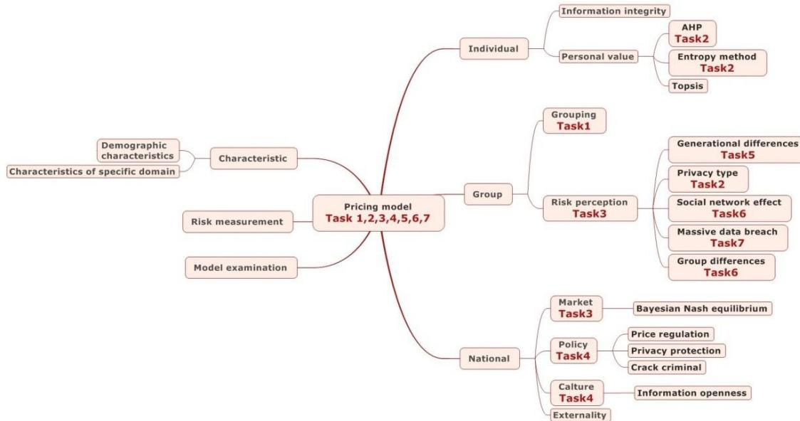
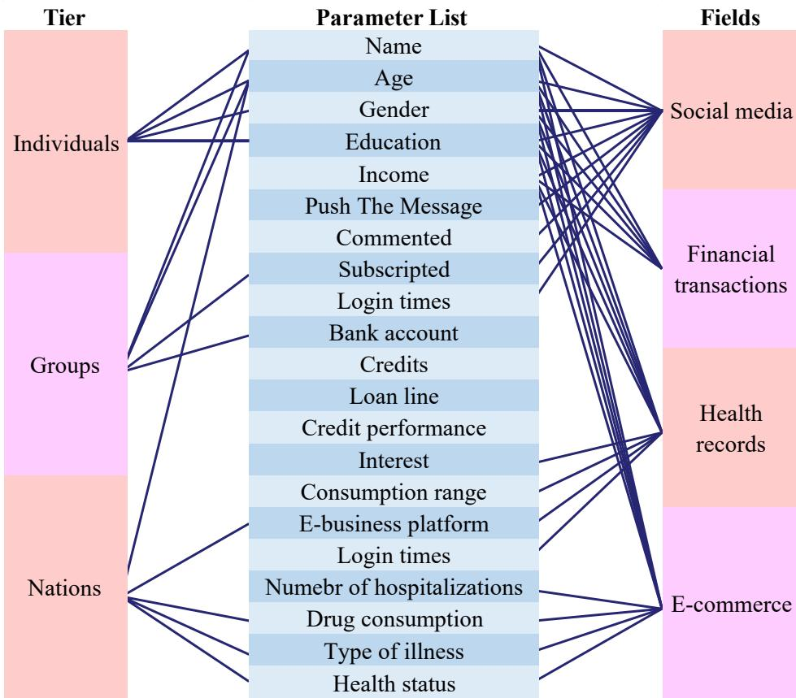
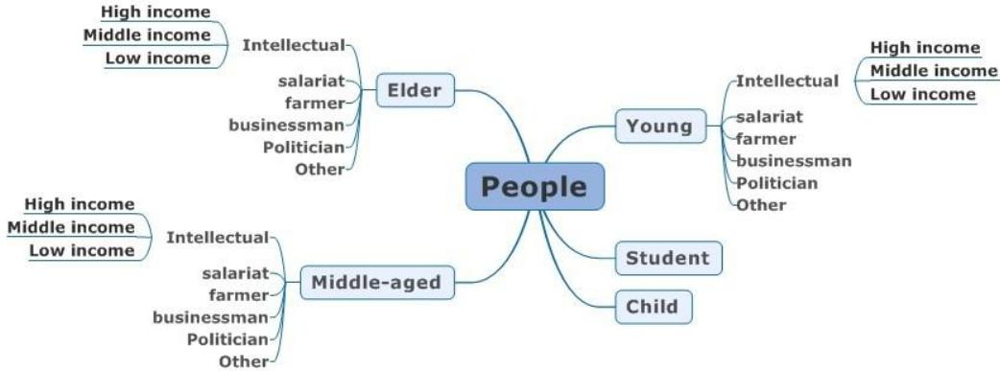
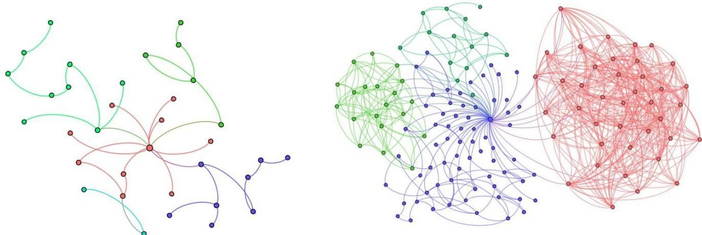
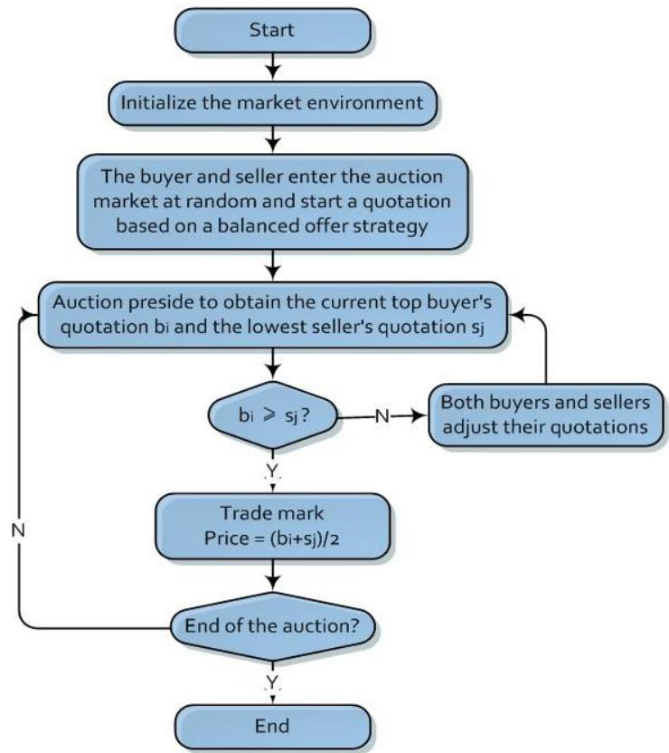

# 《数学建模》2018年美赛O奖论文：A Smart Privacy Commodity: a Quantitative Model of Dynamic Pricing Strategy

原件经识别和整理；“参考解答”是我们补的。

本文档整理自2018年美国大学生数学建模竞赛（ICM）获得特等奖（Outstanding Winner, O奖）的论文《A Smart Privacy Commodity: a Quantitative Model of Dynamic Pricing Strategy》的第一部分，即摘要页（Summary Sheet）。内容涵盖了模型构建思路、核心方法、结果分析及创新点。

## 一、模型概述

### 背景与目标

该论文旨在建立一个模型，以精确量化私人信息（Private Information, PI）的价格和风险，并据此得出隐私管理的最佳策略。

为了实现这一目标，作者创新性地将模型分解为两个子问题：
1. 私人信息定价模型（Model of PI price set）
2. 隐私风险模型（Model of privacy risk）

### 私人信息定价模型的构建

#### 1. 个体层面（Individual Scope）

- **数据收集**：首先收集了社交媒体、金融活动、医疗和电子商务四个领域中个体的基本特征。
- **定义变量**：定义了题目中给出的私人信息（PI）、个人偏好（PP）和身份信息（IP）。
- **权重确定**：采用熵权法（Entropy Method）与层次分析法（AHP）相结合的加权组合，确定了上述四个领域的权重。
- **模型建立**：基于TOPSIS综合评价法和私人信息的一致性权衡，构建了个体层面的隐私定价模型。

#### 2. 社区层面（Community Scope）

- **人群细分**：借鉴多路树理论（multiway tree theory），根据年龄、职业、收入将人群划分为具有相似特征的子社区，以精确衡量社区层面的私人信息价格。
- **风险感知量化**：考虑任务要求，精确量化了风险感知（Risk Perception），其由以下因素决定：
    - 隐私类型
    - 代际差异
    - 网络效应
    - 数据泄露
    - 社区差异
- **关键发现**：
    - **代际差异**：20-30岁的人群最愿意分享信息，且随着年纪增长，这种意愿呈下降趋势。
    - **数据泄露影响**：数据泄露会导致信息共享意愿大幅降低，且在短时间内难以恢复。
- **动态变化模型**：考虑到时间因素，结合马尔可夫链模型（Markov Chain Model），通过贝叶斯定理计算转移概率矩阵，得到了风险感知随年份动态变化的过程。
- **综合定价**：将个体层面的隐私定价模型与风险感知模型相结合，得出社区层面的私人信息定价模型。

#### 3. 国家层面（Nation Scope）

从三个方面分析了国家层面的定价模型：
- **市场方面**：使用贝叶斯纳什均衡（Bayesian Nash Equilibrium）。
- **政策方面**：考虑宏观调整与控制政策、隐私权威政策以及打击信息泄露和非法交易的政策。
- **文化方面**：考虑信息透明的氛围。
- **结果**：得出国家层面的定价模型，四个领域的总金额为 $783$。

## 二、风险模型与分析

- **定性分析**：对不同领域、不同社区面临的不同类型的风险进行了定性分析并进行了测量。
- **回答问题**：基于上述模型，回答了任务4、任务6和任务7提出的问题。

## 三、模型检验与分析

- **实际数据验证**：使用真实数据对模型进行了检验。模型的误差小于等于 $0.17$，表明模型具有很高的实用性。
- **误差分析与稳健性分析**：结果显示模型具有良好的稳健性，意味着模型高度可靠。
- **总结与展望**：最后总结了模型的优势和不足，并为未来发展提供了蓝图。

## 四、创新点

1. **因素考量全面**：考虑了足够多的影响因素。
2. **可视化对比**：在网络效应的逻辑模型中，随机选取了2012年和2032年两个时间点，使用可视化方法比较其变化，从而回答任务6中的问题。
3. **外部效应量化**：考虑了不同领域的私人信息具有不同的影响力（如对公共利益有益或危害国家安全），并量化了外部效应，使模型得到优化。

综上所述，该模型回答了所有给定问题，具有创造性和实用性。

Keywords: Pricing Model of PI; Risk Model of PI, Topsis Method; Markov Chain; External Effect

### Dr.DecisionMaker

### Director of ICM

Dear Dr. Decision Maker:

Thank you for working with us to design a plan to quantify the cost of privacy of electronic communications and transactions across society. We have developed a model to address your concerns about the cost of privacy.

Through the model, we found out the value and risk of PI in all fields. The value and risk can be divided into two categories according to their nature: personality and economic rights. Therefore, we suggest that when discussing the privacy rights of information, it should be divided into two categories. When PI plays the role of safeguarding the value or function of human dignity, it should give the right of personality determination; when PI plays the value or function of the property, it should be given the rights of property; when playing dual functions, it should be based on double recognition.

In the model we evaluated different elements. The conclusion is that the importance of the different elements of the data is various. For example, the value of ID number is higher than that of age. People are also different in their willingness to expose them, and their losses after being illegally used are also quite different. Therefore, our advice on the protection and use of information is as follows.

First, the information is divided into personal general information and personal sensitive information. On the basis of the distinction, it strengthens the protection of sensitive personal information and strengthens the use of general personal information. The classification is based on the PI types. Such as age or sex is a less-sensitive message which can be enhanced use. More sensitive personal information, such as hobbies and political preferences, should be based on respect for the individual's wishes. Bank card number, physical condition and other the most sensitive information should be strictly protected and strictly controlled its use. Reconcile the conflict of needs protection and utilization of personal information and achieve the balance of interests.

Our generational difference model reflects intergenerational differences in the population. The 20-30 age group has an open attitude toward the sharing of personal information, much higher than other age groups. However, because young people have less social experience, they are not aware of the risks posed by the sharing of personal information. Therefore, the blind sharing of personal information may bring greater risks. The government should strengthen its information security education for this group. While other age groups remain closed to information sharing, which will reduce the efficiency of using personal information. The government should strengthen the protection of information and reduce their vigilance.

Through the model we also found that the use of personal information will have external benefits which cannot be detected by general measures. This is of great importance when considering the value of the entire social PI. This external effect may be positive or negative. For the positive externalities, such as the use of PI can reduce the overall social losses in the field of disease control. These are the market regulation can not capture and government support and regulation. Similarly, negative externalities also require government control.

An information leak event is a contingency which will cost so much. As we can see from our risk perception model, when Information leakage event occurs and exposed to public view, the public's trust in information sharing will rapidly decline and it will be hard to recover in a short time. After the information leaked，the probability of their loss is greatly increased resulting from harassment and fraud. This will affect the personal life and social stability. These losses are caused by the mismanagement of the information controller, which entitles the individual to claim against the enterprise or agency.

POLICY MEMO

February 13, 2017

Our model defines PI values and risks that provide direction for the utilization and protection of PI. Among these, the trade-off between the use of information and information protection is an eternal topic. Personal information is "information that can identify one's identity," and identifiable factors can have an impact on the protection of the rights and interests of the main body of information and the utilization of the company.

In the model of risk identification，we find that most of the risk comes from "Information that can identify one's identity". But from the value model, it can be seen that "Information that can identify one's identity" is not an important factor. Therefore, "personal factors eliminating" can be done during the collection, storage, processing and utilization of PIs. For example, when personal information is used in targeted marketing of financial transactions, removing a single person's explicit identification does not affect the analysis of the characteristics of a consumer group. Therefore, in the collection process, unless the consent of the main body of information ， the relationship between the personal characteristics and the specific identification information should be cut off.

At the same time, focusing on information leakage is the most important aspect of information protection. In the era of big data, Internet users in the personal information, comments, pictures, hobbies, transaction information, visit the website, etc. were recorded by the enterprise. Coupled with powerful data mining technology, making information interrelated, once the data leaked, personal information security is facing a great threat.

In order to reduce the risk of leakage and reduce losses, the advice we give based on our model as follow.

The conclusion for in the country-level pricing model is that the national policy of combating the crime of information theft will reduce the information leakage rate. Therefore, we suggest that the state should strictly legislate to crack down on crimes. Second, raising security awareness from the individual, business, social level, and making information safe to share. Third, prevent staff leaks is very important. Data breach survey report in 2008 shows that only 18% of the information leakage is due to Internal staff leaked. But its destructive power is obviously greater than the external damage. Therefore, we must do a good job of the confidentiality of internal staff.

Sincerely,

Team#88508

## 1 Introduction

### 1.1 Background

> "App makers sometimes like to test the limits to see what they can get away with, before users decide to turn off a feature because they aren't comfortable with the amount of personal data being provided, or the audience that it's being shared with."
>
> —— Daniela Relph, Alan Turing Institute, quoted from a BBC article

> "People always want to give yourself some privacy space, just like you will always be standing in front of the shadow of you blocking the line of sight of the light."
>
> —— Laura Sheeter, LSE, quoted from a BBC article

At the moment, webcasts and social media are sweeping across the globe. Life sharing and information dissemination have become the main theme of today's society. Especially in today's Internet era and big data era, every move of our lives is recorded and controlled. Social media has become a window to people's lives, and strangers can know about it through this window. Some people believe privacy is very important and it needs protection, while others think privacy can be shared. Therefore, the discussion of privacy is particularly necessary. We view privacy as a commodity that can be quantified and traded and to establish our model.

### 1.2 Restatement and Clarification

Our team is certain to construct a policy model, which include a set of policy recommendations that will create an efficient privacy pricing plan. To find out the optimal strategies, we need to construct models, run simulations and present the visualized results. Our model should be scalable, multilayered and dynamic. However, trade-offs should be made if some objectives contradict.

We aim to solve the following problems:

- Categorize individuals into various subgroups and develop a price point for protecting one's privacy and PI in various applications. And define a set of parameters, measures from the perspective of individuals and specific domain of information.
- Based on some trade-offs, a privacy cost model is built by grouping the weights of the four domains (social media, financial transactions, health/medical records, electronic commerce).
- The privacy pricing model is set up from the perspective of individuals, groups and entire nations respectively. The model needs to take into account the relationship between supply and demand and personal preference.
- State the assumptions and constraints of the model established and define whether information privacy is a fundamental human right. Introduce dynamic elements to explore changes in people's values.
- Answer the question of whether there are generational differences in perceptions of the risk-to-benefit ratio of PI and data privacy. Explain the effects of age and distinguish the influence of PI, PP and IP.
- Using the optimized method to capture the network effect of data sharing, to answer the question of which subjects are affected, and the responsibilities that come with the community.
- How to adjust the model if the privacy data is lost or abused? Answer the question of how the responsible institution of the violation should perform the liability.
- In addition to using real data to test the stability of the model, sensitivity analysis is also used.

### 1.3 Overview of Our Work

We divided the PI into four areas: social media, financial transactions, health records, and e-commerce, then analyze the properties and characteristics of PI, and answer the problems raised by the task 5 that difference between the PI, PP, and IP. At the same time integrated Task1-7, we set up pricing models from three levels: individuals, groups and countries. We conducted a selection of individual characteristics and specific information areas characteristics, and combine Analytic Hierarchy Process and Entropy method to determine the weight of characteristics in the four areas. Finally, based on the TOPSIS method and combined the Information Feature Completeness, We established a PI pricing model of individual level.

We classify people based on their personal characteristics and different areas, such as age, occupation characteristics, income and so on. Integrated task 2, task 5, task 6 requirements, we introduce the concept of group risk perception, which is determined by the type of privacy, intergenerational differences, social network effects, data breaches, group differences. We set up a social network effect model to capture the dynamic process of social network effects.

Analyze the national level from a market perspective, policy perspective, cultural perspective. The market uses the Bayesian Nash equilibrium model. Policy considerations Market macro-control policies, Personal privacy protection policies, cracking down on information disclosure and illegal trading. Cultural perspectives consider the open atmosphere of information at the national level. Then we use the external effect to optimize the pricing model. After that, we measured the risk of different characteristic people and different information fields. Finally, we conducted a correctness test, error analysis and robustness analysis.



## 2 General Assumptions and Justifications

We make the following basic assumptions in order to simplify the problem. Each of our assumptions is justified and is consistent with the basic fact.

*   It is assumed that people can control the supply of their PI in the market.
*   Suppose people's PI and related data is a valuable and quantifiable commodity.
*   Assuming different people's PI, different areas of PI, different combinations of PI, all have different values.
*   Once PI enters the market, it will be dominated by the law of the market.
*   Assuming that government regulations and policies are mandatory and effective, it can affect the supply and demand of PI in the market.
*   Assume that the general trend of society is more and more inclined to share PI.
*   Assume that once the PI is leaked, it will become part of the identity theft ring.

## 3 Data Sources and Variable Description

### 3.1 Data Sources

The selection of data is of great significance to the model. The authenticity and extensiveness of the data make the model more practical. After repeated search, We found the real data involved in the Acquisti article [1]. This data come from the US Family Educational Rights and Privacy Act (FERPA) and the US Equal Employment Opportunity Commission (EEOC). Although the authority of these data is beyond doubt, due to the variety of variables will be used in different areas in the process of model building, these data must be varied. These data due to sample size and capacity constraints, cannot meet the needs of our model. So we look for an alternative method that uses some of the data that is already in McSherry's article [2]. Then use computer simulation part of the data that modeling needed according to objective laws. The combination of the two types of data becomes the data used by our model. At the same time, we use the real data involved in the Acquisti article [1] to test our model.

### 3.2 Variable Description

Tab.1 Parameter List

| Name | Symbol | Type | Tier | Unit |
| :--- | :--- | :--- | :--- | :--- |
| The ratio of AHP | $\omega_{total}$ | Ratio | Individual | / |
| The ratio of entropy method | $\omega_{total_n}$ | Ratio | Individual | / |
| The ratio of AHP and entropy method | $\omega_{total}$ | Ratio | Individual | / |
| The ideal solution in TCE Method | $A^+$ | Numerical | Individual | / |
| The negative-ideal solution in TCE Method | $A^-$ | Numerical | Individual | / |
| Similarity between example and ideal solution | $S_i^+$ | Ratio | Individual | / |
| Similarity between example and negative-ideal | $S_i^-$ | Ratio | Individual | / |
| The relative approach degree of TCE approach | $C_i$ | Numerical | Individual | / |
| Information completeness | $\eta_{ct}$ | Numerical | Individual | / |
| Privacy type | $T_{pt}$ | Class | Groups | / |
| Generational differences | $T_{gd}$ | Numerical | Groups | / |
| Social network effect | $T_{sn}$ | Numerical | Groups | / |
| Data breach | $T_{db}$ | Ratio | Groups | / |
| Differences in subgroups | $T_{dis}$ | Ratio | Groups | / |
| Group risk perception | $\delta_{risk}$ | Numerical | Groups | / |
| Initial state matrix of values | $R^{(0)}$ | Matrix | Groups | / |
| Transfer probability matrix | $\gamma_s(\alpha_i\delta_{risk})$ | Matrix | Groups | / |
| The cost of privacy of a group | $V_{total}$ | Numerical | Groups | / |
| The private value of a commodity to buyer i | $b_i$ | Numerical | Nations | $ |
| The private value of a commodity to seller j | $d_j$ | Numerical | Nations | $ |
| The payment of buyer i | $B\_U_i$ | Numerical | Nations | $ |
| The payment of seller j | $S\_U_j$ | Numerical | Nations | $ |
| Pricing according to the macro-control policy | $T_{mc}$ | Numerical | Nations | $ |
| Pricing according to the privacy policy | $T_{pp}$ | Numerical | Nations | $ |
| Pricing according to the combating crime policy | $T_{cc}$ | Numerical | Nations | $ |
| Pricing according to the cultural Policy | $T_{co}$ | Numerical | Nations | $ |
| Comprehensive measurement of risk | $R_i$ | Numerical | Individual | / |

## 4 Privacy Pricing Model

The trading of private data comes with a series of benefits and risks. The main task of this chapter is to build a model that benefits of trading privacy, which is to establish a pricing model of private information. In order to make our article structure clearer, we consider task1-7, set up the pricing model from three levels of individuals, groups and countries. Individuals, groups, countries, these three levels are progressive relationship, each level has the corresponding parameters and optimization algorithm. In the individual and group pricing model, the result is "value" rather than "price". Value is a relative concept that reflects the attributes of a product. At the same time, we also need to answer the question of task 5: PP is a concept belonging to the property rights, and PI is not only belong to the property rights, but also the concept of human rights, so the two work in different extents. The IP is the product of human intelligence, it can be a commodity, and PI is not a product of human intelligence.



## 4.1 The Perspective of Individual

### 4.1.1 Features and Parameters of the Selection

In order to accurately assign individuals and their information to different groups, we select the characteristics of individuals and particular information fields as indicators. In the selection of personal characteristics, we selected six personal characteristics, such as name, gender, age, educational attainment, income level and occupation type, according to Karaman's article[3] (which is the most cited demographic literature). In the selection of particular information fields, we start with not just social media, financial transactions, health records, but we also consider the area of e-commerce (which is a field in which private information such as personal preference and location is easily leaked). Then we select the features of four information areas. In the field of social media, we first refer to Mangold's article[4] (which is the most cited social media article). Select the number of news feed (news feed), the number of dynamic comments, the number of visits, the number of login as features. In the field of financial transactions, select the number of accounts opened by the user, credit limit, loan amount, credit performance, refer to Matheson's article [5] (which is the most cited financial transaction literature).

# 动态定价策略的加权组合熵值法与AHP模型

本节内容源自2018年美赛O奖论文《A Smart Privacy Commodity: a Quantitative Model of Dynamic Pricing Strategy》第6部分，主要阐述了如何结合层次分析法（AHP）与熵值法确定隐私数据的权重，并给出了不同领域特征权重的具体数值。

## 4.1.2 熵值法与AHP的加权组合

为了建立个人指数（PI）的定价模型，我们需要明确数据中不同元素对PI需求方的价值程度。因此，必须为上述个人特征和四个领域的特征设定科学合理的权重，以代表不同因素的价值。首先，我们对各项指标进行了无量纲化处理。

在如何科学合理地确定各特征权重的问题上，我们选择了结合AHP（层次分析法）与熵值法的方法。众所周知，AHP是科学赋权领域最常用的方法之一。它通过层级结构将复杂的多指标评价问题视为一个系统，将总目标分解为多个子目标或准则。

然而，尽管AHP结合了经验、知识等因素来确定指标权重，但仍存在主观性和随意性的缺点。此时引入熵值法更为合适。熵的概念由香农提出，最初是一个热力学概念。应用熵值法可以衡量指标系统中指标数据所包含的信息量，从而确定各指标的权重。熵值法充分挖掘了原始数据中包含的信息，结果更为客观，但无法完全反映知识和经验，有时权重可能与实际重要性不符。

因此，我们将这两种方法相结合，利用Mon公式[8]，将两种方法得到的结果进行加权求和。该结果是一个综合考虑了主观和客观指标的权重向量 $\omega_{total}$。AHP与熵值法的结合过程如下：根据Mon公式，将两种方法得到的结果相加：

$$
\omega_{\text{total}} = \alpha \cdot \omega_{\text{AHP}} + (1 - \alpha) \omega_{\text{Entropy}} \quad (0 \leq \alpha \leq 1) \tag{1}
$$

*(注：原文公式中变量名书写有误，此处根据上下文逻辑修正为分别代表AHP和熵值法的结果)*

从图3中，我们可以得到四个领域中每个特征的AHP权重、熵值法权重以及两者的组合权重。在模型中，我们使用AHP与熵值法的组合结果来进行后续分析。

### AHP与熵值法权重对比表

以下表格展示了四种领域（社交媒体、金融交易、健康记录、电子商务）下，各特征在AHP方法、熵值法及两者组合中的权重数值。

#### 1. AHP 权重结果

| 领域 | 特征 | 权重 | 领域 | 特征 | 权重 |
| :--- | :--- | :--- | :--- | :--- | :--- |
| **Social media** | Age | 0.052 | **Financial transactions** | Age | 0.06 |
| | Gender | 0.037 | | Gender | 0.05 |
| | Education | 0.1 | | Education | 0.065 |
| | Income | 0.12 | | Income | 0.225 |
| | Push The Message | 0.164 | | Bank account | 0.151 |
| | Commented | 0.196 | | Credits | 0.124 |
| | Subscribed | 0.167 | | Loan line | 0.117 |
| | Login times | 0.137 | | Credit performance | 0.173 |
| **Health records** | Age | 0.048 | **E-commerce** | Age | 0.074 |
| | Gender | 0.042 | | Gender | 0.084 |
| | Education | 0.097 | | Education | 0.089 |
| | Income | 0.151 | | Income | 0.117 |
| | Interest | 0.117 | | Number of hospitalizations | 0.142 |
| | Consumption range | 0.129 | | Drug consumption | 0.134 |
| | E-business platform | 0.192 | | Type of illness | 0.143 |
| | Login times | 0.2 | | Health status | 0.18 |

#### 2. 熵值法权重结果

| 领域 | 特征 | 权重 | 领域 | 特征 | 权重 |
| :--- | :--- | :--- | :--- | :--- | :--- |
| **Social media** | Age | 0 | **Financial transactions** | Age | 0 |
| | Gender | 0 | | Gender | 0 |
| | Education | 0.035 | | Education | 0.096 |
| | Income | 0.144 | | Income | 0.394 |
| | Push The Message | 0.206 | | Bank account | 0.157 |
| | Commented | 0.204 | | Credits | 0.117 |
| | Subscribed | 0.203 | | Loan line | 0.118 |
| | Login times | 0.208 | | Credit performance | 0.118 |
| **Health records** | Age | 0 | **E-commerce** | Age | 0 |
| | Gender | 0 | | Gender | 0 |
| | Education | 0.152 | | Education | 0.034 |
| | Income | 0.623 | | Income | 0.141 |
| | Interest | 0.07 | | Number of hospitalizations | 0.186 |
| | Consumption range | 0.013 | | Drug consumption | 0.288 |
| | E-business platform | 0.103 | | Type of illness | 0.167 |
| | Login times | 0.039 | | Health status | 0.185 |

*(注：原文表格中"Number of hospitalizations"被识别为"Numbbr"，已修正；"E-business platform"在AHP部分对应"Interest"等特征，此处按原文结构整理。)*

### 4.1.3 TOPSIS Comprehensive Evaluation Method

We establish our pricing model based on the TOPSIS (Technique for order preference by similarity to an ideal solution) method after determining the features scientifically. TOPSIS method, an effective method in multi-objective decision analysis and is commonly used. The basic principle is to detect the distance between the evaluation object and the positive ideal and the distance between the evaluation object and the negative ideal. The best evaluation is the nearest to the positive ideal and the farthest from the negative ideal.

We calculate the corresponding pricing of each area in our model and score each person according to the TOPSIS method. We need to determine the positive ideal and the negative ideal after determining the weight of each feature.

$$
A ^ {+} = \left\lfloor \left(\max _ {i} k _ {i j} \mid j \in J\right), \left(\min _ {i} k _ {i j} \mid j \in J\right) \right\rfloor = \left[ k _ {1} ^ {+}, k _ {2} ^ {+}, \dots , k _ {n} ^ {+} \right] i = 1, 2, \dots , m\tag{2}
$$

$$
A ^ {-} = \left[ \left(\min _ {i} k _ {i j} \mid j \in J\right), \left(\max _ {i} k _ {i j} \mid j \in J\right) \right] = \left[ k _ {1} ^ {-}, k _ {2} ^ {-}, \dots , k _ {n} ^ {-} \right] i = 1, 2, \dots , m
$$

Then we calculate the distance from the ideal solution

$$
S _ {i} ^ {+} = \sqrt [ 2 ]{\sum_ {j = 1} ^ {n} \left(k _ {i j} - k _ {j} ^ {+}\right) ^ {2}}, S _ {i} ^ {-} = \sqrt [ 2 ]{\sum_ {j = 1} ^ {n} \left(k _ {i j} - k _ {j} ^ {-}\right) ^ {2}}\tag{3}
$$

After that we calculate the relative proximity

$$
C _ {i} = \frac {S _ {i} ^ {-}}{\left(S _ {i} ^ {-} + S _ {i} ^ {+}\right)} i = 1, \dots , m \quad 0 \leq C _ {i} \leq 1\tag{4}
$$

$$
\left\{ \begin{array}{l} S _ {i} ^ {-} = 0, C _ {i} = 0, A _ {i} = A _ {i} ^ {-} \\ S _ {i} ^ {+} = 0, C _ {i} = 1, A _ {i} = A _ {i} ^ {+} \end{array} \right.\tag{5}
$$

The results based on the TOPSIS pricing method are shown in Figure 4, where the ordinate is the number of people in the "value" phase and the abscissa is the "value" under ideal conditions. We can see that all four fields have different pricing strategies.

### 4.1.4 PI’s Consistency Tradeoffs

In the TOPSIS model, the value of individual’s PI in different fields has been measured, but there is still a lack of partial information. Although the TOPSIS model above can reflect the importance of different elements, it can’t reflect the importance of different combinations of different elements. So we proposed the concept of PI's consistency tradeoffs.

$$
\eta_ {c t} = \frac {\sum_ {i = 1} ^ {k} A _ {i} \cdot \omega_ {\text { total }}}{\sum_ {i = 1} ^ {n} A _ {j} \cdot \omega_ {\text { total }}} (i = 1, 2 \dots , m j = 1, 2 \dots , m)\tag{6}
$$

A refers to whether there is this feature, n is the number of all features, and k is the number of features included.

PI's consistency tradeoffs are shown in Figure 5. The ordinate represents the number of the information integrity, and the abscissa represents information integrity.

### 4.1.5 Individual Comprehensive Pricing

We use $\varepsilon$ to represent the comprehensive pricing results for individuals.

$$
\varepsilon = \eta_ {c t} \cdot \theta_ {t p s}\tag{7}
$$

The calculation is done by a computer, and the result is shown in Figure 6. The ordinate represents the number of people in the score segment, while the abscissa represents each person's score in the field.

### 4.2 The Perspective of Group

### 4.2.1 The Classification of Sub-groups Based on Multiway Tree

To establish a pricing model at the group level, individuals must be categorized into different subgroups. And subgroups after classification should have a similar level of risk. In order to achieve a better classification effect, we use the idea of Rodeh's multi tree[9] to classify subgroups. The idea of multi tree is derived from the domain of information entropy. Its basic principle is to use ergodic algorithm for classification, which has the advantages of accurate classification and fast speed. We classify people based on their age, occupational characteristics, income characteristics, and so on. The results are shown in Figure7.



### 4.2.2 The Group Pricing Model Based on Markov Chain and Bayes Theorem

After an accurate classification of individuals, we need to establish a group pricing model. However, due to the different characteristics of group members, different group members are affected by different factors. And there may be a cross effect among members, therefore, the group pricing model is more complex than the individual pricing model, and more factors need to be considered.

In the model, we introduce the concept of risk perception based on the assumption that people have the right to decide whether to sell their own data or not. PI's pricing is largely influenced by people's values, and people's values are determined by people's risk perception. Task2 requires us to consider the impact of different combinations of PIs, and task5 requires us to consider the issue of generational differences. Task6 requires us to consider the effects of network and the common characteristics of groups, and task7 requires us to consider the impact of data breach.

## 4 风险感知的量化

因此，我们结合任务要求与 Peters 的文章[10]来量化风险感知。风险感知 $\delta_{risk}$ 由隐私类型、代际差异、社交网络、数据泄露以及子群体差异共同决定。我们求解任务 4 的思路是先求出风险感知，从而得到人们的初始价值；再考虑时间因素，得到人们价值的动态变化，进而建立动态群体定价模型。因此，我们首先度量群体的风险感知。

### ① 隐私类型

$\eta_{ct}$ 表示个人信息（PI）的一致性权衡。

$$
T_{pt} = -e^{\eta_{ct}} \tag{8}
$$

### ② 代际差异

$t_{age}$ 表示某子群体的平均年龄。

$$
T_{gd} = \frac{1}{\sqrt{\frac{71\pi}{50}}} \cdot e^{\frac{-(t_{age}-27)^2}{268}}, \quad t_{age} = (3, 15, 27, 45, 67) \tag{9}
$$

### ③ 网络效应

由于社交网络是一个不断增长的过程，我们借鉴 Mugglestone 的方法<sup>[11]</sup>，用 logistic 模型来刻画社交网络效应。$t_{time}$ 表示年份。

$$
T_{sn} = \frac{0.87}{1 + \left(\frac{0.87}{4.3075} - 1\right) e^{-2.02 t_{time}}} \tag{10}
$$

在该模型中，我们能够刻画社交网络效应的动态过程。为了回答任务 6 的问题，我们通过比较已有的 2012 年数据与计算机模拟的 2032 年数据来说明社交网络效应的变化。如图 8 所示，左图为 2012 年的社交网络效应，右图为 2032 年的情形。图中每种颜色代表一个不同的子群体。随着时间推移、数据被越来越多地共享，人们的社会交集逐渐增大，同一子群体的聚集性也变得更加明显。因此，我们可以得出结论：随着数据共享，人们的社交网络效应逐渐增强。同时我们也能回答任务 6 的问题：社交网络效应会影响群体的定价模型，这一点我们已加以考虑；由于社交网络效应的特性，个体定价不会受社交网络效应影响，但网络效应也会影响全国定价模型，因此我们将其分解，最终转化为群体风险感知问题。



### ④ 数据泄露

$$
\begin{array}{r l}
g_{disclosure} &= \dfrac{\text{已泄露的 PI 价值}}{\text{全部 PI 价值}} \\
T_{db} &= 100\left(1 - \dfrac{5}{3} g_{disclosure}\right) e^{-\frac{3}{5}} \cdot g_{disclosure}
\end{array} \tag{11}
$$

### ⑤ 子群体差异

$$
T_{dis} = \frac{k_a}{k_b}, \quad k_a = \frac{\text{PI 曾被泄露的群体 } i \text{ 人数}}{\text{PI 曾被泄露的总人数}}, \quad k_b = \frac{\text{群体 } i \text{ 在社会中的人数}}{\text{社会总人数}} \tag{13}
$$

### ⑥ 综合以上公式

$$
\delta_{risk} = T_{pt} \cdot T_{gd} \cdot T_{sn} \cdot T_{db} \cdot T_{dis} \tag{14}
$$

图 9 是不同地区、不同年份群体风险感知的动态过程。由图可知，在大多数年份，风险感知受社会环境、主观心理等因素影响，而这些因素在大环境中变化不大。因此，未来 50 年内各地区的风险感知变化相对一致。

风险感知决定人们价值的变化。人们的价值并非静态过程；相反，有必要考虑时间因素，使其成为动态变化的过程。在对价值动态过程建模时，我们选择了马尔可夫链模型。马尔可夫链模型的优点在于：未来情况只受当前情况影响，而与过去情况无关，在预测汇率和产品销售方面有很大优势。

价值 $\gamma_s$ 被划分为六个状态空间，分别为非常不愿意、不愿意、一般、愿意和非常愿意。价值的初始状态矩阵为：

$$
R^{(0)} = \left[ \begin{array}{ccccc} -2 & -1 & 0 & 1 & 2 \end{array} \right] \tag{15}
$$

马尔可夫链中最重要的一步是转移矩阵的计算。为保证结果的准确性，我们参考 Joyce 的方法<sup>[12]</sup>，使用贝叶斯概率公式计算转移概率矩阵。

$$
\gamma_{s}^{(0)} = \left[ \begin{array}{ccccc} \gamma_{s00}^{(n)} & \gamma_{s01}^{(n)} & \dots & \gamma_{s0n}^{(n)} & \dots \\ \gamma_{s10}^{(n)} & \gamma_{s11}^{(n)} & \dots & \gamma_{s1n}^{(n)} & \dots \\ \vdots & \vdots & \ddots & \vdots & \ddots \\ \gamma_{sn0}^{(n)} & \gamma_{sn1}^{(n)} & \dots & \gamma_{snn}^{(n)} & \dots \\ \vdots & \vdots & \ddots & \vdots & \ddots \end{array} \right]\tag{17}
$$

The transfer probability matrix:

Then use Maruyama's state probability recursive formula[13] to calculate the dynamic changes in the values of each year. Using the following formula to sum up, then we get the result of the value in $t_{\romannumeral 1}$

$$
\gamma_{s}^{(n)} = \sum_{t=1}^{n} R\left(t_{\text{time}}\right)\tag{18}
$$

The relationship between the group pricing model and the value $\gamma_{s}$ is:

$$
\left\{ \begin{array}{l} V_{ijk} = \gamma_{s_{ijk}}^{(n)} \cdot \sum_{a=1}^{n} \varepsilon \\ V_{\text{total}} = \sum_{i=1}^{3} \sum_{j=1}^{6} \sum_{k=1}^{3} V_{ijk} \end{array} \right.\tag{19}
$$

Among them, $i$ represents age, which is divided into $(1, 2, 3, 4, 5)$ five groups. $j$ represents occupation, which is divided into $(1, 2, 3, 4, 5, 6)$ six groups. $k$ represents income, which is divided into $(1, 2, 3)$ three groups.

The calculation of the above formula is done by the computer. Due to the importance of PI in different domains and the degree of loss of PI leakage is different, so there are different pricing strategies in different fields. We divide people into different subgroups, so the pricing strategy for each subgroup is different. We take age as an example and divide it into 5 sub-groups. As shown in Figure 10, compared with young children and the elderly, middle-aged groups have higher PI value because they have obtained certain social status. In different fields, the value of PI in health care is significantly higher than other fields.

### 4.3 The Perspective of Entire Nation

Unlike individual and group pricing models, nation pricing model is more complex. The national pricing model should take into account market factors, policy factors (such as price regulation, specific data protection) and cultural constraints.

Because the factors that need to be considered at the national level are too complex, it is very difficult to portray the national pricing model in a comprehensive way[14]. Therefore, this article slightly simplifies the national pricing model, supposing the country has an ideal market conditions, the ideal macro-control, the ideal policy role. We analyze from the perspective of the market, the policy and the culture. Finally, the three perspectives are integrated to obtain the national pricing model.

### 4.3.1 Market Model Based on Game Theory

Nowadays, many modern countries are market economy countries[15], so the PI value at the national level will be determined mainly by the market. At this point, the market is fully competitive, meaning that individuals have the right to decide at what price to sell their PI, and the buyer has the right to decide at what price to buy. However, due to the serious asymmetry of information between the buyers and sellers in the market, the pursuit of maximization of individual utility and other characteristics, the buyer and seller still do not know the other's quotation, so it is a static game that belongs to incomplete information. And there is Bayesian Nash equilibrium in this process.

Suppose there are multiple buyers and sellers in the market and both sides trade all the homogeneous goods. In order to protect the interests of both parties and avoid "malicious quotes", the highest price allowed by the market is $O_{max}$, and the lowest price is $O_{min}$. $b_{i}$ represent the private value of a commodity to $i$ buyer. $d_{j}$ represent the private value of a commodity to $j$ buyer.

$$
b_{i} \sim \left\lfloor O_{\min}, O_{\max} \right\rfloor, \text{equidistribution}
$$

$$
d_{j} \sim \left\lfloor O_{\max}, O_{\min} \right\rfloor, \text{equidistribution}\tag{20}
$$

At the same time, the payment of the $i$ buyer's $B\_U_{i}$ is a function of the quotation, and the quotation is a function of valuation.

$$
B\_U_{i} = b_{i} - g_{i}\left(b_{i}\right)\tag{21}
$$

$g_{i}\left(b_{i}\right)$ is the quotation function of the $i$ buyer. In the same way, the payment by the $j$ seller $S\_U_{j}$ is:

$$
S\_U_{j} = s_{j}\left(d_{j}\right) - d_{j}\tag{22}
$$

$s_{j}\left(d_{j}\right)$ is the quotation function of the $j$ buyer, $s_{j}\left(d_{j}\right) \geq d_{j}$, that is, the seller's offer is not lower than its own valuation.

According to Bayesian equilibrium,

$$
g^{*} = \frac{2}{3} b + \frac{1}{3} O_{\text{min}} + \frac{1}{12} O_{\max}\tag{23}
$$

$$
s^{*} = \frac{2}{3} d + \frac{1}{12} O_{\text{min}} + \frac{1}{4} O_{\text{max}}\tag{24}
$$

The above is a pricing strategy based on the Bayesian Nash equilibrium of incomplete information game. This process aims to maximize the expected return on both buyers and sellers. According to the above strategy can maximize the expected return of both parties so as to achieve balanced status.

In this paper, the computer simulation is carried out based on the game model above. The rules of computer simulation are designed as follows:

The experiment is divided into several segments and the data is initialized at the beginning of each experiment. We also have to set up the number of buyer and seller, the forecast price of the lowest market, the forecast price of the highest market, the range of price adjustment and so on.

- With the random entry and quotation of buyers and sellers, get the highest buyer's quotation as the latest realistic buyer's quotation, and get the lowest seller's quotation as the latest seller's quoted price.

Once the actual buyer's quote is higher than or equal to the actual seller's quoted price, the transaction immediately takes place and the bidding market is withdrawn.

### 4.3.2 The Perspective of Policy

The country has the function of maintaining social stability and ensuring the steady development of the market. At the national level, the country does not just rely solely on market pricing, but on the other hand, the country will formulate relevant policies, such as market macro-control policies, privacy policies, policy of combating PI leakage. After the country has formulated these policies, it will not only affect the supply of

# 《数学建模》2018年美赛O奖论文：A Smart Privacy Commodity: a Quantitative Model of Dynamic Pricing Strategy（第10部分）

本文档整理自《数学建模》2018年美赛O奖论文教材的第10部分（共14部分），对应原件第17–18页内容。主要涵盖国家定价模型中的政策、文化视角及外部效应优化。

## 一、政策视角下的国家定价模型

### ① 市场宏观调控政策

政府制定市场宏观调控政策后，将带来隐私商品（PI commodities）的最高价格和最低价格。

$$
T_{mc} = \left\lfloor \vartheta_{mc} O_{\min}, \vartheta_{mc} O_{\max} \right\rfloor, \quad equidistribution \tag{25}
$$

其中，$\mathcal{S}_{mc}$ 代表修正因子。

### ② 隐私政策

在某些情况下，出于公共安全或国家危机的考虑，国家会引入一些法律或法规来保护公民的某些特定隐私信息（PI）。此时这类隐私商品供应短缺，价格会上涨。

$$
T_{pp} = \mathcal{G}_{pp} \bullet V_{ijk} \tag{26}
$$

其中，$\mathcal{S}_{pp}$ 代表修正因子。$V_{ijk}$ 如前文所述，指代某一领域内某一群体的价值。

### ③ 打击隐私泄露政策

打击犯罪是国家的基本职能。如果国家加强信息立法，信息泄露的概率、泄露程度以及地下网络交易将会显著降低。

$$
T_{cc} = \vartheta_{cc} \cdot g_{\text{disclosure}} + \varsigma \tag{27}
$$

其中，$\mathcal{S}_{cc}$ 代表修正因子。$g_{\text{disclosure}}$ 如前文所述，指代信息泄露情况。<sub></sub>（即 $\varsigma$）代表一个常数。

## 二、文化视角下的国家定价模型

文化是一个民族在长期活动中形成的共同价值观，影响群体中的每个人。文化对隐私定价的影响在于人们价值观的开放性。基于 Kotro 的文章[16]，我们概述了影响隐私开放性的因素，包括 GDP、信息产业占总产业的比重、平均受教育年限。

$$
T_{co} = \vartheta_{co1} \cdot GDP + \vartheta_{co2} \cdot b_{IT} + \vartheta_{co3} \cdot E_{edu} \tag{28}
$$

$$
\delta_{risk\_new} = \delta_{risk} + \vartheta_{co4} \tag{29}
$$

其中，$T_{co}$ 是该国的共享氛围，是一个宏观概念。$\mathcal{S}_{co1}, \mathcal{S}_{co2}, \mathcal{S}_{co3}, \mathcal{S}_{co4}$ 代表修正因子。$b_{IT}$ 是信息产业占所有产业的比例。$E_{edu}$ 是接受教育的年限。

随着国家共享氛围的变化，群体的风险感知会在一定程度上受到影响。因此，我们考虑了这一点并调整了之前的群体风险感知，使该模型更加科学和准确。

## 三、国家定价模型的整体结果

上述模型的计算由计算机完成。此处仅展示市场层面和国家层面的结果。结果如图11所示。通过市场图可以看到，在完全竞争市场中，卖方和买方实现了综合平衡。他们在价格为 783 的点连接，这个“价格点”就是市场层面的最优价格，即我们市场模型的价格。

同理可得国家层面的综合价格，用 $\theta_{na}$ 表示。计算过程由计算机执行。

图片左侧是我们计算市场层级模型的算法流程图，右上角的图是市场层面的结果图，右下角的图是国家均衡结果。右侧的蓝色曲线显示买方的定价，红色曲线代表卖方的价格，黄色曲线显示交易价格。横坐标表示交易次数，纵坐标表示交易价格。



## 四、定价模型的优化——考虑外部效应

完成基本模型后，我们进一步优化了模型。我们不能忽视这样一个事实：当隐私信息（PI）广泛应用于各个领域时，其部分价值或风险可能并非由其所有利益相关者拥有。其他人可能会分享利益或价值观。这种价值或成本在经济学中称为外部效应。

隐私的外部效应多种多样，例如，在医疗保健领域，疾病控制中心使用数据来追踪疾病，并将疾病控制在一定范围内。从它的

initial value, its value is reflected in the price of the patient's disease, but in fact others have reduced their losses as the result of the disease being controlled.

In the same way, PI also has a negative effect to public. For example, in the field of financial transactions, the misuse of information by a company may cause the whole society's distrust of the industry and the loss of other companies. And these values are not reflected in the value of PI.

In order to accurately measure the value of PI, we add the correction coefficient $\mu _ { e x t }$ of externality to the above pricing model.

①The Modified Individual Pricing Model: $\varepsilon = \eta _ { c t } \bullet \theta _ { t p s } + \mu _ { e x t }$

$$
: V _ {t o t a l} = \sum_ {i = 1} ^ {3} \sum_ {j = 1} ^ {6} \sum_ {k = 1} ^ {3} V _ {i j k} + \mu_ {e x t}
$$

②The Modified Group Pricing Model

③The Modified Entire Nation Pricing Model: $\theta _ { n a \_ n e w } { = } \theta _ { n a } { + } \mu _ { e x t }$

### 5 Risk Model of PI

Everyone obtains some benefits while exposing their personal information in a particular field, but there is also some losses due to its uncontrollability. The risks that information exposure brings are unavoidable when sharing personal information. However, the risk and potential loss of sharing personal information in different fields by different people varies according to the differences between the indicators of different fields, such as loss of intellectual property (IP), loss of valuables and social losses. Our goal is to establish a Risk Model to quantify these potential risks.

### 5.1 The Definition of Risks of Each Group in All Fields

In order to establish a quantitative risk model, the risks need to be defined accurately. Therefore, we will explore the potential risks qualitatively according to four sub-areas.

### ①The area of social media

Social media is an open area that encourages users to participate in the social network. In terms of the overall social environment, two circles of acquaintances and strangers emerge, but strangers make up the majority. This makes the environment for information dissemination more complicated. We divide the population into different groups (for the details of classification, see 4.2.1) and distinguish them according to the characteristics of different groups. For example, young people may be criticized by others on the Internet because of their own opinions. The risks they face in the field of social media include the risk of psychological harm, the risk of interpersonal marginalization and the risk of breaking off of social relations. For the important people who represent the government or enterprises, the risks include the loss of prestige of government, the loss of reputation of the enterprise, the loss of orders and the breach of contract due to improper speech. For young students, the risks in the social media arena may be the risk of fluctuating grades.

### ②The area of financial transactions

The loss in the field of financial transactions is directly related to economic loss. Criminals turn a citizen account into a money laundering account through identity theft, using privacy information to cheat or induce or illegal transactions in financial accounts. Fake shopping and fake financing are the most common risks people face after their PI being leaked. For middle-aged businesspeople and white-collar workers, the major risks they face in the area of financial transactions are the risk of their credit being downgraded, the risk of disqualification of their loans, the risk of a capital account being frozen, the risk of their own account becoming a money laundering account, etc. For the elderly, the risk in the field of financial transactions is the risk of being induced and being scammed. And for young students, the risk that their identities are stolen is more common in the financial trading community due to the lack of funds in their accounts.

### ③The area of health records

The PI loss in the field of health care is more serious as the information in the field of health care is mostly private. There is no doubt that it is kind not to let the people around know what kind of disease he or she has, as a result, some people will conceal their illness or their own history of illness from the perspective of their own dignity. What's more, some diseases are private. Once the people around learn about it, it may seriously affect their interpersonal relationships, such as HIV and virus flu. For the elderly, the risks in the field of health care is becoming the sales objects of medical devices or pharmaceutical companies and may be swindled by false pharmaceutical companies. For middle-aged business people, the risks in the field of health care lies in the loss of orders and the marginalization of relationships, including the conflicts in marriage. For young students, the main risks they face are marginalization of psychological and relationships, and the risk of physical punishment from classmates.

Team # 88508

Page 18 of 29

18

### ④ The area of E-commerce

E-commerce is related to personal preferences. Once the personal information is mastered in the field of E-commerce, his or her personal preferences can be obtained through frequency analysis and sellers can fraud, shoddy or increase the price. For middle-aged business men, the risk in the field of E-commerce is that it is easy for others to obtain personal preferences. Additionally, it may give rise to some professional embarrassment due to the partial purchase on the Internet. For young and middle-aged ladies, the risk in the field of E-commerce lies in uncontrolled acceptance of business promotions which results in waste. For students, they were likely to be cheated.

### 5.2 Risk Measurement and Calculation

In this part, we will quantify the risks above with symbols and formulas.

A comprehensive measure of risk:

$$
R _ {i} = \sum r _ {j k m} \cdot P _ {k}, \quad j = s, f, h, e, k = 1, 2, 3, m = 1, 2, 3, 4\tag{30}
$$

In the formula above, $r _ { j k m }$ refers to the value of the loss, $P _ { k }$ refers to the probability of occurrence of the risk. In summary, among the types of risks above, the risks may be psychological injury, marginalization and corporal punishment due to the disclosure of PI and these risks belong to the category of "human rights". On the other hand, people may also be deceived, stolen because of PI disclosure and these risks belong to the category of "property rights". Therefore, we draw lessons from the point of view of Geest[17], to answer the questions of task4: PI can not be judged as human rights simply. PI belongs to human rights in the context of human and it belongs to property rights when it involves property. At the same time, according to the point of view of Leikas[18], we can answer the question in task6,7 about who should be responsible for PI: If PI is shared by the community, the risk should be the main part of the community, and the individual is responsible in specific conditions. And responsible agencies for data violations should bear all responsibility for PI, and pay for the cost of abuse or loss due to their mistakes.

### 6 Testing the model

### 6.1 Examination Using the Real Data

The data we used in our model consists of parts of the data in literatures and simulation data imitated by computer. Although the model considers many factors and is also optimized, the results obtained may have partial deviations. Therefore, we use the real data in Acquisti's article[1] to test the effect of our model. Taking the varieties in the tendencies to share personal information among different age groups as an example, the results show that the difference between the two is between 0 and 0.17. It indicates that our model is similar to the real situation and it reflects the correctness and rationality of our model, that is to say, the model is credible.

### 6.2 Error Analysis

In real life, the measurement of the value of information can be complicated because the way it is used and some social factors. In this section, we will analyze the possible errors that the model can not account for certain factors.

- In our classification, the population is mainly classified according to demographic statistical characteristics, ignoring the deviation caused by demographic differences.
- The internal structure of the features may not be non-linear. That is to say, features may manifest a greater influence due to the interaction between them.
- People's risk perception can be forecasted exactly in the short term. Nevertheless, the rapid development of the information industry gives rise to the quick update of people's values, the measurement may not be suitable for the future society in the long run.

### 6.3 Stability Test

The features are selected before the model is established. In order to measure the stability of the evaluation method, the method of replacing some features is used to find out whether the results are consistent and stable after using the same evaluation method. After substituting some of the features, we find that the results of the model in each domain show a small difference when substituting a few features, but the results change greatly when an increasing number of features are replaced. It represents that the model has strong stability. At the same time, the feature selected in the model also has a greater effect on the results.

## 7 Strengths and Weaknesses

### 7.1 Strengths

Our model considers plenty of the influencing factors. In reality, the value of the information itself, the sharing of information, and the model of price formation is influenced by a great number of factors. We identified the most important feature accurately in the model and took the influence of other significant factors into account.

Classical mathematical models and algorithms are used in our model. We draw on the wisdom of our predecessors fully in the process of modeling and solving and we combine the classic mathematical models and algorithms with our model to make our model more scientific and accurate.

Our model is innovative. We establish our model from the perspectives of individuals, groups and nations creatively and divide our model into pricing models and risk models. In the pricing model, the group's risk is considered which makes our model more creative.

Our model is scientific and adaptable. The model is based on theories of each field and real data so that it is powerful in explaining the reality. The model does not require the internal structure of the data. The content and features of the data are processed by the model, which has strong stability and applicability.

### 7.2 Weaknesses

The real world is a complicated system. We build up assumptions and simplify the reality while establishing our model and these simplifications leave the model with some errors.

We have few ways to obtain the data needed in the model for the cost of privacy. As a consequence, some models are only theoretical inferences and require data to test.

### 7.3 Future Work

We need to measure some of the characteristic data accurately in the next step to make the parameters in the model more reasonable. At the same time, we need to compare the model and the reality to identify the factors that lead to the error and optimize the internal structure of the model. After that, we need to simplify the assumptions we create to make our model more realistic and have more explanatory power.

We establish the pricing model according to the static game theory. In fact, the transaction behavior in the real world is interactive and multi-party. As a consequence, solve the problem according to the dynamic game theory will have more explanatory power. We will establish a model with the introduction of dynamic game theory in the next step to explain the formation of the cost of personal information.

## 8 Conclusion

The model we built addresses the eight tasks required effectively and it is innovative. The innovation of our model is that we consider a great number of factors and we use real data to test. It makes the model practical. We randomly picked two time-points: 2012 and 2012 in the logistic model in the analysis on the effects of social-network and rendered the difference between them on the picture.

We also optimized the pricing model. We take the PI that is beneficial to the public benefit and PI that endanger national security into account and quantified the concept of external effects. In conclusion, our model solves all the tasks required and is innovative and practical.

## References

[1] Acquisti A, Taylor C R, Wagman L. The Economics of Privacy[J]. Ssrn Electronic Journal, 2016, 54(13):págs. 442-492.

[2] Mcsherry F D. Privacy integrated queries: an extensible platform for privacy-preserving data analysis.[J]. Communications of the Acm, 2010, 53(9):89-97.

[3] Nada Karaman Aksentijević. Demographic Characteristics[J]. Physical Review A, 2015, 35(12):5274-5277.

[4] Mangold W G, Faulds D J. Social media: The new hybrid element of the promotion mix[J]. Business Horizons, 2009, 52(4):357-365.

[5] Matheson T. Taxing Financial Transactions: Issues and Evidence[J]. Imf Working Papers, 2011, 11(54).

[6] Organization W H. Primary health care: report of the International Conference on Primary Health Care. Alma-Ata, USSR, September, 1978[M]. WHO, 1978.

[7] Kalakota R, Whinston A B. Frontiers of electronic commerce[J]. 1996.

[8] Mon D L. Evaluating weapon system using fuzzy analytic hierarchy process based on entropy weight[J]. Fuzzy Sets & Systems, 1994, 62(2):127-134.

[9] Itai A, Rodeh M. The Multi-Tree Approach To Reliability In Distributed Networks[J]. Information & Computation, 1988, 79(1):43-59.

[10] Slovic P, Peters E. Risk Perception and Affect[J]. Current Directions in Psychological Science, 2010, 15(6):322-325.

[11] Augustin N H, Mugglestone M A, Buckland S T. An Autologistic Model for the Spatial Distribution of Wildlife[J]. Journal of Applied Ecology, 1996, 33(2):339-347.

[12] Joyce J M. Bayes' Theorem[J]. Stanford Encyclopedia of Philosophy, 2008.

[13] Asahara A, Maruyama K, Sato A, et al. Pedestrian-movement prediction based on mixed Markov-chain model[C]// ACM Sigspatial International Symposium on Advances in Geographic Information Systems, Acm-Gis 2011, November 1-4, 2011, Chicago, Il, Usa, Proceedings. DBLP, 2011:25-33.

[14] Heesterman A R G. Macro-economic market regulation[J]. International Finance, 1974, 18(3):343–360.

[15] Ellman M. The Economics of Transition: From Socialist Economy to Market Economy. by Marie Lavigne[M]. Macmillan, 1995.

[16] Kotro T. From Ideas to Outcomes: Managerial Innovations in the Era of Openness[J].

[17] Geest G D. HUMAN RIGHTS AND PROPERTY: FREE SPEECH, PRIVACY, PROHIBITION OF SLAVERY[J].

[18] Leikas S, Lindeman M, Roininen K, et al. Who is responsible for food risks? The influence of risk type and risk characteristics.[J]. Appetite, 2009, 53(1):123-126.

## Appendix

Appendix Tab.1 The list of MATLAB Script:

| No. | 文件名 |
| --- | --- |
| No.1 | TOPSIS.M |
| No.2 | AHP.M |
| No.3 | DBSCAN.M |
| No.4 | KMNS.M |
| No.5 | ENTROPY.M |
| No.6 | MYPLOT1.M |
| No.7 | MYPLOT2.M |
| No.8 | MYPLOT3.M |

### No.1 topsis.m

Function: The code applies TOPSIS approach according to the theory of multiple objective decision to score the price of each person(row)

Output: result present a vector recording the final score

```matlab
function result = topsis(A,W)
% The function applies TOPSIS approach according to
```

### No.2 ahp.m

Function: The code realized the AHP methord
Input: A is according to Decision matrix RI is according to Decision weight
Output: Q presents the Weight matrix

### No.3 DBSCAN.m

Function: The code realized the DBSCAN classification algorithm
Input: X : data to be classified(data of each person) Epsilon : the epsilon of Density-based Clustering MinPts : the MinPts of Density-based Clustering
Output: ID : The result(Group name) according to DBSCAN Noise : The Noise point

# 《数学建模》2018年美赛O奖论文：A Smart Privacy Commodity: a Quantitative Model of Dynamic Pricing Strategy（第 14 部分）

本资料整理自《数学建模》教材中引用的2018年美国大学生数学建模竞赛（MCM/ICM）特等奖（Outstanding Winner, O奖）论文《A Smart Privacy Commodity: a Quantitative Model of Dynamic Pricing Strategy》的第14部分内容。内容主要涉及该论文所使用的MATLAB代码函数说明，包括K-means聚类、熵权法计算权重以及数据可视化相关脚本。

## 一、代码函数说明

### 代码 No.4 kmns.m

- **Function**: The code realized the k-means classification algorithm to classify all people into different groups for finding out the characteristics of specific people.
- **Input**: `data` stored the index of each person; `N` stands for the number of categories.
- **Output**: `result` presents the result of classification.

### 代码 No.5 entropy.m

- **Function**: The code realized the entropy to obtain the weight of each index.
- **Input**: `data` is according to Original data matrix.
- **Output**: `s` stored the score of each person; `w` stored weight of each index result.

### 代码 No.6 myplot1.m

- **Function**: To see the distribution of Information integrity on the pictures.
- **Input**: `data` is according to Original data matrix.
- **Output**: pictures.

### 代码 No.7 myplot2.m

- **Function**: To see the distribution of scores on the pictures.
- **Input**: `data` is according to Original data matrix.
- **Output**: pictures.

### 代码 No.8 myplot3.m

- **Function**: To see the distribution of risk perception on the pictures.
- **Input**: `data` is according to Original data matrix.
- **Output**: pictures.
