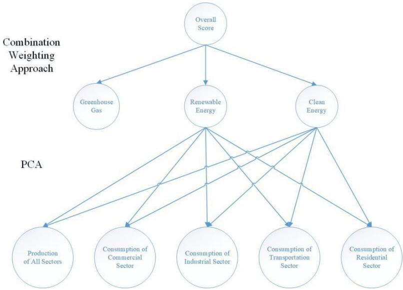

# 《数学建模》2018年美赛O奖论文：可持续能源评估（Sustainable Energy Assessment）

原件为竞赛论文。补充：文中的阅读练习及“参考解答”为整理时增加，原件图文保留出处。

## Sustainable Energy Assessment

### Summary

Energy is one of the four pillars of modern social development, the most basic material basis, and a prerequisite for human civilization. In United States, many aspects of energy policy are decentralized to the state level.

In this paper, we are asked by these states to inform their development of a set of goals for their interstate energy compact.

First, we preprocess the data, including the processing of missing values and the normalization of the data. In the process of missing value processing, we deal with the indicators lacking a small amount of data by Cubic Spline Interpolation, the indicators lacking less than a half of data by curve fitting, and the indicators missing the vast majority of data by replacing them with the average values of other cities.

Second, in order to create a profile of energy, by analyzing the data, we classify the energy sources, and then choose three indicators to calculate, including the use of renewable energy sources $U_r$, the use of clean energy $U_c$, and greenhouse gas emissions GE, all of which are calculated separately by transportation, industrial, commercial and residential sectors. After defining these indicators, we make an analysis and comparison on the profiles of the four states made.

Then, based on the above indicators, we propose the MAUA model to calculate the overall score. We first use the PCA to integrate the different aspects of the three indicators, and then we use the Combination Weighting Approach (AHP and PCA) to weight these three indicators. And we get the weights of $U_r, U_c, GE$ as 0.178, 0.433, -0.389. To make our model more accurate, we take the MAUA model with the appropriate utility function to calculate the composite score. We then sort the states by descending order of overall score: CA, TX, NM, AZ.

After that, we use the ARIMA model to predict each state's indicators. It is estimated that by 2025, the overall score of each state will reach CA: 0.2578, AZ: 0.1966, NM: 0.2545, TX: 0.1518. And by 2050, each state’s score will reach CA: 0.3481, AZ: 0.3334, NM: 0.3232, TX: 0.3132.

Finally, we set goals of the four states to be raising the proportion of electric generated by renewable energy source to 34% by 2025 and 59% by 2050. We use the proportion of electric generated by renewable energy source to indicate the renewable energy usage and use our model to predict the proportion. To achieve such goals, we recommend the following three actions for the four states: integrating electric market, establishing a fund and apply tax and subsidy policy.

### Contents

| Section | Title | Page |
| :--- | :--- | :--- |
| 1 | Introduction | 1 |
| 1.1 | Background | 1 |
| 1.2 | Our Work | 1 |
| 1.3 | Detailed Assumptions and Notations | 1 |
| 1.3.1 | Detail Assumptions | 1 |
| 1.3.2 | Mathematical Notations | 2 |
| 2 | Data Preprocessing | 2 |
| 2.1 | Addressing the Missing Values | 2 |
| 2.2 | Data Normalization | 3 |
| 3 | Energy Profile | 3 |
| 3.1 | Energy Classification | 3 |
| 3.2 | Energy Indices | 4 |
| 3.3 | Analysis of Energy Profiles of Four States | 6 |
| 3.3.1 | Energy Structure | 6 |
| 3.3.2 | Use of Renewable and Clean Energy | 6 |
| 3.3.3 | Greenhouse Gas Emissions | 7 |
| 3.3.4 | Influential Factors | 7 |
| 4 | Model for Overall Score | 9 |
| 4.1 | Overview of the Model | 9 |
| 4.2 | Utility Function | 10 |
| 4.3 | Determination of Weights | 11 |
| 4.3.1 | Solving for Weights of Secondary Indices Using PCA | 11 |
| 4.3.2 | Combination Weighting Approach | 11 |
| 4.4 | Determination of the Best Profile | 12 |
| 5 | Prediction of Energy Profiles | 13 |
| 5.1 | Model of ARIMA | 13 |
| 5.2 | Solution and Results of ARIMA | 13 |
| 6 | Cooperation Strategies of Energy Compact | 15 |
| 6.1 | Future Energy Targets | 15 |
| 6.2 | Actions to Take | 16 |
| 6.2.1 | Establish a Fund | 16 |
| 6.2.2 | Electricity Market Integration | 18 |
| 6.2.3 | Enact Strict Laws and Regulations | 18 |
| 7 | Evaluation of Our Model | 18 |
| 7.1 | Strengths of Our Model | 18 |
| 7.2 | Weaknesses of Our Model | 19 |
| | References | 19 |

## Memo

**To:** Governors of CA, AZ, TX and NM
**From:** Team # 78577
**Date:** 12 February 2018
**Subject:** Usage of Cleaner, Renewable Energy Sources

### Purpose

We propose to summarize the state profiles of 2009 for you, and predict the trend of energy usage in the absence of any policy changes, give my recommended goals and actions.

### Summary for the Profile of 2009

CA (California) has the best energy profile of 0.1816 in 2009, followed by TX (Texas) of 0.1743, NM (New Mexico) of 0.1209 and AZ (Arizona) of 0.1064. This result is quite reasonable because California had the lowest emission of greenhouse gases (per capita) and relatively high performance in use of renewable energy in 2009.

### Prediction the Trend of Energy Usage

If we ignore any policy changes, by 2025, the four states (AZ, CA, NM, TX) will achieve an overall score of 0.1966, 0.2578, 0.2545, 0.1518.

By 2050, the four states (AZ, CA, NM, TX) will achieve an overall score of 0.3334, 0.3481, 0.3232, 0.3132, where CA always has the best score, and TX has the minimal one.

### Recommended Goals and Actions

We recommend goals of the four states to be raising the proportion of electric generated by renewable energy source to 34% by 2025 and 59% by 2050. To achieve such goals, we recommend the following three actions for the four states.

1. Integrating electric market;

2. Establishing a fund.

The total fund is 208 billion with the share of: CA: 89.8, AZ: 31.3, NM: 30.6, TX: 56.3.

3. Applying tax and subsidy policies.

# 2018年美赛O奖论文：可持续能源评估（Sustainable Energy Assessment）

## 1 Introduction

### 1.1 Background

Energy is an important part of people’s daily life, and the cornerstone of the development of society. The formation of an industrial society brought fossil fuels into our lives. However, with the development of society, people have been gradually aware of the shortcomings of fossil fuels: high pollution and limited quantity. People began to seek to create a clean, renewable energy structure.

Along the U.S. border with Mexico, four states hope to form a realistic energy contract that focuses on cleaner, renewable energy. We are asked to analyze the composition of the energy structure of these states, and predict the trend of their development over the next 50 years. We will finally put forward some feasible suggestions for the compact.

### 1.2 Our Work

In this paper, we break our work into sections as follows.

1. Process the primary data (including missing value processing, data normalization).
2. Establish the comprehensive evaluation model of energy (energy profile), and solve for the state with best energy profile.
3. Establish the prediction model of energy profile, and analyze the changing trend in each state.
4. Set reasonable targets according to our model results, and provide feasible suggestions for the compact.

### 1.3 Detailed Assumptions and Notations

#### 1.3.1 Detail Assumptions

In our model, we make the following assumptions.

*   We ignore any policy changes by each governor’s office when predicting the energy profile of each state, which has been mentioned in the problem.
*   We assume that the relative importance of various indicators doesn’t change over time.
*   Each sector (transportation, commerce, etc.) is of the same importance to an energy type, and is empowered only by the amount of information contained. For example, the four sectors have the same realistic weight on renewable energy, and only consider the number of factors in the synthesis process.

#### 1.3.2 Mathematical Notations

Here are the notations and their meanings in our paper:

**Table 1: Mathematical Notations**

| Notations | Mathematical Meanings |
| :--- | :--- |
| $S$ | Overall score of energy profile |
| $U_r$ | Energy index of use of renewable energy |
| $U_c$ | Energy index of use of clean energy |
| $GE$ | Energy index of greenhouse gas emissions |
| $x_i$ | Data of the $i$th indicator |
| $u_i(\cdot)$ | Utility Function / Proportion of consumption |
| $CA_r, CC_r, CI_r, CR_r$ | of renewable energy in four sectors |
| $CA_c, CC_c, CI_c, CR_c$ | Proportion of consumption of clean energy in four sectors |

## 2 Data Preprocessing

The attached data file “ProblemCData.xlsx” provides us with 50 years (1960-2009) of data in 605 variables on energy production and consumption along with some demographic and economic information of the four states respectively. This is a huge amount of data with lots of redundant and useless data. Therefore, we need to perform data preprocessing by cleaning, selecting and normalizing the data.

### 2.1 Addressing the Missing Values

There are lots of missing values in the data file, so we come up with the following methods to address this problem.

1.  For some of the indicators (of some states), there are sometimes a small number of values to be zero, which may result from statistical negligence. In this case, we adopt cubic spline interpolation to fill in the missing values.
2.  Data of some indicators were not collected in certain years (less than 25 years), which would lead to long lists of zeros. In this case, we fit the remaining data into a curve and thus fill in the missing values.
3.  For those indicators who have only 40 years (1970-2009) of data, we can adopt the same method mentioned in 2.
4.  For some of the indicators (of some states), most or all of the values are zero. In this case, we have to refer to other data (e.g. data of other states of the same indicator) and fill it with the help of the average of other highly correlated data.

It is noteworthy that not all zeros are caused by statistical negligence. Some of them may be due to the absence of according technology or other special reasons. A typical example is “electricity produced from nuclear power by the electric power sector”.

### 2.2 Data Normalization

Since we will use indicators with various units, we have to normalize all the indicators and scale all the values in the range [0,1]. Formula (1) gives the general form of the adopted normalization.

$$
x _ {\text {new}} = \frac {x - x _ {\text {min}}}{x _ {\text {max}} - x _ {\text {min}}},\tag{1}
$$

where $x_{max}$ and $x_{min}$ are respectively the maximum and minimum value of the indicators in the same unit.

For most of the given indicators (e.g. consumption, production), the values are proportional to the population or the area of the state. Therefore, when we compare the states in terms of such indicators, we avoid the influence of population by dividing the variables by the population of the state accordingly.

## 3 Energy Profile

### 3.1 Energy Classification

To create an energy profile of each state, we categorize the energy into the following groups:

## 3.1 Energy Sources

*   Coal
*   Natural gases
*   Petroleum products
*   Nuclear energy
*   Renewable Energy

Renewable energy here includes biomass energy, geothermal energy, Photovoltaic and solar thermal energy, hydroelectricity energy and wind energy. Since the reduction of greenhouse emissions is also crucial in determining the energy structure, we will also consider clean energy, which is the aggregation of renewable energy, natural gases and nuclear energy.

### 3.2 Energy Indices

To demonstrate the overall performance of the use of energy of four states, we adopt three indices listed below.

#### Use of Renewable Energy

The use of renewable energy is one of the most important indices to illustrate the energy profile of each state. Thus, we create an energy index $U _ { r } ,$ which includes the following aspects:

1. Total production of renewable energies per capita $P _ { r }$
2. Proportion of renewable energy consumption in all energy consumption in transportation sector per capita $CA_r$
3. Proportion of renewable energy consumption in all energy consumption in commercial sector per capita $CC_r$
4. Proportion of renewable energy consumption in all energy consumption in industrial sector per capita $CI_r$
5. Proportion of renewable energy consumption in all energy consumption in residential sector per capita $CR_r$

Total production of renewable energy per capita can reflect the extent to which renewable energy is developed. Since the energy structure of the four sectors are different and changes over time, we should calculate the proportion of consumed renewable energy respectively.

#### Use of Clean Energy

Similar to renewable energy, we create an energy index $U _ { c }$ to illustrate the use of clean energy, which is determined by the following indicators:

1. Total production of clean energies per capita $P _ { c }$
2. Proportion of clean energy consumption in all energy consumption in transportation sector per capita $CA_c$
3. Proportion of clean energy consumption in all energy consumption in commercial sector per capita $CC_c$
4. Proportion of clean energy consumption in all energy consumption in industrial sector per capita $CI_c$
5. Proportion of clean energy consumption in all energy consumption in residential sector per capita $CR_c$

#### Greenhouse Gas Emissions

In the United States, most of the emissions of human-caused greenhouse gases (GHG) come primarily from burning fossil fuels (coal, natural gas and petroleum) for energy use. Carbon Dioxide is the main component of greenhouse gases, so we use the emission of carbon dioxide to represent that of greenhouse gases.

To analyze emissions across different fuels, we compare the amount of $\mathbf { C O } _ { 2 }$ emitted per unit of energy output using the data in Table 2.[1]

**Table 2: $\mathbf { C O } _ { 2 }$ Emission Ratio of Different Fuels**

| Fuel | CO2 Emission Ratio (Pound/Million Btu) |
| :--- | :--- |
| Coal | 214.3 |
| Gasoline | 157.2 |
| Natural gas | 117.0 |

Therefore, we calculate the index of total greenhouse gas emissions GE as the weighted sum of consumption of fossil fuels with $\mathbf { C O } _ { 2 }$ emission ratios as weights.

### 3.3 Analysis of Energy Profiles of Four States

#### 3.3.1 Energy Structure

To illustrate the energy profiles of the four states, we first need to observe their energy structures.

In Figure 1, we present the consumption of five types of energy per capita in the four states. This shows that energy consumption in both 1960 and 2009 comes mainly from non-renewable energy sources (coal, petroleum and natural gas).

Figure 2 shows the production of five types of energy per capita. We can see that the large differences between the states: Arizona and California lack natural resources while New Mexico and Texas are rich in resources such as petroleum and natural gas.

#### 3.3.2 Use of Renewable and Clean Energy

Use of renewable and clean energy is a main component of the energy profile. Figure 3 illustrates the proportion of consumption of renewable and clean energy and their changing trends over time.

From Figure 2, we find that California had the best performance in the two indices since the 1980s. The general trend of proportion of consumed clean energy had been decreasing before 1985 and have been slowly increasing since then.

#### 3.3.3 Greenhouse Gas Emissions

Another important factor of the energy profile is greenhouse gas emissions. Figure 4 illustrates the emissions per capita and the changing trend over time.

Arizona and California have obvious advantages over New Mexico and Texas in this aspect. This can be derived from Figure 1, for the proportion of consumed coal, petroleum and natural gases directly contribute to greenhouse gas emissions. The general trend of greenhouse gas emissions has been decreasing since the early 1980s.

#### 3.3.4 Influential Factors

##### Geography and Climate

Due to the unique geography of the four states, they have different levels of richness in both non-renewable and renewable resources.[1]

Arizona has few fossil fuel resources and no significant natural gas reserves, but it does have abundant solar and geothermal energy potential. Arizona also has some wind potential, mainly along and just north of the steep-walled Mogollon Rim that cuts across the central part of the state.

California has an abundant supply of crude oil and natural gas but lacks coal reserves. It also leads the nation in electricity generation from solar, geothermal, hydroelectric and biomass resources.

New Mexico is among the top 10 natural gas-producing states. Its richness in fossil fuels is average. New Mexico possesses substantial renewable resources, particularly from wind and solar, but also from hydroelectric, biomass, and geothermal energy.

# 数学建模2018年美赛O奖论文：可持续能源评估（第4部分）

整理自《数学建模》2018年美赛O奖论文：可持续能源评估（Sustainable Energy Assessment）教材第4部分（共7部分），由识别工具读取第11–14页内容整理。

## 一、背景分析与模型概述

### 选择 1

**题干：**
关于美国四个州（Texas, California, Arizona, New Mexico）的人口与能源需求，原文指出：“Actually, California and Texas are the two most populated states in America and they have the largest energy demand. The large populations of the states make the production of the renewable and clean energy per capita less outstanding, despite their richness in natural resources.”

**分析：**
加州和德州人口众多，能源需求大，尽管自然资源丰富，但人均可再生能源生产表现并不突出。

**知识点：** 数据解读

### 简答 1

**题干：**
简述四个州在气候和居民能源使用方面的特点。

**参考解答：**
原文提到：“The four states are roughly on the same latitude and the climate there is mild. Therefore, the per capita energy use in residential sector is relatively lower because there’s little need for air conditioning or space heating.”
即：这四个州纬度大致相同，气候温和，因此居民部门的人均能源使用量相对较低，因为对空调或空间供暖的需求很少。

**知识点：** 背景分析

### 简答 2

**题干：**
简述四个州在经济和政策方面的特点及其对能源的影响。

**参考解答：**
1. **经济方面：**
   - 加州和德州是美国最大的两个经济体，有能力通过实施替代技术提高能源效率。
   - 亚利桑那州的主要经济活动非能源密集型，其人均能源消费量在全国处于最低水平之一。
   - 新墨西哥州认识到向其他州出售更多电力（特别是来自可再生资源的电力）的经济利益。
2. **政策方面：**
   - 所有四个州都有监管政策，旨在增加可再生或清洁能源的使用并减少温室气体排放。
   - 这解释了自20世纪80年代初以来图3和图4所示的总体趋势。

**知识点：** 政策分析

## 二、总体评分模型

### 小节 1

**标题：** 模型概述 (Overview of the Model)

**正文：**
在选择能源指标后，我们开发了一个模型来描述每个州从1960年到2009年的能源概况演变。图6给出了我们模型的直观表示。

首先，我们使用PCA（主成分分析）计算两个能源指数——$U_c$ 和 $U_r$。我们采用PCA来压缩原始数据并确定它们的权重，因为指标（例如不同部门的消费比例）是相关的，而AHP（层次分析法）在这种情况下会失效。

在加权求和过程中，我们使用了效用函数（Utility Functions），这有助于处理数量级差距过大的问题。

之后，我们采用组合加权法（Combination Weighting Approach）来获得总体得分 S。以下章节将详细讨论这些方法的具体细节。

**知识点：** 主成分分析, 效用函数, 组合加权法

### 小节 2

**标题：** 效用函数 (Utility Function)

**正文：**
在我们的模型中，即使经过归一化，我们仍面临数量级巨大的问题。为了不忽略小数量级指数的影响，我们决定使用效用函数。

效用函数可以被视为调节器，用于调整数据值，使数据分布更加均匀。

在所有形式的效用函数中，我们选择公式(2)的形式：

$$
u _ {i} (x _ {i}) = \left\{ \begin{array}{l l} 0 & , x \leq a _ {i} \\ \left(\frac {x _ {i} - a _ {i}}{b _ {i} - a _ {i}}\right) ^ {k _ {i}} & , x > a _ {i} \end{array} \right.,\tag{2}
$$

其中 $x _ { i }$ 是第 $i$ 个指标，$a _ { i }, b _ { i }$ 和 $k _ { i }$ 是待定系数。

为了使操作后的数据值范围在0到1之间，我们有：

$$
u _ {i} (\min (x _ {i})) = 0, \quad u _ {i} (\max (x _ {i})) = 1.\tag{3}
$$

为了确定系数 $k _ { i }$，我们将数据的中位数指定为0.5，即：

$$
u _ {i} (\text { median } (x _ {i})) = 0. 5.\tag{4}
$$

通常，数据中位数周围的区域具有最大的分布密度。如图7所示，我们有效地通过使用效用函数增加了数据的区分度。

将公式(3)(4)代入公式(2)，得到 $a _ { i } = 0 , b _ { i } = 1$，并且可以通过不同指标的数据获得 $k _ { i }$。

**知识点：** 数据归一化, 参数估计

### 小节 3

**标题：** 权重的确定 (Determination of Weights)

#### 小节 3.1

**标题：** 使用PCA求解二级指标的权重 (Solving for Weights of Secondary Indices Using PCA)

**正文：**
首先，我们使用PCA处理每个州的二级指标。我们得到的二级指标对前两个主成分的贡献权重如表3所示。

**Table 3: Results of PCA**

| Renewable | $CA_r$ | $CC_r$ | $CI_r$ | $CR_r$ | $P_r$ | Cumulative |
| :--- | :--- | :--- | :--- | :--- | :--- | :--- |
| Comp.1 | 0.19347 | -0.09019 | 0.11611 | -0.16790 | 0.95538 | 0.83952 |
| Comp.2 | -0.21188 | -0.24016 | -0.93253 | 0.07815 | 0.14730 | 0.93164 |
| Clean | $CA_c$ | $CC_c$ | $CI_c$ | $CR_c$ | $P_c$ | Cumulative |
| Comp.1 | -0.00036 | -0.59869 | -0.28644 | -0.48698 | -0.56777 | 0.93549 |
| Comp.2 | 0.00229 | 0.80078 | -0.22566 | -0.37477 | -0.40910 | 0.97887 |

通过使用前两个主成分，我们可以得到清洁能源的累积比例为0.93，可再生能源的累积比例为0.98。

**知识点：** 主成分分析, 因子载荷

#### 小节 3.2

**标题：** 组合加权法 (Combination Weighting Approach)

**正文：**
在确定二级指标的主成分后，我们计算了3个能源指标的权重。由于我们必须同时考虑指标之间的相关性和它们的实际重要性，我们采用组合加权法，结合AHP和PCA来获得权重，从而得到每个州的总体得分 S。该方法公式如下：

$$
d _ {i} = \prod_ {j = 1} ^ {p} (u _ {j i}) ^ {\frac {1}{p}} / \sum_ {i = 1} ^ {m} \prod_ {j = 1} ^ {p} (u _ {j i}) ^ {\frac {1}{p}}, \quad i = 1, 2, \dots , m,\tag{5}
$$

其中 $d _ { i }$ 是我们获得的第 $i$ 个指数的最终权重，$p$ 是加权方法的数量，$m$ 是指标的数量。

通过计算，我们可以得到使用不同加权方法获得的权重，如表4所示。值得一提的是，在处理AHP时，我们得到一致性比率 $C R = 0 . 0 3 3 < 0 . 1$。因此，AHP的结果通过了一致性检验。

**知识点：** 层次分析法, 权重合成

# 数学建模：可持续能源评估（2018年美赛O奖论文整理）

本资料整理自《数学建模》教材中收录的2018年美国大学生数学建模竞赛（MCM/ICM）O奖论文《Sustainable Energy Assessment》第5至第7部分（对应原稿第12-15页左右的内容片段），主要涵盖最佳能源画像确定、ARIMA预测模型及能源联盟合作策略。

## 一、最佳能源画像的确定与权重分析

### 综合评分标准说明

根据前文确定的指标权重，我们定义了一个状态在清洁能源使用方面的优劣评判标准。如表3所示，如果一个州具有较低的广义熵（GE）和较高的 $U_r$（可再生能源利用性能）以及 $U_c$（清洁性），则认为该州在清洁能源使用方面表现更好。

通过公式 (2)、(3) 和 (4)，我们计算得到效用函数的系数，结果如表5所示。

**表3：能源指标权重对比**

| 方法 | $U_r$ | $U_c$ | GE |
| :--- | :--- | :--- | :--- |
| AHP | 0.258 | 0.637 | -0.105 |
| PCA | 0.066 | 0.158 | -0.776 |
| Combination | 0.178 | 0.433 | -0.389 |

**表5：效用函数系数**

| 系数 | $U_r$ | $U_c$ | GE |
| :--- | :--- | :--- | :--- |
| $a_i$ | -0.115 | -0.361 | 0 |
| $b_i$ | 0.074 | -0.096 | 1 |
| $k_i$ | 1.431 | 0.782 | 0.821 |

### 4.4 最佳能源画像的确定

在确定权重后，我们可以计算出四个州的能源指标和综合得分。2009年四个州的能源指标如图8所示（注：原文引用图8，此处保留占位），而50年间四个州的综合得分如图9所示（注：原文引用图9，此处保留占位）。

从图9可以看出，CA（加利福尼亚州）在2009年拥有最佳的能源画像，其次是TX（德克萨斯州）、NM（新墨西哥州）和AZ（亚利桑那州）。这一结果非常合理，因为加州在2009年的人均温室气体排放量最低，且在可再生能源利用方面表现相对较好。

## 二、能源画像的预测

### 5.1 ARIMA 模型

ARIMA模型是一种广泛应用的时间序列分析方法，由Box和Jenkins于1970年首次提出[5]。ARIMA的基本步骤如下：

1. 首先，使用差分法对原始时间序列进行平滑处理；
2. 其次，通过分析平稳序列的自相关函数（ACF）和偏自相关函数（PACF）的特征，确定模型类型、模型阶数和待定参数；
3. 第三，检验模型的有效性；
4. 最后，分析和预测未来的时间序列。

ARIMA模型可表示为 $ARIMA(p, q, d)$，其中 $p$ 是自回归阶数，$q$ 是滑动平均阶数。该模型表示对非平稳随机序列变量 $Y_t$ 进行 $d$ 次差分，从而获得平稳序列 $X_t$。

随后，我们用 $ARMA(p, q)$ 模型拟合序列 $X_t$，其表达式为：

$$
X _ {t} = \varphi_ {1} X _ {t - 1} + \dots + \varphi_ {p} X _ {t - p} + \varepsilon_ {t} - (\theta_ {1} \varepsilon_ {t - 1} + \dots + \theta_ {q} \varepsilon_ {t - q}), \quad t \in \mathbb {Z},\tag{6}
$$

其中，前半部分是自回归过程，$\varphi _ { 1 } , \cdots , \varphi_ { p }$ 是回归系数；后半部分是滑动平均过程，$\theta _ { 1 } , \cdots , \theta _ { q }$ 是滑动平均系数，$\{ \varepsilon _ { t - q } , \cdots , \varepsilon _ { t } \}$ 是不服从高斯分布的白色噪声序列。

### 5.2 ARIMA 的求解与结果

为了更直观地分析能源指标并进行更准确的预测，我们使用ARIMA模型分别预测每个二级指数。

在本文中，我们仅选取加州的一个指数 $CA_r$ 作为例子进行详细说明。

首先，通过绘制数据序列曲线，我们发现它不是一个平稳时间序列，因为它呈上升趋势。因此，我们对序列进行一次差分处理。然而，由于 p-value $= 0.2607 > 0.05$，我们对序列再次进行差分。此时得到的 p-value 为 $0.014 < 0.05$，这意味着数据通过了平稳性检验。

接着，我们绘制该序列的ACF和PACF图，以选择合适的 $p$ 和 $q$ 用于 $ARIMA(p, q, d)$ 模型。如图10所示，在第4阶滞后之后，自相关值基本上未超过置信区间。虽然有一个自相关值超过了界限，但这可能是由于偶然超过95%置信区间造成的，因此我们取 $p = 4$。使用相同的方法，根据图11，我们可以得到 $q = 4$。

通过上述过程，我们将模型确定为 ARIMA(4, 4, 2)。然后通过计算，得出预测结果如图12所示（注：原文引用图12，此处保留占位）。

参数如表6所示。其中，$\sigma ^ { 2 } = 1.439 \times 10^{-8}$，loglikelihood=361.26，AIC=-704.52。这些结果表明模型的可行性。

**表6：ARIMA中的参数结果**

| 参数 | $\phi_1$ | $\phi_2$ | $\phi_3$ | $\phi_4$ |
| :--- | :--- | :--- | :--- | :--- |
| 值 | 0.1779 | 0.2868 | -0.0048 | -0.1790 |
| **参数** | **$\theta_1$** | **$\theta_2$** | **$\theta_3$** | **$\theta_4$** |
| **值** | **-1.5161** | **0.1022** | **0.4157** | **0.0218** |

此后，使用上述方法，我们可以预测所有二级指数的值，从而确定四个州的能源指标和综合得分。各州综合得分的预测结果如图13所示（注：原文引用图13，此处保留占位）。

2025年和2050年四个州的综合得分如表7所示。

**表7：2025年和2050年综合得分预测**

| | AZ | CA | NM | TX |
| :--- | :--- | :--- | :--- | :--- |
| 2025 | 0.1966 | 0.2578 | 0.2545 | 0.1518 |
| 2050 | 0.3334 | 0.3481 | 0.3232 | 0.3132 |

## 三、能源联盟的合作策略

### 6.1 未来能源目标

在为联盟设定目标时，我们主要关注结合后可再生能源利用性能 $U_r$ 的提升。

# 2018年美赛O奖论文：可持续能源评估（Sustainable Energy Assessment）第6部分

本部分整理自2018年美国大学生数学建模竞赛（MCM/ICM）获得Outstanding Winner (O奖)的论文《Sustainable Energy Assessment》。内容涵盖合作目标的设定、资金建立模型、电力市场整合及法规建议，并简述了模型的评价。

## 一、目标设定与预测

### 6.1 聚合数据与趋势预测

我们已经预测了未来几年能源构成的变化。现在，我们将四个州的数据聚合在一起，预测其变化趋势。我们将利用 $U_r$ 的变化趋势来设定目标。

如图14所示，我们可以得知 $U_r$ 在2025年和2050年的预测值分别为 0.34 和 0.59。

为了展示合作的强度，我们将目标设定为预测值的 110%。也就是说，联盟应在2025年和2050年分别达到 $U_r$ 分数 0.374 和 0.649。

## 二、采取的行动

### 6.2 Actions to Take

#### 6.2.1 Establish a Fund

第一个行动是建立一个基金。该基金将用于投资建设风能或太阳能相关设施的公司。为了实现联盟的目标，四个州必须向该基金贡献一定金额的资金。

通常情况下，四个州的合作可以产生额外的利润。因此，这种方法可以理解为合作中的利润分配问题。我们使用 **Shapley Value Regression Model**（沙普利值回归模型）来确定每个州出资的最优份额。

##### Shapley Value Regression Model

沙普利值基于每个成员在不同联盟中所能做出的贡献，提供对合作博弈中每个成员地位的事前评估。在游戏中，应遵循以下基本规则以确保公平性[8]：

-   **Efficiency（效率）**：成员应分配游戏的全部收益。
-   **Symmetry（对称性）**：对每个联盟具有相同边际贡献的两个成员应具有相同的值。
-   **Law of aggregation（可加性）**：两个独立的游戏可以线性组合。
-   **Null member property（零成员属性）**：没有任何贡献的成员应获得零值。

在合作博弈 $(N, v)$ 中，对于每个成员 $i \in N$，游戏的理想利润为 $\Phi_i(v)$。如果函数 $\Phi_i(\cdot)$ 满足上述所有规则，则每个成员的分配利润可由公式 (7) 和 (8) 给出：

$$
\Phi_{i}(v) = \sum_{s \in N} \omega_{n} [ v(s) - v(s \backslash i) ],\tag{7}
$$

$$
\omega_{n} = \frac {(| s | - 1) ! (n - | S |)}{n !}.\tag{8}
$$

##### Share of Investment of Each State

电价与可再生能源（RES）比例呈正比关系。利用美国2006年至2014年的数据[12]，我们估算了资金转化为可再生能源比例的比例，结果显示52亿美元可以提高1%的可再生能源比例。

电力及其价格的详细信息如表8所示。

**Table 8: Electricity Information**

| | AZ | CA | NM | TX |
| :--- | :--- | :--- | :--- | :--- |
| Electricity (Wind) (Btu) | 288.3592 | 56996.98 | 15095.7 | 195454.8 |
| Electricity (Solar) (Btu) | 2.982 | 19.783 | 0.645 | 1.22 |
| Electricity Price(Wind) ($/MWh) | 50 | 40 | 35 | 30 |
| Electricity Price(Solar) ($/MWh) | 80 | 90 | 100 | 110 |

*注：原文表格中 "Electricity Price(Wind) ($/MWh) (Solar)" 行存在排版混淆，根据上下文逻辑及常见数据格式，推测第三行为风电价格，第四行为光电价格，此处按此逻辑修正列名以符合语义。*

利用上述信息，我们求解公式 (7) 和 (8)，得到各州的份额和投资金额，如表9所示。

**Table 9: Results of Investment**

| | AZ | CA | NM | TX | Total |
| :--- | :--- | :--- | :--- | :--- | :--- |
| Share (%) | 0.150 | 0.431 | 0.147 | 0.27 | 1 |
| Money (Billion dollars) | 57.1 | 148.2 | 50.5 | 92.8 | 343.85 |

#### 6.2.2 Electricity Market Integration

由于联盟主要关注可再生能源和清洁能源，我们不考虑其他类型的能源。可再生能源来源有四大组成部分：生物质能、水电、风能和太阳能热发电。四个州在生物质能方面差异不大，且水电已达到市场饱和。然而，由于海拔和地质条件的不同，这四个州在风能和太阳能热发电方面存在显著差异。因此，这四个州有不同的辐射强度和风速等，这意味着它们开发风能和太阳能的潜力不同。因此，我们只关注后两种能源的合作。

整合后，州可以从其他州以更低的价格购买能源，而提供能源的州在建设更多发电厂时赚取资金。

#### 6.2.3 Enact Strict Laws and Regulations

为了提高整体能源构成，我们还建议联盟共同努力制定严格的法律法规。我们可以采取以下步骤：

-   对可再生能源发电实施一定程度的免税政策。
-   根据各州的能源结构开发不同的可再生能源项目。例如，CA可能专注于风力和水力发电的建设和发展。
-   为了推动可再生能源的快速发展，在四个州设立基金，旨在筛选可再生能源建设示范项目。

## 三、模型评价

### 7 Evaluation of Our Model

### 7.1 Strengths of Our Model

针对指标数据缺失的情况，我们采取了不同的措施，尽可能保持数据的真实性。

## 7.2 Weaknesses of Our Model

- We may not make full use of all the data. We use only 13 indicators to calculate the composite score, and some other summary indicators for analysis.
- The determination of the form of utility function and the determination of $p$ and $q$ of the ARIMA model may be subjective.

## References

[1] U.S. Energy Information Administration. https://www.eia.gov.

[2] Omar Hafez and Kankar Bhattacharya. Optimal planning and design of a renewable energy based supply system for microgrids. *Renewable Energy*, 45:7–15, 2012.

[3] James Douglas Hamilton. *Time series analysis*, volume 2. Princeton University Press, Princeton, 1994.

[4] Andrew C Harvey and Andrew C Harvey. *Time series models*, volume 2. Harvester Wheatsheaf, New York, 1993.

[5] Gareth Janacek. Time series analysis forecasting and control. *Journal of Time Series Analysis*, 31(4):303–303, 2010.

[6] M. Kelly and M. C. Thorne. An approach to multi-attribute utility analysis under parametric uncertainty. *Annals of Nuclear Energy*, 28(9):875–893, 2001.

[7] Dawen Liang. Maximum likelihood estimator for variance is biased: Proof. 2012.

[8] Tatiana Nenova. The value of corporate voting rights and control: A cross-country analysis. *Journal of Financial Economics*, 68(3):325–351, 2003.

[9] Angel Nikolaev and Popi Konidari. Development and assessment of renewable energy policy scenarios by 2030 for Bulgaria. *Renewable Energy*, 111:792–802, 2017.

[10] Jyoti P Painuly. Barriers to renewable energy penetration; a framework for analysis. *Renewable Energy*, 24(1):73–89, 2001.

[11] Y. F. Zhou and Fa-jie Wu. Combination weighting approach in multiple attribute decision making based on relative entropy. *Operations Research and Management Science*, 5:009, 2006.

[12] Tong Zhu. Comparison analysis on current energy transition in Germany and the United States. *International Petroleum Economics*, 2016.
