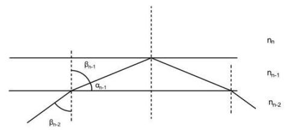
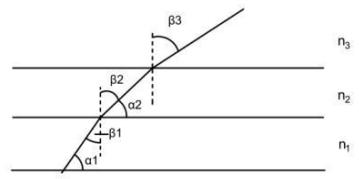

# 《数学建模》美赛O奖论文：多跳高频无线电传播的MHPM与MSRSM仿真建模

原件经识别和整理；“参考解答”是我们补的。

---
title: 2018 MCM/ICM O奖论文：多跳高频无线电传播的MHPM与MSRSM仿真建模（第1部分）
kind: 课件
course: 数学建模
term: 2018
source: 2018 MCM/ICM Summary Sheet & Introduction (Team #77845)
---

# 2018 MCM/ICM O奖论文：多跳高频无线电传播的MHPM与MSRSM仿真建模（第1部分）

本资料整理自2018年美赛O奖论文《MHPM and MSRSM: Simulation and Modeling of Multi-hop HF Radio Propagation》的前四页内容，包含摘要、目录及引言部分。

## 一、摘要（Summary）

### 摘要正文

基于电离层的物理特性及物理学定律，我们建立了一个完整的数学模型——**多跳高频无线电传播模型（MHPM）**，能够很好地模拟多跳高频无线电波在传播过程中的折射和反射现象。MHPM 还能模拟沿海拔高度的电离层电子密度分布和折射率分布。D层电离层的能量衰减、“自由空间路径损耗”以及“在地面或海面反射时的能量损失”决定了无线电波传播过程中的能量损失，基于此，我们的模型成功模拟了无线电波传播期间的能量损失。

利用 MHPM，我们比较了平静海面和湍流表面对无线电波能量耗散的不同影响，并计算了几种情况（不同频率和不同掠射角）下的最大传播距离和最大跳数。我们还分析了掠射角、频率以及海面附近的风速对粗糙海面折射效应的影响。MHPM 同样适用于地面反射情况，我们发现地面反射情况下无线电波的能量耗散随着高程标准差的增加而迅速增加。

我们提出了一种无线电波发射方案，并建立了**移动船舶接收信号模型（MSRSM）**，以使船舶在海面上航行时通过相同的多跳路径持续接收信号。应用 MSRSM，我们模拟了移动船舶的信号接收过程，对于海面风速为 $20 \, \text{m/s}$、船速为 $41.67 \, \text{km/h}$、频率范围为 $21 \, \text{MHz} - 21.45 \, \text{MHz}$ 的情况，计算出连续接收信号的总时长为 46.20 小时。

在敏感性分析中，我们研究了三个因素：电离层中的电子浓度、电离层的高度以及海面附近的风速，并分析了它们的变化对多跳高频无线电波传播的影响。

**关键词：** multi-hop（多跳）, MHPM, MSRSM, free-space path loss（自由空间路径损耗）

## 二、目录（Contents）

| 章节 | 标题 | 页码 |
| :--- | :--- | :--- |
| **1** | **Introduction** | 3 |
| 1.1 | Background | 3 |
| 1.2 | Problem Restatement | 3 |
| **2** | **Assumption and Symbols** | 4 |
| 2.1 | Assumption | 4 |
| 2.2 | Symbols | 5 |
| **3** | **Multi-Hop Propagation Model** | 5 |
| 3.1 | Model Description | 5 |
| 3.2 | The Ionosphere | 6 |
| 3.2.1 | D-Layer Energy Loss | 6 |
| 3.2.2 | The Refractive Index vs. Altitude and Frequency | 6 |
| 3.2.3 | E-Layer Refraction | 7 |
| 3.2.4 | F-Layer Refraction and Reflection | 8 |
| 3.2.5 | MUF | 9 |
| 3.3 | Propagation on The Sea | 10 |
| 3.4 | Propagation on The Ground | 11 |
| 3.5 | Free-Space Path Loss | 13 |
| 3.6 | Background Noise | 14 |
| **4** | **Result of Part I and Part II** | 14 |
| 4.1 | The Comparison of Strength of Single-Hop Radio Wave Between Calm and Turbulent Ocean Surface | 14 |
| 4.2 | The Multi-Hop Radio Propagation Process on Ocean Surface | 15 |
| 4.3 | The Comparison of Strength of Single-Hop Radio Wave Between Rugged and Smooth Ground Terrains | 16 |
| **5** | **Moving-Ship-Receiving-Signal Model** | 17 |
| **6** | **Result of Part III** | 17 |
| **7** | **Sensitivity Analysis** | 18 |
| 7.1 | Electron Density of The E Layer and F Layer | 18 |
| 7.2 | The Height of The F Layer | 18 |
| 7.3 | The Wind Speed Near The Sea | 19 |
| **8** | **Strengths and weaknesses** | 19 |
| 8.1 | Strengths | 19 |
| 8.2 | Weaknesses | 19 |
| **Appendices** | **Appendices** | 23 |
| Appendix A | A Short Synopsis | 23 |
| Appendix B | The Code | 25 |

## 三、引言（Introduction）

### 1.1 背景（Background）

高频无线电波可以通过以下三种模式传输：天波（skywave）、地波（ground wave）和直射波（direct wave）[1]。美赛题目A中提到的“多跳高频无线电传播”是天波的一种应用。

我们在模型中使用的天波依赖于电离层传播，电离层是地面以上80至1000公里高空的大气层，由太阳辐射电离 [6]。由于在电离层和地球表面的多次反射，其传播距离可以非常远，通常超过9600公里 [2]。缺点是它受气候影响，传输信号非常不稳定。短波频段是天波传播的最佳选择。图1展示了这种传播模式。

![Figure 1: Schematic diagram of Skywave reflection[3]](figure:4acd8431082cb4af32400d96e9153b07eb092651a0bdca6422d7f90e929d9e33-0/675c20da85a38553f8cad1fb5570882c56e2fbb3de8c0d647685c66f1a582568.jpg)

### 1.2 问题重述（Problem Restatement）

问题描述已经生动且基本地解释了高频天波在电离层和地球表面之间弹跳的传输模式。经过归纳和整理，我们提炼出以下需要思考和决定的问题：

**哪些关于电离层的因素需要主要讨论？**
太阳活动、季节变化以及白天或黑夜都会影响电离层的性质，例如电子密度和层的高度。

**什么假设既能保证模型的可靠性又能简化使用？**
（原文此处未给出具体答案，仅作为思考引导）

**如何量化电离层不同层面对无线电波的影响？**
就像确定反射、折射和吸收一样。

**如何量化不同地形对无线电波的影响？障碍物在地面上的作用是什么？平静海面和粗糙海面有什么区别……**
（原文此处截断，后续内容未提供）

# 《数学建模》美赛O奖论文：多跳高频无线电传播的MHPM与MSRSM仿真建模

本文档整理自2021—2022学年第二学期《计算机通信与网络》课程参考资料，来源为美赛O奖论文《多跳高频无线电传播的MHPM与MSRSM仿真建模》第2部分（共8部分），由识别工具读取后整理。

## 二、假设与符号

### 问题重述中的关键疑问

在建立模型前，需明确以下核心物理问题：

- 地球表面的不同性质是否会影响无线电波的反射、角度和衰减？
- 影响信号传输距离和中继次数（hopcount）的主要因素是什么？如何计算最大传输距离和中继次数上限？
- 如何确保模型具有覆盖范围？在实际导航中，接收状态是随机变化的，采取何种方法可以使无线电波准确到达给定范围内的任意位置？

### 假设

针对上述问题，本文提出以下假设以简化模型并聚焦核心机制：

#### 假设 1：能量损耗组成

在多跳传播过程中，无线电波的能量损耗包含三部分：
1. D层电离层的能量衰减；
2. “自由空间路径损耗[4]”；
3. “地面或海面反射”造成的损耗。

#### 假设 2：默认环境参数

若无特别说明，模型采用以下默认参数：
- 海面附近风速为 $8 \text{ m/s}$（对应粗糙海面）；
- 电磁波掠射角为 $15^\circ$；
- 无线电频率为 $20 \text{ MHz}$。

依据文献[5]，地球平均风速分布在 $4 \text{ m/s}$ 至 $12 \text{ m/s}$ 之间，故选取 $8 \text{ m/s}$ 作为默认情况。

#### 假设 3：射线近似

将无线电波简化为直线传播（类似激光），忽略电磁波的发散效应。

#### 假设 4：D层作用

D层电离层不影响电磁波的传播路径，但会导致电磁波能量衰减，因此将其视为“衰减层”。D层中电磁波的能量损耗可通过Marc C.[1]给出的公式计算。

#### 假设 5：E层作用

假设E层电离层仅对电磁波产生一次折射，不影响其能量，因此将其视为“单折射层”。

#### 假设 6：F层作用

F1层和F2层电离层[6]被视为一层，即F层，作为“折射和反射层”。具有合适掠射角和频率的无线电波进入F层后会连续折射，随后再次反射回地球表面。

#### 假设 7：E层均匀性

假设E层的电子浓度均匀，即E层的折射率 $n$ 为常数。取E层中间高度的折射率作为整体折射率，并假设折射发生在E层中间高度的平面上。这意味着电磁波在E层中传播时仅发生一次折射。

#### 假设 8：昼夜条件

D层在夜间消失，日落后面密度降低90%[1]。为涵盖更多情况，本模型仅考虑白天情形，即D层存在且E层密度保持恒定。

#### 假设 9：干扰条件

只有相同频率的电磁波才会相互干扰。

#### 假设 10：设备可靠性

电磁波发射设备和接收设备均可靠且精确。

#### 假设 11：发射精度

无线电波发射器能够以精确的方式发射无线电波，使其频率符合目标要求。

#### 假设 12：默认场景

若无特别说明，模型默认场景为夏季白天。此时选用的波长为 $20\text{m}$、$17\text{m}$ 或 $15\text{m}$，对应的频率选择为 $15 \text{ MHz}$、$17.65 \text{ MHz}$ 或 $20 \text{ MHz}$。

### 符号说明

本文使用的符号及其含义列于表1。

| Symbol | Meaning |
| :--- | :--- |
| $f$ | Radio waves frequency (无线电波频率) |
| $n$ | Refractive index (折射率) |
| $N_e(h)$ | Electron density of the ionosphere at height h (高度h处的电离层电子密度) |
| $F_{0E}, F_{0F_2}$ | Critical frequency of E layer, $F_2$ layer (E层、$F_2$层的临界频率) |
| $y_{mE}, y_{mF_2}$ | Half thickness of E layer, $F_2$ layer (E层、$F_2$层的半厚度) |
| $h_{mE}, h_{mF_2}$ | Altitudes of E layer, $F_2$ layer (E层、$F_2$层的高度) |
| $N_{mE}, N_{mF_2}$ | Maximum electron density of E layer, $F_2$ layer (E层、$F_2$层的最大电子密度) |
| $R_H$ | Reflection coefficient of horizontal polarization wave (水平极化波的反射系数) |
| $R_V$ | Reflection coefficient of vertical polarization wave (垂直极化波的反射系数) |
| $\theta, \varphi$ | Grazing angle [7] (掠射角) |
| $v$ | Wind speed near the sea (海面附近风速) |
| $c$ | Speed of light (光速) |
| $\rho$ | Rough correction factor (粗糙修正因子) |
| $S_h$ | Standard deviation of the elevation (仰角的标准差) |
| $\lambda$ | Wavelength (波长) |
| $K$ | Boltzmann constant [8], $1.38 \times 10^{-23} \text{ m}^2 \text{ kg s}^{-2} \text{ K}^{-1}$ (玻尔兹曼常数) |
| $T_0$ | Absolute temperature of the environment (in Kelvin [9]) (环境的绝对温度，单位开尔文) |
| $b$ | Effective noise bandwidth (有效噪声带宽) |

## 三、多跳传播模型

### 3.1 模型描述

在天波模式下，电离层中无线电波的折射和反射受电离层特性的影响。不同的电离层（即D、E、F1、F2）位于不同的高度[6]。此外，它们的折射率、厚度和位置会随昼夜和季节的变化而变化[1]。MHPM（多跳高频无线电传播模型）取

## 3.2 The Ionosphere

### 3.2.1 D-Layer Energy Loss

According to literature [1], the energy loss of the radio wave whose frequency is $f$ MHz in D layer is represented as:

$$
\alpha = 1.16 \times 10^{-15} \frac{N v}{f^2}\tag{1}
$$

where $\alpha$ is the energy loss (dB/km), $N$ is the electron density ($\text{m}^{-3}$), $v$ is the collision rate ($\text{s}^{-1}$), and $f$ is the frequency (MHz). In literature [1], the electron of D layer is very small, so $N = 10^{10} \text{ m}^{-3}$, and the collision rate is $10^6 \text{ s}^{-1}$.

### 3.2.2 The Refractive Index vs. Altitude and Frequency

Yu Chao et al. analyzed the variation of electron density in ionosphere as well as the refractive index of the ionosphere with altitude and carried out numerical simulation, and the comparison between simulation and real ionospheric data in Sanya City and Wuhan City confirmed the accuracy of their numerical simulation method [12]. So, the refractive index of the ionosphere can be determined by [12]:

$$
n = \sqrt {1 - \frac {80.8 N _{e}}{f ^ {2}}}\tag{2}
$$

where $f$ is the frequency of the radio wave, and $N_e$ is the electron density, which can be determined by:

$$
\left\{ \begin{array}{l l} N _ {e} (h) = N _ {m E} \left[ 1 - (\frac {h - h _ {m E}}{y _ {m E}}) ^ {2} \right] & , h _ {m E} - y _ {m E} \leq h \leq h _ {m E} \\ N _ {e} (h) = \frac {N _ {j} - N _ {m E}}{h _ {j} - h _ {m E}} h + \frac {N _ {m E} h _ {j} - N _ {j} h _ {m E}}{h _ {j} - h _ {m E}} & , h _ {m E} \leq h \leq h _ {j} \\ N _ {e} (h) = N _ {m F _ {2}} \left[ 1 - (\frac {h - h _ {m F _ {2}}}{y _ {m F _ {2}}}) ^ {2} \right] & , h _ {j} \leq h \leq h _ {m F _ {2}} \\ N _ {e} (h) = N _ {m F _ {2}} e x p \left[ 0. 5 \times (1 - \frac {h - h _ {m F _ {2}}}{H} - e ^ {- \frac {h - h _ {m F _ {2}}}{H}}) \right] & , h _ {m F _ {2}} \leq h \leq 1000 km \end{array} \right.\tag{3}
$$

where,

$$
\begin{array}{r c l} {H} & {=} & {1. 6 6 \left[ 3 0 + 0. 0 7 5 (h _ {m F _ {2}} - 2 0 0) \right], (km)} \\ {N _ {j}} & {=} & {1. 2 4 \times 1 0 ^ {1 0} f _ {j} ^ {2}} \\ {h _ {j}} & {=} & {h _ {m F _ {2}} - y _ {m F _ {2}} \sqrt {1 - (\frac {f _ {j}}{f _ {0 F _ {2}}}) ^ {2}}} \\ {f _ {j}} & {=} & {1. 7 f _ {0 E}} \end{array}\tag{4}
$$

The unit of the electron density is $10^{12} \text{ m}^{-3}$, and the unit of the frequency is MHz. Some ionospheric parameters in the Sanya region are given in the literature [12], and according to B. Zolesi and L. R. Cander, we can get the approximate value of an E-layer maximum electron density [13]. In order to determine the distribution of the refractive index and the electron density along the height, we put these parameters of ionosphere into Equation 4, Equation 3, and Equation 2 and can get the graphs of the distribution of the refractive index and the electron density along the height, which is shown in Figure 2. All these parameters of ionosphere are shown in Table 2.

**Table 2: Ionospheric parameters used to determine the distribution of refractive index and electron density**

| Parameters | $f_{0E}/\text{MHz}$ | $h_{mE}/\text{km}$ | $y_{mE}/\text{km}$ | $f_{0F_2}/\text{MHz}$ |
| :--- | :--- | :--- | :--- | :--- |
| Values | 3.21 | 101 | 10.7 | 14.20 |
| **Parameters** | **$h_{mF_2}/\text{km}$** | **$y_{mF_2}/\text{km}$** | **$N_{mE}/\text{m}^{-3}$** | **$N_{mF_2}/\text{m}^{-3}$** |
| **Values** | 339.3 | 78.0 | $10^{10.5}$ | $2.5 \times 10^{12}$ |

### 3.2.3 E-Layer Refraction

We assume the refractive index of the area below the middle height of the E layer is the same as that of the D layer. Because we assume that the D layer only acts as "energy attenuation layer", the refractive index of the D layer is the same as that of the air. In order to simplify the calculation, we think that the refractive index of air is 1. The refractive index of the region above the middle height in the E layer is constant, whose value is the refractive index at the middle height. The refraction process in E layer is a simple single refraction, as shown in the Figure 3.

### 3.2.4 F-Layer Refraction and Reflection

The propagation of radio waves in the F layer is complex compared to the E layer because of the reflection of electromagnetic waves in the F layer. We believe that the refractive index of the electromagnetic wave in F layer varies with the altitude, as described in the Equation 2. According to the Figure 2 and Equation 2, the refractive index is gradually reduced with the increase of the elevation in F layer, which indicates that the electromagnetic wave will gradually refracted after entering the F layer, and its propagation trajectory will bend. If the electromagnetic wave path is sufficiently curved before reaching the top level of the F layer, it can be reflected back to the ground, otherwise the electromagnetic waves will penetrate the F layer and go out.

Radio waves cannot return to the ground after passing through the F layer. It is because the refractive index is increasing when the altitude is higher than the F layer, as shown in the Figure 2, which leads to a decrease in the bending trend of the propagation path of the electromagnetic wave. Thus, it is not possible to bend backwards, that is, to bend back to the ground. This phenomenon is shown in the Figure 1.

To show more clearly the propagation of radio waves in the F layer, a schematic diagram Figure 4 based on the "micro-element method" is shown below:

We take a rather small height as the step $h_{step}$, dividing the F layer into many parts, each being considered as a micro-element. According to Snell’s law [14], we can have:





$$
\begin{array}{l} \frac {n _ {1}}{n _ {2}} = \frac {\sin \beta_ {2}}{\sin \beta_ {1}} = \frac {\cos \alpha_ {2}}{\cos \alpha_ {1}} \\ \frac {n _ {2}}{n _ {3}} = \frac {\sin \beta_ {3}}{\sin \beta_ {2}} = \frac {\cos \alpha_ {3}}{\cos \alpha_ {2}} \end{array}\tag{5}
$$

$$
\frac {n _ {n - 1}}{n _ {n}} = \frac {\sin \beta_ {n}}{\sin \beta_ {n - 1}} = \frac {\cos \alpha_ {n}}{\cos \alpha_ {n - 1}}
$$

其中，$n_i$，$i = 1, 2, \cdots$ 可由式 3 和式 2 确定。对每个微元 $i$，通过式 5 和递推方法，我们可以得到角度 $\alpha_i$ 和 $\beta_i$，于是无线电波在该微元 $i$ 中的横向距离为：

$$
Distance_{i} = h_{step} \tan \beta_{i}\tag{6}
$$

若无线电波在第 $m$ 个微元处发生反射，则无线电波从刚进入 F 层到第 $m$ 个微元所经过的总横向距离为：

$$
\text{Distance}_{\text{total}} = \sum_{i=1}^{m} \text{Distance}_{i}\tag{7}
$$

其中，$m$ 可由斯涅尔定律确定，即当 $\beta_m = 90^\circ$ 时达到临界反射，此时无线电波开始反射。

### 3.2.5 最大可用频率（MUF）

要实现电离层反射，无线电波的频率必须满足临界频率和 MUF 的限制。文献 [1] 给出了临界频率与 MUF（最大可用频率）的计算公式：

$$
\begin{array}{r l} MUF & = \frac {f_{cr}}{\sqrt {1 - (\frac {R_{E}}{R_{E} + h}) ^ {2}}} \\ f_{cr} & = \sqrt {\frac {N_{e}}{1.24 \times 10^{10}}} \end{array}\tag{8}
$$

其中，$h$ 为电离层高度，频率单位为 MHz。典型 MUF 白天为 15–40 MHz，夜间为 3–14 MHz [1]。

### 3.3 海面传播

WANG Ying 分析了海洋对电磁波的反射特性，根据其研究，海面对电磁波的反射系数可确定如下 [10]。对于光滑海面：

$$
\begin{array}{r} R_{H} = \frac {\sin \theta - \sqrt {\widetilde {\varepsilon} - \cos^{2} \theta}}{\sin \theta + \sqrt {\widetilde {\varepsilon} - \cos^{2} \theta}} \\ R_{V} = \frac {\widetilde {\varepsilon} \sin \theta - \sqrt {\widetilde {\varepsilon} - \cos^{2} \theta}}{\widetilde {\varepsilon} \sin \theta + \sqrt {\widetilde {\varepsilon} - \cos^{2} \theta}} \end{array}\tag{9}
$$

其中，$\widetilde{\varepsilon}$ 为海面的复介电常数，可确定为：$\widetilde{\varepsilon} = 70 + i300$，其中 $i$ 为无线电波波长。

水平极化波反射系数与垂直极化波反射系数随掠射角的变化如图 5 所示。所研究的频率为：15 MHz、17.65 MHz 和 20 MHz。

对于粗糙海面的反射，文献 [10] 采用光滑海面反射系数乘以粗糙修正因子来近似，即：

$$
R^{\prime} = \rho R\tag{10}
$$

其中，$R^{\prime}$ 为粗糙海面的反射系数，$R$ 为光滑海面的反射系数，$\rho$ 为粗糙修正因子，可由下式确定：

$$
\begin{array}{r l} \rho = & \frac {1}{\sqrt {3.2 g - 2 + \sqrt {(3.2 g)^{2} - 7 g + 9}}} \\ g = & 0.5 (\frac {4 \pi h f \sin \theta}{c})^{2} \\ h = & 0.0051 v^{2} \end{array}\tag{11}
$$

粗糙修正因子随掠射角和海面附近风速的变化如图 6 所示。图 6 表明，随着掠射角增大和海面附近风速增大，海面粗糙修正因子逐渐减小。这意味着海面反射天波通信在海面较平静时效果更好，减小掠射角也会增强无线电波的传播能力。


### 3.4 地面传播

根据文献 [11]，平坦地形上电磁波的反射系数仍可用式 9（即海面反射率计算公式）描述，区别在于复介电常数 $\widetilde{\varepsilon}$，其可由 $\widetilde{\varepsilon} = \varepsilon_{r}(f) + i 60 \lambda \sigma(f)$ 确定，其中 $\varepsilon_{r}(f)$ 为地表在频率 $f$ 下的相对介电常数，$\sigma(f)$ 为地表在频率 $f$ 下的电导率（S/m）。

# 多跳高频无线电传播的 MHPM 与 MSRSM 仿真建模

本部分内容为《数学建模》美赛 O 奖论文（教材）第 5 部分（原稿第 14–17 页）的识别整理，修正了原文中的断行、乱码及单位表述错误，将 HTML 表格转换为 Markdown 格式，并规范了公式表达。

## 一、地表参数与反射系数分析

我们将湿混凝土的相对介电常数近似为地表的相对介电常数。根据文献 [15]，湿混凝土的相对介电常数范围约为 12-18，我们取值为 15。文献 [16] 表明，混凝土的电阻率主要集中在 $10 \sim 100\,\Omega\cdot m$，这意味着其电导率在 $0.01 \sim 0.1\,S/m$ 之间（因为电导率是电阻率的倒数 [17]），我们取值为 0.05。因此，水平极化波和垂直极化波的反射系数随掠射角的变化如图 7 所示。

对于崎岖地形，类似于海面情况，平面地面的折射系数还需乘以地形衰减因子 $\boldsymbol{\mathsf{s}}$ 来近似真实反射系数 [11]：

$$
\begin{array}{r l} 
\rho_s = & e^{-0.5 g^2} \\ 
g = & 4 \pi (S_h / \lambda) \sin \varphi 
\end{array}\tag{12}
$$

因此，我们可以得到地形衰减因子 $\mathsf{s}$ 随频率、$\mathsf{Sh}$（高程标准差）的变化情况，分别如图 8 和图 9 所示。

在文献 [18] 中，高程标准差 $\mathsf{S}_h$ 被分为四类：

- $0 \leq S_h \leq 10\,m$：非常平坦的地形；
- $10\,m \leq S_h \leq 30\,m$：相对平坦的草地；
- $30\,m \leq S_h \leq 50\,m$：起伏的山丘；
- $50\,m \leq S_h$：山地地形。

从图 9(b) 可以看出，粗糙校正因子随着高程标准差的增加而迅速减小。当 $S_h$ 为 15m 时，地形衰减因子几乎为 0，这意味着当电磁波在具有大高程标准差的地面上反射时，能量将大量损失。图 9(a) 显示 $\mathsf{s}$ 随频率增加而减小，这意味着高频无线电波在地面反射时更容易损失能量。图 8 显示 $\mathsf{s}$ 也随掠射角的增加而减小，即入射角较小的电磁波在地面反射时更容易损失能量。

因此，在使用天波进行地面信号传输时，人们应尽量选择低频电磁波，并使用较小的掠射角。同时，地面对天波通信更适合平坦地形。

 图 7：反射系数随掠射角的变化
 图 8：地形衰减因子随频率的变化
 图 9：地形衰减因子随高程标准差的变化

### 3.5 自由空间路径损耗

我们假设只要电磁波在传播，由自由空间路径损耗引起的能量损失就始终存在。根据文献 [4]，自由空间路径损耗可描述为：

$$
FSPL(dB) = 20 \log_{10}(d) + 20 \log_{10}(f) + 32.45 \tag{13}
$$

其中 $d$ 为传播距离（km），$f$ 为频率（MHz）。

### 3.6 背景噪声

我们假设只有与目标电磁波频率相同的背景电磁噪声才能干扰无线电信号。根据文献 [19]，我们得到了每个频率对应的背景噪声，其单位为 $\mathsf{F}_{a}$，意为“相对于 $kT_0b$ 的分贝数”，即 $10 \log_{10} k T_0 b$（此处原文可能有误，通常指功率谱密度相关量），其中 $P$ 为无线电波的功率（Watt），如图 10 所示。

 图 10：背景噪声频谱分布

## 二、第一部分与第二部分结果

从图 7 和图 5 可以看出，无论是地面还是海洋表面，水平极化波的反射系数受掠射角变化的影响都小于垂直极化波。因此，在模型求解中，我们使用水平极化波进行分析。

### 4.1 平静海面与湍流海面单跳无线电波强度对比

我们模拟了单跳无线电波，获得了经湍流海面和平静海面第一次反射后的波强度（单位：dBw [20]）。不同频率、风速和掠射角的几种无线电波案例如表 3 所示。此外，我们绘制了湍流与平静海面上波的功率比随掠射角和海面附近风速的变化曲线，如图 11 所示。

<table>
<thead>
<tr>
<th>Cases</th>
<th>$Power_c$ (dBw)</th>
<th>$Power_t$ (dBw)</th>
<th>Diff. (dBw)</th>
<th>Power ratio</th>
</tr>
</thead>
<tbody>
<tr>
<td>20MHz, 15°, 8m/s</td>
<td>47.666</td>
<td>47.644</td>
<td>0.022</td>
<td>1.005</td>
</tr>
<tr>
<td>17.65MHz, 15°, 8m/s</td>
<td>45.634</td>
<td>45.617</td>
<td>0.017</td>
<td>1.004</td>
</tr>
<tr>
<td>20MHz, 25°, 8m/s</td>
<td>56.347</td>
<td>56.288</td>
<td>0.059</td>
<td>1.013</td>
</tr>
<tr>
<td>20MHz, 15°, 16m/s</td>
<td>47.666</td>
<td>47.316</td>
<td>0.350</td>
<td>1.084</td>
</tr>
</tbody>
</table>

**说明：**
- $Power_c$: 平静海面功率
- $Power_t$: 湍流海面功率
- Diff.: 两者差值
- Power ratio: 功率比值

 图 11：功率比随掠射角和风速的变化

### 4.2 海面上的多跳无线电传播过程

根据模型，我们模拟了海面上的多跳无线电传播过程，并绘制了随掠射角和频率变化的传播过程图，如图 12 所示。

我们将电磁波的上下运动称为一跳。如图 12 所示，我们得到了每种情况的跳数和各跳的最大传播距离，如表 4 所示。

 图 12：多跳传播过程示意图

*(注：原文提及的表 4 内容在此页未完全展示，故仅保留标题及上下文描述)*

---
title: 多跳高频无线电传播的MHPM与MSRSM仿真建模（第6部分）
kind: 教材
course: 数学建模
source: 《数学建模》美赛O奖论文：多跳高频无线电传播的MHPM与MSRSM仿真建模（教材）第 6 部分，识别自原稿第 18–20 页
---

# 多跳高频无线电传播的MHPM与MSRSM仿真建模（第6部分）

本节整理自《数学建模》美赛O奖论文教材第6部分（共8部分），对应原稿第18-20页内容。主要涵盖单跳无线电波在粗糙与平滑地面地形下的强度对比、移动船接收信号模型（MSRSM）、第三部分结果以及敏感性分析。

## 4.3 粗糙与平滑地面地形下单跳无线电波强度的对比

类似于海面反射的情况，我们比较了从粗糙地面和平滑地面反射的波的强度。由于地表对电磁能量耗散有很大影响（如图9所示），我们仅分析单跳情况。表5显示了几种情况下粗糙表面与平滑表面的无线电波功率比。图13显示了粗糙表面与平滑表面的功率比随高程标准差 $\sigma_h$ 的变化情况。

### 表5：粗糙与平滑地面地形间波强对比的部分案例

其中 $Powers_s$ 表示平滑表面情况下的功率（单位：dBw），$Powers_r$ 表示粗糙表面情况下的功率（单位：dBw），Diff. 表示 $Powers_s$ 和 $Powers_r$ 之间的差异，Power ratio 是粗糙表面功率与平滑表面功率的比值。

| Cases | $Powers_s$ (dBw) | $Powers_r$ (dBw) | Diff.(dBw) | Power ratio |
| :--- | :--- | :--- | :--- | :--- |
| 20MHz; 15°; $\sigma_h = 5$ | 47.186 | 42.081 | 5.105 | 0.309 |
| 20MHz; 15°; $\sigma_h = 10$ | 47.186 | 26.768 | 20.418 | 0.009 |
| 20MHz; 15°; $\sigma_h = 15$ | 47.186 | 1.245 | 45.941 | $2.547 \times 10^{-5}$ |
| 20MHz; 15°; $\sigma_h = 20$ | 47.186 | -34.486 | 81.672 | $6.804 \times 10^{-9}$ |

**知识点：** 电磁波传播, 地面反射

## 5 移动船接收信号模型 (MSRSM)

为了确保船舶在海上的持续通信，我们假设发射时无线电波不是单一频率，而是具有一定的带宽。例如，发射波的频率由 21MHz 到 21.45MHz 之间的所有频率组成。

由于给定频率范围内的电磁波频率是连续的，且不同频率的电磁波具有不同的传播路径，电磁波与海面的交点不再是一个点，而是一个区域。我们将此区域的长度取为 $L$，将船速取为 $v_{ship}$，那么，船舶可以使用相同的多跳路径保持通信的时间为：

$$
\text{time} = \frac{L}{v_{ship}}
$$

**知识点：** 多径效应, 通信连续性

## 6 第三部分的结果

基于移动船接收信号模型（MSRSM），我们分析了船舶以相同路径持续接收信号的时间长度。针对船速、海面附近的风速、频率范围，我们分别取值为 41.67 km/h、20 m/s、21MHz ~ 21.45MHz。掠射角为 15°。连续频率无线电波的多跳传播过程如图14所示。

接着，我们分析了每个交叉区域的长度（km），并得到船舶在每个交叉区域内可保持接收信号的时间长度（小时），如表6所示。

### 表6：船舶在每个交叉区域内可保持接收信号的时间长度

| Intersection zone | Left(km) | Right(km) | Length(km) | Time(hour) |
| :--- | :--- | :--- | :--- | :--- |
| 1 | 2828 | 3031 | 203 | 4.87 |
| 2 | 5656 | 6049 | 393 | 9.43 |
| 3 | 8484 | 9055 | 571 | 13.70 |
| 4 | 11312 | 12070 | 758 | 18.19 |
| total | | | 1925 | 46.20 |

**知识点：** 传播距离计算, 时间窗口分析

## 7 敏感性分析

太阳活动、季节变化、昼夜交替会影响地球周围电离层的性质，如电离层高度、电子密度等[6]。我们分析了这些因素对多跳HF无线电波传播的影响。

### 7.1 E层和F层的电子密度

根据公式(3)，我们通过改变E层和F层的最大电子密度来改变E层和F层的电子密度分布。图15显示了E层最大电子密度变化和F层最大电子密度变化的影响。从图中可以看出，E层电子密度的增加使无线电波传播得更远，因为E层电子密度的增加导致E层的折射率降低，这意味着电磁波在E层中的弯曲趋势变大，无线电波在水平方向上传播得更远。此外，传输过程中的能量损失几乎没有变化。然而，F层最大电子密度的变化几乎不影响无线电波的传播过程，因为F层最大电子密度的变化不影响F层下层的电子浓度，只影响F层上部的电子浓度，这可以通过分析公式(3)得出。在本节分析的示例中，没有电磁波到达F层的上部。


**知识点：** 电离层特性, 折射率变化

### 7.2 F层的高度

我们分析了F层高度分别为 289.8km、339.3km 或 418.6km 时的多跳HF无线电波传播。如图16所示，随着F层电离层高度的增加，无线电波可以传播得更高，最大传播距离也随之增加。然而，最大跳数没有变化，传播路径在几何形状上看起来相似。


**知识点：** 电离层高度影响, 传播路径几何

---
title: 多跳高频无线电传播的MHPM与MSRSM仿真建模（第7部分）
kind: 课件
course: 数学建模
term: 
source: 《数学建模》美赛O奖论文：多跳高频无线电传播的MHPM与MSRSM仿真建模（教材）
---

# 多跳高频无线电传播的MHPM与MSRSM仿真建模（第7部分）

本部分整理自《数学建模》美赛O奖论文教材第 7 部分（共 8 部分），对应原稿第 21–24 页内容，涵盖近海风速对无线电波传播的影响、模型优缺点分析及参考文献。

## 一、近海风速对无线电波传播的影响

### 近海风速的影响分析

风速的变化仅影响海面反射率，而不影响无线电波的传播路径。图 17 展示了在不同近海风速下无线电波在传播过程中的能量变化。从图中可以看出，风速的增加会导致电磁波在反射过程中损失更多的能量，从而影响电磁波的最大跳数。

## 二、模型的优缺点分析

### 优点

- **模拟效果好**：我们的模型很好地模拟了单跳和多跳高频无线电波传播的过程。
- **考虑因素全面**：模型考虑了平静海面、 turbulent seas（湍流海面）以及不同地形的影响。
- **提供解决方案**：模型给出了使船舶能够连续接收信号的方案，并分析了船舶保持接收信号的时间长度。
- **应用广泛**：该模型可广泛应用于无线电波传播路径的设计和频率决策。

### 缺点

- **电离层参数代表性不足**：确定电离层特性的参数取自武汉和三亚，不能充分代表地球其他地区的情况。
- **地面反射系数计算精度有限**：陆地的相对介电常数和电导率近似为湿混凝土的值，使用这些数据计算地面反射系数可能不够准确。

## 三、参考文献

[1] Marc C. Tarplee. Hf radio wave propagation. http://arrlsc.org/wordpress/ Tech%20Presentations/HF%20Radio%20Wave%20Propagation.ppt. [On-line; accessed 10-February-2018].

[2] Wikipedia. Skywave. https://en.wikipedia.org/wiki/Skywave. [Online; accessed 11- February-2018].

[3] RF Cafe. Typical daytime ionosphere layer diagram. http:// www.rfcafe.com/references/electronics-world/images2/ ionospheric-propagation-prediction-electronics-world-april-1969-3. jpg. [Online; accessed 11-February-2018].

[4] Wikipedia. Free-space path loss. https://en.wikipedia.org/wiki/ Freespace\_path\_loss. [Online; accessed 11-February-2018].

[5] A. H Monahan. The probability distribution of sea surface wind speeds. part i: Theory and seawinds observations. Journal of Climate, 19(4):502, Feb. 2006.

[6] Wikipedia. Ionosphere. https://en.wikipedia.org/wiki/Ionosphere. [Online; accessed 11-February-2018].

[7] George Simpson. What is a grazing angle? https://www.quora.com/ What-is-agrazing-angle. [Quora; Online; accessed 12-February-2018].

[8] Wikipedia. Boltzmann constant. https://en.wikipedia.org/wiki/ Boltzmann\_constant. [Online; accessed 12-February-2018].

[9] Wikipedia. Kelvin. https://en.wikipedia.org/wiki/Kelvin. [Online; ac-cessed 12- February-2018].

[10] WANG Ying and GU Jian. Research and simulation analysis of radio reflection characteristic over the ocean. Electronic Design Engineering, 24(5):113–119, Mar. 2016.

[11] Reflection from the surface of the earth. https://www.itu.int/pub/R-REP-P. 1008.

[12] Yu Chao, Guozhu Shen, Gu Bin, and Guosheng Cheng. Characteristics of electromagnetic wave propagating through ionosphere. Journal of nanjing information engi-neering university (natural science edition), 5(04):379–384, Aug. 2013.

[13] B. Zolesi and L. R. Cander. Chapter 2: The general structure of the iono-sphere, ionospheric prediction and forecasting, springer geophysics. http: //www.springer.com/cda/content/document/cda\_downloaddocument/ 9783642384295-c2.pdf?SGWID=0-0-45-1432953-p175163711, Chapter 2:38,2014. [Online; accessed 11-February-2018].

[14] Wikipedia. Snell’s law. https://en.wikipedia.org/wiki/Snell%27s\_law. [Online; accessed 11-February-2018].

[15] Bertrand Daout, Marc Sallin, and Heinz Wipf. Measurement of complex permittivity of large concrete samples with an open-ended coaxial line. Measurement Notes, 10, 2014.

[16] Hamed Layssi, Pouria Ghods, Aali R Alizadeh, and Mustafa Salehi. Electrical resis-tivity of concrete. Concrete International, 37(5):41–46, 2015.

[17] Wikipedia. Electrical resistivity and conductivity. https://en.wikipedia.org/ wiki/Electrical\_resistivity\_and\_conductivity. [Online; accessed 12-February-2018].

[18] SUI Gang, HAO Bingyuan, and PENG Lin. Data analysis of topographic relief using standard deviation of elevation (in chinese). Journal of taiyuan university of technology, 41(4):383, Jul. 2010.

[19] International Telecommunication Union. Radio noise. https://www.itu.int/ dms\_pubrec/itu-r/rec/p/R-REC-P.372-13-201609-I!!PDF-C.pdf, 9 2016. P.372-13.

[20] Wikipedia. Decibel watt. https://en.wikipedia.org/wiki/Decibel\_watt. [Online; accessed 12-February-2018].

---
title: 多跳高频无线电传播的MHPM与MSRSM仿真建模（第8部分）
kind: 课件
course: 数学建模
source: 《数学建模》美赛O奖论文：多跳高频无线电传播的MHPM与MSRSM仿真建模
---

# 多跳高频无线电传播的MHPM与MSRSM仿真建模（第8部分）

本部分为美赛O奖论文《多跳高频无线电传播的MHPM与MSRSM仿真建模》的第8部分（第25–32页），主要包含附录A（简要综述）、附录B（核心代码实现）以及模型应用前景总结。内容涉及电离层反射机制、海/地表面反射损耗分析、移动船舶接收信号模型（MSRSM）及MATLAB代码片段。

## 一、附录 A：简要综述 (Appendix A A Short Synopsis)

### 1. 高频无线电波的多跳传播原理

高频无线电波通过天波通信实现远距离传输，利用电磁波在电离层与地球表面之间的反射。多跳传播是天波通信的一种表现形式，相比单跳传播能覆盖更远的距离。

为了模拟这一过程，建立了完整的数学模型，能够很好地模拟电离层与地表之间的反射以及多跳过程。

**电离层分层假设：**
模型基于白天的电离层实际情况，做出合理假设：
- **D层**：视为“能量衰减层”。
- **E层**：视为“单折射层”。
- **F1层和F2层**：合并为一层，称为“F层”，视为“折射和反射层”。

### 2. 能量衰减的三个组成部分

为了模拟无线电波在传播过程中的能量衰减，考虑了以下三个部分：
1. D层电离层中的能量衰减。
2. “自由空间路径损耗”（Free-space path loss）。
3. 在地面或海面反射时的“能量损失”。

此外，模型还模拟了沿高度分布的电子密度和折射率。

### 3. MHPM模型在海面反射中的应用

使用多跳传播模型（MHPM, Multi-Hop Propagation Model），比较了平静海面与湍流海面首次反射后无线电波的强度。

**研究发现：**
- 湍流海面可以增强电磁波在反射过程中的衰减。
- 分析了不同自然条件和频率下的最大跳数和最大传播距离。
- 分析了平静海面功率与湍流海面功率之比随掠射角（grazing angle）和海面附近风速的变化。
- **结论**：该功率比随着掠射角和风速的增加而减小。

### 4. MHPM模型在地面反射中的应用

MHPM同样适用于地面反射情况的模拟。参考相关文献，根据高程标准差将地面分为四类。

**研究发现：**
- 随着高程标准差的增加，粗糙表面情况与平滑表面情况的功率比迅速下降。
- 粗糙地面比海面更能显著影响电磁波的能量损失。
- 当高程标准差为 15 时，地面几乎失去了有效反射电磁波的能力。

### 5. MSRSM模型：移动船舶连续接收方案

为了使船舶在海上航行时能连续接收信号，提出了一种解决方案并建立了移动船舶接收信号模型（MSRSM, Moving-Ship-Receiving-Signal Model）。

**解决方案：**
发射具有一定带宽的电磁波。

**仿真条件：**
- 海面附近风速：$20 \text{ m/s}$
- 船舶速度：$41.67 \text{ km/h}$
- 频率范围：$21 \text{ MHz} - 21.45 \text{ MHz}$
- 带宽：$0.45 \text{ MHz}$

**仿真结果表格：**

| Intersection zone | Left(km) | Right(km) | Length(km) | Time(hour) |
| :--- | :--- | :--- | :--- | :--- |
| 1 | 2828 | 3031 | 203 | 4.87 |
| 2 | 5656 | 6049 | 393 | 9.43 |
| 3 | 8484 | 9055 | 571 | 13.70 |
| 4 | 11312 | 12070 | 758 | 18.19 |
| total | | | 1925 | 46.20 |

*(注：原表头 "Intersection zone" 对应原文中的区域编号，Left/Right 表示区间端点)*

### 6. 模型应用前景

MHPM 和 MSRSM 具有良好的应用前景，可用于确定多跳无线电波传播的路径、频率和掠射角。

**模型功能：**
- 对于给定的电离层参数、特殊物理参数的地面或海面，模型可以确定无线电波的传播路径及传输过程中的能量变化。
- 模型具有实用性，能较好地模拟多跳高频无线电波的传播，在无线电通信领域发挥一定作用。

## 二、附录 B：代码 (Appendix B The Code)

本部分展示了实现上述模型的 MATLAB 核心函数代码。

### main.m

*(注：原文此处仅显示页眉页脚，无具体代码内容)*

### calnAndNe.m

*(注：原文此处仅显示页眉页脚，无具体代码内容)*

### fcandMUF.m

该函数用于计算临界频率（Critical frequency）和最大可用频率（MUF）。

```matlab
function frequency=fcandMUF(Ne,h)
    R=6371; %The radius of the earth,km
    fcr=(Ne/1.24/10^10).^(0.5); %Critical frequency
    MUF=fcr/(1-(R/(R+h)).^2).^0.5;
end
```

**代码说明：**
- `R`: 地球半径，单位为 km。
- `Ne`: 电子密度。
- `h`: 高度。
- `fcr`: 临界频率，计算公式为 $(N_e / 1.24 \times 10^{10})^{0.5}$。
- `MUF`: 最大可用频率，公式为 $f_{cr} / (1 - (R/(R+h))^2)^{0.5}$。

### groundreflection.m

*(注：原文此处仅显示页眉页脚，无具体代码内容)*

### seareflection.m

*(注：原文此处仅显示页眉页脚，无具体代码内容)*

### tryfcandMUF.m

*(注：原文此处仅显示页眉页脚，无具体代码内容)*

### tryforCalnAndNe.m

*(注：原文此处仅显示页眉页脚，无具体代码内容)*
