# 《概率统计和随机过程》第1章 概率论基本概念（课件）

原件的每一页，下面附识别出的文字。

### 概 率 统 计 和 随 机 过 程

原文：

概 率 统 计 和 随 机 过 程

主讲： 金 栩

E-mail: jinxu @ njupt.edu.cn

### 第 2 页

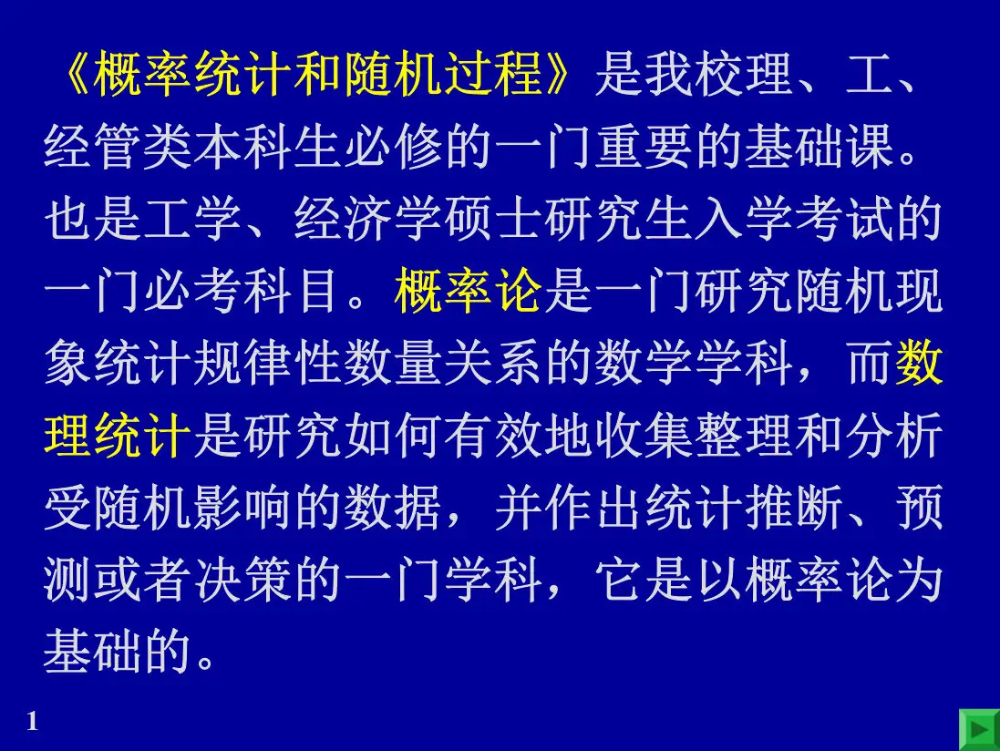

原文：

《概率统计和随机过程》 是我校理 工经管类本科生必修的一门重要的基础课也是工学、 经济学硕士研究生入学考试的一门必考科 目 。 概率论是一门研究随机现象统计规律性数量关系的数学学科， 而数理统计是研究如何有效地收集整理和分析受随机影响的数据， 并作出统计推断 预测或者决策的一门学科， 它是以概率论为基础的 。

1

口

### 第一章 概率论基本概念

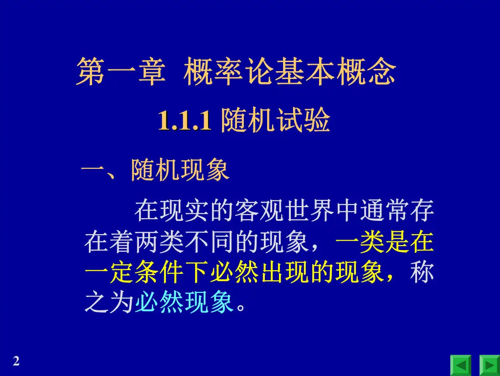

原文：

第一章 概率论基本概念

1 . 1 . 1 随机试验

一、 随机现象

在现实的客观世界中通常存在着两类不同的现象， 一类是在一定条件下必然出现的现象， 称之为必然现象。

2

口

### 例如:

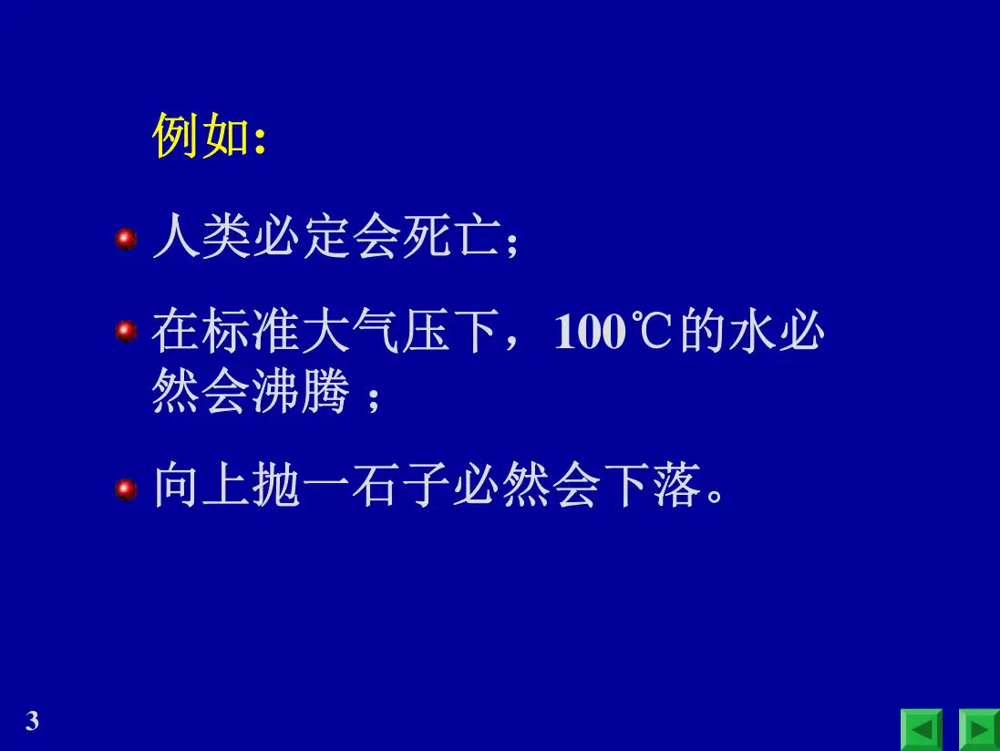

原文：

例如:

人类必定会死亡；

在标准大气压下， 100℃ 的水必然会沸腾 ；

向上抛一石子必然会下落

3

A口

### 这种随机现象在社会生活和 日常生产活动中是随处可见。 例如 :

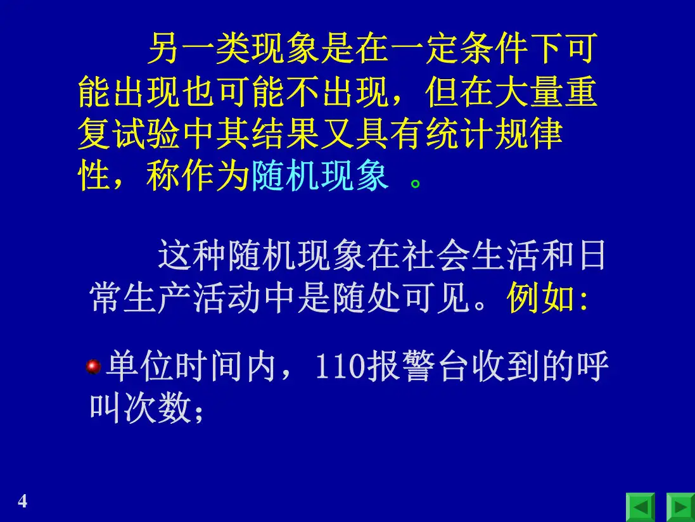

原文：

另一类现象是在一定条件下可能出现也可能不出现， 但在大量重复试验中其结果又具有统计规律性， 称作为随机现象

这种随机现象在社会生活和 日常生产活动中是随处可见。 例如 :

单位时间 内 ， 1 10报警台收到的呼叫次数；

4

口

### 第 6 页

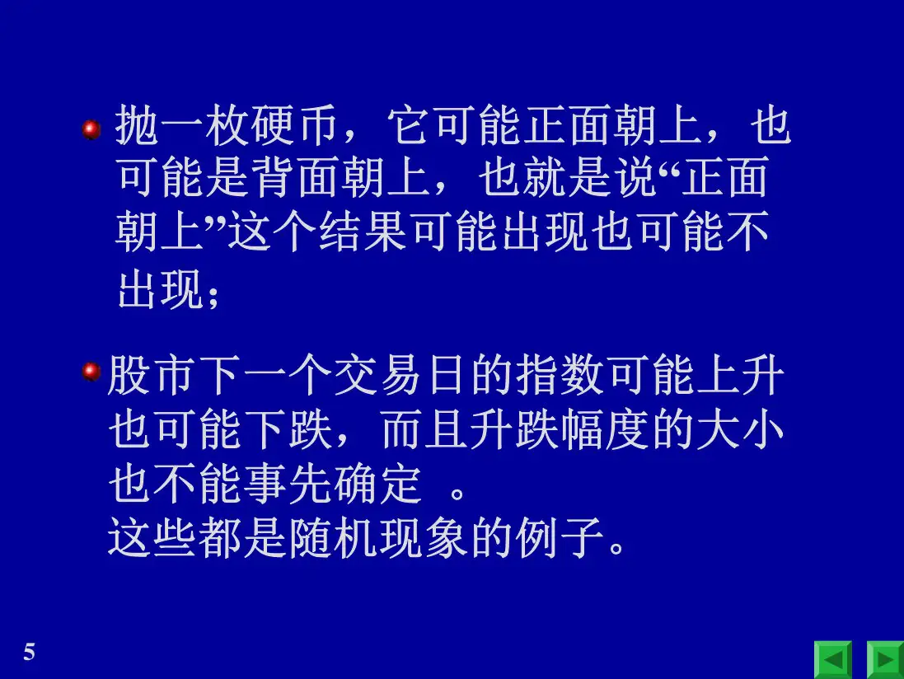

原文：

抛一枚硬币 ， 它可能正面朝上， 也可能是背面朝上， 也就是说“正面朝上”这个结果可能出现也可能不出现；

股市下一个交易 日 的指数可能上升也可能下跌， 而且升跌幅度的大小也不能事先确定 。这些都是随机现象的例子。

5

口

### 二、 随机试验

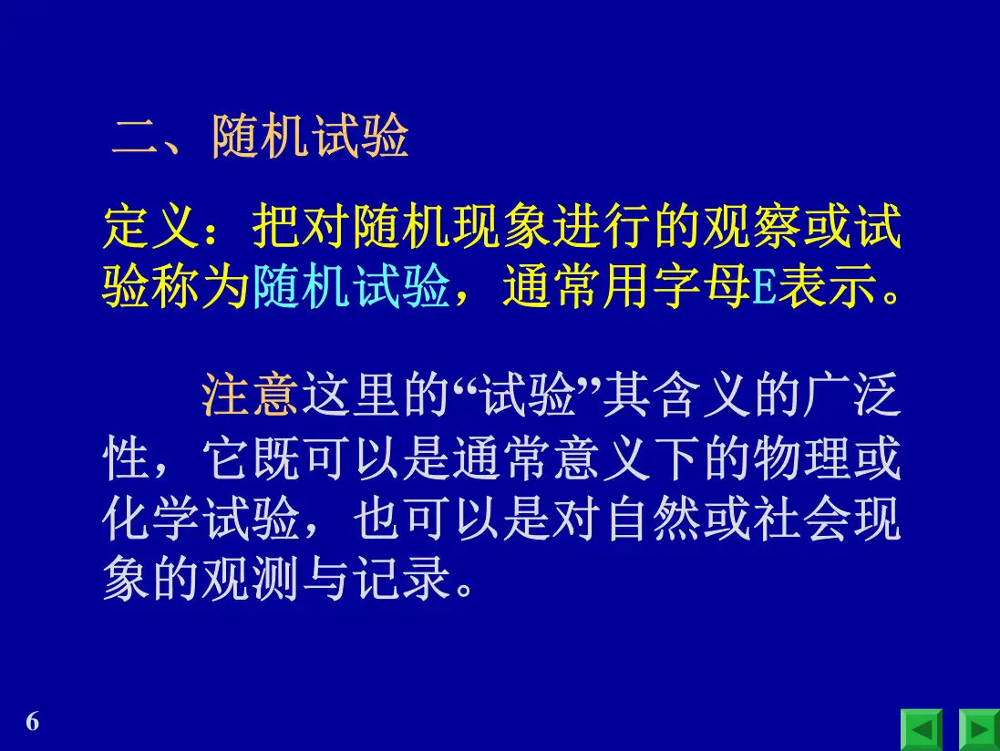

原文：

二、 随机试验

定义： 把对随机现象进行的观察或试验称为随机试验， 通常用字母E表示。

注意这里的“试验”其含义的广泛性， 它既可以是通常意义下的物理或化学试验， 也可以是对 自然或社会现象的观测与记录。

6

口

### 随机试验具有以下三个特性：

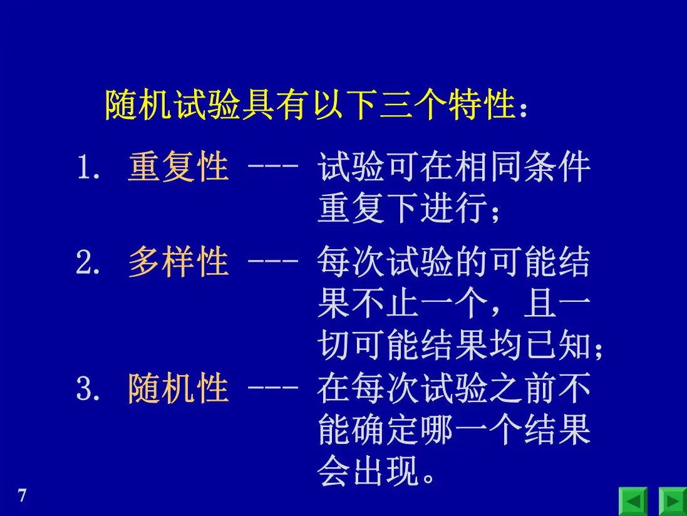

原文：

随机试验具有以下三个特性：

1. 重复性 试验可在相同条件重复下进行；

2. 多样性 --- 每次试验的可能结果不止一个， 且一切可能结果均已知；

3. 随机性 --- 在每次试验之前不能确定哪一个结果会出现。

7

### 随机试验的例子

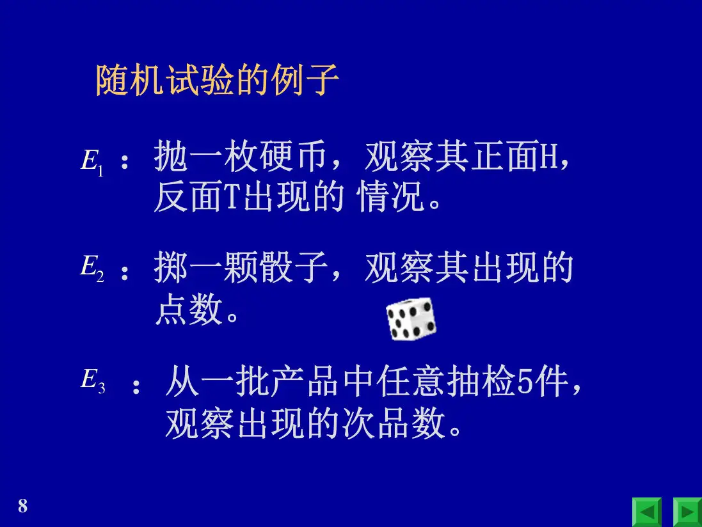

原文：

随机试验的例子

： 抛一枚硬币 ， 观察其正面H，E反面T出现的 情况。

： 掷一颗骰子， 观察其出现的E2 点数。

： 从一批产品 中任意抽检5件，E3观察出现的次品数。

8

A口

### ： 记录某地1 10报警台单位时间 内E4收到的呼叫次数。

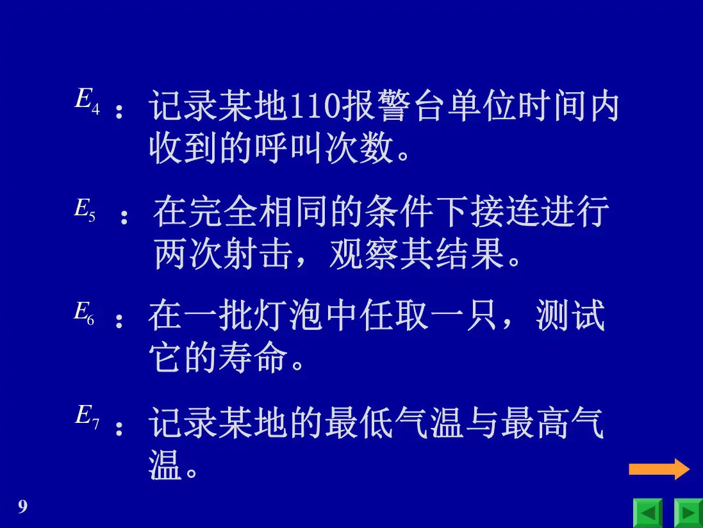

原文：

： 记录某地1 10报警台单位时间 内E4收到的呼叫次数。

： 在完全相同的条件下接连进行E5两次射击， 观察其结果。

： 在一批灯泡中任取一只 ， 测试E6它的寿命。

： 记录某地的最低气温与最高气E7温 。

9

### 1.1.2 样本空间和随机事件样本空间和随机事件一、 样本空间

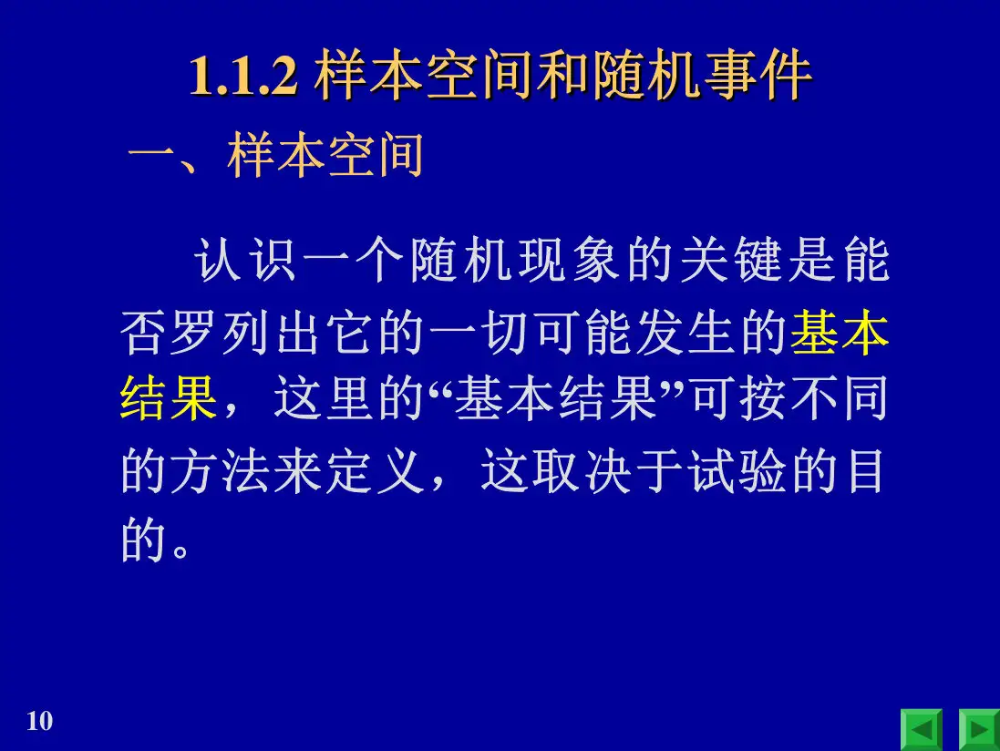

原文：

1.1.2 样本空间和随机事件样本空间和随机事件一、 样本空间

认识一个随机现象 的关键是能否罗列 出它 的一切可能发生的基本结果， 这里的“基本结果”可按不同的方法来定义， 这取决于试验的 目的 。

10

口

### 1 1

原文：

如果在检查产品 中， 只关心合格与否， 那么基本结果只有两个：合格品与不合格品 ； 若为了满足顾客的不同需求， 把合格品再分两个级别， 这时基本结果就有三个：级品、 二级品、 不合格品 。 可见基本结果是相对的， 是随人们研究需要而划分的。

1 1

口

### 12

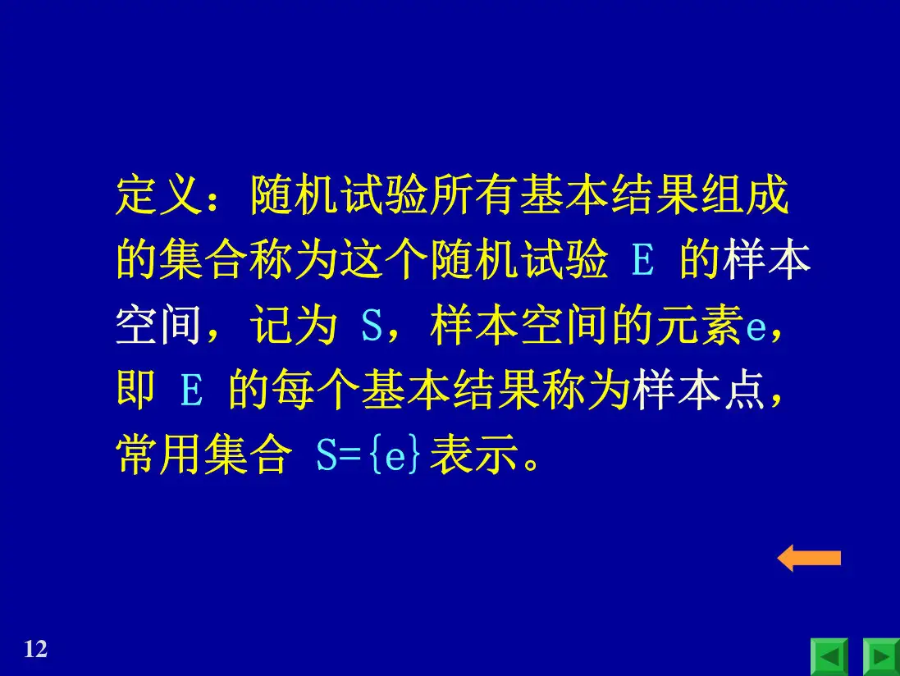

原文：

定义： 随机试验所有基本结果组成的集合称为这个随机试验 E 的样本空间， 记为 S， 样本空间 的元素e，即 E 的每个基本结果称为样本点，常用 集合 S= {e} 表示 。

12

口

### 随机试验例1的样本空间可表示如下：

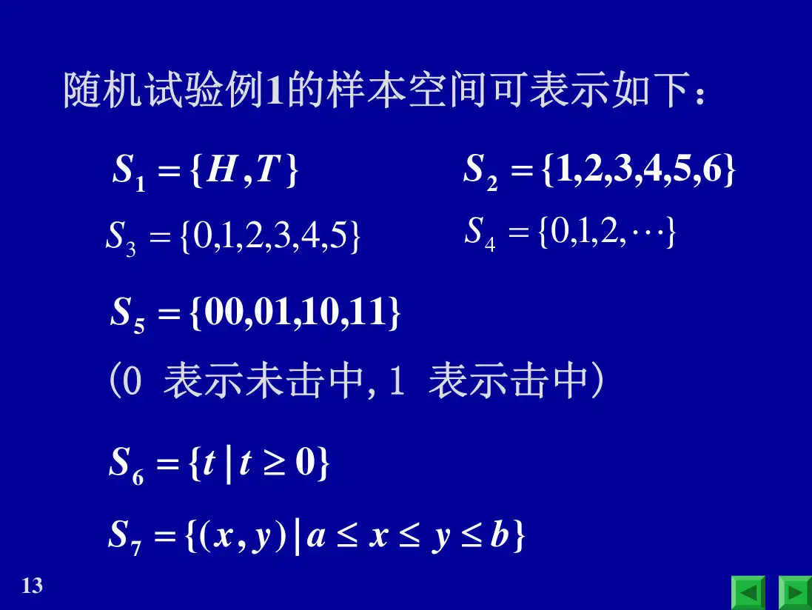

原文：

随机试验例1的样本空间可表示如下：

$$
S _ {1} = \{H, T \}
$$

$$
S _ {2} = \{1, 2, 3, 4, 5, 6 \}
$$

$$
S _ {3} = \{0, 1, 2, 3, 4, 5 \}
$$

$$
S _ {4} = \{0, 1, 2, \dots \}
$$

$$
S _ {5} = \{0 0, 0 1, 1 0, 1 1 \}
$$

(0 表示未击中 1 表示击中)

$$
S _ {6} = \{t | t \geq 0 \}
$$

$$
S _ {7} = \{(x, y) | a \leq x \leq y \leq b \}
$$

13

### 14

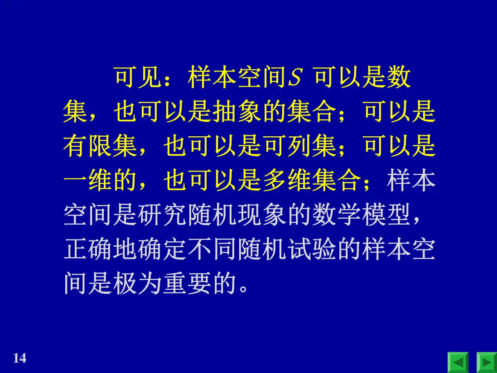

原文：

可见： 样本空间S 可以是数集， 也可以是抽象的集合； 可以是有限集， 也可以是可列集； 可以是一维的， 也可以是多维集合； 样本空间是研究随机现象的数学模型，正确地确定不同随机试验的样本空间是极为重要的。

14

口

### 二、 随机事件

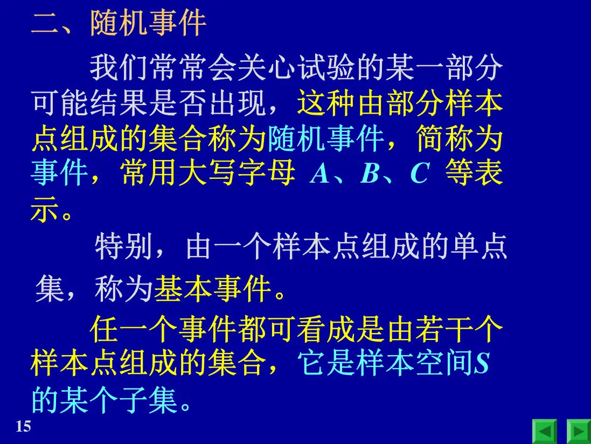

原文：

二、 随机事件

我们常常会关心试验的某一部分可能结果是否出现， 这种 由部分样本点组成的集合称为随机事件， 简称为事件， 常用大写字母 A、 B、 C 等表示 。

特别， 由一个样本点组成的单点集， 称为基本事件。

任一个事件都可看成是由若干个样本点组成的集合， 它是样本空间S的某个子集。

15

口

### 例： 掷一颗骰子,

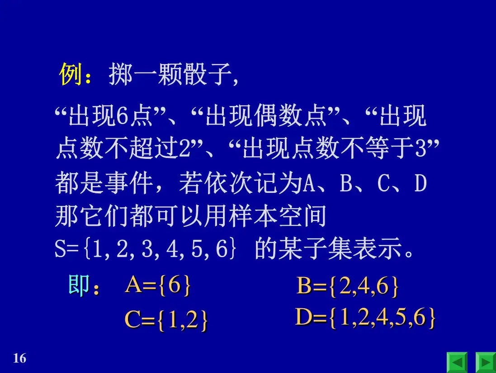

原文：

例： 掷一颗骰子,

“出现6点”、 “出现偶数点”、 “出现点数不超过2”、 “出现点数不等于3”都是事件， 若依次记为A、 B、 C、 D那它们都可以用样本空间S= { 1 2 3 4 5 6 } 的 某子集表示 。

A= { 6 } 即 ：

C= { 1 , 2 } C= { 1 , 2 }

B= { 2,4,6 } B= { 2,4,6 }

D= { 1 , 2 ,4 , 5 , 6 } D= { 1 , 2 ,4 , 5 , 6 }

16

### 所谓某事件A发生， 当且仅当它所包含的某个样本点出现。

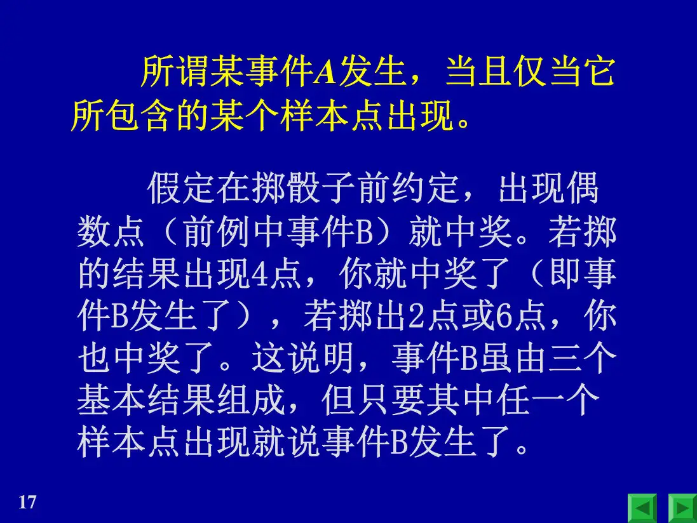

原文：

所谓某事件A发生， 当且仅当它所包含的某个样本点出现。

假定在掷骰子前约定， 出现偶数点 （前例中事件B） 就中奖。 若掷的结果出现4点， 你就中奖了 （ 即事件B发生了 ） ， 若掷出2点或6点， 你也中奖了 。 这说明 ， 事件B虽由三个基本结果组成， 但只要其中任一个样本点出现就说事件B发生了 。

17

口

### 三、 必然事件与不可能事件

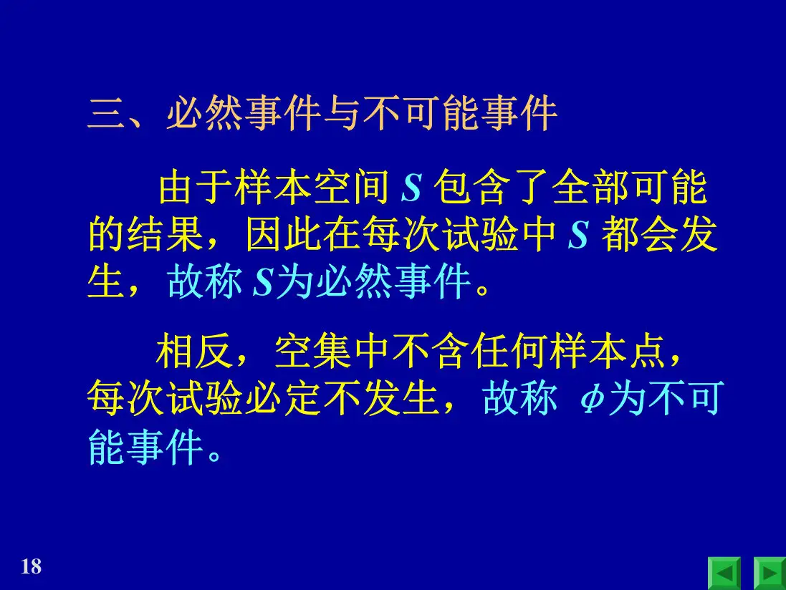

原文：

三、 必然事件与不可能事件

由于样本空间 S 包含了全部可能的结果， 因此在每次试验中 S 都会发生， 故称 S为必然事件。

相反， 空集中不含任何样本点，每次试验必定不发生， 故称 φ为不可能事件。

18

口

### 19

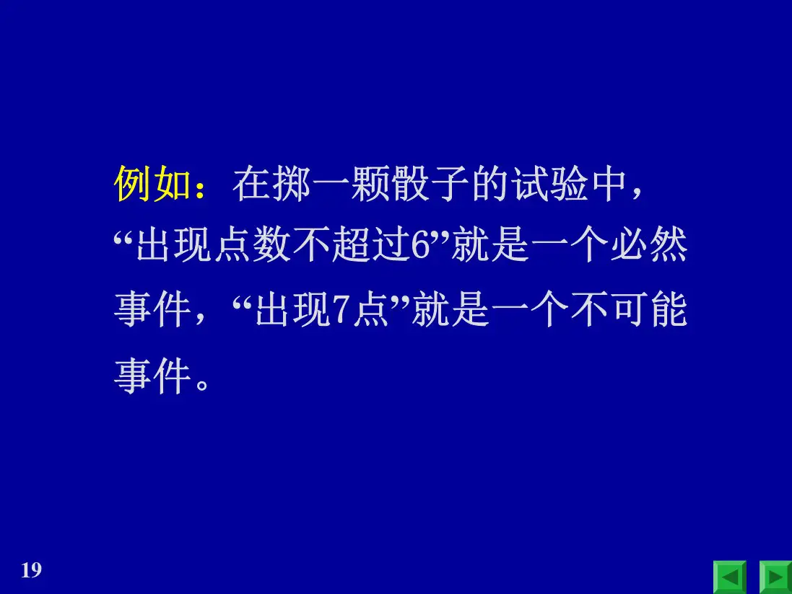

原文：

例如： 在掷一颗骰子的试验中，“出现点数不超过6”就是一个必然事件， “出现7点”就是一个不可能事件。

19

A口

### 20

原文：

从集合的观点看， 必然事件与样本空间 S 没有差异， 不可能事件与不含S 中 的任一元素的空集 φ没有差异。 样本空间S本身及其空集 φ也可看作样本空间S的二个子集， 一个是最大子集， 一个是最小子集 。

20

口

### 21

原文：

必然事件和不可能事件本质上是确定性结果， 但概率论离不开这二个事件， 就象计算机中离不开0与1 一样， 把这两个事件看作随机试验的二个极端情况是很合理的 。

21

A口

### 四、 事件的运算

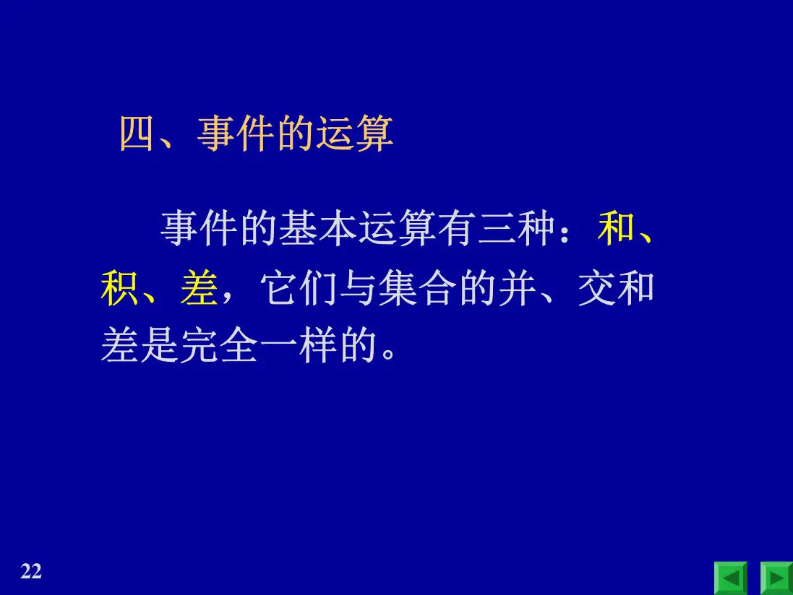

原文：

四、 事件的运算

事件的基本运算有三种： 和、积、 差， 它们与集合的并、 交和差是完全一样的。

22

A口

### 23

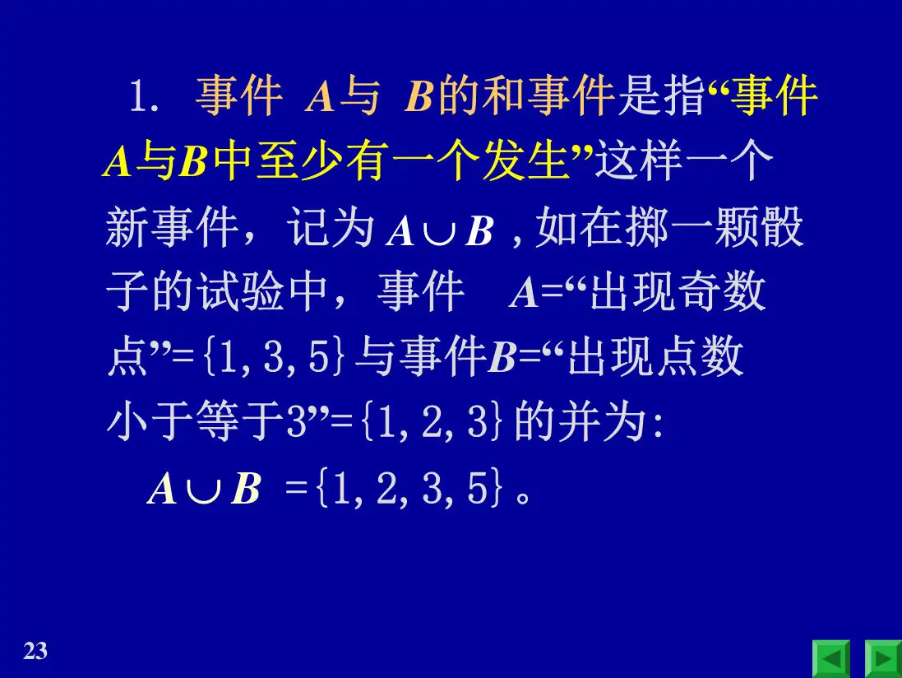

原文：

1. 事件 A与 B的和事件是指“事件A与B中至少有一个发生”这样一个新事件， 记为 如在掷一颗骰∪BA子的试验中， 事件 A=“出现奇数点”= { 1 3 5} 与事件B=“出 现点数小 于等于 3”= { 1 2 3 } 的 并为 := { 1 , 2 , 3 , 5 } 。A ∪ B

23

口

### 图 1 . 1 A 与 B 的并

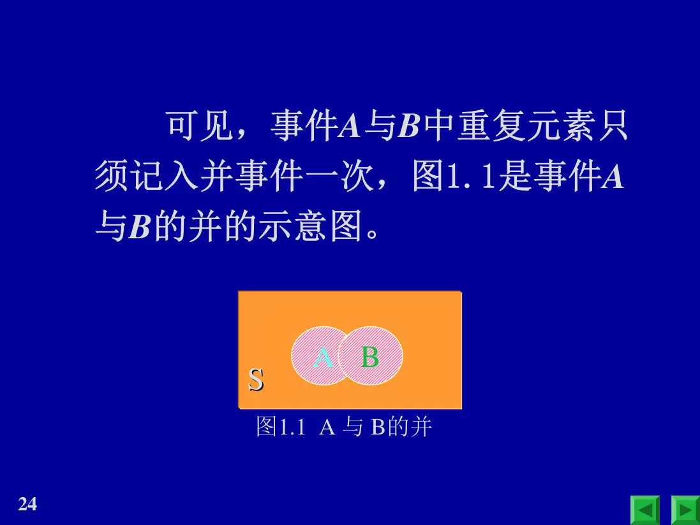

原文：

可见， 事件A与B中重复元素只须记入并事件一次， 图1. 1是事件A与B的并的示意 图 。

图 1 . 1 A 与 B 的并

24

A口

### 图 1 .2 A 与 B 的交

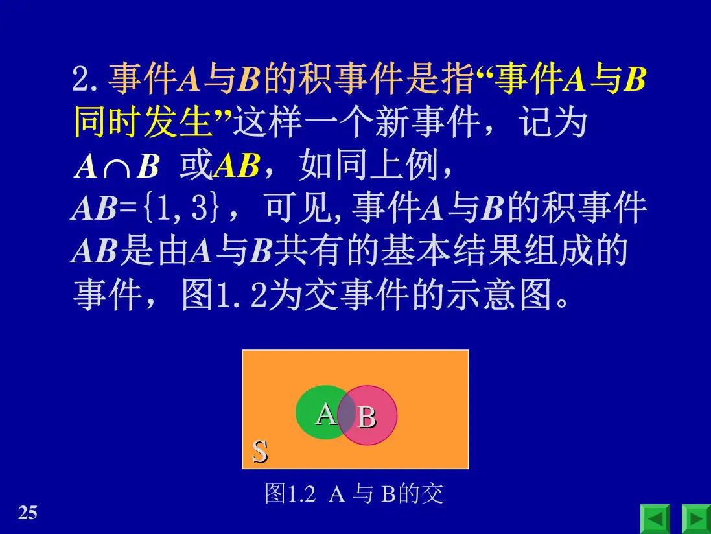

原文：

2 事件A与B的积事件是指“事件A与B同时发生”这样一个新事件， 记为或AB， 如 同上例 ，A ∩ BAB= { 1 3} ， 可见 事件A与B的积事件AB是由A与B共有的基本结果组成的事件， 图1. 2为交事件的示意图 。

图 1 .2 A 与 B 的交

25

口

### 26

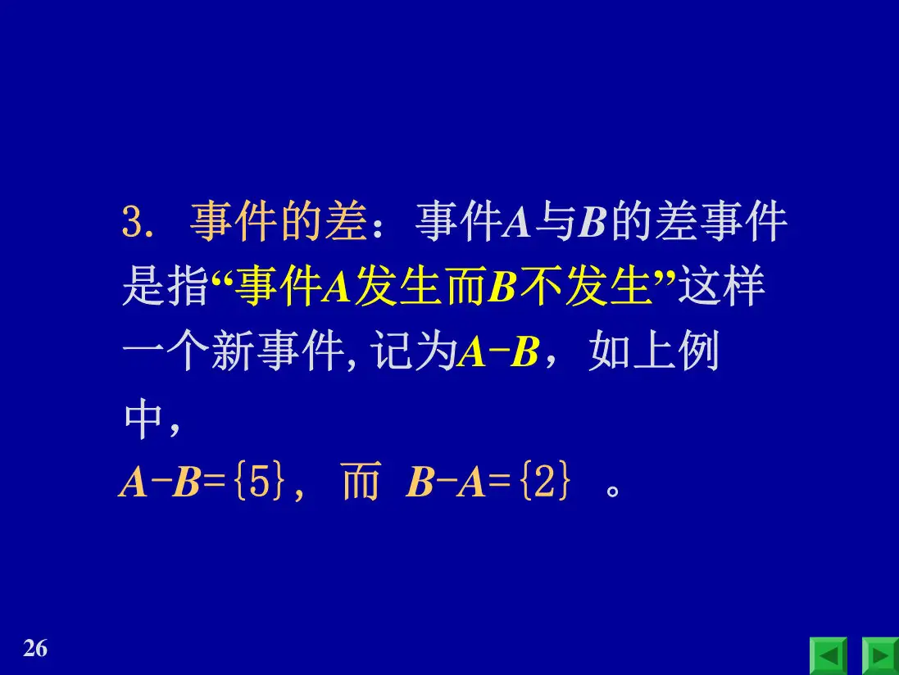

原文：

3. 事件的差： 事件A与B的差事件是指“事件A发生而B不发生”这样一个新事件 记为A-B， 如上例中 ，$\angle C = \angle B = \angle E D$ $| B | = | B |$

26

A口

### 下图给出 了二种场合差事件的示意图 。

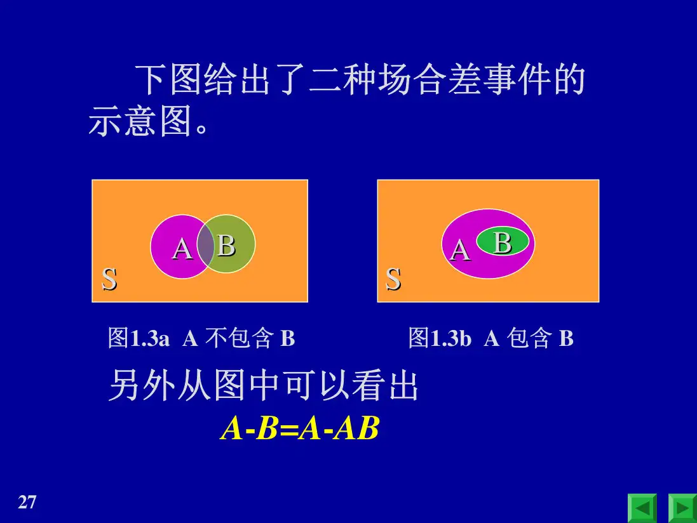

原文：

下图给出 了二种场合差事件的示意图 。

图1.3a A 不包含 B 图另外从图 中可以看出A-B=A-AB

1.3b A 包含 B

27

口

### 4. 事件的和 以及积可推广到任意n个事件

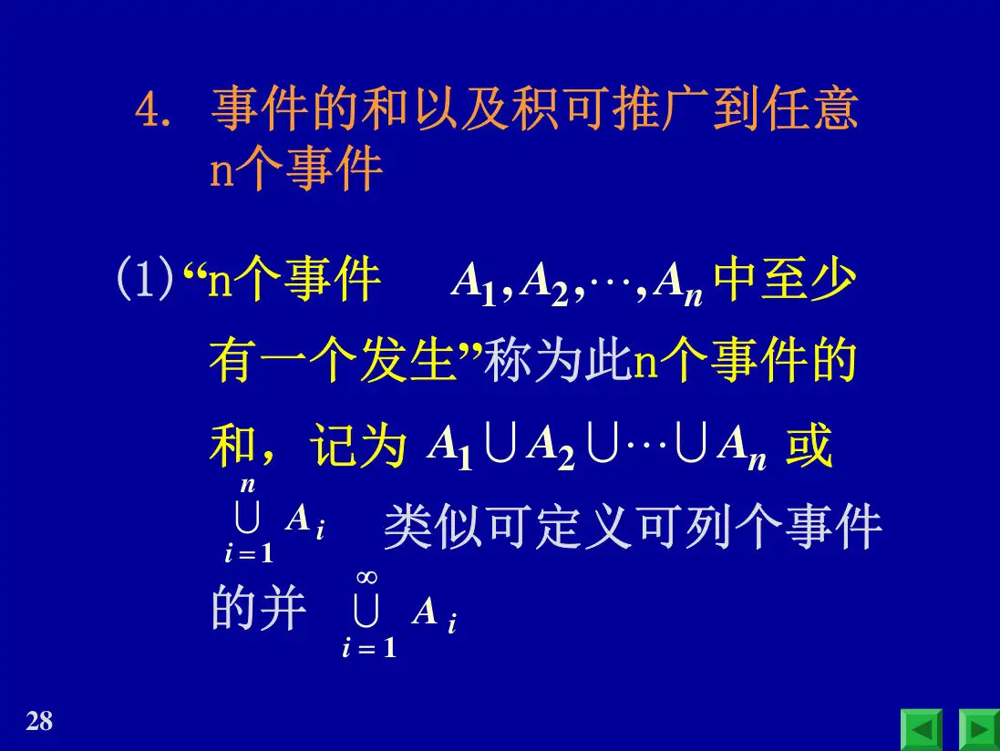

原文：

4. 事件的和 以及积可推广到任意n个事件

( 1 ) “n个事件 $1 0 0 0 0 0 0 0 0 0 0 0 0 0 0 0 0 0 0 0 0 0 0 0 0 0 0 0 0 0 0 0 0 0 0 0 0 0 0 0 0 0 0 0 0 0 0 0 0 0 0 0 0 0 0 0 0 0 0 0 0 0 0 0 0 0 0 0 0 0 0 0 0 0 0 0 0 0 0 0 0 0 0 0 0 0 0 0 0 0 0 0 0 0 0 0 0 0 0 0 0 0 0 0 0 0 0 0 0 0 0 0 0 0 0 0 0 0 0 0 0 0 0 0 0 0 0 0 0 0 0 0 0 0 0 0 0 0 0 0 0 0 0 0 0 0 0 0 0 0 0 0 0 0 0 0 0 0 0 0 0 0 0 0 0 0 0 0 0 0 0 0 0 0 0 0 0 0 0 0 0 0 0 0 0 0 0 0 0 0 0 0 0 0 0 0 0 0 0 0 0 0 0 0 0 0 0 0 0 0 0 0 0 0 0 0 0 0 0 0 0 0 0 0 0 0 0 0 0 0 0 0 0 0 0 0 0 0 0 0 0 0 0 0 0 0 0 0 0 0 0 0 0 0 0 0 0 0 0 0 0 0 0 0 0 0 0 0 0 0 0 0 0 0 0 0 0 0 0 0 0 0 0 0 0 0 0 0 0 0 0 0 0 0 0 0 0 0 0 0 0 0 0 0 0 0 0 0 0 0 0 0 0 0 0 0 0 0 0 0 0 0 0 0 0 0 0 0 0 0 0 0 0 0 0 0 0 0 0 0 0 0 0 0 0 0 0 0 0 0 0 0 0 0 0 0 0 0 0 0 0 0 0 0 0 0 0 0 0 0 0 0 0 0 0 0 0 0 0 0 0 0 0 0 0 0 0 0 0 0 0 0 0 0 0 0 0 0 0 0 0 0 0 0 0 0 0 0 0 0 0 0 0 0 0 0 0 0 0 0 0 0 0 0 0 0 0 0 0 0 0 0 0 0 0 0 0 0 0 0 0 0 0 0 0 0 0 0 0 0 0 0 0 0 0 0 0 0 0 0 0 0 0 0 0 0 0 0 0 0 0 0 0 0 0 0 0 0 0 0 0 0 0 0 0 0 0 0 0 0 0 0 0 0 0 0 0 0 0 0 0 0 0 0 0 0 0 0 0 0 0 0 0 0 0 0 0 0 0 0 0 0 0 0 0 0 0 0 0 0 0 0 0 0 0 0 0 0 0 0 0 0 0 0 0 0 0 0 0 0 0 0 0 0 0 0 0 0 0 0 0 0 0 0 0 0 0 0 0 0 0 0 0 0 0 0$ 中至少有一个发生”称为此n个事件的和， 记为 $: 5 0 \times 5 = 5 0 0 0 0 ( c m ) = 5 0 0 0 ( c m )$ 或n类似可定义可列个事件iAUi = 1的 并 iAU ∞i = 1

28

口

### 29

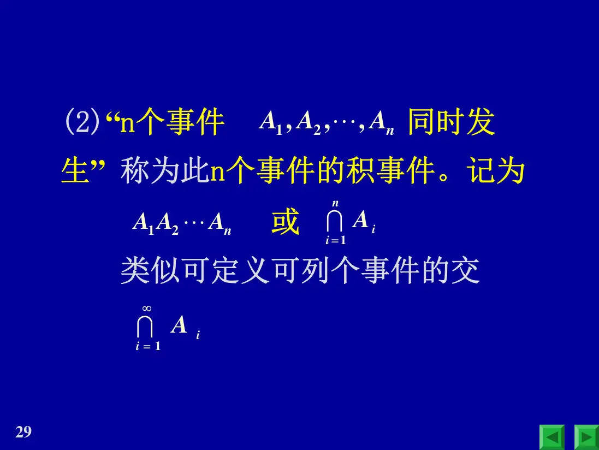

原文：

(2) “n个事件 $\angle 1 = \angle 2 = \angle 2 = 9 0 ^ { \circ } - \angle 2 = \angle 1$ 同时发 生” 称为此n个事件的积事件。 记为 $1 0 0 0 0 0 0 0 0 0 0 0 0 0 0 0 0 0 0 0 0 0 0 0 0 0 0 0 0 0 0 0 0 0 0 0 0 0 0 0 0 0 0 0 0 0 0 0 0 0 0 0 0 0 0 0 0 0 0 0 0 0 0 0 0 0 0 0 0 0 0 0 0 0 0 0 0 0 0 0 0 0 0 0 0 0 0 0 0 0 0 0 0 0 0 0 0 0 0 0 0 0 0 0 0 0 0 0 0 0 0 0 0 0 0 0 0 0 0 0 0 0 0 0 0 0 0 0 0 0 0 0 0 0 0 0 0 0 0 0 0 0 0 0 0 0 0 0 0 0 0 0 0 0 0 0 0 0 0 0 0 0 0 0 0 0 0 0 0 0 0 0 0 0 0 0 0 0 0 0 0 0 0 0 0 0 0 0 0 0 0 0 0 0 0 0 0 0 0 0 0 0 0 0 0 0 0 0 0 0 0 0 0 0 0 0 0 0 0 0 0 0 0 0 0 0 0 0 0 0 0 0 0 0 0 0 0 0 0 0 0 0 0 0 0 0 0 0 0 0 0 0 0 0 0 0 0 0 0 0 0 0 0 0 0 0 0 0 0 0 0 0 0 0 0 0 0 0 0 0 0 0 0 0 0 0 0 0 0 0 0 0 0 0 0 0 0 0 0 0 0 0 0 0 0 0 0 0 0 0 0 0 0 0 0 0 0 0 0 0 0 0 0 0 0 0 0 0 0 0 0 0 0 0 0 0 0 0 0 0 0 0 0 0 0 0 0 0 0 0 0 0 0 0 0 0 0 0 0 0 0 0 0 0 0 0 0 0 0 0 0 0 0 0 0 0 0 0 0 0 0 0 0 0 0 0 0 0 0 0 0 0 0 0 0 0 0 0 0 0 0 0 0 0 0 0 0 0 0 0 0 0 0 0 0 0 0 0 0 0 0 0 0 0 0 0 0 0 0 0 0 0 0 0 0 0 0 0 0 0 0 0 0 0 0 0 0 0 0 0 0 0 0 0 0 0 0 0 0 0 0 0 0 0 0 0 0 0 0 0 0 0 0 0 0 0 0 0 0 0 0 0 0 0 0 0 0 0 0 0 0 0 0 0 0 0 0 0 0 0 0 0 0 0 0 0 0 0 0 0 0 0 0 0 0 0 0 0 0 0 0 0 0 0 0 0 0 0 0 0 0 0 0 0 0 0 0 0 0 0 0 0 0 0 0 0 0 0 0 0 0 0 0 0 0 0 0 0 0 0 0 0 0 0 0 0 0 0 0 0 0 0 0 0 0 0$ 或 iI A n i = 1 类似可定义可列个事件的交 ∞ I A i = 1

29

口

### 五、 事件间 的关系

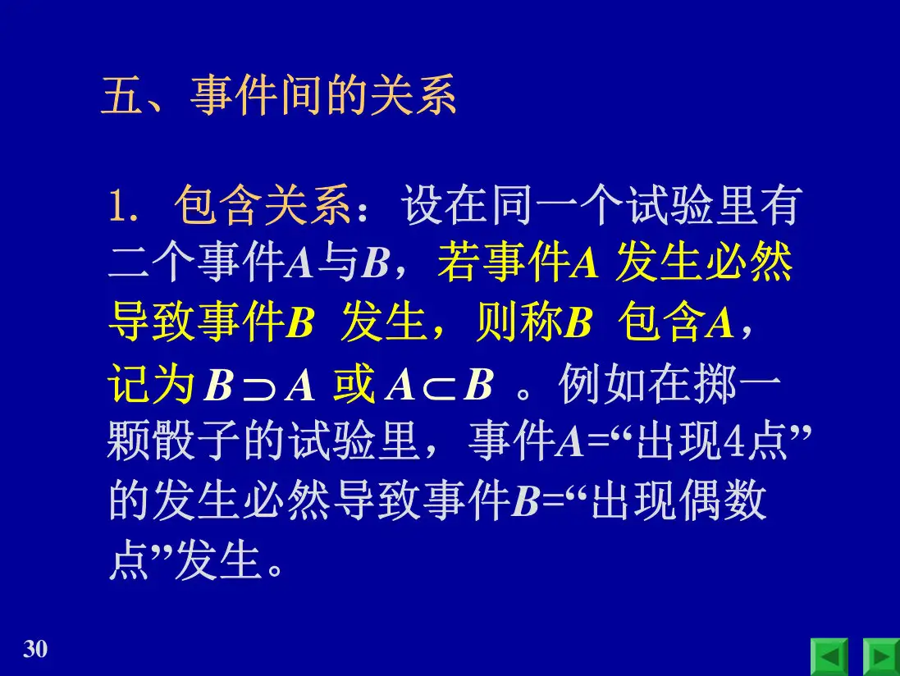

原文：

五、 事件间 的关系

1. 包含关系： 设在同一个试验里有二个事件A与B， 若事件A 发生必然导致事件B 发生， 则称B 包含A，记为 或 。 例如在掷一B ⊃A A⊂B颗骰子的试验里， 事件A=“出现4点”的发生必然导致事件B=“出现偶数点”发生。

30

口

### 事件的包含关系可用维恩图表示：

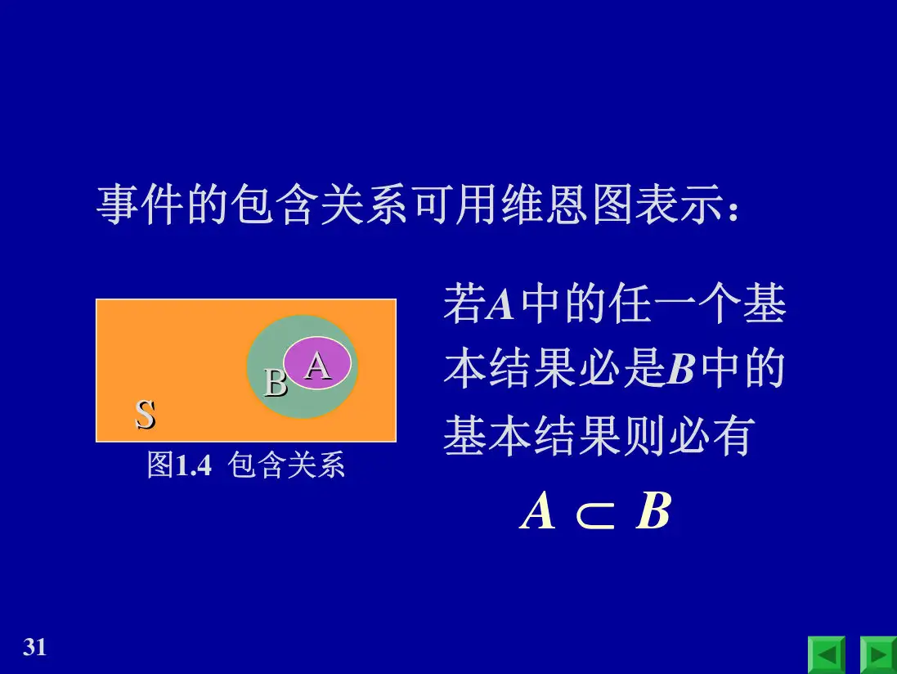

原文：

事件的包含关系可用维恩图表示：

图1.4 包含关系若A中 的任一个基本结果必是B中 的基本结果则必有

⊂ BA

31

口

### 32

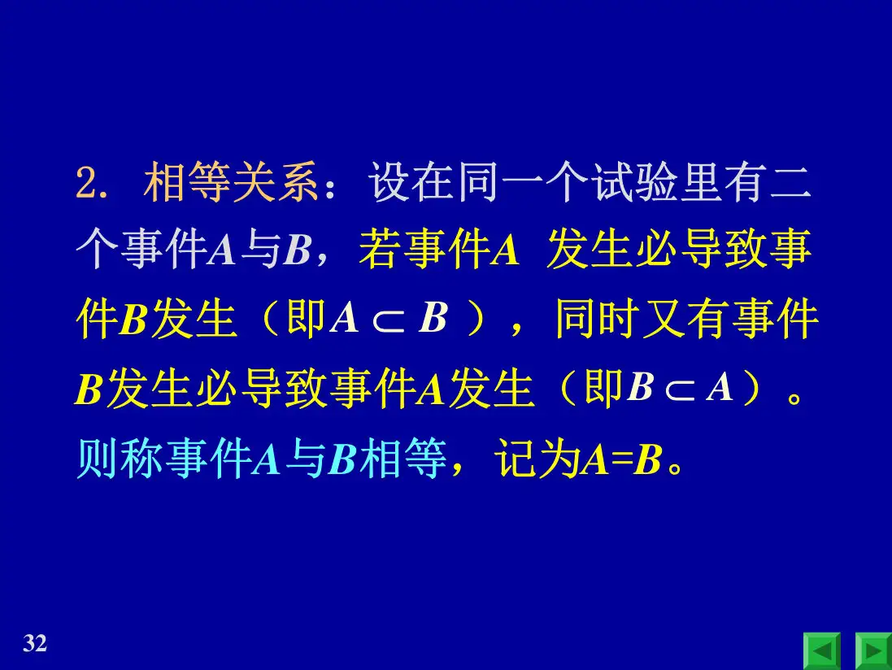

原文：

2. 相等关系： 设在同一个试验里有二个事件A与B， 若事件A 发生必导致事件B发生 （ 即 ） ， 同时又有事件A ⊂ BB发生必导致事件A发生 （ 即 ） 。B ⊂ A则称事件A与B相等， 记为A=B。

32

口

### 3. 事件的互不相容性

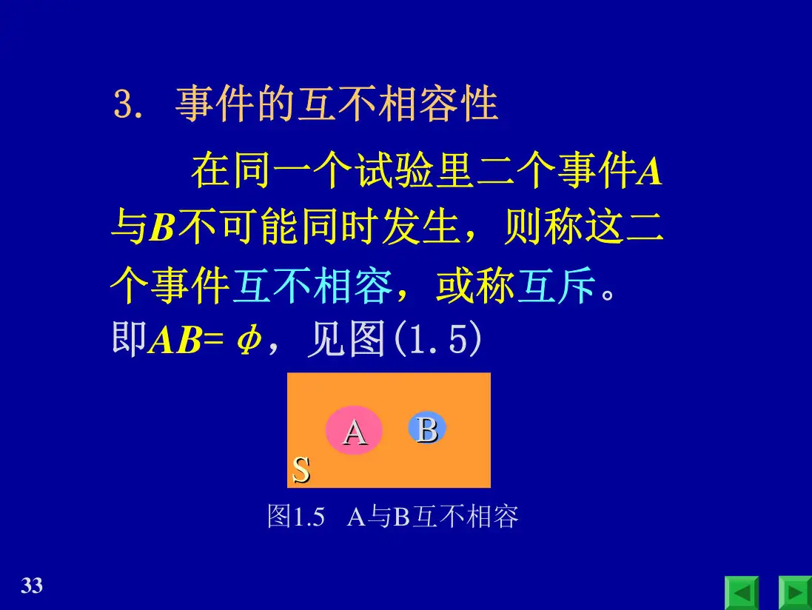

原文：

3. 事件的互不相容性

在同一个试验里二个事件A与B不可能同时发生， 则称这二个事件互不相容， 或称互斥。即 $\% 0 . 3 = 1 0 0 \%$ ， 见 图 ( 1 . 5 )

图 1.5 A与B互不相容

33

口

### 34

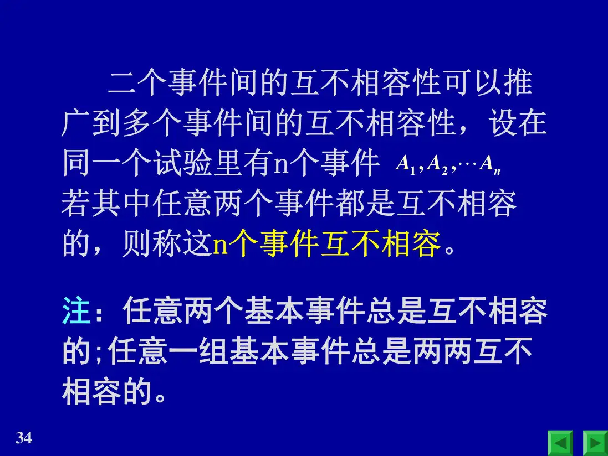

原文：

二个事件间的互不相容性可以推广到多个事件间的互不相容性， 设在同一个试验里有n个事件 $\angle 1 = \angle C = \angle A = \angle B = \angle C = \angle C$ 若其中任意两个事件都是互不相容的， 则称这n个事件互不相容。

注 ： 任意两个基本事件总是互不相容的 ; 任意一组基本事件总是两两互不相容的 。

34

口

### 4 对立事件

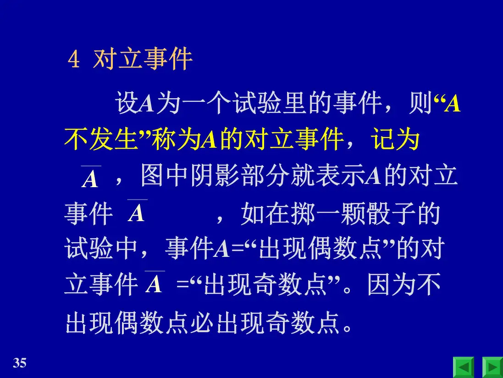

原文：

4 对立事件

设A为一个试验里的事件， 则“A不发生”称为A的对立事件， 记为， 图中 阴影部分就表示A的对立A事件 A ， 如在掷一颗骰子的试验中 ， 事件A=“出现偶数点”的对立事件 =“出现奇数点”。 因为不A出现偶数点必出现奇数点。

35

口

### 对立事件是相互， A的对立事件是 的对立事件必是A A 即AA = A

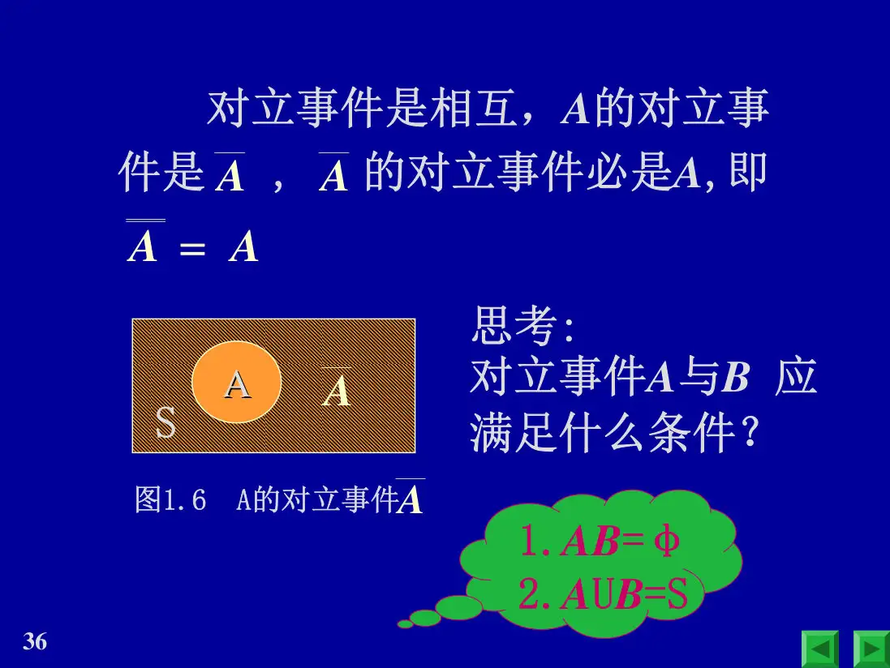

原文：

对立事件是相互， A的对立事件是 的对立事件必是A A 即AA = A

图 1. 6 A的对立事件A思考 :对立事件A与B 应满足什么条件？

$$
1. A B = \Phi
$$

$$
2. A U B = S
$$

36

口

### 六、 事件的运算规律

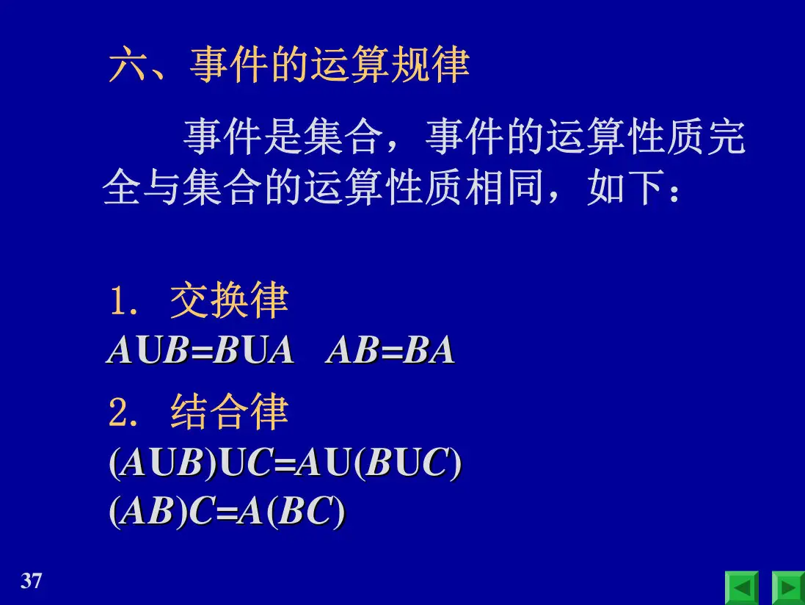

原文：

六、 事件的运算规律

事件是集合， 事件的运算性质完全与集合的运算性质相 同， 如下：

1. 交换律

AUB=BUA AB=BA

2. 结合律 $( \rho _ { \mathrm { e } } ( 0 / \beta ) ) ( 0 / \beta - \rho _ { \mathrm { e } } ( 0 / ( \beta ) ) 0 / ( 9 ) )$ $( \rho _ { \circ } ^ { \prime } | \theta _ { \circ } ^ { \prime } | ) / ( \theta _ { \circ } ^ { \prime } | \theta _ { \circ } ^ { \prime } | \phi _ { \circ } ^ { \prime } | \phi _ { \circ } ^ { \prime } | )$

37

口

### 补充：

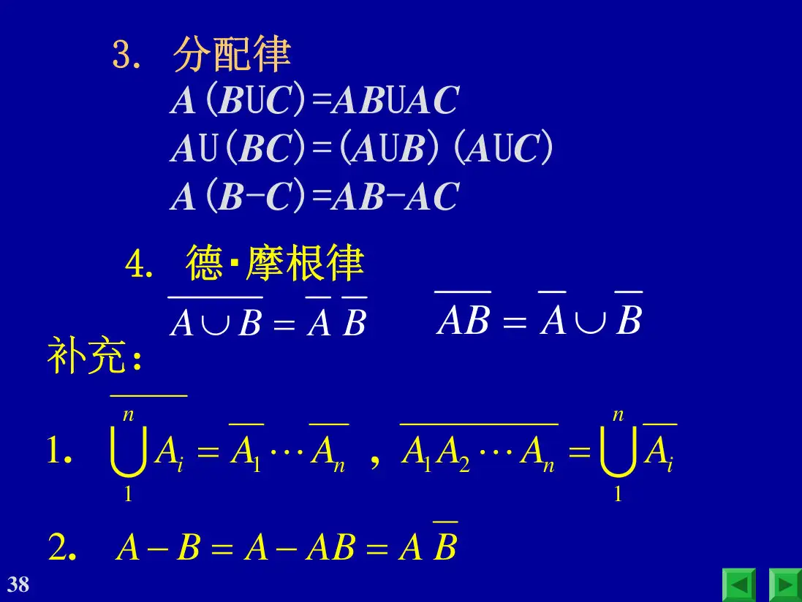

原文：

3. 分配律$\pm \sqrt { ( 0 / 2 0 0 ) - ( 0 / 2 0 ) ^ { 2 } } = 0$ $0 . 1 1 ( 0 . 7 ( 9 ) ) = ( 0 . 1 1 1 ) ( 0 . 1 1 ( 9 )$ $\pmb { \mathscr { L } } _ { i } ( 0 ; i , 0 ; i , 0 ; i , 0 ; i , 0 ; i , 0 ; i )$

4. 德▪摩根律$\mathrm { _ 4 ^ { \prime } ( \bullet ) \bullet ( \bullet ) \bullet ( \bullet ) \bullet ( \bullet ) \bullet ( \bullet ) }$ $4 0 \% = 7 . 0 7 \%$

补充：

$\frac { 1 } { 2 } \times ( - 1 0 0 0 - 2 0 0 ) \times 2 = 1 0 0 0 ( c m )$

BAABABA =−=−.2例1 设A、 B、 C是某试验中 的三个事件， 则

38

口

### 1. 事件 “A发生而B与C都不发生”，可表示为 或A CB A − B − C

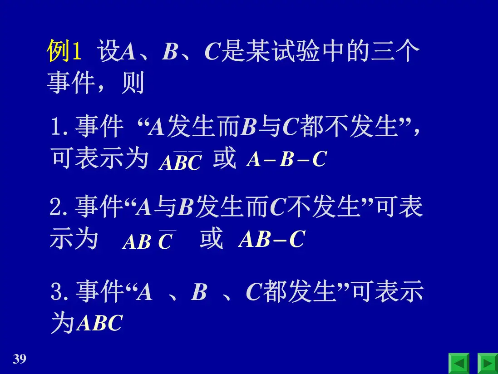

原文：

1. 事件 “A发生而B与C都不发生”，可表示为 或A CB A − B − C

2. 事件“A与B发生而C不发生”可表示为 或AB C AB− C

3. 事件“A 、 B 、 C都发生”可表示为ABC

39

口

### 4. 事件“A 、 B、 C至少发生一个”可表示为 A ∪∪ CB

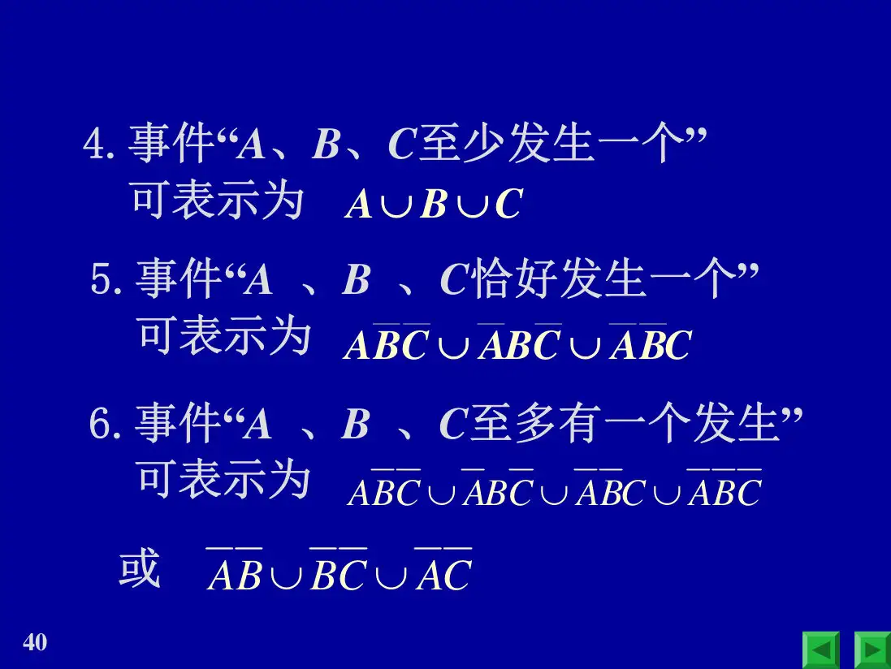

原文：

4. 事件“A 、 B、 C至少发生一个”可表示为 A ∪∪ CB

5. 事件“A 、 B 、 C恰好发生一个”可表示为 ∪∪ CBACBACBA

6. 事件“A 、 B 、 C至多有一个发生”可表示为 ∪∪∪ CBACBACBACBA或 ∪∪ CACBBA

40

### 例2 : 若 A、 B满足 ， 则事件A与B 为对立事件。 （ 多选）

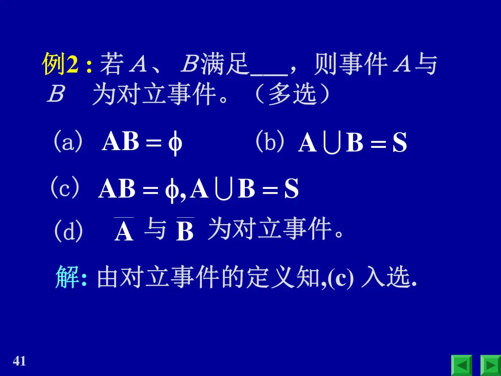

原文：

例2 : 若 A、 B满足 ， 则事件A与B 为对立事件。 （ 多选）

( a ) $\Delta V _ { 2 } = 0$

( b ) $\mathbf { \Delta } _ { 4 } ( 0 . 1 3 - 8 )$

( c ) $0 . 0 3 - 0 . 0 2 = 0 . 0 3 - 0 . 0 3$

(d) 与 BA 为对立事件。

解: 由对立事件的定义知 (c) 入选.

41

口

### 对(c) 中两事件 求其逆事件 有

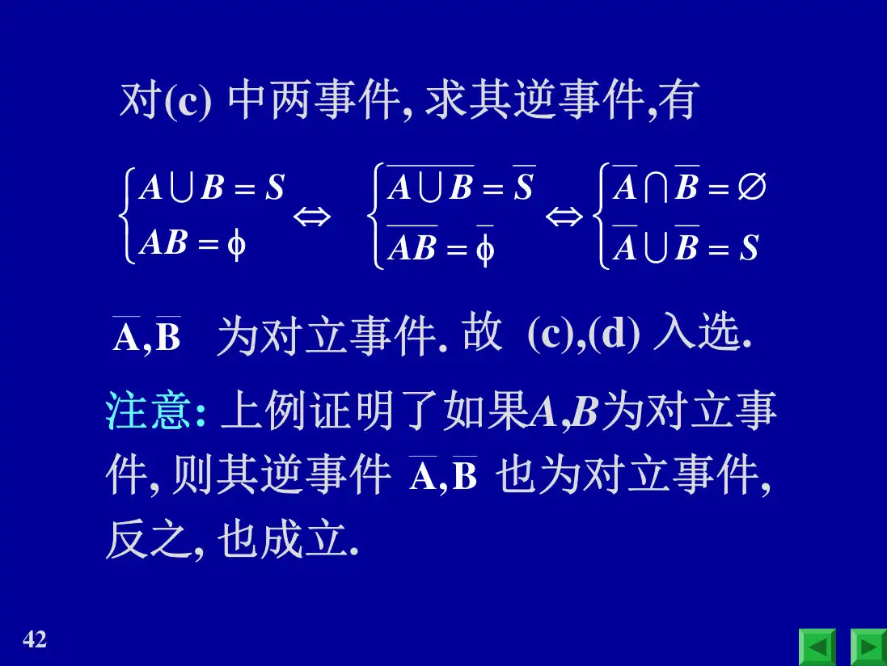

原文：

对(c) 中两事件 求其逆事件 有

$$
\left\{ \begin{array}{l} A \bigcup B = S \\ A B = \phi \end{array} \right. \Leftrightarrow \quad \left\{ \begin{array}{l} \overline {{A \bigcup B}} = \overline {{S}} \\ \overline {{A B}} = \overline {{\phi}} \end{array} \right. \Leftrightarrow \left\{ \begin{array}{l} \overline {{A}} \cap \overline {{B}} = \varnothing \\ \overline {{A}} \cup \overline {{B}} = S \end{array} \right.
$$

BA 为对立事件 故 (c) (d) 入选.注意: 上例证明 了如果A B为对立事件 则其逆事件 也为对立事件BA反之 也成立.

42

口
