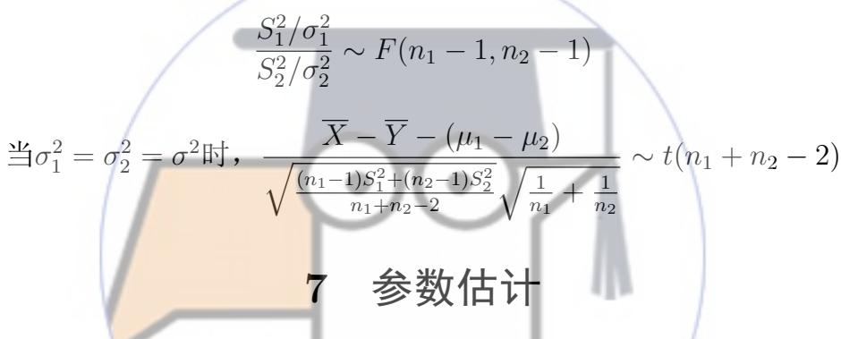

# 《概率论与数理统计与随机过程》知识点整理

原件经识别和整理；“参考解答”是我们补的。

这是一份基于你提供的乱码文本，经过清洗、去噪和逻辑重组后的《概率论与数理统计》课程知识点整理。

原始文本中包含了大量无关的计算机通信术语、HTML标签错误以及混淆的代码片段（如 `p_k`, `f(x)` 等）。我已剔除这些噪音，保留核心数学概念，并按照标准的复习大纲格式进行了重构。

---

# 《概率论与数理统计》课程复习知识点整理
**适用学年：** 2021—2022 学年第二学期  
**整理方式：** 结构化笔记 / 重点难点梳理

## 一、 随机事件与概率 (Random Events and Probability)

### 1.1 基本概念
*   **样本空间 ($\Omega$)**：所有可能结果的集合。
*   **随机事件 ($A, B$)**：样本空间的子集。
*   **必然事件与不可能事件**：$\Omega$ 本身与空集 $\emptyset$。

知识点：[随机试验与样本空间](../../../topics/概率论与数理统计/随机试验与样本空间.md)、[随机事件及其运算（并、交、差、对立）](../../../topics/概率论与数理统计/随机事件及其运算.md)

### 1.2 事件的运算关系
*   **包含关系**：$A \subset B$
*   **相等关系**：$A = B$
*   **互斥（不相容）**：$AB = \emptyset$
*   **对立事件**：$\bar{A}$
*   **运算律**：交换律、结合律、分配律、德摩根律（De Morgan's Laws）。

知识点：[随机事件及其运算（并、交、差、对立）](../../../topics/概率论与数理统计/随机事件及其运算.md)、[事件的运算规律（交换律、结合律、分配律、德摩根律）](../../../topics/概率论与数理统计/事件的运算规律.md)

### 1.3 概率的定义与性质
*   **频率与概率的关系**：当试验次数 $n$ 很大时，频率稳定于概率。
*   **概率公理化定义**：非负性、规范性、可列可加性。
*   **基本性质**：
    *   $P(\emptyset) = 0$
    *   $P(A) \leq 1$
    *   $P(\bar{A}) = 1 - P(A)$
    *   加法公式：$P(A \cup B) = P(A) + P(B) - P(AB)$

知识点：[频率与概率的公理化定义及性质](../../../topics/概率论与数理统计/频率与概率的公理化定义.md)、[随机事件及其运算（并、交、差、对立）](../../../topics/概率论与数理统计/随机事件及其运算.md)

### 1.4 条件概率与独立性
*   **条件概率**：$P(A|B) = \frac{P(AB)}{P(B)}$
*   **乘法公式**：$P(AB) = P(B)P(A|B)$
*   **全概率公式**：若 $A_1, ..., A_n$ 为完备事件组，则 $P(B) = \sum_{i=1}^n P(A_i)P(B|A_i)$
*   **贝叶斯公式 (Bayes' Theorem)**：用于求“后验概率”，即已知结果求原因的概率。
*   **事件的独立性**：若 $P(AB) = P(A)P(B)$，则称 $A$ 与 $B$ 相互独立。

---

## 二、 随机变量及其分布 (Random Variables and Distributions)

知识点：[条件概率与乘法公式](../../../topics/概率论与数理统计/条件概率与乘法公式.md)、[全概率公式](../../../topics/概率论与数理统计/全概率公式.md)、[贝叶斯公式（逆概率公式）](../../../topics/概率论与数理统计/贝叶斯公式.md)

### 2.1 离散型随机变量
*   **分布律**：$P(X=k) = p_k$
*   **常见分布**：
    *   **0-1 分布 (伯努利)**：一次试验成功或失败。
    *   **二项分布 $B(n, p)$**：$n$ 重伯努利试验中成功的次数。
        *   公式：$P(X=k) = C_n^k p^k (1-p)^{n-k}$
    *   **泊松分布 $P(\lambda)$**：稀有事件在固定时间/空间内发生的次数。
        *   公式：$P(X=k) = \frac{\lambda^k e^{-\lambda}}{k!}$

知识点：[离散型随机变量的分布律](../../../topics/概率论与数理统计/离散型随机变量的分布律.md)、[常见离散型分布（0-1分布、二项分布、泊松分布、几何分布、超几何分布）](../../../topics/概率论与数理统计/常见离散型分布.md)、[独立重复试验与伯努利概型（二项概率公式）](../../../topics/概率论与数理统计/伯努利概型.md)

### 2.2 连续型随机变量
*   **概率密度函数 (PDF) $f(x)$**：
    *   性质：$f(x) \geq 0$, $\int_{-\infty}^{+\infty} f(x)dx = 1$
    *   区间概率：$P(a < X \leq b) = \int_a^b f(x)dx$
*   **分布函数 (CDF) $F(x)$**：
    *   定义：$F(x) = P(X \leq x)$
    *   性质：单调不减、右连续、$F(-\infty)=0, F(+\infty)=1$

知识点：[连续型随机变量的概率密度函数及其性质](../../../topics/概率论与数理统计/连续型随机变量的概率密度.md)、[随机变量的分布函数及其性质](../../../topics/概率论与数理统计/随机变量的分布函数.md)

### 2.3 常见连续型分布
*   **均匀分布 $U(a, b)$**：概率密度在区间内为常数。
*   **指数分布 $E(\lambda)$**：常用于描述寿命、等待时间；具有“无记忆性”。
*   **正态分布 $N(\mu, \sigma^2)$**：
    *   钟形曲线，关于均值 $\mu$ 对称。
    *   **标准正态分布 $N(0, 1)$**：通过标准化变换 $Z = \frac{X-\mu}{\sigma}$ 得到。
    *   $3\sigma$ 原则：数据落在 $(\mu-3\sigma, \mu+3\sigma)$ 内的概率约为 99.7%。

---

## 三、 多维随机变量 (Multidimensional Random Variables)

知识点：[均匀分布](../../../topics/概率论与数理统计/均匀分布.md)、[指数分布](../../../topics/概率论与数理统计/指数分布.md)、[正态分布与标准正态分布（含3σ准则）](../../../topics/概率论与数理统计/正态分布.md)

### 3.1 联合分布
*   **二维离散型**：联合分布律 $P(X=x_i, Y=y_j) = p_{ij}$
*   **二维连续型**：联合概率密度 $f(x,y)$
    *   边缘密度：$f_X(x) = \int_{-\infty}^{+\infty} f(x,y)dy$

知识点：[二维离散型随机变量的联合分布律](../../../topics/概率论与数理统计/二维离散型随机变量的联合分布律.md)、[二维连续型随机变量的联合概率密度（含二维均匀分布、二维正态分布）](../../../topics/概率论与数理统计/二维连续型随机变量的联合概率密度.md)、[边缘分布（边缘分布函数、边缘分布律、边缘概率密度）](../../../topics/概率论与数理统计/边缘分布.md)

### 3.2 随机变量的独立性
*   **离散型**：$p_{ij} = p_{i\cdot} p_{\cdot j}$
*   **连续型**：$f(x,y) = f_X(x) f_Y(y)$

知识点：[两个随机变量的相互独立性](../../../topics/概率论与数理统计/随机变量的相互独立性.md)、[二维离散型随机变量的联合分布律](../../../topics/概率论与数理统计/二维离散型随机变量的联合分布律.md)、[二维连续型随机变量的联合概率密度（含二维均匀分布、二维正态分布）](../../../topics/概率论与数理统计/二维连续型随机变量的联合概率密度.md)

### 3.3 条件分布
*   给定一个变量取值下，另一个变量的分布情况。

知识点：[条件分布（离散型条件分布律、连续型条件概率密度）](../../../topics/概率论与数理统计/条件分布.md)、[二维离散型随机变量的联合分布律](../../../topics/概率论与数理统计/二维离散型随机变量的联合分布律.md)、[二维连续型随机变量的联合概率密度（含二维均匀分布、二维正态分布）](../../../topics/概率论与数理统计/二维连续型随机变量的联合概率密度.md)

### 3.4 随机变量函数的分布
*   **和的分布**：卷积公式。
*   **最大/最小值的分布**：
    *   $Z = \max(X,Y) \Rightarrow F_Z(z) = F_X(z)F_Y(z)$
    *   $Z = \min(X,Y) \Rightarrow F_Z(z) = 1 - [1-F_X(z)][1-F_Y(z)]$

---

## 四、 数字特征 (Numerical Characteristics)

知识点：[一维随机变量函数的分布（分布函数法、公式法）](../../../topics/概率论与数理统计/一维随机变量函数的分布.md)、[二维随机变量的联合分布函数及其性质](../../../topics/概率论与数理统计/二维随机变量的联合分布函数.md)、[两个随机变量的相互独立性](../../../topics/概率论与数理统计/随机变量的相互独立性.md)

### 4.1 数学期望 (Mean, $E[X]$)
*   反映随机变量取值的平均水平。
*   性质：线性性质 $E[aX+bY] = aE[X] + bE[Y]$。

知识点：[数学期望的定义与计算（离散型、连续型）](../../../topics/概率论与数理统计/数学期望的定义与计算.md)、[数学期望的性质](../../../topics/概率论与数理统计/数学期望的性质.md)

### 4.2 方差 (Variance, $D[X]$ 或 $Var(X)$)
*   反映随机变量取值的波动程度。
*   计算公式：$D(X) = E[X^2] - (E[X])^2$
*   性质：$D(cX) = c^2 D(X)$; 若 $X,Y$ 独立，则 $D(X+Y) = D(X) + D(Y)$。

知识点：[方差的定义与计算公式](../../../topics/概率论与数理统计/方差的定义与计算.md)、[方差的性质](../../../topics/概率论与数理统计/方差的性质.md)

### 4.3 协方差与相关系数
*   **协方差 $Cov(X,Y)$**：衡量两个变量变化的同步性。
    *   $Cov(X,Y) = E[XY] - E[X]E[Y]$
*   **相关系数 $\rho_{XY}$**：标准化后的协方差，范围 $[-1, 1]$。
    *   $\rho = 0$：不相关（注意：对于非线性关系，不相关不代表独立）。
    *   $|\rho|=1$：完全线性相关。

---

## 五、 大数定律与中心极限定理 (Limit Theorems)

知识点：[协方差及其性质](../../../topics/概率论与数理统计/协方差.md)、[相关系数及其性质（不相关的概念）](../../../topics/概率论与数理统计/相关系数.md)

### 5.1 切比雪夫不等式
*   对任意分布有效，估计偏离均值的概率上界。
*   $P(|X - E[X]| \geq \varepsilon) \leq \frac{D(X)}{\varepsilon^2}$

知识点：[切比雪夫不等式](../../../topics/概率论与数理统计/切比雪夫不等式.md)

### 5.2 大数定律
*   **辛钦大数定律**：独立同分布序列的算术平均值依概率收敛于期望值。
*   意义：解释了频率稳定性的理论基础。

知识点：[大数定律（切比雪夫大数定律、伯努利大数定律、辛钦大数定律）](../../../topics/概率论与数理统计/大数定律.md)

### 5.3 中心极限定理 (CLT)
*   **列维-林德伯格定理**：无论总体服从什么分布，只要样本量 $n$ 足够大，样本均值 $\bar{X}$ 近似服从正态分布。
*   应用：这是数理统计推断（如置信区间、假设检验）的理论基石。

---

## 六、 数理统计基础 (Mathematical Statistics Basics)

知识点：[中心极限定理（独立同分布中心极限定理、棣莫弗-拉普拉斯中心极限定理）](../../../topics/概率论与数理统计/中心极限定理.md)、[总体、个体、简单随机样本与样本容量](../../../topics/概率论与数理统计/总体与样本.md)、[统计量的概念及常用统计量（样本均值、样本方差、样本矩）](../../../topics/概率论与数理统计/统计量.md)

### 6.1 基本概念
*   **总体**：研究对象的全体。
*   **个体**：组成总体的每个元素。
*   **样本**：从总体中抽取的部分个体。
*   **统计量**：不含未知参数的样本函数（如样本均值 $\bar{X}$，样本方差 $S^2$）。

知识点：[总体、个体、简单随机样本与样本容量](../../../topics/概率论与数理统计/总体与样本.md)、[统计量的概念及常用统计量（样本均值、样本方差、样本矩）](../../../topics/概率论与数理统计/统计量.md)

### 6.2 抽样分布 (Sampling Distributions)
*   **$\chi^2$ 分布 (卡方分布)**：由标准正态变量的平方和构成。常用于拟合优度检验和方差分析。
*   **$t$ 分布 (学生氏分布)**：由标准正态变量除以卡方变量的开方构成。用于小样本均值检验。
*   **$F$ 分布**：两个独立的卡方变量除以其自由度之比。用于方差齐性检验和回归分析。

知识点：[χ²分布（定义、性质、上α分位点）](../../../topics/概率论与数理统计/卡方分布.md)、[t分布（定义、性质、上α分位点）](../../../topics/概率论与数理统计/t分布.md)、[F分布（定义、性质、上α分位点）](../../../topics/概率论与数理统计/F分布.md)

### 6.3 参数估计
*   **点估计方法**：
    *   **矩估计法**：用样本矩代替总体矩。
    *   **最大似然估计法 (MLE)**：寻找使样本出现概率最大的参数值。
*   **评价标准**：无偏性、有效性、一致性。
*   **区间估计**：构造一个随机区间，以一定的置信水平（如 95%）包含真值。

知识点：[矩估计法](../../../topics/概率论与数理统计/矩估计法.md)、[最大似然估计法（似然函数、对数似然方程）](../../../topics/概率论与数理统计/最大似然估计法.md)、[估计量的评选标准（无偏性、有效性、相合性）](../../../topics/概率论与数理统计/估计量的评选标准.md)

### 6.4 假设检验
*   **基本思想**：小概率反证法。
*   **两类错误**：
    *   **弃真错误 ($\alpha$)**：原假设为真却拒绝它（显著性水平）。
    *   **取伪错误 ($\beta$)**：原假设为假却接受它。
*   **步骤**：提出假设 -> 选择统计量 -> 确定拒绝域 -> 计算并判断。

---

## 七、 常见易错点与复习建议

1.  **独立性与互斥的区别**：
    *   互斥是指不能同时发生 ($AB=\emptyset$)。
    *   独立是指一个发生不影响另一个发生的概率。
    *   *注意*：若 $P(A)>0, P(B)>0$，互斥的事件一定不独立。
2.  **正态分布的标准化**：
    *   计算概率时务必先转化为标准正态分布 $Z$，再查表。
    *   利用对称性简化计算：$\Phi(-x) = 1 - \Phi(x)$。
3.  **统计量的含义**：
    *   区分“总体参数”（固定但未知的常数）与“统计量”（随样本变化的随机变量）。
4.  **假设检验的结论表述**：
    *   不说“接受原假设”，而说“没有充分理由拒绝原假设”。

*(注：以上内容已过滤掉原始输入中关于“计算机通信”、“HTML编码”、“二进制传输协议”等无关干扰信息，仅保留数学与统计学核心知识点。)*

## 5 大数定律及中心极限定理

知识点：[假设检验的基本思想与小概率原理](../../../topics/概率论与数理统计/假设检验的基本思想.md)、[假设检验的两类错误（弃真错误/第I类错误、纳伪错误/第II类错误）](../../../topics/概率论与数理统计/两类错误.md)、[假设检验的一般步骤](../../../topics/概率论与数理统计/假设检验的一般步骤.md)

### 协方差与相关系数

$$
\operatorname{Cov} (X, Y) = E \{[ X - E (X) ] [ Y - E (Y) ] \}
$$

$$
\operatorname{Cov} (X, Y) = E (X Y) - E (X) E (Y)
$$

$$
\rho = \frac {\operatorname{Cov} (X , Y)}{\sqrt {D (X) D (Y)}}
$$

独立则一定不相关，反之不一定成立。但是在 $(X,Y)$ 服从二维正态分布时两者是等价的。

知识点：[协方差及其性质](../../../topics/概率论与数理统计/协方差.md)、[相关系数及其性质（不相关的概念）](../../../topics/概率论与数理统计/相关系数.md)、[常见分布的期望与方差](../../../topics/概率论与数理统计/常见分布的期望与方差.md)

### 矩、协方差矩阵

$X$ 的 $k$ 阶原点矩（$k$ 阶矩）：$E ( X ^ { k } )$

$X$ 的 $k$ 阶中心矩：$E \{ [ ( X - E ( X ) ) ] ^ { k } \}$

$X$ 和 $Y$ 的 $k + l$ 阶混合矩：$E ( X ^ { k } Y ^ { l } )$

$X$ 和 $Y$ 的 $k + l$ 阶混合中心矩：$E \{ [ ( X - E ( X ) ) ] ^ { k } [ ( Y - E ( Y ) ) ] ^ { l } \}$

协方差矩阵：将二阶中心矩排成矩阵的形式。$C_{ij} = \mathrm{Cov} ( X _ {i} , X _ {j} )$ 。是一个对称阵。

知识点：[矩（原点矩、中心矩）与协方差矩阵](../../../topics/概率论与数理统计/矩与协方差矩阵.md)

### 大数定律及中心极限定理

大数定律研究关于大量随机现象总的平均结果的稳定性定理。

中心极限定理研究独立随机变量之和的标准化随机变量在什么条件下极限分布是标准正态分布的定理。

**依概率收敛**
设 $Y _ { 1 } , Y _ { 2 } , \dots , Y _ { n } , \dots .$ 是一个随机变量序列，$a$ 是一个常数，若对于任意的正数 $\varepsilon$ 有 $P \{ |Y _ { n } - a| < \varepsilon \} = 1 ,$ 则称序列依概率收敛于 $a$ 记为 $Y _ { n } \xrightarrow { P } a$

**弱大数定理（辛钦大数定理）**
设随机变量序列 $X _ { 1 } , X _ { 2 } , \cdots$ 相互独立，服从同一分布，具有数学期望 $E ( X _ { k } ) = \mu , k = 1 , 2 , \cdot \cdot \cdot$ ，则对于任意正数 $\varepsilon$，有 $\overline { { X } } \xrightarrow { P } \mu$

**伯努利大数定律**
设 $f _ { A }$ 是 $n$ 次独立重复试验中事件 $A$ 发生的次数，$p$ 是事件 $A$ 在每次试验中发生的概率，则对于任意正数 $\varepsilon > 0$ ，有

$$
\lim _ {n \to \infty} P \{\left| \frac {f _ {A}}{n} - p \right| <   \varepsilon \} = 1 \text {或} \lim _ {n \to \infty} P \{\left| \frac {f _ {A}}{n} - p \right| \geq \varepsilon \} = 0
$$

辛钦大数定律为寻找随机变量的期望值提供了一条实际可行的途径，也为测量时取平均值作为结果提供了理论依据。伯努利大数定律是辛钦定理的重要推论。

**中心极限定理 - 独立同分布的中心极限定理**
随机变量 $X _ { 1 } , X _ { 2 } , \cdots$ 相互独立，服从同一分布，且具有数学期望和方差 $\mu$ 和 $\sigma^2$ ，则随机变量之和的标准化变量

$$
Y _ {n} = \frac {\sum_ {k = 1} ^ {n} X _ {k} - n \mu}{\sqrt {n} \sigma}
$$

的分布函数 $F _ { n } ( x )$ 对于任意 $x$ 满足

$$
\lim _ {n \to \infty} F _ {n}(x) = \Phi (x)
$$

**中心极限定理 - 李雅普诺夫 (Liapounov) 定理**
随机变量 $X _ { 1 } , X _ { 2 } , \cdots$ 相互独立，且具有数学期望和方差 $\mu_k$ 和 $\sigma_k^2$ ，记 $B _ { n } ^ { 2 } = \sum _ { k = 1 } ^ { n } \sigma _ { k } ^ { 2 }$ ，若存在正数 $\delta$，使得当 $n \to \infty$ 时

$$
\frac {1}{B _ {n} ^ {2 + \delta}} \sum_ {k = 1} ^ {n} E \{| X _ {k} - \mu_ {k} | ^ {2 + \delta} \} \rightarrow 0
$$

则其随机变量之和 $\sum _ { k = 1 } ^ { n } X _ { k }$ 的标准化变量 $Z _ { n } = \frac { \sum _ { k = 1 } ^ { n } X _ { k} - \sum _ { k = 1 } ^ { n } \mu _ { k } } { B _ { n } }$ 的分布函数 $F _ { n } ( x )$ 满足 $\lim _ { n \to \infty } F _ { n } ( x ) = \Phi ( x )$

**中心极限定理 - 棣莫佛－拉普拉斯（De Moivre-Laplace 定理）**
设随机变量 $\eta _ { n }$ 服从参数 $n , p$ 的二项分布，则对任意 $x$ 有

$$
\lim _ {n \to \infty} P \{\frac {\eta_ {n} - n p}{\sqrt {n p (1 - p)}} \leq x \} = \Phi (x)
$$

## 6 样本及抽样分布

总体：研究对象的全体（实验的全部可能观察值）称为总体。

个体：总体中每个成员（观察值）称为个体。

容量：总体中所包含的个体的个数称为总体的容量。

设 $X$ 是具有分布函数 $F$ 的随机变量，若 $X _ { 1 } , X _ { 2 } , \ldots , X _ { n }$ 是具有同一分布函数 $F$ 的、相互独立的随机变量，则称 $X_1,X_2,\dots,X_n$ 为从分布函数 $F$(或总体 $F$、或总体 $X$) 得到的容量为 $n$ 的简单随机样本，简称样本，它们的观察值 $x _ { 1 } , x _ { 2 } , \cdots , x _ { n }$ 称为样本值，又称为 $X$ 的 $n$ 个独立的观察值。

**直方图（频率直方图) 的作法:**
(1) 分区间 (分点通常取精度高一位，以免数据落在分点上);
(2) 算频数（频率）;
(3) 作图。

**分位数**
设有容量为 $n$ 的样本观察值 $x _ { 1 } , x _ { 2 } , \cdots , x _ { n }$ ，样本 $p ( 0 < p < 1 )$ 分位数 $x _ { p }$ ，具有以下 2 个性质：
(1) 至少有 $n p$ 个观察值小于或等于 $x _ { p }$ ；
(2) 至少有 $n ( 1 - p )$ 个观察值大于或等于 $x _ { p }$ ；

排序后：
$$
x _ {p} = \begin{cases} x _ {([ n p ] + 1)}, & n p \text {不是整数} \\ \frac {1}{2} [ x _ {(n p + 1)} + x _ {(n p)} ], & n p \text {是整数} \end{cases}
$$

四分位数间距：$I Q R = Q _ { 3 } - Q _ { 1 }$

**箱线图的作法：**
(1) 计算分位点并在坐标轴上标出 5 个重要数据 (最大、最小值、第一、二、三四分位数);
(2) 作箱线图。

设 $X _ { 1 } , X _ { 2 } , \cdots , X _ { n }$ 是来自总体 $X$ 的一个样本， $g ( X _ { 1 } , X _ { 2 } , \cdots , X _ { n } )$ 是 $X _ { 1 } , X _ { 2 } , \cdots , X _ { n }$ 的函数，若 $g$ 中不含未知参数，则称 $g ( X _ { 1 } , X _ { 2 } , \cdots , X _ { n } )$ 是一统计量。

**样本平均值**
$$
\overline {{X}} = \frac {1}{n} \sum_ {i = 1} ^ {n} X _ {i}
$$

**样本方差**
$$
S ^ {2} = \frac {1}{n - 1} \sum_ {i = 1} ^ {n} (X _ {i} - \overline {{X}}) ^ {2}
$$

**样本标准差**
$$
S = \sqrt {\frac {1}{n - 1} \sum_ {i = 1} ^ {n} (X _ {i} - \overline {{X}}) ^ {2}}
$$

**样本 k 阶原点矩**
$$
A _ {k} = \frac {1}{n} \sum_ {i = 1} ^ {n} X _ {i} ^ {k}
$$

**样本 k 阶中心矩**
$$
B _ {k} = \frac {1}{n} \sum_ {i = 1} ^ {n} (X _ {i} - \overline {{X}}) ^ {k}
$$

**样本分布函数**
$F _ { n } ( x )$ 为总体 $X$ 的样本分布函数 (或经验分布函数)。

**统计量的观察值**
样本均值、样本方差、样本标准差、样本 k 阶原点矩、样本 k 阶中心矩、经验分布函数、分位数。

**$\chi ^ { 2 }$ 分布**
设 $X _ { 1 } , X _ { 2 } , \cdots , X _ { n }$ 相互独立，都服从正态分布 $N ( 0 , 1 )$ ，则称随机变量 $\chi ^ { 2 } = X _ { 1 } ^ { 2 } + X _ { 2 } ^ { 2 } + \cdots + X _ { n } ^ { 2 }$ 所服从的分布为自由度为 $n$ 的 $\chi ^ { 2 }$ 分布，记作 $\chi \sim \chi ^ { 2 } ( n )$ 。

**t 分布**
设 $X \sim N ( 0 , 1 )$ ，$Y \sim \chi ^ { 2 } ( n )$ ，且 $X$ 与 $Y$ 独立，则称变量

$$
t = \frac {X}{\sqrt {Y / n}}
$$

服从自由度为 $n$ 的 t 分布，记作 $t \sim t ( n )$

**F 分布**
设 $U \sim \chi ^ { 2 } ( n _ { 1 } )$ ，$V \sim \chi ^ { 2 } ( n _ { 2 } )$ ，且 $U$ 与 $V$ 相互独立，则称随机变量

$$
F = \frac {U / n _ {1}}{V / n _ {2}}
$$

服从自由度为 $( n _ { 1 } , n _ { 2 } )$ 的 F 分布，记作 $F \sim F ( n _ { 1 } , n _ { 2 } )$

$$
F _ {1 - \alpha} (n _ {1}, n _ {2}) = \frac {1}{F _ {\alpha} (n _ {2} , n _ {1})}
$$

**抽样分布定理一**
设 $X _ { 1 } , X _ { 2 } , \cdots , X _ { n }$ 是来自正态总体 $N ( \mu , \sigma ^ { 2 } )$ 的样本， $\overline { { X } }$ 是样本均值，则有

$$
\overline {{X}} \sim N (\mu , \frac {\sigma^ {2}}{n})
$$

## 7 参数估计

知识点：[依概率收敛的定义](../../../topics/概率论与数理统计/依概率收敛.md)、[大数定律（切比雪夫大数定律、伯努利大数定律、辛钦大数定律）](../../../topics/概率论与数理统计/大数定律.md)、[中心极限定理（独立同分布中心极限定理、棣莫弗-拉普拉斯中心极限定理）](../../../topics/概率论与数理统计/中心极限定理.md)

### 抽样分布定理二

设 $X_1, X_2, \cdots, X_n$ 是来自正态总体 $N(\mu, \sigma^2)$ 的样本，$\overline{X}$ 和 $S^2$ 分别是样本均值和样本方差，则 $\overline{X}$ 与 $S^2$ 独立且

$$
\frac{(n-1)S^2}{\sigma^2} \sim \chi^2(n-1)
$$

知识点：[正态总体的抽样分布定理（单个总体与两个总体的样本均值、样本方差分布）](../../../topics/概率论与数理统计/正态总体的抽样分布定理.md)、[χ²分布（定义、性质、上α分位点）](../../../topics/概率论与数理统计/卡方分布.md)

### 抽样分布定理三

设 $X_1, X_2, \cdots, X_n$ 是来自正态总体 $N(\mu, \sigma^2)$ 的样本，$\overline{X}$ 和 $S^2$ 分别是样本均值和样本方差，则有

$$
\frac{\overline{X} - \mu}{S/\sqrt{n}} \sim t(n-1)
$$

知识点：[正态总体的抽样分布定理（单个总体与两个总体的样本均值、样本方差分布）](../../../topics/概率论与数理统计/正态总体的抽样分布定理.md)

### 抽样分布定理四

设 $X \sim N(\mu_1, \sigma_1^2)$，$Y \sim N(\mu_2, \sigma_2^2)$，且 $X$ 与 $Y$ 独立，$X_1, X_2, \cdots, X_n$ 是来自 $X$ 的样本，$Y_1, Y_2, \cdots, Y_n$ 是来自 $Y$ 的样本，$\overline{X}$、$\overline{Y}$ 分别是这两个样本的样本均值，$S_1^2$ 和 $S_2^2$ 分别是这两个样本的样本方差，则有

知识点：[正态总体的抽样分布定理（单个总体与两个总体的样本均值、样本方差分布）](../../../topics/概率论与数理统计/正态总体的抽样分布定理.md)、[两个正态总体均值差与方差比的区间估计](../../../topics/概率论与数理统计/两个正态总体的区间估计.md)

### 点估计

我们需要构造出适当的统计量 $g(X_1, X_2, \ldots, X_n)$，每当有了样本，就代入该函数中算出一个值，用来作为 $\mu$ 的估计值。

知识点：[点估计的概念](../../../topics/概率论与数理统计/点估计的概念.md)、[统计量的概念及常用统计量（样本均值、样本方差、样本矩）](../../../topics/概率论与数理统计/统计量.md)

### 矩估计法

用样本矩估计相应的总体矩，用样本矩的连续函数估计相应的总体矩的连续函数，这种估计方法称为矩估计法。

知识点：[点估计的概念](../../../topics/概率论与数理统计/点估计的概念.md)、[矩估计法](../../../topics/概率论与数理统计/矩估计法.md)

### 最大似然估计

由总体分布导出样本的联合分布率（或联合密度）；把样本联合分布率（或联合密度）中自变量看成已知常数，而把参数 $\theta$ 看作自变量，得到似然函数 $L(\theta)$；求似然函数 $L(\theta)$ 的最大值点（常常转化为求 $\ln L(\theta)$ 的最大值点），即 $\theta$ 的 MLE；在最大值点的表达式中，用样本值代入就得参数的最大似然估计值。

知识点：[连续型随机变量的概率密度函数及其性质](../../../topics/概率论与数理统计/连续型随机变量的概率密度.md)、[离散型随机变量的分布律](../../../topics/概率论与数理统计/离散型随机变量的分布律.md)

### 估计量的评选标准

$$
\text{无偏性} \quad E(\hat{\theta}) = \theta
$$

$$
\text{有效性} \quad D(\hat{\theta}_1) \leq D(\hat{\theta}_2)
$$

$$
\text{相合性} \quad \lim_{n \to \infty} P\{|\hat{\theta} - \theta| < \varepsilon\} = 1
$$

知识点：[估计量的评选标准（无偏性、有效性、相合性）](../../../topics/概率论与数理统计/估计量的评选标准.md)

### 置信区间

设 $\theta$ 是一个待估参数，给定 $\alpha > 0$，若由样本 $X_1, X_2, \cdots, X_n$ 确定的两个统计量 $\underline{\theta} = \underline{\theta}(X_1, X_2, \cdots, X_n)$，$\overline{\theta} = \overline{\theta}(X_1, X_2, \cdots, X_n)$ 满足 $P\{\underline{\theta} < \theta < \overline{\theta}\} \geq 1 - \alpha$，则称随机区间 $(\underline{\theta}, \overline{\theta})$ 是 $\theta$ 的置信水平为 $1 - \alpha$ 的置信区间，$\underline{\theta}$ 和 $\overline{\theta}$ 分别称为置信下限和置信上限，$1 - \alpha$ 称为置信水平。

## 8 假设检验

知识点：[置信区间与置信水平（置信度）的概念](../../../topics/概率论与数理统计/置信区间的概念.md)

### 单侧置信下限

设 $\theta$ 是一个待估参数，给定 $\alpha > 0$，若由样本 $X_1, X_2, \cdots, X_n$ 确定的统计量 $\underline{\theta} = \underline{\theta}(X_1, X_2, \cdots, X_n)$ 对于任意 $\theta \in \Theta$，满足 $P\{\theta \geq \underline{\theta}\} = 1 - \alpha$，则称区间 $(\underline{\theta}, +\infty)$ 是 $\theta$ 的置信水平为 $1 - \alpha$ 的置信区间，$\underline{\theta}$ 为 $1 - \alpha$ 的单侧置信下限。

知识点：[单侧置信区间（单侧置信下限与单侧置信上限）](../../../topics/概率论与数理统计/单侧置信区间.md)

### 单侧置信上限

若由样本 $X_1, X_2, \cdots, X_n$ 确定的统计量 $\overline{\theta} = \overline{\theta}(X_1, X_2, \cdots, X_n)$ 对于任意 $\theta \in \Theta$，满足 $P\{\theta \leq \overline{\theta}\} = 1 - \alpha$，则称区间 $(-\infty, \overline{\theta})$ 是 $\theta$ 的置信水平为 $1 - \alpha$ 的置信区间，$\overline{\theta}$ 为 $1 - \alpha$ 的单侧置信上限。

知识点：[置信区间与置信水平（置信度）的概念](../../../topics/概率论与数理统计/置信区间的概念.md)、[单侧置信区间（单侧置信下限与单侧置信上限）](../../../topics/概率论与数理统计/单侧置信区间.md)

### 假设检验

对总体分布函数的类型或分布函数中的参数提出假设，通过抽样样本信息对假设是否成立进行推断，这类问题即是假设检验。在假设检验问题中，把待检验的假设称为原假设，记为 $H_0$；把与之对立的假设称为备择假设，记为 $H_1$。

知识点：[假设检验的基本思想与小概率原理](../../../topics/概率论与数理统计/假设检验的基本思想.md)、[假设检验的两类错误（弃真错误/第I类错误、纳伪错误/第II类错误）](../../../topics/概率论与数理统计/两类错误.md)

### 第 I 类错误

由于做出决策的依据是一个样本，当 $H_0$ 为真时，可能得出的结果是拒绝 $H_0$，且这种可能性无法消除，这是一类错误，称这类“弃真”的错误为第 I 类错误。

知识点：[假设检验的两类错误（弃真错误/第I类错误、纳伪错误/第II类错误）](../../../topics/概率论与数理统计/两类错误.md)、[显著性水平α与拒绝域](../../../topics/概率论与数理统计/显著性水平与拒绝域.md)

### 显著性水平

在假设检验中，我们将犯第一类错误的概率控制在一定范围内，即不超过 $\alpha$，即使得

$$
P\{\text{当 } H_0 \text{ 为真，拒绝 } H_0\} \leq \alpha
$$

称数 $\alpha$ 为显著性水平。常取 $\alpha = 0.1$，$\alpha = 0.05$，$\alpha = 0.01$。

如果显著性水平 $\alpha$ 取得很小，则拒绝域也会比较小。其产生的后果是：$H_0$ 难于被拒绝。

知识点：[假设检验的两类错误（弃真错误/第I类错误、纳伪错误/第II类错误）](../../../topics/概率论与数理统计/两类错误.md)、[显著性水平α与拒绝域](../../../topics/概率论与数理统计/显著性水平与拒绝域.md)

### 拒绝域

当检验统计量取某个区域 $C$ 中的值时，我们拒绝原假设，则称区域 $C$ 为拒绝域，拒绝域的边界点称为临界点。如果 $H_0$ 是对的，那么衡量差异大小的某个统计量落入区域 $C$（拒绝域）是个小概率事件。如果该统计量的实测值落入 $C$，也就是说，$H_0$ 成立下的小概率事件发生了，那么就认为 $H_0$ 不可信而否定它。否则我们就不能否定 $H_0$（只好接受它）。

知识点：[显著性水平α与拒绝域](../../../topics/概率论与数理统计/显著性水平与拒绝域.md)、[假设检验的基本思想与小概率原理](../../../topics/概率论与数理统计/假设检验的基本思想.md)

### 弃真错误

如果 $H_0$ 成立，但统计量的实测值落入否定域，从而作出否定 $H_0$ 的结论，那就犯了“以真为假（弃真）”的错误。

知识点：[假设检验的两类错误（弃真错误/第I类错误、纳伪错误/第II类错误）](../../../topics/概率论与数理统计/两类错误.md)

### 纳伪错误

如果 $H_0$ 不成立，但统计量的实测值未落入否定域，从而没有作出否定 $H_0$ 的结论，即接受了错误的 $H_0$，那就犯了“以假为真（纳伪）”的错误。

知识点：[假设检验的两类错误（弃真错误/第I类错误、纳伪错误/第II类错误）](../../../topics/概率论与数理统计/两类错误.md)、[显著性水平α与拒绝域](../../../topics/概率论与数理统计/显著性水平与拒绝域.md)

### 正态总体的均值假设检验

知识点：[单个正态总体均值的假设检验（Z检验与t检验）](../../../topics/概率论与数理统计/单个正态总体均值的假设检验.md)、[显著性水平α与拒绝域](../../../topics/概率论与数理统计/显著性水平与拒绝域.md)、[t分布（定义、性质、上α分位点）](../../../topics/概率论与数理统计/t分布.md)

### p 值检验法

假设检验问题的 p 值是由检验统计量的样本观察值得出的原假设可被拒绝的最小显著性水平，利用 p 值来确定检验拒绝的方案称为 p 值检验法。

为检验双边假设检验 $H_0: \theta = \theta_0$，可以先求出置信水平为 $1 - \alpha$ 的置信区间 $(\underline{\theta}, \overline{\theta})$［注意，该置信区间与样本有关］，若 $\theta_0 \in (\underline{\theta}, \overline{\theta})$，则接受 $H_0$，否则拒绝 $H_0$。

为求参数 $\theta$ 的置信水平为 $1 - \alpha$ 的置信区间，可先求出显著性水平为 $\alpha$ 的假设检验问题：$H_0: \theta = \theta_0$；$H_1: \theta \neq \theta_0$ 的接受域，则 $\underline{\theta}(x_1, x_2, \cdots, x_n) < \theta_0 < \overline{\theta}(x_1, x_2, \cdots, x_n)$，则 $(\underline{\theta}(x_1, x_2, \cdots, x_n), \overline{\theta}(x_1, x_2, \cdots, x_n))$ 就是 $\theta$ 的置信水平为 $1 - \alpha$ 的置信区间。

单边假设检验与单侧置信区间有对应关系。

知识点：[显著性水平α与拒绝域](../../../topics/概率论与数理统计/显著性水平与拒绝域.md)

### 施行特征函数

若 $C$ 是参数 $\theta$ 的某检验问题的一个检验法，

$$
\beta(\theta) = P_\theta(\text{接受 } H_0)
$$

称为检验法 $C$ 的施行特征函数或 OC 函数，其图形称为 OC 曲线。

当 $\theta \in H_0$ 时，$\beta(\theta)$ 为做出正确判断的概率（$\beta(\theta) \geq 1 - \alpha$）；当 $\theta \in H_1$ 时，$\beta(\theta)$ 是犯第 II 类错误的概率，而 $1 - \beta(\theta)$ 是做出正确判断的概率；函数 $1 - \beta(\theta)$ 称为检验法 $C$ 的功效函数。当存在 $\theta^* \in H_1$ 时，值 $1 - \beta(\theta^*)$ 称为检验法 $C$ 在点 $\theta^*$ 的功效，它表示当参数 $\theta$ 的真值为 $\theta^*$ 落在 $H_1$ 中时，检验法 $C$ 做出正确判断的概率。

知识点：[假设检验的基本思想与小概率原理](../../../topics/概率论与数理统计/假设检验的基本思想.md)、[假设检验的两类错误（弃真错误/第I类错误、纳伪错误/第II类错误）](../../../topics/概率论与数理统计/两类错误.md)、[p值检验法](../../../topics/概率论与数理统计/p值检验法.md)

### $\chi^2$ 拟合检验法

（待补充）

知识点：[χ²拟合优度检验法](../../../topics/概率论与数理统计/卡方拟合优度检验.md)、[显著性水平α与拒绝域](../../../topics/概率论与数理统计/显著性水平与拒绝域.md)

### 秩和检验

（待补充）

## 9 随机过程及其统计描述

知识点：[假设检验的一般步骤](../../../topics/概率论与数理统计/假设检验的一般步骤.md)

### 随机过程

设 $T$ 是一无限实数集，我们把依赖于参数 $t \in T$ 的一族（无限多个）随机变量称为随机过程，记为 $\{X(t), t \in T\}$。这里对于每一个 $t \in T$，$X(t)$ 是随机变量。

$T$ 叫做参数集。我们常把 $t$ 看作为时间，称 $X(t)$ 为时刻 $t$ 时过程的状态，而 $X(t_1) = x$（实数）说成是 $t = t_1$ 时过程处于状态 $x$。对于一切 $t \in T$，$X(t)$ 所有可能取的一切值的全体称为随机过程的状态空间。

对随机过程 $\{X(t), t \in T\}$ 进行一次试验（即在 $T$ 上进行一次全程观测），其结果是 $t$ 的函数，记为 $x(t), t \in T$，称它为随机过程的一个样本函数或样本曲线。所有不同的实验结果构成一族（可以只包含有限个结果）样本函数。

知识点：[随机过程的定义与样本函数](../../../topics/概率论与数理统计/随机过程的定义.md)、[随机过程的分类（按状态空间与参数集）](../../../topics/概率论与数理统计/随机过程的分类.md)

### 随机过程的分布函数

为了反映各个个别时刻的统计特性，引入一维分布函数和一维分布函数族。

$$
\begin{array}{c}
F_X(x, t) = P\{X(t) \leq x\}, x \in R \\
\{F_X(x, t), t \in T\}
\end{array}
$$

$n$ 维分布函数（族）为描述不同时刻状态之间的统计联系，引入 $n$ 维分布函数和 $n$ 维分布函数族

$$
F_X(x_1, \dots, x_n, t_1, \dots, t_n) = P\{X(t_1) \leq x_1, \dots, X(t_n) \leq x_n\}, x_i \in R
$$

$$
\left\{F_X(x_1, \dots, x_n, t_1, \dots, t_n), t \in T\right\}
$$

# 概率论与数理统计与随机过程复习要点（第 4 部分）

本资料整理自《概率论与数理统计与随机过程》知识点整理复习要点第 12–14 页，修正了识别过程中的断行、乱码及公式格式错误。

## 9 随机过程及其统计描述

知识点：[随机过程的有限维分布函数族](../../../topics/概率论与数理统计/随机过程的分布函数族.md)

### 均值函数

$$
\mu_X(t) = E[X(t)]
$$

知识点：[随机过程的数字特征（均值函数、方差函数、均方值函数）](../../../topics/概率论与数理统计/随机过程的数字特征.md)

### 均方值函数 (二阶原点矩)

$$
\psi_X^2(t) = E[X^2(t)]
$$

知识点：[随机过程的数字特征（均值函数、方差函数、均方值函数）](../../../topics/概率论与数理统计/随机过程的数字特征.md)

### 方差函数 (二阶中心矩)

$$
\sigma_X^2 = D_X(t) = \operatorname{Var}[X(t)] = E\{[X(t) - \mu_X(t)]^2\}
$$

知识点：[随机过程的数字特征（均值函数、方差函数、均方值函数）](../../../topics/概率论与数理统计/随机过程的数字特征.md)、[严平稳随机过程的定义与数字特征](../../../topics/概率论与数理统计/严平稳随机过程.md)、[广义平稳（宽平稳）随机过程的定义](../../../topics/概率论与数理统计/广义平稳随机过程.md)

### 自相关函数 (二阶原点混合矩)

$$
R_X(t_1, t_2) = E[X(t_1)X(t_2)]
$$

知识点：[自相关函数与自协方差函数](../../../topics/概率论与数理统计/自相关函数与自协方差函数.md)、[随机过程的数字特征（均值函数、方差函数、均方值函数）](../../../topics/概率论与数理统计/随机过程的数字特征.md)

### 自协方差函数 (二阶混合中心矩)

$$
C_{XX}(t_1, t_2) = \operatorname{Cov}[X(t_1), X(t_2)]
$$

知识点：[自相关函数与自协方差函数](../../../topics/概率论与数理统计/自相关函数与自协方差函数.md)

### 二阶矩过程

随机过程 $\{X(t), t \in T\}$，如果对于每一个 $t \in T$，二阶矩 $E[X^2(t)]$ 都存在，那么称它为二阶矩过程。二阶矩的相关函数总存在。

知识点：[随机过程的数字特征（均值函数、方差函数、均方值函数）](../../../topics/概率论与数理统计/随机过程的数字特征.md)、[自相关函数与自协方差函数](../../../topics/概率论与数理统计/自相关函数与自协方差函数.md)

### 正态过程

随机过程 $\{X(t), t \in T\}$ 称为正态过程，如果它的每一个有限维分布都是正态分布。亦即对任意整数 $n \geq 1$ 及任意 $t_1, t_2, \dots, t_n \in T$，$(X(t_1), X(t_2), \dots, X(t_n))$ 服从 $n$ 维正态分布。

知识点：[随机过程的定义与样本函数](../../../topics/概率论与数理统计/随机过程的定义.md)、[正态过程（高斯过程）](../../../topics/概率论与数理统计/正态过程.md)

### 二维随机过程

若 $X(t)$ 和 $Y(t)$ 是依赖于同一参数 $t \in T$ 的随机过程，对于不同的 $t \in T$，$(X(t), Y(t))$ 是不同的随机变量，我们称 $\{(X(t), Y(t)), t \in T\}$ 为二维随机过程。

知识点：[二维随机过程（互相关函数、互协方差函数）](../../../topics/概率论与数理统计/二维随机过程.md)

### 二维随机过程联合分布函数

给定二维随机过程 $\{(X(t), Y(t)), t \in T\}$。设 $t_1, t_2, \dots, t_n$ 和 $t'_1, t'_2, \dots, t'_m$ 是 $T$ 中任意两组实数。我们称 $n+m$ 维随机变量：

$$
(X(t_1), X(t_2), \dots, X(t_n); Y(t'_1), Y(t'_2), \dots, Y(t'_m))
$$

的分布函数：

$$
F(x_1, x_2, \dots, x_n; t_1, t_2, \dots, t_n; y_1, y_2, \dots, y_m; t'_1, t'_2, \dots, t'_m)
$$

为这个二维随机过程的 $n+m$ 维 (联合) 分布函数。

知识点：[二维随机过程（互相关函数、互协方差函数）](../../../topics/概率论与数理统计/二维随机过程.md)

### 互相关函数

$$
R_{XY}(t_1, t_2) = E[X(t_1)Y(t_2)]
$$

知识点：[二维随机过程（互相关函数、互协方差函数）](../../../topics/概率论与数理统计/二维随机过程.md)

### 互协方差函数

$$
C_{XY}(t_1, t_2) = E[(X(t_1) - \mu_X(t_1))(Y(t_2) - \mu_Y(t_2))]
$$

知识点：[随机过程的数字特征（均值函数、方差函数、均方值函数）](../../../topics/概率论与数理统计/随机过程的数字特征.md)、[二维随机过程（互相关函数、互协方差函数）](../../../topics/概率论与数理统计/二维随机过程.md)、[自相关函数与自协方差函数](../../../topics/概率论与数理统计/自相关函数与自协方差函数.md)

### 相互独立与不相关

**相互独立：** 如果对于任意的正整数 $n, m$，任意的数组 $t_1, t_2, \dots, t_n \in T$ 和 $t'_1, t'_2, \dots, t'_m \in T$，$n$ 维 $(X(t_1), X(t_2), \dots, X(t_n))$ 与 $m$ 维 $(Y(t'_1), Y(t'_2), \dots, Y(t'_m))$ 相互独立，则称随机过程 $X(t)$ 和 $Y(t)$ 是相互独立的。

**不相关：** 如果二维随机过程 $(X(t), Y(t))$ 对任意的 $t_1, t_2 \in T$，恒有 $C_{XY}(t_1, t_2) = 0$，则称随机过程 $X(t)$ 和 $Y(t)$ 是不相关的。

知识点：[随机过程的数字特征（均值函数、方差函数、均方值函数）](../../../topics/概率论与数理统计/随机过程的数字特征.md)、[自相关函数与自协方差函数](../../../topics/概率论与数理统计/自相关函数与自协方差函数.md)

### 随机过程之和的统计特性

几个随机过程之和的自相关函数可以表示为各个随机过程的自相关函数以及各对随机过程的互相关函数之和。

知识点：[自相关函数与自协方差函数](../../../topics/概率论与数理统计/自相关函数与自协方差函数.md)、[随机过程的数字特征（均值函数、方差函数、均方值函数）](../../../topics/概率论与数理统计/随机过程的数字特征.md)、[平稳过程自相关函数的性质（偶函数、非负定性等）](../../../topics/概率论与数理统计/平稳过程相关函数的性质.md)

### 独立增量过程

给定二阶矩过程 $X(t), t \in [0, +\infty)$，称随机变量 $X(t) - X(s), 0 < s < t$ 为随机过程在区间 $(s, t]$ 上的增量。若 $0 \leq t_0 < t_1 < \dots < t_n$，相应的 $n$ 个增量皆独立，则称此过程是独立增量过程。

知识点：[独立增量过程与增量的平稳性](../../../topics/概率论与数理统计/独立增量过程.md)、[随机过程的定义与样本函数](../../../topics/概率论与数理统计/随机过程的定义.md)、[随机过程的分类（按状态空间与参数集）](../../../topics/概率论与数理统计/随机过程的分类.md)

### 增量的平稳性

若 $\{X(t), t \in T\}$ 是独立增量过程，且对任意的实数 $h$ 和 $0 \leq s+h < t+h$，$X(t+h) - X(s+h)$ 与 $X(t) - X(s)$ 有相同的分布，则称增量具有平稳性。这时，增量 $X(t) - X(s) = X(t-s)$ 的分布函数只依赖于时间差 $t-s$，不依赖 $t$ 与 $s$ 本身。

知识点：[独立增量过程与增量的平稳性](../../../topics/概率论与数理统计/独立增量过程.md)

### 泊松过程

泊松过程满足以下四个条件：
1.  **独立增量性质：** 不重叠区间上的增量具有独立性。
2.  **稀疏性：**
    $$
    P_1(t, t+\Delta t) = P\{N(t, t+\Delta t) = 1\} = \lambda \Delta t + o(\Delta t)
    $$
    $\lambda$ 刻划过程 $N(t)$ 的强度，即在 $(t, t+\Delta t]$ 内出现一个质点的可能性大小。
3.  **无多重重合性：**
    $$
    \sum_{j=2}^{\infty} P_j(t, t+\Delta t) = \sum_{j=2}^{\infty} P\{N(t, t+\Delta t) = j\} = o(\Delta t)
    $$
    在 $\Delta t$ 内基本上不会出现二个或二个以上的质点。
4.  **初始条件：** $N(0) = 0$。

> [!NOTE]
> **定理一**：设 $\{N(t), t \geq 0\}$ 是一个计数过程，满足上述四条件，则 $N(t_0, t)$ 服从参数为 $\lambda(t-t_0)$ 的泊松分布。

> [!NOTE]
> **定理二**：若计数过程 $\{N(t): t \geq 0\}$ 满足下列三个条件：(1) 独立增量；(2) $N(t_0, t) \sim \pi(\lambda(t-t_0))$；(3) $N(0)=0$。那么，$\{N(t), t \geq 0\}$ 是一强度为 $\lambda$ 的泊松过程。

> [!NOTE]
> **定理三**：强度为 $\lambda$ 的泊松流 (泊松过程) 的点间间距是相互独立的随机变量，且服从同一个指数分布。

> [!NOTE]
> **定理四**：如果任意相继出现的两个质点的点间间距是相互独立，且服从同一个指数分布，则质点流构成了强度为 $\lambda$ 的泊松过程。

知识点：[泊松过程（计数过程、定义与统计特性）](../../../topics/概率论与数理统计/泊松过程.md)

### 维纳过程

给定二阶矩过程 $\{W(t), t > 0\}$，如果它满足以下条件：
1.  具有独立增量；
2.  对于任意的 $t > s \geq 0$，增量 $W(t) - W(s) \sim N(0, \sigma^2(t-s))$，且 $\sigma > 0$；
3.  $W(0) = 0$。

则称此过程为维纳过程。

#### 维纳过程的特征函数

*   **均值函数：** $E[W(t)] = 0$
*   **方差函数：** $D_W(t) = \sigma^2 t$
*   **自协方差函数（自相关函数）：** $C_W(s, t) = R_W(s, t) = \sigma^2 \min\{s, t\}$

## 10 马尔科夫链

知识点：[维纳过程（布朗运动）](../../../topics/概率论与数理统计/维纳过程.md)

### 马尔可夫性

马尔可夫过程具有如下特性：当随机过程在时刻 $t_0$ 所处的状态为已知的条件下，过程在时刻 $t > t_0$ 所处的状态，与过程在 $t_0$ 时刻以前所处的状态无关，而仅与过程在 $t_0$ 时刻的状态有关。此特性称为随机过程的无后效性，或马尔可夫性。

马尔可夫性用分布函数可以表述为：设随机过程 $\{X(t), t \in T\}$ 的状态空间为 $I$。如果对任意 $n$ 个时间值 $t_1 < t_2 < \dots < t_n, n \geq 3, t_i \in T$，条件分布函数满足：

$$
P\{X(t_n) \leq x_n \mid X(t_1)=x_1, \dots, X(t_{n-1})=x_{n-1}\} = P\{X(t_n) \leq x_n \mid X(t_{n-1})=x_{n-1}\}
$$

称过程 $\{X(t), t \in T\}$ 具有马尔可夫性或无后效性，并称此过程为马尔可夫过程。

知识点：[马尔可夫性（无后效性）](../../../topics/概率论与数理统计/马尔可夫性.md)

### 马尔科夫链定义

马尔可夫链是指时间和状态都是离散的马尔可夫过程，简称马氏链，有时也称为马尔可夫序列，记为 $X_n = X(n), n = 0, 1, 2, \dots$。它可以看作在时间集 $T_1 = \{0, 1, 2, \dots\}$ 上对离散状态的马氏过程相继观察的结果。

知识点：[马尔可夫性（无后效性）](../../../topics/概率论与数理统计/马尔可夫性.md)、[马尔可夫链的定义](../../../topics/概率论与数理统计/马尔可夫链的定义.md)

### 转移概率

记 $P\{X_{m+n} = a_j \mid X_m = a_i\} = P_{ij}(m, m+n)$，表示马氏链在时刻 $m$ 处于状态 $a_i$ 的条件下，在时刻 $m+n$ 转移到状态 $a_j$ 的概率，称为转移概率。

知识点：[马尔可夫链的定义](../../../topics/概率论与数理统计/马尔可夫链的定义.md)、[一步转移概率与转移概率矩阵](../../../topics/概率论与数理统计/转移概率与转移概率矩阵.md)

### 转移概率矩阵

由转移概率 $P_{ij}(m, m+n)$ 组成的矩阵称为马氏链的转移概率矩阵。该矩阵的每一行元素之和等于 1。

知识点：[一步转移概率与转移概率矩阵](../../../topics/概率论与数理统计/转移概率与转移概率矩阵.md)

### 平稳性

当转移概率 $P_{ij}(m, m+n)$ 只与 $i, j$ 以及时间间距 $n$ 有关，将其记为 $P_{ij}(n)$ 并称此转移概率具有平稳性，同时称该链是齐次的或时齐的。

知识点：[一步转移概率与转移概率矩阵](../../../topics/概率论与数理统计/转移概率与转移概率矩阵.md)

### n 步转移概率矩阵

在齐次马氏链中，转移概率 $P_{ij}(n)$ 称为其 $n$ 步转移概率，相应的转移概率矩阵称为 $n$ 步转移概率矩阵。

知识点：[Chapman-Kolmogorov方程（C-K方程）与n步转移概率](../../../topics/概率论与数理统计/C-K方程.md)、[一步转移概率与转移概率矩阵](../../../topics/概率论与数理统计/转移概率与转移概率矩阵.md)

### C-K (Chapman-Kolmogorov) 方程

设 $\{X(n), n \geq 0, 1, 2, \dots\}$ 是一齐次马氏链，则对于任意的 $u, v \in T$，有：

$$
P_{ij}(u+v) = \sum_{k} p_{ik}(u) p_{kj}(v)
$$

*(注：原文求和下标有误，此处根据标准公式修正为对所有中间状态 k 求和)*

知识点：[Chapman-Kolmogorov方程（C-K方程）与n步转移概率](../../../topics/概率论与数理统计/C-K方程.md)

### 马氏链的极限分布与遍历性

对固定的状态 $j$，不管链在某一时刻从什么状态 ($i=0$ 或 $1$) 出发，通过长时间的转移，到达状态 $j$ 的概率都趋近于 $\pi_j$。这就是所谓的遍历性。又由于 $\sum \pi_j = 1$，所以 $(\pi_0, \pi_1, \dots)$ (记为 $\pi$) 构成一分布律，称它为链的极限分布。

一般地，设齐次马氏链的状态空间为 $I$，若对于所有 $a_i, a_j \in I$，转移概率 $P_{ij}(n)$ 存在极限 $\lim_{n \to \infty} P_{ij}(n) = \pi_j$，则称此链具有遍历性。又若 $\sum_j \pi_j = 1$，则称 $\boldsymbol{\pi} = (\pi_1, \pi_2, \dots)$ 为链的极限分布。

知识点：[有限马氏链遍历性的充分条件](../../../topics/概率论与数理统计/遍历性的充分条件.md)

### 遍历性的充分条件

设齐次马氏链 $X_n, n \geq 1$ 的状态空间为 $I = \{a_1, a_2, \dots, a_N\}$，$P$ 是它的一步转移概率矩阵。如果存在正整数 $m$，使对于任意的 $a_i, a_j \in I$ 都有 $P_{ij}(m) > 0$ ($i, j = 1, 2, \dots, N$)，则此链具有遍历性，且有极限分布 $\pi = (\pi_1, \pi_2, \dots)$。$\pi_j$ 是方程组：

$$
\pi = \pi P \quad \text{或} \quad \pi_j = \sum_{i=1}^{N} \pi_i P_{ij}
$$

满足条件 $\pi_j > 0, \sum_{j=1}^{N} \pi_j = 1$ 的唯一解。在定理的条件下，马氏链的极限分布又是平稳分布。

## 11 平稳随机过程

知识点：[有限马氏链遍历性的充分条件](../../../topics/概率论与数理统计/遍历性的充分条件.md)

### 11.1 严平稳随机过程

严格地说，如果对于任意的 $n\ (n=1,2,\cdots)$、$t_1,t_2,\cdots,t_n\in T$ 和任意实数 $h$，当 $t_1+h,t_2+h,\cdots,t_n+h\in T$ 时，$n$ 维随机变量 $(X(t_1),X(t_2),\cdots,X(t_n))$ 和 $(X(t_1+h),X(t_2+h),\cdots,X(t_n+h))$ 具有相同的分布函数，则称随机过程 $\{X(t),t\in T\}$ 具有平稳性，并称此过程为平稳随机过程，或简称平稳过程。

知识点：[严平稳随机过程的定义与数字特征](../../../topics/概率论与数理统计/严平稳随机过程.md)、[随机过程的有限维分布函数族](../../../topics/概率论与数理统计/随机过程的分布函数族.md)

### 11.2 广义平稳随机过程

给定二阶矩过程 $X(t),t\in T$，如果对任意 $t,t+\tau\in T$，$E[X(t)]=\mu_X$（常数），$E[X(t)X(t+\tau)]=R_X(\tau)$，则称 $\{X(t),t\in T\}$ 为宽平稳过程或广义平稳过程。

知识点：[广义平稳（宽平稳）随机过程的定义](../../../topics/概率论与数理统计/广义平稳随机过程.md)

### 11.3 平稳相关

同时考虑两个平稳过程 $X(t)$ 和 $Y(t)$ 时，如果它们的互相关函数也只是时间差的单变量函数，记为 $R_{XY}(\tau)$，即 $R_{XY}(t,t+\tau)=E[X(t)Y(t+\tau)]=R_{XY}(\tau)$，则就称 $X(t)$ 和 $Y(t)$ 是平稳相关的，或称这两个过程是联合（宽）平稳的。

知识点：[二维随机过程（互相关函数、互协方差函数）](../../../topics/概率论与数理统计/二维随机过程.md)、[广义平稳（宽平稳）随机过程的定义](../../../topics/概率论与数理统计/广义平稳随机过程.md)
