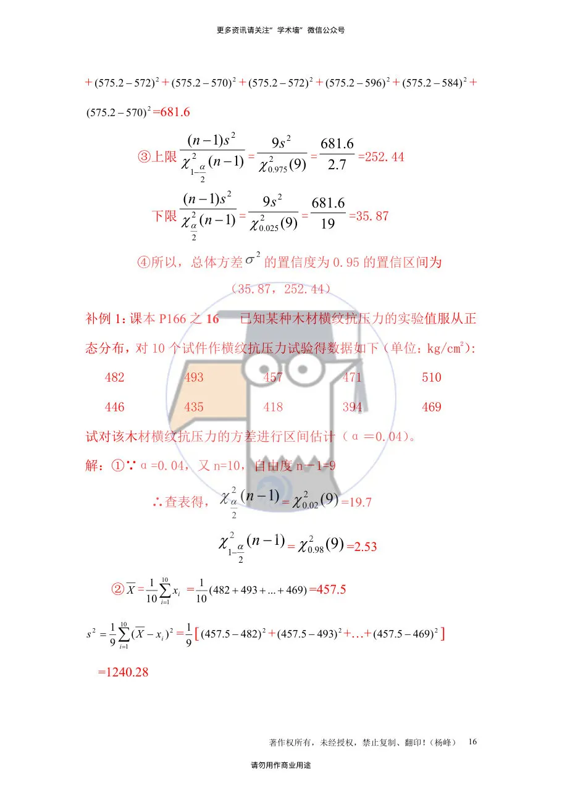

# 《概率论与数理统计》复习参考资料

原件经识别和整理；“参考解答”是我们补的。

本资料由杨峰老师整理，强烈建议以《综合练习》为纲。全书复习范围为第一、二、三、四、七、八、九、十一章。此处整理第一章至第二章的部分内容。

## 第一章 随机事件及其概率

### § 1.1 随机事件

#### 一、给出事件描述，要求用运算关系符表示事件

典型例题：《综合练习》第一大题之 1，其中第一个空应填：$A \overline{B} \overline{C}$

补充：第二大题之 1（正确答案应选 C）。

#### 二、给出事件运算关系符，要求判断其正确性

典型例题：《综合练习》第二大题之 2。

订正：答案 D 应为：

$$
A \cup B \cup C = \Omega - \overline{A} \overline{B} \overline{C}
$$

知识点：[随机事件及其运算（并、交、差、对立）](../../../topics/概率论与数理统计/随机事件及其运算.md)、[事件的运算规律（交换律、结合律、分配律、德摩根律）](../../../topics/概率论与数理统计/事件的运算规律.md)、[随机试验与样本空间](../../../topics/概率论与数理统计/随机试验与样本空间.md)

### § 1.2 概率

**古典概型公式：**

$$
P(A) = \frac{A \text{所含样本点数}}{\Omega \text{所含样本点数}}
$$

实用中经常采用“排列组合”的方法计算（未学过的同志请自学初等数学的这部分内容）。

#### 补例 1

将 $n$ 个球随机地放到 $n$ 个盒中去，问每个盒子恰有 1 个球的概率是多少？

解：设 $A$：“每个盒子恰有 1 个球”。求：$P(A)=?$

$\Omega$ 所含样本点数：$n \cdot n \cdot \ldots \cdot n = n^n$

$A$ 所含样本点数：$n \cdot (n - 1) \cdot (n - 2) \cdot \ldots \cdot 1 = n!$

$$
\therefore P(A) = \frac{n!}{n^n}
$$

#### 补例 2

将 3 封信随机地放入 4 个信箱中，问信箱中信的封数的最大数分别为 1、2、3 的概率各是多少？

解：设 $A_i$：“信箱中信的最大封数为 $i$”。($i=1,2,3$) 求：$P(A_i)=?$

$\Omega$ 所含样本点数：$4 \cdot 4 \cdot 4 = 4^3 = 64$

1. **当最大封数为 1 时 ($A_1$)**

   $A_1$ 所含样本点数：$4 \cdot 3 \cdot 2 = 24$

   $$
   \therefore P(A_1) = \frac{24}{64} = \frac{3}{8}
   $$

2. **当最大封数为 2 时 ($A_2$)**

   $A_2$ 所含样本点数：$C_{3}^{2} \cdot 4 \cdot 3 = 36$

   $$
   \therefore P(A_2) = \frac{36}{64} = \frac{9}{16}
   $$

3. **当最大封数为 3 时 ($A_3$)**

   $A_3$ 所含样本点数：$C_{3}^{3} \cdot 4 = 4$

   $$
   \therefore P(A_3) = \frac{4}{64} = \frac{1}{16}
   $$

典型例题：《综合练习》第二大题之 6、7、9；第二大题之 1、2。

注：由概率定义得出的几个性质：
1. $0 < P(A) < 1$
2. $P(\Omega)=1, P(\Phi)=0$

知识点：[古典概型（等可能概型）](../../../topics/概率论与数理统计/古典概型.md)

### § 1.3 概率的加法法则

**定理：** 设 $A$、$B$ 是互不相容事件（$AB = \phi$），则：

$$
P(A \cup B) = P(A) + P(B)
$$

**推论 1：** 设 $A_1$、$A_2$、…、$A_n$ 互不相容，则

$$
P(A_1 + A_2 + \dots + A_n) = P(A_1) + P(A_2) + \dots + P(A_n)
$$

**推论 2：** 设 $A_1$、$A_2$、…、$A_n$ 构成完备事件组，则

$$
P(A_1 + A_2 + \dots + A_n) = 1
$$

**推论 3：** $P(A) = 1 - P(\overline{A})$

**推论 4：** 若 $B \supset A$，则 $P(B-A)=P(B)-P(A)$

**推论 5（广义加法公式）：**

对任意两个事件 $A$ 与 $B$，有 $P(A \cup B) = P(A) + P(B) - P(AB)$

> [!NOTE]
> 补充——对偶律：
> $$
> \overline{A_1 \cup A_2 \cup \ldots \cup A_n} = \overline{A_1} \cap \overline{A_2} \cap \ldots \cap \overline{A_n}
> $$
> $$
> \overline{A_1 \cap A_2 \cap \ldots \cap A_n} = \overline{A_1} \cup \overline{A_2} \cup \ldots \cup \overline{A_n}
> $$

典型例题：《综合练习》第二大题之 5、第三大题之 3。

知识点：[频率与概率的公理化定义及性质](../../../topics/概率论与数理统计/频率与概率的公理化定义.md)、[随机事件及其运算（并、交、差、对立）](../../../topics/概率论与数理统计/随机事件及其运算.md)、[事件的运算规律（交换律、结合律、分配律、德摩根律）](../../../topics/概率论与数理统计/事件的运算规律.md)

### § 1.4 条件概率与乘法法则

**条件概率公式：**

$$
P(A / B) = \frac{P(AB)}{P(B)} \quad (P(B) \neq 0)
$$

$$
P(B / A) = \frac{P(AB)}{P(A)} \quad (P(A) \neq 0)
$$

$$
\therefore P(AB) = P(A / B) P(B) = P(B / A) P(A)
$$

有时须与 $P(A+B)=P(A)+P(B)-P(AB)$ 中的 $P(AB)$ 联系解题。

**全概率与逆概率公式：**

**全概率公式：**

$$
P(B) = \sum_{i=1}^{n} P(A_i) P(B / A_i)
$$

**逆概率公式：**

$$
P(A_i / B) = \frac{P(A_i B)}{P(B)} \quad (i = 1, 2, \dots , n)
$$

典型例题：《综合练习》第一大题之 2、3；第二大题之 3、4；第三大题之 4。

补充：注意全概率公式和逆概率公式的题型：将试验可看成分为两步做，如果要求第二步某事件的概率，就用全概率公式；如果求在第二步某事件发生条件下第一步某事件的概率，就用逆概率公式。

知识点：[条件概率与乘法公式](../../../topics/概率论与数理统计/条件概率与乘法公式.md)、[全概率公式](../../../topics/概率论与数理统计/全概率公式.md)、[贝叶斯公式（逆概率公式）](../../../topics/概率论与数理统计/贝叶斯公式.md)

### § 1.5 独立试验概型

**事件的独立性：**

$A$ 与 $B$ 相互独立 $\Leftrightarrow P(AB) = P(A)P(B)$

**贝努里公式（$n$ 重贝努里试验概率计算公式）：** 课本 P24

另两个解题中常用的结论：

1. **定理：** 有四对事件：$A$ 与 $B$、$A$ 与 $\overline{B}$ 、 $\overline{A}$ 与 $B$、 $\overline{A}$ 与 $\overline{B}$ ，如果其中有一对相互独立，则其余三对也相互独立。
2. **公式：** $P(A_1 \cup A_2 \cup \ldots \cup A_n) = 1 - P(\overline{A_1} \cdot \overline{A_2} \cdot \ldots \cdot \overline{A_n})$

典型例题：《综合练习》第一大题之 4（第二个空答案应为 $\frac{1}{2}$）、5、7；第二大题之 8；第三大题之 5。

## 第二章 随机变量及其分布

知识点：[事件的相互独立性](../../../topics/概率论与数理统计/事件的独立性.md)、[独立重复试验与伯努利概型（二项概率公式）](../../../topics/概率论与数理统计/伯努利概型.md)、[随机事件及其运算（并、交、差、对立）](../../../topics/概率论与数理统计/随机事件及其运算.md)

### 一、关于离散型随机变量的分布问题

**1、求分布列：**
(1) 确定各种事件，记为 $\xi$ 写成一行；
(2) 计算各种事件概率，记为 $p_k$ 写成第二行。得到的表即为所求的分布列。
注意：应符合性质——
1. $p_k \geq 0$ （非负性）
2. $\sum_{k} p_k = 1$ （可加性和规范性）

#### 补例 1

将一颗骰子连掷 2 次，以 $\xi$ 表示两次所得结果之和，试写出 $\xi$ 的概率分布。

解：$\Omega$ 所含样本点数：$6 \times 6 = 36$

所求分布列为：

| $\xi$ | 2 | 3 | 4 | 5 | 6 | 7 | 8 | 9 | 10 | 11 | 12 |
| :--- | :--- | :--- | :--- | :--- | :--- | :--- | :--- | :--- | :--- | :--- | :--- |
| $p_k$ | 1/36 | 2/36 | 3/36 | 4/36 | 5/36 | 6/36 | 5/36 | 4/36 | 3/36 | 2/36 | 1/36 |

#### 补例 2

一袋中有 5 只乒乓球，编号 1，2，3，4，5，在其中同时取 3 只，以 $\xi$ 表示取出 3 只球中最大号码，试写出 $\xi$ 的概率分布。

解：$\Omega$ 所含样本点数：$C_{5}^{3}=10$

所求分布列为：

| $\xi$ | 3 | 4 | 5 |
| :--- | :--- | :--- | :--- |
| $p_k$ | 1/10 | 3/10 | 6/10 |

**2、求分布函数 $F(x)$ :**

$$
F(x) = P\{\xi \leq x\} = \sum_{x_k \leq x} p_k
$$

典型例题：《综合练习》第一大题之 10 第一个空（0.8），第二大题之 10。

知识点：[离散型随机变量的分布律](../../../topics/概率论与数理统计/离散型随机变量的分布律.md)、[随机变量的分布函数及其性质](../../../topics/概率论与数理统计/随机变量的分布函数.md)、[古典概型（等可能概型）](../../../topics/概率论与数理统计/古典概型.md)

### 二、关于连续型随机变量的分布问题

$\forall x \in \mathbb{R}$，如果随机变量 $\xi$ 的分布函数 $F(x)$ 可写成 $F(x) = \int_{-\infty}^{x}\phi (x)dx$，则 $\xi$ 为连续型。$\phi (x)$ 称概率密度函数。

解题中应该知道的几个关系式：

$$
\phi (x) \geq 0
$$

$$
P\{a \leq \xi \leq b\} = P\{a < \xi < b\} = F(b) - F(a) = \int_{a}^{b} \phi (x) dx
$$

典型例题：《综合练习》第一大题之 6（题目应为 $k=1,2,...$）、10（两个空答案分别应为 0.8 与 2.3）与 11 第一个空、12；《综合练习》第二大题之 10、11、12、18；《综合练习》第三大题之 6、8、9、10、12。

# 《概率论与数理统计》复习参考资料（第 2 部分）

## 第三章 随机变量数字特征

知识点：[连续型随机变量的概率密度函数及其性质](../../../topics/概率论与数理统计/连续型随机变量的概率密度.md)、[随机变量的分布函数及其性质](../../../topics/概率论与数理统计/随机变量的分布函数.md)

### 一、求离散型随机变量 $\xi$ 的数学期望 $\mathbf{E}\xi = ?$

数学期望（均值）公式为：

$$
E \xi = \sum_{k} x_k p_k
$$

典型例题：《综合练习》第一大题之 10、11；第二大题之 13。

知识点：[数学期望的定义与计算（离散型、连续型）](../../../topics/概率论与数理统计/数学期望的定义与计算.md)、[离散型随机变量的分布律](../../../topics/概率论与数理统计/离散型随机变量的分布律.md)

### 二、设 $\xi$ 为随机变量，$\mathbf{f}(\mathbf{x})$ 是普通实函数，则 $\eta = \mathbf{f}(\xi)$ 也是随机变量

对于离散型随机变量，若 $\xi$ 的分布列为：

| $\xi$ | $x_1$ | $x_2$ | ... | $x_k$ |
| :--- | :--- | :--- | :--- | :--- |
| $p_k$ | $p_1$ | $p_2$ | ... | $p_k$ |

则 $\eta = f(\xi)$ 的分布列可通过对应映射得到。以上计算只要求掌握这种离散型的情况。

**补例 1**

设 $\xi$ 的概率分布为：

| $\xi$ | -1 | 0 | 1 | 2 | $\frac{5}{2}$ |
| :--- | :---: | :---: | :---: | :---: | :---: |
| $p_k$ | $\frac{1}{5}$ | $\frac{1}{10}$ | $\frac{1}{10}$ | $\frac{3}{10}$ | $\frac{3}{10}$ |

求：(1) $\eta=\xi-1$ 与 $\eta=\xi^2$ 的概率分布；(2) $E\eta$。

**解：**

首先列出变换后的值：

| $\xi$ | -1 | 0 | 1 | 2 | $\frac{5}{2}$ |
| :--- | :---: | :---: | :---: | :---: | :---: |
| $p_k$ | $\frac{1}{5}$ | $\frac{1}{10}$ | $\frac{1}{10}$ | $\frac{3}{10}$ | $\frac{3}{10}$ |
| $\eta = \xi - 1$ | -2 | -1 | 0 | 1 | $\frac{3}{2}$ |
| $\eta = \xi^2$ | 1 | 0 | 1 | 4 | $\frac{25}{4}$ |

所以，所求分布列为：

对于 $\eta = \xi - 1$：

| $\eta = \xi - 1$ | -2 | -1 | 0 | 1 | $\frac{3}{2}$ |
| :--- | :---: | :---: | :---: | :---: | :---: |
| $p_k$ | $\frac{1}{5}$ | $\frac{1}{10}$ | $\frac{1}{10}$ | $\frac{3}{10}$ | $\frac{3}{10}$ |

对于 $\eta = \xi^2$：

| $\eta = \xi^2$ | 1 | 0 | 1 | 4 | $\frac{25}{4}$ |
| :--- | :---: | :---: | :---: | :---: | :---: |
| $p_k$ | $\frac{1}{5}$ | $\frac{1}{10}$ | $\frac{1}{10}$ | $\frac{3}{10}$ | $\frac{3}{10}$ |

*注：在 $\eta=\xi^2$ 的分布中，取值 1 出现了两次（分别对应 $\xi=-1$ 和 $\xi=1$），其概率应合并为 $\frac{1}{5} + \frac{1}{10} = \frac{3}{10}$。但在原题给出的表格结构中未体现合并步骤，此处仅按原意展示计算过程。*

当 $\eta=\xi-1$ 时，$E\eta=E(\xi-1)$：

$$
\begin{aligned}
E\eta &= -2 \times \frac{1}{5} + (-1) \times \frac{1}{10} + 0 \times \frac{1}{10} + 1 \times \frac{3}{10} + \frac{3}{2} \times \frac{3}{10} \\
&= -0.4 - 0.1 + 0 + 0.3 + 0.45 \\
&= 0.25
\end{aligned}
$$

当 $\eta = \xi^2$ 时，$E\eta = E\xi^2$：

$$
\begin{aligned}
E\eta &= 1\times \frac{1}{5} + 0\times \frac{1}{10} + 1\times \frac{1}{10} + 4\times \frac{3}{10} + \frac{25}{4}\times \frac{3}{10} \\
&= 0.2 + 0 + 0.1 + 1.2 + 1.875 \\
&= 3.375
\end{aligned}
$$

知识点：[一维随机变量函数的分布（分布函数法、公式法）](../../../topics/概率论与数理统计/一维随机变量函数的分布.md)、[数学期望的定义与计算（离散型、连续型）](../../../topics/概率论与数理统计/数学期望的定义与计算.md)、[离散型随机变量的分布律](../../../topics/概率论与数理统计/离散型随机变量的分布律.md)

### 三、求 $\xi$ 或 $\eta$ 的方差 $\mathbf{D}\xi = ?$

实用公式：$D\xi = E\xi^{2} - (E\xi)^{2}$

其中，$(E\xi)^2 = (\sum_k x_k p_k)^2$，且 $E\xi^2 = \sum_k x_k^2 p_k$。

**补例 2**

已知 $\xi$ 的分布列为：

| $\xi$ | -2 | 0 | 2 |
| :--- | :---: | :---: | :---: |
| $p_k$ | 0.4 | 0.3 | 0.3 |

求：$E\xi$ 和 $D\xi$。

**解：**

$$
E\xi = -2\times0.4 + 0\times0.3 + 2\times0.3 = -0.8 + 0 + 0.6 = -0.2
$$

$$
E\xi^2 = (-2)^2 \times 0.4 + 0^2 \times 0.3 + 2^2 \times 0.3 = 4\times0.4 + 0 + 4\times0.3 = 1.6 + 1.2 = 2.8
$$

$$
D\xi = E\xi^2 - (E\xi)^2 = 2.8 - (-0.2)^2 = 2.8 - 0.04 = 2.76
$$

《综练》三之 13 也是该类题目。

## 第四章 几种重要的分布

知识点：[离散型随机变量的分布律](../../../topics/概率论与数理统计/离散型随机变量的分布律.md)、[数学期望的定义与计算（离散型、连续型）](../../../topics/概率论与数理统计/数学期望的定义与计算.md)、[方差的定义与计算公式](../../../topics/概率论与数理统计/方差的定义与计算.md)

### 常用分布的均值与方差

解题必备速查表：

| 名称 | 概率分布或密度 | 期望 | 方差 | 参数范围 |
| :--- | :--- | :--- | :--- | :--- |
| **二项分布** | $P\{\xi=k\}=C_{n}^{k}p^{k}q^{n-k}, \quad (k=0,1,2,...,n)$ | $np$ | $npq$ | $0<p<1, q=1-p$ |
| **正态分布** | $\phi(x)=\frac{1}{\sqrt{2\pi}\cdot\sigma}\cdot e^{-\frac{(x-\mu)^{2}}{2\sigma^{2}}}, \quad x\in(-\infty,+\infty)$ $\sigma, \mu$ 为常数 | $\mu$ | $\sigma^2$ | $\mu$ 任意, $\sigma>0$ |
| **泊松分布** | （不要求推导） | $\lambda$ | $\lambda$ | $\lambda>0$ |
| **指数分布** | （不要求推导） | $\frac{1}{\lambda}$ | $\frac{1}{\lambda^2}$ | $\lambda>0$ |

知识点：[常见分布的期望与方差](../../../topics/概率论与数理统计/常见分布的期望与方差.md)、[常见离散型分布（0-1分布、二项分布、泊松分布、几何分布、超几何分布）](../../../topics/概率论与数理统计/常见离散型分布.md)、[正态分布与标准正态分布（含3σ准则）](../../../topics/概率论与数理统计/正态分布.md)

### 解题中经常需要运用的 $E\xi$ 和 $D\xi$ 的性质

解题必备速查表：

| $E\xi$ 的性质 | $D\xi$ 的性质 |
| :--- | :--- |
| $E(c) = c$ | $D(c) = 0$ |
| $E(\xi \pm \eta) = E\xi \pm E\eta$ | 若 $\xi, \eta$ 独立，则 $D(\xi \pm \eta) = D\xi + D\eta$ |
| 若 $\xi, \eta$ 独立，则 $E(\xi\eta) = E\xi \cdot E\eta$ | |
| $E(c\xi) = c \cdot E\xi$ | $D(c\xi) = c^2 \cdot D\xi$ |

典型例题：
- 《综合练习》第一大题之 8（第二个空应为 0.27648）、9（题目应为 $\Phi(x)=\dots$ 且 $e$ 的指数前面应带负号）、13、14。
- 《综合练习》第二大题之 14、15、16、17。
- 《综合练习》第三大题之 7、11、14、15（这四个题目是难点，需下些功夫看看，特别是第 15 题）。

## 第八章 参数估计

知识点：[数学期望的性质](../../../topics/概率论与数理统计/数学期望的性质.md)、[方差的性质](../../../topics/概率论与数理统计/方差的性质.md)、[常见分布的期望与方差](../../../topics/概率论与数理统计/常见分布的期望与方差.md)

### § 8.1 估计量的优劣标准（以下知识点可作填空或选择题考查）

1.  **一致性**：若总体参数 $\theta$ 的估计量为 $\hat{\theta}$，如果对任给的 $\varepsilon > 0$，有 $\lim_{n \to \infty} P\{|\hat{\theta} - \theta| < \varepsilon\} = 1$，则称 $\hat{\theta}$ 是 $\theta$ 的一致估计。
2.  **无偏性**：如果满足 $E(\hat{\theta})=\theta$，则称 $\hat{\theta}$ 是 $\theta$ 的无偏估计。
3.  **有效性**：如果 $\hat{\theta}_{1}$ 和 $\hat{\theta}_{2}$ 均是 $\theta$ 的无偏估计，若 $D(\hat{\theta}_{1}) < D(\hat{\theta}_{2})$，则称 $\hat{\theta}_{1}$ 是比 $\hat{\theta}_{2}$ 有效的估计量。

知识点：[估计量的评选标准（无偏性、有效性、相合性）](../../../topics/概率论与数理统计/估计量的评选标准.md)、[数学期望的定义与计算（离散型、连续型）](../../../topics/概率论与数理统计/数学期望的定义与计算.md)、[方差的定义与计算公式](../../../topics/概率论与数理统计/方差的定义与计算.md)

### § 8.3 区间估计

1.  设总体分布含有一位置参数，若由样本算得的两个统计量 $\hat{\theta}_{1}(x_{1},\ldots,x_{n})$ 及 $\hat{\theta}_{2}(x_{1},\ldots,x_{n})$，对于给定的 $\alpha$ ($0< \alpha <1$) 满足：

    $$
    P \{\hat {\theta} _ {1} (x _ {1}, \dots , x _ {n}) < \theta < \hat {\theta} _ {2} (x _ {1}, \dots , x _ {n}) \} = 1 - \alpha
    $$

    则称随机区间 $(\hat{\theta}_1, \hat{\theta}_2)$ 是 $\theta$ 的 $100(1 - \alpha)\%$ 的置信区间，$\hat{\theta}_1$ 和 $\hat{\theta}_2$ 称为 $\theta$ 的 $100(1 - \alpha)\%$ 的置信下、上限，百分数 $100(1 - \alpha)\%$ 称为置信度。

知识点：[置信区间与置信水平（置信度）的概念](../../../topics/概率论与数理统计/置信区间的概念.md)

### 一、求总体期望（均值）$E\xi$ 的置信区间

#### 1. 总体方差 $\sigma^2$ 已知的类型

求解步骤如下：
1.  据给定的 $\alpha$，得 $\Phi_{0}(U_{\alpha})=1-\frac{\alpha}{2}$，反查标准正态分布表（课本 P260 表）得临界值 $U_{\alpha}$（通常记为 $z_{\alpha/2}$ 或 $u_{\alpha/2}$）；
2.  计算样本均值 $\overline{x}=\frac{1}{n}\sum_{i=1}^{n}x_{i}$；
3.  求误差限 $d=U_{\alpha}\cdot\frac{\sigma}{\sqrt{n}}$；
4.  置信区间为 $(\overline{x}-d, \overline{x}+d)$。

**补简例**

设总体 $X \sim N(\mu, 0.09)$，随机取 4 个样本，其观测值为 12.6，13.4，12.8，13.2，求总体均值 $\mu$ 的 $95\%$ 的置信区间。

## 一、单正态总体均值的置信区间（续）

知识点：[单个正态总体均值的区间估计（σ已知用Z，σ未知用t）](../../../topics/概率论与数理统计/正态总体均值的区间估计.md)、[统计量的概念及常用统计量（样本均值、样本方差、样本矩）](../../../topics/概率论与数理统计/统计量.md)

### 计算 1（$\sigma$ 已知类型）

解：①∵$1-\alpha=0.95$，$\alpha=0.05$

$\therefore \Phi(U_{\alpha}) = 1 - \dfrac{\alpha}{2} = 0.975$，反查表得：$U_{\alpha} = 1.96$

② $\overline{X} = \dfrac{1}{4}\sum_{i=1}^{4}X_{i} = \dfrac{1}{4}(12.6 + 13.4 + 12.8 + 13.2) = 13$

③∵ $\sigma = 0.3,\quad n = 4$ ∴ $d = U_{\alpha}\cdot\dfrac{\sigma}{\sqrt{n}} = 1.96\times\dfrac{0.3}{\sqrt{4}} = 0.29$

④所以，总体均值 $\mu$ 的 $\alpha = 0.05$ 的置信区间为：

$(\overline{X} - d, \overline{X} + d) = (13 - 0.29, 13 + 0.29)$，即 $(12.71, 13.29)$。

知识点：[单个正态总体均值的区间估计（σ已知用Z，σ未知用t）](../../../topics/概率论与数理统计/正态总体均值的区间估计.md)、[置信区间与置信水平（置信度）的概念](../../../topics/概率论与数理统计/置信区间的概念.md)

### 计算 2（$\sigma^{2}$ 未知类型）

> 这种类型十分重要！务必掌握!!

①据 $\alpha$ 和自由度 $n-1$（$n$ 为样本容量），查表（课本 P262 表）得 $t_{\alpha}(n-1)$；

②确定 $\overline{x} = \dfrac{1}{n}\sum_{i=1}^{n}x_{i}$ 和 $s^2 = \dfrac{1}{n-1}\sum_{i=1}^{n}(\overline{x} - x_i)^2$；

③求 $d = t_{\alpha}(n-1)\cdot\dfrac{s}{\sqrt{n}}$；

④置信区间 $(\overline{x} - d,\ \overline{x} + d)$。

典型例题：《综合练习》第三大题之 16（综练后附答案，自看）。

补例 1：课本 P165 之 11。

解：①∵$1-\alpha=0.95$，$\alpha=0.05$，又 $n=15$，自由度 $n-1=14$

∴查表得，$t_{0.05}(14) = 2.145$

② $\overline{X} = 1950,\quad s = 300$

③ $d = t_{\alpha}\cdot\dfrac{s}{\sqrt{n}} = 2.145\times\dfrac{300}{\sqrt{15}} = 166.28$

④所以，该批电子管平均寿命 $\mu$ 的 $\alpha = 0.05$ 的置信上、下限为：

上限 $= \overline{X} + d = 1950 + 166.28 = 2116.28$（小时）

下限 $= \overline{X} - d = 1950 - 166.28 = 1783.72$（小时）

注：无特别声明，一般可保留小数点后两位，下同。

## 二、求总体方差 $\sigma^2$ 的置信区间

①据 $\alpha$ 和自由度 $n-1$（$n$ 为样本数），查表得临界值：

$\chi_{\frac{\alpha}{2}}^{2}(n-1)$ 和 $\chi_{1-\frac{\alpha}{2}}^{2}(n-1)$

②确定 $\overline{X} = \dfrac{1}{n}\sum_{i=1}^{n}x_i$ 和 $s^2 = \dfrac{1}{n-1}\sum_{i=1}^{n}(\overline{X} - x_i)^2$

③上限 $\dfrac{(n-1)s^2}{\chi_{1-\frac{\alpha}{2}}^{2}(n-1)}$，下限 $\dfrac{(n-1)s^2}{\chi_{\frac{\alpha}{2}}^{2}(n-1)}$

④置信区间（下限，上限）

典型例题：《综合练习》第一大题之 15、16；《综合练习》第三大题之 18（一个综合性很强的题目，注意看看）；第三大题之 17（此题原书答案有误，全题修正如下）。

知识点：[单个正态总体方差的区间估计（用χ²分布）](../../../topics/概率论与数理统计/正态总体方差的区间估计.md)、[χ²分布（定义、性质、上α分位点）](../../../topics/概率论与数理统计/卡方分布.md)、[统计量的概念及常用统计量（样本均值、样本方差、样本矩）](../../../topics/概率论与数理统计/统计量.md)

### 计算 3（原书答案有误，全题修正）

解：①∵$\alpha=0.05$，又 $n=10$，自由度 $n-1=9$

∴查表得，$\chi_{\frac{\alpha}{2}}^{2}(n-1) = \chi_{0.025}^{2}(9) = 19$

$\chi_{1-\frac{\alpha}{2}}^{2}(n-1) = \chi_{0.975}^{2}(9) = 2.7$

② $\overline{X} = \ldots\ldots$（这里仍按答案进行，略）$= 575.2$

$\because s^{2} = \dfrac{1}{n-1}\sum_{i=1}^{n}(\overline{X} - x_{i})^{2}$

$9s^{2} = \sum_{i=1}^{10}(\overline{X} - x_{i})^{2} = (575.2 - 578)^{2} + (575.2 - 572)^{2} + (575.2 - 570)^{2} + (575.2 - 568)^{2}$
$+ (575.2 - 572)^{2} + (575.2 - 570)^{2} + (575.2 - 572)^{2} + (575.2 - 596)^{2} + (575.2 - 584)^{2}$
$+ (575.2 - 570)^{2} = 681.6$

③上限 $\dfrac{(n-1)s^2}{\chi_{1-\frac{\alpha}{2}}^{2}(n-1)} = \dfrac{9s^2}{\chi_{0.975}^{2}(9)} = \dfrac{681.6}{2.7} = 252.44$

下限 $\dfrac{(n-1)s^2}{\chi_{\frac{\alpha}{2}}^{2}(n-1)} = \dfrac{9s^2}{\chi_{0.025}^{2}(9)} = \dfrac{681.6}{19} = 35.87$

④所以，总体方差 $\sigma^{2}$ 的置信度为 0.95 的置信区间为 $(35.87, 252.44)$。

知识点：[单个正态总体方差的区间估计（用χ²分布）](../../../topics/概率论与数理统计/正态总体方差的区间估计.md)、[χ²分布（定义、性质、上α分位点）](../../../topics/概率论与数理统计/卡方分布.md)、[统计量的概念及常用统计量（样本均值、样本方差、样本矩）](../../../topics/概率论与数理统计/统计量.md)

### 计算 4（补例 1）

课本 P166 之 16：已知某种木材横纹抗压力的实验值服从正态分布，对 10 个试件作横纹抗压力试验得数据如下（单位：$\mathrm{kg/cm^2}$）：

| 482 | 493 | 457 | 471 | 510 |
| --- | --- | --- | --- | --- |
| 446 | 435 | 418 | 394 | 469 |

试对该木材横纹抗压力的方差进行区间估计（$\alpha = 0.04$）。

解：①∵$\alpha=0.04$，又 $n=10$，自由度 $n-1=9$

∴查表得，$\chi_{\frac{\alpha}{2}}^{2}(n-1) = \chi_{0.02}^{2}(9) = 19.7$

$\chi_{1-\frac{\alpha}{2}}^{2}(n-1) = \chi_{0.98}^{2}(9) = 2.53$

② $\overline{X} = \dfrac{1}{10}\sum_{i=1}^{10}x_{i} = \dfrac{1}{10}(482 + 493 + \dots + 469) = 457.5$

$s^{2} = \dfrac{1}{9}\sum_{i=1}^{10}(\overline{X} - x_{i})^{2} = \dfrac{1}{9}\left[(457.5 - 482)^{2} + (457.5 - 493)^{2} + \dots + (457.5 - 469)^{2}\right]$

上限 $\dfrac{(n-1)s^{2}}{\chi_{1-\frac{\alpha}{2}}^{2}(n-1)} = \dfrac{9s^{2}}{\chi_{0.98}^{2}(9)} = \dfrac{9\times 1240.28}{2.53} = 4412.06$

下限 $\dfrac{(n-1)s^{2}}{\chi_{\frac{\alpha}{2}}^{2}(n-1)} = \dfrac{9s^{2}}{\chi_{0.02}^{2}(9)} = \dfrac{9\times 1240.28}{19.7} = 566.63$

④所以，所求该批木材横纹抗压力的方差的置信区间为 $(566.63, 4412.06)$。

第八章 到此结束

## 第九章 假设检验

必须熟练掌握一个正态总体假设检验的执行标准

四种类型：P169（熟练掌握类型 (2)、(3)）

一般思路：

1. 提出待检假设 $H_0$
2. 选择统计量
3. 据检验水平 $\alpha$，确定临界值
4. 计算统计量的值
5. 作出判断

检验类型 (2)：未知方差 $\sigma^{2}$，检验总体期望（均值）$\mu$

①根据题设条件，提出 $H_{0}:\mu=\mu_{0}$（$\mu_{0}$ 已知）；

②选择统计量 $|T|=\left|\dfrac{\overline{X}-\mu}{s/\sqrt{n}}\right|\sim t(n-1)$；

③据 $\alpha$ 和自由度 $n-1$（$n$ 为样本容量），查表（课本 P262 表）得 $t_{\alpha}(n-1)$；

④由样本值算出 $\overline{X} = ?$ 和 $s = ?$，从而得到 $\left|T_{0}\right| = \left|\dfrac{\overline{X} - \mu}{s/\sqrt{n}}\right|$；

⑤作出判断

$$
\begin{cases}
\text{若}\left|T_{0}\right| < t_{\alpha}(n-1), & \text{则接受}H_{0}\\
\text{若}\left|T_{0}\right| > t_{\alpha}(n-1), & \text{则拒绝}H_{0}
\end{cases}
$$

典型例题：《综合练习》第三大题之 20。

知识点：[χ²分布（定义、性质、上α分位点）](../../../topics/概率论与数理统计/卡方分布.md)、[统计量的概念及常用统计量（样本均值、样本方差、样本矩）](../../../topics/概率论与数理统计/统计量.md)

### 简答 1（补例）

对一批新的某种液体的存贮罐进行耐裂试验，抽查 5 个，得到爆破压力的数据（公斤/寸$^{2}$）为：545，545，530，550，545。根据经验爆破压认为是服从正态分布的，而过去该种液体存贮罐的平均爆破压力为 549 公斤/寸$^{2}$，问这种新罐的爆破压与过去有无显著差异？（$\alpha=0.05$）

解：$H_{0}:\mu=549$

选择统计量 $\left|T\right|=\left|\dfrac{\overline{X}-\mu}{s/\sqrt{n}}\right|\sim t(n-1)$

$\because \alpha=0.05,\ n-1=4,\ \therefore$ 查表得：$t_{0.05}(4)=2.776$

又∵ $\overline{X}=\dfrac{1}{5}(545+\ldots+545)=543$

$s^{2} = \dfrac{1}{4}\left[(545 - 545)^{2} + \dots + (543 - 545)^{2}\right] = 57.5$

$\therefore \left|T_{0}\right| = \left|\dfrac{\overline{X} - \mu}{s/\sqrt{n}}\right| = \left|\dfrac{543 - 549}{\sqrt{57.5}/\sqrt{5}}\right| = 1.77 < 2.776$

∴接受假设，即认为该批新罐的平均爆破压与过去的无显著差异。

检验类型 (3)：未知期望（均值）$\mu$，检验总体方差 $\sigma^{2}$

①根据题设条件，提出 $H_{0}:\sigma=\sigma_{0}$（$\sigma_{0}$ 已知）；

②选择统计量 $\chi^2(n-1)=\left|\dfrac{(n-1)\cdot s^2}{\sigma^2}\right|$

③据 $\alpha$ 和自由度 $n-1$（$n$ 为样本容量），查表（课本 P264 表）得临界值：$\chi^{2}_{1-\frac{\alpha}{2}}(n-1)$ 和 $\chi^{2}_{\frac{\alpha}{2}}(n-1)$；

④由样本值算出 $\overline{X} = ?$ 和 $s = ?$，从而得到 $\chi_0^2(n-1) = \left|\dfrac{(n-1)\cdot s^2}{\sigma^2}\right|$；

⑤若 $\chi^{2}_{1-\frac{\alpha}{2}}(n-1) < \chi_{0}^{2}(n-1) < \chi^{2}_{\frac{\alpha}{2}}(n-1)$ 则接受假设，否则拒绝！

典型例题：《综合练习》第三大题之 19、21。

知识点：[单个正态总体均值的假设检验（Z检验与t检验）](../../../topics/概率论与数理统计/单个正态总体均值的假设检验.md)、[t分布（定义、性质、上α分位点）](../../../topics/概率论与数理统计/t分布.md)

### 简答 2（补例）

某厂生产铜丝的折断力在正常情况下服从正态分布，折断力方差 $\sigma^{2}=64$，今从一批产品中抽 10 根作折断力试验，试验结果（单位：……）

## 第八章 假设检验

知识点：[单个正态总体均值的假设检验（Z检验与t检验）](../../../topics/概率论与数理统计/单个正态总体均值的假设检验.md)、[假设检验的基本思想与小概率原理](../../../topics/概率论与数理统计/假设检验的基本思想.md)、[显著性水平α与拒绝域](../../../topics/概率论与数理统计/显著性水平与拒绝域.md)

### 计算 1

一批铜丝折断力（单位：公斤）的数据如下：578, 572, 570, 568, 572, 570, 572, 596, 584, 570。是否可相信这批铜丝折断力的方差也是 64? ($\alpha = 0.05$)

解： $\mathrm{H}_0: \sigma^2 = 64$ （注：原题写为 $\sigma=64$，根据上下文及统计量公式推断应为方差检验，但此处保留原文逻辑结构，若按标准方差检验通常针对 $\sigma^2$，若针对标准差则统计量不同。鉴于后续计算使用 $s^2/\sigma^2$，且结论讨论“方差”，此处修正 H0 表述以符合计算过程，或理解为笔误。根据后文 $\chi^2$ 分布检验方差的常规写法，通常为 $H_0: \sigma^2 = 64$。若严格按识别内容 $\sigma=64$，则分母应为 $64^2$。观察计算式 $\frac{9 \times 75.73}{64}$，分母直接用了 64，说明题目意图是检验**方差** $\sigma^2=64$。故整理时保留原计算数值，修正假设表述以匹配计算。）

选择统计量 $\chi^2 (n - 1) = \frac{(n - 1)\cdot s^2}{\sigma^2}$

$\because \alpha=0.05,\ n-1=9,\ \therefore$ 查表得:

$$
\chi_ {1 - \frac {\alpha}{2}} ^ {2} (n - 1) = \chi_ {0. 9 7 5} ^ {2} (9) = 2. 7
$$

$$
\chi_ {\frac {\alpha}{2}} ^ {2} (n - 1) = \chi_ {0. 0 2 5} ^ {2} (9) = 1 9
$$

又 $\because \overline{X} = \frac{1}{10} (578 + \dots + 570) = 575.2$

$$
\mathrm{s} ^ {2} = \frac {1}{9} [ (5 7 5. 2 - 5 7 8) ^ {2} + \dots + (5 7 5. 2 - 5 7 0) ^ {2} ] = 7 5. 7 3
$$

$$
\therefore \chi_ {0} ^ {2} (n - 1) = \frac {9 \times 7 5 . 7 3}{6 4} = 1 0. 6 5
$$

$$
\therefore \chi_ {0. 9 7 5} ^ {2} (9) = 2. 7 <   \chi_ {0} ^ {2} (n - 1) = 1 0. 6 5 <   \chi_ {0. 0 2 5} ^ {2} (9) = 1 9
$$

∴接受假设，即认为这批铜丝折断力的方差也是 64。

第九章到此结束。

## 第十一章 回归分析

掌握求变量 $y$ 相对于变量 $x$ 的回归直线方程即可:

① 计算 $\overline{x} = \frac{1}{n}\sum_{i = 1}^{n}x_{i}$ 和 $\overline{y} = \frac{1}{n}\sum_{i = 1}^{n}y_{i}$

② 计算 $\mathrm{L}_{\mathrm{xx}} = \sum_{i=1}^{n}(x_i - \overline{x})^2$ 和 $\mathrm{L}_{\mathrm{xy}} = \sum_{i=1}^{n}x_iy_i - n\overline{x}\cdot \overline{y}$

(如果题目已经告诉 $L_{xx}$ 和 $L_{xy}$ 的值，则不必自己计算)

③ 求回归系数

$$
\hat {b} = \frac {L _ {x y}}{L _ {x x}}
$$

$$
\hat {a} = \overline {{y}} - \hat {b} \overline {{x}}
$$

④ 写出回归直线方程:

$$
\hat {y} = \hat {a} + \hat {b} x
$$

典型例题:《综合练习》第三大题之 22、23

第十一章到此结束。

## 《综合练习题与答案》勘误

南邮印发《综合练习题与答案》中 P7—13 “习题答案及解答”部分错误之修正：

知识点：[单个正态总体方差的假设检验（χ²检验）](../../../topics/概率论与数理统计/单个正态总体方差的假设检验.md)、[χ²分布（定义、性质、上α分位点）](../../../topics/概率论与数理统计/卡方分布.md)

### 一、填空题部分答案修正

（红色为修正后的正确答案）

4、0.3, 0.5
8、0.27648
10、0.8, 2.3

知识点：[离散型随机变量的分布律](../../../topics/概率论与数理统计/离散型随机变量的分布律.md)、[常见离散型分布（0-1分布、二项分布、泊松分布、几何分布、超几何分布）](../../../topics/概率论与数理统计/常见离散型分布.md)、[数学期望的定义与计算（离散型、连续型）](../../../topics/概率论与数理统计/数学期望的定义与计算.md)

### 二、单项选择题部分答案修正

（原件未列出具体选项，仅提及有修正，此处略去具体内容，依规范不编造）

知识点：[总体、个体、简单随机样本与样本容量](../../../topics/概率论与数理统计/总体与样本.md)、[统计量的概念及常用统计量（样本均值、样本方差、样本矩）](../../../topics/概率论与数理统计/统计量.md)、[估计量的评选标准（无偏性、有效性、相合性）](../../../topics/概率论与数理统计/估计量的评选标准.md)

### 三、计算题部分修正

#### 计算 8

该题解的第三行“ $4 \leqslant x < 5$ ”错误，正确应为 $4 \leqslant x < 7$ 。同样道理，以下均须改正：第三行“ $x \geqslant 5$ ”错误，正确应为 $x \geqslant 7$ ； $\{\xi = 5\}$ 错误，正确应为 $\{\xi = 7\}$ 。最后结论的 F（x）中的“ $4 \leqslant x < 5$ ”和“ $x \geqslant 5$ ”也应当分别更正为 $4 \leqslant x < 7$ 和 $x \geqslant 7$ 。

#### 计算 13

(2)原来的 E $\eta=\sum_{i=1}^{3}y_{i}p_{i}$ 有误，应为 E $\eta=\sum_{i=1}^{3}\eta_{i}p_{i}$

#### 计算 17

该题全面修正见上面第八章复习内容。

#### 计算 18

见 P11 倒数第三行， $\chi_{0.975}^{2}(15)$ 前面应注明序号(2)，表示解答第二个问题；因为倒数第五行已经注明了序号(1)，表示解答第一个问题。另外，倒数第一行中间的 $= 095$ 应改为 $= 0.95$ .

#### 计算 21

计算 $\chi_{0}^{2}$ 的式子中 652.8 是错误的，应按题目给的数字 625.8 计算，正确的计算式子是 $\chi_{0}^{2}=\ldots=\frac{625.8}{8^{2}}=9.78$ ，其余不需要更改。

#### 计算 22

该题部分符号有误，且公式不够详细，全题修正（或补充）如下：

解：计算得 $\overline{x} = 3$ ， $\overline{y} = 4.2$

$$
\mathrm{L} _ {\mathrm{xy}} = \sum_ {i = 1} ^ {n} x _ {i} y _ {i} - n \overline {{x}} \cdot \overline {{y}} = (6 + 1 0 + 1 0. 5 + 1 7. 5 + 2 2) - 5 \times 3 \times 4. 2 = 3
$$

$$
\mathrm{L} _ {\mathrm{xx}} = \sum_ {i = 1} ^ {n} \left(x _ {i} - \bar {x}\right) ^ {2} = (2 - 3) ^ {2} + (2. 5 - 3) ^ {2} + (3 - 3) ^ {2} + (3. 5 - 3) ^ {2} + (4 - 3) ^ {2} = 1 ^ {2} + 0. 5 ^ {2} + 0 ^ {2} + 0. 5 ^ {2} + 1 ^ {2} = 2. 5
$$

故 $\hat{b} = \frac{L_{xy}}{L_{xx}} = \frac{3}{2.5} = 1.2$

$$
\hat {a} = \overline {{y}} - \hat {b} \overline {{x}} = 4. 2 - 1. 2 \times 3 = 0. 6
$$

故所求回归直线方程为： $\hat{y} = 0.6 + 1.2x$

#### 计算 23

该题部分数字计算有误，全题修正如下：

$$
\because \overline {{{x}}} = \frac {1}{n} \sum_ {i = 1} ^ {n} x _ {i} = \frac {1}{1 1} (5 + 1 0 + 1 5 + \dots + 1 2 0) = \frac {5 1 0}{1 1} = 4 6. 4
$$

$$
\overline {{y}} = \frac {1}{n} \sum_ {i = 1} ^ {n} y _ {i} = \frac {1}{1 1} (6 + 1 0 + 1 0 + \dots + 4 6) = \frac {2 1 4}{1 1} = 1 9. 5
$$

计算得： $L_{xx}=13104.56,\quad L_{xy}=3957.2,$

$$
\therefore \hat {b} = \frac {L _ {x y}}{L _ {x x}} = \frac {3 9 5 7 . 2}{1 3 1 0 4 . 5 6} = 0. 3 0 2
$$

$$
\hat {a} = \overline {{y}} - \hat {b} \overline {{x}} = 1 9. 5 - 0. 3 0 2 \times 4 6. 4 = 5. 4 9
$$

所以所求回归直线方程为： $\hat{y} = 5.49 + 0.302\mathrm{x}$

复习参考资料到此结束。

知识点：[随机变量的分布函数及其性质](../../../topics/概率论与数理统计/随机变量的分布函数.md)、[数学期望的定义与计算（离散型、连续型）](../../../topics/概率论与数理统计/数学期望的定义与计算.md)
