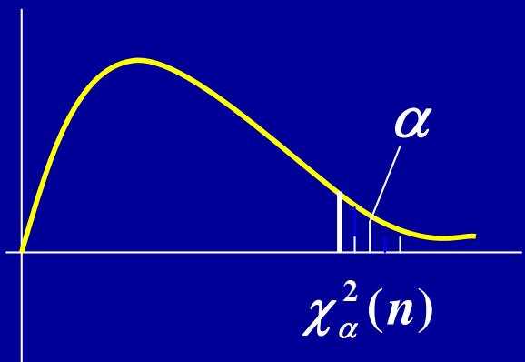
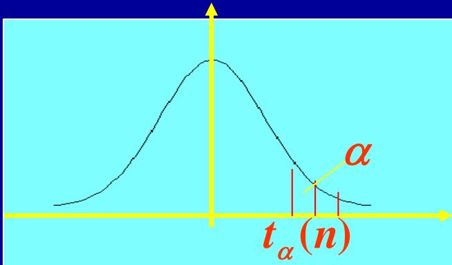
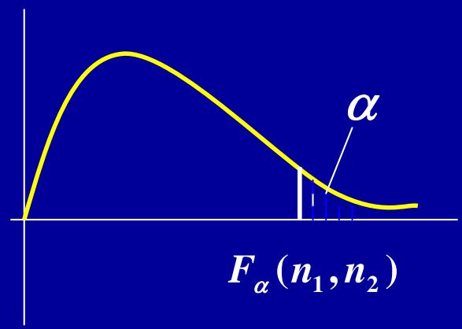

# 《概率论与数理统计》数理统计部分知识点总结

原件经识别和整理；“参考解答”是我们补的。

## 一、总体，样本，样本值，容量

简单随机样本：独立同分布。

## 二、统计量

样本均值：

$$
\overline{X} = \frac{1}{n}\sum_{i=1}^{n} X_i
$$

样本方差：

$$
S^2 = \frac{1}{n - 1}\sum_{i = 1}^{n}(X_i - \overline{X})^2 = \frac{1}{n - 1} \left(\sum_{i = 1}^{n}X_i^2 -n\overline{X}^2\right)
$$

样本 $k$ 阶（原点）矩：

$$
A_{k}=\frac{1}{n}\sum_{i=1}^{n}X_{i}^{k},\quad k=1,2,\cdots
$$

样本 $k$ 阶中心矩：

$$
B_{k} = \frac{1}{n}\sum_{i=1}^{n}(X_{i} - \overline{X})^{k},\quad k = 1,2,\cdots
$$

## 三、经验分布函数

设 $X_{1},X_{2},\cdots,X_{n}$ 是总体 $X$ 的一个样本，用 $S(x)\ (|x|<\infty)$ 表示 $X_{1},X_{2},\cdots,X_{n}$ 中不大于 $x$ 的随机变量的个数。

定义经验分布函数为

$$
F_{n}(x) = \frac{1}{n} S(x),\quad -\infty < x < \infty
$$

## 四、三大分布

### （一）$\chi^{2}$ 分布

1. 定义：设 $X_{1}, X_{2}, \cdots, X_{n}$ 是来自总体 $N(0,1)$ 的样本，则称 $\chi^{2} = X_{1}^{2} + X_{2}^{2} + \cdots + X_{n}^{2}$ 服从自由度为 $n$ 的 $\chi^{2}$ 分布，记为 $\chi^{2} \sim \chi^{2}(n)$。

2. $\chi^2$ 分布的性质

1）设 $X \sim \chi^2(n_1)$，$Y \sim \chi^2(n_2)$，且 $X, Y$ 独立，则有 $X + Y \sim \chi^2(n_1 + n_2)$。（可加性）

2）设 $X \sim \chi^2(n)$，则有 $E(X) = n$，$D(X) = 2n$。

3. $\chi^2$ 分布的上 $\alpha$ 分位点

知识点：[χ²分布（定义、性质、上α分位点）](../../../topics/概率论与数理统计/卡方分布.md)、[正态总体的抽样分布定理（单个总体与两个总体的样本均值、样本方差分布）](../../../topics/概率论与数理统计/正态总体的抽样分布定理.md)、[常见分布的期望与方差](../../../topics/概率论与数理统计/常见分布的期望与方差.md)

### （二）$t$ 分布

1. 定义：设 $X \sim N(0,1)$，$Y \sim \chi^{2}(n)$，且 $X, Y$ 独立，则称 $t = \frac{X}{\sqrt{Y / n}}$ 服从自由度为 $n$ 的 $t$ 分布（学生分布），记为 $t \sim t(n)$。

性质 1：$E(T)=0$；$D(T)=n/(n-2)$。

定义：称满足条件 $P(t > t_{\alpha}(n)) = \alpha$ 的点 $t_{\alpha}(n)$ 为 $t$ 分布 $\alpha$ 分位点。

性质 2：$t_{1 - \alpha}(n) = -t_{\alpha}(n)$。

知识点：[t分布（定义、性质、上α分位点）](../../../topics/概率论与数理统计/t分布.md)

### （三）$F$ 分布

1. 定义：设 $X \sim \chi^{2}(n_{1})$，$Y \sim \chi^{2}(n_{2})$，且 $X, Y$ 独立，则称 $F = \frac{X / n_{1}}{Y / n_{2}}$ 服从自由度为 $(n_{1}, n_{2})$ 的 $F$ 分布，记为 $F \sim F(n_{1}, n_{2})$。

性质 1：若 $F \sim F(n_{1}, n_{2})$，则 $\frac{1}{F} \sim F(n_{2}, n_{1})$。

定义：称满足条件 $P(F > F_{\alpha}(n_{1}, n_{2})) = \alpha$ 的点 $F_{\alpha}(n_{1}, n_{2})$ 为 $F$ 分布的 $\alpha$ 分位点。

性质 2：$F_{\alpha}(n_1,n_2) = \frac{1}{F_{1 - \alpha}(n_2,n_1)}$。

## 五、重要定理

定理 1：设总体 $X$ 的均值为 $\mu$，方差为 $\sigma^{2}$，$X_{1}, X_{2}, \cdots, X_{n}$ 是来自总体 $X$ 的样本，则有

$$
E(\overline{X}) = \mu,\quad D(\overline{X}) = \frac{\sigma^{2}}{n},\quad E(S^{2}) = \sigma^{2}
$$

定理 2：设 $X_{1}, X_{2}, \cdots, X_{n}$ 是来自总体 $X \sim N(\mu, \sigma^{2})$ 的样本，$\overline{X}$ 和 $S^{2}$ 分别是样本均值和样本方差，则有

1）$\frac{\overline{X} - \mu}{\sigma / \sqrt{n}} \sim N(0,1)$；

2）$\frac{(n-1)S^2}{\sigma^2} \sim \chi^2(n-1)$；

3）$\overline{X}$ 与 $S^2$ 相互独立；

4）$\frac{\overline{X} - \mu}{S / \sqrt{n}} \sim t(n - 1)$。

定理 3：设 $X_{1}, X_{2}, \cdots, X_{n_{1}}$ 与 $Y_{1}, Y_{2}, \cdots, Y_{n_{2}}$ 分别是来自总体 $X \sim N(\mu_{1}, \sigma_{1}^{2})$ 与 $Y \sim N(\mu_{2}, \sigma_{2}^{2})$ 的样本，且这两个样本相互独立，$\overline{X}$ 和 $\overline{Y}$ 分别是这两个样本的样本均值，$S_{1}^{2}$ 和 $S_{2}^{2}$ 分别是这两个样本的样本方差，则有

1）$\frac{S_1^2 / S_2^2}{\sigma_1^2 / \sigma_2^2} \sim F(n_1 - 1, n_2 - 1)$；

2）当 $\sigma_1^2 = \sigma_2^2$ 时，$\frac{(\overline{X} - \overline{Y}) - (\mu_1 - \mu_2)}{S_W \sqrt{\frac{1}{n_1} + \frac{1}{n_2}}} \sim t(n_1 + n_2 - 2)$。

其中 $S_W^2 = \frac{(n_1 - 1)S_1^2 + (n_2 - 1)S_2^2}{n_1 + n_2 - 2}$，$S_W = \sqrt{S_W^2}$。

## 参数估计

知识点：[F分布（定义、性质、上α分位点）](../../../topics/概率论与数理统计/F分布.md)、[正态总体的抽样分布定理（单个总体与两个总体的样本均值、样本方差分布）](../../../topics/概率论与数理统计/正态总体的抽样分布定理.md)

### 一、矩估计

用相应的样本矩去估计总体矩的估计方法就称为矩估计法。

一般求解步骤：

1. $\mu_{i}=g_{i}(\theta_{1},\cdots,\theta_{k})$，$i=1,2,\ldots,k$；
2. $\theta_{j}=h_{j}(\mu_{1},\cdots,\mu_{k})$，$j=1,2,\ldots,k$；
3. $\hat{\theta}_{j}=h_{j}(A_{1},\cdots,A_{k})$，$j=1,2,\ldots,k$。

知识点：[矩估计法](../../../topics/概率论与数理统计/矩估计法.md)、[总体、个体、简单随机样本与样本容量](../../../topics/概率论与数理统计/总体与样本.md)

### 二、最大似然估计

求最大似然估计的一般步骤是：

（1）求似然函数 $L(\theta)$：

$$
L(\theta) = \left\{ \begin{array}{ll} \prod_{i = 1}^{n} p(x_{i}, \theta) & X \text{为离散型} \\ \prod_{i = 1}^{n} f(x_{i}, \theta) & X \text{为连续型} \end{array} \right.
$$

（2）求 $\ln L(\theta)$；

（3）令 $\frac{d \ln L(\theta)}{d\theta} = 0$。

知识点：[最大似然估计法（似然函数、对数似然方程）](../../../topics/概率论与数理统计/最大似然估计法.md)、[点估计的概念](../../../topics/概率论与数理统计/点估计的概念.md)、[统计量的概念及常用统计量（样本均值、样本方差、样本矩）](../../../topics/概率论与数理统计/统计量.md)

### 三、估计量的评选标准

1. 无偏性

设 $\hat{\theta}(X_{1},\cdots,X_{n})$ 是未知参数 $\theta$ 的估计量，若

$$
E(\hat{\theta}) = \theta
$$

则称 $\hat{\theta}$ 为 $\theta$ 的无偏估计。

2. 有效性

设 $\hat{\theta}_{1}=\hat{\theta}_{1}(X_{1},\cdots,X_{n})$ 和 $\hat{\theta}_{2}=\hat{\theta}_{2}(X_{1},\cdots,X_{n})$ 都是参数 $\theta$ 的无偏估计量，若有

$$
D(\hat{\theta}_{1})< D(\hat{\theta}_{2})
$$

则称 $\hat{\theta}_{1}$ 较 $\hat{\theta}_{2}$ 有效。

3. 相合性

设 $\hat{\theta}(X_{1},X_{2},\cdots,X_{n})$ 为参数 $\theta$ 的估计量，若对于任意 $\theta\in\Theta$，当 $n\to\infty$ 时，$\hat{\theta}=\hat{\theta}(X_{1},X_{2},\cdots,X_{n})$ 依概率收敛于 $\theta$，则称 $\hat{\theta}$ 为 $\theta$ 的相合估计量。

（即：对 $\forall \varepsilon > 0$，有 $\lim_{n\to \infty}P\{|\hat{\theta} -\theta| < \varepsilon \} = 1$。）

知识点：[估计量的评选标准（无偏性、有效性、相合性）](../../../topics/概率论与数理统计/估计量的评选标准.md)、[数学期望的定义与计算（离散型、连续型）](../../../topics/概率论与数理统计/数学期望的定义与计算.md)、[方差的定义与计算公式](../../../topics/概率论与数理统计/方差的定义与计算.md)

### 四、区间估计

求置信区间的一般步骤如下：

1. 明确问题，是求什么参数的置信区间？置信水平 $1 - \alpha$ 是多少？
2. 寻找参数 $\theta$ 的一个良好的点估计 $T(X_{1}, X_{2}, \ldots, X_{n})$。
3. 寻找一个待估参数 $\theta$ 和估计量 $T$ 的函数 $S(T, \theta)$，且其分布为已知。
4. 对于给定的置信水平 $1 - \alpha$，根据 $S(T, \theta)$ 的分布，确定常数 $a, b$，使得 $P(a \leqslant S(T, \theta) \leqslant b) = 1 - \alpha$。
5. 对“$a \leqslant S(T, \theta) \leqslant b$”作等价变形，得到如下形式：$P\{\hat{\theta}_1 \leq \theta \leq \hat{\theta}_2\} = 1 - \alpha$，则 $[\hat{\theta}_1, \hat{\theta}_2]$ 就是 $\theta$ 的置信度为 $1 - \alpha$ 的置信区间。

具体参见书上 P164–167 的表格。

知识点：[置信区间与置信水平（置信度）的概念](../../../topics/概率论与数理统计/置信区间的概念.md)、[点估计的概念](../../../topics/概率论与数理统计/点估计的概念.md)、[单个正态总体均值的区间估计（σ已知用Z，σ未知用t）](../../../topics/概率论与数理统计/正态总体均值的区间估计.md)

### 五、假设检验的基本步骤

step1：提出原假设 $H_{0}$ 及备择假设 $H_{1}$；

step2：确定统计量；

step3：求出拒绝域；

step4：计算样本观察值；

step5：作出选择。

正态总体期望方差的检验见书 P182、P186 表格。

知识点：[假设检验的一般步骤](../../../topics/概率论与数理统计/假设检验的一般步骤.md)、[单个正态总体均值的假设检验（Z检验与t检验）](../../../topics/概率论与数理统计/单个正态总体均值的假设检验.md)、[单个正态总体方差的假设检验（χ²检验）](../../../topics/概率论与数理统计/单个正态总体方差的假设检验.md)
