# 《概率论与数理统计》第10章 马尔可夫链（2）（课件）

原件的每一页，下面附识别出的文字。

### $$

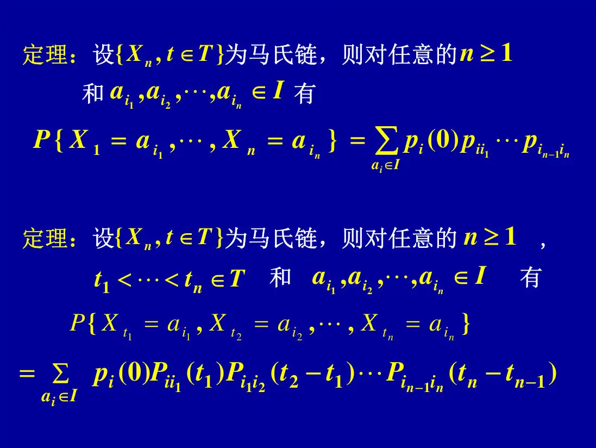

原文：

定理： 设 $\angle B ^ { \prime } = \angle B = \angle C = 1 8 0 ^ { \circ }$ 为马 氏链， 则对任意的} $n P = 1 1$

和 $( 1 ) \frac { 1 } { 1 0 } \times ( 1 0 - 2 ) \times ( 1 0 - 2 ) \times ( 1 0 - 2 ) \times ( 1 0 - 2 ) \times ( 1 0 - 2 ) \times ( 1 0 - 2 ) \times ( 1 0 - 2 ) \times ( 1 0 - 2 ) \times ( 1 0 - 2 ) \times ( 1 0 - 2 ) \times ( 1 0 - 2 ) \times ( 1 0 - 2 ) \times ( 1 0 - 2 ) \times ( 1 0 - 2 )$ 有I∈

$$
P \{X _ {1} = a _ {i _ {1}}, \dots , X _ {n} = a _ {i _ {n}} \} = \sum_ {a _ {i} \in I} p _ {i} (0) p _ {i i _ {1}} \dots p _ {i _ {n - 1} i _ {n}}
$$

定理 ： 设{ $b ^ { 2 } c m = 1 1 0$ 为马 氏链， 则对任意的 $m > 1 1$ ,

$1 8 \div m = 1 1 0 = 1 1$ 和 $\because \angle B A C = \angle A B C = \angle C$ 有

$$
P \{X _ {t _ {1}} = a _ {i _ {1}}, X _ {t _ {2}} = a _ {i _ {2}}, \dots , X _ {t _ {n}} = a _ {i _ {n}} \}
$$

$$
= \sum_ {a _ {i} \in I} p _ {i} (0) P _ {i i _ {1}} (t _ {1}) P _ {i _ {1} i _ {2}} (t _ {2} - t _ {1}) \dots P _ {i _ {n - 1} i _ {n}} (t _ {n} - t _ {n - 1})
$$

### $$

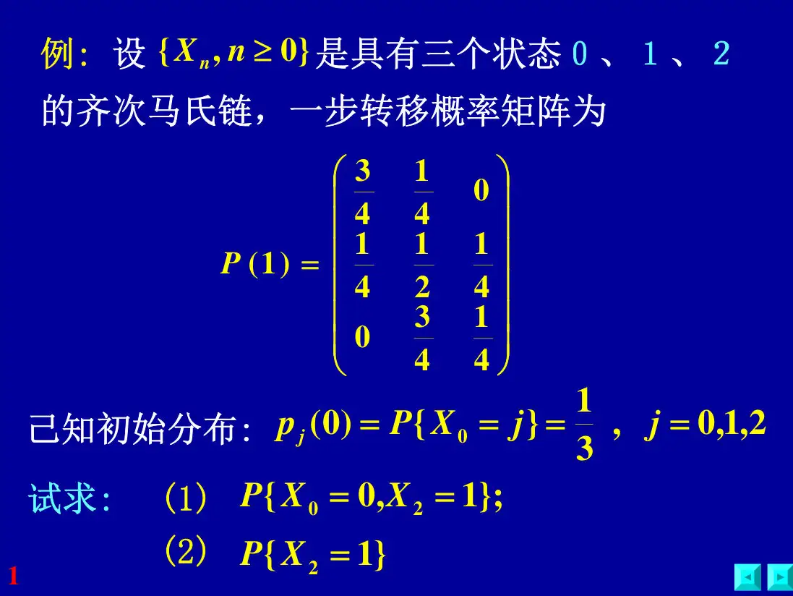

原文：

例 : 设 $\textcircled { 1 } : ( \textcircled { 1 } ) = \textcircled { 1 }$ 是具有三个状态 0 、 1 、 2的齐次马 氏链， 一步转移概率矩阵为

$$
P (1) = \left( \begin{array}{c c c} \frac {3}{4} & \frac {1}{4} & 0 \\ \frac {1}{4} & \frac {1}{2} & \frac {1}{4} \\ 0 & \frac {3}{4} & \frac {1}{4} \end{array} \right)
$$

己知初始分布 : $1 2 ( 1 ) = 1 2 ( 1 2 - m ) = 1 2 ( 1 2 - m )$

试 求 : ( 1 ) $1 2 0 0 0 0 0 0 0 0 0 0 0 0 0 0 0 0 0 0 0 0 0 0 0 0 0 0 0 0 0 0 0 0 0 0 0 0 0 0 0 0 0 0 0 0 0 0 0 0 0 0 0 0 0 0 0 0 0 0 0 0 0 0 0 0 0 0 0 0 0 0 0 0 0 0 0 0 0 0 0 0 0 0 0 0 0 0 0 0 0 0 0 0 0 0 0 0 0 0 0 0 0 0 0 0 0 0 0 0 0 0 0 0 0 0 0 0 0 0 0 0 0 0 0 0 0 0 0 0 0 0 0 0 0 0 0 0 0 0$

( 2 ) $1 2 0 : 0 = 1 4$

1

口

### 解： 先求出二步转移矩阵

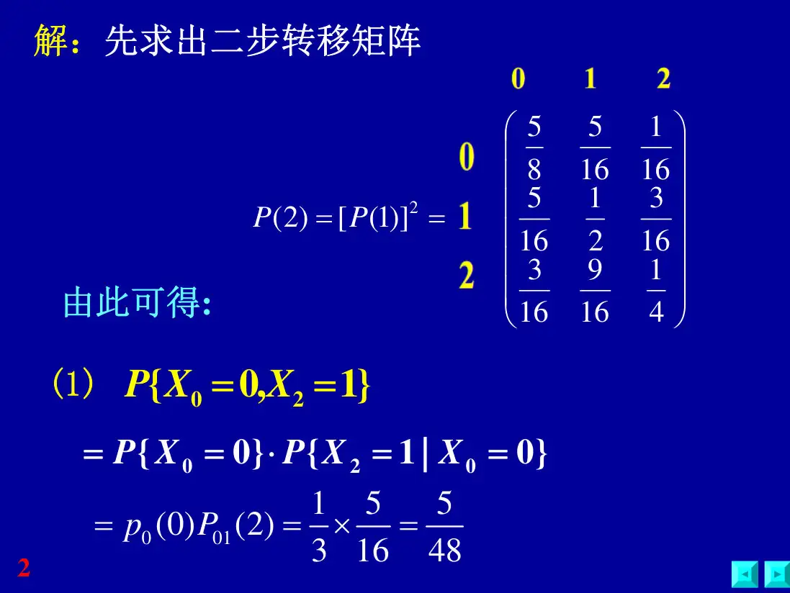

原文：

解： 先求出二步转移矩阵

$$
P (2) = [ P (1) ] ^ {2} = \begin{array}{l} 0 \\ 1 \\ 2 \end{array} \left( \begin{array}{c c c} 5 & 5 & 1 \\ \hline 8 & \hline 1 6 & \hline 1 6 \\ 5 & \frac {1}{2} & \frac {3}{1 6} \\ \hline 3 & \frac {9}{1 6} & \frac {1}{4} \end{array} \right)
$$

由此可得:

( 1 ) $1 2 0 0 0 - 1 1 0 0 = 1 1 0 0 0$ }0|1{}0{ = 0 = ⋅ 2 = XXPXP 0 = 1 5 5 0 0 1(0) ( 2) = = ×p P = 3 1 6 48

2

口

### $$

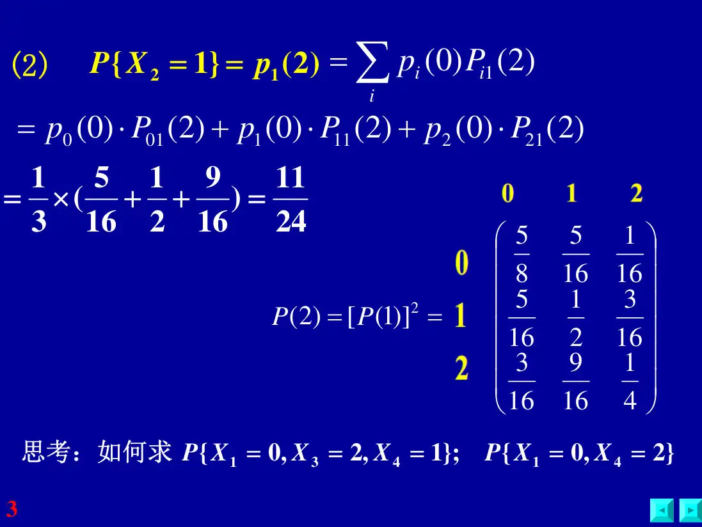

原文：

$$
P \{X _ {2} = 1 \} = p _ {1} (2) = \sum p _ {i} (0) P _ {i 1} (2)
$$

$$
P (2) = [ P (1) ] ^ {2} = \begin{array}{l} 0 \\ 1 \\ 2 \end{array} \left( \begin{array}{c c c} \frac {5}{8} & \frac {5}{1 6} & \frac {1}{1 6} \\ \frac {5}{1 6} & \frac {1}{2} & \frac {3}{1 6} \\ \frac {3}{1 6} & \frac {9}{1 6} & \frac {1}{4} \end{array} \right)
$$

思考： 如何求 $1 2 5 - 1 1 9 - 1 9 9 - 1 9 9 = 1 1 5 7 - 1 9 9 = 1 1 9 9 - 9 9$ 例 : 传输数字 0 和 1 的通信系统每个数字的传输需经若干步骤， 设每步传输正确的概率为 $\frac { 8 } { 1 0 }$ 传输错误的概率为 $\frac { 1 1 } { 1 1 }$ 。

3

口

### (1) 数字 1 经三步传输出 1 的概率是多少 ？

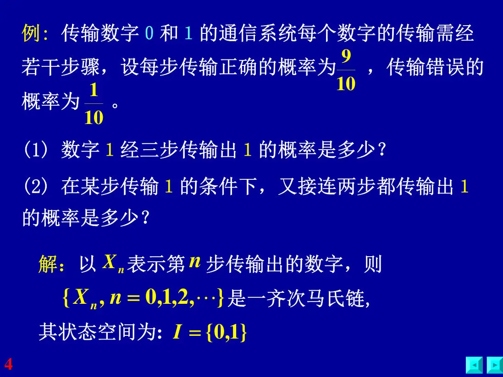

原文：

(1) 数字 1 经三步传输出 1 的概率是多少 ？

(2) 在某步传输 1 的条件下， 又接连两步都传输出 1的概率是多少 ？

解： 以 $) : ($ 表示第 步传输出 的数字， 则n$( 1 ) \because \angle B = \angle C D = \angle C A B = 9 0 ^ { \circ }$ 是一齐次马 氏链,其状态空间为: $\mathbb { Z } = \mathbb { G } \mathbb { G } \mathbb { Z }$

4

口

### 一步转移矩阵为 :

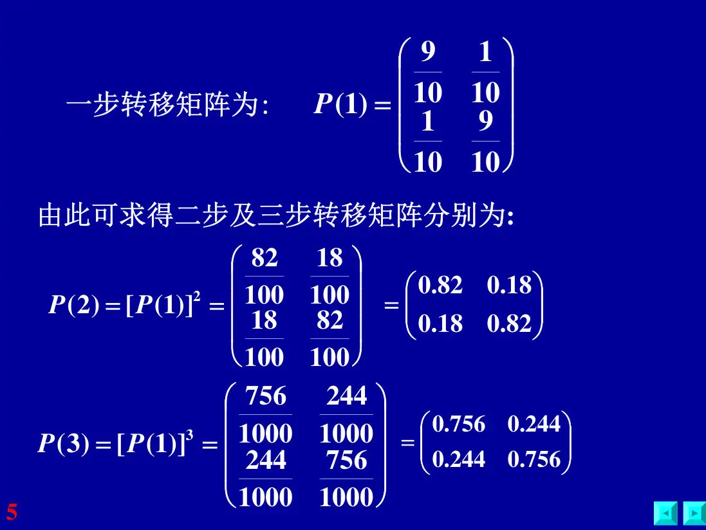

原文：

一步转移矩阵为 :

$$
P (1) = \left( \begin{array}{c c} 9 & 1 \\ \hline 1 0 & 1 0 \\ 1 & 9 \\ \hline 1 0 & 1 0 \end{array} \right)
$$

由此可求得二步及三步转移矩阵分别为:

$$
P (2) = [ P (1) ] ^ {2} = \left( \begin{array}{c c} 8 2 & 1 8 \\ \hline 1 0 0 & 1 0 0 \\ 1 8 & 8 2 \\ \hline 1 0 0 & 1 0 0 \end{array} \right) = \left( \begin{array}{c c} 0. 8 2 & 0. 1 8 \\ 0. 1 8 & 0. 8 2 \end{array} \right)
$$

$$
P (3) = [ P (1) ] ^ {3} = \left( \begin{array}{c c} 7 5 6 & 2 4 4 \\ \hline 1 0 0 0 & 1 0 0 0 \\ 2 4 4 & 7 5 6 \\ \hline 1 0 0 0 & 1 0 0 0 \end{array} \right) = \left( \begin{array}{c c} 0. 7 5 6 & 0. 2 4 4 \\ 0. 2 4 4 & 0. 7 5 6 \end{array} \right)
$$

5

口

### $$

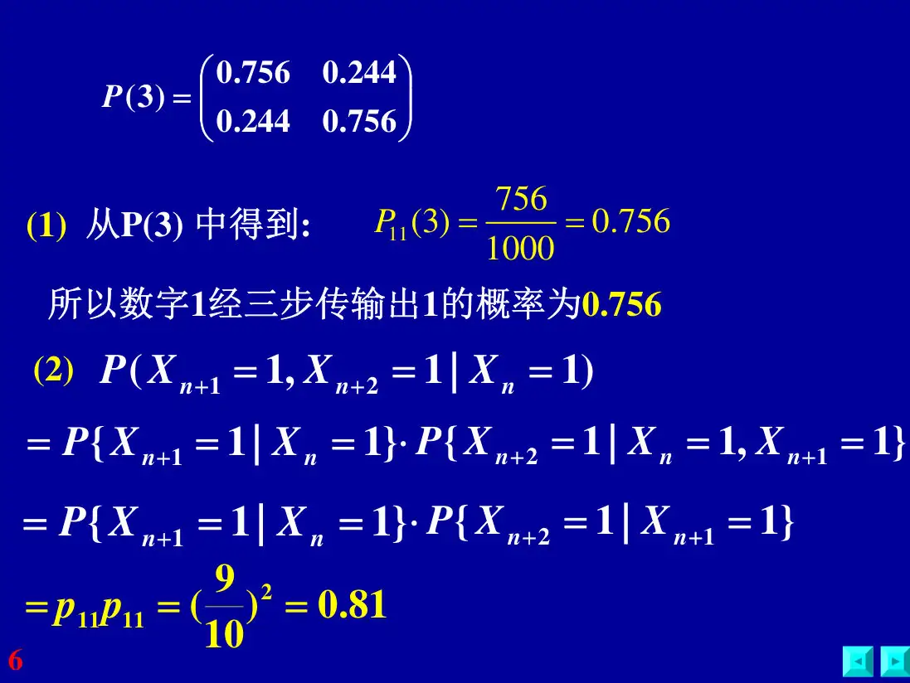

原文：

$$
P (3) = \left( \begin{array}{c c} 0. 7 5 6 & 0. 2 4 4 \\ 0. 2 4 4 & 0. 7 5 6 \end{array} \right)
$$

(1) 从P(3) 中 得 到 : $\mathrm { | \frac { \partial } { \partial t } ( \mathbf { E } ) = \frac { | \mathbf { \nabla } [ \mathbf { \vec { \mu } } ( \mathbf { \vec { \mu } } ) ] | } { | \mathbf { \nabla } [ \mathbf { \vec { \mu } } ( \mathbf { \vec { \mu } } ) ] | } = | \vec { \mu } _ { \mathbf { \vec { \mu } } } ( \mathbf { \vec { \mu } } ) - \vec { \mu } _ { \mathbf { \vec { \mu } } } ( \mathbf { \vec { \mu } } ) | }$ 所以数字1经三步传输出1的概率为0.756

(2) $1 2 ( k m + 1 1 0 ) = 1 1 ( m + 1 1 ) = 1 1 ( m + 1 1 )$ $- 1 . 2 8 \div 5 = 1 1 . 5 \div 5 \times 2 = 1 1 . 2 8 ( c m ) = 1 1 . 5 ( m )$ $= 1 2 0 \div ( 2 0 \times 1 0 \times 2 0 \times 2 0 \times 2 0 \times 2 0 \times 2 0 \times 2 0 \times 2 0 \times 2 0 \times 2 0 \times 2 0 \times 2 0 \times 2 0 \times 2 0 \times 2 0 \times 2 0 \times 2 0 \times 2 0 \times 2 0 \times 2 0 \times 2 0$ $- 1 2 \sqrt { 2 } \sqrt { 2 } \sqrt { 1 + ( \frac { 1 } { 2 } - 1 ) ^ { 2 } } = \frac { 1 } { 2 } \sqrt { 2 }$

### $$

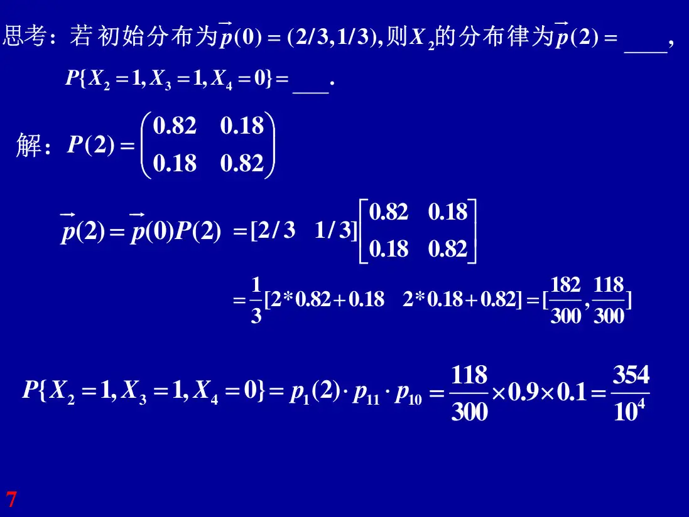

原文：

初始分布为思考： 若 $/ / ( 1 ) 2 - ( 6 / 6 ) / ( 1 3 )$ , 则 $3 : 5 = 1$ p = (2)的 分 布 律 为2 3 4P X X X { 1, 1, 0}= = = =

$$
\text {解:} P (2) = \left( \begin{array}{l l} 0. 8 2 & 0. 1 8 \\ 0. 1 8 & 0. 8 2 \end{array} \right)
$$

$$
\begin{array}{r l} \overrightarrow {p} (2) = \overrightarrow {p} (0) P (2) & = [ 2 / 3 \quad 1 / 3 ] \left[ \begin{array}{l l} 0. 8 2 & 0. 1 8 \\ 0. 1 8 & 0. 8 2 \end{array} \right] \\ & = \frac {1}{3} [ 2 * 0. 8 2 + 0. 1 8 \quad 2 * 0. 1 8 + 0. 8 2 ] = [ \frac {1 8 2}{3 0 0}, \frac {1 1 8}{3 0 0} ] \end{array}
$$

$$
P \{X _ {2} = 1, X _ {3} = 1, X _ {4} = 0 \} = p _ {1} (2) \cdot p _ {1 1} \cdot p _ {1 0} = \frac {1 1 8}{3 0 0} \times 0. 9 \times 0. 1 = \frac {3 5 4}{1 0 ^ {4}}
$$

7

### 第三节 遍历性

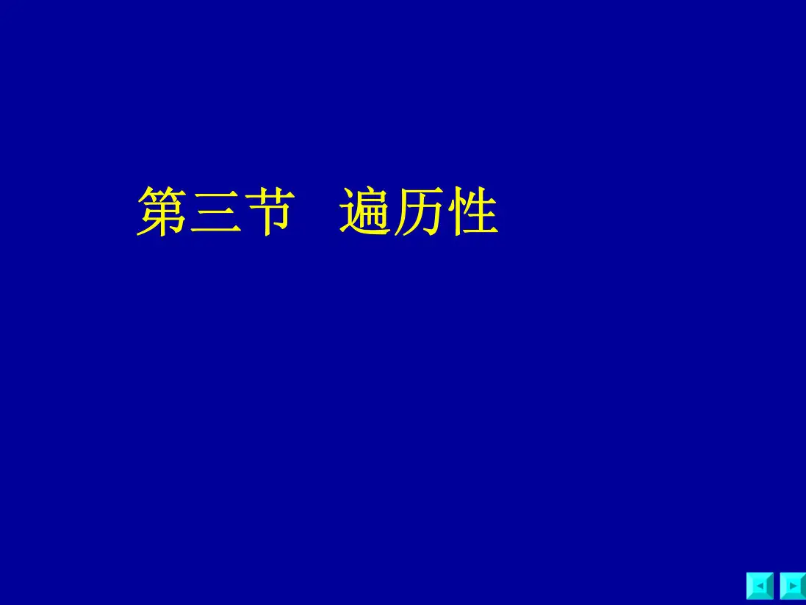

原文：

第三节 遍历性

### $$

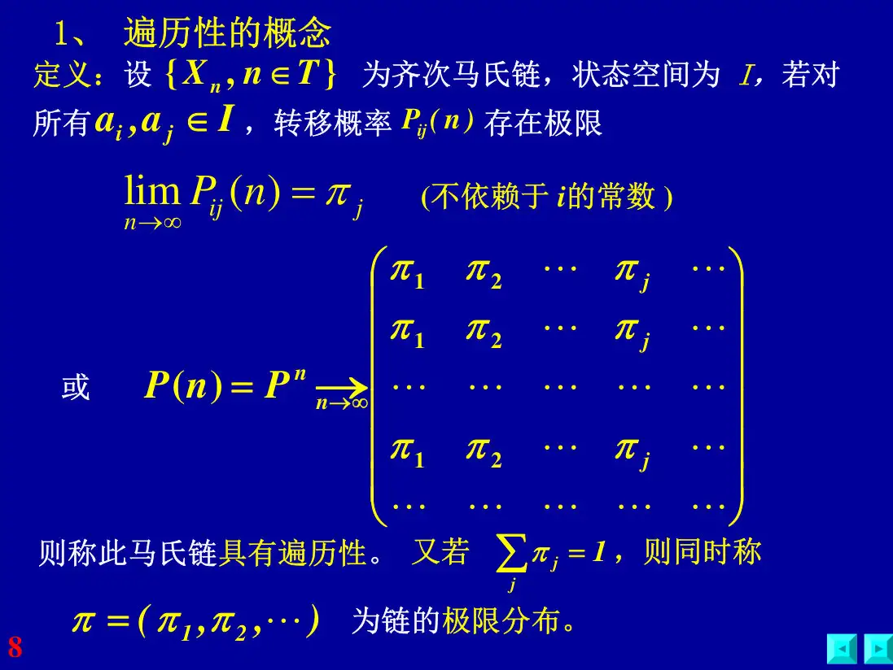

原文：

1、 遍历性的概念定义： 设 $\textcircled { 1 } A B = \textcircled { 1 } A B = \textcircled { 2 } A B$ 为齐次马 氏链， 状态空间为 I， 若对所有 $\langle g \vert \mathbf { x } \vert \langle g \vert \mathbf { x } \vert = \vert I$ 转移概率 $\textcircled { 1 } \textcircled { 4 } \textcircled { 4 } \textcircled { 1 }$ 存在极限

$\frac { 1 6 0 0 0 } { 1 2 0 0 } \div ( \frac { 1 } { 1 2 } ) = \frac { 1 } { 1 2 0 0 }$ (不依赖于 i的常数

或

$$
P (n) = P ^ {n} \underset {n \rightarrow \infty} {\longrightarrow} \left(\begin{array}{c c c c c}\pi_ {1}&\pi_ {2}&\dots&\pi_ {j}&\dots\\\pi_ {1}&\pi_ {2}&\dots&\pi_ {j}&\dots\\\dots&\dots&\dots&\dots&\dots\\\pi_ {1}&\pi_ {2}&\dots&\pi_ {j}&\dots\\\dots&\dots&\dots&\dots&\dots\end{array}\right)
$$

则称此马 氏链具有遍历性。 又若 $) 2 \times ( 2 - x ) = 1 1$ 则 同时称$a _ { 2 } = ( a _ { 1 } + b _ { 2 } ) ( a _ { 2 } + b _ { 2 } )$ 为链的极限分布。

8

口

### 2、 有限马 氏链遍历性的充分条件

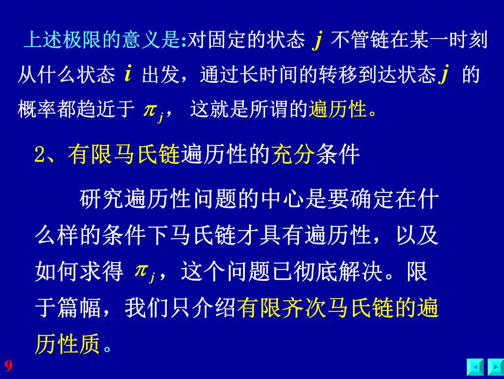

原文：

上述极限的意义是:对固定的状态 不管链在某一时刻j从什么状态 出发， 通过长时间的转移到达状态 的i j概率都趋近于 $y = \frac { 1 } { 2 }$ 这就是所谓的遍历性。

2、 有限马 氏链遍历性的充分条件

研究遍历性问题的中心是要确定在什么样的条件下马 氏链才具有遍历性， 以及如何求得 ， 这个问题已彻底解决。 限πj于篇幅， 我们只介绍有限齐次马 氏链的遍历性质 。

9

口

### 10

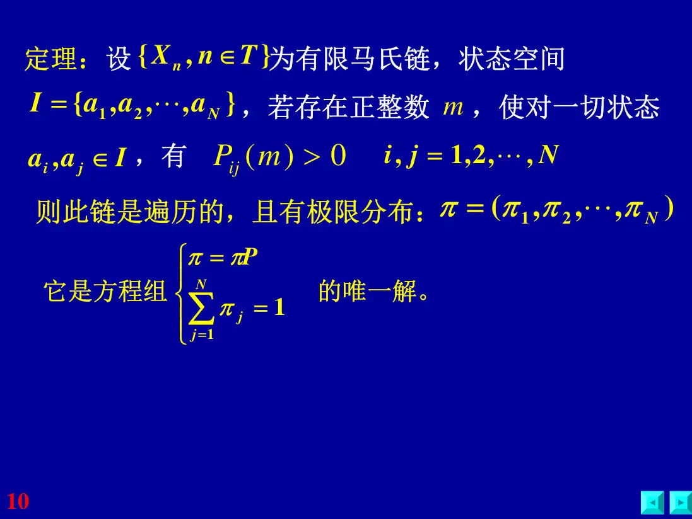

原文：

定理： 设 $\textcircled { 1 } \because \textcircled { 1 } \textcircled { 2 } \textcircled { 1 }$ 为有限马 氏链， 状态空间}$1 0 - 1 0 = 1 0$ 若存在正整数 ， 使对一切状态m$\angle B A C = \angle 1$ 有 $1 \div m = \cdots 0$ $1 5 0 0 - 1 5 0 = 1 5 0 0 0 0 0 0 0 0$ 则此链是遍历的， 且有极限分布： $\angle C _ { 1 } = \angle C _ { 2 } = \angle C _ { 3 } = \angle C _ { 2 } = 9 0 ^ { \circ }$ 它是方程组 $\frac { 1 } { 2 } \times \frac { 1 } { 4 } = \frac { 1 } { 2 }$ 的唯一解。

10

口

### 注 ：

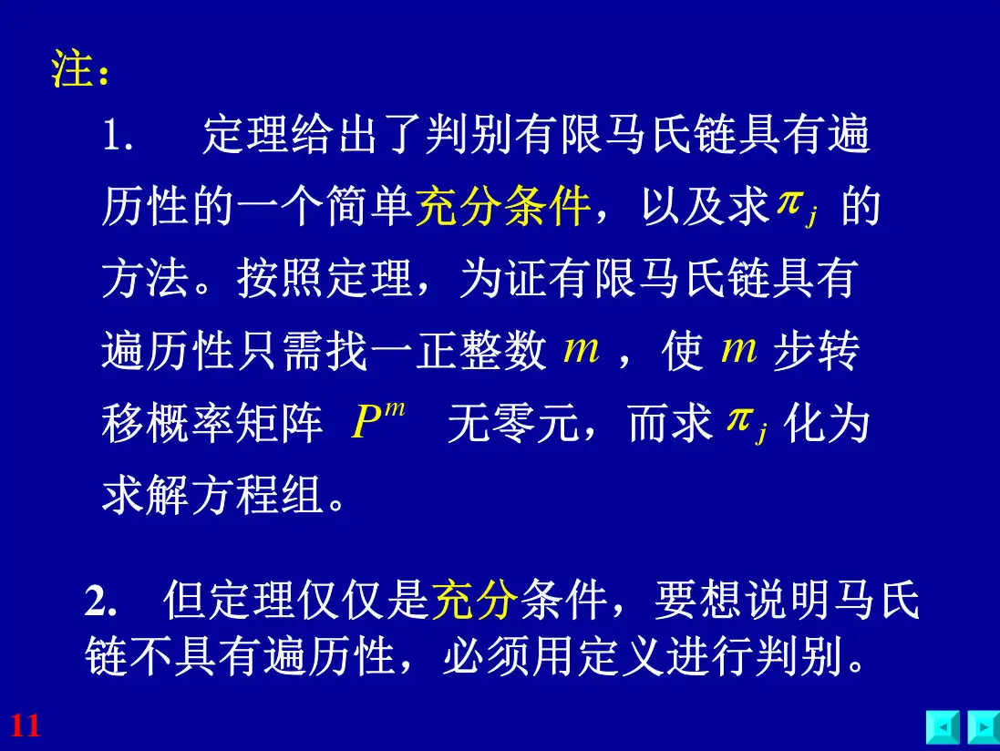

原文：

注 ：

定理给出 了判别有限马 氏链具有遍历性的一个简单充分条件， 以及求 的jπ方法。 按照定理， 为证有限马 氏链具有遍历性只需找一正整数 ， 使 步转m m移概率矩阵 $\textcircled { 1 } \textcircled { 2 } \textcircled { 4 }$ 无零元， 而求 化为π j求解方程组。

2. 但定理仅仅是充分条件， 要想说明马 氏链不具有遍历性， 必须用定义进行判别 。

1 1

口

### 3、 平稳分布

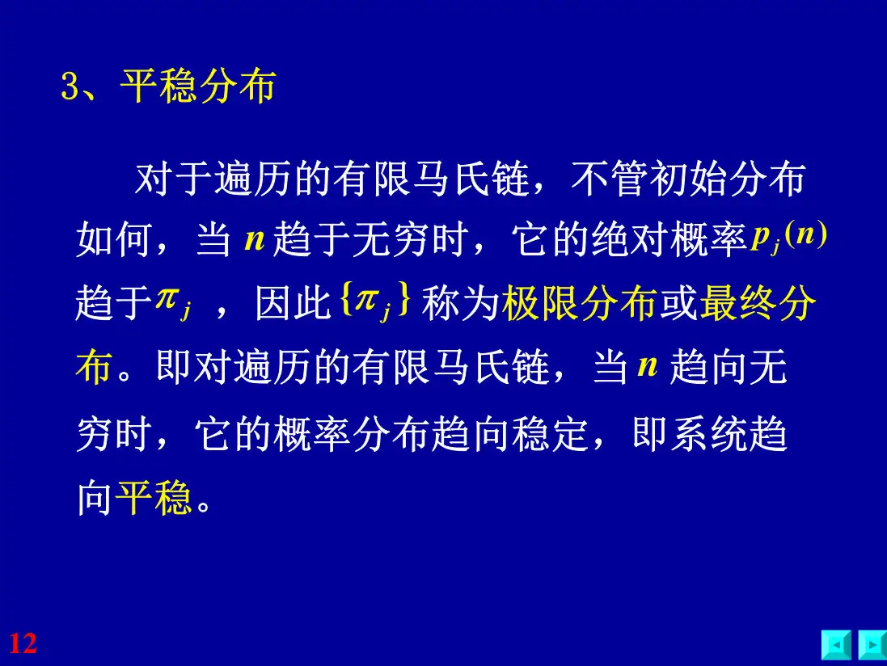

原文：

3、 平稳分布

对于遍历的有限马 氏链， 不管初始分布如何， 当 趋于无穷时， 它的绝对概率n $1 2 0 0$ 趋于 ， 因此 称为极限分布或最终分π j }{π j布。 即对遍历的有限马 氏链， 当 趋向无n穷时， 它的概率分布趋向稳定， 即系统趋向平稳。

12

口

### 满足： $1 9 \div m = \cdots 2$

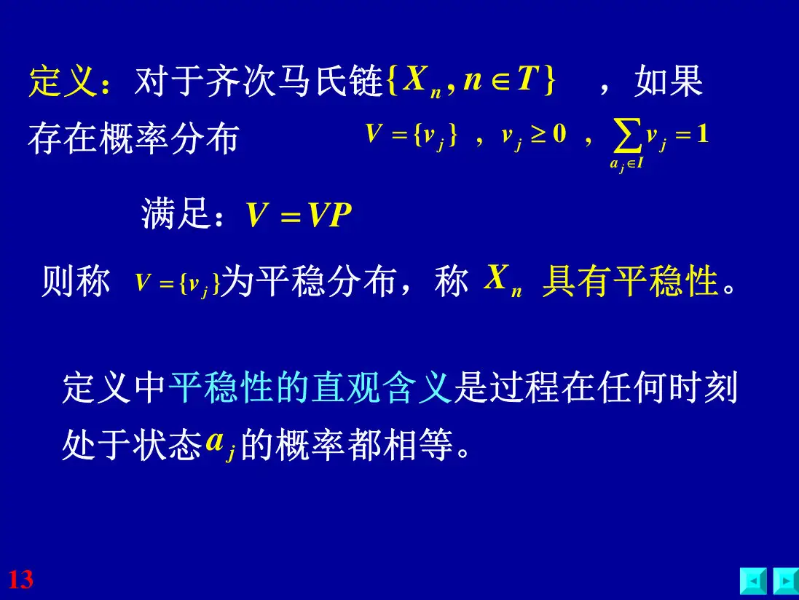

原文：

定义： 对于齐次马 氏链{ $\angle B A D = \angle B A C = \angle C A B$ 如果存在概率分布 $\angle A C D = \angle B A C = \angle C A B = 3 0 ^ { \circ }$

满足： $1 9 \div m = \cdots 2$

则称 $V _ { 1 } = \sqrt { 1 2 }$ 为平稳分布， 称 } Xn 具有平稳性。

定义中平稳性的直观含义是过程在任何时刻处于状态 的概率都相等。aj

13

口

### 在定理的条件下， 马 氏链的极限分布就是平稳分布， 且是唯一的。

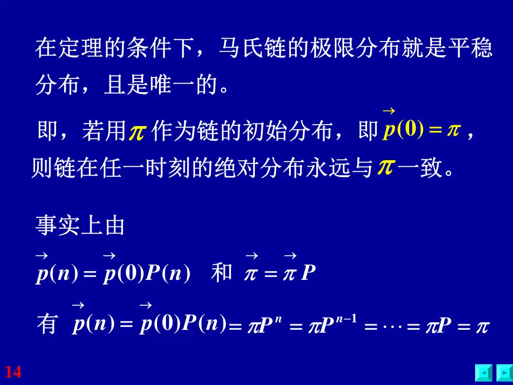

原文：

在定理的条件下， 马 氏链的极限分布就是平稳分布， 且是唯一的。

即， 若用 作为链的初始分布， 即π $| \Omega ( 0 ) | = \Omega$ 则链在任一时刻的绝对分布永远与 一致。π

事实上由

$( \Omega ( u ) ) - \Omega ( 0 ) / 2 ( \Omega )$ → 和 Pπ = π

有 $( 2 ) ( 1 ) ( 1 ) ( 1 ) ( 1 ) ( 1 ) ( 2 ) ( 1 ) ( 2 ) ( 1 ) ( 2 ) ( 1 ) ( 2 ) ( 1 ) ( 2 ) ( 2 ) ( 1 ) ( 2 ) ( 2 )$

14

口

### 例： 数字通信的例子， 其转移概率矩阵为：

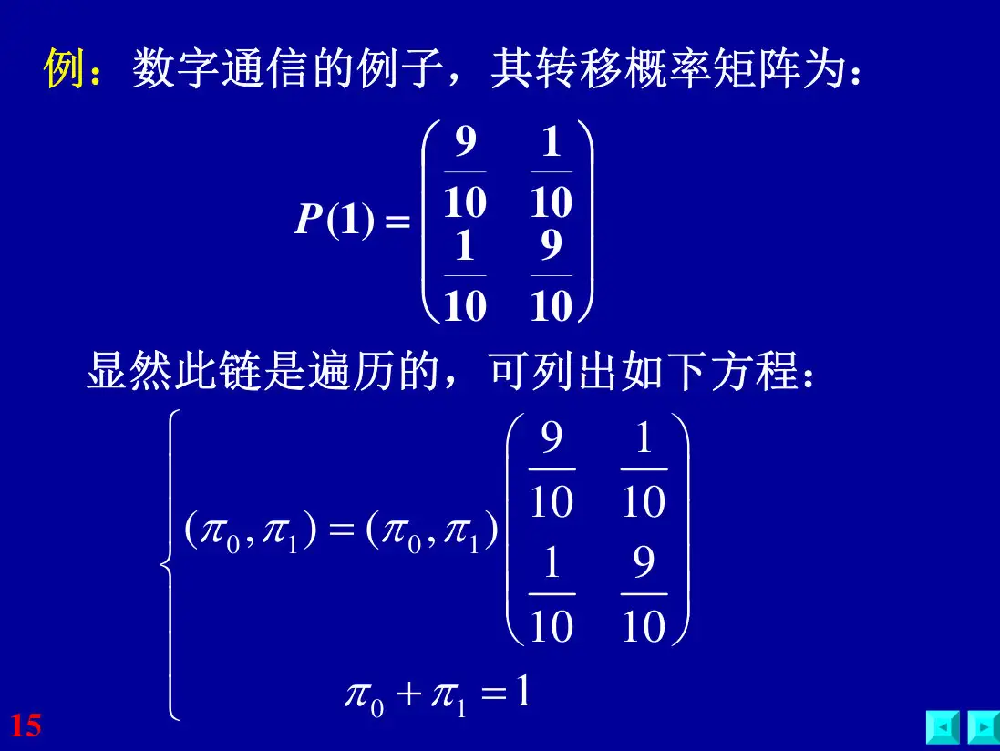

原文：

例： 数字通信的例子， 其转移概率矩阵为：

$$
P (1) = \left( \begin{array}{c c} 9 & 1 \\ \hline 1 0 & 1 0 \\ 1 & 9 \\ \hline 1 0 & 1 0 \end{array} \right)
$$

显然此链是遍历的， 可列出如下方程：

$$
\left\{ \begin{array}{c} (\pi_ {0}, \pi_ {1}) = (\pi_ {0}, \pi_ {1}) \left( \begin{array}{c c} \frac {9}{1 0} & \frac {1}{1 0} \\ \frac {1}{1 0} & \frac {9}{1 0} \end{array} \right) \\ \pi_ {0} + \pi_ {1} = 1 \end{array} \right.
$$

15

口

### 即 ：

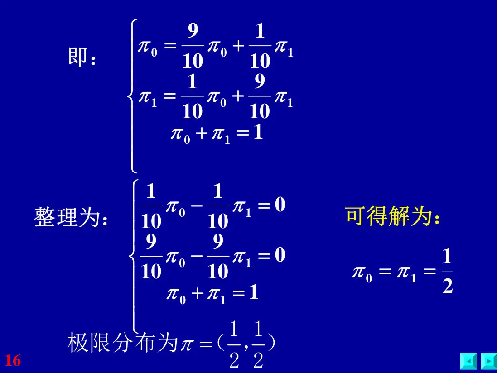

原文：

即 ：

$$
\left\{ \begin{array}{c} \pi_ {0} = \frac {9}{1 0} \pi_ {0} + \frac {1}{1 0} \pi_ {1} \\ \pi_ {1} = \frac {1}{1 0} \pi_ {0} + \frac {9}{1 0} \pi_ {1} \\ \pi_ {0} + \pi_ {1} = 1 \end{array} \right.
$$

整理为：

$$
\left\{ \begin{array}{l} \frac {1}{1 0} \pi_ {0} - \frac {1}{1 0} \pi_ {1} = 0 \\ \frac {9}{1 0} \pi_ {0} - \frac {9}{1 0} \pi_ {1} = 0 \\ \pi_ {0} + \pi_ {1} = 1 \end{array} \right.
$$

可得解为：

$$
\pi_ {0} = \pi_ {1} = \frac {1}{2}
$$

极限分布为 $x _ { 2 } = \frac { 1 } { 2 } \times \frac { 1 } { 2 }$ 这说明 当通信系统的级数无限增大时 离开系统时的数字为 0 或 1 的概率是相 同的这与原发概率大小无关 特别 若当进入系统的数字是等可能的， 即马 氏链的初始分布为 $( 2 \times ( 1 ) - 1 2 \times ( 1 ) = 6$ 时， 则系统在任何步取0或1的概率都为 1

16

### 17

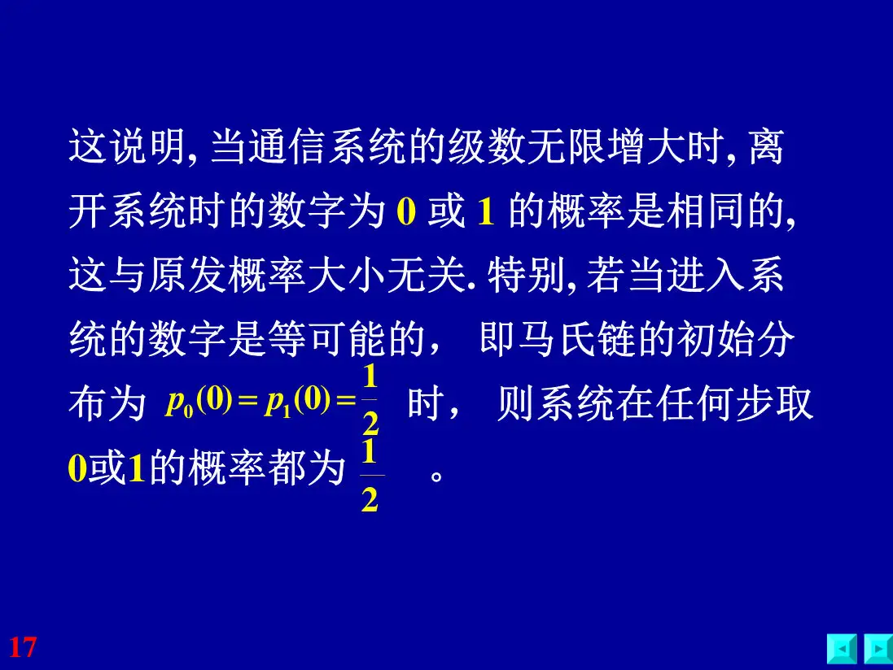

原文：

17

口

### 3. P设齐次马氏链的一步转移概率矩阵为

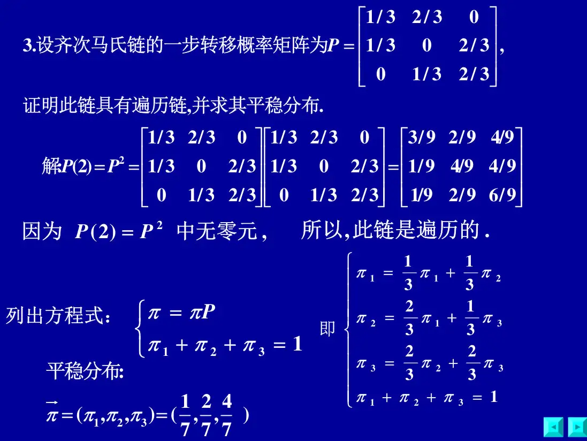

原文：

3. P设齐次马氏链的一步转移概率矩阵为

$$
= \left[ \begin{array}{c c c} 1 / 3 & 2 / 3 & 0 \\ 1 / 3 & 0 & 2 / 3 \\ 0 & 1 / 3 & 2 / 3 \end{array} \right],
$$

.证明此链具有遍历链 并求其平稳分布

$$
\text {解} P (2) = P ^ {2} = \left[ \begin{array}{l l l} 1 / 3 & 2 / 3 & 0 \\ 1 / 3 & 0 & 2 / 3 \\ 0 & 1 / 3 & 2 / 3 \end{array} \right] \left[ \begin{array}{l l l} 1 / 3 & 2 / 3 & 0 \\ 1 / 3 & 0 & 2 / 3 \\ 0 & 1 / 3 & 2 / 3 \end{array} \right] = \left[ \begin{array}{l l l} 3 / 9 & 2 / 9 & 4 / 9 \\ 1 / 9 & 4 / 9 & 4 / 9 \\ 1 / 9 & 2 / 9 & 6 / 9 \end{array} \right]
$$

因为 $\textcircled { 1 } \textcircled { 6 4 } = \textcircled { 1 2 } \textcircled { 2 }$ 中无零元 所以,此链是遍历的 .

列出方程式：

$$
\left\{ \begin{array}{l} \pi = \pi P \\ \pi_ {1} + \pi_ {2} + \pi_ {3} = 1 \end{array} \right.
$$

:平稳分布

即

$$
\left\{ \begin{array}{l} \pi_ {1} = \frac {1}{3} \pi_ {1} + \frac {1}{3} \pi_ {2} \\ \pi_ {2} = \frac {2}{3} \pi_ {1} + \frac {1}{3} \pi_ {3} \\ \pi_ {3} = \frac {2}{3} \pi_ {2} + \frac {2}{3} \pi_ {3} \\ \pi_ {1} + \pi_ {2} + \pi_ {3} = 1 \end{array} \right.
$$

$$
\vec {\pi} = (\pi_ {1}, \pi_ {2}, \pi_ {3}) = (\frac {1}{7}, \frac {2}{7}, \frac {4}{7})
$$

口

### $$

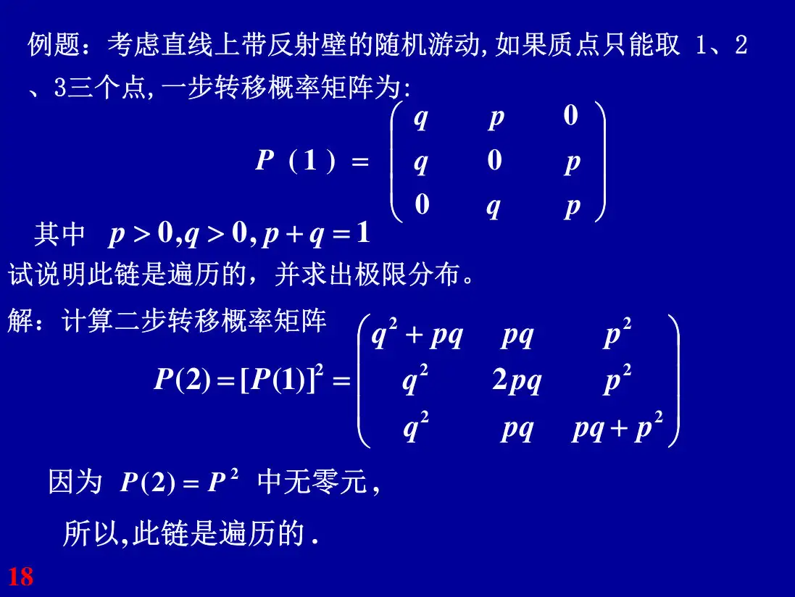

原文：

例题： 考虑直线上带反射壁的随机游动 如果质点只能取 1 2、 3三个点 一步转移概率矩阵为 :

$$
P (1) = \left( \begin{array}{c c c} q & p & 0 \\ q & 0 & p \\ 0 & q & p \end{array} \right)
$$

其中 $1 2 - 1 1 \times ( 1 2 - 1 1 ) = 1 2 \times 1 2 = 1 1$ 试说明此链是遍历的， 并求出极限分布。

解： 计算二步转移概率矩阵

$$
P (2) = [ P (1) ] ^ {2} = \left( \begin{array}{c c c} q ^ {2} + p q & p q & p ^ {2} \\ q ^ {2} & 2 p q & p ^ {2} \\ q ^ {2} & p q & p q + p ^ {2} \end{array} \right)
$$

因为 $| \mathcal { W } ( \phi ) | = | \mathcal { P } |$ 中无零元所以 此链是遍历的 .

18

### 下面求极限分布

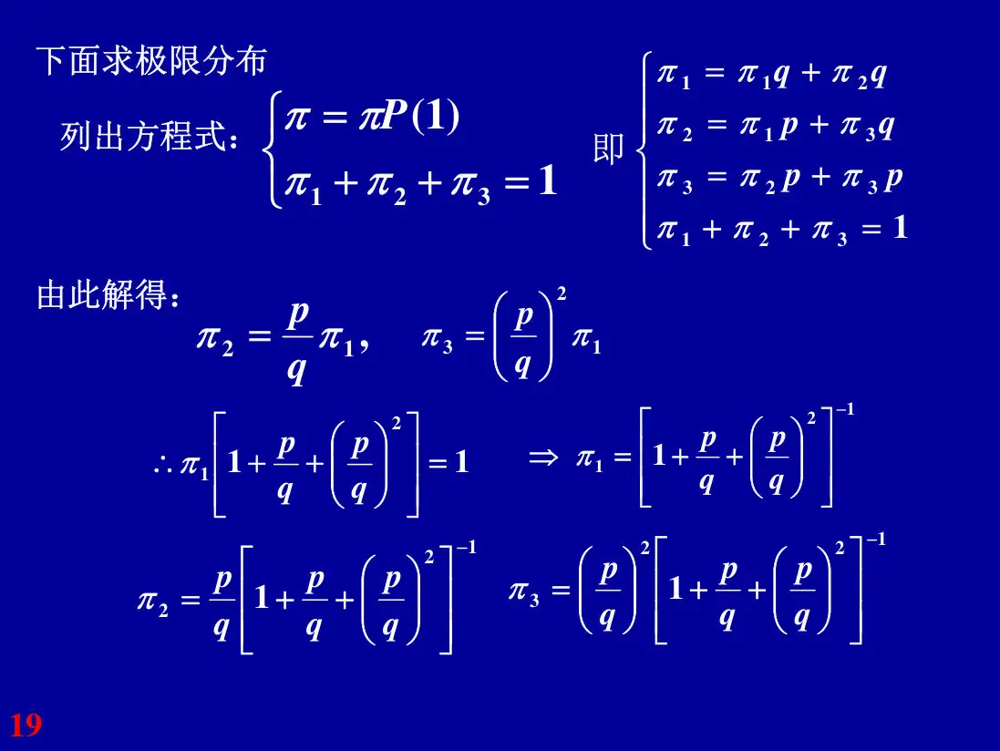

原文：

下面求极限分布

列出方程式：

$$
\left\{ \begin{array}{l} \pi = \pi P (1) \\ \pi_ {1} + \pi_ {2} + \pi_ {3} = 1 \end{array} \right.
$$

即

$$
\left\{ \begin{array}{l} \pi_ {1} = \pi_ {1} q + \pi_ {2} q \\ \pi_ {2} = \pi_ {1} p + \pi_ {3} q \\ \pi_ {3} = \pi_ {2} p + \pi_ {3} p \\ \pi_ {1} + \pi_ {2} + \pi_ {3} = 1 \end{array} \right.
$$

由此解得：

$$
\pi_ {2} = \frac {p}{q} \pi_ {1}, \quad \pi_ {3} = \left(\frac {p}{q}\right) ^ {2} \pi_ {1}
$$

$$
\therefore \pi_ {1} \left[ 1 + \frac {p}{q} + \left(\frac {p}{q}\right) ^ {2} \right] = 1 \quad \Rightarrow \pi_ {1} = \left[ 1 + \frac {p}{q} + \left(\frac {p}{q}\right) ^ {2} \right] ^ {- 1}
$$

$$
\pi_ {2} = \frac {p}{q} \left[ 1 + \frac {p}{q} + \left(\frac {p}{q}\right) ^ {2} \right] ^ {- 1} \quad \pi_ {3} = \left(\frac {p}{q}\right) ^ {2} \left[ 1 + \frac {p}{q} + \left(\frac {p}{q}\right) ^ {2} \right] ^ {- 1}
$$

19

### 例： 设一马 氏链的一步转移概率矩阵为

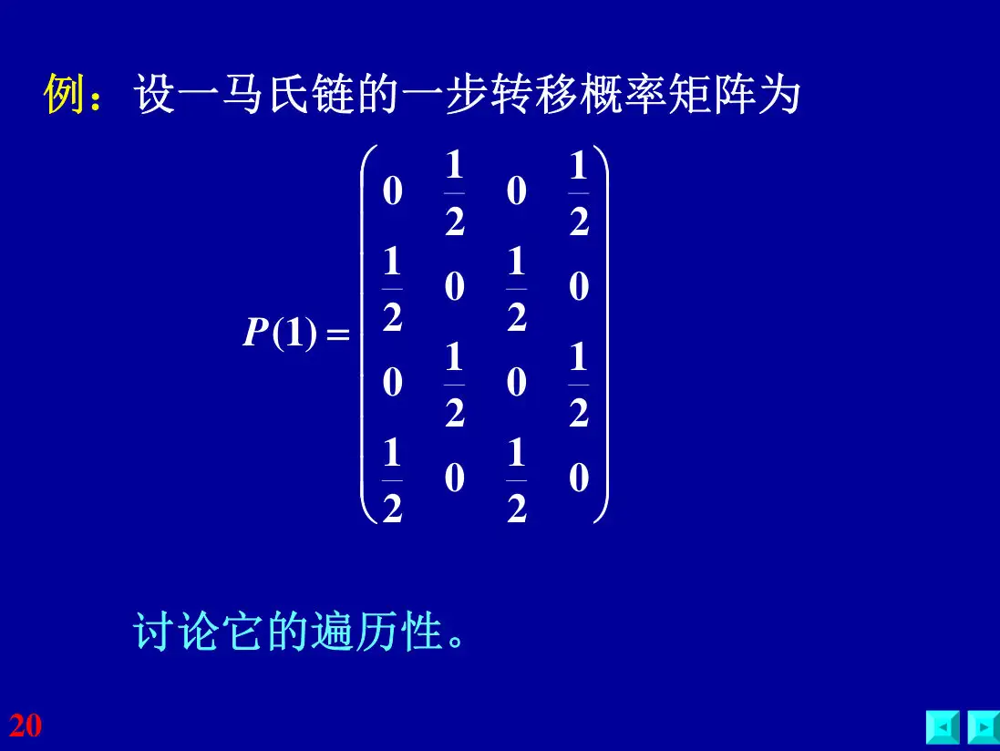

原文：

例： 设一马 氏链的一步转移概率矩阵为

$$
P (1) = \left( \begin{array}{c c c c} 0 & \frac {1}{2} & 0 & \frac {1}{2} \\ \frac {1}{2} & 0 & \frac {1}{2} & 0 \\ 0 & \frac {1}{2} & 0 & \frac {1}{2} \\ \frac {1}{2} & 0 & \frac {1}{2} & 0 \end{array} \right)
$$

讨论它的遍历性。

20

口

### 解： 先计算二步转移矩阵

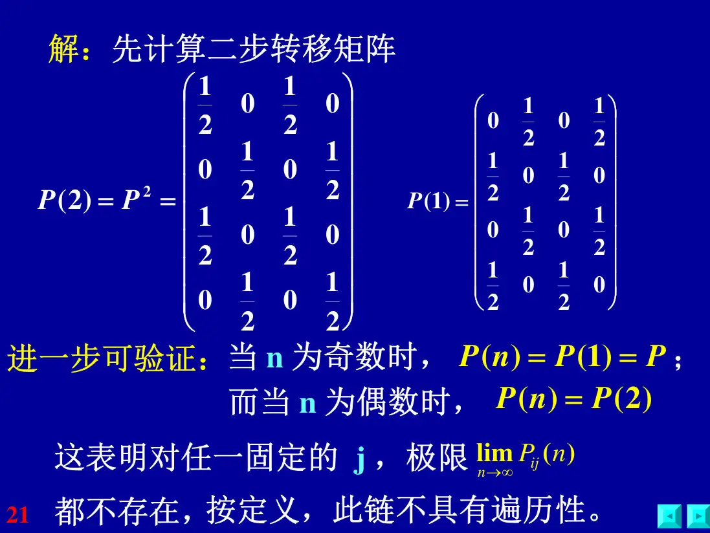

原文：

解： 先计算二步转移矩阵

$$
P (2) = P ^ {2} = \left( \begin{array}{c c c c} \frac {1}{2} & 0 & \frac {1}{2} & 0 \\ 0 & \frac {1}{2} & 0 & \frac {1}{2} \\ \frac {1}{2} & 0 & \frac {1}{2} & 0 \\ 0 & \frac {1}{2} & 0 & \frac {1}{2} \end{array} \right)
$$

$$
P (1) = \left( \begin{array}{c c c c} 0 & \frac {1}{2} & 0 & \frac {1}{2} \\ \frac {1}{2} & 0 & \frac {1}{2} & 0 \\ 0 & \frac {1}{2} & 0 & \frac {1}{2} \\ \frac {1}{2} & 0 & \frac {1}{2} & 0 \end{array} \right)
$$

进一步可验证： 当 n 为奇数时， $1 2 ( m ) - 1 2 ( m ) = 1 2$ 而当 n 为偶数时， $1 2 ( m ) = 1 2 ( m )$

这表明对任一固定的 j ， 极限 $\frac { 1 1 1 0 0 } { 1 0 0 0 } = \frac { 1 0 0 0 } { 1 0 0 } ( c m )$

21 都不存在， 按定义， 此链不具有遍历性。

口口

### 例： 设一马 氏链的一步转移概率矩阵为

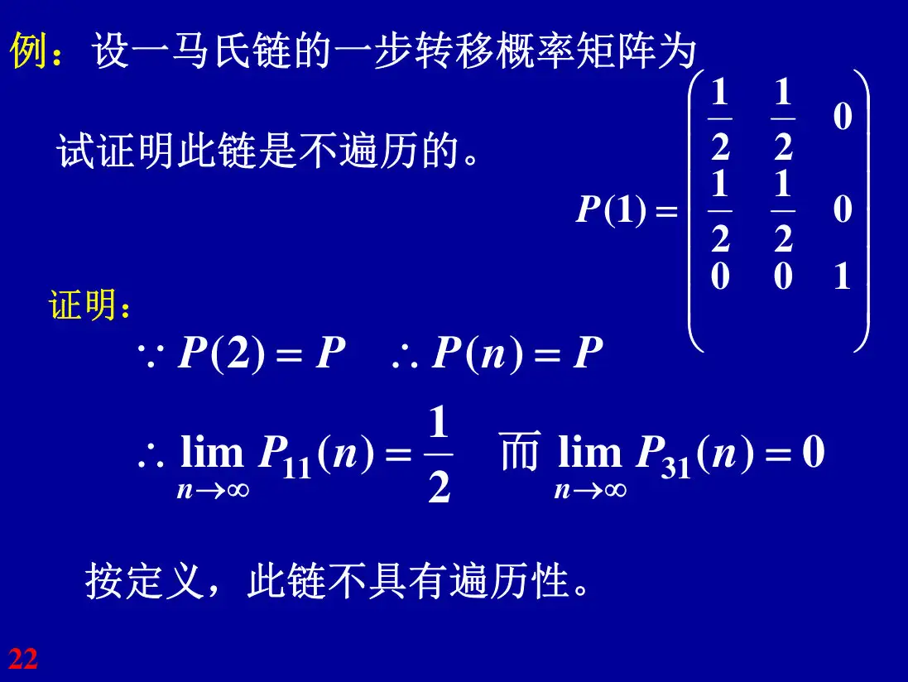

原文：

例： 设一马 氏链的一步转移概率矩阵为

试证明此链是不遍历的。

证明 ：

$$
P (1) = \left( \begin{array}{c c c} \frac {1}{2} & \frac {1}{2} & 0 \\ \frac {1}{2} & \frac {1}{2} & 0 \\ 0 & 0 & 1 \end{array} \right)
$$

$$
\because P (2) = P \quad \therefore P (n) = P
$$

$$
\therefore \lim _ {n \to \infty} P _ {1 1} (n) = \frac {1}{2} \quad \text {而} \lim _ {n \to \infty} P _ {3 1} (n) = 0
$$

按定义， 此链不具有遍历性。

22
