# 《概率论与数理统计》第11章 平稳过程（课件）

原件的每一页，下面附识别出的文字。

### 第十一章 平稳过程

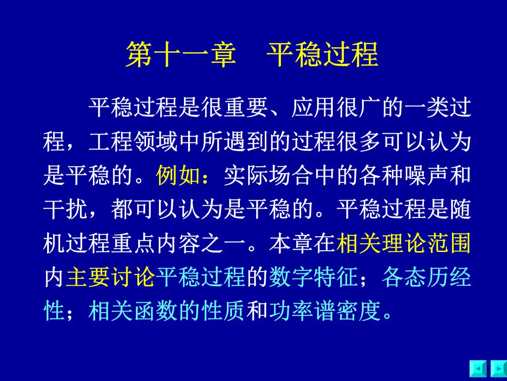

原文：

第十一章 平稳过程

平稳过程是很重要、应用很广的一类过程，工程领域中所遇到的过程很多可以认为是平稳的。例如：实际场合中的各种噪声和干扰，都可以认为是平稳的。平稳过程是随机过程重点内容之一。本章在相关理论范围内主要讨论平稳过程的数字特征；各态历经性；相关函数的性质和功率谱密度。

### 11.1 平稳过程的概念

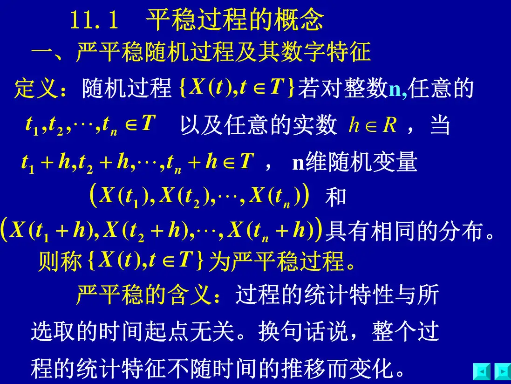

原文：

11.1 平稳过程的概念
一、严平稳随机过程及其数字特征
定义：随机过程 $\{X(t), t \in T\}$ 若对整数 n，任意的 $t_{1}, t_{2}, \cdots, t_{n} \in T$ 以及任意的实数 $h \in R$ ，当 $t_{1} + h, t_{2} + h, \cdots, t_{n} + h \in T$ ，n 维随机变量 $(X(t_{1}), X(t_{2}), \cdots, X(t_{n}))$ 和 $(X(t_{1}+h), X(t_{2}+h), \cdots, X(t_{n}+h))$ 具有相同的分布。
则称 $\{X(t), t \in T\}$ 为严平稳过程。
严平稳的含义：过程的统计特性与所选取的时间起点无关。换句话说，整个过程的统计特征不随时间的推移而变化。

### 下面来考察严平稳过程的数字特征:

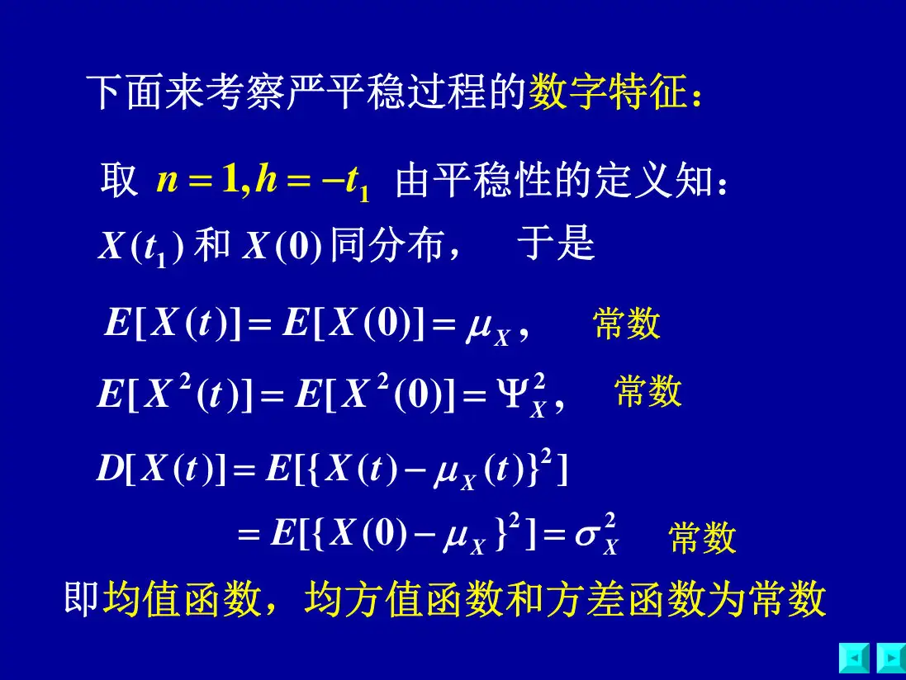

原文：

下面来考察严平稳过程的数字特征:

取 $n = 1, h = -t_{1}$ 由平稳性的定义知:

$X(t_{1})$ 和 $X(0)$ 同分布，于是

$E[X(t)] = E[X(0)] = \mu_X,$ 常数

$E[X^{2}(t)]=E[X^{2}(0)]=\Psi_{X}^{2}$ ，常数

$D[X(t)] = E[\{X(t) - \mu_X(t)\}^2]$ $= E[\{X(0) - \mu_X\}^2 ] = \sigma_X^2$ 常数

即均值函数，均方值函数和方差函数为常数

### 下面考虑过程的自相关函数和自协方差函数

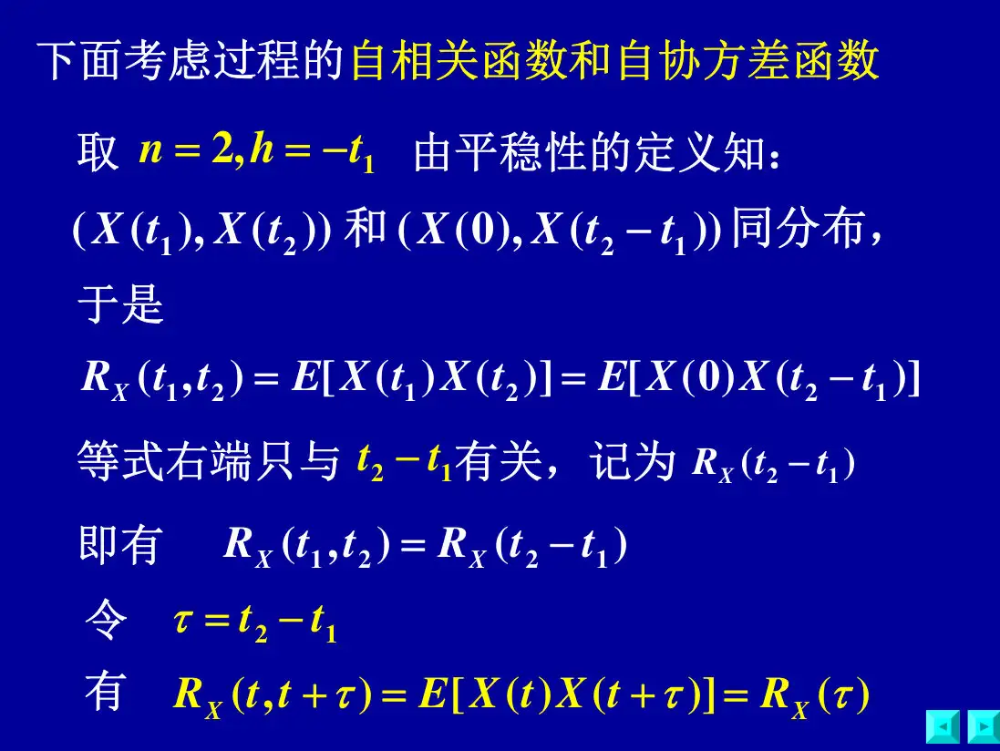

原文：

下面考虑过程的自相关函数和自协方差函数

取 $n = 2, h = -t_{1}$ 由平稳性的定义知:

$(X(t_{1}), X(t_{2}))$ 和 $(X(0), X(t_{2}-t_{1}))$ 同分布，

$$
R _ {X} (t _ {1}, t _ {2}) = E [ X (t _ {1}) X (t _ {2}) ] = E [ X (0) X (t _ {2} - t _ {1}) ]
$$

等式右端只与 $t_2 - t_1$ 有关，记为 $R_{X}(t_{2} - t_{1})$

即有 $R_{X}(t_{1},t_{2}) = R_{X}(t_{2} - t_{1})$

令 $\tau = t_{2} - t_{1}$

有 $R_{X}(t,t + \tau) = E[X(t)X(t + \tau)] = R_{X}(\tau)$

### $$

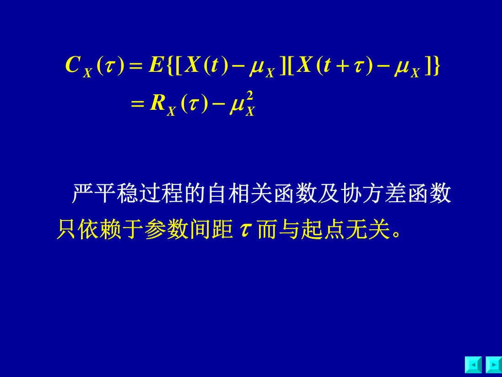

原文：

$$
\begin{array}{r l} & C _ {X} (\tau) = E \{[ X (t) - \mu_ {X} ] [ X (t + \tau) - \mu_ {X} ] \} \\ & \qquad = R _ {X} (\tau) - \mu_ {X} ^ {2} \end{array}
$$

严平稳过程的自相关函数及协方差函数只依赖于参数间距 $\tau$ 而与起点无关。

### 二、宽平稳随机过程

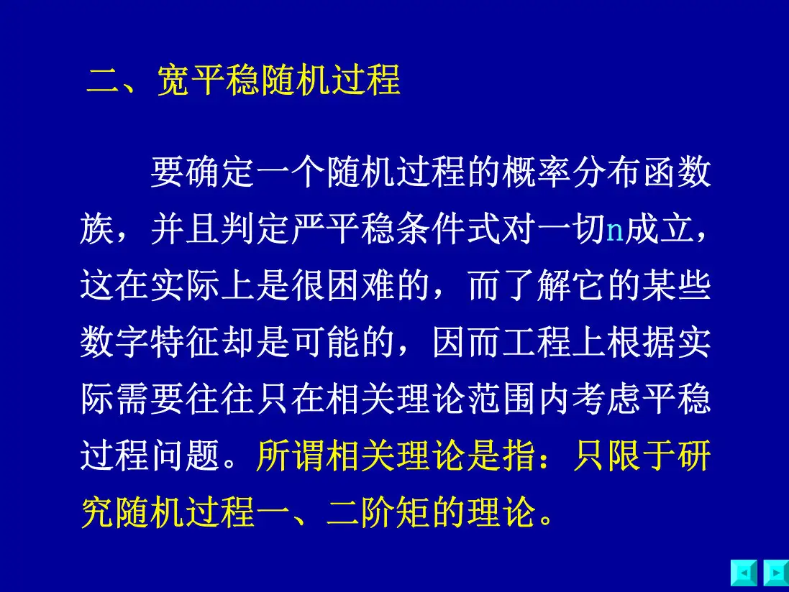

原文：

二、宽平稳随机过程

要确定一个随机过程的概率分布函数族，并且判定严平稳条件式对一切n成立，这在实际上是很困难的，而了解它的某些数字特征却是可能的，因而工程上根据实际需要往往只在相关理论范围内考虑平稳过程问题。所谓相关理论是指：只限于研究随机过程一、二阶矩的理论。

### 定义: 若 $\{X(t), t \in T\}$ 为二阶矩过程,

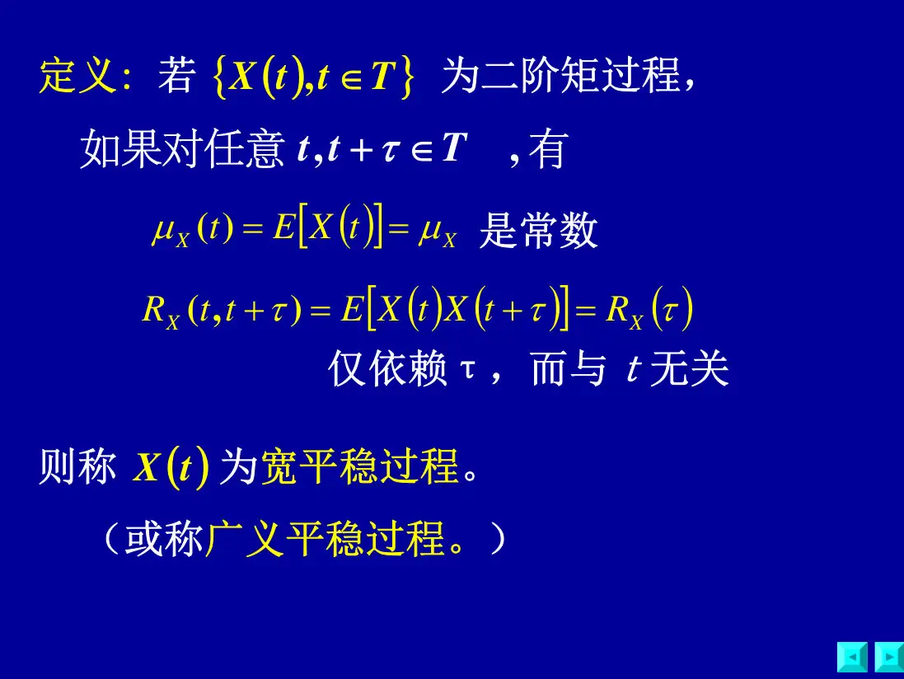

原文：

定义: 若 $\{X(t), t \in T\}$ 为二阶矩过程,

如果对任意 $t, t + \tau \in T$ ，有

$\mu_{X}(t)=E[X(t)]=\mu_{X}$ 是常数

$R_{X}(t,t+\tau)=E\left[X(t)X(t+\tau)\right]=R_{X}(\tau)$ 仅依赖 $\tau$ ，而与 t 无关

则称 $X(t)$ 为宽平稳过程。

(或称广义平稳过程。)

### $E[X(n)]=\mu_{X}$ 是常数;

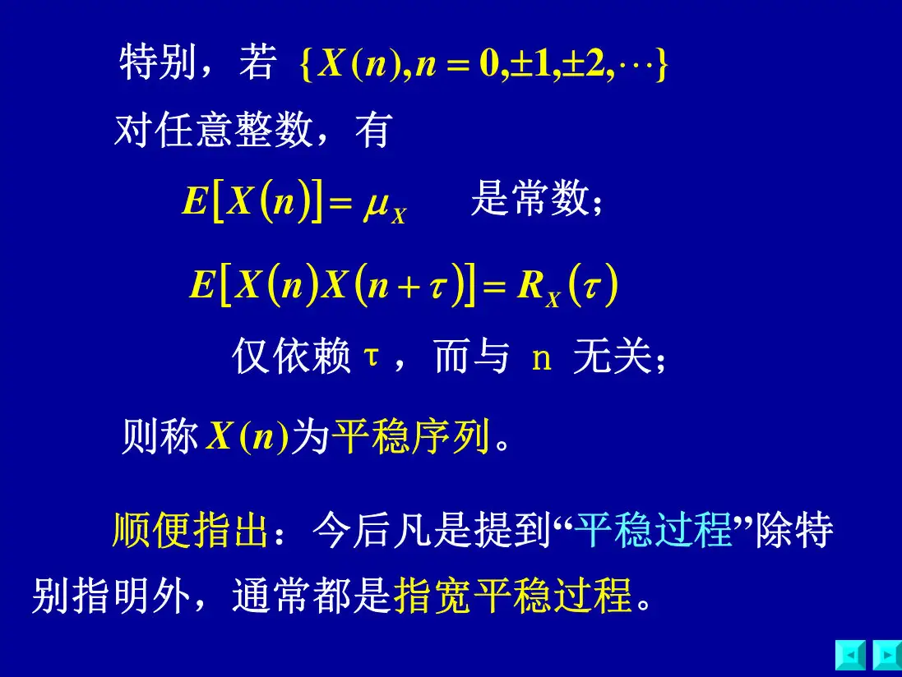

原文：

特别，若 $\{X(n),n=0,\pm1,\pm2,\cdots\}$ 对任意整数，有

$E[X(n)]=\mu_{X}$ 是常数;

$E[X(n)X(n+\tau)]=R_{x}(\tau)$ 仅依赖 $\tau$ ，而与 n 无关；
则称 $X(n)$ 为平稳序列。

顺便指出：今后凡是提到“平稳过程”除特别指明外，通常都是指宽平稳过程。

### 相关函数仅与 $\tau$ 有关。因此，它是平稳随机序列。

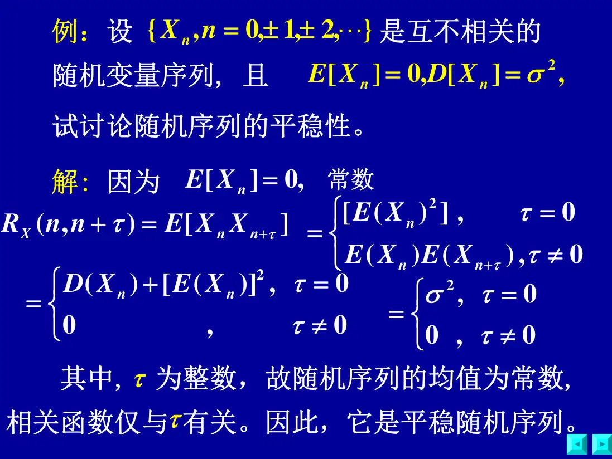

原文：

例：设 $\{X_{n}, n=0, \pm1, \pm2, \cdots\}$ 是互不相关的随机变量序列，且 $E[X_{n}]=0, D[X_{n}]=\sigma^{2}$ ，试讨论随机序列的平稳性。

解：因为 $E[X_{n}]=0$ ，常数 $R_{X}(n,n+\tau)=E[X_{n}X_{n+\tau}]=\left\{\begin{aligned}&[E(X_{n})^{2}],&\tau=0\\ &E(X_{n})E(X_{n+\tau}),\tau\neq0\end{aligned}\right.$ $=\left\{\begin{aligned}D(X_{n})+[E(X_{n})]^{2},&\tau=0\\ 0,&\tau\neq0\end{aligned}\right.=\left\{\begin{aligned}\sigma^{2},&\tau=0\\ 0,&\tau\neq0\end{aligned}\right.$ 其中， $\tau$ 为整数，故随机序列的均值为常数，

相关函数仅与 $\tau$ 有关。因此，它是平稳随机序列。

### 证：由于 $\Theta \sim U(0,2\pi)$

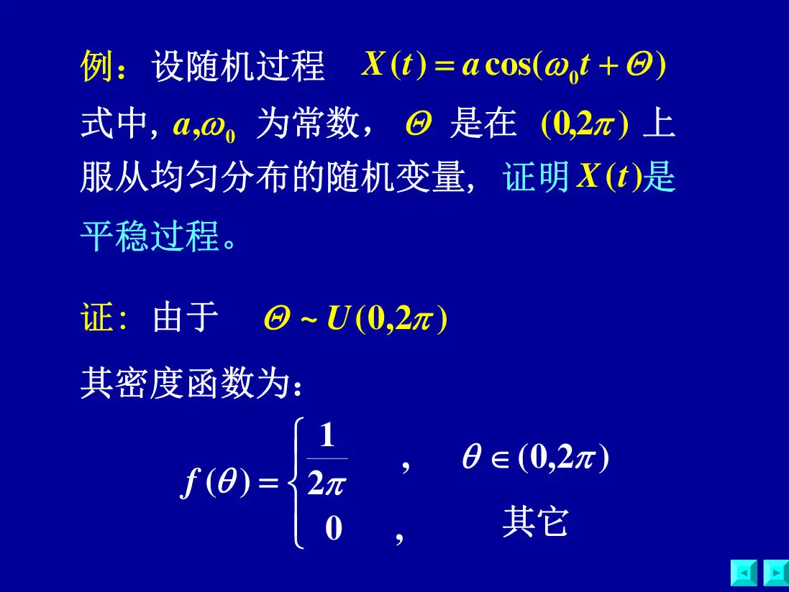

原文：

例：设随机过程 $X(t) = a \cos (\omega_0 t + \Theta)$ 式中， $a, \omega_0$ 为常数， $\Theta$ 是在 $(0,2\pi)$ 上服从均匀分布的随机变量，证明 $X(t)$ 是平稳过程。

证：由于 $\Theta \sim U(0,2\pi)$

其密度函数为:

$f(\theta)=\left\{\begin{aligned}&\frac{1}{2\pi}\quad,\quad\theta\in(0,2\pi)\\ &0\quad,\quad\text{其它}\end{aligned}\right.$

### $$

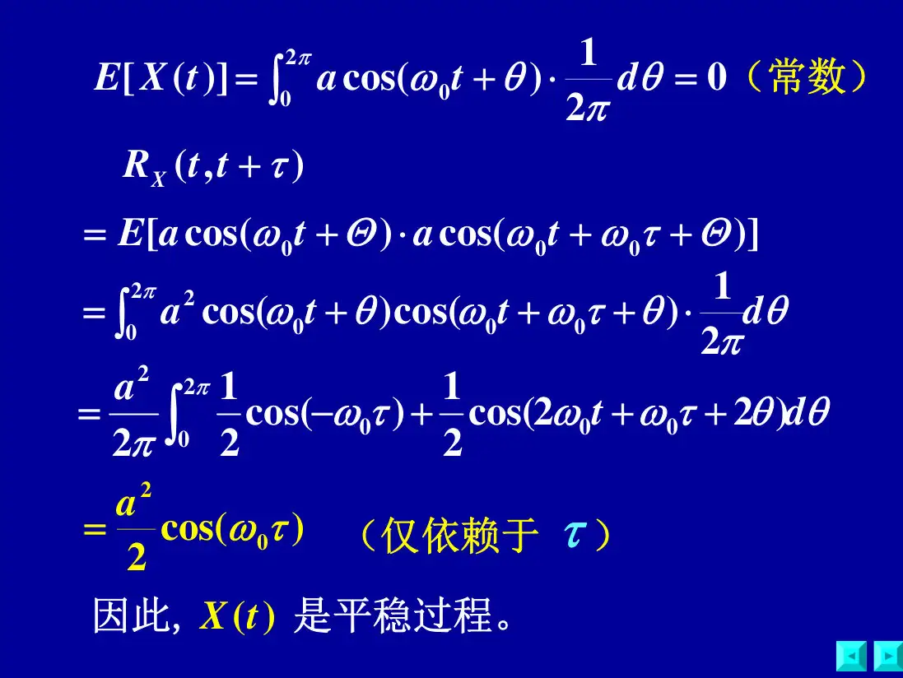

原文：

$E[X(t)]=\int_{0}^{2\pi}a\cos(\omega_{0}t+\theta)\cdot\frac{1}{2\pi}d\theta=0$ （常数）

$$
R _ {X} (t, t + \tau)
$$

$$
= E [ a \cos (\omega_ {0} t + \Theta) \cdot a \cos (\omega_ {0} t + \omega_ {0} \tau + \Theta) ]
$$

$$
= \int_ {0} ^ {2 \pi} a ^ {2} \cos (\omega_ {0} t + \theta) \cos (\omega_ {0} t + \omega_ {0} \tau + \theta) \cdot \frac {1}{2 \pi} d \theta
$$

$$
= \frac {a ^ {2}}{2 \pi} \int_ {0} ^ {2 \pi} \frac {1}{2} \cos (- \omega_ {0} \tau) + \frac {1}{2} \cos (2 \omega_ {0} t + \omega_ {0} \tau + 2 \theta) d \theta
$$

$$
= \frac {a ^ {2}}{2} \cos (\omega_ {0} \tau)
$$

因此， $X(t)$ 是平稳过程。

### 试讨论它的平稳性。

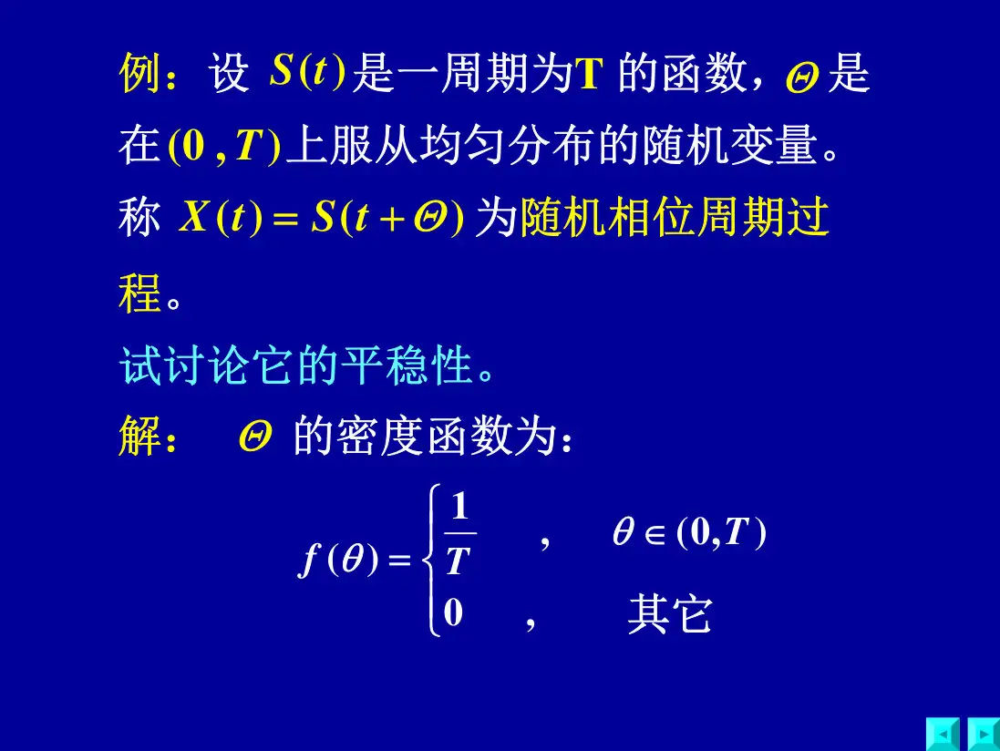

原文：

例：设 $S(t)$ 是一周期为 $\mathbf{T}$ 的函数， $\Theta$ 是在 $(0, T)$ 上服从均匀分布的随机变量。称 $X(t) = S(t + \Theta)$ 为随机相位周期过程。

试讨论它的平稳性。

解: $\Theta$ 的密度函数为:

$$
f (\theta) = \left\{ \begin{array}{l l} \frac {1}{T}, & \theta \in (0, T) \\ 0, & \text {其它} \end{array} \right.
$$

### $X(t)$ 的均值函数

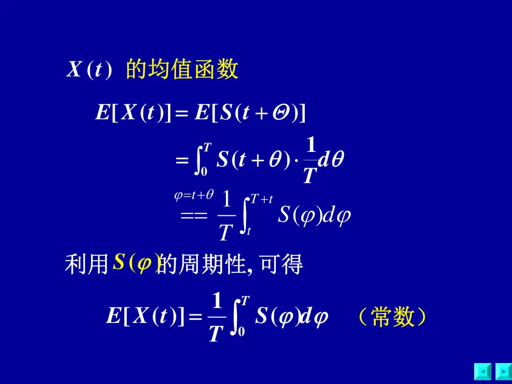

原文：

$X(t)$ 的均值函数

$$
\begin{array}{r l} & E [ X (t) ] = E [ S (t + \Theta) ] \\ & \qquad = \int_ {0} ^ {T} S (t + \theta) \cdot \frac {1}{T} d \theta \\ & \qquad \stackrel {\varphi = t + \theta} {=} \frac {1}{T} \int_ {t} ^ {T + t} S (\varphi) d \varphi \end{array}
$$

利用 $S(\varphi)$ 的周期性, 可得

$E[X(t)]=\frac{1}{T}\int_{0}^{T}S(\varphi)d\varphi$ （常数）

### $$

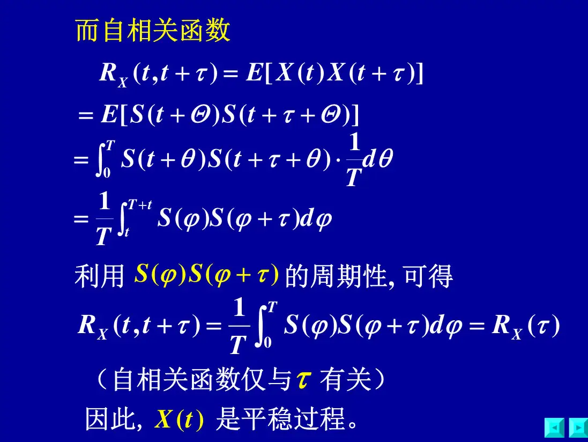

原文：

$$
R _ {X} (t, t + \tau) = E [ X (t) X (t + \tau) ]
$$

$$
= E [ S (t + \Theta) S (t + \tau + \Theta) ]
$$

$$
= \int_ {0} ^ {T} S (t + \theta) S (t + \tau + \theta) \cdot \frac {1}{T} d \theta
$$

$$
= \frac {1}{T} \int_ {t} ^ {T + t} S (\varphi) S (\varphi + \tau) d \varphi
$$

$$
S (\varphi) S (\varphi + \tau)
$$

$$
R _ {X} (t, t + \tau) = \frac {1}{T} \int_ {0} ^ {T} S (\varphi) S (\varphi + \tau) d \varphi = R _ {X} (\tau)
$$

(自相关函数仅与 $\tau$ 有关)

因此， $X(t)$ 是平稳过程。

### 11.3 各态历经性

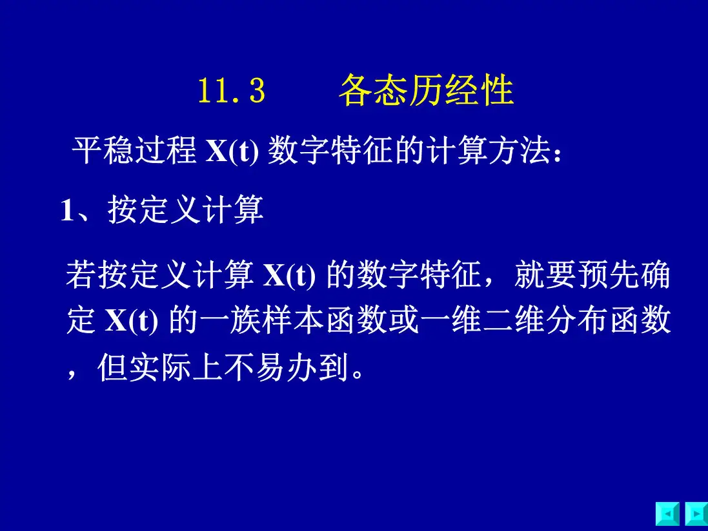

原文：

11.3 各态历经性

平稳过程 X(t) 数字特征的计算方法:

1、按定义计算

若按定义计算 X(t) 的数字特征，就要预先确定 X(t) 的一族样本函数或一维二维分布函数，但实际上不易办到。

### 2、统计实验方法

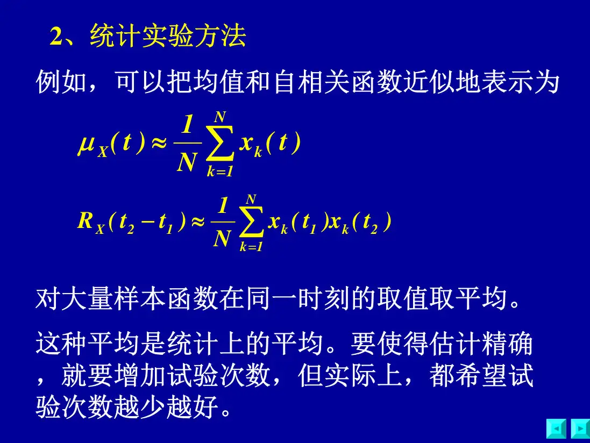

原文：

2、统计实验方法
例如，可以把均值和自相关函数近似地表示为

$$
\mu_ {X} (t) \approx \frac {1}{N} \sum_ {k = 1} ^ {N} x _ {k} (t)
$$

$$
R _ {X} (t _ {2} - t _ {1}) \approx \frac {1}{N} \sum_ {k = 1} ^ {N} x _ {k} (t _ {1}) x _ {k} (t _ {2})
$$

对大量样本函数在同一时刻的取值取平均。这种平均是统计上的平均。要使得估计精确，就要增加试验次数，但实际上，都希望试验次数越少越好。

### 于是产生问题: 能不能根据一次试验获得的一个样本函数来确定过程的数字特征呢?

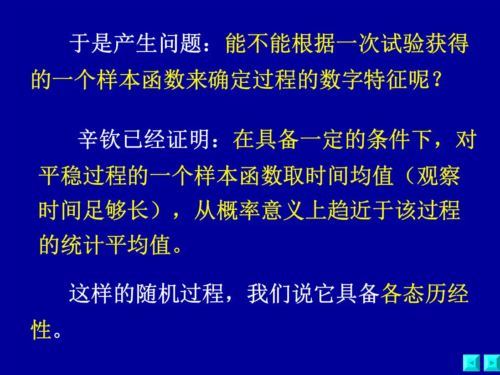

原文：

于是产生问题: 能不能根据一次试验获得的一个样本函数来确定过程的数字特征呢?

辛钦已经证明：在具备一定的条件下，对平稳过程的一个样本函数取时间均值（观察时间足够长），从概率意义上趋近于该过程的统计平均值。

这样的随机过程，我们说它具备各态历经性。

### 第 18 页

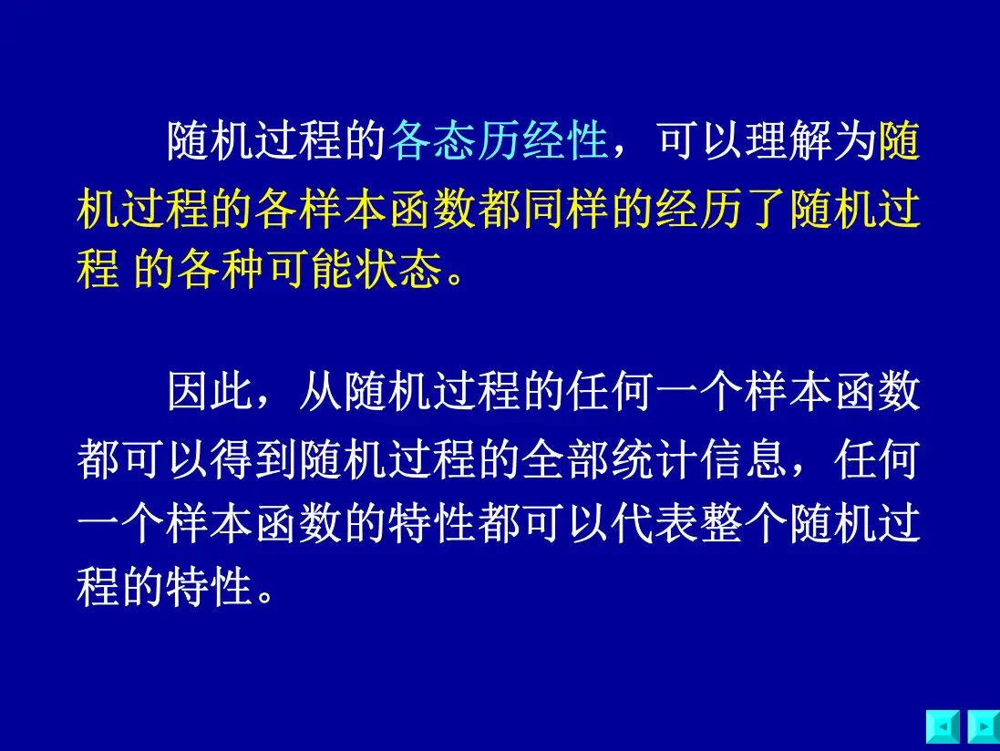

原文：

随机过程的各态历经性，可以理解为随机过程的各样本函数都同样的经历了随机过程的各种可能状态。

因此，从随机过程的任何一个样本函数都可以得到随机过程的全部统计信息，任何一个样本函数的特性都可以代表整个随机过程的特性。

### 一、随机过程的时间均值和时间相关函数

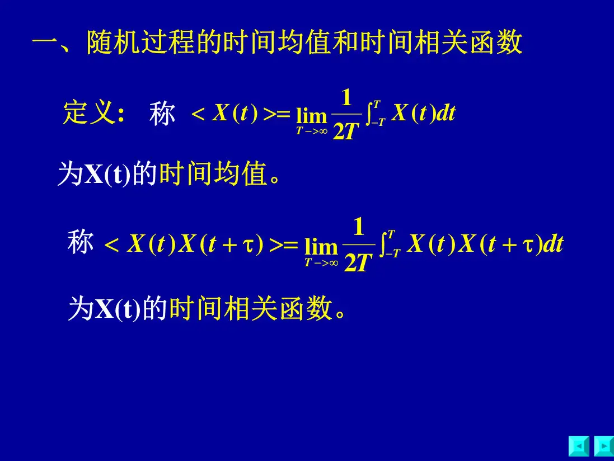

原文：

一、随机过程的时间均值和时间相关函数

定义: 称 $< X(t) >= \lim_{T \to \infty} \frac{1}{2T} \int_{-T}^{T} X(t) dt$ 为X(t)的时间均值。

称 $< X(t)X(t + \tau) > = \lim_{T\to \infty}\frac{1}{2T}\int_{-T}^{T}X(t)X(t + \tau)dt$ 为 $\mathrm{X(t)}$ 的时间相关函数。

### 第 20 页

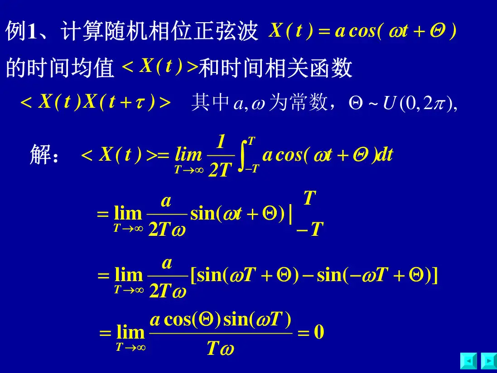

原文：

例1、计算随机相位正弦波 $X(t)=a\cos(\omega t+\Theta)$ 的时间均值 $<X(t)>$ 和时间相关函数 $<X(t)X(t+\tau)>$ 其中 $a,\omega$ 为常数， $\Theta\sim U(0,2\pi)$ ,
解： $<X(t)>=\lim_{T\to\infty}\frac{1}{2T}\int_{-T}^{T}a\cos(\omega t+\Theta)dt$ $=\lim_{T\to\infty}\frac{a}{2T\omega}\sin(\omega t+\Theta)\bigg|_{-T}^{T}$ $=\lim_{T\to\infty}\frac{a}{2T\omega}[\sin(\omega T+\Theta)-\sin(-\omega T+\Theta)]$ $=\lim_{T\to\infty}\frac{a\cos(\Theta)\sin(\omega T)}{T\omega}=0$

### $$

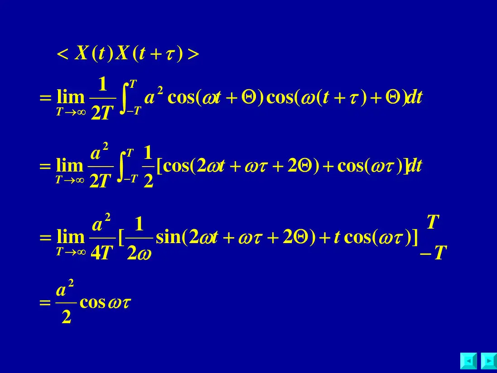

原文：

$$
\begin{array}{r l} & {<   X (t) X (t + \tau) >} \\ & {= \lim _ {T \to \infty} \frac {1}{2 T} \int_ {- T} ^ {T} a ^ {2} \cos (\omega t + \Theta) \cos (\omega (t + \tau) + \Theta) d t} \\ & {= \lim _ {T \to \infty} \frac {a ^ {2}}{2 T} \int_ {- T} ^ {T} \frac {1}{2} [ \cos (2 \omega t + \omega \tau + 2 \Theta) + \cos (\omega \tau) ] d t} \\ & {= \lim _ {T \to \infty} \frac {a ^ {2}}{4 T} [ \frac {1}{2 \omega} \sin (2 \omega t + \omega \tau + 2 \Theta) + t \cos (\omega \tau) ] _ {- T} ^ {T}} \\ & {= \frac {a ^ {2}}{2} \cos \omega \tau} \end{array}
$$

### $$

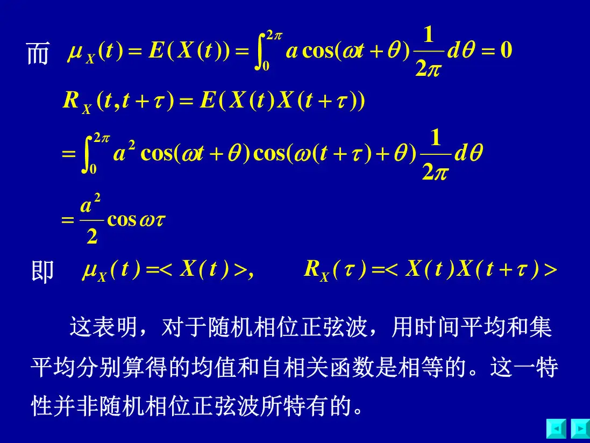

原文：

$$
\begin{array}{r l} {\text {而}} & {\mu_ {X} (t) = E (X (t)) = \int_ {0} ^ {2 \pi} a \cos (\omega t + \theta) \frac {1}{2 \pi} d \theta = 0} \\ & {R _ {X} (t, t + \tau) = E (X (t) X (t + \tau))} \\ & {= \int_ {0} ^ {2 \pi} a ^ {2} \cos (\omega t + \theta) \cos (\omega (t + \tau) + \theta) \frac {1}{2 \pi} d \theta} \\ & {= \frac {a ^ {2}}{2} \cos \omega \tau} \\ {\text {即}} & {\mu_ {X} (t) = <   X (t) >, R _ {X} (\tau) = <   X (t) X (t + \tau) >} \end{array}
$$

这表明，对于随机相位正弦波，用时间平均和集平均分别算得的均值和自相关函数是相等的。这一特性并非随机相位正弦波所特有的。

### 二、各态历经性

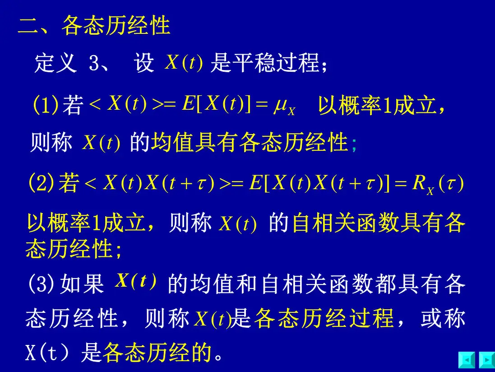

原文：

二、各态历经性

定义 3、设 $X(t)$ 是平稳过程;

(1) 若 $< X(t) >= E[X(t)] = \mu_X$ 以概率1成立，

则称 $X(t)$ 的均值具有各态历经性；

(2) 若 $< X(t)X(t + \tau) >= E[X(t)X(t + \tau)] = R_X(\tau)$

以概率1成立，则称 $X(t)$ 的自相关函数具有各态历经性；

(3) 如果 $X(t)$ 的均值和自相关函数都具有各态历经性, 则称 $X(t)$ 是各态历经过程, 或称 $X(t)$ 是各态历经的。

### 注：1) 定义中的“以概率1成立”是对 X(t)的所有样本函数而言的；

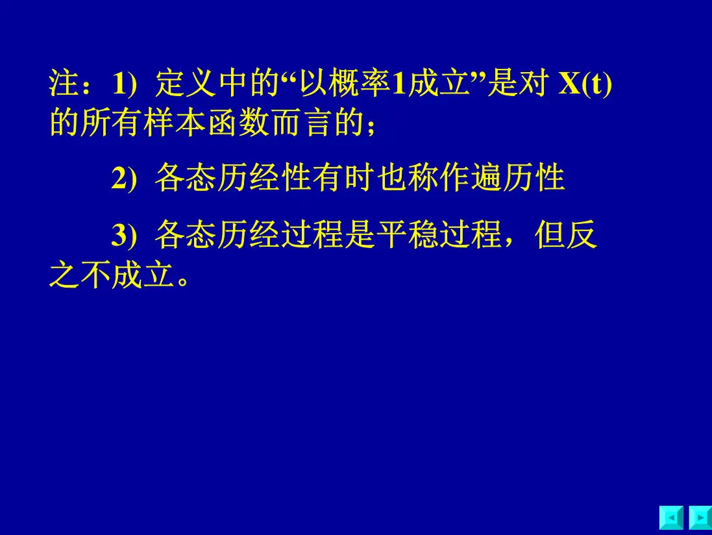

原文：

注：1) 定义中的“以概率1成立”是对 X(t)的所有样本函数而言的；

2) 各态历经性有时也称作遍历性

3) 各态历经过程是平稳过程，但反之不成立。

### 例 随机相位正弦波是否为各态历经的？

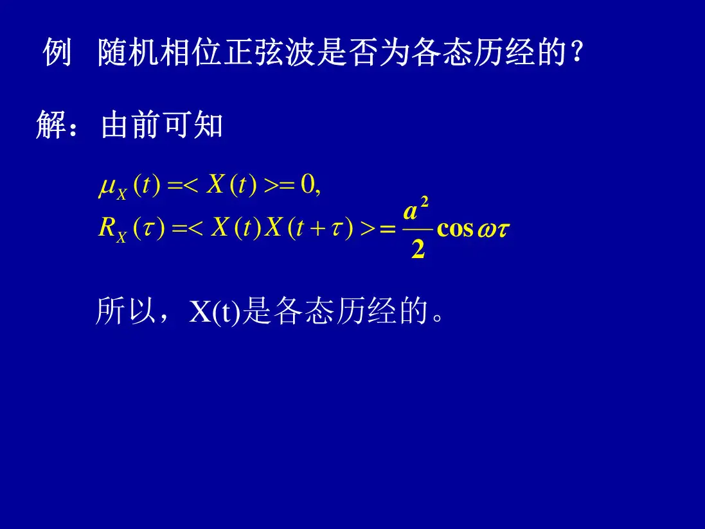

原文：

例 随机相位正弦波是否为各态历经的？

解：由前可知

$$
\begin{array}{l} \mu_ {X} (t) = <   X (t) > = 0, \\ R _ {X} (\tau) = <   X (t) X (t + \tau) > = \frac {a ^ {2}}{2} \cos \omega \tau \end{array}
$$

所以，X(t)是各态历经的。

### 于是 $\neq E(X(t))$

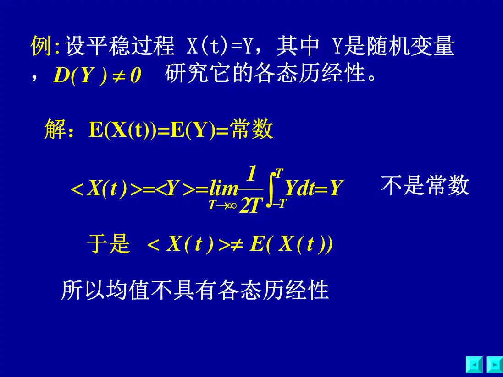

原文：

例:设平稳过程 X(t)=Y，其中 Y是随机变量，D(Y)≠0 研究它的各态历经性。

解： $\mathrm{E}(\mathrm{X}(t)) = \mathrm{E}(\mathrm{Y}) = \text{常数}$

$<X(t)>=<Y>=\lim_{T\to\infty}\frac{1}{2T}\int_{-T}^{T}Ydt=Y$ 不是常数

于是 $< X(t) > \neq E(X(t))$

所以均值不具有各态历经性

### 数，A与B为相互独立的随机变量，且

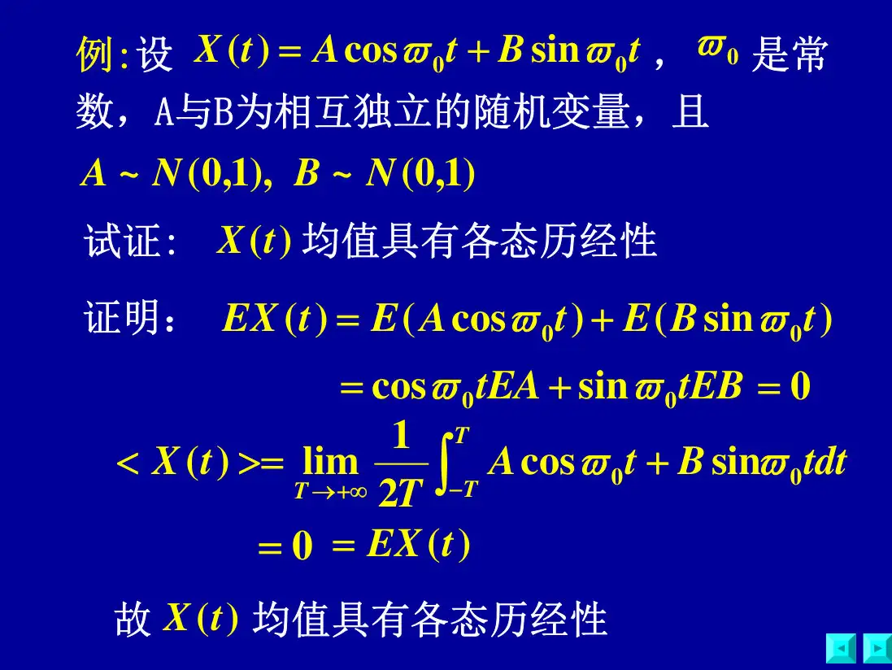

原文：

例:设 $X(t)=A\cos\varpi_{0}t+B\sin\varpi_{0}t$ ， $\varpi_{0}$ 是常

数，A与B为相互独立的随机变量，且

$$
A \sim N (0, 1), B \sim N (0, 1)
$$

试证: $X(t)$ 均值具有各态历经性

$$
E X (t) = E \left(A \cos \varpi_ {0} t\right) + E \left(B \sin \varpi_ {0} t\right)
$$

$$
= \cos \varpi_ {0} t E A + \sin \varpi_ {0} t E B = 0
$$

$$
\begin{array}{r l} <   X (t) > = & \lim _ {T \to + \infty} \frac {1}{2 T} \int_ {- T} ^ {T} A \cos \varpi_ {0} t + B \sin \varpi_ {0} t d t \\ = & 0 = E X (t) \end{array}
$$

故 $X(t)$ 均值具有各态历经性

### 平稳过程在什么条件下才是各态历经的呢？

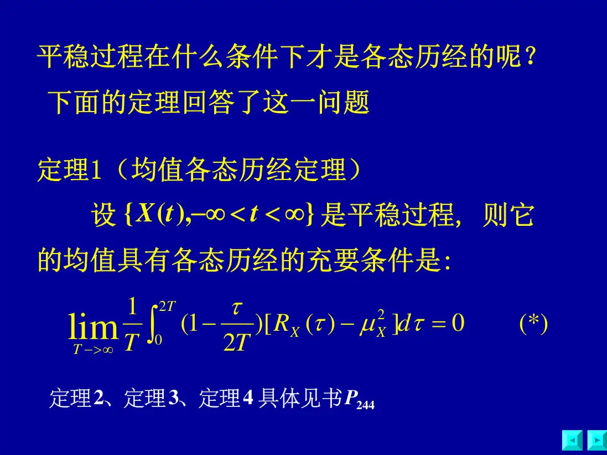

原文：

平稳过程在什么条件下才是各态历经的呢？

下面的定理回答了这一问题

定理1（均值各态历经定理）

设 $\{X(t), -\infty < t < \infty\}$ 是平稳过程，则它的均值具有各态历经的充要条件是：

$\lim_{T \to \infty} \frac{1}{T} \int_{0}^{2T} (1 - \frac{\tau}{2T}) [R_X(\tau) - \mu_X^2] d\tau = 0$ (\*)

定理2、定理3、定理4具体见书 $P_{244}$ 例题1、设 $X(t)$ 平稳过程，已知 $\mu_{X}(t)=0, R_{X}(\tau)=e^{-a|\tau|}$ ，问 $X(t)$ 的均值是否具有各态历经性？

### $$

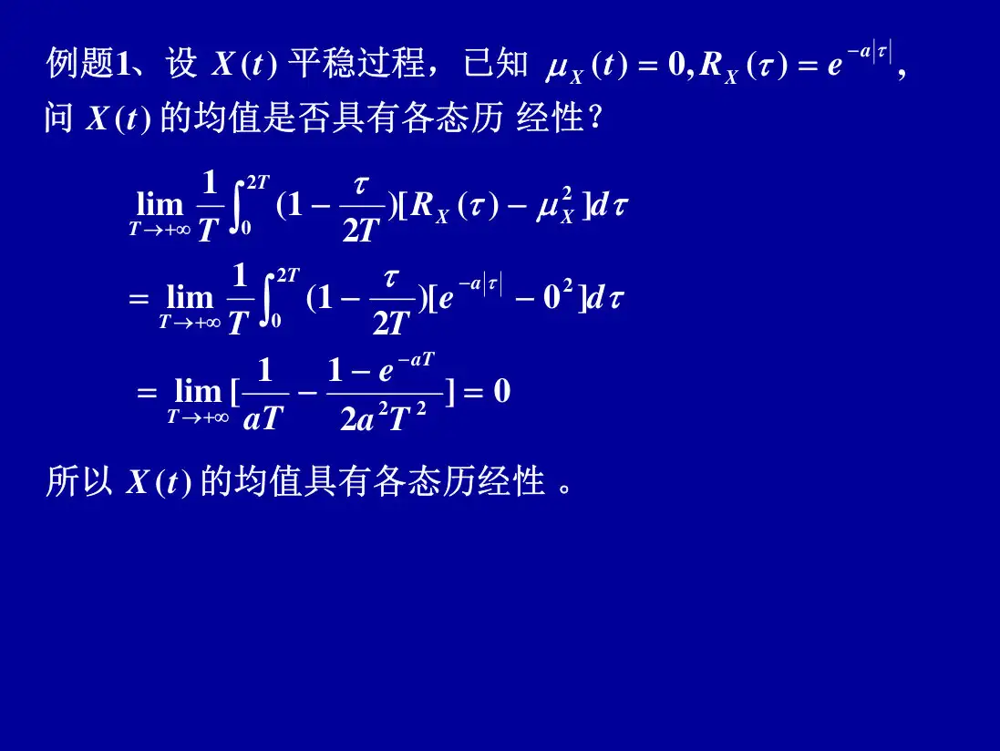

原文：

$$
\begin{array}{l} \lim _ {T \to + \infty} \frac {1}{T} \int_ {0} ^ {2 T} (1 - \frac {\tau}{2 T}) [ R _ {X} (\tau) - \mu_ {X} ^ {2} ] d \tau \\ = \lim _ {T \to + \infty} \frac {1}{T} \int_ {0} ^ {2 T} (1 - \frac {\tau}{2 T}) [ e ^ {- a | \tau |} - 0 ^ {2} ] d \tau \\ = \lim _ {T \to + \infty} [ \frac {1}{a T} - \frac {1 - e ^ {- a T}}{2 a ^ {2} T ^ {2}} ] = 0 \end{array}
$$

所以 $X(t)$ 的均值具有各态历经性。
