# 《概率论与数理统计》第11章 平稳随机过程相关函数性质及谱密度（课件）

原件的每一页，下面附识别出的文字。

### 11.2 平稳过程相关函数性质

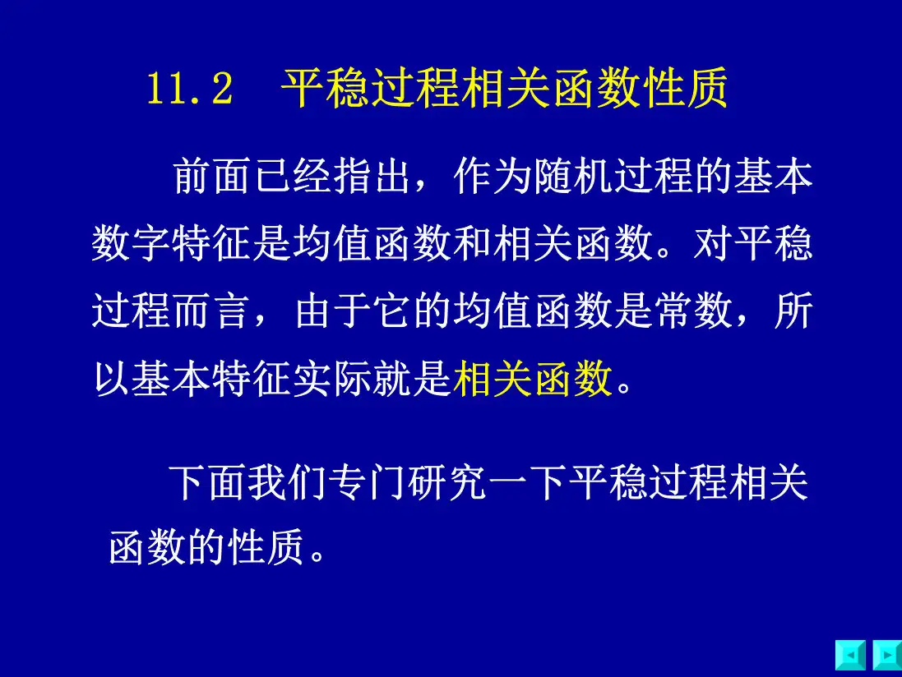

原文：

11.2 平稳过程相关函数性质

前面已经指出，作为随机过程的基本数字特征是均值函数和相关函数。对平稳过程而言，由于它的均值函数是常数，所以基本特征实际就是相关函数。

下面我们专门研究一下平稳过程相关函数的性质。

### $\{X(t),t\in T\}$ 是一个平稳过程:

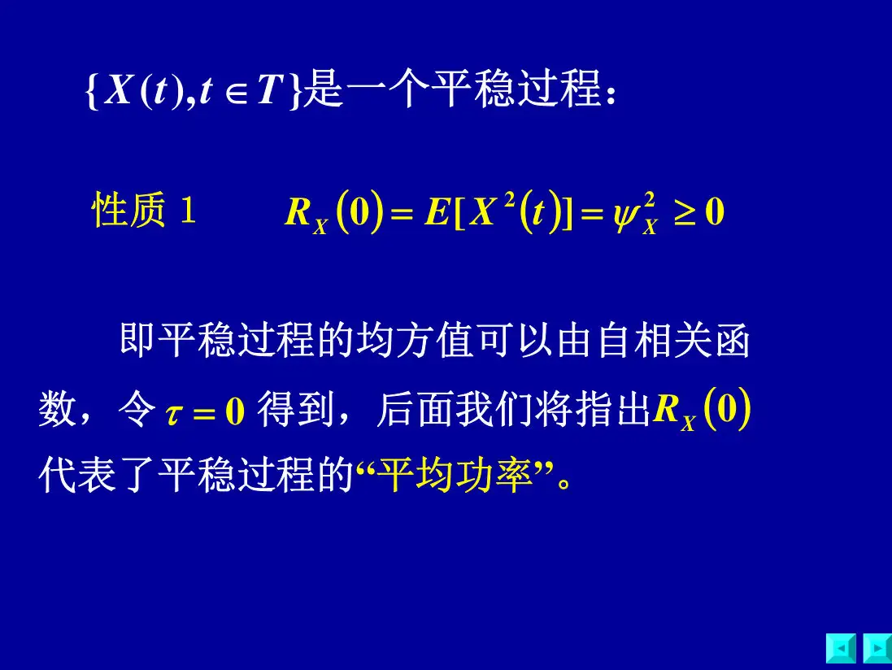

原文：

$\{X(t),t\in T\}$ 是一个平稳过程:

性质 1

$$
R _ {X} (0) = E [ X ^ {2} (t) ] = \psi_ {X} ^ {2} \geq 0
$$

即平稳过程的均方值可以由自相关函数，令 $\tau = 0$ 得到，后面我们将指出 $R_{X}(0)$ 代表了平稳过程的“平均功率”。

### 性质 2 $R_{X}(\tau)$ 是偶函数，即满足

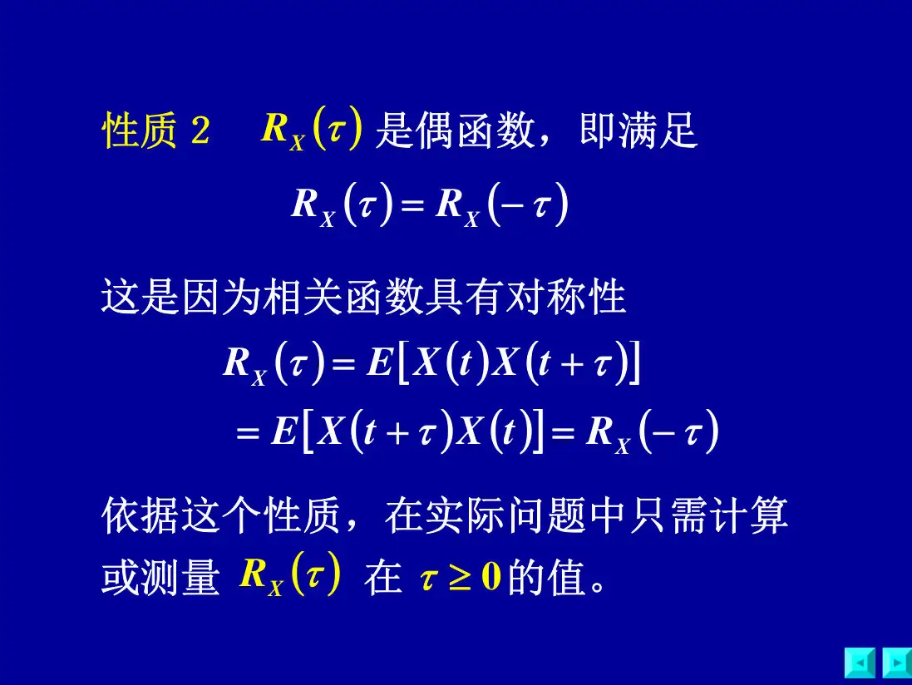

原文：

性质 2 $R_{X}(\tau)$ 是偶函数，即满足

$$
R _ {X} (\tau) = R _ {X} (- \tau)
$$

这是因为相关函数具有对称性 $R_{X}(\tau) = E[X(t)X(t + \tau)]$ $= E[X(t + \tau)X(t)] = R_{X}(-\tau)$ 依据这个性质，在实际问题中只需计算或测量 $R_{X}(\tau)$ 在 $\tau \geq 0$ 的值。

### $$

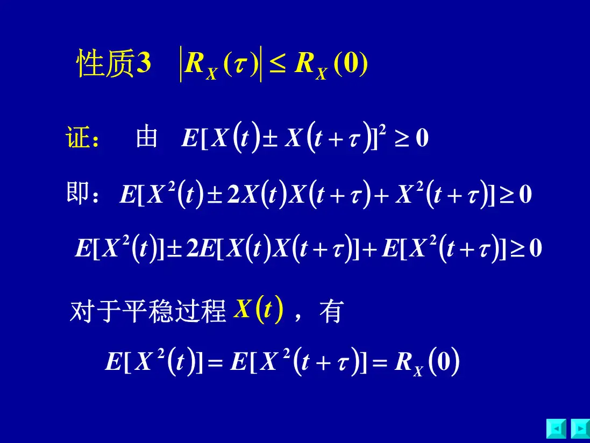

原文：

性质3 $\left|R_{X}(\tau)\right|\leq R_{X}(0)$

证: 由 $E[X(t) \pm X(t + \tau)]^{2} \geq 0$

即： $E[X^{2}(t)\pm2X(t)X(t+\tau)+X^{2}(t+\tau)]\geq0$

$$
E [ X ^ {2} (t) ] \pm 2 E [ X (t) X (t + \tau) ] + E [ X ^ {2} (t + \tau) ] \geq 0
$$

对于平稳过程 $X(t)$ ，有

$$
E [ X ^ {2} (t) ] = E [ X ^ {2} (t + \tau) ] = R _ {X} (0)
$$

### 代入上述不等式得:

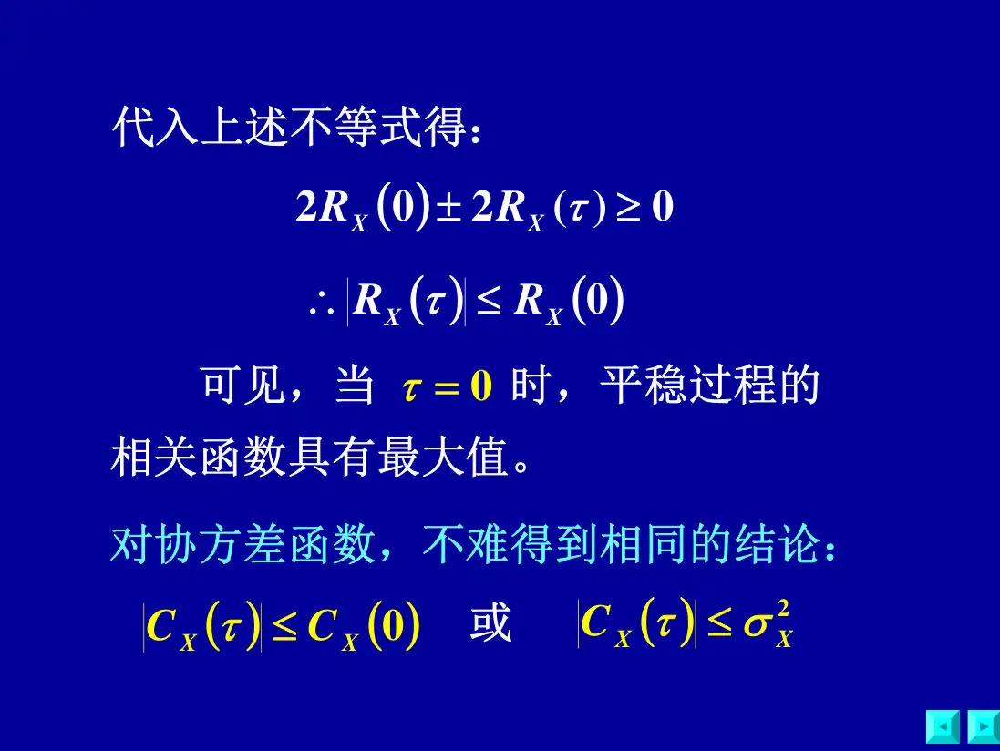

原文：

代入上述不等式得:

$$
2 R _ {X} (0) \pm 2 R _ {X} (\tau) \geq 0
$$

$$
\therefore \left| R _ {X} (\tau) \right| \leq R _ {X} (0)
$$

可见，当 $\tau = 0$ 时，平稳过程的相关函数具有最大值。

对协方差函数，不难得到相同的结论：

$|C_X(\tau)| \leq C_X(0)$ 或 $|C_X(\tau)| \leq \sigma_X^2$

### $$

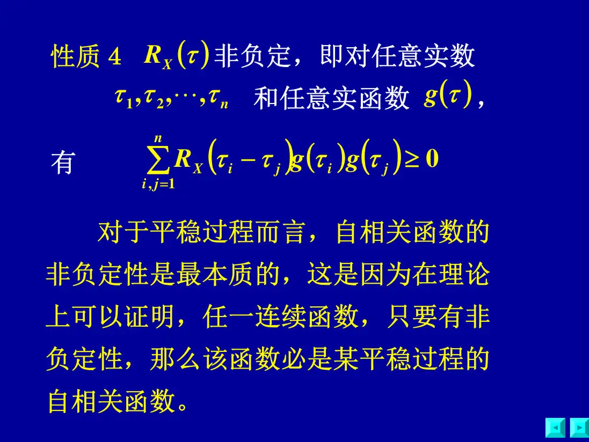

原文：

$$
R _ {X} (\tau)
$$

$$
\tau_ {1}, \tau_ {2}, \dots , \tau_ {n}
$$

有

$$
\sum_ {i, j = 1} ^ {n} R _ {X} (\tau_ {i} - \tau_ {j}) g (\tau_ {i}) g (\tau_ {j}) \geq 0
$$

对于平稳过程而言，自相关函数的非负定性是最本质的，这是因为在理论上可以证明，任一连续函数，只要有非负定性，那么该函数必是某平稳过程的自相关函数。

### 性质 5 若平稳过程 $X(t)$ 满足条件:

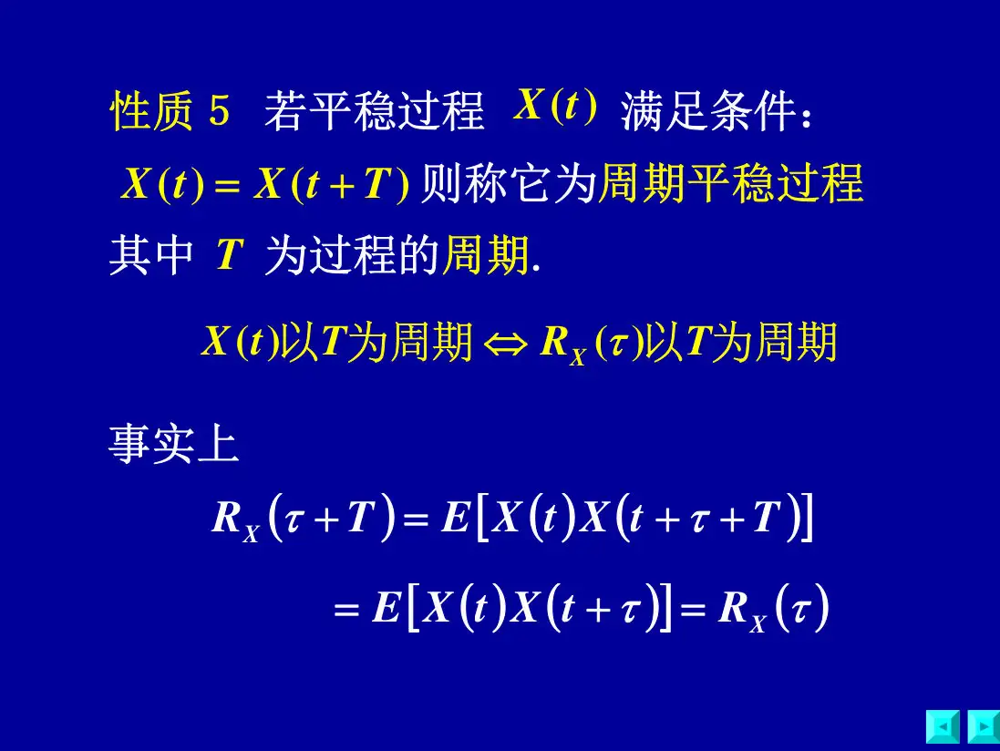

原文：

性质 5 若平稳过程 $X(t)$ 满足条件:

$X(t)=X(t+T)$ 则称它为周期平稳过程其中 T 为过程的周期.

$X(t)$ 以T为周期 $\Leftrightarrow R_{X}(\tau)$ 以T为周期

事实上

$R_{X}(\tau +T) = E\bigl [X(t)X(t + \tau +T)\bigr ]\\ = E\bigl [X(t)X(t + \tau)\bigr ] = R_{X}(\tau)$

### 11.4 平稳随机过程的功率谱密度

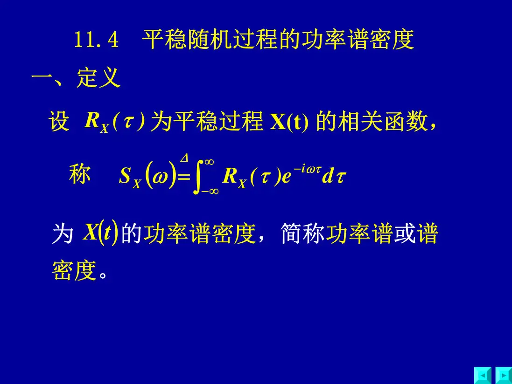

原文：

11.4 平稳随机过程的功率谱密度

一、定义

设 $R_{X}(\tau)$ 为平稳过程 X(t) 的相关函数，

称 $S_{X}(\omega)=\int_{-\infty}^{\infty}R_{X}(\tau)e^{-i\omega\tau}d\tau$

为 $X(t)$ 的功率谱密度，简称功率谱或谱密度。

### $$

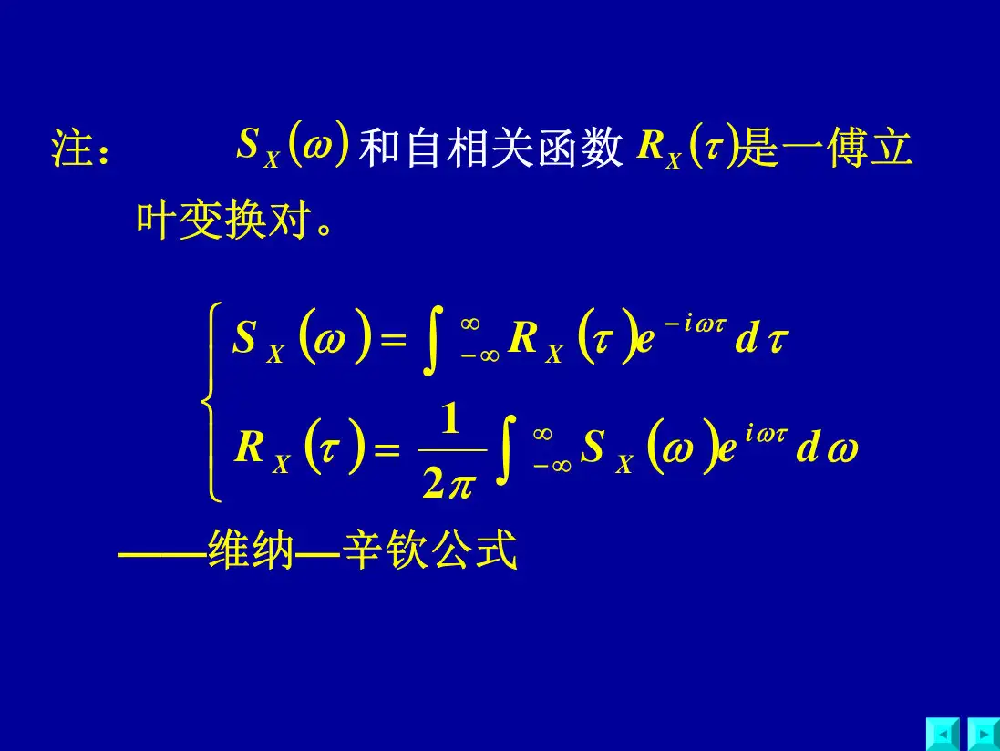

原文：

注: $S_{X}(\omega)$ 和自相关函数 $R_{X}(\tau)$ 是一傅立叶变换对。

$$
S _ {X} (\omega) = \int_ {- \infty} ^ {\infty} R _ {X} (\tau) e ^ {- i \omega \tau} d \tau
$$

$$
R _ {X} (\tau) = \frac {1}{2 \pi} \int_ {- \infty} ^ {\infty} S _ {X} (\omega) e ^ {i \omega \tau} d \omega
$$

——维纳—辛钦公式

### $$

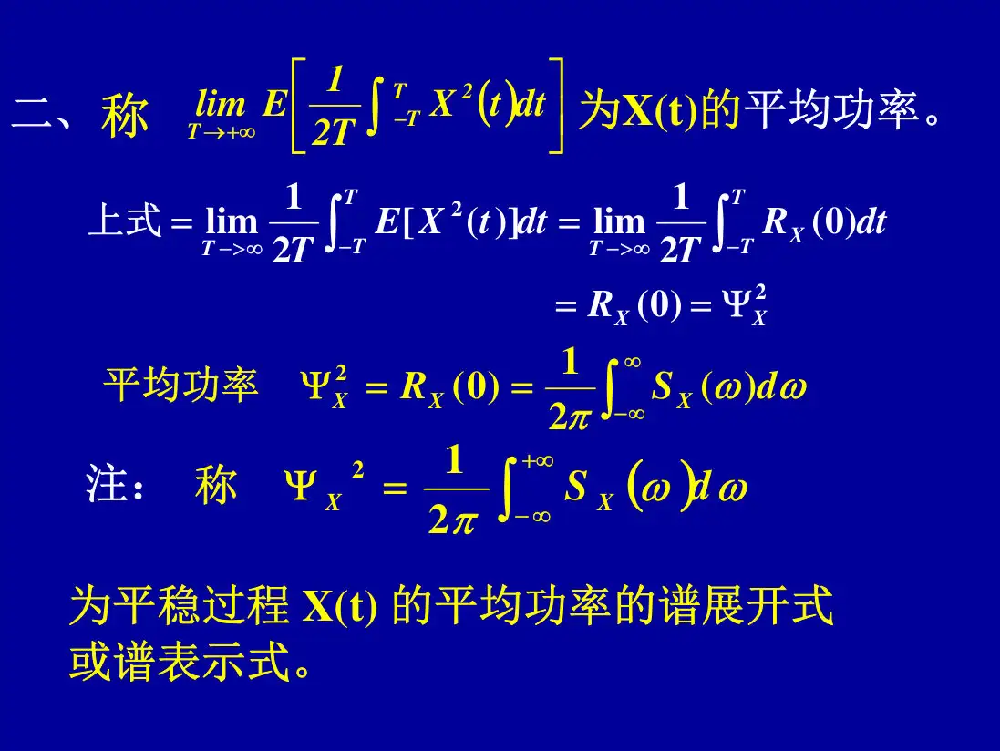

原文：

二、称 $\lim_{T\to+\infty}E\left[\frac{1}{2T}\int_{-T}^{T}X^{2}(t)dt\right]$ 为 $X(t)$ 的平均功率。

$$
\begin{array}{r l}\text {上式}&= \lim _ {T \rightarrow \infty} \frac {1}{2 T} \int_ {- T} ^ {T} E [ X ^ {2} (t) ] d t = \lim _ {T \rightarrow \infty} \frac {1}{2 T} \int_ {- T} ^ {T} R _ {X} (0) d t\\&= R _ {X} (0) = \Psi_ {X} ^ {2}\end{array}
$$

平均功率 $\Psi_X^2 = R_X(0) = \frac{1}{2\pi}\int_{-\infty}^{\infty}S_X(\omega)d\omega$

注：称 $\Psi_{X}^{2} = \frac{1}{2\pi}\int_{-\infty}^{+\infty}S_{X}(\omega)d\omega$

为平稳过程 X(t) 的平均功率的谱展开式或谱表示式。

### 三、功率谱密度的性质

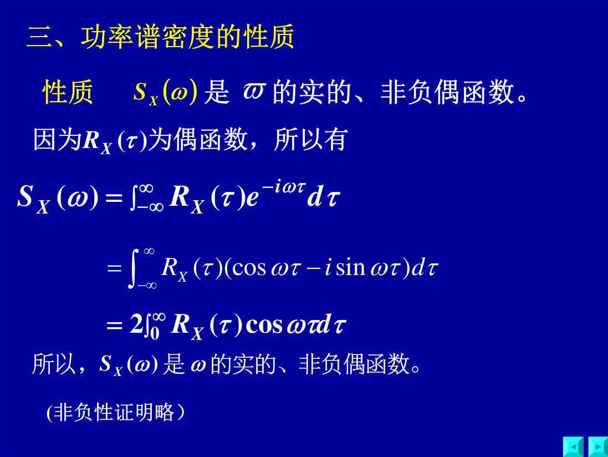

原文：

三、功率谱密度的性质

性质 $S_{X}(\omega)$ 是 $\varpi$ 的实的、非负偶函数。因为 $R_{X}(\tau)$ 为偶函数，所以有 $S_{X}(\omega) = \int_{-\infty}^{\infty}R_{X}(\tau)e^{-i\omega \tau}d\tau$ $= \int_{-\infty}^{\infty}R_{X}(\tau)(\cos \omega \tau -i\sin \omega \tau)d\tau$ $= 2\int_0^\infty R_X(\tau)\cos \omega \tau d\tau$ 所以， $S_{X}(\omega)$ 是 $\omega$ 的实的、非负偶函数。（非负性证明略）

### 四、具有下列性质的函数称为 $\delta$ 函数

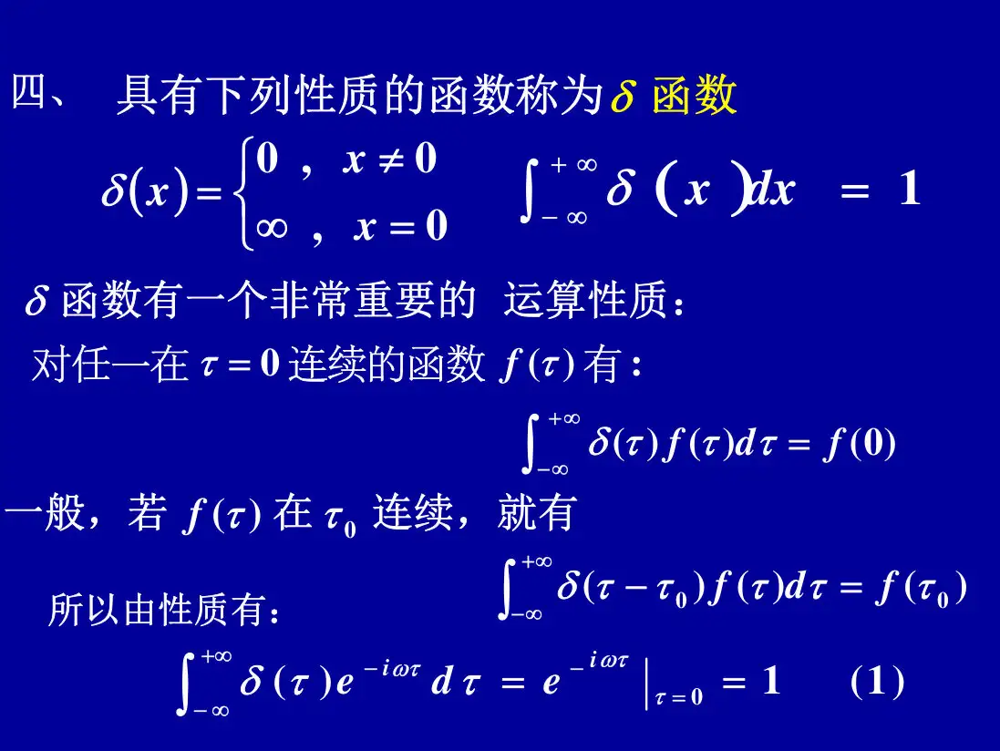

原文：

四、具有下列性质的函数称为 $\delta$ 函数

$$
\delta (x) = \left\{ \begin{array}{l l} 0, & x \neq 0 \\ \infty , & x = 0 \end{array} \right. \quad \int_ {- \infty} ^ {+ \infty} \delta (x) d x = 1
$$

$\delta$ 函数有一个非常重要的 运算性质: 对任一在 $\tau = 0$ 连续的函数 $f(\tau)$ 有:

$$
\int_ {- \infty} ^ {+ \infty} \delta (\tau) f (\tau) d \tau = f (0)
$$

一般，若 $f(\tau)$ 在 $\tau_0$ 连续，就有

所以由性质有:

$$
\int_ {- \infty} ^ {+ \infty} \delta (\tau - \tau_ {0}) f (\tau) d \tau = f (\tau_ {0})
$$

$$
\int_ {- \infty} ^ {+ \infty} \delta (\tau) e ^ {- i \omega \tau} d \tau = e ^ {- i \omega \tau} \Big | _ {\tau = 0} = 1 (1)
$$

### $$

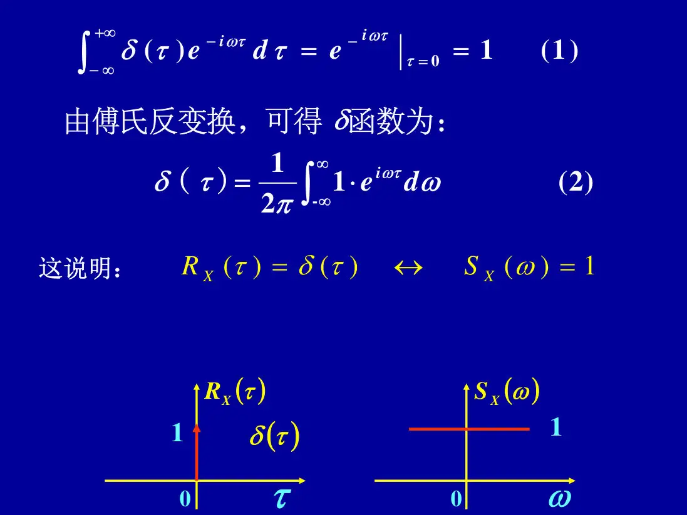

原文：

$$
\int_ {- \infty} ^ {+ \infty} \delta (\tau) e ^ {- i \omega \tau} d \tau = e ^ {- i \omega \tau} \big | _ {\tau = 0} = 1 (1)
$$

由傅氏反变换，可得 $\delta$ 函数为：

$$
\delta (\tau) = \frac {1}{2 \pi} \int_ {- \infty} ^ {\infty} 1 \cdot e ^ {i \omega \tau} d \omega\tag{2}
$$

$$
\text {这说明:} \quad R _ {X} (\tau) = \delta (\tau) \quad \leftrightarrow \quad S _ {X} (\omega) = 1
$$

$$
\begin{array}{r l} & \text {   R } _ {X} (\tau) \\ & \delta (\tau) \\ & 0 \quad \tau \\ & S _ {X} (\omega) \\ & 1 \end{array}
$$

### 第 14 页

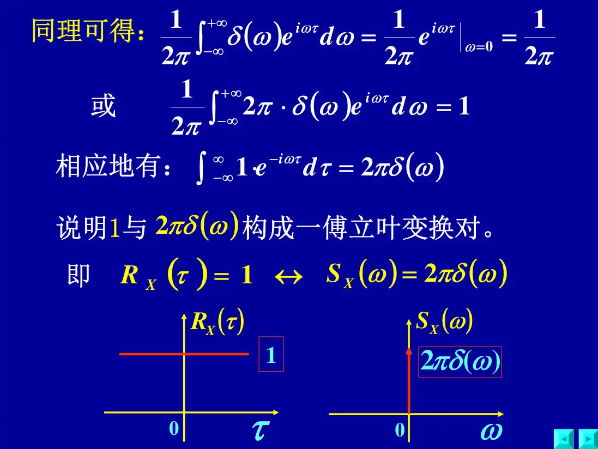

原文：

同理可得: $\frac{1}{2\pi}\int_{-\infty}^{+\infty}\delta(\omega)e^{i\omega\tau}d\omega=\frac{1}{2\pi}e^{i\omega\tau}\bigg|_{\omega=0}=\frac{1}{2\pi}$ 或 $\frac{1}{2\pi}\int_{-\infty}^{+\infty}2\pi\cdot\delta(\omega)e^{i\omega\tau}d\omega=1$ 相应地有: $\int_{-\infty}^{\infty}1\cdot e^{-i\omega\tau}d\tau=2\pi\delta(\omega)$ 说明1与 $2\pi\delta(\omega)$ 构成一傅立叶变换对。

即 $R_X(\tau)=1 \leftrightarrow S_X(\omega)=2\pi\delta(\omega)$ $R_X(\tau)$ $S_X(\omega)$ $2\pi\delta(\omega)$

### 其余结果见 $P_{255}$ ，主要是1，5，6，7

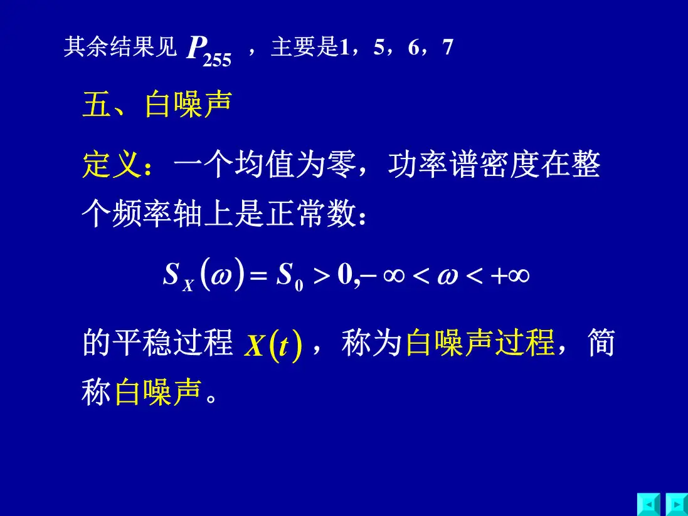

原文：

其余结果见 $P_{255}$ ，主要是1，5，6，7

五、白噪声

定义: 一个均值为零, 功率谱密度在整个频率轴上是正常数:

$$
S _ {X} (\omega) = S _ {0} > 0, - \infty <   \omega <   + \infty
$$

的平稳过程 $X(t)$ ，称为白噪声过程，简称白噪声。

### 第 16 页

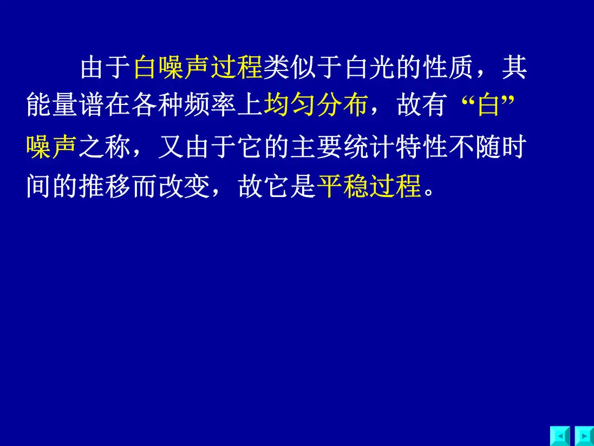

原文：

由于白噪声过程类似于白光的性质，其能量谱在各种频率上均匀分布，故有“白”噪声之称，又由于它的主要统计特性不随时间的推移而改变，故它是平稳过程。

### 求 $X(t)$ 的平均功率。

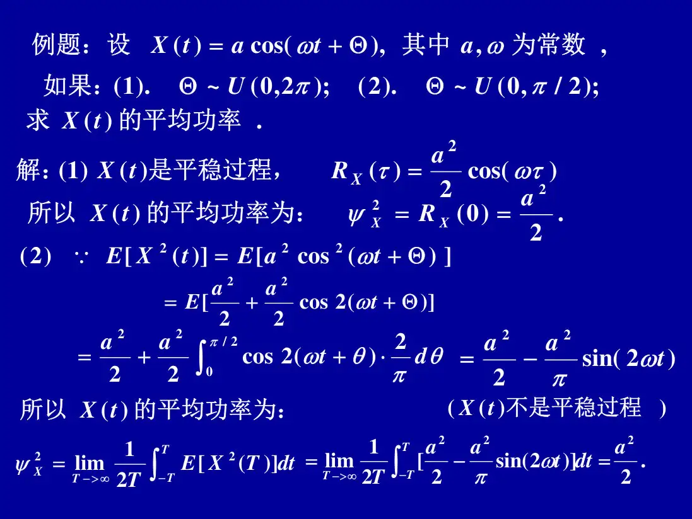

原文：

例题：设 $X(t)=a\cos(\omega t+\Theta)$ ，其中 $a,\omega$ 为常数，
如果：(1). $\Theta\sim U(0,2\pi)$ ; (2). $\Theta\sim U(0,\pi/2)$ ;
求 $X(t)$ 的平均功率。
解：(1) $X(t)$ 是平稳过程， $R_{X}(\tau)=\frac{a^{2}}{2}\cos(\omega\tau)$ 所以 $X(t)$ 的平均功率为： $\psi_{X}^{2}=R_{X}(0)=\frac{a^{2}}{2}$ .
(2) $\because E[X^{2}(t)]=E[a^{2}\cos^{2}(\omega t+\Theta)]$ $=E[\frac{a^{2}}{2}+\frac{a^{2}}{2}\cos2(\omega t+\Theta)]$ $=\frac{a^{2}}{2}+\frac{a^{2}}{2}\int_{0}^{\pi/2}\cos2(\omega t+\theta)\cdot\frac{2}{\pi}d\theta=\frac{a^{2}}{2}-\frac{a^{2}}{\pi}\sin(2\omega t)$ 所以 $X(t)$ 的平均功率为： $(X(t)$ 不是平稳过程例：已知平稳过程 $X(t)$ 具有如下功率谱密度： $S_{X}(\omega)=\frac{1}{\omega^{4}+5\omega^{2}+4}$ 求平稳过程相关函数及平均功率。
解：直接用傅立叶变换法求相关函数
通常先把 $S_{X}(\omega)$ 化成部分分式后，再求原函数。 $S_{X}(\omega)=\frac{1}{3}\left(\frac{1}{\omega^{2}+1}-\frac{1}{\omega^{2}+4}\right)$

### 第 18 页

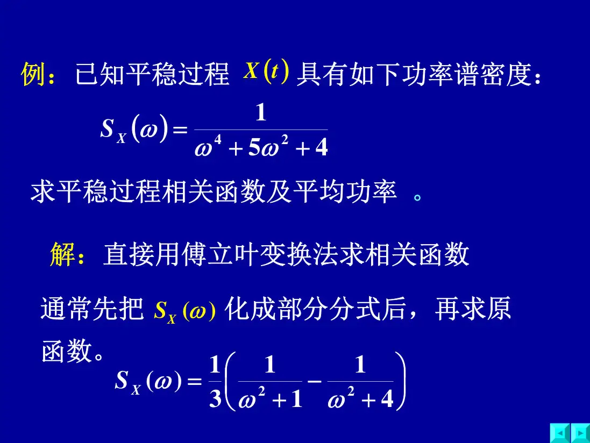

### $$

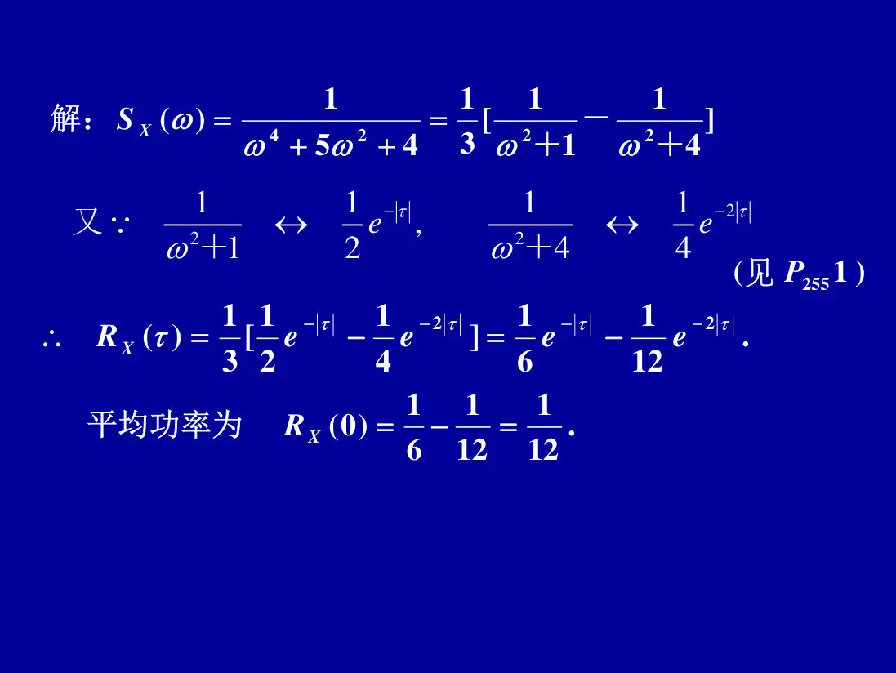

原文：

解： $S_{X}(\omega) = \frac{1}{\omega^{4} + 5\omega^{2} + 4} = \frac{1}{3} [\frac{1}{\omega^{2} + 1} -\frac{1}{\omega^{2} + 4} ]$

$$
\text {又} \because \frac {1}{\omega^ {2} + 1} \leftrightarrow \frac {1}{2} e ^ {- | \tau |}, \quad \frac {1}{\omega^ {2} + 4} \leftrightarrow \frac {1}{4} e ^ {- 2 | \tau |}
$$

(见 $P_{255}1$ )

$$
\therefore R _ {X} (\tau) = \frac {1}{3} [ \frac {1}{2} e ^ {- | \tau |} - \frac {1}{4} e ^ {- 2 | \tau |} ] = \frac {1}{6} e ^ {- | \tau |} - \frac {1}{1 2} e ^ {- 2 | \tau |}.
$$

平均功率为 $R_{X}(0) = \frac{1}{6} -\frac{1}{12} = \frac{1}{12}.$

### 例：设平稳随机过程 $X(t)$ 的功率谱密度为：

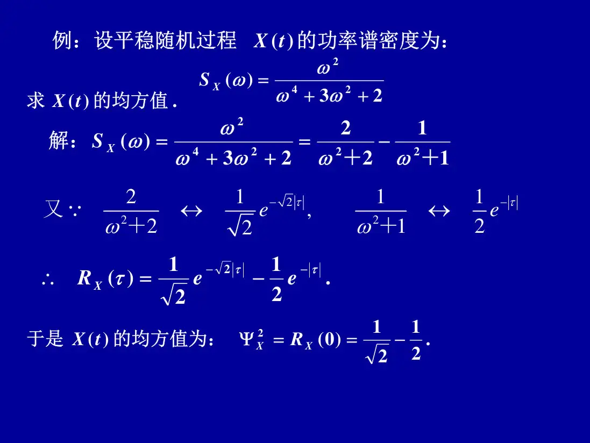

原文：

例：设平稳随机过程 $X(t)$ 的功率谱密度为：

$$
S _ {X} (\omega) = \frac {\omega^ {2}}{\omega^ {4} + 3 \omega^ {2} + 2}
$$

求 $X(t)$ 的均方值.

解： $S_{X}(\omega) = \frac{\omega^{2}}{\omega^{4} + 3\omega^{2} + 2} = \frac{2}{\omega^{2} + 2} -\frac{1}{\omega^{2} + 1}$

$$
\text {又} \because \frac {2}{\omega^ {2} + 2} \leftrightarrow \frac {1}{\sqrt {2}} e ^ {- \sqrt {2} | \tau |}, \quad \frac {1}{\omega^ {2} + 1} \leftrightarrow \frac {1}{2} e ^ {- | \tau |}
$$

$$
\therefore R _ {X} (\tau) = \frac {1}{\sqrt {2}} e ^ {- \sqrt {2} | \tau |} - \frac {1}{2} e ^ {- | \tau |}.
$$

于是 $X(t)$ 的均方值为： $\Psi_{X}^{2}=R_{X}(0)=\frac{1}{\sqrt{2}}-\frac{1}{2}.$

### 第 21 页

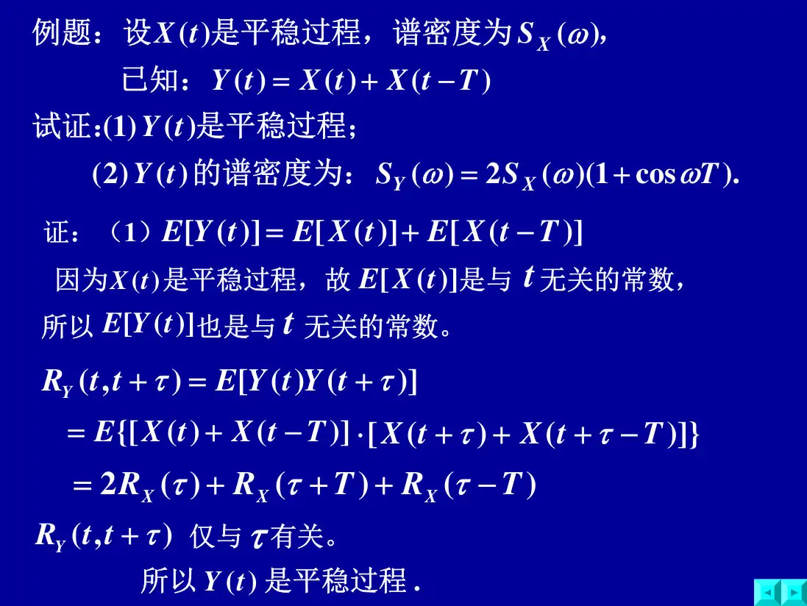

原文：

例题：设 $X(t)$ 是平稳过程，谱密度为 $S_{X}(\omega)$ ，已知： $Y(t) = X(t) + X(t - T)$ 试证：(1) $Y(t)$ 是平稳过程；(2) $Y(t)$ 的谱密度为： $S_{Y}(\omega) = 2S_{X}(\omega)(1 + \cos \omega T)$ . 证：（1） $E[Y(t)] = E[X(t)] + E[X(t - T)]$ 因为 $X(t)$ 是平稳过程，故 $E[X(t)]$ 是与 $t$ 无关的常数，所以 $E[Y(t)]$ 也是与 $t$ 无关的常数。 $R_{Y}(t,t + \tau) = E[Y(t)Y(t + \tau)]$ $= E\{[X(t) + X(t - T)] \cdot [X(t + \tau) + X(t + \tau - T)]\}$ $= 2R_{X}(\tau) + R_{X}(\tau + T) + R_{X}(\tau - T)$ $R_{Y}(t,t + \tau)$ 仅与 $\tau$ 有关。所以 $Y(t)$ 是平稳过程。

### $$

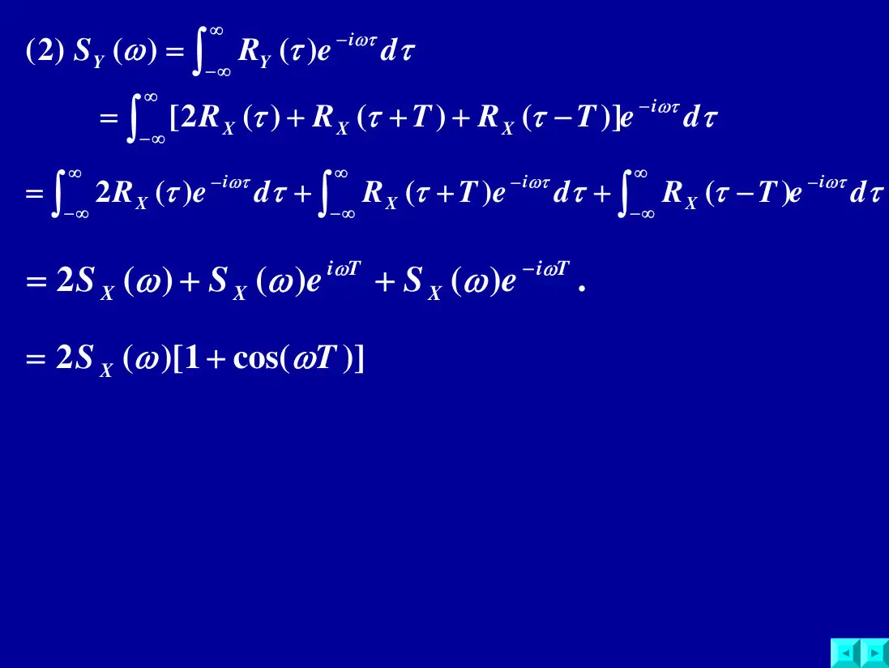

原文：

$$
\begin{array}{r l} & {(2) S _ {Y} (\omega) = \int_ {- \infty} ^ {\infty} R _ {Y} (\tau) e ^ {- i \omega \tau} d \tau} \\ & {\qquad = \int_ {- \infty} ^ {\infty} [ 2 R _ {X} (\tau) + R _ {X} (\tau + T) + R _ {X} (\tau - T) ] e ^ {- i \omega \tau} d \tau} \\ & {= \int_ {- \infty} ^ {\infty} 2 R _ {X} (\tau) e ^ {- i \omega \tau} d \tau + \int_ {- \infty} ^ {\infty} R _ {X} (\tau + T) e ^ {- i \omega \tau} d \tau + \int_ {- \infty} ^ {\infty} R _ {X} (\tau - T) e ^ {- i \omega \tau} d \tau} \\ & {= 2 S _ {X} (\omega) + S _ {X} (\omega) e ^ {i \omega T} + S _ {X} (\omega) e ^ {- i \omega T}.} \\ & {= 2 S _ {X} (\omega) [ 1 + \cos (\omega T) ]} \end{array}
$$

### (1) 证明 $X(t)$ 是平稳过程;

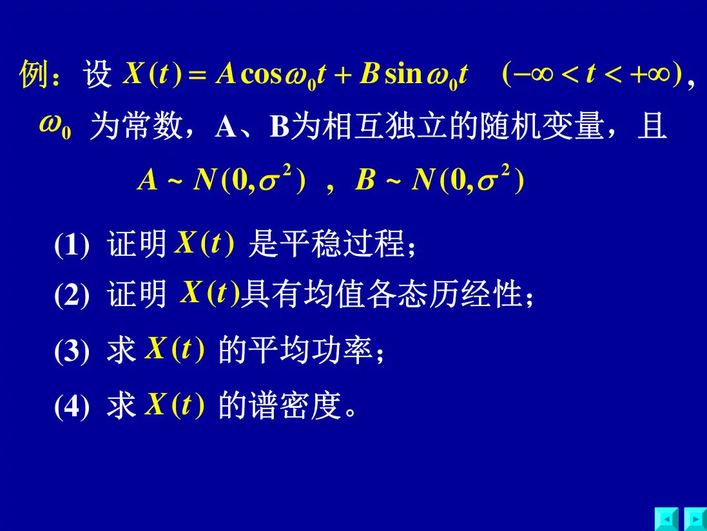

原文：

例：设 $X(t)=A\cos\omega_{0}t+B\sin\omega_{0}t$ $(-∞<t<+\infty)$ , $\omega_{0}$ 为常数，A、B为相互独立的随机变量，且 $A \sim N(0, \sigma^{2})$ ， $B \sim N(0, \sigma^{2})$

(1) 证明 $X(t)$ 是平稳过程;

(2) 证明 $X(t)$ 具有均值各态历经性;

(3) 求 $X(t)$ 的平均功率;

(4) 求 $X(t)$ 的谱密度。

### 第 24 页

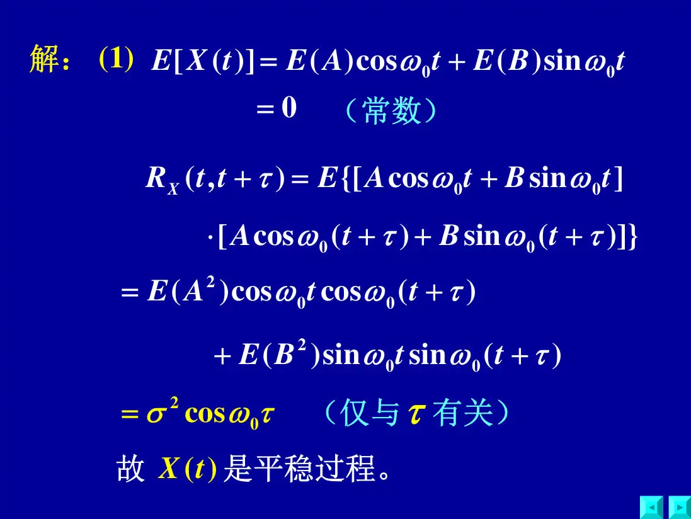

原文：

解：（1） $E[X(t)] = E(A)\cos\omega_{0}t + E(B)\sin\omega_{0}t$ = 0 （常数）

$R_{X}(t,t + \tau) = E\{[A\cos \omega_{0}t + B\sin \omega_{0}t]$ $\cdot [A\cos \omega_0(t + \tau) + B\sin \omega_0(t + \tau)]\}$ $= E(A^2)\cos \omega_0t\cos \omega_0(t + \tau)$ $+E(B^{2})\sin \omega_{0}t\sin \omega_{0}(t + \tau)$ $= \sigma^{2}\cos \omega_{0}\tau$ （仅与 $\pmb{\tau}$ 有关）故 $X(t)$ 是平稳过程。

### 第 25 页

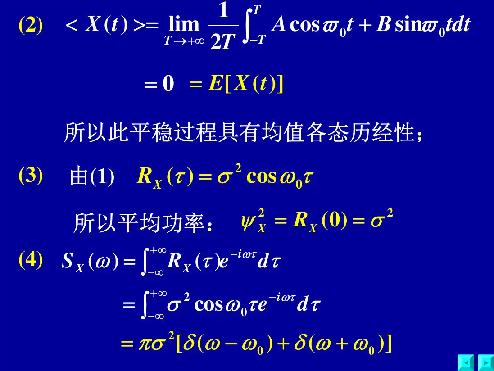

原文：

(2) $< X(t) >= \lim_{T \to +\infty} \frac{1}{2T} \int_{-T}^{T} A \cos \varpi_0 t + B \sin \varpi_0 t dt$ $= 0 = E[X(t)]$ 所以此平稳过程具有均值各态历经性；

(3) 由(1) $R_{X}(\tau) = \sigma^{2}\cos \omega_{0}\tau$

所以平均功率: $\psi_{X}^{2} = R_{X}(0) = \sigma^{2}$

(4) $S_{X}(\omega)=\int_{-\infty}^{+\infty}R_{X}(\tau)e^{-i\omega\tau}d\tau$ $=\int_{-\infty}^{+\infty}\sigma^{2}\cos\omega_{0}\tau e^{-i\omega\tau}d\tau$ $=\pi\sigma^{2}[\delta(\omega-\omega_{0})+\delta(\omega+\omega_{0})]$
