# 《概率论与数理统计》第12章 随机过程及其统计描述（课件）

原件的每一页，下面附识别出的文字。

### 第十二章 随机过程及其统计描述

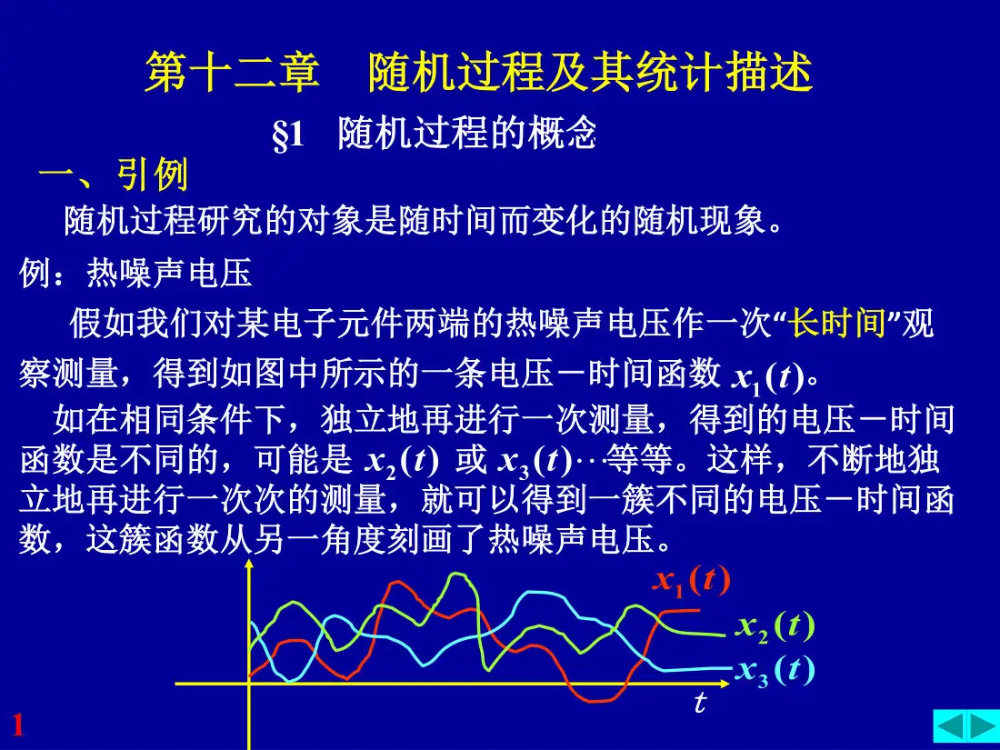

原文：

第十二章 随机过程及其统计描述

§1 随机过程的概念

一、引例

随机过程研究的对象是随时间而变化的随机现象。例：热噪声电压

假如我们对某电子元件两端的热噪声电压作一次“长时间”观察测量，得到如图中所示的一条电压一时间函数 $x_{1}(t)$ 。

如在相同条件下，独立地再进行一次测量，得到的电压一时间函数是不同的，可能是 $x_{2}(t)$ 或 $x_{3}(t)\cdots$ 等等。这样，不断地独立地再进行一次次的测量，就可以得到一簇不同的电压一时间函数，这簇函数从另一角度刻画了热噪声电压。

◀

### 二、随机过程的定义

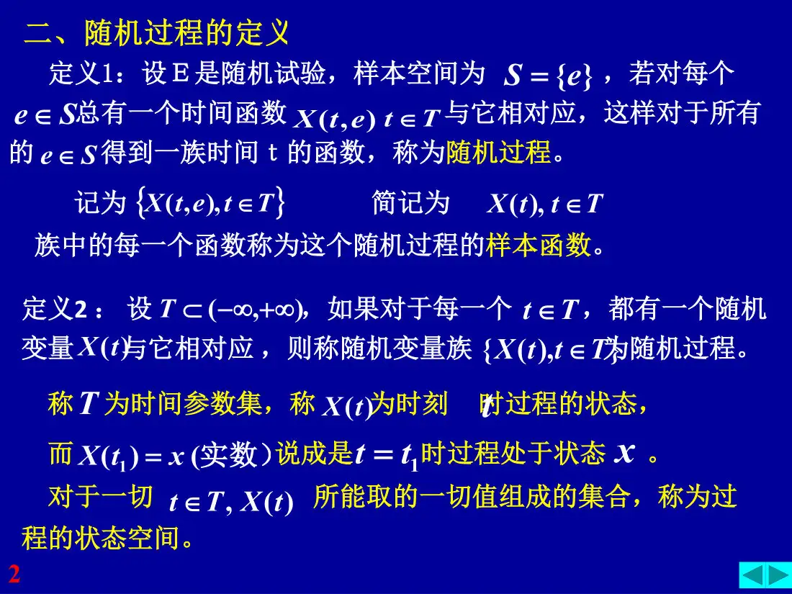

原文：

二、随机过程的定义

定义1：设E是随机试验，样本空间为 $S = \{e\}$ ，若对每个 $e \in S$ 总有一个时间函数 $X(t, e) t \in T$ 与它相对应，这样对于所有的 $e \in S$ 得到一族时间t的函数，称为随机过程。

记为 $\{X(t, e), t \in T\}$ 简记为 $X(t), t \in T$ 族中的每一个函数称为这个随机过程的样本函数。

定义2：设 $T \subset (-\infty, +\infty)$ ，如果对于每一个 $t \in T$ ，都有一个随机变量 $X(t)$ 与它相对应，则称随机变量族 $\{X(t), t \in T\}$ 为随机过程。

称 T 为时间参数集，称 $X(t)$ 为时刻时过程的状态，

而 $X(t_{1})=x$ (实数) 说成是 $t=t_{1}$ 时过程处于状态 x 。

对于一切 $t \in T, X(t)$ 所能取的一切值组成的集合，称为过程的状态空间。

2

◀

### 第 3 页

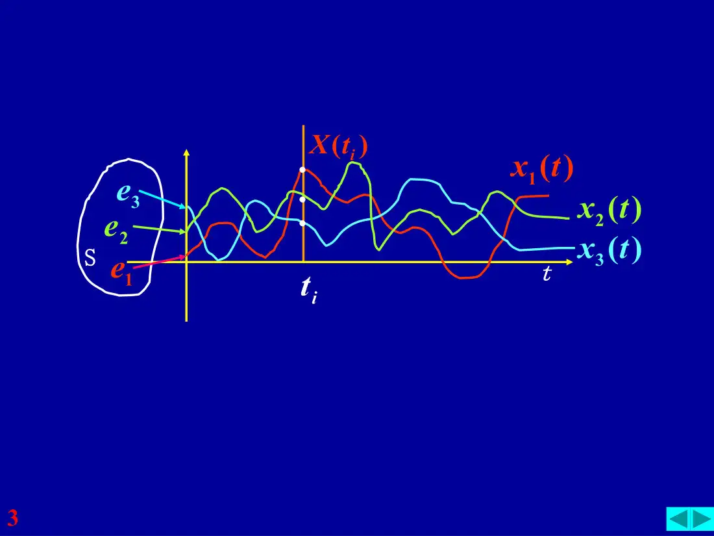

原文：

3

◀

### 三、例题

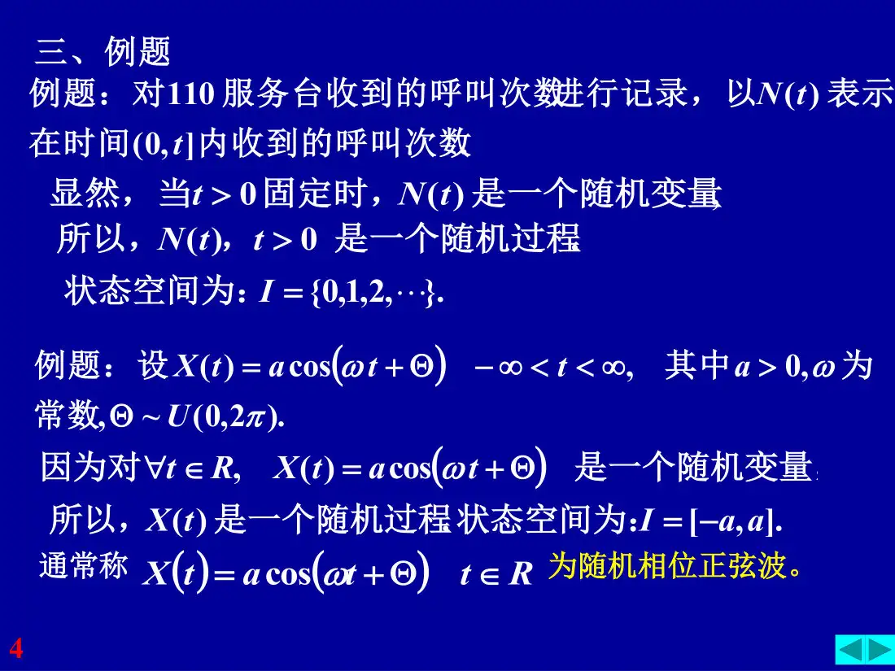

原文：

三、例题
例题：对110服务台收到的呼叫次数进行记录，以 $N(t)$ 表示在时间 $(0,t]$ 内收到的呼叫次数
显然，当t>0固定时， $N(t)$ 是一个随机变量
所以， $N(t)$ ，t>0 是一个随机过程
状态空间为： $I=\{0,1,2,\cdots\}$ .

例题：设 $X(t) = a\cos (\omega t + \Theta)$ $-\infty < t < \infty$ ，其中 $a > 0, \omega$ 为常数, $\Theta \sim U(0,2\pi)$ .

因为对 $\forall t \in R, X(t) = a\cos (\omega t + \Theta)$ 是一个随机变量。所以， $X(t)$ 是一个随机过程状态空间为: $I = [-a, a]$ .

通常称 $X(t) = a\cos (\omega t + \Theta)$ $t \in R$ 为随机相位正弦波。

4

◀

### 例题：利用抛硬币的试验，定义：

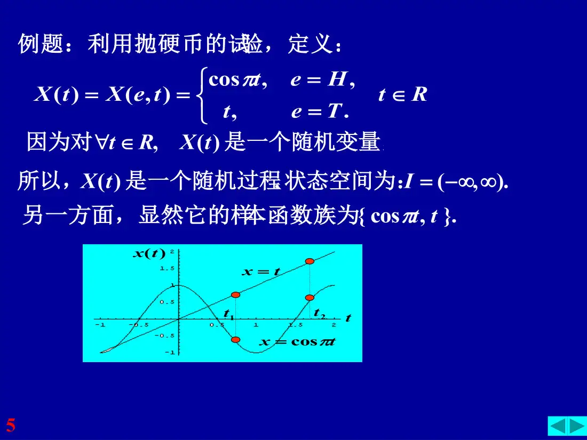

原文：

例题：利用抛硬币的试验，定义：

$X(t)=X(e,t)=\left\{\begin{array}{ll}\cos\pi t,&e=H,\\t,&e=T.\end{array}\right.$ $t\in R$ 因为对 $\forall t \in R,\quad X(t)$ 是一个随机变量
所以， $X(t)$ 是一个随机过程状态空间为： $I=(-\infty,\infty)$ .
另一方面，显然它的样本函数族为 $\{\cos\pi t,t\}$ .

5

◀◀

### 四、随机过程的分类随机过程可以根据其状态空间和参数集的连续或离散进行分类

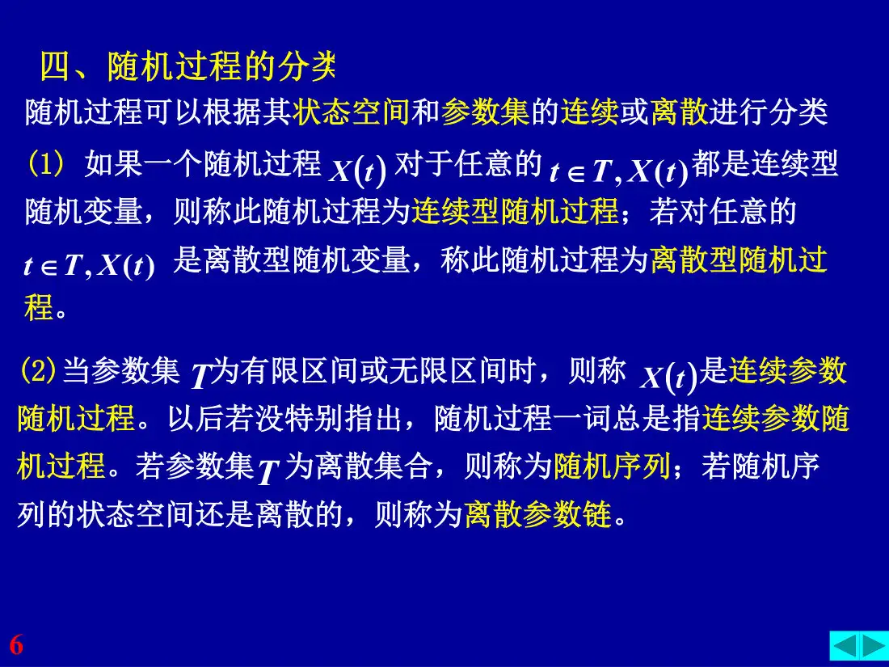

原文：

四、随机过程的分类随机过程可以根据其状态空间和参数集的连续或离散进行分类

(1) 如果一个随机过程 $X(t)$ 对于任意的 $t \in T, X(t)$ 都是连续型随机变量，则称此随机过程为连续型随机过程；若对任意的 $t \in T, X(t)$ 是离散型随机变量，称此随机过程为离散型随机过程。

(2) 当参数集 $T$ 为有限区间或无限区间时, 则称 $X(t)$ 是连续参数随机过程。以后若没特别指出, 随机过程一词总是指连续参数随机过程。若参数集 $T$ 为离散集合, 则称为随机序列; 若随机序列的状态空间还是离散的, 则称为离散参数链。

6

◀

### §2 随机过程的统计描述

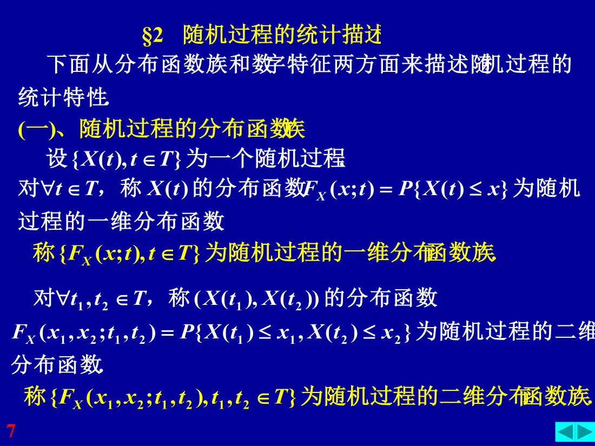

原文：

§2 随机过程的统计描述
下面从分布函数族和数字特征两方面来描述随机过程的统计特性

$$
\{X (t), t \in T \}
$$

$$
\forall t \in T,
$$

$$
F _ {X} (x; t) = P \{X (t) \leq x \}
$$

$$
\{F _ {X} (x; t), t \in T \}
$$

对 $\forall t_{1},t_{2}\in T$ ，称 $(X(t_1),X(t_2))$ 的分布函数

$F_{X}(x_{1},x_{2};t_{1},t_{2}) = P\{X(t_{1})\leq x_{1},X(t_{2})\leq x_{2}\}$ 为随机过程的二维

称 $\{F_{X}(x_{1},x_{2};t_{1},t_{2}),t_{1},t_{2}\in T\}$ 为随机过程的二维分布函数族

◀

### $$

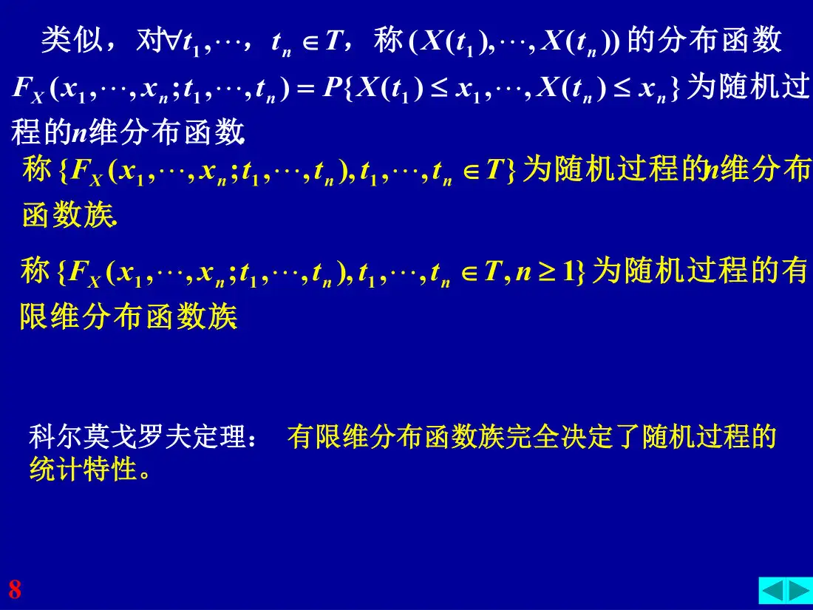

原文：

$$
\not {t} _ {1}, \dots , t _ {n} \in T.
$$

$$
(X (t _ {1}), \dots , X (t _ {n}))
$$

$$
F _ {X} (x _ {1}, \dots , x _ {n}; t _ {1}, \dots , t _ {n}) = P \{X (t _ {1}) \leq x _ {1}, \dots , X (t _ {n}) \leq x _ {n} \}
$$

称 $\{F_{X}(x_{1},\cdots,x_{n};t_{1},\cdots,t_{n}),t_{1},\cdots,t_{n}\in T\}$ 为随机过程的 n 维分布函数族.

称 $\{F_{X}(x_{1},\cdots,x_{n};t_{1},\cdots,t_{n}),t_{1},\cdots,t_{n}\in T,n\geq1\}$ 为随机过程的有限维分布函数族

科尔莫戈罗夫定理：有限维分布函数族完全决定了随机过程的统计特性。

8

◀

### (二)、随机过程的数字特征

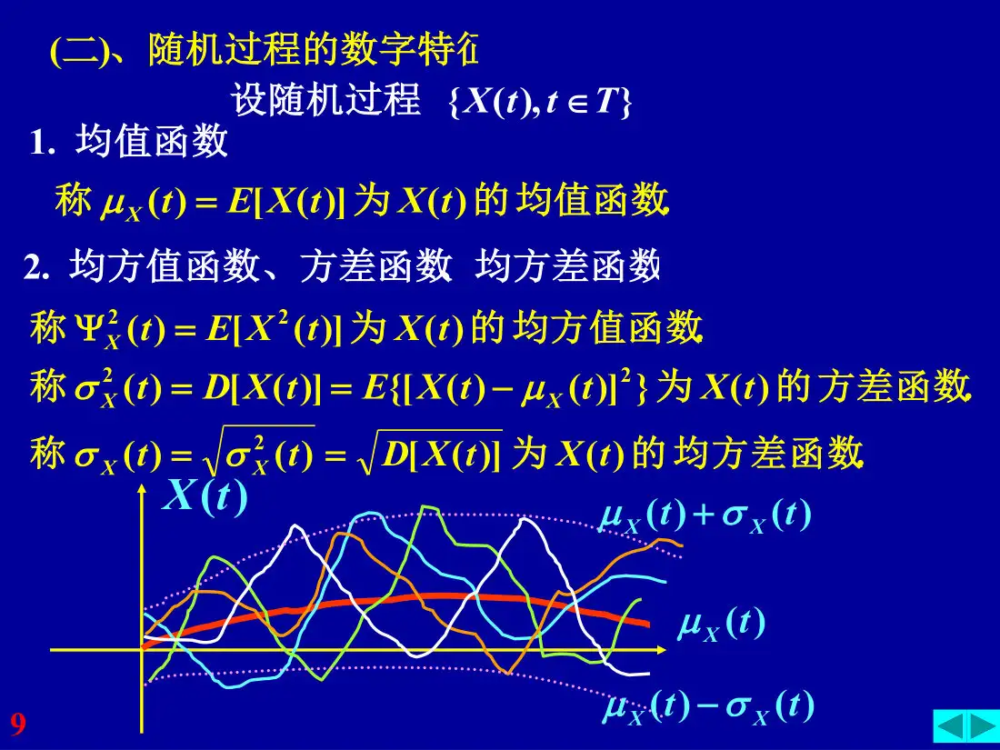

原文：

(二)、随机过程的数字特征
设随机过程 $\{X(t), t \in T\}$

1. 均值函数
称 $\mu_{X}(t)=E[X(t)]$ 为 $X(t)$ 的均值函数。

2. 均方值函数、方差函数 均方差函数
称 $\Psi_{X}^{2}(t)=E[X^{2}(t)]$ 为 $X(t)$ 的均方值函数
称 $\sigma_{X}^{2}(t)=D[X(t)]=E\{[X(t)-\mu_{X}(t)]^{2}\}$ 为 $X(t)$ 的方差函数
称 $\sigma_{X}(t)=\sqrt{\sigma_{X}^{2}(t)}=\sqrt{D[X(t)]}$ 为 $X(t)$ 的均方差函数

$\mu_{X}(t) - \sigma_{X}(t)$

9

◀

### 3. 相关函数、协方差函数

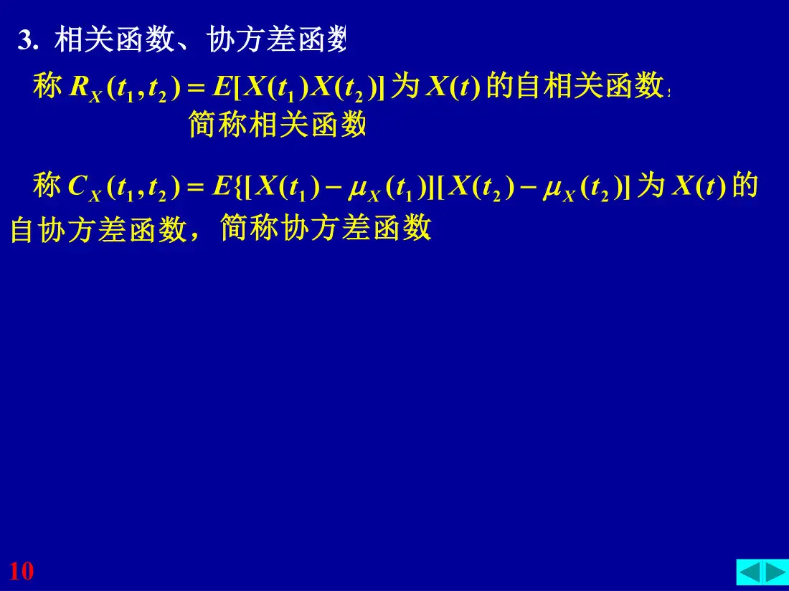

原文：

3. 相关函数、协方差函数
称 $R_{X}(t_{1}, t_{2}) = E[X(t_{1})X(t_{2})]$ 为 $X(t)$ 的自相关函数，简称相关函数

称 $C_{X}(t_{1}, t_{2}) = E\{[X(t_{1}) - \mu_{X}(t_{1})][X(t_{2}) - \mu_{X}(t_{2})]$ 为 $X(t)$ 的自协方差函数，简称协方差函数

10

◀◀

### 随机过程的数字特征之间的关系:

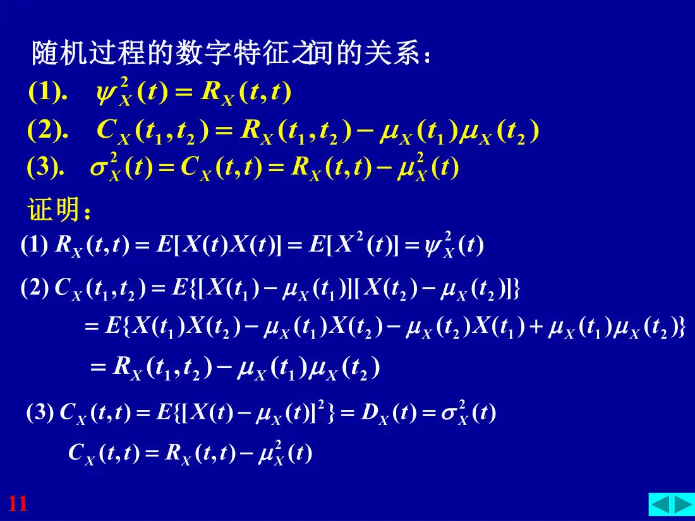

原文：

随机过程的数字特征之间的关系:

(1). $\psi_{X}^{2}(t)=R_{X}(t,t)$

(2). $C_X(t_1,t_2) = R_X(t_1,t_2) - \mu_X(t_1)\mu_X(t_2)$

(3). $\sigma_X^2 (t) = C_X(t,t) = R_X(t,t) - \mu_X^2 (t)$

证明：

(1) $R_{X}(t,t)=E[X(t)X(t)]=E[X^{2}(t)]=\psi_{X}^{2}(t)$

(2) $C_X(t_1,t_2) = E\{[X(t_1) - \mu_X(t_1)][X(t_2) - \mu_X(t_2)]\}$ $= E\{X(t_1)X(t_2) - \mu_X(t_1)X(t_2) - \mu_X(t_2)X(t_1) + \mu_X(t_1)\mu_X(t_2)\}$ $= R_{X}(t_{1},t_{2}) - \mu_{X}(t_{1})\mu_{X}(t_{2})$

(3) $C_X(t,t) = E\{[X(t) - \mu_X(t)]^2\} = D_X(t) = \sigma_X^2 (t)$ $C_X(t,t) = R_X(t,t) - \mu_X^2 (t)$

11

◀◀

### 协方差函数

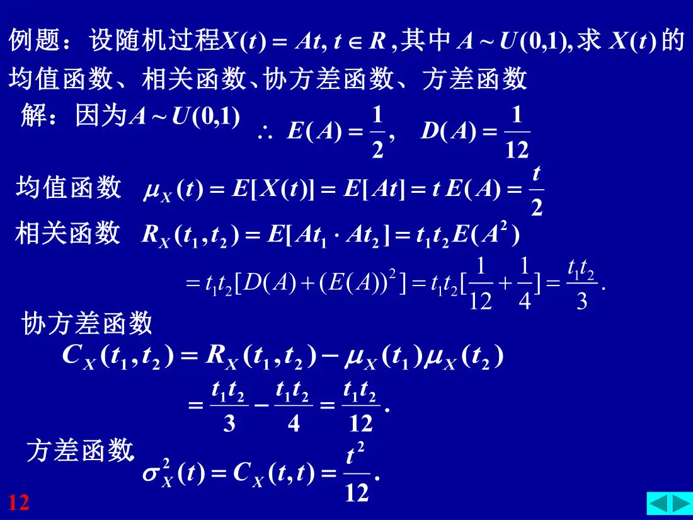

原文：

例题：设随机过程 $X(t) = At, t \in R$ ，其中 $A \sim U(0,1)$ ，求 $X(t)$ 的均值函数、相关函数、协方差函数、方差函数解：因为 $A \sim U(0,1) \therefore E(A) = \frac{1}{2}, D(A) = \frac{1}{12}$ 均值函数 $\mu_X(t) = E[X(t)] = E[At] = tE(A) = \frac{t}{2}$ 相关函数 $R_X(t_1, t_2) = E[At_1 \cdot At_2] = t_1t_2E(A^2) = t_1t_2[D(A) + (E(A))^2] = t_1t_2[\frac{1}{12} + \frac{1}{4}] = \frac{t_1t_2}{3}$ .

协方差函数

$$
\begin{array}{r l} C _ {X} (t _ {1}, t _ {2}) & = R _ {X} (t _ {1}, t _ {2}) - \mu_ {X} (t _ {1}) \mu_ {X} (t _ {2}) \\ & = \frac {t _ {1} t _ {2}}{3} - \frac {t _ {1} t _ {2}}{4} = \frac {t _ {1} t _ {2}}{1 2}. \end{array}
$$

方差函数

$$
\sigma_ {X} ^ {2} (t) = C _ {X} (t, t) = \frac {t ^ {2}}{1 2}.
$$

12

◀

### 13

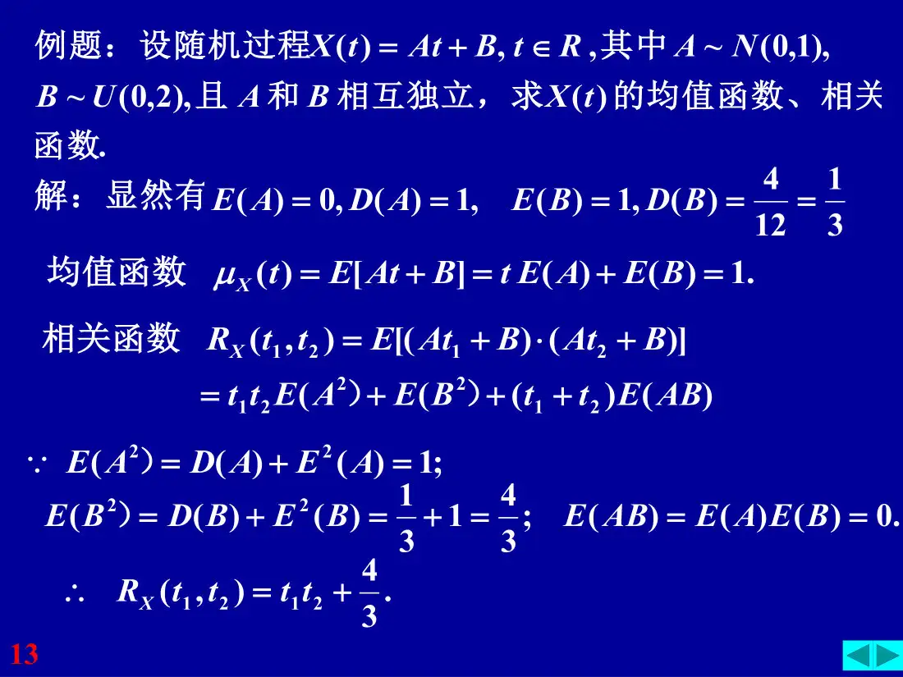

原文：

例题：设随机过程 $X(t)=At+B,t\in R$ ，其中 $A\sim N(0,1)$ ， $B\sim U(0,2)$ ，且A和B相互独立，求 $X(t)$ 的均值函数、相关函数.
解：显然有 $E(A)=0,D(A)=1,\quad E(B)=1,D(B)=\frac{4}{12}=\frac{1}{3}$ 均值函数 $\mu_{X}(t)=E[At+B]=tE(A)+E(B)=1.$ 相关函数 $R_{X}(t_{1},t_{2})=E[(At_{1}+B)\cdot(At_{2}+B)]$ $=t_{1}t_{2}E(A^{2})+E(B^{2})+(t_{1}+t_{2})E(AB)$ $\because E(A^{2})=D(A)+E^{2}(A)=1;$ $E(B^{2})=D(B)+E^{2}(B)=\frac{1}{3}+1=\frac{4}{3};\quad E(AB)=E(A)E(B)=0.$ $\therefore R_{X}(t_{1},t_{2})=t_{1}t_{2}+\frac{4}{3}.$

13

◀ △

### 求 $X(t)$ 的均值函数、相关函数 协方差函数

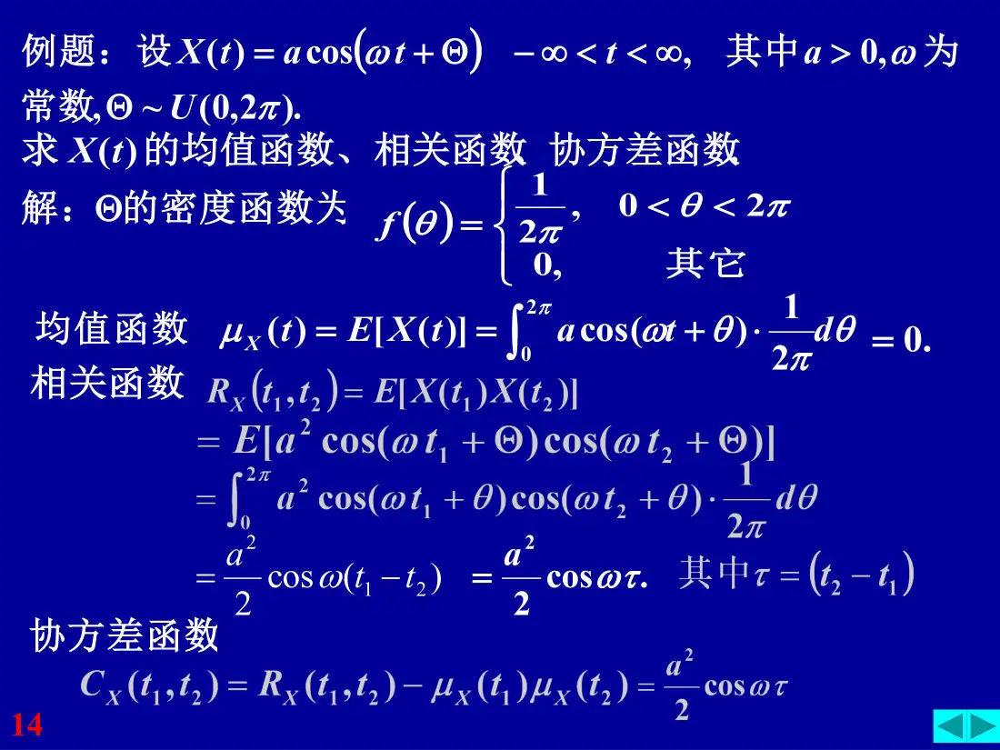

原文：

例题：设 $X(t) = a\cos (\omega t + \Theta)$ $-\infty < t < \infty$ ，其中 $a > 0, \omega$ 为常数, $\Theta \sim U(0,2\pi)$ .

求 $X(t)$ 的均值函数、相关函数 协方差函数

解： $\Theta$ 的密度函数为 $f(\theta) = \begin{cases} \frac{1}{2\pi}, & 0 < \theta < 2\pi \\ 0, & \text{其它} \end{cases}$ 均值函数 $\mu_X(t) = E[X(t)] = \int_0^{2\pi} a\cos (\omega t + \theta) \cdot \frac{1}{2\pi} d\theta = 0$ .

相关函数 $R_X(t_1, t_2) = E[X(t_1)X(t_2)] = E[a^2\cos (\omega t_1 + \Theta)\cos (\omega t_2 + \Theta)] = \int_0^{2\pi} a^2\cos (\omega t_1 + \theta)\cos (\omega t_2 + \theta) \cdot \frac{1}{2\pi} d\theta = \frac{a^2}{2}\cos \omega (t_1 - t_2) = \frac{a^2}{2}\cos \omega \tau.$ 其中 $\tau = (t_2 - t_1)$ 协方差函数 $C_X(t_1, t_2) = R_X(t_1, t_2) - \mu_X(t_1)\mu_X(t_2) = \frac{a^2}{2}\cos \omega \tau$

◀

### §3 泊松过程及维纳过程

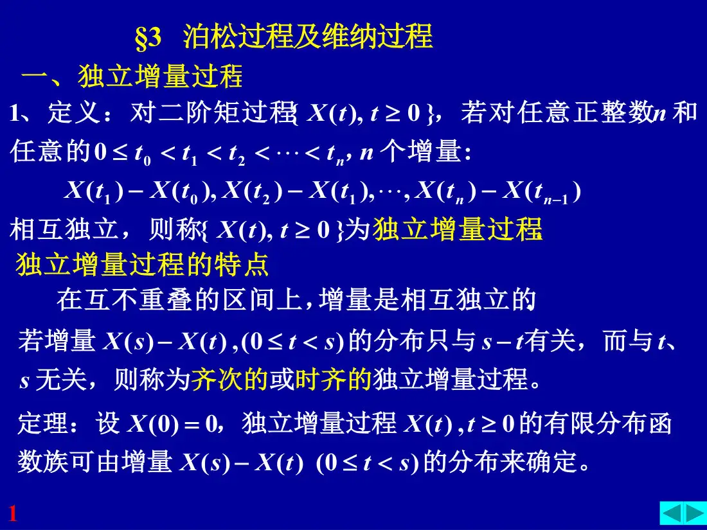

原文：

§3 泊松过程及维纳过程

一、独立增量过程

1、定义：对二阶矩过程 $X(t), t \geq 0$ ，若对任意正整数n和任意的 $0 \leq t_{0} < t_{1} < t_{2} < \cdots < t_{n}$ ，n个增量： $X(t_{1}) - X(t_{0}), X(t_{2}) - X(t_{1}), \cdots, X(t_{n}) - X(t_{n-1})$ 相互独立，则称 $\{X(t), t \geq 0\}$ 为独立增量过程
独立增量过程的特点
在互不重叠的区间上，增量是相互独立的
若增量 $X(s) - X(t), (0 \leq t < s)$ 的分布只与 s - t 有关，而与 t、s 无关，则称为齐次的或时齐的独立增量过程。
定理：设 $X(0)=0$ ，独立增量过程 $X(t), t \geq 0$ 的有限分布函数族可由增量 $X(s) - X(t) (0 \leq t < s)$ 的分布来确定。

◀ △

### ◀◀

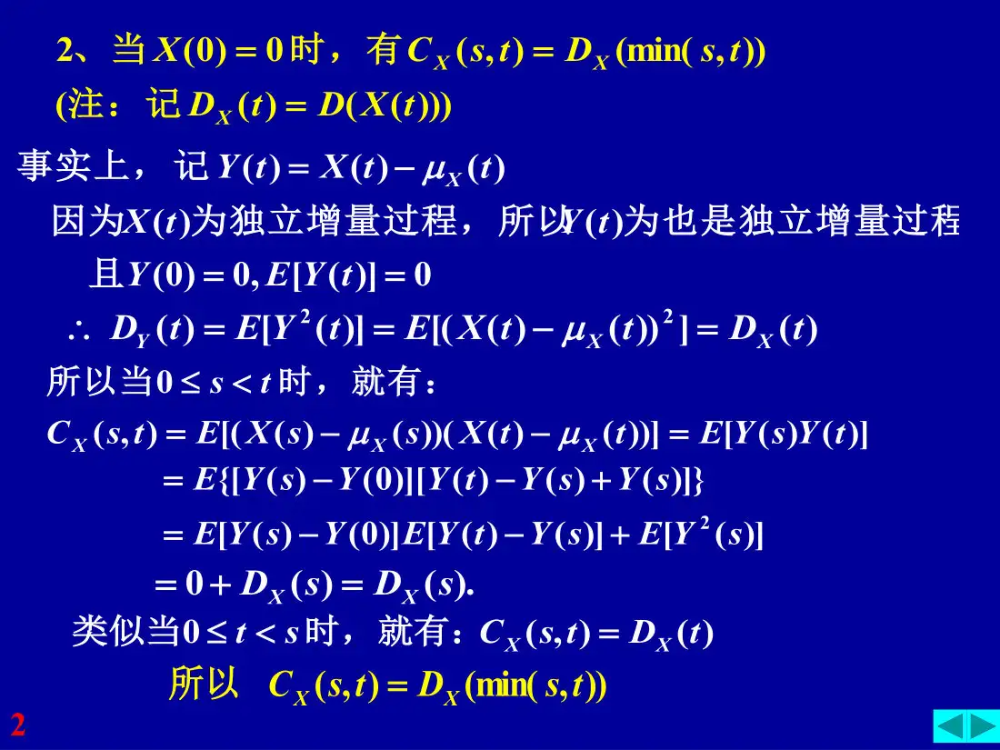

原文：

2、当 $X(0) = 0$ 时，有 $C_X(s,t) = D_X(\min (s,t))$ （注：记 $D_{X}(t) = D(X(t))$ 事实上，记 $Y(t) = X(t) - \mu_X(t)$ 因为 $X(t)$ 为独立增量过程，所以 $Y(t)$ 为也是独立增量过程且 $Y(0) = 0, E[Y(t)] = 0$ $\therefore D_Y(t) = E[Y^2 (t)] = E[(X(t) - \mu_X(t))^2] = D_X(t)$ 所以当 $0 \leq s < t$ 时，就有： $C_X(s,t) = E[(X(s) - \mu_X(s))(X(t) - \mu_X(t))] = E[Y(s)Y(t)]$ $= E\{[Y(s) - Y(0)][Y(t) - Y(s) + Y(s)]\}$ $= E[Y(s) - Y(0)]E[Y(t) - Y(s)] + E[Y^2 (s)]$ $= 0 + D_X(s) = D_X(s).$ 类似当 $0 \leq t < s$ 时，就有： $C_X(s,t) = D_X(t)$ 所以 $C_X(s,t) = D_X(\min (s,t))$

2

◀◀

### 二、泊松过程

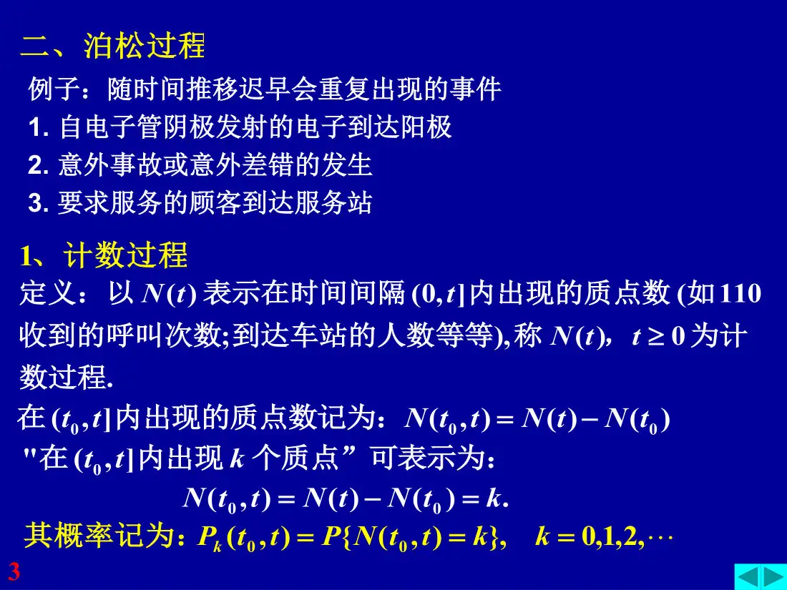

原文：

二、泊松过程

例子：随时间推移迟早会重复出现的事件

1. 自电子管阴极发射的电子到达阳极

2. 意外事故或意外差错的发生

3. 要求服务的顾客到达服务站

1、计数过程
定义：以 $N(t)$ 表示在时间间隔 $(0,t]$ 内出现的质点数（如 110 收到的呼叫次数；到达车站的人数等等），称 $N(t)$ ， $t \geq 0$ 为计数过程。
在 $(t_{0},t]$ 内出现的质点数记为： $N(t_{0},t)=N(t)-N(t_{0})$ “在 $(t_{0},t]$ 内出现 k 个质点”可表示为： $N(t_{0},t)=N(t)-N(t_{0})=k.$ 其概率记为： $P_{k}(t_{0},t)=P\{N(t_{0},t)=k\},\quad k=0,1,2,\cdots$

### 2、泊松过程的定义

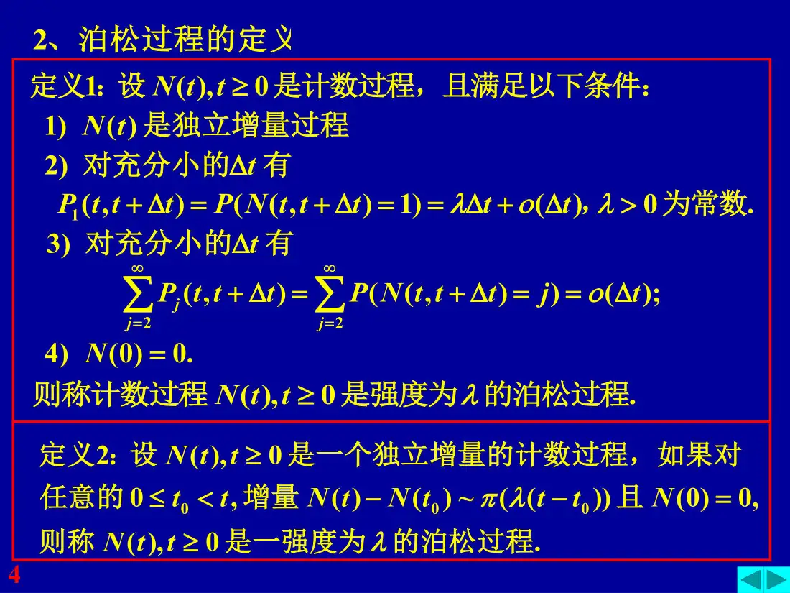

原文：

2、泊松过程的定义

定义1: 设 $N(t), t \geq 0$ 是计数过程，且满足以下条件:

1) $N(t)$ 是独立增量过程

2) 对充分小的 $\Delta t$ 有 $P_{1}(t, t + \Delta t) = P(N(t, t + \Delta t) = 1) = \lambda \Delta t + o(\Delta t), \lambda > 0$ 为常数.

3) 对充分小的 $\Delta t$ 有

$\sum_{j=2}^{\infty} P_j(t, t + \Delta t) = \sum_{j=2}^{\infty} P(N(t, t + \Delta t) = j) = o(\Delta t)$ ;

4) $N(0) = 0$ .

则称计数过程 $N(t), t \geq 0$ 是强度为 $\lambda$ 的泊松过程.

定义2: 设 $N(t), t \geq 0$ 是一个独立增量的计数过程, 如果对任意的 $0 \leq t_0 < t$ , 增量 $N(t) - N(t_0) \sim \pi(\lambda(t - t_0))$ 且 $N(0) = 0$ , 则称 $N(t), t \geq 0$ 是一强度为 $\lambda$ 的泊松过程.

### 定理 定义1与定义2是等价的

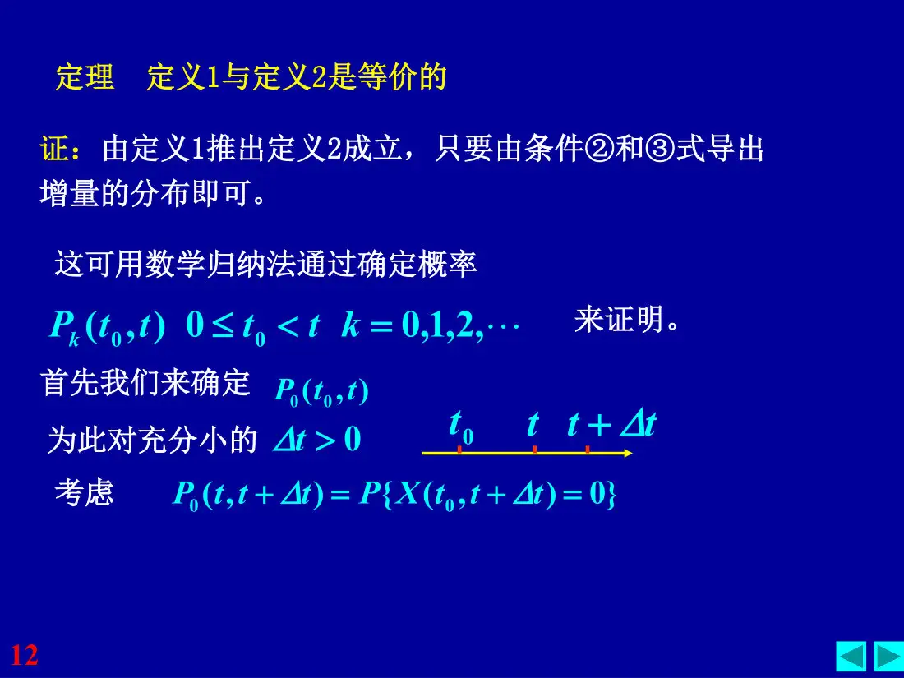

原文：

定理 定义1与定义2是等价的

证: 由定义1推出定义2成立, 只要由条件②和③式导出增量的分布即可。

这可用数学归纳法通过确定概率 $P_{k}(t_{0},t)$ $0\leq t_{0}<t$ $k=0,1,2,\cdots$ 来证明。
首先我们来确定 $P_{0}(t_{0},t)$ 为此对充分小的 $\Delta t>0$ $\begin{array}{c}t_{0}\quad t\quad t+\Delta t\\ \hline  \\ \end{array}$ 考虑 $P_{0}(t,t+\Delta t)=P\{X(t_{0},t+\Delta t)=0\}$

12

◀

### 13

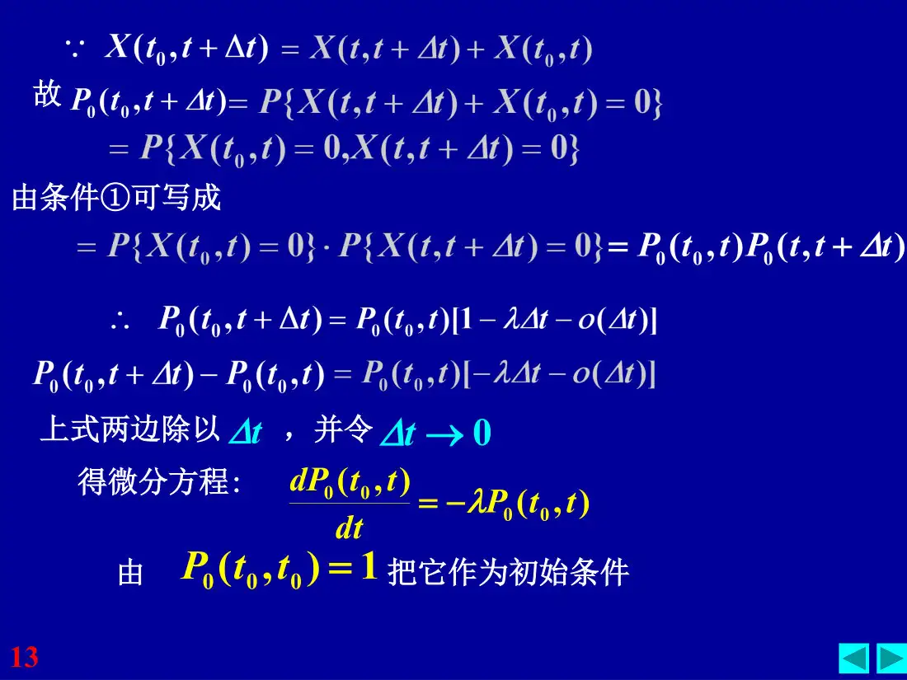

原文：

$\because X(t_0, t + \Delta t) = X(t, t + \Delta t) + X(t_0, t)$ 故 $P_0(t_0, t + \Delta t) = P\{X(t, t + \Delta t) + X(t_0, t) = 0\} = P\{X(t_0, t) = 0, X(t, t + \Delta t) = 0\}$

由条件①可写成 $= P\{X(t_0,t) = 0\} \cdot P\{X(t,t + \Delta t) = 0\} = P_0(t_0,t)P_0(t,t + \Delta t)$ $\therefore P_0(t_0,t + \Delta t) = P_0(t_0,t)[1 - \lambda \Delta t - o(\Delta t)]$ $P_0(t_0,t + \Delta t) - P_0(t_0,t) = P_0(t_0,t)[-\lambda \Delta t - o(\Delta t)]$ 上式两边除以 $\Delta t$ ，并令 $\Delta t \to 0$ 得微分方程: $\frac{dP_0(t_0,t)}{dt} = -\lambda P_0(t_0,t)$ 由 $P_0(t_0,t_0) = 1$ 把它作为初始条件

13

◀ ▶

### $t_{0}$ $t$ $t + \Delta t$

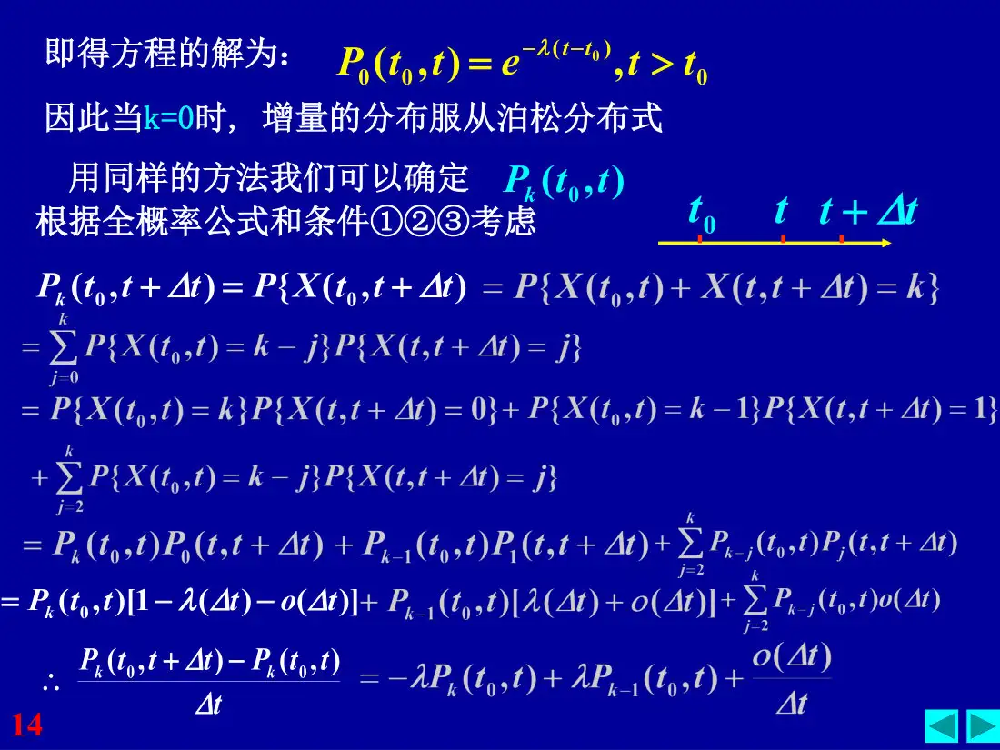

原文：

即得方程的解为: $P_{0}(t_{0}, t) = e^{-\lambda(t - t_{0})}, t > t_{0}$ 因此当 $\mathrm{k} = 0$ 时, 增量的分布服从泊松分布式

用同样的方法我们可以确定 $P_{k}(t_{0}, t)$ 根据全概率公式和条件①②③考虑

$t_{0}$ $t$ $t + \Delta t$

$P_{k}(t_{0},t+\Delta t)=P\{X(t_{0},t+\Delta t)=P\{X(t_{0},t)+X(t,t+\Delta t)=k\}$ $=\sum_{j=0}^{k}P\{X(t_{0},t)=k-j\}P\{X(t,t+\Delta t)=j\}$ $=P\{X(t_{0},t)=k\}P\{X(t,t+\Delta t)=0\}+P\{X(t_{0},t)=k-1\}P\{X(t,t+\Delta t)=1\}$ $+\sum_{j=2}^{k}P\{X(t_{0},t)=k-j\}P\{X(t,t+\Delta t)=j\}$ $=P_{k}(t_{0},t)P_{0}(t,t+\Delta t)+P_{k-1}(t_{0},t)P_{1}(t,t+\Delta t)+\sum_{j=2}^{k}P_{k-j}(t_{0},t)P_{j}(t,t+\Delta t)$ $=P_{k}(t_{0},t)[1-\lambda(\Delta t)-o(\Delta t)]+P_{k-1}(t_{0},t)[\lambda(\Delta t)+o(\Delta t)]+\sum_{j=2}^{k}P_{k-j}(t_{0},t)o(\Delta t)$ $\therefore\frac{P_{k}(t_{0},t+\Delta t)-P_{k}(t_{0},t)}{\Delta t}=-\lambda P_{k}(t_{0},t)+\lambda P_{k-1}(t_{0},t)+\frac{o(\Delta t)}{\Delta t}$

### 15

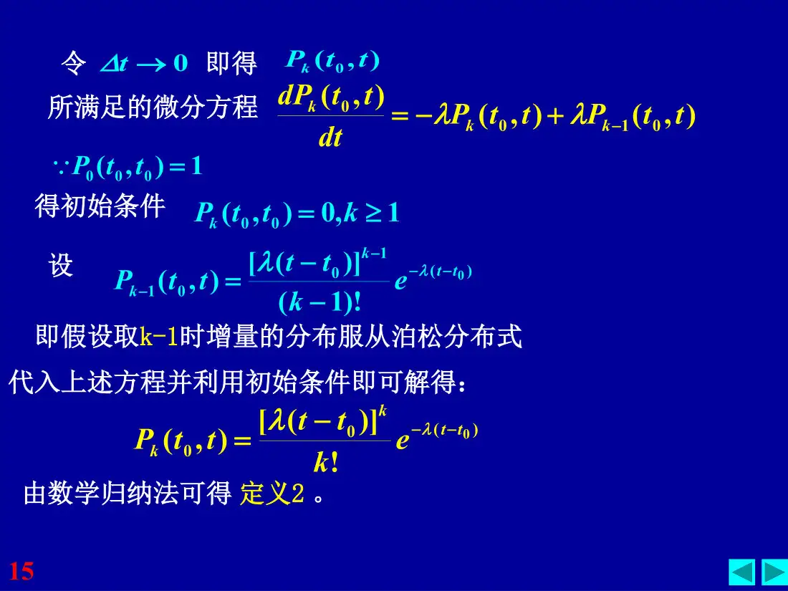

原文：

令 $\Delta t \rightarrow 0$ 即得 $P_{k}(t_{0}, t)$ 所满足的微分方程 $\frac{dP_{k}(t_{0}, t)}{dt} = -\lambda P_{k}(t_{0}, t) + \lambda P_{k-1}(t_{0}, t)$ $\because P_{0}(t_{0}, t_{0}) = 1$ 得初始条件 $P_{k}(t_{0}, t_{0}) = 0, k \geq 1$ 设 $P_{k-1}(t_{0}, t) = \frac{[\lambda(t - t_{0})]^{k-1}}{(k-1)!} e^{-\lambda(t - t_{0})}$ 即假设取k-1时增量的分布服从泊松分布式代入上述方程并利用初始条件即可解得： $P_{k}(t_{0}, t) = \frac{[\lambda(t - t_{0})]^{k}}{k!} e^{-\lambda(t - t_{0})}$ 由数学归纳法可得定义2。

15

◀▶

### 均值函数

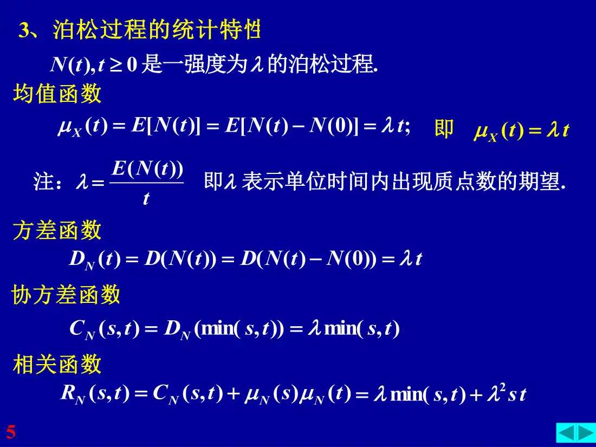

原文：

3、泊松过程的统计特性 $N(t), t \geq 0$ 是一强度为 $\lambda$ 的泊松过程.
均值函数

$\mu_{X}(t) = E[N(t)] = E[N(t) - N(0)] = \lambda t;\quad \text{即}\quad \mu_{X}(t) = \lambda t$

注： $\lambda=\frac{E(N(t))}{t}$ 即 $\lambda$ 表示单位时间内出现质点数的期望.

方差函数

$$
D _ {N} (t) = D (N (t)) = D (N (t) - N (0)) = \lambda t
$$

协方差函数

$$
C _ {N} (s, t) = D _ {N} (\min (s, t)) = \lambda \min (s, t)
$$

相关函数

$$
R _ {N} (s, t) = C _ {N} (s, t) + \mu_ {N} (s) \mu_ {N} (t) = \lambda \min (s, t) + \lambda^ {2} s t
$$

5

◀◀

### 三、维纳过程

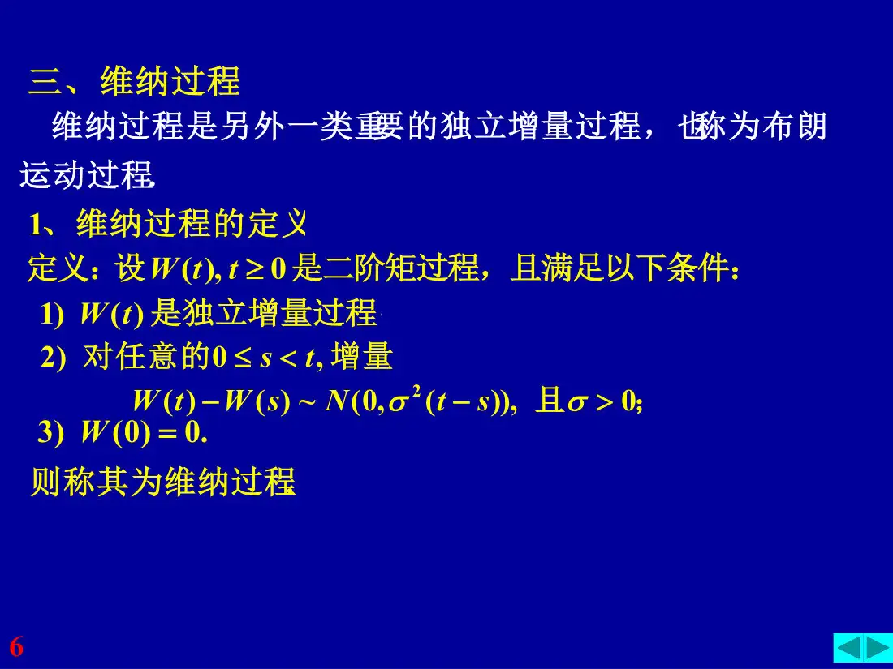

原文：

三、维纳过程

维纳过程是另外一类重要的独立增量过程，也称为布朗运动过程。

1、维纳过程的定义
定义: 设 $W(t), t \geq 0$ 是二阶矩过程, 且满足以下条件:

1) $W(t)$ 是独立增量过程

2) 对任意的 $0 \leq s < t$ , 增量

$$
W (t) - W (s) \sim N \left(0, \sigma^ {2} (t - s)\right)
$$

3) $W(0)=0.$

$$
\sigma > 0;
$$

则称其为维纳过程

6

◀◀

### 均值函数

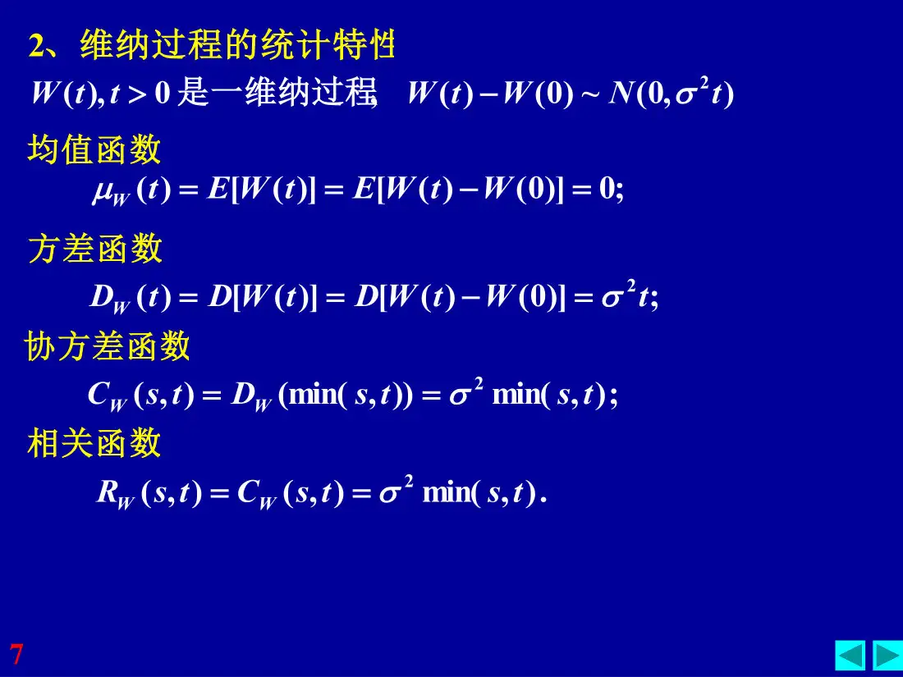

原文：

2、维纳过程的统计特性 $W(t), t > 0$ 是一维纳过程 $W(t) - W(0) \sim N(0, \sigma^2 t)$

均值函数

$$
\mu_ {W} (t) = E [ W (t) ] = E [ W (t) - W (0) ] = 0;
$$

方差函数

$$
D _ {W} (t) = D [ W (t) ] = D [ W (t) - W (0) ] = \sigma^ {2} t;
$$

协方差函数

$$
C _ {W} (s, t) = D _ {W} (\min (s, t)) = \sigma^ {2} \min (s, t);
$$

相关函数

$$
R _ {W} (s, t) = C _ {W} (s, t) = \sigma^ {2} \min (s, t).
$$

7

◀▶

### 例: 某种产品有3个存货，求这些存货维持不了一天的概率。如果货物的销售构成如下:

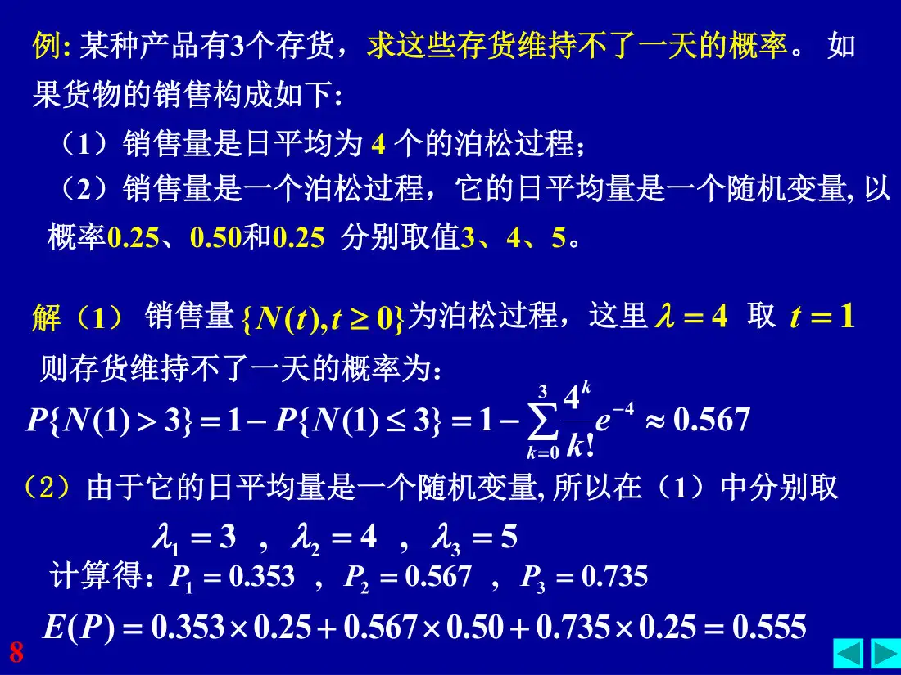

原文：

例: 某种产品有3个存货，求这些存货维持不了一天的概率。如果货物的销售构成如下:

(1) 销售量是日平均为 4 个的泊松过程;

(2) 销售量是一个泊松过程, 它的日平均量是一个随机变量, 以概率0.25、0.50和0.25分别取值3、4、5。

$$
\{N (t), t \geq 0 \}
$$

$$
P \{N (1) > 3 \} = 1 - P \{N (1) \leq 3 \} = 1 - \sum_ {k = 0} ^ {3} \frac {4 ^ {k}}{k !} e ^ {- 4} \approx 0. 5 6 7
$$

(2) 由于它的日平均量是一个随机变量, 所以在 (1) 中分别取 $\lambda_{1}=3,\lambda_{2}=4,\lambda_{3}=5$ 计算得: $P_{1}=0.353,P_{2}=0.567,P_{3}=0.735$ $E(P)=0.353\times0.25+0.567\times0.50+0.735\times0.25=0.555$ 例: 设 $\{N_{1}(t), t \geq 0\}$ 和 $\{N_{2}(t), t \geq 0\}$ 为两个相互独立的泊松过程, 强度分别为 $\lambda_{1}$ 和 $\lambda_{2}$

◀ ▶

### 证：

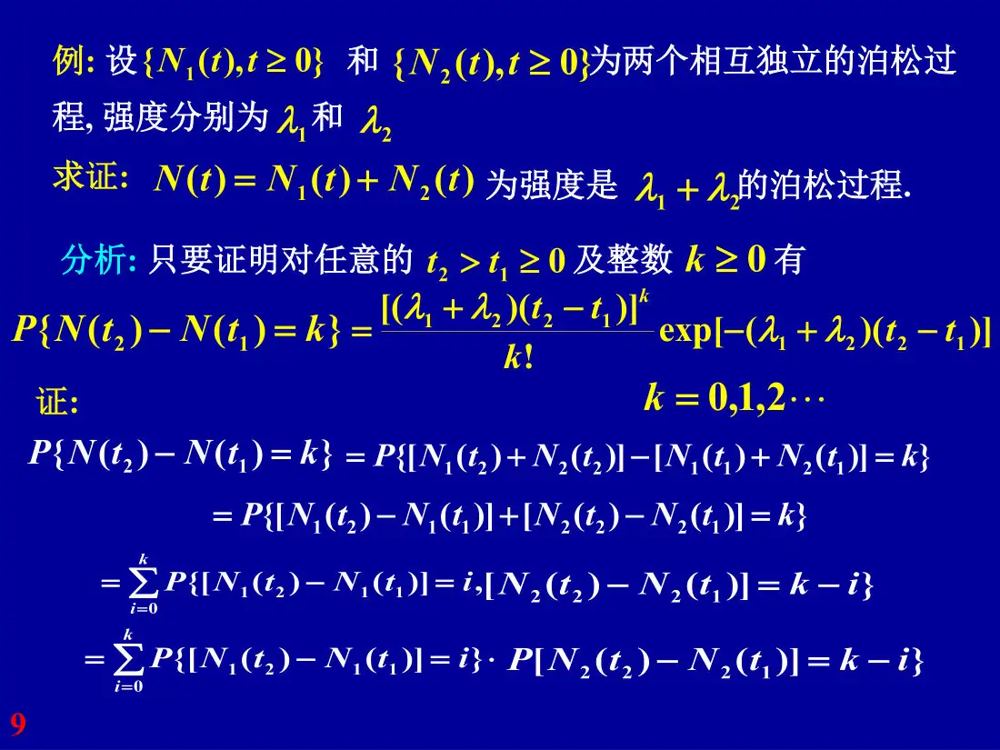

原文：

求证: $N(t) = N_{1}(t) + N_{2}(t)$ 为强度是 $\lambda_{1} + \lambda_{2}$ 的泊松过程.

分析: 只要证明对任意的 $t_{2} > t_{1} \geq 0$ 及整数 $k \geq 0$ 有

$P\{N(t_{2}) - N(t_{1}) = k\} = \frac{[(\lambda_{1} + \lambda_{2})(t_{2} - t_{1})]^{k}}{k!}\exp [-(\lambda_{1} + \lambda_{2})(t_{2} - t_{1})]$

证：

$$
k = 0, 1, 2 \dots
$$

$$
\begin{array}{r l} & P \{N (t _ {2}) - N (t _ {1}) = k \} = P \{[ N _ {1} (t _ {2}) + N _ {2} (t _ {2}) ] - [ N _ {1} (t _ {1}) + N _ {2} (t _ {1}) ] = k \} \\ & \qquad = P \{[ N _ {1} (t _ {2}) - N _ {1} (t _ {1}) ] + [ N _ {2} (t _ {2}) - N _ {2} (t _ {1}) ] = k \} \\ & \qquad = \sum_ {i = 0} ^ {k} P \{[ N _ {1} (t _ {2}) - N _ {1} (t _ {1}) ] = i, [ N _ {2} (t _ {2}) - N _ {2} (t _ {1}) ] = k - i \} \\ & \qquad = \sum_ {i = 0} ^ {k} P \{[ N _ {1} (t _ {2}) - N _ {1} (t _ {1}) ] = i \} \cdot P [ N _ {2} (t _ {2}) - N _ {2} (t _ {1}) ] = k - i \} \end{array}
$$

9

### $$

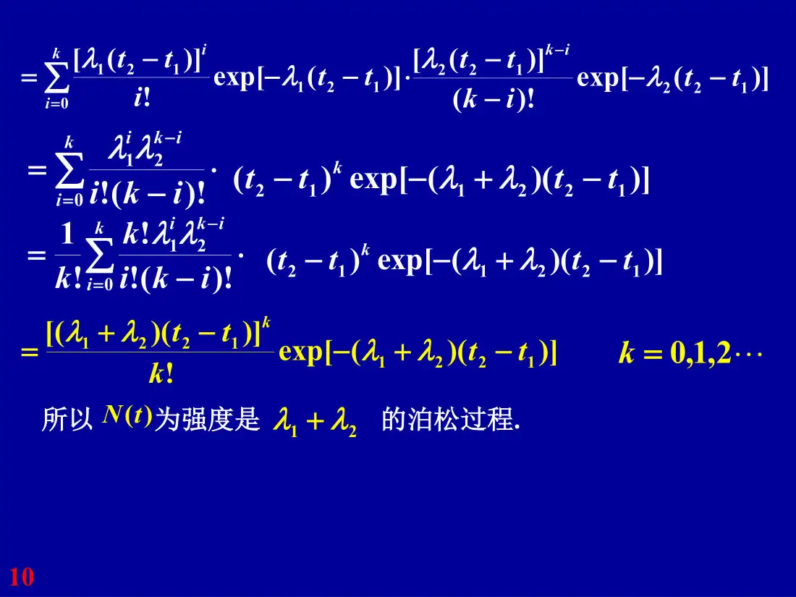

原文：

$$
= \sum_ {i = 0} ^ {k} \frac {\left[ \lambda_ {1} \left(t _ {2} - t _ {1}\right) \right] ^ {i}}{i !} \exp \left[ - \lambda_ {1} \left(t _ {2} - t _ {1}\right) \right] \cdot \frac {\left[ \lambda_ {2} \left(t _ {2} - t _ {1}\right) \right] ^ {k - i}}{(k - i) !} \exp \left[ - \lambda_ {2} \left(t _ {2} - t _ {1}\right) \right]
$$

$$
= \frac {[ (\lambda_ {1} + \lambda_ {2}) (t _ {2} - t _ {1}) ] ^ {k}}{k !} \exp [ - (\lambda_ {1} + \lambda_ {2}) (t _ {2} - t _ {1}) ] \qquad k = 0, 1, 2 \dots
$$

所以 $N(t)$ 为强度是 $\lambda_{1} + \lambda_{2}$ 的泊松过程.

10

### $$

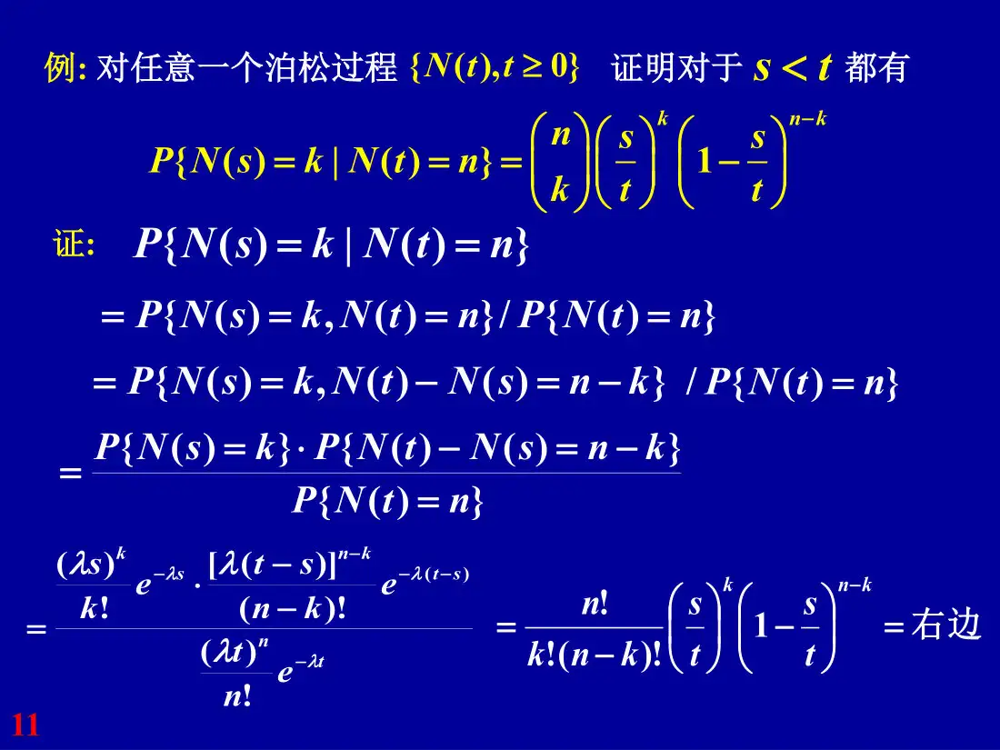

原文：

例: 对任意一个泊松过程 $\{N(t), t \geq 0\}$ 证明对于 s < t 都有

$$
P \{N (s) = k \mid N (t) = n \} = {\binom {n} {k}} {\binom {s} {t}} ^ {k} {\binom {1 - \frac {s}{t}} {}} ^ {n - k}
$$

证： $P\{N(s)=k \mid N(t)=n\}$ $=P\{N(s)=k,N(t)=n\}/P\{N(t)=n\}$ $=P\{N(s)=k,N(t)-N(s)=n-k\}/P\{N(t)=n\}$ $=\frac{P\{N(s)=k\}\cdot P\{N(t)-N(s)=n-k\}}{P\{N(t)=n\}}$

$$
= \frac {\frac {(\lambda s) ^ {k}}{k !} e ^ {- \lambda s} \cdot \frac {[ \lambda (t - s) ] ^ {n - k}}{(n - k) !} e ^ {- \lambda (t - s)}}{\frac {(\lambda t) ^ {n}}{n !} e ^ {- \lambda t}} = \frac {n !}{k ! (n - k) !} \left(\frac {s}{t}\right) ^ {k} \left(1 - \frac {s}{t}\right) ^ {n - k} = \text {右边}
$$

11

### 四、正态过程

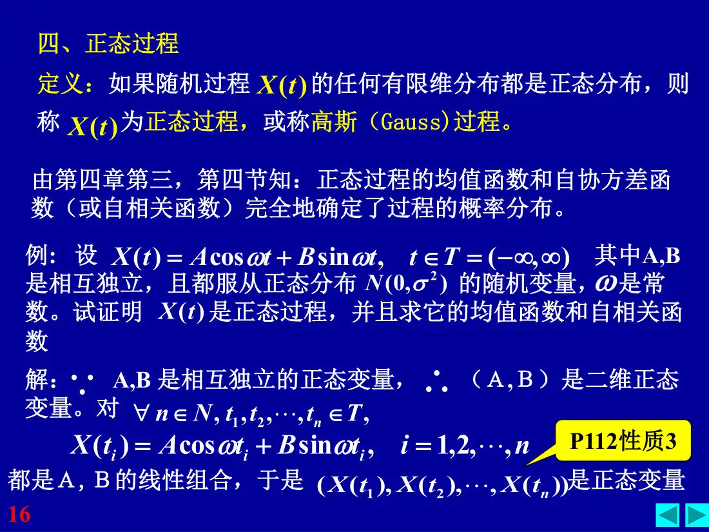

原文：

四、正态过程

定义: 如果随机过程 $X(t)$ 的任何有限维分布都是正态分布, 则称 $X(t)$ 为正态过程, 或称高斯 (Gauss) 过程。

由第四章第三，第四节知：正态过程的均值函数和自协方差函数（或自相关函数）完全地确定了过程的概率分布。

例：设 $X(t) = A\cos \omega t + B\sin \omega t, t \in T = (-\infty, \infty)$ 其中A,B是相互独立，且都服从正态分布 $N(0, \sigma^2)$ 的随机变量， $\omega$ 是常数。试证明 $X(t)$ 是正态过程，并且求它的均值函数和自相关函数

解: $\because$ A,B 是相互独立的正态变量, $\therefore$ (A,B) 是二维正态变量。对 $\forall n \in N, t_1, t_2, \cdots, t_n \in T$ ,

$$
X (t _ {i}) = A \cos \omega t _ {i} + B \sin \omega t _ {i}, \quad i = 1, 2, \dots , n
$$

P112性质3

都是A, B的线性组合, 于是 $(X(t_{1}), X(t_{2}), \cdots, X(t_{n}))$ 是正态变量

16

◀ ▶

### 所以， $X(t)$ 是正态过程。

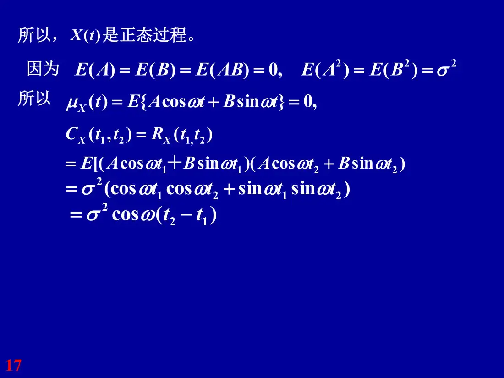

原文：

所以， $X(t)$ 是正态过程。

因为 $E(A) = E(B) = E(AB) = 0, \quad E(A^2) = E(B^2) = \sigma^2$ 所以 $\mu_X(t) = E\{A\cos \omega t + B\sin \omega t\} = 0,$ $C_X(t_1,t_2) = R_X(t_1,t_2)$ $= E[(A\cos \omega t_1 + B\sin \omega t_1)(A\cos \omega t_2 + B\sin \omega t_2)$ $= \sigma^2 (\cos \omega t_1\cos \omega t_2 + \sin \omega t_1\sin \omega t_2)$ $= \sigma^2\cos \omega (t_2 - t_1)$

17

### 例: 维纳过程是正态过程.

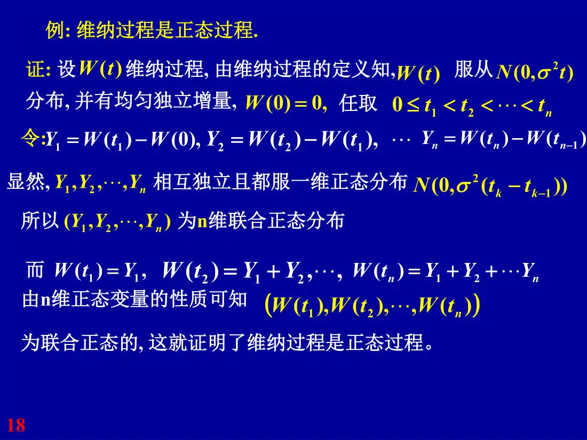

原文：

例: 维纳过程是正态过程.

证: 设 $W(t)$ 维纳过程, 由维纳过程的定义知, $W(t)$ 服从 $N(0, \sigma^{2}t)$ 分布, 并有均匀独立增量, $W(0) = 0$ , 任取 $0 \leq t_{1} < t_{2} < \cdots < t_{n}$ 令: $Y_{1}=W(t_{1})-W(0)$ , $Y_{2}=W(t_{2})-W(t_{1})$ , $\cdots$ $Y_{n}=W(t_{n})-W(t_{n-1})$ 显然, $Y_{1}, Y_{2}, \cdots, Y_{n}$ 相互独立且都服一维正态分布 $N(0, \sigma^{2}(t_{k}-t_{k-1}))$ 所以 $(Y_{1}, Y_{2}, \cdots, Y_{n})$ 为 n 维联合正态分布

而 $W(t_{1})=Y_{1},\quad W(t_{2})=Y_{1}+Y_{2},\cdots,W(t_{n})=Y_{1}+Y_{2}+\cdots Y_{n}$ 由n维正态变量的性质可知 $\left(W(t_{1}),W(t_{2}),\cdots,W(t_{n})\right)$ 为联合正态的, 这就证明了维纳过程是正态过程。

18

### 并说明 $\{X(t);-\infty<t<+\infty\}$ 是正态过程。

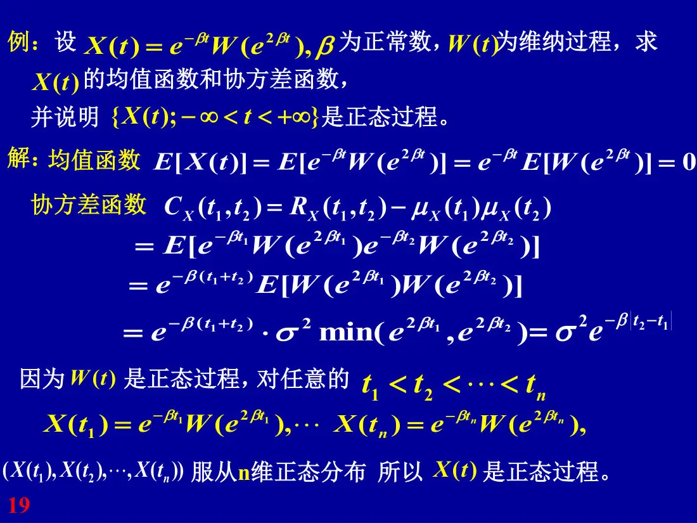

原文：

例：设 $X(t)=e^{-\beta t}W(e^{2\beta t}),\beta$ 为正常数， $W(t)$ 为维纳过程，求 $X(t)$ 的均值函数和协方差函数，
并说明 $\{X(t);-\infty<t<+\infty\}$ 是正态过程。
解：均值函数 $E[X(t)]=E[e^{-\beta t}W(e^{2\beta t})]=e^{-\beta t}E[W(e^{2\beta t})]=0$ 协方差函数 $C_{X}(t_{1},t_{2})=R_{X}(t_{1},t_{2})-\mu_{X}(t_{1})\mu_{X}(t_{2})$ $=E[e^{-\beta t_{1}}W(e^{2\beta t_{1}})e^{-\beta t_{2}}W(e^{2\beta t_{2}})]$ $=e^{-\beta(t_{1}+t_{2})}E[W(e^{2\beta t_{1}})W(e^{2\beta t_{2}})]$ $=e^{-\beta(t_{1}+t_{2})}\cdot\sigma^{2}\min(e^{2\beta t_{1}},e^{2\beta t_{2}})=\sigma^{2}e^{-\beta|t_{2}-t_{1}|}$ 因为 $W(t)$ 是正态过程，对任意的 $t_{1}<t_{2}<\cdots<t_{n}$ $X(t_{1})=e^{-\beta t_{1}}W(e^{2\beta t_{1}}),\cdots,X(t_{n})=e^{-\beta t_{n}}W(e^{2\beta t_{n}}),$ $(X(t_{1}),X(t_{2}),\cdots,X(t_{n}))$ 服从 n 维正态分布 所以 $X(t)$ 是正态过程。
