# 《概率论与数理统计》第13章 马尔可夫链（课件）

原件的每一页，下面附识别出的文字。

### 第13章 马尔可夫链

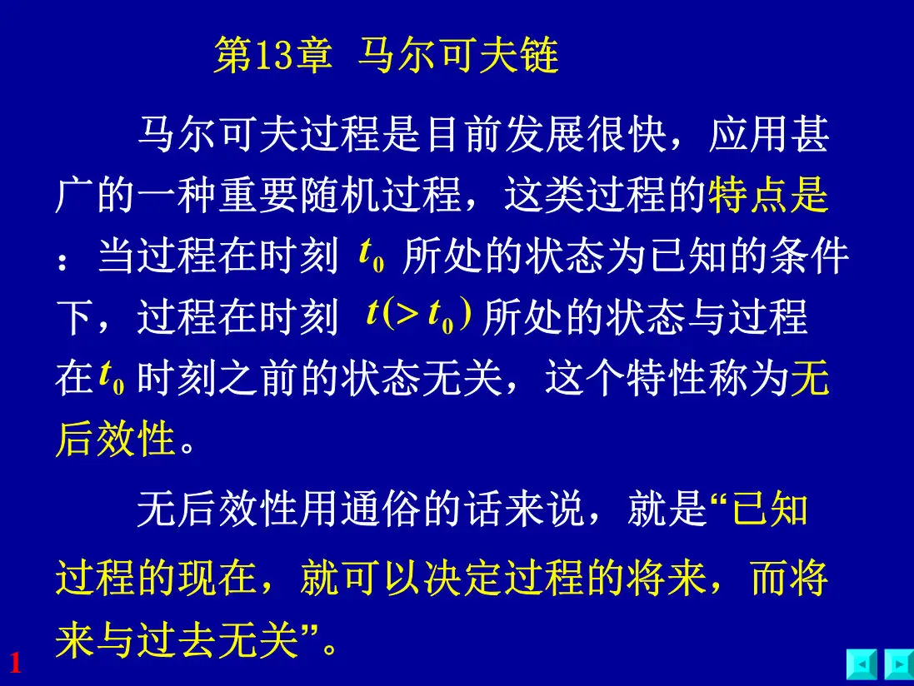

原文：

第13章 马尔可夫链

马尔可夫过程是 目 前发展很快， 应用甚广的一种重要随机过程， 这类过程的特点是当过程在时刻 所处的状态为已知的条件0t下， 过程在时刻 所处的状态与过程)( 0t > t在 时刻之前的状态无关， 这个特性称为无0t后效性。

无后效性用通俗的话来说， 就是“已知过程的现在， 就可以决定过程的将来， 而将来与过去无关”。

口

### 第 2 页

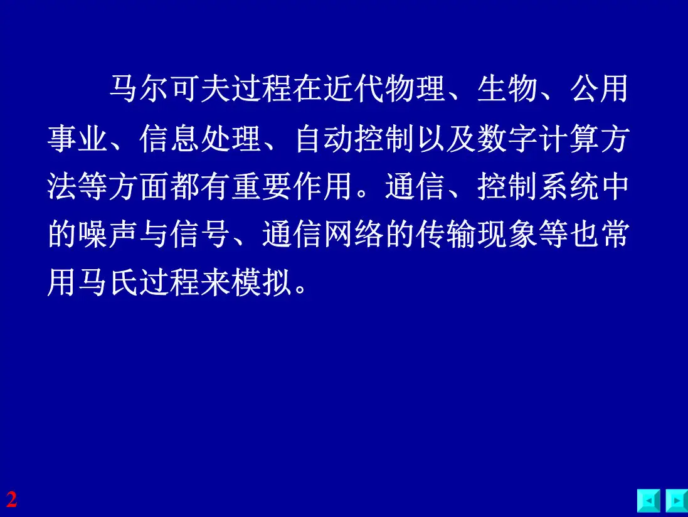

原文：

马尔可夫过程在近代物理、 生物、 公用事业、 信息处理、 自动控制 以及数字计算方法等方面都有重要作用 。 通信、 控制系统中的噪声与信号、 通信网络的传输现象等也常用马 氏过程来模拟。

2

### 一、 马尔可夫过程的概念

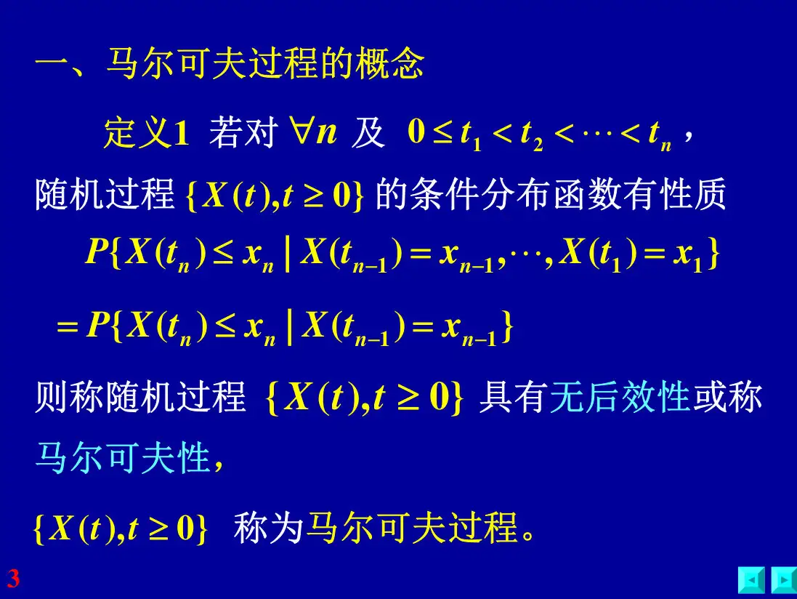

原文：

一、 马尔可夫过程的概念

定义1 若对 及∀n $( 1 ) - ( 1 + \frac { 1 } { 2 } + \frac { 1 } { 2 } ) \times \frac { 1 } { 2 } - ( 1 + \frac { 1 } { 2 } ) \times \frac { 1 } { 2 } + ( 1 + \frac { 1 } { 2 } )$ 随机过程 $\textcircled { 1 } : ( 0 . 0 ) : \textcircled { 2 } : 0$ 的条件分布函数有性质$1 2 0 \times ( m ^ { 2 } + 2 ) \times ( m ^ { 2 } ) = 2 0 0 0 0 ( m ^ { 2 } )$ $- 1 2 0 \times ( \frac { 1 } { 2 } \times 2 \times 1 ) \times ( \frac { 1 } { 2 } \times 2 \times 1 ) = \frac { 1 } { 2 } \times 2 \times 1$ 则称随机过程 $\textcircled { 1 } : \textcircled { 1 } : \textcircled { 2 } : \textcircled { 2 } : \textcircled { 1 }$ 具有无后效性或称马尔可夫性，

$\textcircled { 1 } : ( 0 . 0 ) : \textcircled { 2 } : 0$ 称为马尔可夫过程。这表明 ， 在 已知 X $( 0 , 0 ) = 0 , 0 = 1 0 0 0$ 的 条件下 ， X t)(在 $1 4 - 2 = 1 1 0 = 1 1$ 时的取值情况与 $1 4 5 - 1 1 = 1 1$ 以前 取值无关，亦即对 $1 1 - \frac { 1 } { 2 } = 1 1$ 时刻的信息都已总结到 $1 4 5 - 1 1 = 1 1$ 时刻了 。

3

口

### 第 4 页

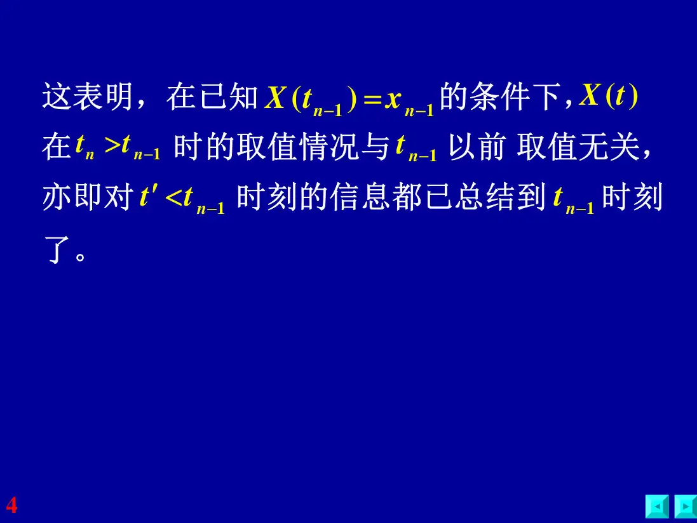

原文：

4

### 第 5 页

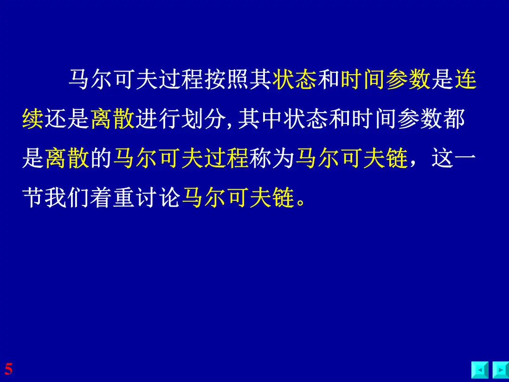

原文：

马尔可夫过程按照其状态和时间参数是连续还是离散进行划分 其中状态和时间参数都是离散的马尔可夫过程称为马尔可夫链， 这节我们着重讨论马尔可夫链。

5

### 二、 马尔可夫链的概念及转移概率

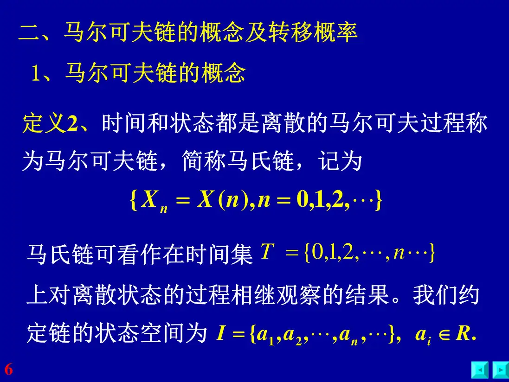

原文：

二、 马尔可夫链的概念及转移概率

1、 马尔可夫链的概念

定义2、 时间和状态都是离散的马尔可夫过程称为马尔可夫链， 简称马 氏链， 记为

$$
\{X _ {n} = X (n), n = 0, 1, 2, \dots \}
$$

马 氏链可看作在时间集 $U _ { L } = \frac { \mathcal { U } ( 0 ) } { \mathcal { U } ( 0 ) } = \frac { \mathcal { U } ( 0 ) } { \mathcal { U } ( 0 ) } = \frac { \mathcal { U } ( 0 ) } { \mathcal { U } ( 0 ) } = 0$ 上对离散状态的过程相继观察的结果。 我们约定链的状态空间为 $1 1 - 1 1 + 1 1 + 1 1 + 1 1 + 1 1 + 1 1 + 1 1 + 1 1 + 1 1 + 1 1 + 1 1 + 1 1 + 1 1 + 1 1 + 1 1 + 1 1 + 1 1 + 1 1 + 1 1 + 1 1 + 1 1 + 1 1$

口

### 2、 转移概率

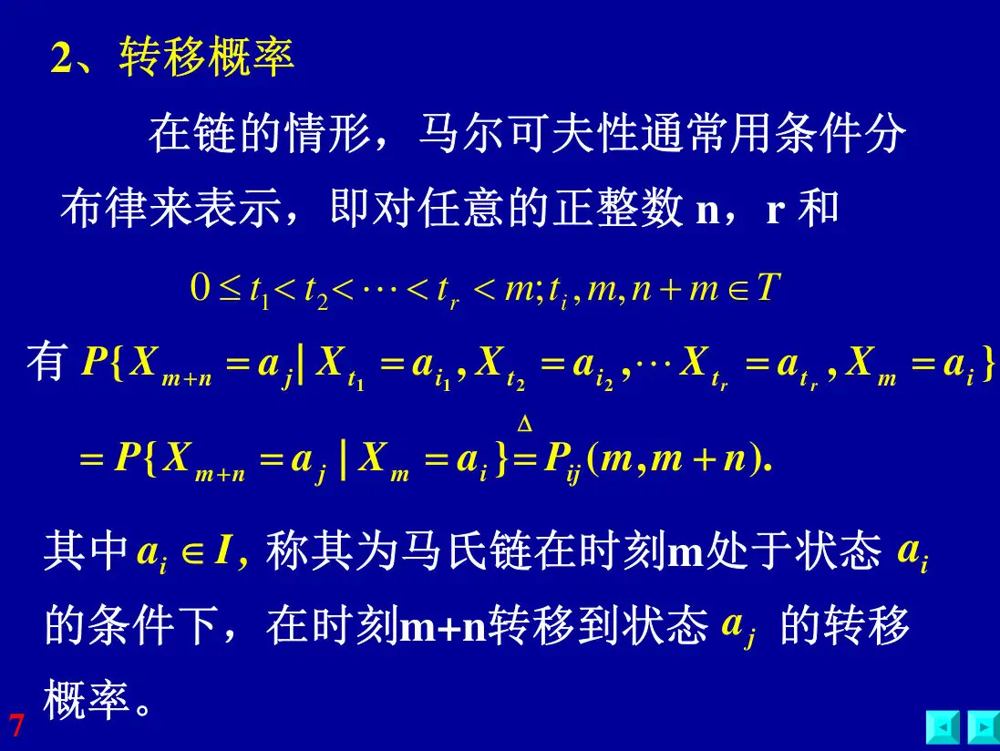

原文：

2、 转移概率

在链的情形， 马尔可夫性通常用条件分布律来表示， 即对任意的正整数 n， r 和

$$
0 \leq t _ {1} <   t _ {2} <   \dots <   t _ {r} <   m; t _ {i}, m, n + m \in T
$$

$$
P \{X _ {m + n} = a _ {j} | X _ {t _ {1}} = a _ {i _ {1}}, X _ {t _ {2}} = a _ {i _ {2}}, \dots X _ {t _ {r}} = a _ {t _ {r}}, X _ {m} = a _ {i} \}
$$

$$
= P \{X _ {m + n} = a _ {j} \mid X _ {m} = a _ {i} \} = P _ {i j} (m, m + n).
$$

其中 $\langle y _ { 5 } \rangle = 1 7$ 称其为马 氏链在时刻m处于状态 $\textcircled { 9 }$ 的条件下， 在时刻m+n转移到状态 的转移ja概率。

口

### 下面我们只讨论齐次马 氏链， 并习惯上常将“齐次”两字省略。

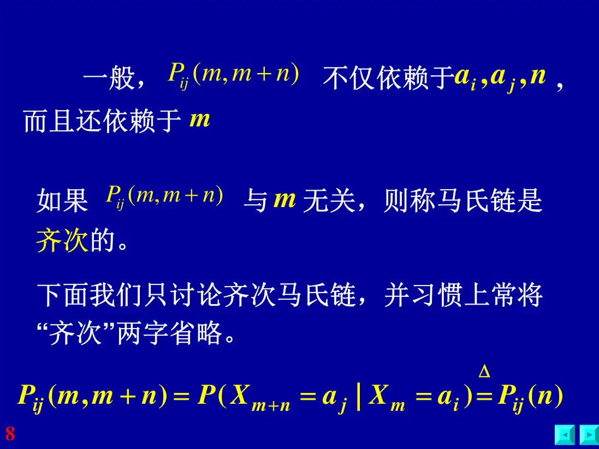

原文：

一般 ， $1 0 0 0 0 0 0 0 0 0 0 0 0 0 0 0 0 0 0 0 0 0 0 0 0 0 0 0 0 0 0 0 0 0 0 0 0 0 0 0 0 0 0 0 0 0 0 0 0 0 0 0 0 0 0 0 0 0 0 0 0 0 0 0 0 0 0 0 0 0 0 0 0 0 0 0 0 0 0 0 0 0 0 0 0 0 0 0 0 0 0 0 0 0 0 0 0 0 0 0 0 0 0 0 0 0 0 0 0 0 0 0 0 0 0 0 0 0 0 0 0 0 0 0 0 0 0 0 0 0 0 0 0 0 0 0 0 0 0 0 0 0 0 0 0 0 0 0 0 0 0 0 0 0 0 0 0 0 0 0 0 0 0 0 0 0 0 0 0 0 0 0 0 0 0 0 0 0 0 0 0 0 0 0 0 0 0 0 0 0 0 0 0 0 0 0 0 0 0 0 0 0 0 0 0 0 0 0 0 0 0 0 0 0 0 0 0 0 0 0 0 0 0 0 0 0 0 0 0 0 0 0 0 0 0 0 0 0 0 0 0 0 0 0 0 0 0 0 0 0 0 0 0 0 0 0 0 0 0 0 0 0 0 0 0 0 0 0 0 0 0 0 0 0 0 0 0 0 0 0 0 0 0 0 0 0 0 0 0 0 0 0 0 0 0 0 0 0 0 0 0 0 0 0 0 0 0 0 0 0 0 0 0 0 0 0 0 0 0 0 0 0 0 0 0 0 0 0 0 0 0 0 0 0 0 0 0 0 0 0 0 0 0 0 0 0 0 0 0 0 0 0 0 0 0 0 0 0 0 0 0 0 0 0 0 0 0 0 0 0 0 0 0 0 0 0 0 0 0 0 0 0 0 0 0 0 0 0 0 0 0 0 0 0 0 0 0 0 0 0 0 0 0 0 0 0 0 0 0 0 0 0 0 0 0 0 0 0 0 0 0 0 0 0 0 0 0 0 0 0 0 0 0 0 0 0 0 0 0 0 0 0 0 0 0 0 0 0 0 0 0 0 0 0 0 0 0 0 0 0 0 0 0 0 0 0 0 0 0 0 0 0 0 0 0 0 0 0 0 0 0 0 0 0 0 0 0 0 0 0 0 0 0 0 0 0 0 0 0 0 0 0 0 0 0 0 0 0 0 0 0 0 0 0 0 0 0 0 0 0 0 0 0 0 0 0 0 0 0 0 0 0 0 0 0 0 0 0 0 0 0 0 0 0 0 0 0 0 0 0 0 0 0 0 0 0 0 0 0 0 0 0 0 0 0 0 0 0 0 0 0 0 0 0 0 0$ 不仅依赖于 $\textcircled { 1 } \textcircled { 2 } \textcircled { 1 }$ 而且还依赖于 m

如果 $1 0 0 0 0 0 0 0 0 0 0 0 0 0 0 0 0 0 0 0 0 0 0 0 0 0 0 0 0 0 0 0 0 0 0 0 0 0 0 0 0 0 0 0 0 0 0 0 0 0 0 0 0 0 0 0 0 0 0 0 0 0 0 0 0 0 0 0 0 0 0 0 0 0 0 0 0 0 0 0 0 0 0 0 0 0 0 0 0 0 0 0 0 0 0 0 0 0 0 0 0 0 0 0 0 0 0 0 0 0 0 0 0 0 0 0 0 0 0 0 0 0 0 0 0 0 0 0 0 0 0 0 0 0 0 0 0 0 0 0 0 0 0 0 0 0 0 0 0 0 0 0 0 0 0 0 0 0 0 0 0 0 0 0 0 0 0 0 0 0 0 0 0 0 0 0 0 0 0 0 0 0 0 0 0 0 0 0 0 0 0 0 0 0 0 0 0 0 0 0 0 0 0 0 0 0 0 0 0 0 0 0 0 0 0 0 0 0 0 0 0 0 0 0 0 0 0 0 0 0 0 0 0 0 0 0 0 0 0 0 0 0 0 0 0 0 0 0 0 0 0 0 0 0 0 0 0 0 0 0 0 0 0 0 0 0 0 0 0 0 0 0 0 0 0 0 0 0 0 0 0 0 0 0 0 0 0 0 0 0 0 0 0 0 0 0 0 0 0 0 0 0 0 0 0 0 0 0 0 0 0 0 0 0 0 0 0 0 0 0 0 0 0 0 0 0 0 0 0 0 0 0 0 0 0 0 0 0 0 0 0 0 0 0 0 0 0 0 0 0 0 0 0 0 0 0 0 0 0 0 0 0 0 0 0 0 0 0 0 0 0 0 0 0 0 0 0 0 0 0 0 0 0 0 0 0 0 0 0 0 0 0 0 0 0 0 0 0 0 0 0 0 0 0 0 0 0 0 0 0 0 0 0 0 0 0 0 0 0 0 0 0 0 0 0 0 0 0 0 0 0 0 0 0 0 0 0 0 0 0 0 0 0 0 0 0 0 0 0 0 0 0 0 0 0 0 0 0 0 0 0 0 0 0 0 0 0 0 0 0 0 0 0 0 0 0 0 0 0 0 0 0 0 0 0 0 0 0 0 0 0 0 0 0 0 0 0 0 0 0 0 0 0 0 0 0 0 0 0 0 0 0 0 0 0 0 0 0 0 0 0 0 0 0 0 0 0 0 0 0 0 0 0 0 0 0 0 0 0 0 0 0 0 0 0 0 0 0 0 0 0 0 0 0 0 0 0 0 0 0 0 0 0 0 0 0 0 0 0 0 0 0 0 0 0 0$ 与 无关， 则称马 氏链是m齐次的 。

下面我们只讨论齐次马 氏链， 并习惯上常将“齐次”两字省略。

Δ (),( nPaXaXPnmmP )()| ij ijimjnm=+ + ===

口

### 三、 转移概率矩阵

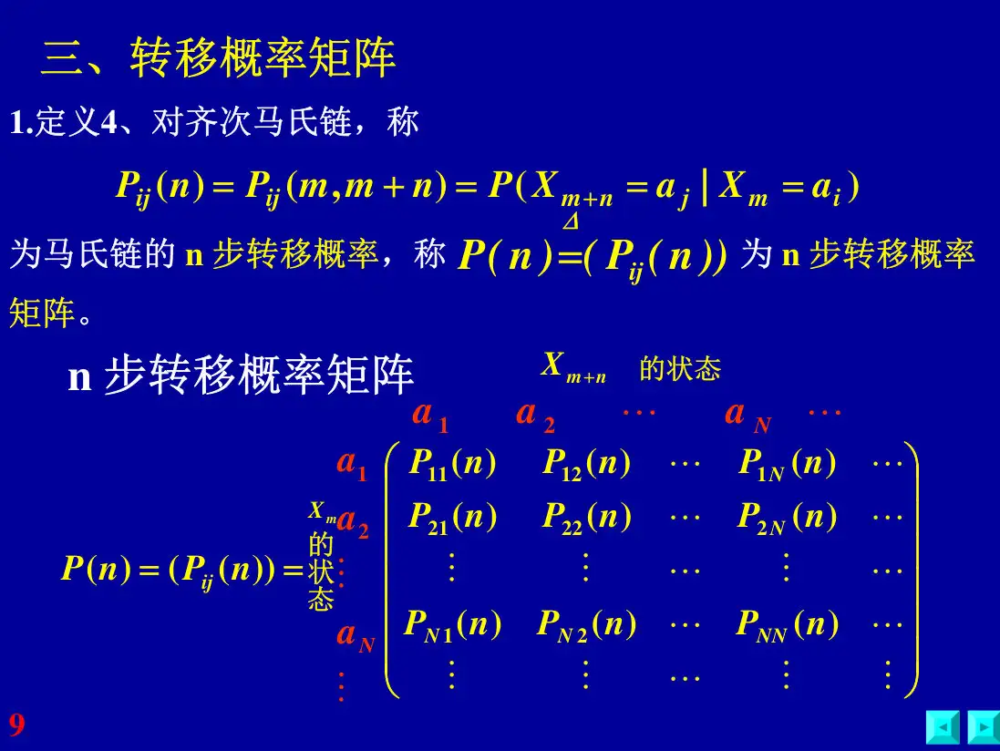

原文：

三、 转移概率矩阵

1.定义4、 对齐次马 氏链， 称

$$
P _ {i j} (n) = P _ {i j} (m, m + n) = P (X _ {\underset {\varDelta} {m + n}} = a _ {j} \mid X _ {m} = a _ {i})
$$

为马 氏链的 n 步转移概率， 称 $1 2 ( m ^ { 3 } ) = ( 0 \div m )$ 为 n 步转移概率矩阵。

n 步转移概率矩阵

$$
P (n) = \left(P _ {i j} (n)\right) = \underset {\text {状态}} {\overset {X _ {m} a _ {2}} {\text {的状态}}}
$$

$$
X _ {m + n}
$$

的状态

$$
\left( \begin{array}{c c c c c} a _ {1} & a _ {2} & \dots & a _ {N} & \dots \\ P _ {1 1} (n) & P _ {1 2} (n) & \dots & P _ {1 N} (n) & \dots \\ P _ {2 1} (n) & P _ {2 2} (n) & \dots & P _ {2 N} (n) & \dots \\ \vdots & \vdots & \dots & \vdots & \dots \\ P _ {N 1} (n) & P _ {N 2} (n) & \dots & P _ {N N} (n) & \dots \\ \vdots & \vdots & \dots & \vdots & \vdots \end{array} \right)
$$

9

口

### 2、 一步转移概率及其转移概率矩阵

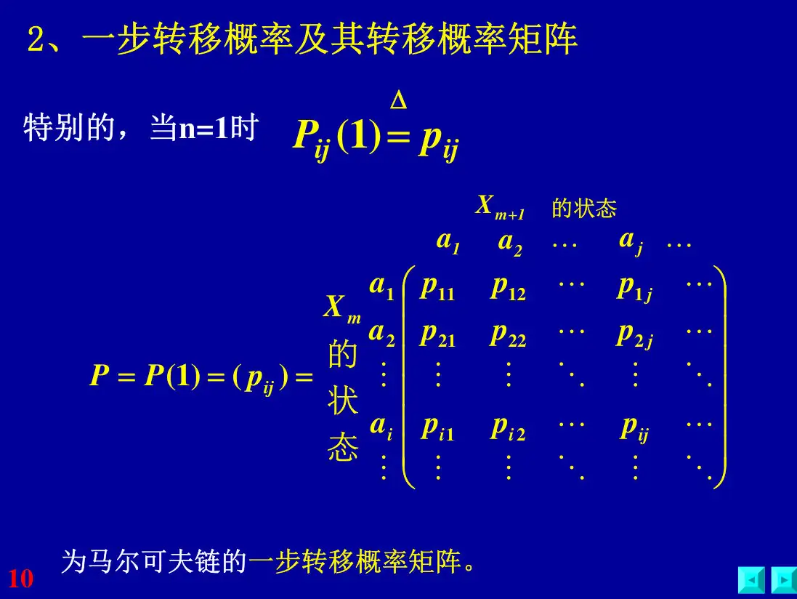

原文：

2、 一步转移概率及其转移概率矩阵

特别 的， 当n=1时 $1 0 \times ( 1 0 ) = 1 0$

$$
P = P (1) = (p _ {i j}) = \begin{array}{c} X _ {m} \\ \text {的} \\ \text {状态} \end{array} \begin{array}{c} a _ {1} \\ a _ {2} \\ \vdots \\ a _ {i} \\ \vdots \end{array} \left( \begin{array}{c c c c c} X _ {m + 1} & \text {的状态} \\ a _ {1} & a _ {2} & \dots & a _ {j} & \dots \\ p _ {1 1} & p _ {1 2} & \dots & p _ {1 j} & \dots \\ p _ {2 1} & p _ {2 2} & \dots & p _ {2 j} & \dots \\ \vdots & \vdots & \ddots & \vdots & \ddots \\ p _ {i 1} & p _ {i 2} & \dots & p _ {i j} & \dots \\ \vdots & \vdots & \ddots & \vdots & \ddots \end{array} \right)
$$

10

为马尔可夫链的一步转移概率矩阵。

口

### 这个矩阵具有以下两个性质 ：

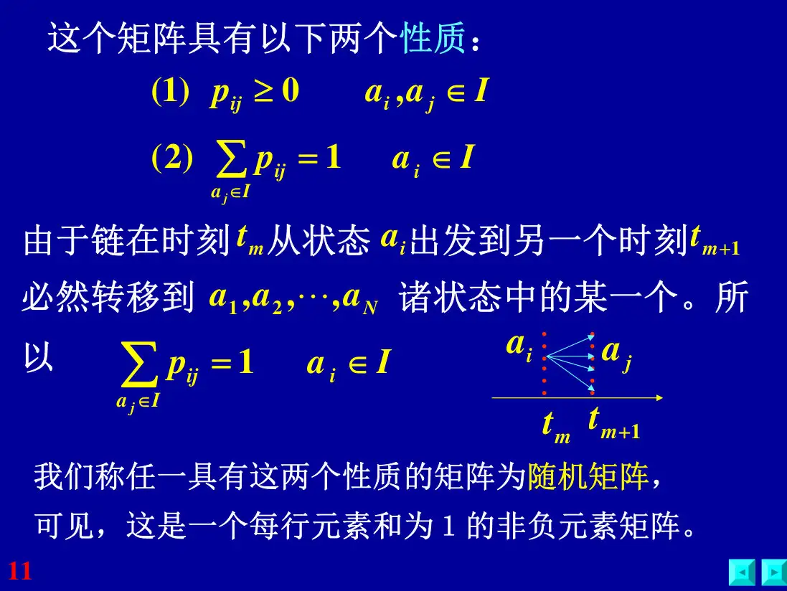

原文：

这个矩阵具有以下两个性质 ：

)1( $1 2 m = 1 2$

$$
a _ {i}, a _ {j} \in I
$$

)2( $2 \times 3 = 1 1$

由于链在时刻 $1 4 \times 1 = 1 4 ( m ^ { 2 } )$ 从状态 出发到另一个时刻ai $[ \frac { 1 } { 4 } , \frac { 1 } { 5 } ] = \frac { 1 } { 5 }$ 必然转移到 $( 1 5 0 - 1 5 ) \times 2 = 1 5 0 0 ( c m )$ 诸状态中 的某一个。 所

以

$$
\sum_ {a _ {j} \in I} p _ {i j} = 1 \qquad a _ {i} \in I
$$

$$
\begin{array}{c c} a _ {i} & a _ {j} \\ \hline t _ {m} & t _ {m + 1} \end{array}
$$

我们称任一具有这两个性质 的矩阵为随机矩阵，可见， 这是一个每行元素和为 1 的非负元素矩阵。

1 1

口

### 例： 一维随机游动

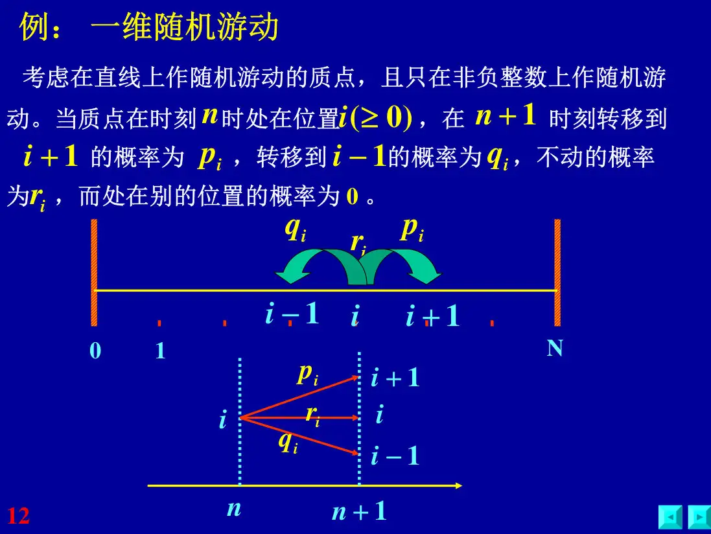

原文：

例： 一维随机游动

考虑在直线上作随机游动的质点 且只在非负整数上作随机游动。 当质点在时刻 时处在位置 ， 在 时刻转移到n i ≥ )0( n + 1的概率为i + 1 $| \varPsi |$ ， 转移到 的概率为i − 1 $( \%$ ， 不动的概率为 $\pmb { l }$ ， 而处在别的位置的概率为 0 。

12

口

### $$

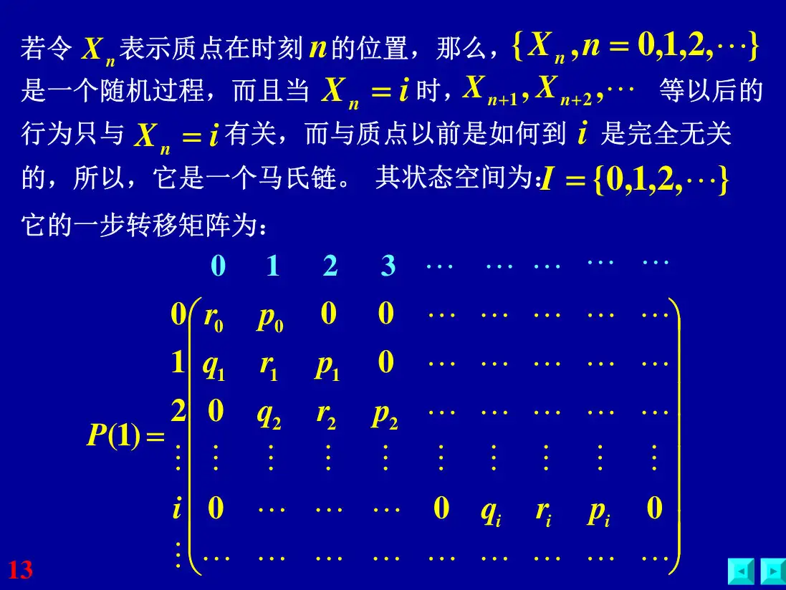

原文：

若令 表示质点在时刻 的位置， 那么 ，X n $( 2 + \frac { 1 } { 2 } ) ( 1 + \frac { 1 } { 2 } + 1 ) \times ( 2 + 2 )$ 是一个随机过程， 而且当 $1 3 - 9 = 1 9$ 时 ， $0 . 1 \dot { 0 } 0 0 \dot { 0 } < 0 . 1 \dot { 0 } 0 0 0 \dot { 0 }$ 等以后的行为只与 $1 3 \div \frac { 1 } { 2 }$ 有关， 而与质点 以前是如何到 是完全无关i= i的， 所以， 它是一个马 氏链。 其状态空间为 $9 / 6 = 8 ( 1 1 1 0 ) / 9 \times 9$ 它的一步转移矩阵为：

$$
P (1) = \left( \begin{array}{c c c c c c c c c} 0 & 1 & 2 & 3 & \dots & \dots & \dots & \dots & \dots \\ 0 & r _ {0} & p _ {0} & 0 & 0 & \dots & \dots & \dots & \dots & \dots \\ 1 & q _ {1} & r _ {1} & p _ {1} & 0 & \dots & \dots & \dots & \dots & \dots \\ 2 & 0 & q _ {2} & r _ {2} & p _ {2} & \dots & \dots & \dots & \dots & \dots \\ \vdots & \vdots & \vdots & \vdots & \vdots & \vdots & \vdots & \vdots & \vdots & \vdots \\ i & 0 & \dots & \dots & \dots & 0 & q _ {i} & r _ {i} & p _ {i} & 0 \\ \vdots & \dots & \dots & \dots & \dots & \dots & \dots & \dots & \dots & \dots . \end{array} \right)
$$

13

口

### 这里

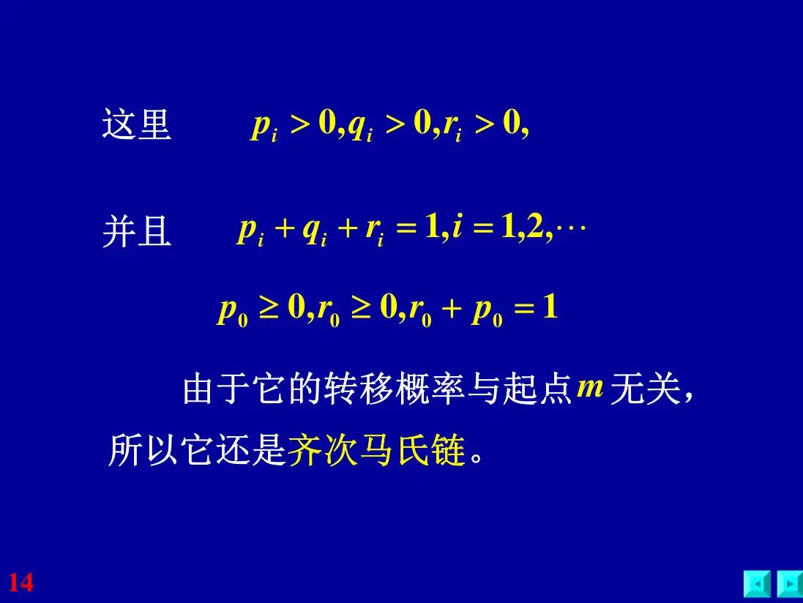

原文：

这里

$$
p _ {i} > 0, q _ {i} > 0, r _ {i} > 0,
$$

并且

$$
p _ {i} + q _ {i} + r _ {i} = 1, i = 1, 2, \dots
$$

$$
p _ {0} \geq 0, r _ {0} \geq 0, r _ {0} + p _ {0} = 1
$$

由于它的转移概率与起点 无关，m所以它还是齐次马 氏链。

14

口

### 15

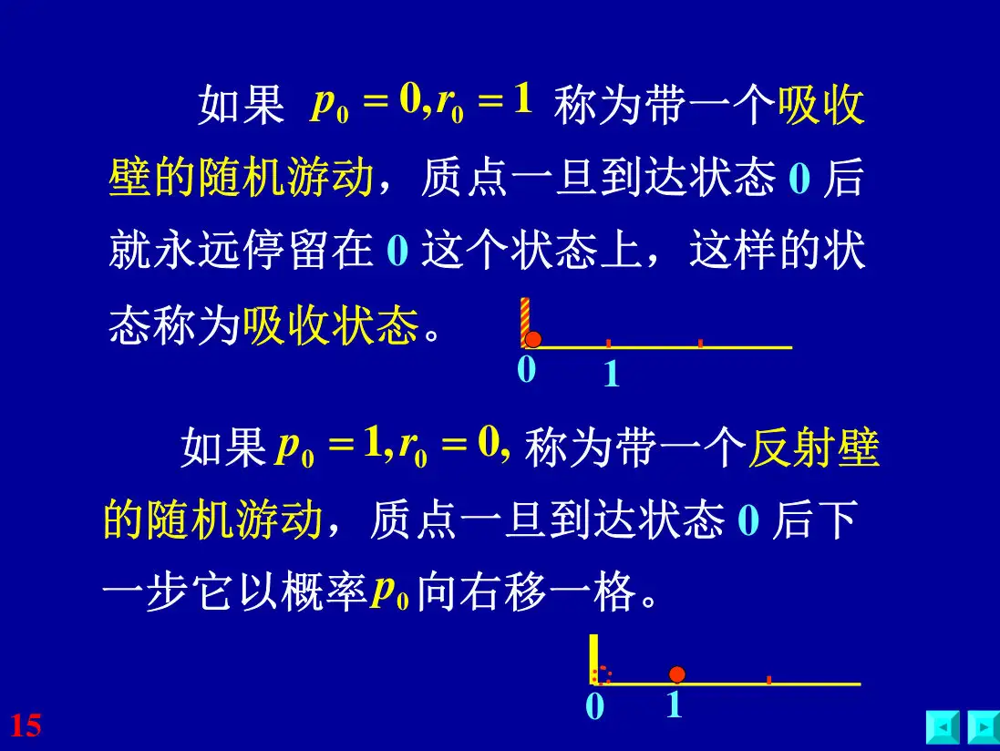

原文：

如果 $1 2 0 - 1 1 0 0 = 1 1$ 称为带一个吸收壁的随机游动， 质点一旦到达状态 0 后就永远停留在 0 这个状态上， 这样的状态称为吸收状态。0 1

如果 $1 2 0 - 5 0 0 = 1 1$ 称为带一个反射壁,的随机游动， 质点一旦到达状态 0 后下一步它 以概率 $1 \%$ 向右移一格。

15

口

### 它的一步转移矩阵为：

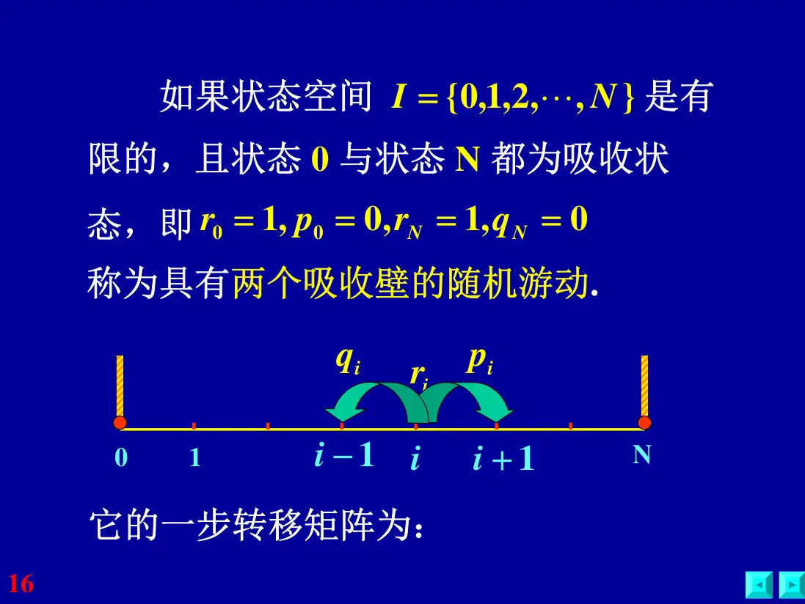

原文：

如果状态空间 $H _ { 2 } = H _ { 2 } ( 1 ) _ { 2 } = 2 N a C l _ { 2 } + H _ { 2 } O$ 是有限的， 且状态 0 与状态 N 都为吸收状态， 即 $( 1 ) 1 3 \times 1 2 0 = ( 1 ) 1 2 0 = ( 1 ) 1 2 0 ( m ^ { 2 } )$ 称为具有两个吸收壁的随机游动.

它的一步转移矩阵为：

16

口

### $$

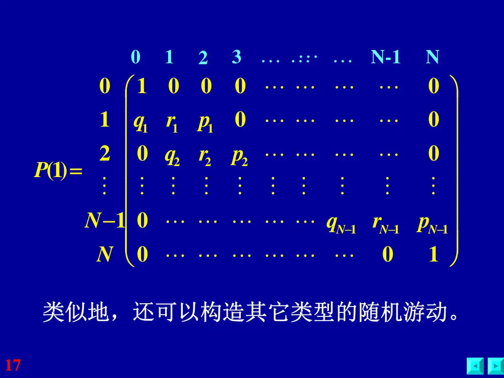

原文：

$$
P (1) = \begin{array}{c} 0 \\ 1 \\ 2 \\ \vdots \\ N - 1 \\ N \end{array} \left( \begin{array}{c c c c c c c c c} 0 & 1 & 2 & 3 & \dots & \dots & \dots & N - 1 & N \\ 1 & 0 & 0 & 0 & \dots & \dots & \dots & \dots & 0 \\ q _ {1} & r _ {1} & p _ {1} & 0 & \dots & \dots & \dots & \dots & 0 \\ 0 & q _ {2} & r _ {2} & p _ {2} & \dots & \dots & \dots & \dots & 0 \\ \vdots & \vdots & \vdots & \vdots & \vdots & \vdots & \vdots & \vdots & \vdots \\ 0 & \dots & \dots & \dots & \dots & \dots & q _ {N - 1} & r _ {N - 1} & p _ {N - 1} \\ 0 & \dots & \dots & \dots & \dots & \dots & \dots & 0 & 1 \end{array} \right)
$$

类似地， 还可以构造其它类型的随机游动。

17

口

### 随机游动可以作为扩散质点的物理过程的合理近似 ；

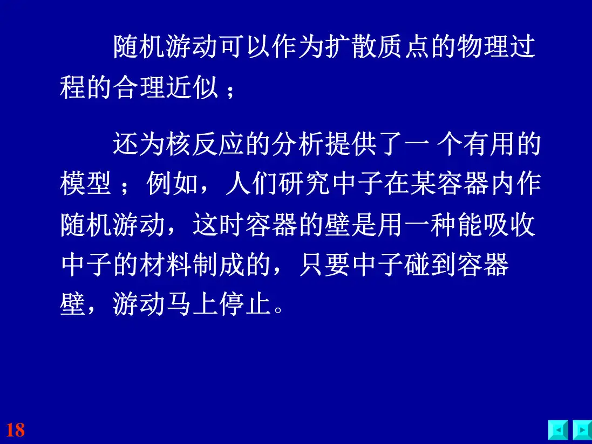

原文：

随机游动可以作为扩散质点的物理过程的合理近似 ；

还为核反应的分析提供了一 个有用 的模型 ； 例如， 人们研究中子在某容器内作随机游动， 这时容器的壁是用一种能吸收中子的材料制成的， 只要中子碰到容器壁， 游动马上停止。

18

口

### 四、 切普曼－柯尔莫哥洛夫方程

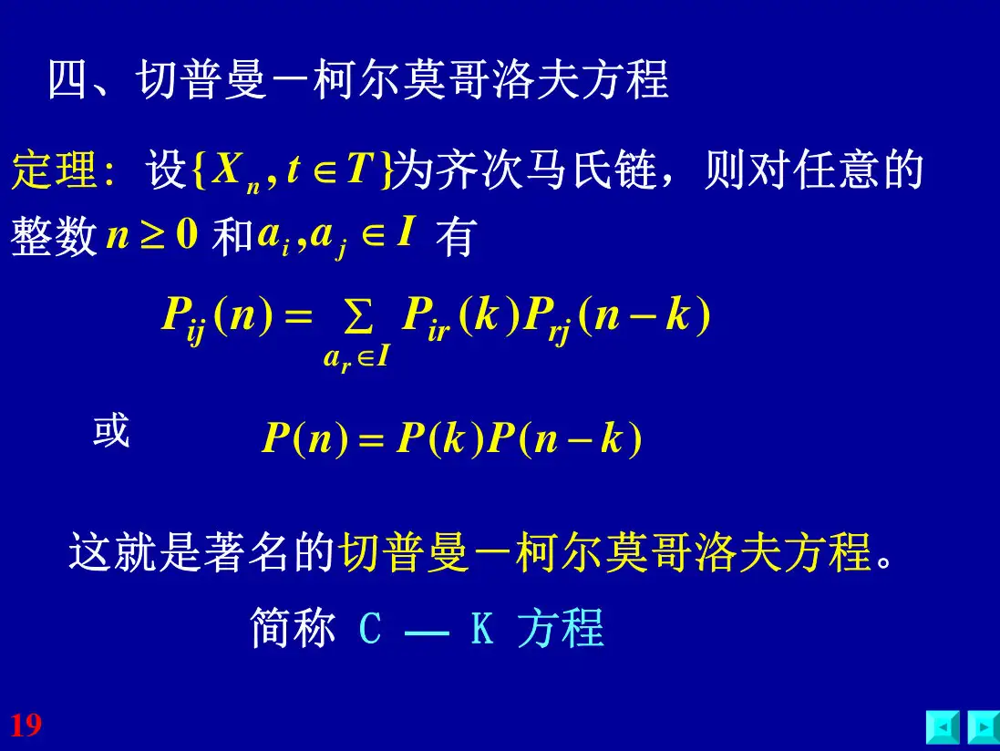

原文：

四、 切普曼－柯尔莫哥洛夫方程

定理 : 设{ $l _ { 4 } ^ { 2 } ( m ) ^ { 2 } = l _ { 2 } ^ { 2 }$ 为齐次马 氏链， 则对任意的}整数 $m ^ { * } - 0$ 和 $\langle g \vert \mathbf { z } \vert \langle \mathbf { \vec { z } } \vert \rangle = \vert \boldsymbol { \mathcal { U } } \vert$ 有

$$
P _ {i j} (n) = \sum_ {a _ {r} \in I} P _ {i r} (k) P _ {r j} (n - k)
$$

或

$$
P (n) = P (k) P (n - k)
$$

这就是著名 的切普曼－柯尔莫哥洛夫方程。

简称 C — K 方程

19

口

### 切普曼－柯尔莫夫方程的直观解释：

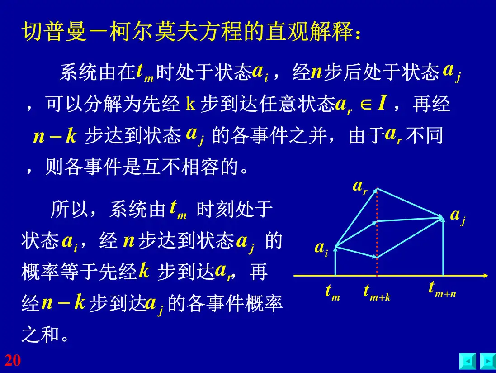

原文：

切普曼－柯尔莫夫方程的直观解释：

系统由在 $1 4 0 - 1 = 1 4 4$ 时处于状态 ， 经 步后处于状态a n a可以分解为先经 k 步到达任意状态 ， 再经a I∈步达到状态 的各事件之并， 由于 不同ajn − k ar， 则各事件是互不相容的。

所以 ， 系统 由 $l \textcircled { 4 }$ 时刻处于状态 $\textcircled { 4 }$ ， 经 步达到状态 的n aj概率等于先经 步到达 ， 再k ar经 步到达 的各事件概率ajn − k之和 。

20

口

### 证明 ： 利用全概率公式及马尔可夫性， 有

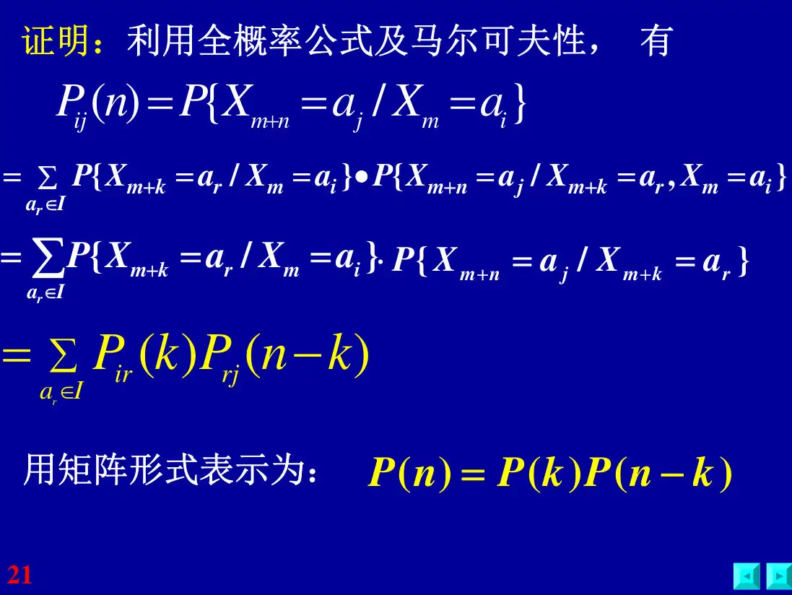

原文：

证明 ： 利用全概率公式及马尔可夫性， 有

$$
P _ {i j} (n) = P \{X _ {m + n} = a _ {j} / X _ {m} = a _ {i} \}
$$

$$
= \sum_ {a _ {r} \in I} P \{X _ {m + k} = a _ {r} / X _ {m} = a _ {i} \} \bullet P \{X _ {m + n} = a _ {j} / X _ {m + k} = a _ {r}, X _ {m} = a _ {i} \}
$$

$$
= \sum_ {a _ {r} \in I} P \{X _ {m + k} = a _ {r} / X _ {m} = a _ {i} \} \cdot P \{X _ {m + n} = a _ {j} / X _ {m + k} = a _ {r} \}
$$

$$
= \sum_ {a _ {r} \in I} P _ {i r} (k) P _ {r j} (n - k)
$$

用矩阵形式表示为： $) 2 ( 1 3 ) - 1 2 ( 1 3 ) = ( 1 2 - 1 3 )$

21

口

### 第 22 页

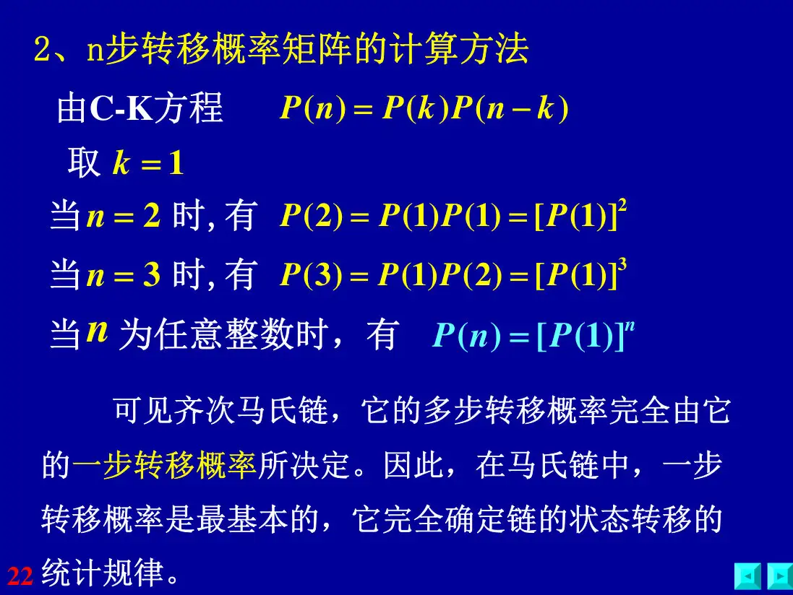

原文：

2、 n步转移概率矩阵的计算方法由C-K方程 $) 2 ( 1 2 ) - 1 2 ( 1 3 ) = 1 2 ( 1 2 - 1 3 )$ 取 $l _ { i } = 1 1$ 当 $\textcircled { 1 } = \textcircled { 2 }$ 时, 有 $) \chi ( \varphi ) = \chi ( 0 ) \chi ( 0 ) = | \psi ( 0 ) | ^ { 2 }$ 当 $| \pmb { \eta } | \in \pmb { \mathbb { B } }$ 时, 有 $) 2 ( 8 ) 2 ( 1 1 ) 2 ( 9 ) 2 ( 1 2 ( 1 1 ) )$ 当 为任意整数时， 有n $1 2 ( m ) = 1 2 ( m )$

可见齐次马 氏链， 它的多步转移概率完全由它的一步转移概率所决定。 因此， 在马 氏链中， 一步转移概率是最基本的， 它完全确定链的状态转移的统计规律。

口

### 五、 马 氏链的有限维分布

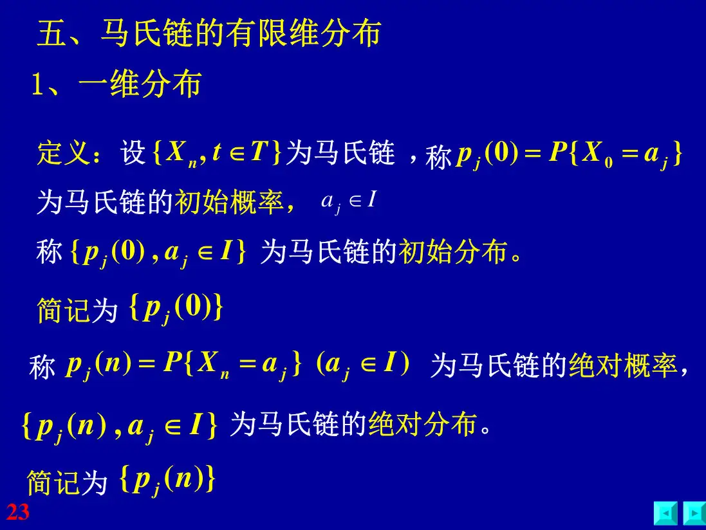

原文：

五、 马 氏链的有限维分布

1、 一维分布

定义： 设 $\textcircled { 1 } \because y = \textcircled { 1 4 }$ 为马 氏链 ， 称 $1 2 \times ( 1 ) = 1 2 ( c m ^ { 2 } )$ 为马 氏链的初始概率， $\langle g \rangle \langle \equiv \langle l$ 称 $( 1 ) 2 ( 1 ) \times ( 1 ) = 1 4$ 为马 氏链的初始分布。简记为 $\textcircled { 1 } \textcircled { 2 } \textcircled { ( 1 ) }$ 称 $1 2 ( 1 0 ) = 1 2 ( 1 0 - 1 ) = 1 2 ( 1 0 ) = 1 0 ( 1 0 - 1 )$ 为马 氏链的绝对概率，$( 1 ) ( m ) \times ( 1 ) = 1 4$ 为马 氏链的绝对分布。简记为 $[ 1 0 , 1 0 , 1 ]$ 口

23

### 2、 绝对概率与初始概率的关系

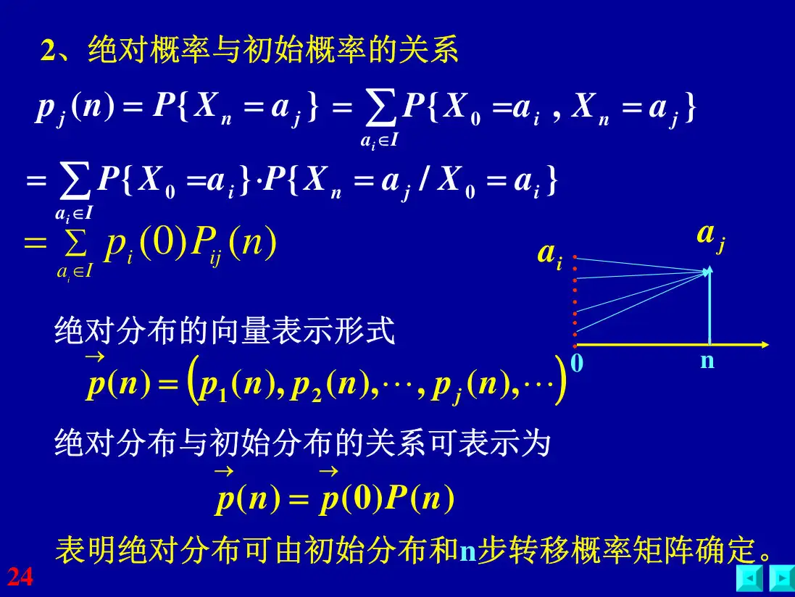

原文：

2、 绝对概率与初始概率的关系

$$
p _ {j} (n) = P \{X _ {n} = a _ {j} \} = \sum_ {a _ {i} \in I} P \{X _ {0} = a _ {i}, X _ {n} = a _ {j} \}
$$

$$
\begin{array}{r l r} & = \sum_ {a _ {i} \in I} P \{X _ {0} = a _ {i} \} \cdot P \{X _ {n} = a _ {j} / X _ {0} = a _ {i} \} \\ & = \sum_ {a _ {i} \in I} p _ {i} (0) P _ {i j} (n) & a _ {i} \end{array}
$$

绝对分布的向量表示形式

$$
\vec {p} (n) = \left(p _ {1} (n), p _ {2} (n), \dots , p _ {j} (n), \dots\right)
$$

绝对分布与初始分布的关系可表示为nPpnp )()0()( =

表明绝对分布可由初始分布和n步转移概率矩阵确定。

24

### 3、 马尔可夫链的有限维分布

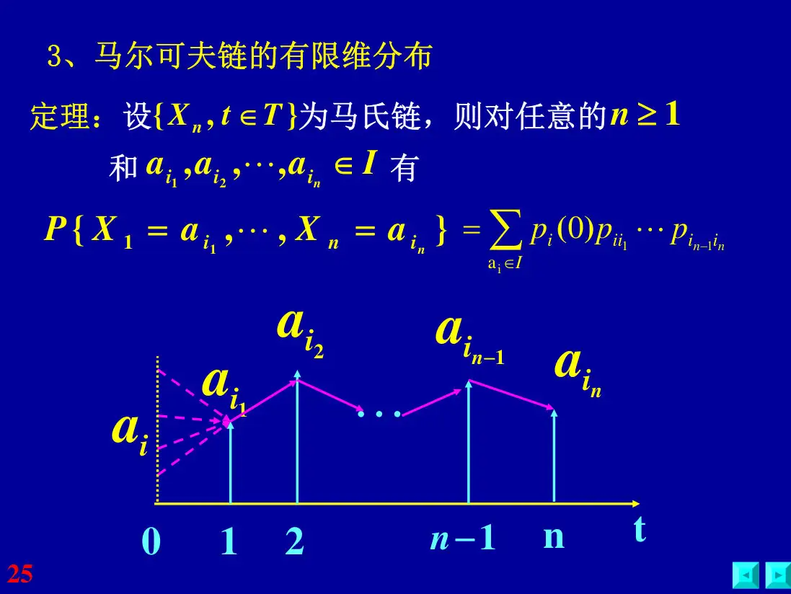

原文：

3、 马尔可夫链的有限维分布

定理： 设 $\angle B = \angle C = 1 8 0 ^ { \circ }$ 为马 氏链， 则对任意的} $n - 1 1$

和 $( 1 ) ( 1 0 0 0 0 0 0 0 0 0 0 0 0 0 0 0 0 0 0 0 0 0 0 0 0 0 0 0 0 0 0 0 0 0 0 0 0 0 0 0 0 0 0 0 0 0 0 0 0 0 0 0 0 0 0 0 0 0 0 0 0 0 0 0 0 0 0 0 0 0 0 0 0 0 0 0 0 0 0 0 0 0 0 0 0 0 0 0 0 0 0 0 0 0 0 0 0 0 0 0 0 0 0 0 0 0 0 0 0 0 0 0 0 0 0 0 0 0 0 0 0 0 0 0 0 0 0 0 0 0 0 0 0 0 0 0 0 0 0 0 0 0 0 0 0 0 0 0 0 0 0 0 0 0 0 0 0 0 0 0 0 0 0 0 0 0 0 0 0 0 0 0 0 0 0 0 0 0 0 0 0 0 0 0 0 0 0 0 0 0 0 0 0 0 0 0 0 0 0 0 0 0 0 0 0 0 0 0 0 0 0 0 0 0 0 0 0 0 0 0 0 0 0 0 0 0 0 0 0 0 0 0 0 0 0 0 0 0 0 0 0 0 0 0 0 0 0 0 0 0 0 0 0 0 0 0 0 0 0 0 0 0 0 0 0 0 0 0 0 0 0 0 0 0 0 0 0 0 0 0 0 0 0 0 0 0 0 0 0 0 0 0 0 0 0 0 0 0 0 0 0 0 0 0 0 0 0 0 0 0 0 0 0 0 0 0 0 0 0 0 0 0 0 0 0 0 0 0 0 0 0 0 0 0 0 0 0 0 0 0 0 0 0 0 0 0 0 0 0 0 0 0 0 0 0 0 0 0 0 0 0 0 0 0 0 0 0 0 0 0 0 0 0 0 0 0 0 0 0 0 0 0 0 0 0 0 0 0 0 0 0 0 0 0 0 0 0 0 0 0 0 0 0 0 0 0 0 0 0 0 0 0 0 0 0 0 0 0 0 0 0 0 0 0 0 0 0 0 0 0 0 0 0 0 0 0 0 0 0 0 0 0 0 0 0 0 0 0 0 0 0 0 0 0 0 0 0 0 0 0 0 0 0 0 0 0 0 0 0 0 0 0 0 0 0 0 0 0 0 0 0 0 0 0 0 0 0 0 0 0 0 0 0 0 0 0 0 0 0 0 0 0 0 0 0 0 0 0 0 0 0 0 0 0 0 0 0 0 0 0 0 0 0 0 0 0 0 0 0 0 0 0 0 0 0 0 0 0 0 0 0 0 0 0 0 0 0 0 0 0 0 0 0 0 0 0 0 0 0 0 0 0 0 0 0 0 0 0 0 0 0 0$ 有

$$
P \{X _ {1} = a _ {i _ {1}}, \dots , X _ {n} = a _ {i _ {n}} \} = \sum_ {a _ {i} \in I} p _ {i} (0) p _ {i i _ {1}} \dots p _ {i _ {n - 1} i _ {n}}
$$

25

口

### 证 ：

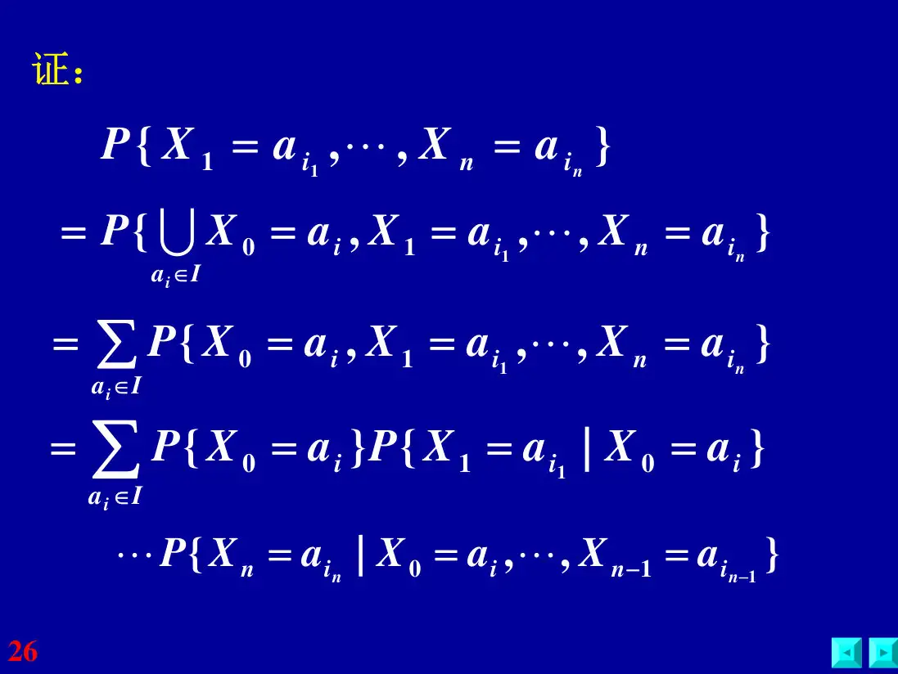

原文：

证 ：

$$
P \{X _ {1} = a _ {i _ {1}}, \dots , X _ {n} = a _ {i _ {n}} \}
$$

$$
= P \{\bigcup_ {a _ {i} \in I} X _ {0} = a _ {i}, X _ {1} = a _ {i _ {1}}, \dots , X _ {n} = a _ {i _ {n}} \}
$$

$$
= \sum_ {a _ {i} \in I} P \{X _ {0} = a _ {i}, X _ {1} = a _ {i _ {1}}, \dots , X _ {n} = a _ {i _ {n}} \}
$$

$$
= \sum_ {a _ {i} \in I} P \{X _ {0} = a _ {i} \} P \{X _ {1} = a _ {i _ {1}} \mid X _ {0} = a _ {i} \}
$$

$$
\dots P \{X _ {n} = a _ {i _ {n}} \mid X _ {0} = a _ {i}, \dots , X _ {n - 1} = a _ {i _ {n - 1}} \}
$$

26

口

### $$

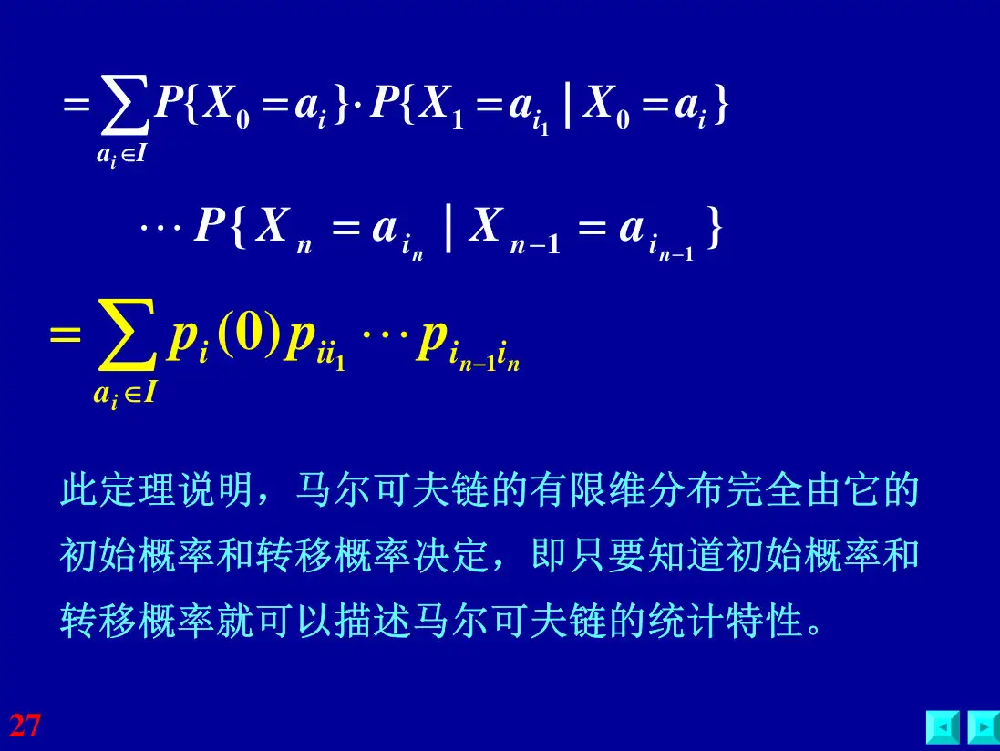

原文：

$$
= \sum_ {a _ {i} \in I} P \{X _ {0} = a _ {i} \} \cdot P \{X _ {1} = a _ {i _ {1}} \mid X _ {0} = a _ {i} \}
$$

$$
\dots P \{X _ {n} = a _ {i _ {n}} \mid X _ {n - 1} = a _ {i _ {n - 1}} \}
$$

$$
= \sum_ {a _ {i} \in I} p _ {i} (0) p _ {i i _ {1}} \dots p _ {i _ {n - 1} i _ {n}}
$$

此定理说明， 马尔可夫链的有限维分布完全由它的初始概率和转移概率决定， 即只要知道初始概率和转移概率就可以描述马尔可夫链的统计特性。

27

口

### 推论：

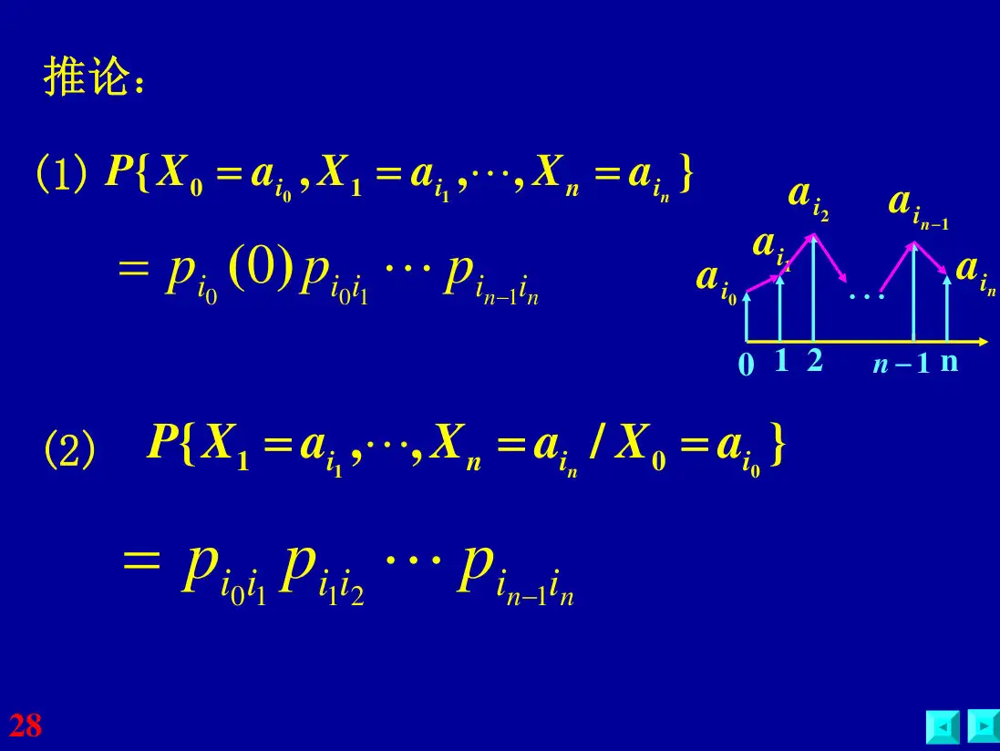

原文：

推论：

$$
\begin{array}{r l} & {(1) P \{X _ {0} = a _ {i _ {0}}, X _ {1} = a _ {i _ {1}}, \dots , X _ {n} = a _ {i _ {n}} \}} \\ & {\qquad = p _ {i _ {0}} (0) p _ {i _ {0} i _ {1}} \dots p _ {i _ {n - 1} i _ {n}}} \end{array}
$$

$$
a _ {i _ {0}} \quad a _ {i _ {1}} \quad a _ {i _ {2}} \quad \dots \quad a _ {i _ {n - 1}} \quad a _ {i _ {n}}
$$

( 2 ) $1 2 0 m - 1 0 0 0 m = 1 0 0 0 m - 1 0 0 m$

$$
= p _ {i _ {0} i _ {1}} p _ {i _ {1} i _ {2}} \dots p _ {i _ {n - 1} i _ {n}}
$$

28

口

### 例 : 两种状态的马 氏链

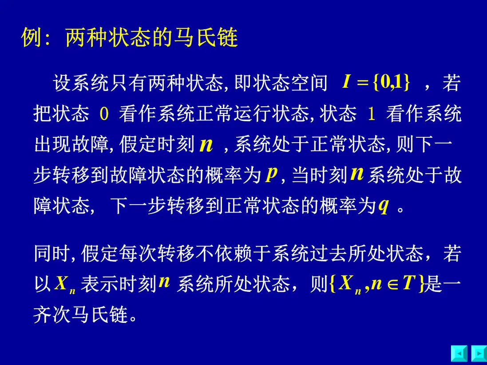

原文：

例 : 两种状态的马 氏链

设系统只有两种状态 即状态空间 ， 若I = }1,0{把状态 0 看作系统正常运行状态 状态 1 看作系统出现故障 假定时刻 系统处于正常状态 则下一n步转移到故障状态的概率为 当时刻 系统处于故np障状态 下一步转移到正常状态的概率为 。q

同时 假定每次转移不依赖于系统过去所处状态， 若以 表示时刻 系统所处状态， 则X n { $\angle B = \angle C = 9 0 ^ { \circ }$ 是}齐次马 氏链。

口

### 一步转移概率矩阵为：

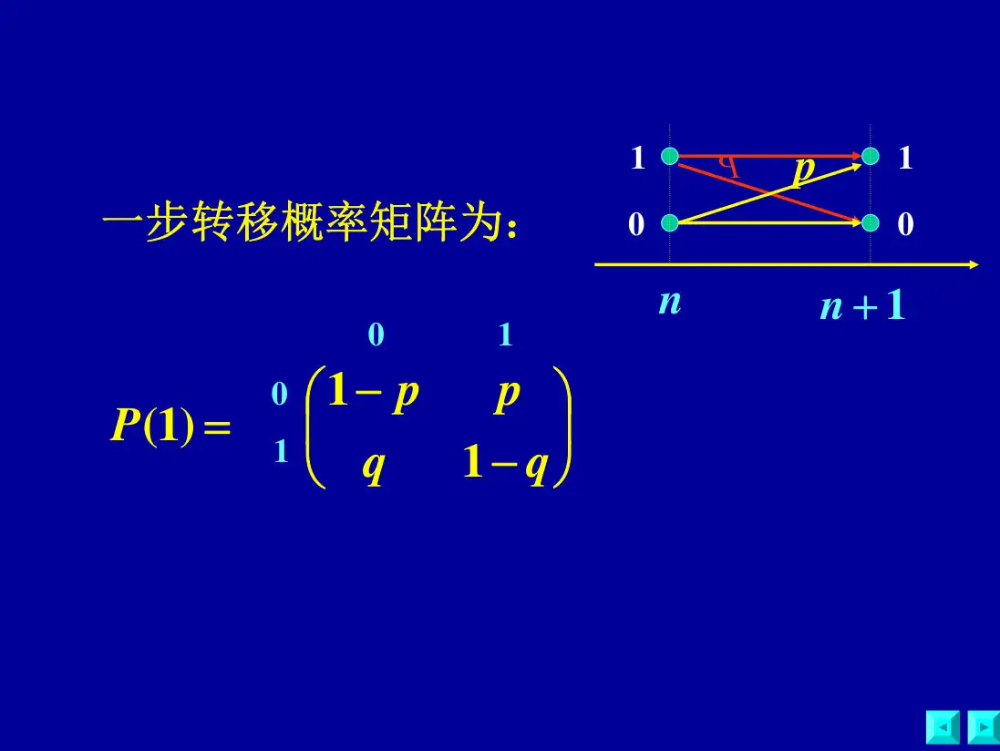

原文：

一步转移概率矩阵为：

$$
P (1) = \begin{array}{c} 0 \\ 1 \end{array} \left( \begin{array}{c c} 1 - p & p \\ q & 1 - q \end{array} \right)
$$

口

### 第 31 页

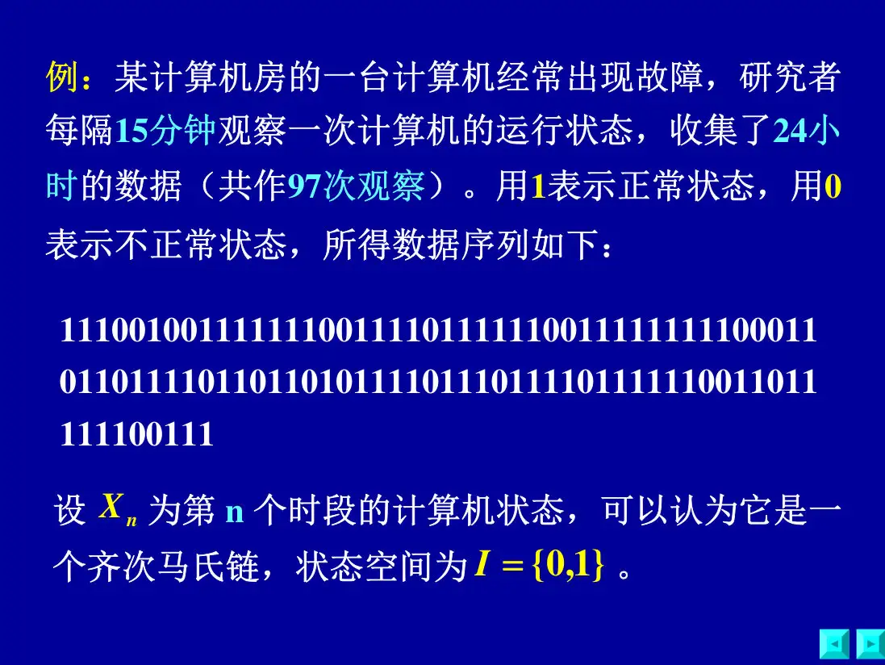

原文：

例： 某计算机房的一台计算机经常出现故障， 研究者每隔15分钟观察一次计算机的运行状态， 收集了24小时的数据 （共作97次观察） 。 用1表示正常状态 用0表示不正常状态， 所得数据序列如下：

1 1 1001001 1 1 1 1 1 1001 1 1 101 1 1 1 1 1001 1 1 1 1 1 1 1 10001 1 01 101 1 1 101 101 10101 1 1 101 1 101 1 1 101 1 1 1 1 1001 101 1 1 1 1 1001 1 1

设 为第 n 个时段的计算机状态， 可以认为它是一Xn个齐次马 氏链， 状态空 间为 。I = }1,0{

口

### 我们可以用统计的方法来确定它的一步转移概率

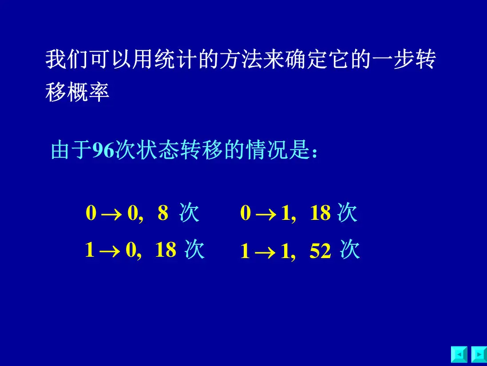

原文：

我们可以用统计的方法来确定它的一步转移概率

由于96次状态转移的情况是：

→ 8,00 次

→ 18,01 次

→ 18,10 次

→ 5211 次

口

### 因此， 一步转移概率可用频率近似地表示为 ：

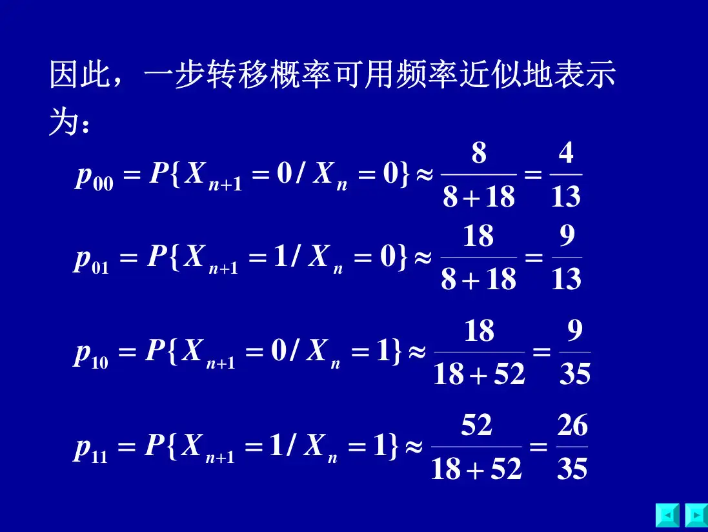

原文：

因此， 一步转移概率可用频率近似地表示为 ：

$$
p _ {0 0} = P \{X _ {n + 1} = 0 / X _ {n} = 0 \} \approx \frac {8}{8 + 1 8} = \frac {4}{1 3}
$$

$$
p _ {0 1} = P \{X _ {n + 1} = 1 / X _ {n} = 0 \} \approx \frac {1 8}{8 + 1 8} = \frac {9}{1 3}
$$

$$
p _ {1 0} = P \{X _ {n + 1} = 0 / X _ {n} = 1 \} \approx \frac {1 8}{1 8 + 5 2} = \frac {9}{3 5}
$$

$$
p _ {1 1} = P \{X _ {n + 1} = 1 / X _ {n} = 1 \} \approx \frac {5 2}{1 8 + 5 2} = \frac {2 6}{3 5}
$$

口

### 一步转移概率矩阵为：

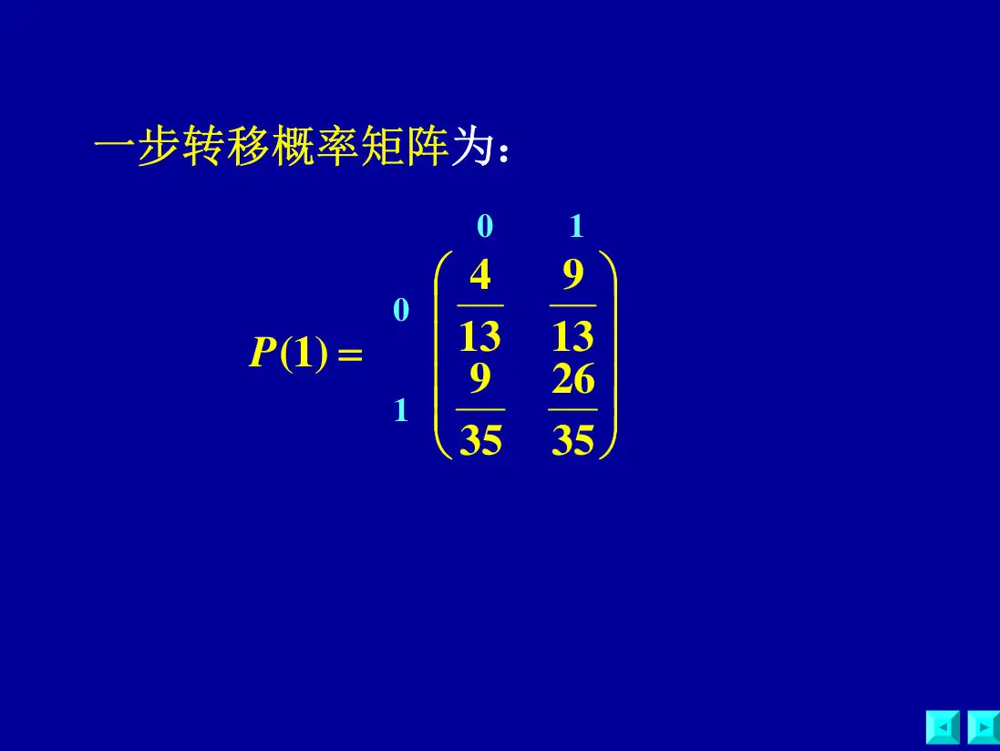

原文：

一步转移概率矩阵为：

$$
P (1) = \begin{array}{l} 0 \\ 1 \end{array} \left( \begin{array}{c c} 0 & 1 \\ \frac {4}{1 3} & \frac {9}{1 3} \\ \frac {9}{3 5} & \frac {2 6}{3 5} \end{array} \right)
$$

口

### 第 35 页

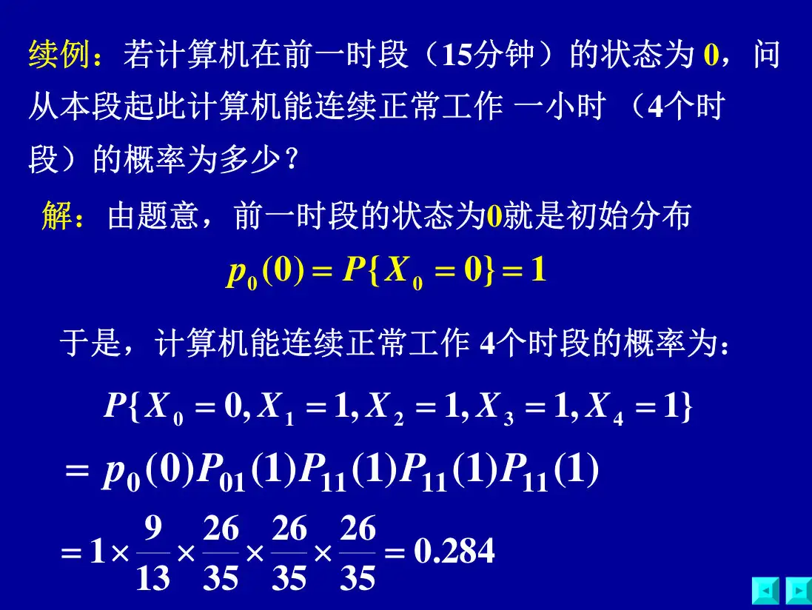

原文：

续例： 若计算机在前一时段 （15分钟 ） 的状态为 0 问从本段起此计算机能连续正常工作 一小时 （4个时段） 的概率为多少 ？解： 由题意， 前一时段的状态为0就是初始分布$/ \angle B ( 0 ) = 1 2 0 ^ { \circ } , \angle 1 = 1 2 5 ^ { \circ }$ 于是， 计算机能连续正常工作 4个时段的概率为：$1 2 0 0 0 0 0 0 0 0 0 0 0 0 0 0 0 0 0 0 0 0 0 0 0 0 0 0 0 0 0 0 0 0 0 0 0 0 0 0 0 0 0 0 0 0 0 0 0 0 0 0 0 0 0 0 0 0 0 0 0 0 0 0 0 0 0 0 0 0 0 0 0 0 0 0 0 0 0 0 0 0 0 0 0 0 0 0 0 0 0 0 0 0 0 0 0 0 0 0 0 0 0 0 0 0 0 0 0 0 0 0 0 0 0 0 0 0 0 0 0 0 0 0 0 0 0 0 0 0 0 0 0 0 0 0 0 0 0 0 0 0 0 0 0 0 0 0 0 0 0 0 0 0 0 0 0 0 0 0 0 0 0 0 0 0 0 0 0 0 0 0 0 0 0 0 0 0 0 0 0 0 0 0 0 0 0 0 0 0 0 0 0 0 0 0 0 0 0 0 0 0 0 0 0 0 0 0 0 0 0 0 0 0 0 0 0 0 0 0 0 0 0 0 0 0 0 0 0 0 0 0 0 0 0 0 0 0 0 0 0 0 0 0 0 0 0 0 0 0 0 0 0 0 0 0 0 0 0 0 0 0 0 0 0 0 0 0 0 0 0 0 0 0 0 0 0 0 0 0 0 0 0 0 0 0 0 0 0 0 0 0 0 0 0 0 0 0 0 0 0 0 0 0 0 0 0 0 0 0 0 0 0 0 0 0 0 0 0 0 0 0 0 0 0 0 0 0 0 0 0 0 0 0 0 0 0 0 0 0 0 0 0 0 0 0 0 0 0 0 0 0 0 0 0 0 0 0 0 0 0 0 0 0 0 0 0 0 0 0 0 0 0 0 0 0 0 0 0 0 0 0 0 0 0 0 0 0 0 0 0 0 0 0 0 0 0 0 0 0 0 0 0 0 0 0 0 0 0 0 0 0 0 0 0 0 0 0 0 0 0 0 0 0 0 0 0 0 0 0 0 0 0 0 0 0 0 0 0 0 0 0 0 0 0 0 0 0 0 0 0 0 0 0 0 0 0 0 0 0 0 0 0 0 0 0 0 0 0 0 0 0 0 0 0 0 0 0 0 0 0 0 0 0 0 0 0 0 0 0 0 0 0 0 0 0 0 0 0 0 0 0 0 0 0 0 0 0 0 0 0 0 0 0 0 0 0 0 0 0 0 0 0 0 0 0 0 0 0 0 0 0 0 0 0 0 0 0 0 0 0 0 0 0 0 0 0 0 0 0 0 0 0 0 0 0 0 0 0 0 0 0 0 0 0 0 0 0 0 0 0 0 0 0 0 0$ $- \eta _ { \mathrm { d i f f } } ( 0 ) 2 \eta _ { \mathrm { d f f } } ( 0 ) 2 \eta _ { \mathrm { d f f } } ( 0 ) 2 \eta _ { \mathrm { d f f } } ( 0 ) 2 \eta _ { \mathrm { d f f } } ( 0 ) 2 \eta _ { \mathrm { d f f } } ( 0 ) 2$ 26262691 ××××= 2840=35353513 口
