# 《概率论与数理统计》第1章 事件的独立性（课件）

原件的每一页，下面附识别出的文字。

### 设事件 A=‘第一颗骰子出现点数为1’，

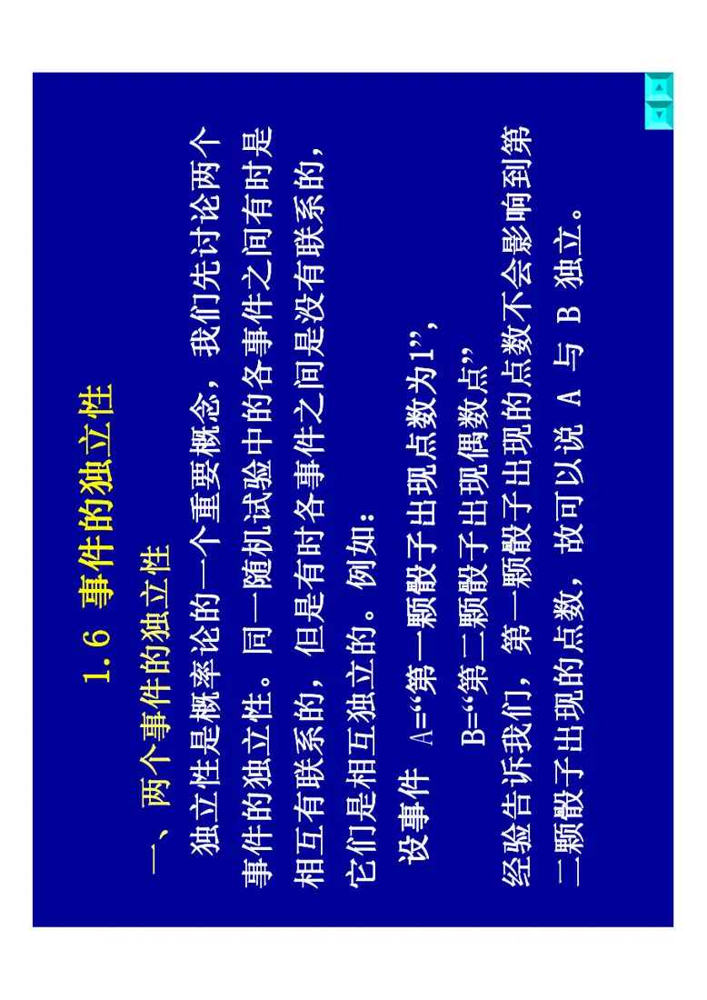

原文：

经验告诉我们，第一颗骰子出现的点数不会影响到第二颗骰子出现的点数，故可以说 A 与 B 独立。

设事件 A=‘第一颗骰子出现点数为1’，

独立性是概率论的一个重要概念，我们先讨论两个事件的独立性。同一随机试验中的各事件之间有时是相互有联系的，但是有时各事件之间是没有联系的，

1.6 事件的独立性

### 第 2 页

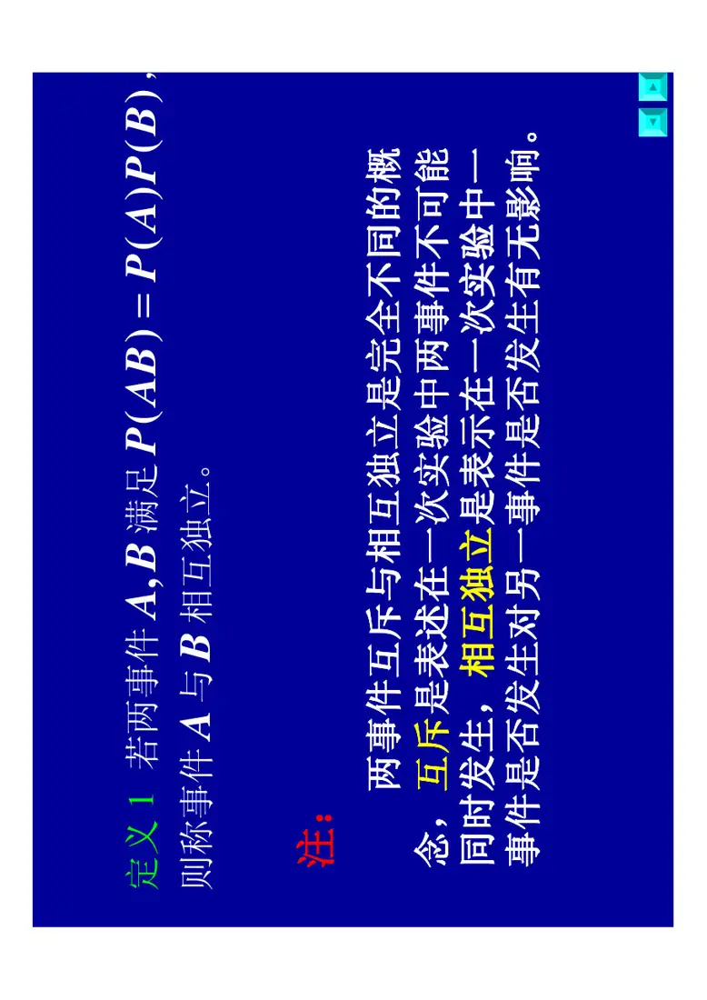

原文：

两事件互斥与相互独立是完全不同的概念，互斥是表述在一次实验中两事件不可能同时发生，相互独立是表示在一次实验中一事件是否发生对另一事件是否发生有无影响。

定义 1 若两事件 A, B 满足 P(AB) = P(A)P(B), 则称事件 A 与 B 相互独立。

### 定理 1 若 $P(B)>0$ ，则事件 A 与 B 相互独立

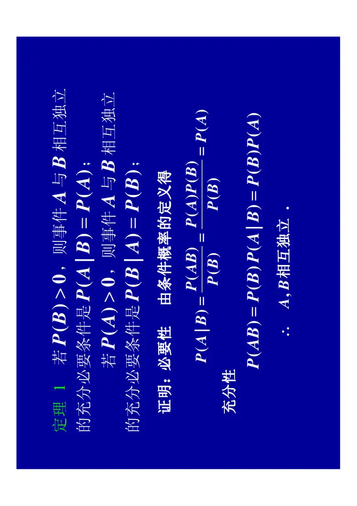

原文：

定理 1 若 $P(B)>0$ ，则事件 A 与 B 相互独立
的充分必要条件是 $P(A|B)=P(A)$ ;
若 $P(A)>0$ ，则事件 A 与 B 相互独立
的充分必要条件是 $P(B|A)=P(B)$ ;

### ∴ A, B 相互独立.

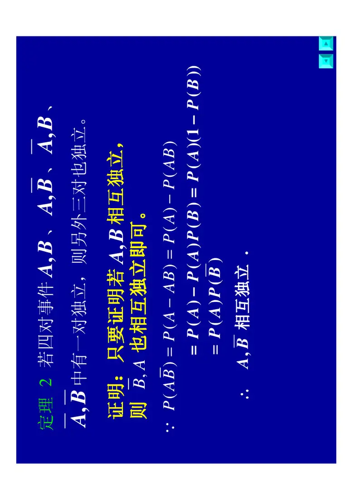

原文：

∴ A, B 相互独立.

$\therefore P(A \overline{B}) = P(A - AB) = P(A) - P(AB)$ $= P(A) - P(A)P(B) = P(A)(1 - P(B))$

证明: 只要证明若 A, B 相互独立, 则 $\overline{B}, A$ 也相互独立即可。

定理 2 若四对事件 A, B、A, B、A, B、
A, B 中有一对独立，则另外三对也独立。

### 第 5 页

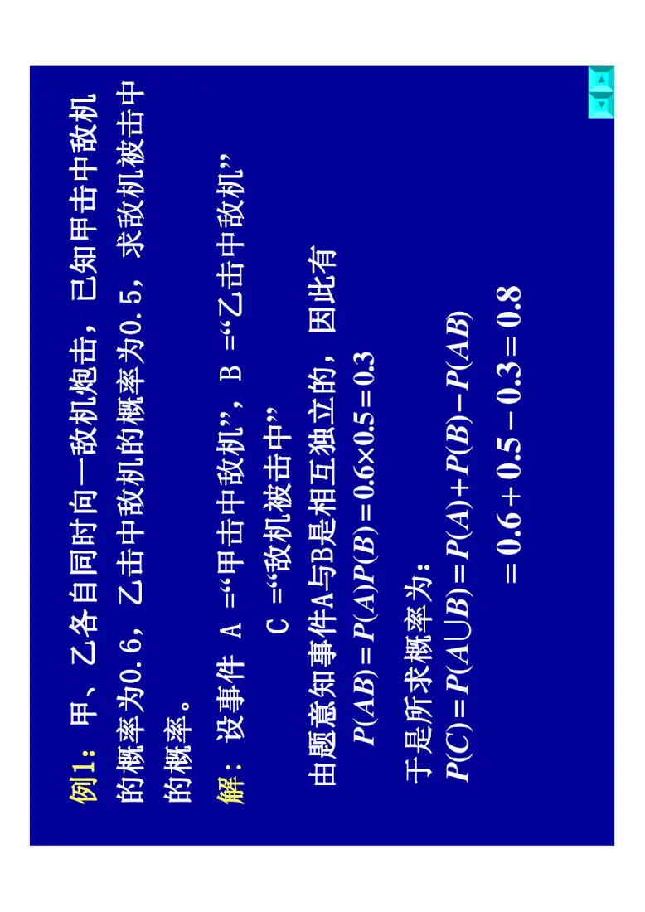

原文：

于是所求概率为： $P(C)=P(A\cup B)=P(A)+P(B)-P(AB)$ $=0.6+0.5-0.3=0.8$

由题意知事件A与B是相互独立的，因此有 $P(AB)=P(A)P(B)=0.6\times0.5=0.3$

解：设事件 A = “甲击中敌机”，B = “乙击中敌机”，C = “敌机被击中”

例1: 甲、乙各自同时向一敌机炮击，已知甲击中敌机的概率为0.6，乙击中敌机的概率为0.5，求敌机被击中的

### 第 6 页

原文：

二、多个事件的独立性 1、三个事件的独立性 定义 对于三个事件 A, B, C，若 P(AB) = P(A)P(B) P(AC) = P(A)P(C) P(BC) = P(B)P(C) P(ABC) = P(A)P(B)P(C) 则称三个事件 A, B, C 相互独立。

### 则称 $A_{1}, A_{2}, \cdots, A_{n}$ 相互独立。

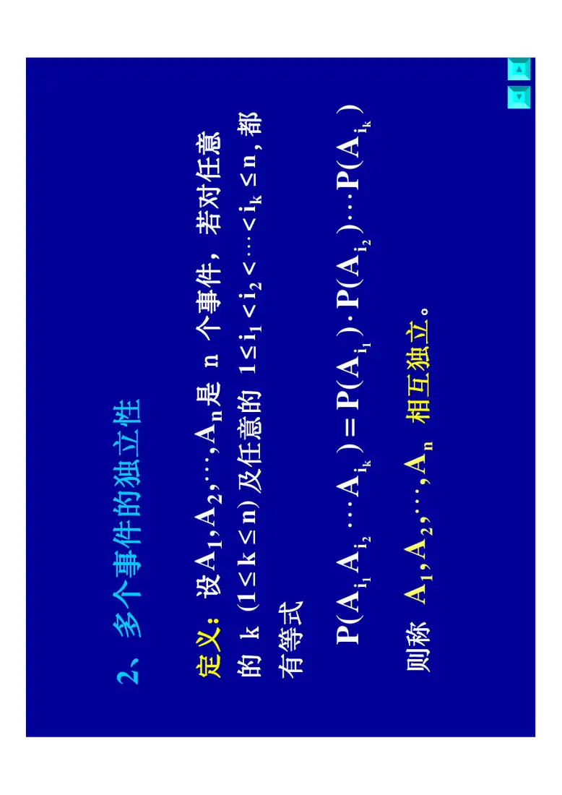

原文：

则称 $A_{1}, A_{2}, \cdots, A_{n}$ 相互独立。

$\mathrm{P(A_{i_1}A_{i_2}\cdots A_{i_k}) = P(A_{i_1})\cdot P(A_{i_2})\cdots P(A_{i_k})}$

定义: 设 $A_{1}, A_{2}, \ldots, A_{n}$ 是 $n$ 个事件，若对任意的 $k (1 \leq k \leq n)$ 及任意的 $1 \leq i_{1} < i_{2} < \ldots < i_{k} \leq n$ ，都

2、多个事件的独立性

### 第 8 页

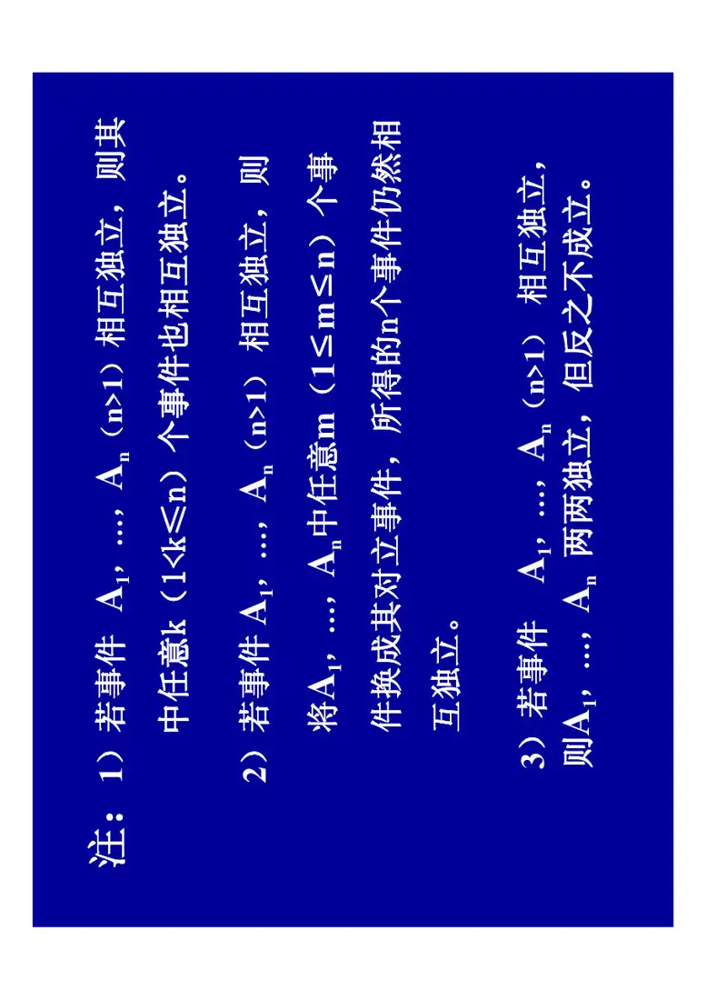

原文：

3）若事件 $A_{1}, \ldots, A_{n}$ (n>1) 相互独立，则 $A_{1}, \ldots, A_{n}$ 两两独立，但反之不成立。

2) 若事件 $A_{1}, \ldots, A_{n}$ (n>1) 相互独立，则将 $A_{1}, \ldots, A_{n}$ 中任意 m ( $1 \leq m \leq n$ ) 个事件换成其对立事件，所得的 n 个事件仍然相

注：1）若事件 $A_{1}, \ldots, A_{n}$ (n>1) 相互独立，则其中任意 k （1<k≤n）个事件也相互独立。

### 第 9 页

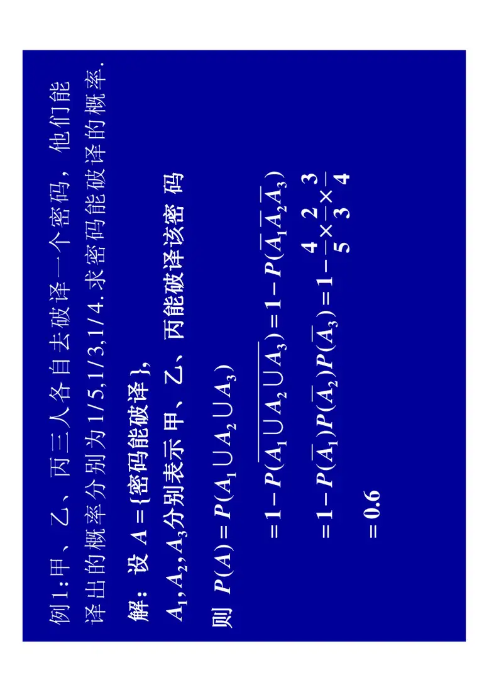

原文：

$\overline{1 - P(A_1 \cup A_2 \cup A_3)} = 1 - P(\overline{A_1} \overline{A_2} \overline{A_3}) = 1 - P(\overline{\overline{A_1}})P(\overline{\overline{A_2}})P(\overline{\overline{A_3}}) = 1 - \frac{4}{5}\times \frac{2}{3}\times \frac{3}{4}$

则 $P(A) = P(A_{1} \cup A_{2} \cup A_{3})$

例1:甲、乙、丙三人各自去破译一个密码，他们能译出的概率分别为1/5,1/3,1/4.求密码能破译的概率.

### 第 10 页

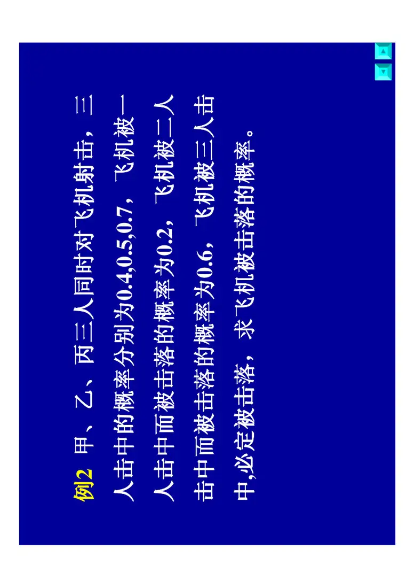

原文：

例2 甲、乙、丙三人同时对飞机射击，三人击中的概率分别为0.4,0.5,0.7，飞机被一人击中而被击落的概率为0.2，飞机被二人击中而被击落的概率为0.6，飞机被三人击中，必定被击落，求飞机被击落的概率。

### 第 11 页

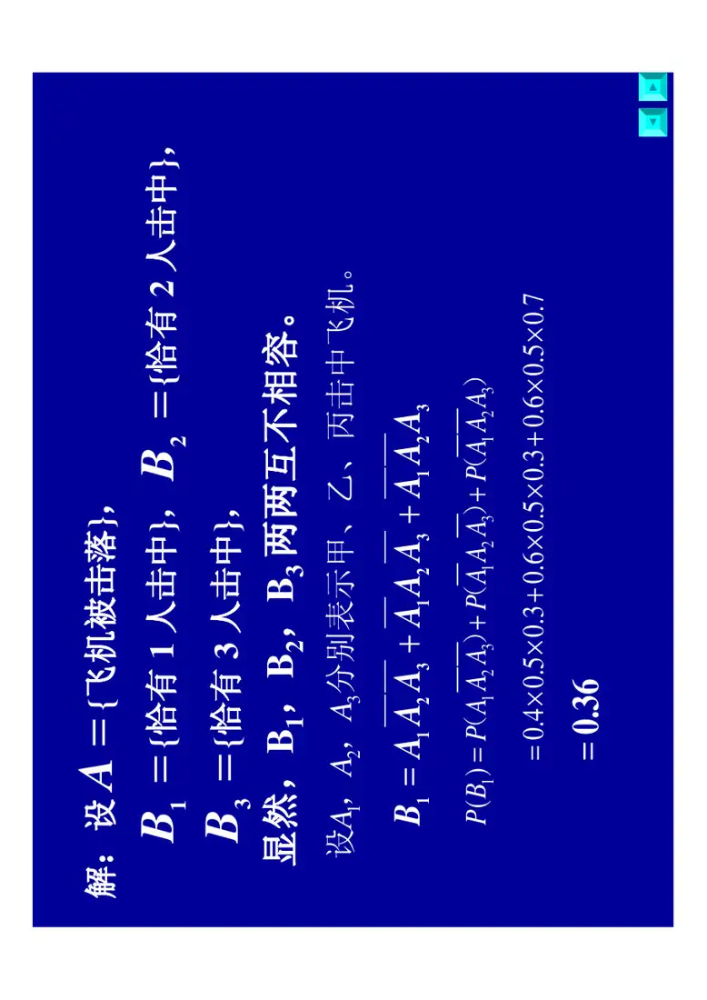

原文：

$P(B_{1}) = P(A_{1}A_{2}A_{3}) + P(A_{1}A_{2}A_{3}) + P(A_{1}A_{2}A_{3})$

$B_{1} = A_{1}A_{2}A_{3} + A_{1}A_{2}A_{3} + A_{1}A_{2}A_{3}$

设 $A_{1}$ ， $A_{2}$ ， $A_{3}$ 分别表示甲、乙、丙击中飞机。

### 因此， $P(A)=\sum P(B_{i})P(A|B_{i})=0.458$

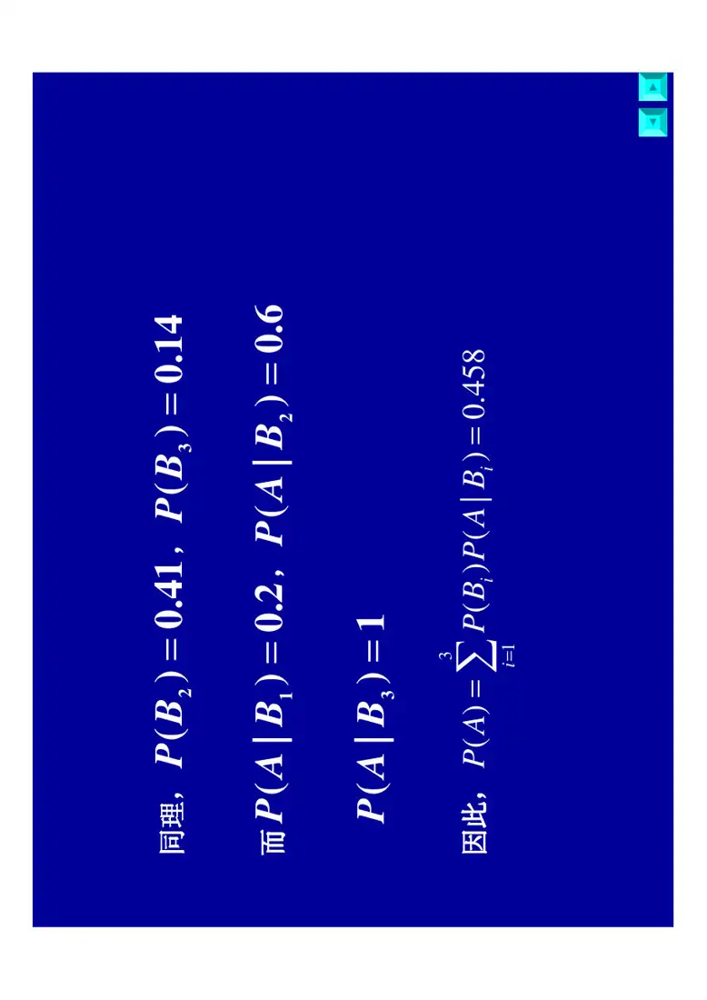

原文：

因此， $P(A)=\sum P(B_{i})P(A|B_{i})=0.458$

$P(A|B_{3}) = 1$

而 $P(A|B_{1})=0.2,\ P(A|B_{2})=0.6$

同理， $P(B_{2})=0.41,\ P(B_{3})=0.14$

### 第 13 页

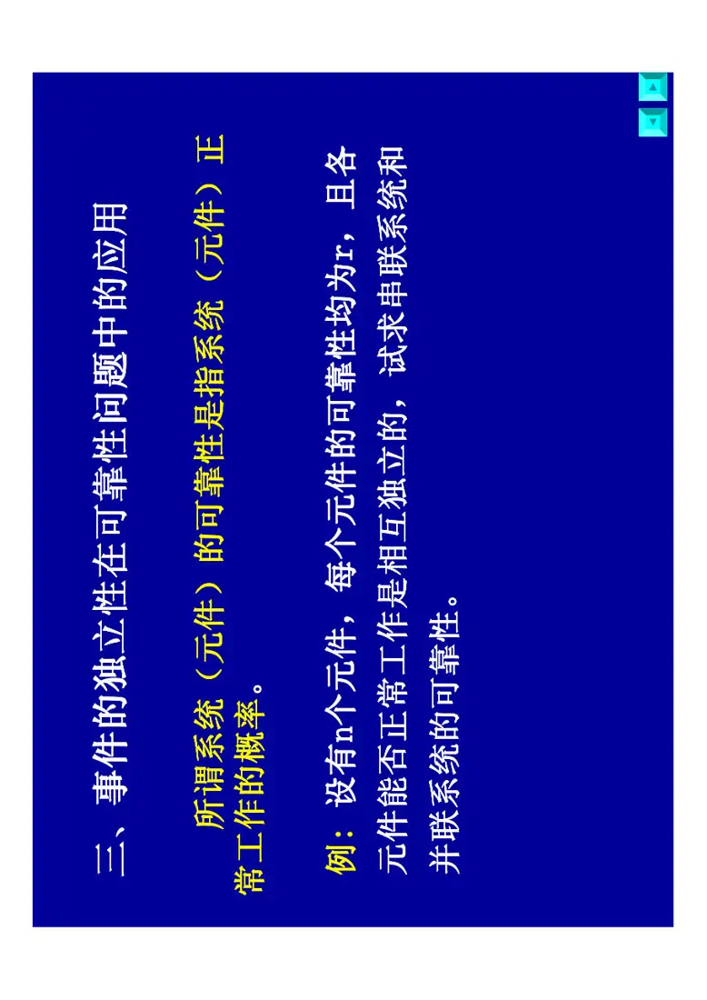

原文：

例：设有n个元件，每个元件的可靠性均为r，且各元件能否正常工作是相互独立的，试求串联系统和并联系统的可靠性。

所谓系统（元件）的可靠性是指系统（元件）正三、事件的独立性在可靠性问题中的应用由于 r<1 所以，串联系统的可靠性随着 n 的增大而减少。

### 所以串联系统的可靠性为：

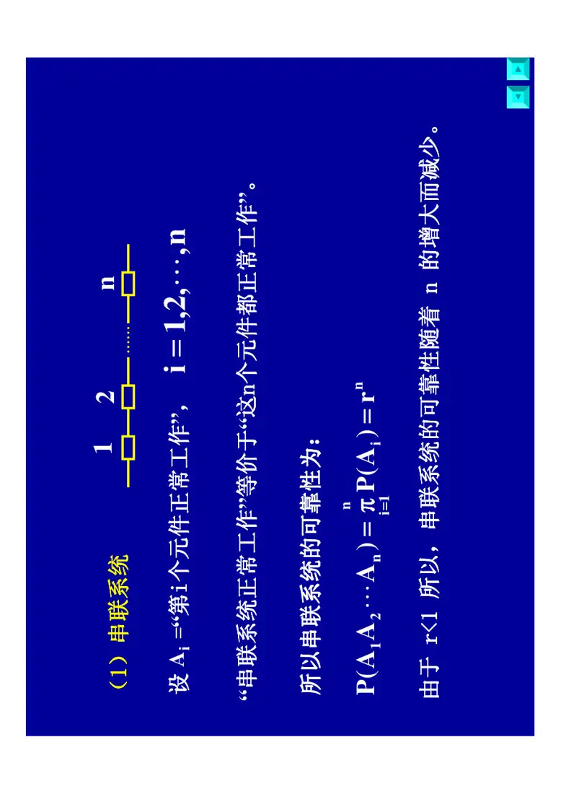

原文：

$\mathrm{P(A_1A_2\dots A_n)} = \pi \mathrm{P(A_i)} = \mathrm{r}^{\mathrm{n}}$

所以串联系统的可靠性为：

“串联系统正常工作”，等价于“这n个元件都正常工作”。

设 $A_i =$ “第i个元件正常工作”， $i = 1,2,\cdots,n$ (1) 串联系统
1 2 n
□ □ …… □可见并联系统的可靠性高于串联系统。

### 所以并联系统的可靠性为：

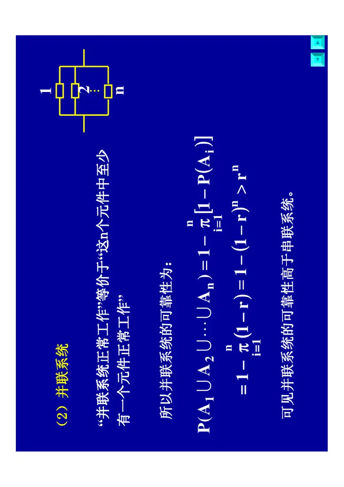

原文：

$\mathrm{P(A_1\cup A_2\cup\dots\cup A_n) = 1 - \pi_{i = 1}^{n}[1 - P(A_i)]}$ $= 1 - \pi_{i = 1}^{n}(1 - r) = 1 - (1 - r)^n >r^n$

所以并联系统的可靠性为：

“并联系统正常工作”等价于“这n个元件中至少有一个元件正常工作”

(2) 并联系统

1 2 ... n

### 混联系统的可靠性一般可以分解为若干串联或并联系系统，从而逐步求得其可靠性

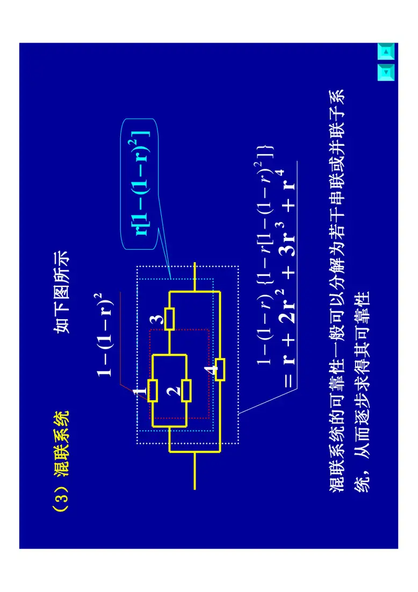

原文：

混联系统的可靠性一般可以分解为若干串联或并联系系统，从而逐步求得其可靠性

$\left. \begin{array}{l} 1 - (1 - r) \{1 - r[1 - (1 - r)^2] \} \\ = r + 2r^2 + 3r^3 + r^4 \end{array} \right\}$

$\mathrm{r}[1-(1-r)^{2}]$

$1-(1-r)^{2}$

如下图所示(3) 混联系统

### 在一次实验中我们只关心某个事件A

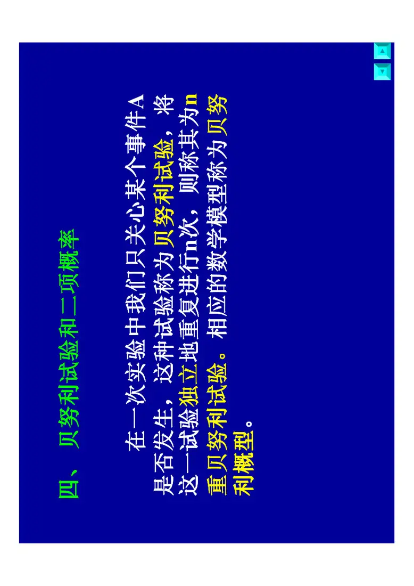

原文：

在一次实验中我们只关心某个事件A
是否发生，这种试验称为贝努利试验，将
这一试验独立地重复进行n次，则称其为n
重贝努利试验。相应的数学模型称为贝努
利模型。

四、贝努利试验和二项概率

### 在n重贝努里试验中，我们主要研究事件A恰好出现k次的概率 $P_{n}(k)$

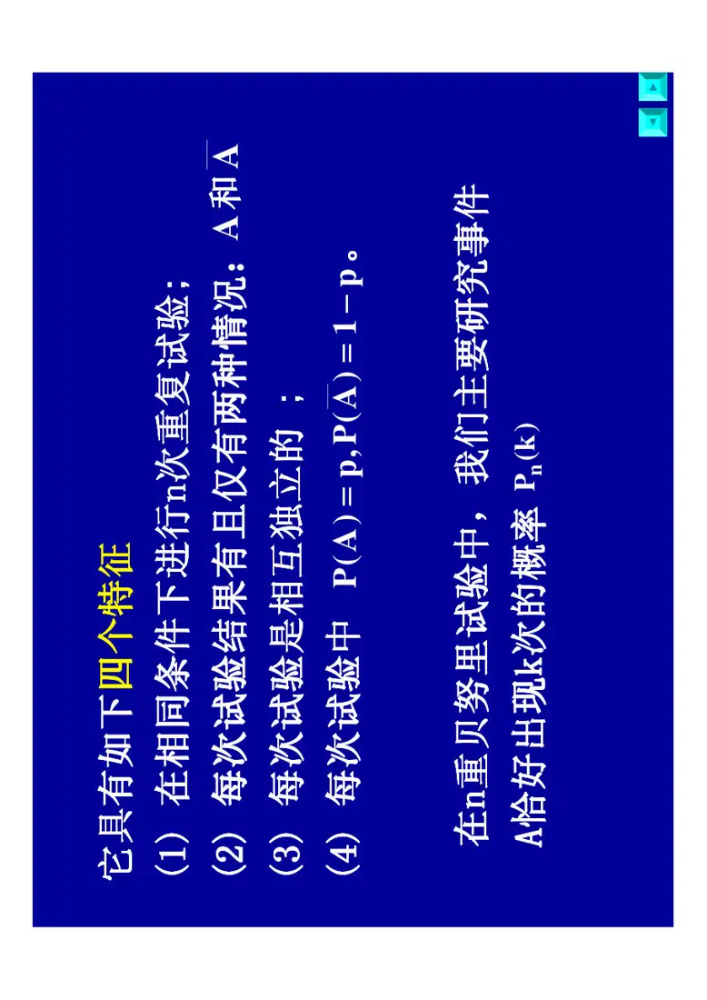

原文：

在n重贝努里试验中，我们主要研究事件A恰好出现k次的概率 $P_{n}(k)$

它具有如下四个特征
(1) 在相同条件下进行n次重复试验；
(2) 每次试验结果有且仅有两种情况：A和A
(3) 每次试验是相互独立的；
(4) 每次试验中 $P(A)=p, P(\overline{A})=1-p$ 。

### k n-k

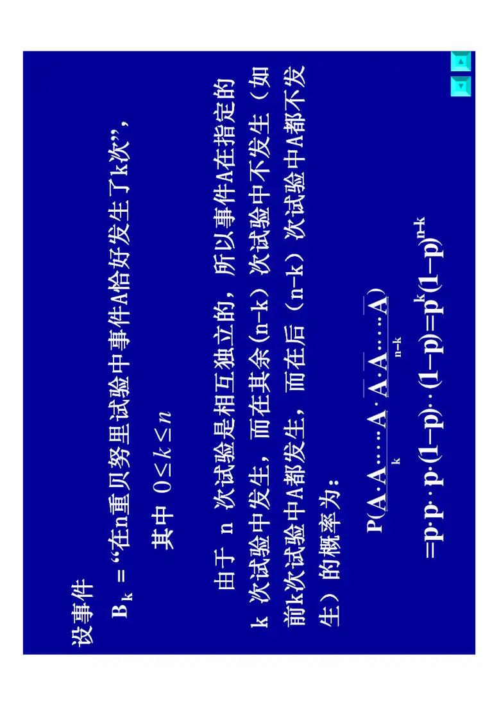

原文：

$= p \cdot p \cdot p \cdot (1 - p) \cdot (1 - p) = p^k (1 - p)^{n-k}$

k n-k

P(A·A···A·A·A···A)

生）的概率为：

由于 n 次试验是相互独立的，所以事件A在指定的 k 次试验中发生，而在其余(n-k)次试验中不发生（如前k次试验中A都发生，而在后(n-k)次试验中A都不发

其中 0≤k≤n

$B_{k}$ = “在n重贝努里试验中事件A恰好发生了k次”，

设事件

### 公式称为二项概率公式。

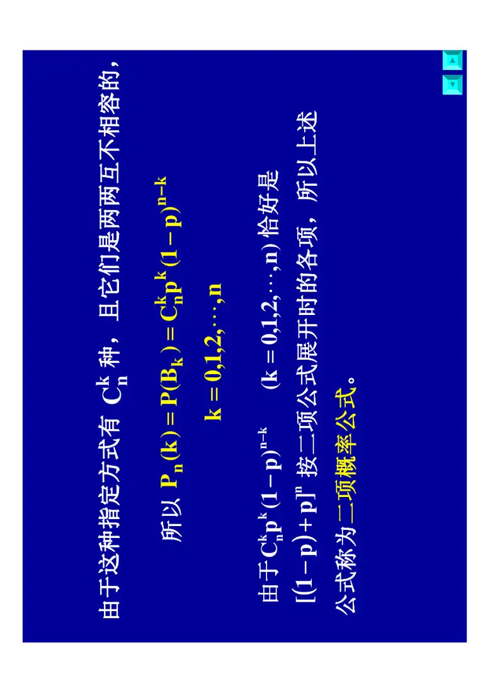

原文：

公式称为二项概率公式。

由于 $C_{n}^{k}p^{k}(1-p)^{n-k}$ (k=0,1,2,...,n) 恰好是 $[(1-p)+p]^{n}$ 按二项公式展开时的各项，所以上述

k = 0,1,2,...,n

所以 $P_{n}(k)=P(B_{k})=C_{n}^{k}p^{k}(1-p)^{n-k}$

由于这种指定方式有 $C_{n}^{k}$ 种，且它们是两互不相容的，

### 因此，我们有如下的定理

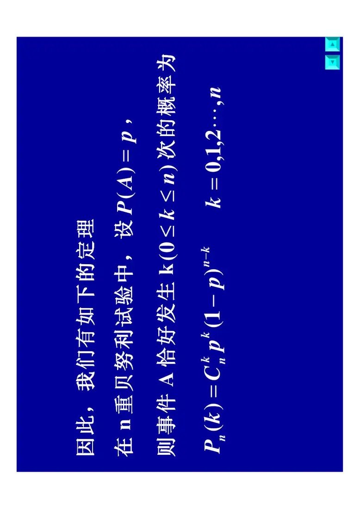

原文：

因此，我们有如下的定理
在 n 重贝努利试验中，设 $P(A)=p$ 则事件 A 恰好发生 $k(0 \leq k \leq n)$ 次的概率为 $P_{n}(k)=C_{n}^{k}p^{k}(1-p)^{n-k}$ $k=0,1,2\cdots,n$ 种情形下甲最终获胜的概率。
(1) 采用三盘比赛制；
(2) 采用五盘比赛制；
(3) 采用九盘比赛制。

### 第 22 页

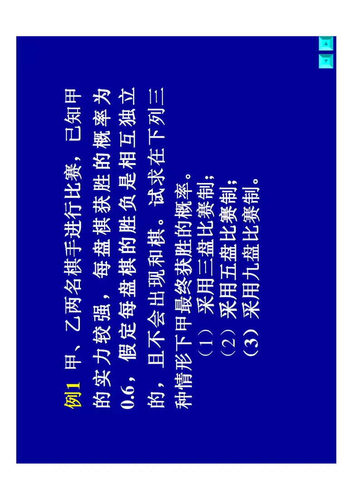

原文：

例1 甲、乙两名棋手进行比赛，已知甲的实力较强，每盘棋获胜的概率为0.6；假定每盘棋的胜负是相互独立的，且不会出现和棋。试求在下列三

### 显然，每盘比赛只有甲胜和甲负两种结果，

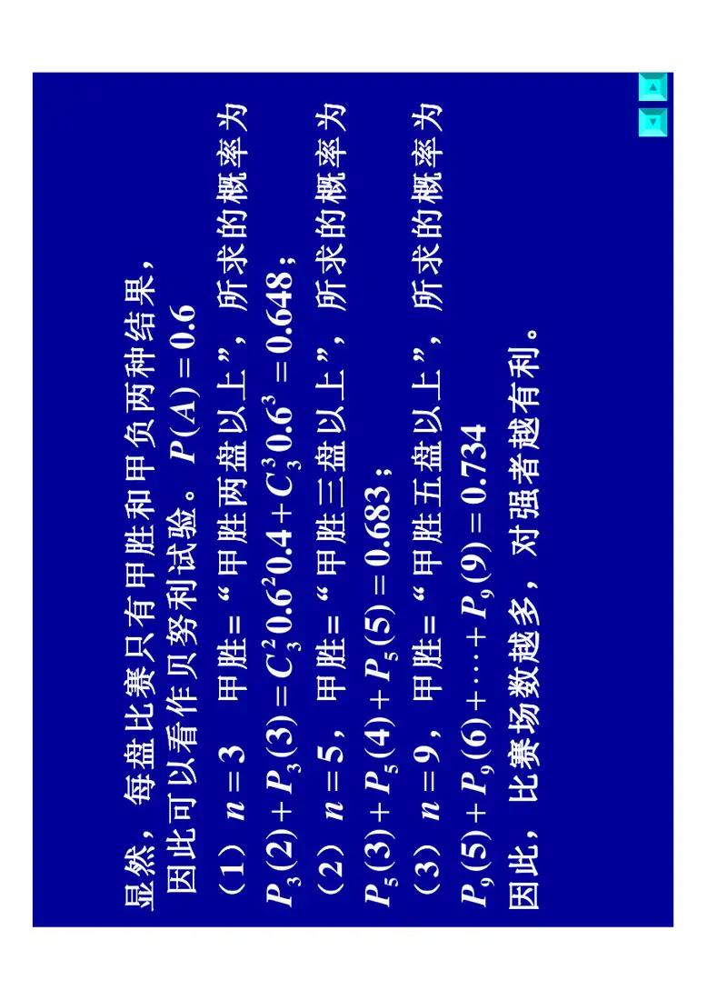

原文：

显然，每盘比赛只有甲胜和甲负两种结果，
因此可以看作贝努利试验。 $P(A)=0.6$ (1) n=3 甲胜=“甲胜两盘以上”，所求的概率为 $P_{3}(2)+P_{3}(3)=C_{3}^{2}0.6^{2}0.4+C_{3}^{3}0.6^{3}=0.648;$ (2) n=5 甲胜=“甲胜三盘以上”，所求的概率为 $P_{5}(3)+P_{5}(4)+P_{5}(5)=0.683;$ (3) n=9 甲胜=“甲胜五盘以上”，所求的概率为 $P_{9}(5)+P_{9}(6)+\cdots+P_{9}(9)=0.734$ 因此，比赛场数越多，对强者越有利。

H

### 5、事件的独立性，贝努利概型

原文：

5、事件的独立性，贝努利概型

条件概率的定义及性质；乘法公式，全概率公式，贝叶斯公式

4、条件概率

等可能概型的两个特征，古典概率的计算

3、等可能概型

2、概率的公理化定义
概率的公理化定义及 6 个重要性质

注： $AB = A - B = A - AB$

1、事件间的运算及关系
AUB,AB,A-B; 互不相容，互逆等.

第一章 概率论的基本概念

### 第 25 页

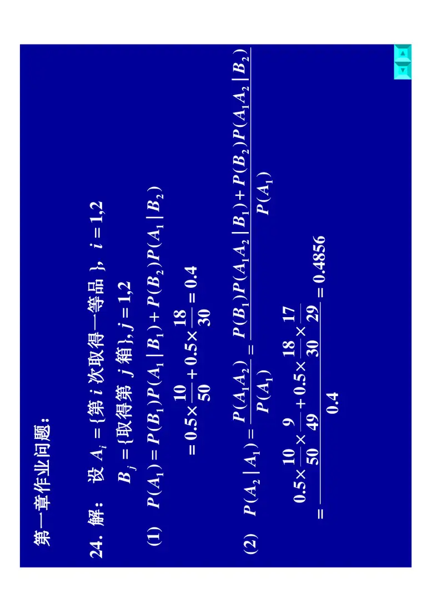

原文：

24. 解: 设 $A_{i}=\{第 i 次取得一等品\}, i=1,2$ (1) $P(A_{1})=P(B_{1})P(A_{1}|B_{1})+P(B_{2})P(A_{1}|B_{2})$ $=0.5\times\frac{10}{50}+0.5\times\frac{18}{30}=0.4$

8
