# 《概率论与数理统计》第2章 正态分布（课件）

原件的每一页，下面附识别出的文字。

### 德莫佛

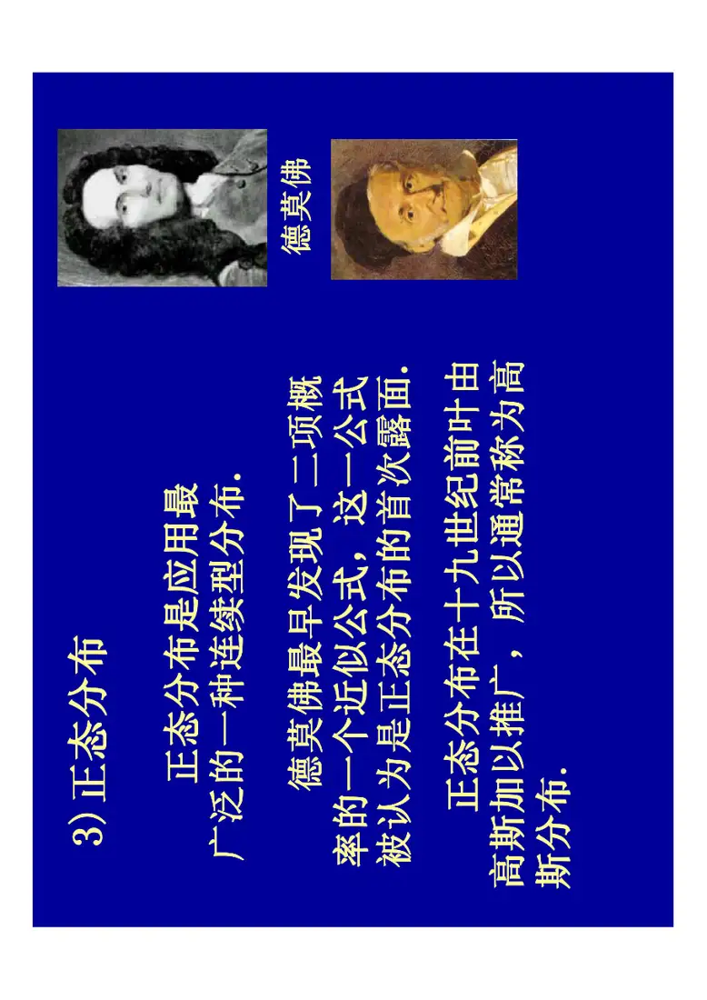

原文：

德莫佛

德莫佛最早发现了二项概率的一个近似公式，这一公式被认为是正态分布的首次露面。

正态分布是应用最广泛的一种连续型分布.

3) 正态分布

### 这条曲线就近似我们将要介绍的正态分布的密度曲线。

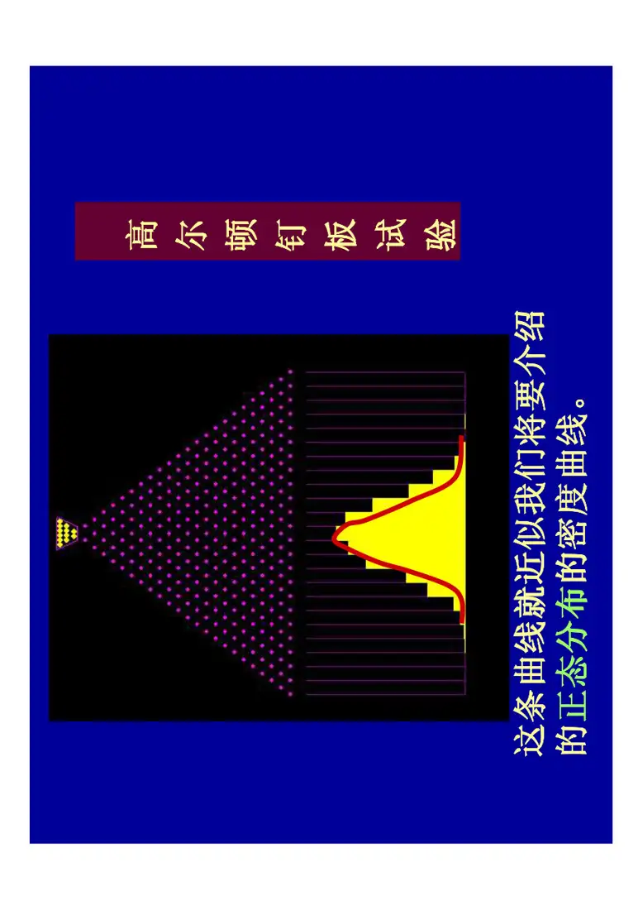

原文：

这条曲线就近似我们将要介绍的正态分布的密度曲线。

实验手板试验

### $f(x)$ 所确定的曲线叫作正态曲线.

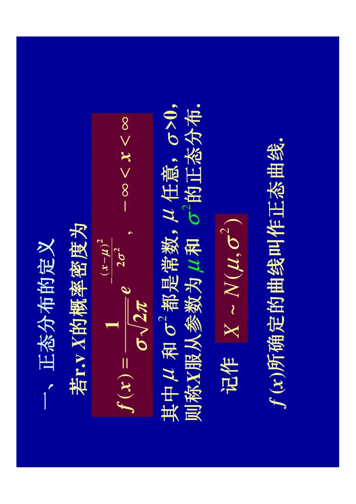

原文：

$f(x)$ 所确定的曲线叫作正态曲线.

记作 X \~ N(μ, σ²)

其中 $\mu$ 和 $\sigma^{2}$ 都是常数， $\mu$ 任意， $\sigma>0$ ，则称 X 服从参数为 $\mu$ 和 $\sigma^{2}$ 的正态分布。

$f(x) = \frac{1}{\sigma\sqrt{2\pi}} e$ 一、正态分布的定义
若r.v X的概率密度为

### 正态分布有些什么性质呢？

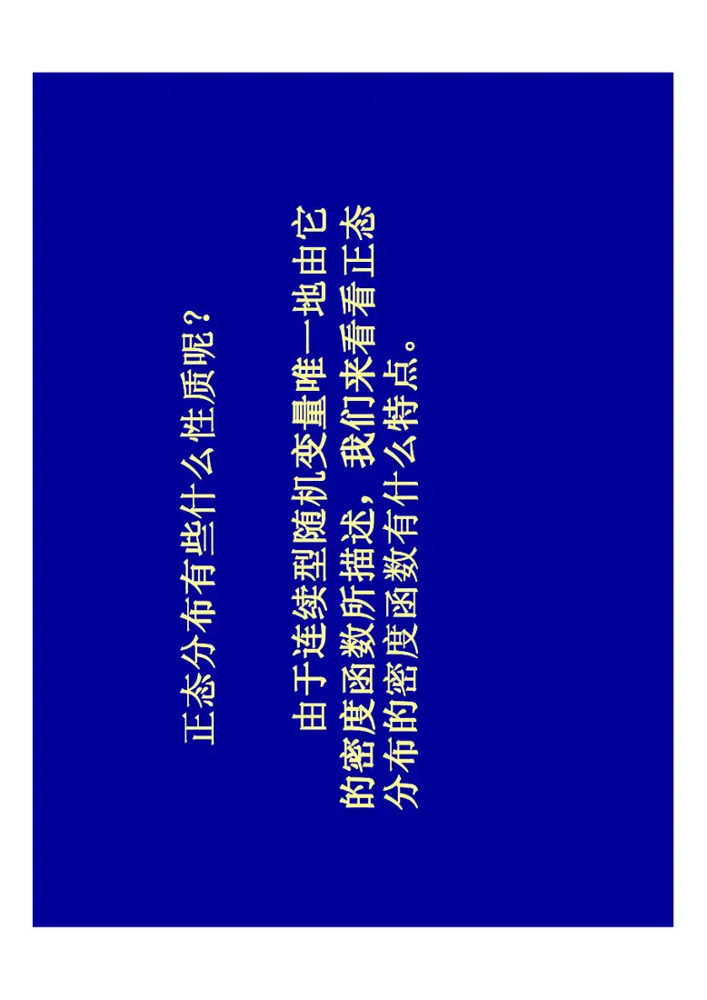

原文：

由于连续型随机变量唯一地由它的密度函数所描述，我们来看看正态分布的密度函数有什么特点。

正态分布有些什么性质呢？

### 特点是“两头小，中间大，左右对称”。

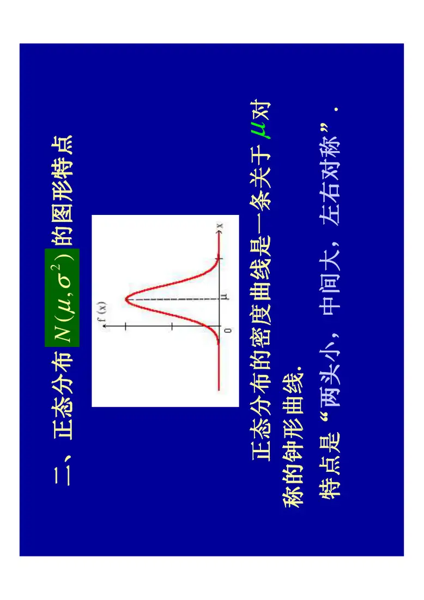

原文：

特点是“两头小，中间大，左右对称”。

正态分布的密度曲线是一条关于 $\mu$ 对

二、正态分布 $N(\mu,\sigma^{2})$ 的图形特点

### $\mu$ 决定了图形的中心位置， $\sigma$ 决定了图形

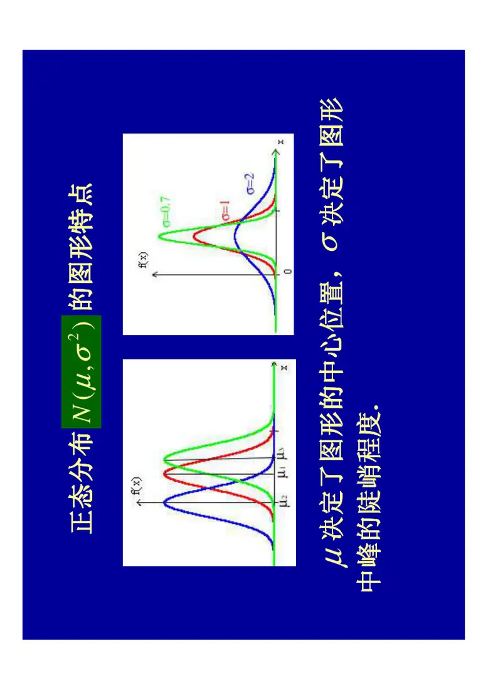

原文：

$\mu$ 决定了图形的中心位置， $\sigma$ 决定了图形

正态分布 $N(\mu, \sigma^2)$ 的图形特点

### 即整个概率密度曲线都在x轴的上方；

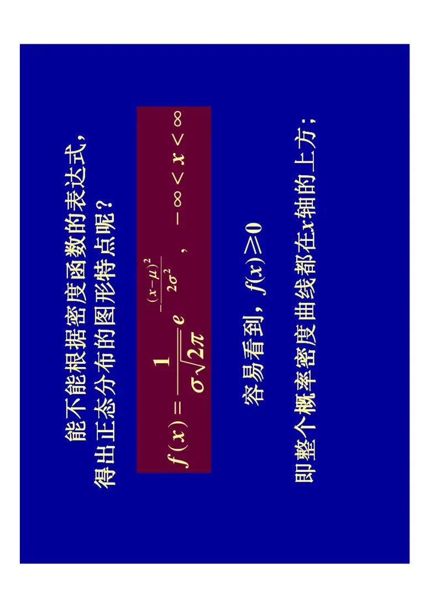

原文：

即整个概率密度曲线都在x轴的上方；

容易看到， $f(x) \geq 0$

$f(x) = \frac{1}{\sigma\sqrt{2\pi}} e^{\frac{(x - \mu)^2}{2\sigma^2}}, -\infty < x < \infty$ 能不能根据密度函数的表达式，得出正态分布的图形特点呢？

### $f(\mu+c)=f(\mu-c)$

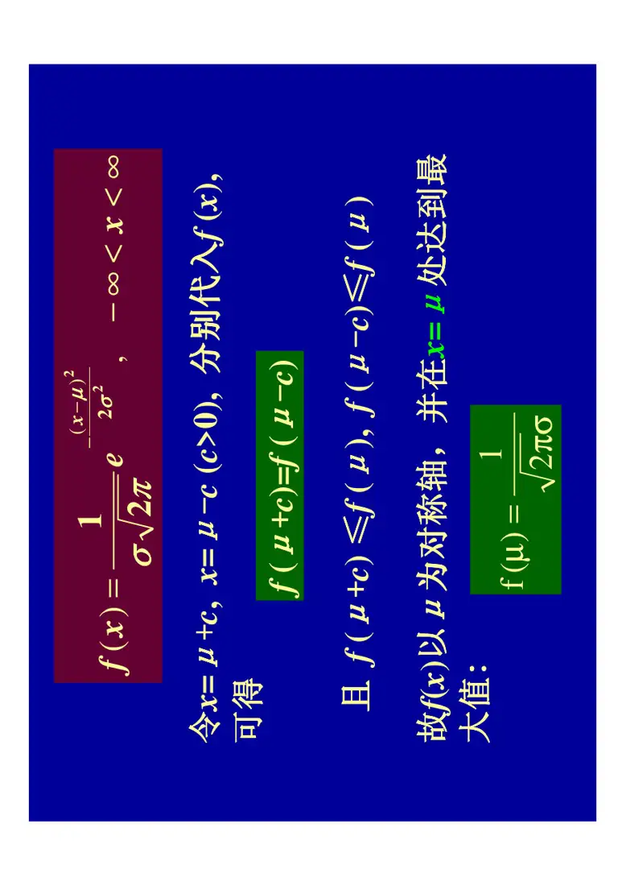

原文：

$f(\mu) = \frac{1}{\sqrt{2\pi\sigma}}$ 且 $f(\mu + c) \leq f(\mu), f(\mu - c) \leq f(\mu)$

$f(\mu+c)=f(\mu-c)$

令 $x = \mu + c, x = \mu - c (c > 0)$ , 分别代入 $f(x)$ ,

$f(x) = \frac{1}{\sigma\sqrt{2\pi}} e^{\frac{(x - \mu)^2}{2\sigma^2}}, - \infty <  x <   \infty$ 这说明曲线 $f(x)$ 向左右伸展时，越来越贴近 x 轴。即 $f(x)$ 以 x 轴为渐近线。

### 当 $x \to +\infty$ 时， $f(x) \to 0$

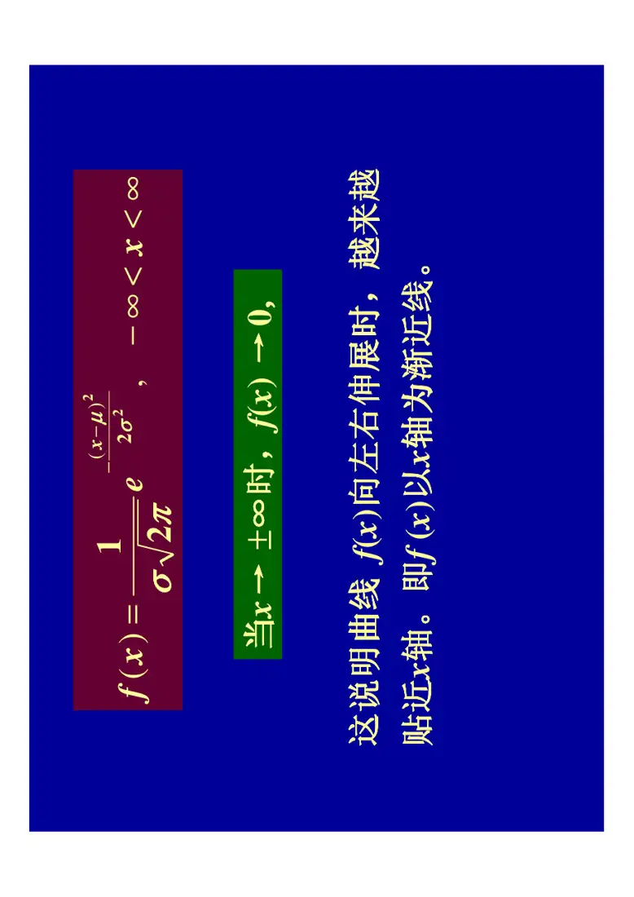

原文：

当 $x \to +\infty$ 时， $f(x) \to 0$

$f(x) = \frac{1}{\sigma\sqrt{2\pi}} e^{\frac{(x - \mu)^2}{2\sigma^2}}, -\infty < x < \infty$

### 用求导的方法可以证明，

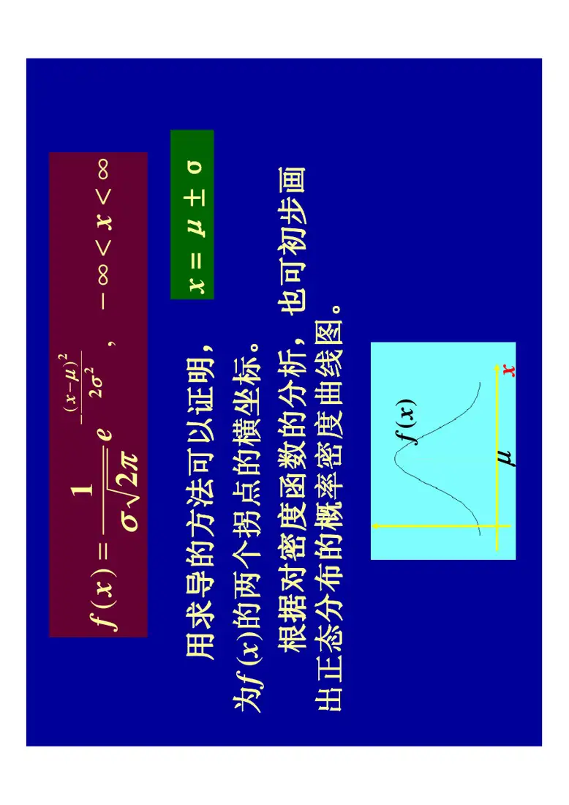

原文：

用求导的方法可以证明，
为 $f(x)$ 的两个拐点的横坐标。
根据对密度函数的分析，也可初步画
出正态分布的概率密度曲线图。

$f(x) = \frac{1}{\sigma\sqrt{2\pi}} e^{\frac{(x - \mu)^2}{2\sigma^2}}, -\infty < x < \infty$

### 我们用某年降雨量的数据画出了频率

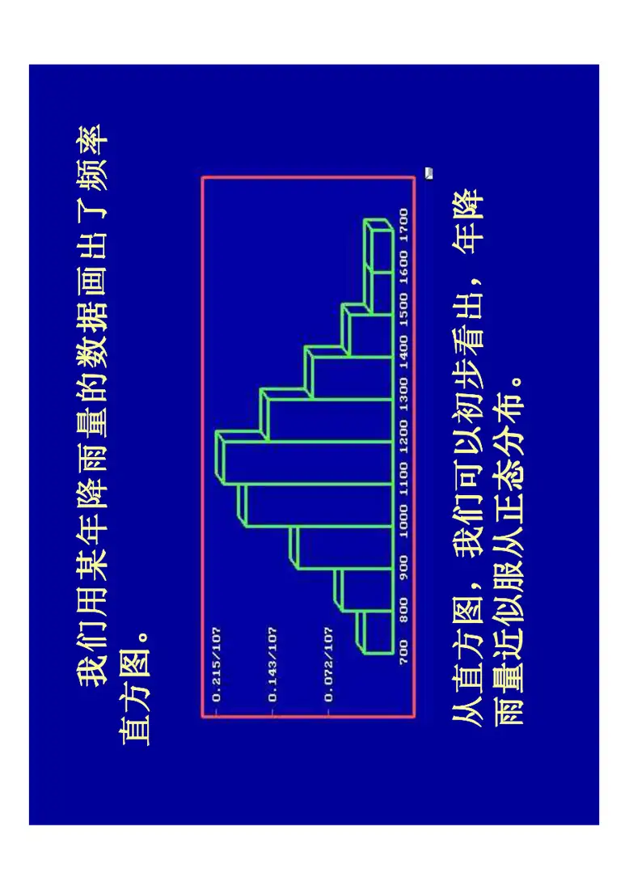

原文：

我们用某年降雨量的数据画出了频率

从直方图，我们可以初步看出，年降雨量近似服从正态分布。

### 可见，某大学女大学生的身高应服从正态分布。

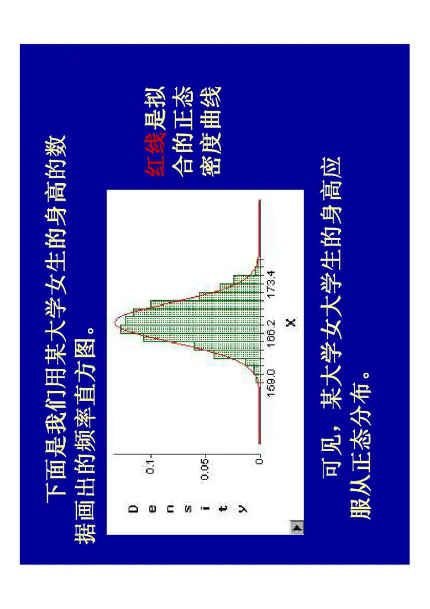

原文：

可见，某大学女大学生的身高应服从正态分布。

红线是拟合的正态密度曲线

下面是我们用某大学女生的身高的数 据画出的频率直方图。

[NO TEXT]

### 第 13 页

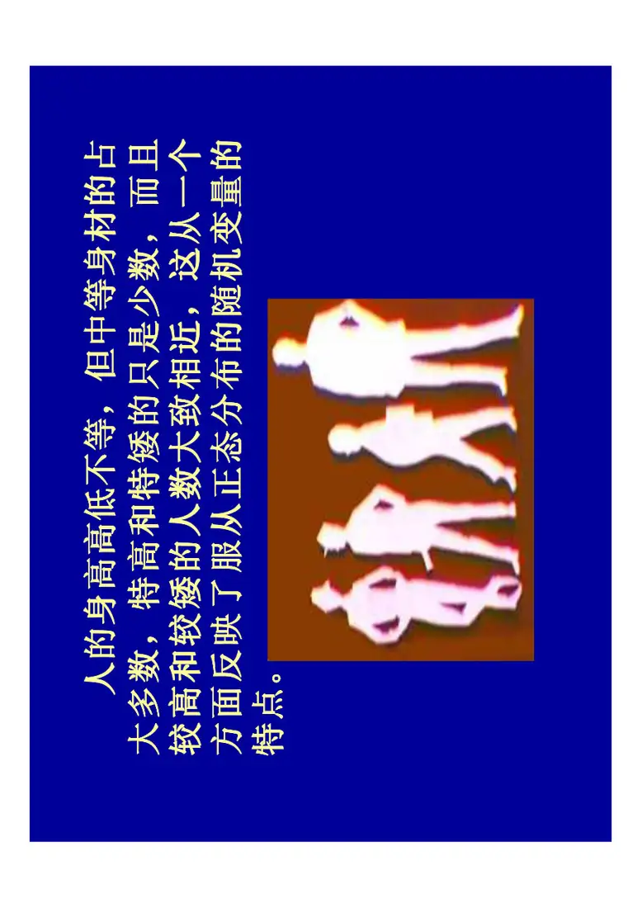

原文：

人的身高高低不等，但中等身材的占大多数，特高和特矮的只是少数，而且较高和较矮的人数大致相近，这从一个方面反映了服从正态分布的随机变量的特点。

### 除了我们在前面遇到过的年降雨量和身

原文：

除了我们在前面遇到过的年降雨量和身
高外，在正常条件下各种产品的质量指标，
如零件的尺寸；纤维的强度和张力；农作物
的产量，小麦的穗长、株高；测量误差，射
击目标的水平或垂直偏差；信号噪声等等，
都服从或近似服从正态分布。

### 第 15 页

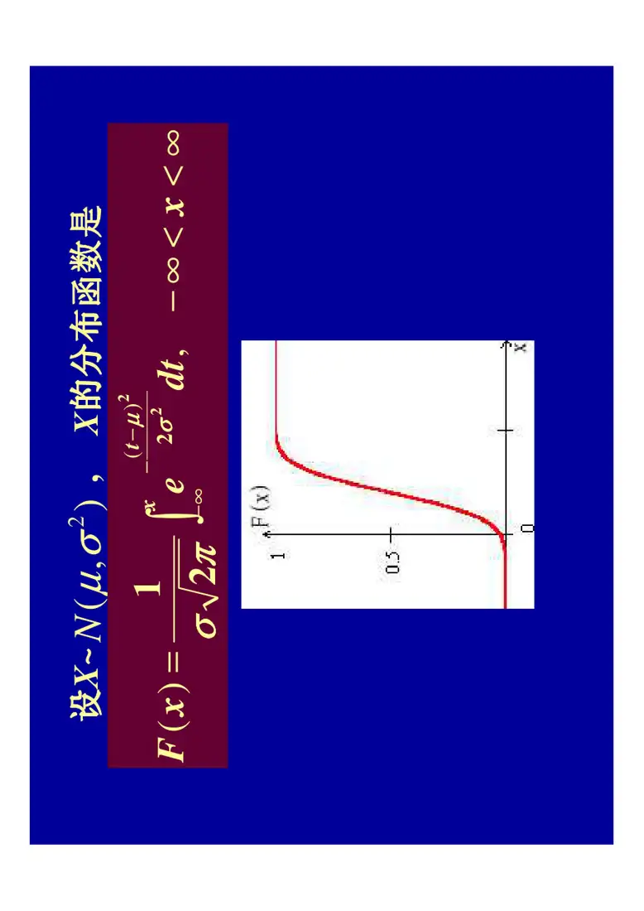

原文：

设 $X \sim N(\mu, \sigma^{2})$ ，X的分布函数是 [  F(x) = \frac{1}{\sigma \sqrt{2\pi}} \int\_{-\infty}^{\infty} e^{\frac{(t - \mu)^{2}}{2\sigma^{2}}} dt, -\infty < x < \infty  ]

### 标准正态分布

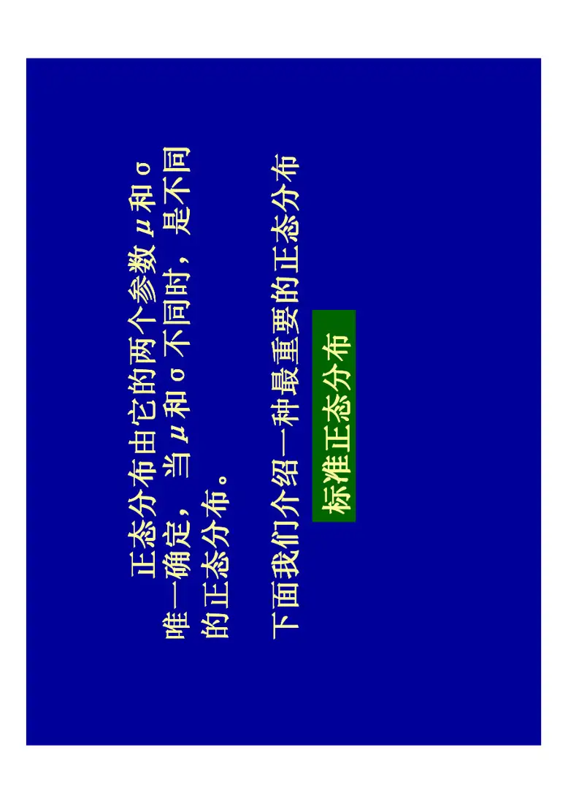

原文：

标准正态分布

下面我们介绍一种最重要的正态分布

正态分布由它的两个参数 $\mu$ 和 $\sigma$ 唯一确定，当 $\mu$ 和 $\sigma$ 不同时，是不同

### 三、标准正态分布$\Phi (-x) = 1 - \Phi (x)$

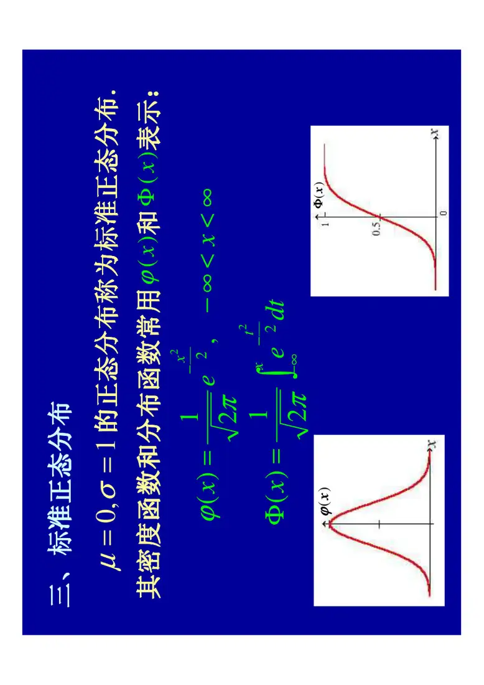

原文：

$\varphi (x) = \frac{1}{\sqrt{2\pi}} e^{\frac{x^2}{2}}, - \Phi (x) = \frac{1}{\sqrt{2\pi}} e^{\frac{t^2}{2}}dt$

$\mu = 0, \sigma = 1$ 的正态分布称为标准正态分布. 其密度函数和分布函数常用 $\phi(x)$ 和 $\Phi(x)$ 表示:

三、标准正态分布$\Phi (-x) = 1 - \Phi (x)$

### 表中给的是x>0时， $\Phi(x)$ 的值.

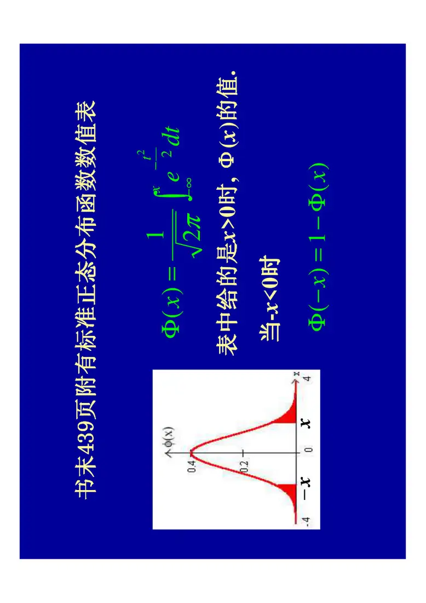

原文：

表中给的是x>0时， $\Phi(x)$ 的值.

当-x<0时

$\Phi (x) = \frac {1}{\sqrt {2 \pi}} \int_ {- \infty} ^ {x - \frac {t ^ {2}}{2}} e ^ {2} dt$

书末439页附有标准正态分布函数数值表根据定理1, 只要通过标准正态分布的分布函数数值表, 就可以解决一般正态分设 $X \sim N(\mu, \sigma^2)$ ，则 $Y = \frac{X - \mu}{X} N(0,1)$

### 它的依据是下面的定理：

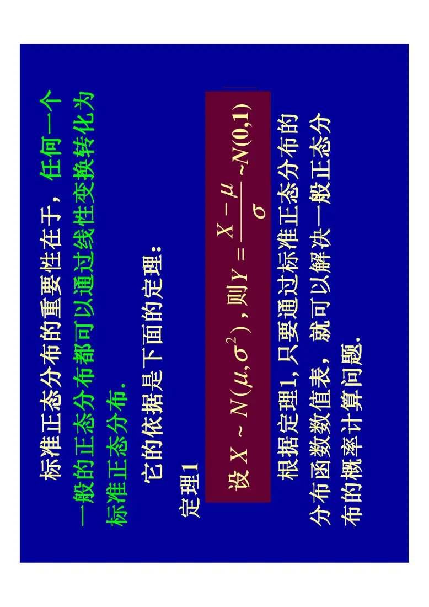

原文：

它的依据是下面的定理：

定理1

标准正态分布的重要性在于，任何一个一般的正态分布都可以通过线性变换转化为若 $X \sim N(\mu, \sigma^2)$ , $\frac{X - \mu}{X}$ $N(0,1)$

### $P(a<X<b)=\Phi(b)-\Phi(a)$

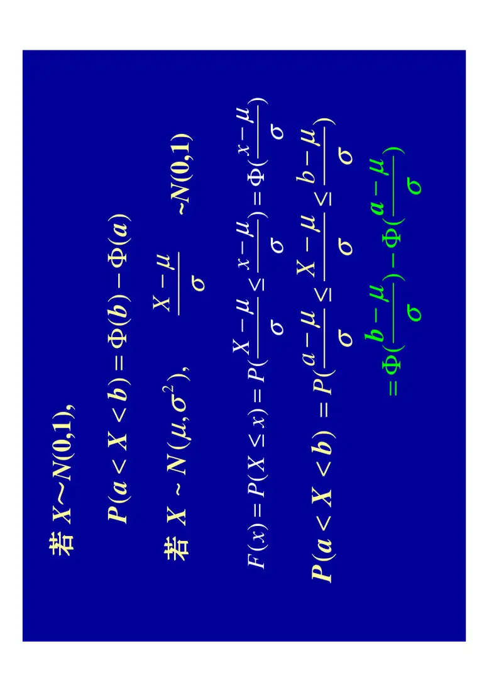

原文：

$P(a<X<b)=\Phi(b)-\Phi(a)$

若 $X \sim N(0,1)$ ,

### 第 21 页

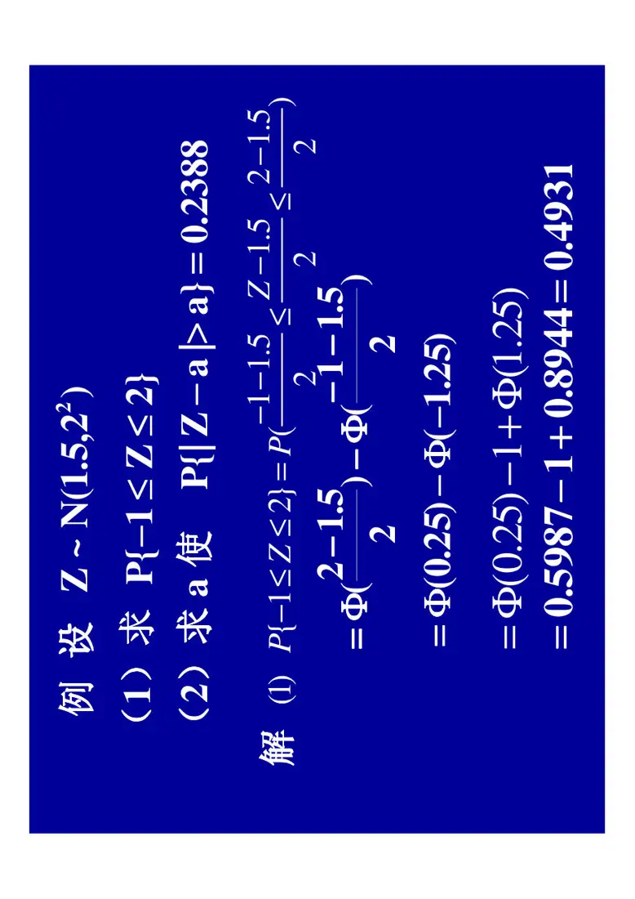

原文：

例设 Z\~N(1.5,2²) (1) 求 P{-1≤Z≤2} (2) 求 a 使 P{|Z-a|>a}=0.2388 解 (1) P{-1≤Z≤2}=P( $\frac{-1-1.5}{2}\leq\frac{Z-1.5}{2}\leq\frac{2-1.5}{2}$ ) =Φ( $\frac{2-1.5}{2}$ ) - Φ( $\frac{-1-1.5}{2}$ ) =Φ(0.25)-Φ(-1.25) =Φ(0.25)-1+Φ(1.25) =0.5987-1+0.8944=0.4931

### 第 22 页

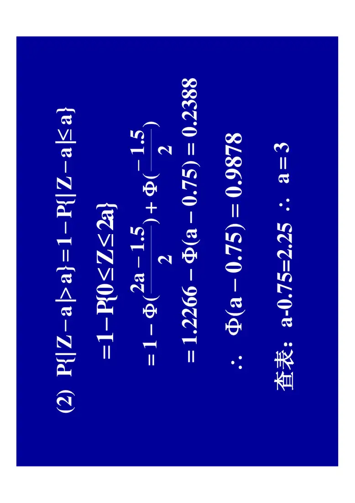

原文：

(2) P{|Z-a|>a}=1-P{|Z-a|≤a} =1-P{0≤Z≤2a} =1-Φ(2a-1.5)/2+Φ(-1.5)/2 =1.2266-Φ(a-0.75)=0.238 ∴ Φ(a-0.75)=0.9878 查表: a-0.75=2.25 ∴ a=3

### 四、3σ准则

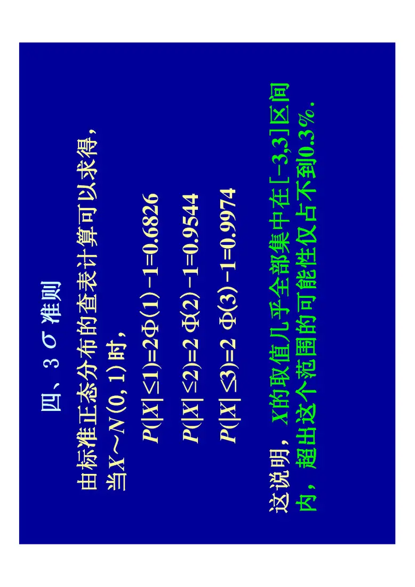

原文：

这说明，X的取值几乎全部集中在[-3,3]区间内，超出这个范围的可能性仅占不到0.3%.

四、3σ准则

### 第 24 页

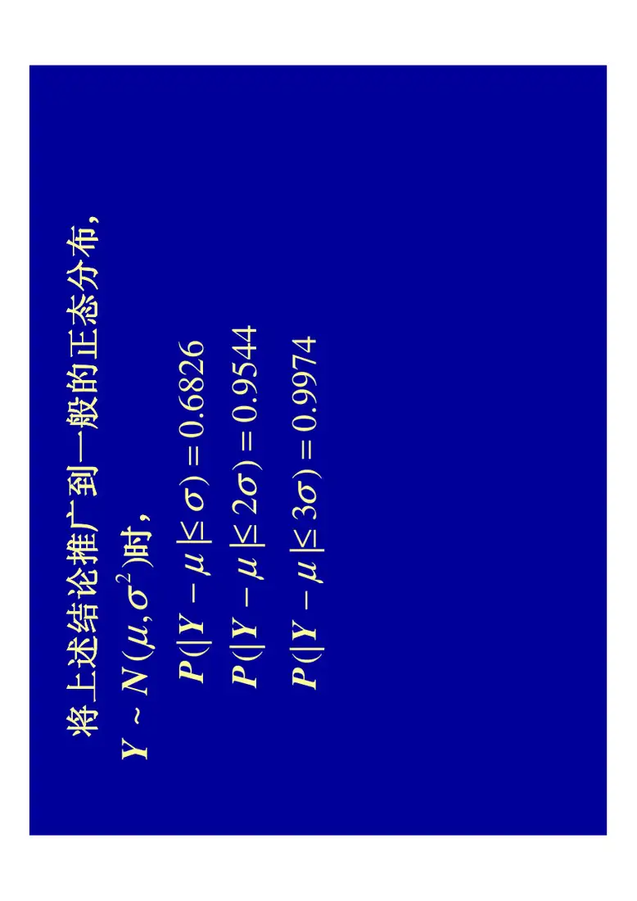

原文：

将上述结论推广到一般的正式 Y \~ N(μ, σ²)时, P(|Y - μ| ≤ σ) = 0.6826 P(|Y - μ| ≤ 2σ) = 0.9544 P(|Y - μ| ≤ 3σ) = 0.9974

### 可见服从正态分布 $N(\mu,\sigma^{2})$ 的随机变量

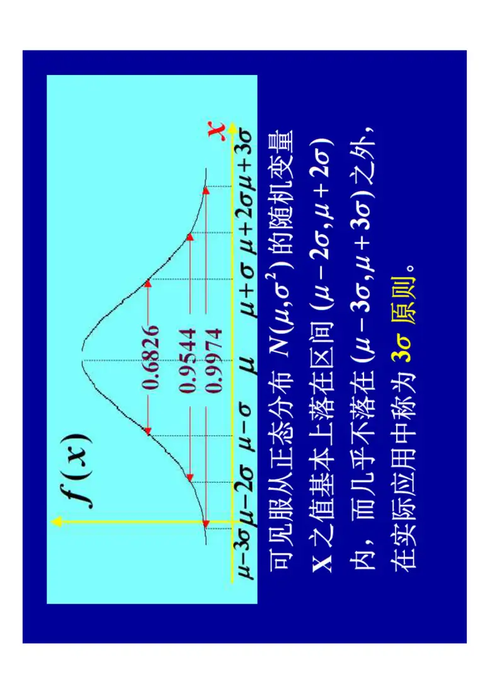

原文：

可见服从正态分布 $N(\mu,\sigma^{2})$ 的随机变量
X 之值基本上落在区间 $(\mu-2\sigma,\mu+2\sigma)$ 内，而几乎不落在 $(\mu-3\sigma,\mu+3\sigma)$ 之外，
在实际应用中称为 $3\sigma$ 原则。

### 后面第五章中，我们还将介绍为什么这么多随机现象都近似服从正态分布。

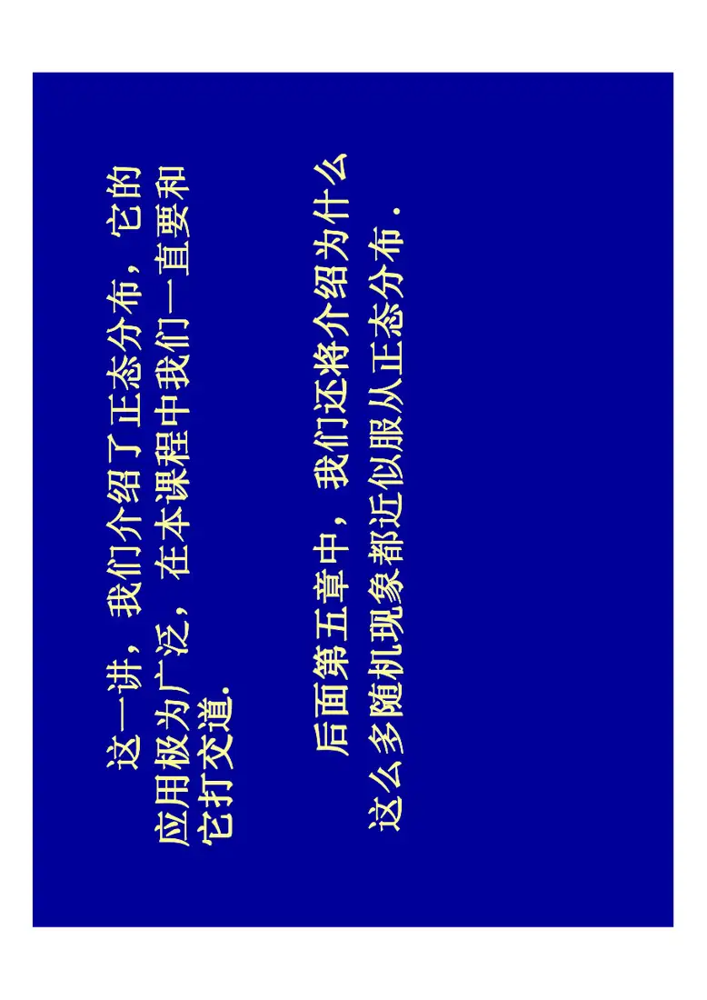

原文：

后面第五章中，我们还将介绍为什么这么多随机现象都近似服从正态分布。

这一讲，我们介绍了正态分布，它的应用极为广泛，在本课程中我们一定要和它打交道。
