# 《概率论与数理统计》第2章 随机变量及其分布 2.2 离散型随机变量的概率分布（课件）

原件的每一页，下面附识别出的文字。

### 2.2 离散型随机变及其分布律

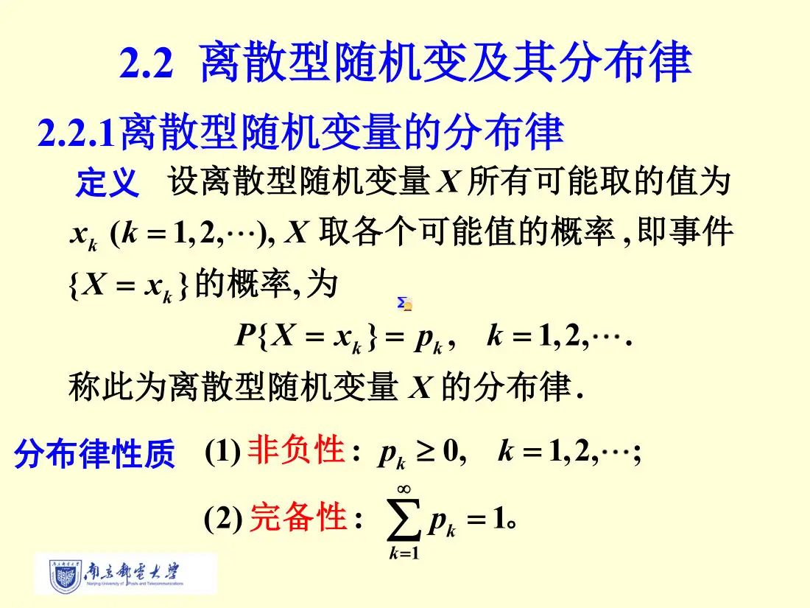

原文：

2.2 离散型随机变及其分布律

2.2.1离散型随机变量的分布律

定义 设离散型随机变量X所有可能取的值为$x _ { k } \left( k = 1 , 2 , \cdots \right)$ ,X取各个可能值的概率，即事件$\{ X = x _ { k } \}$ 的概率,为 Σ

$$
P \{X = x _ {k} \} = p _ {k}, \quad k = 1, 2, \dots .
$$

称此为离散型随机变量X的分布律.

分布律性质 (1) :非负性 $p _ { k } \ge 0 , \quad k = 1 , 2 , \cdots ;$

(2)完备性： $\sum _ { k = 1 } ^ { \infty } p _ { k } = 1$

南立都生大学 南京郵電大学 Nanjing University ofPosts and Telecommunication

### 离散型随机变量的分布律也可表示为

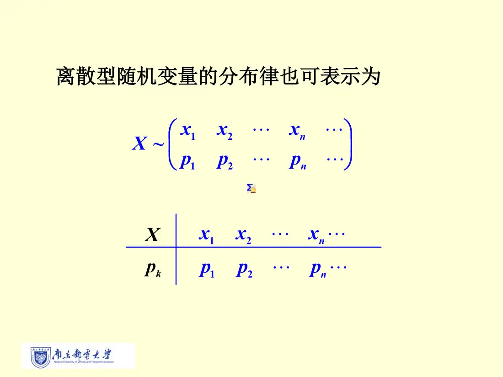

原文：

离散型随机变量的分布律也可表示为

$$
X \sim \left( \begin{array}{c c c c c} x _ {1} & x _ {2} & \dots & x _ {n} & \dots \\ p _ {1} & p _ {2} & \dots & p _ {n} & \dots \end{array} \right)
$$

<table><tr><td>X</td><td> $x_{1}$ </td><td> $x_{2}$ </td><td> $\cdots$ </td><td> $x_{n} \cdots$ </td></tr><tr><td> $p_{k}$ </td><td> $p_{1}$ </td><td> $p_{2}$ </td><td> $\cdots$ </td><td> $p_{n} \cdots$ </td></tr></table>

南京郵電大學 Nanjing University ofPosts and Telecommunication

### 第 3 页

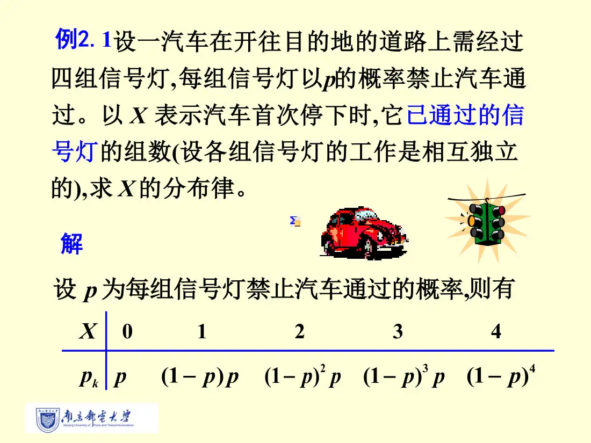

原文：

例2.1设一汽车在开往目的地的道路上需经过四组信号灯,每组信号灯以 $p$ 的概率禁止汽车通过。以X表示汽车首次停下时，它已通过的信号灯的组数(设各组信号灯的工作是相互独立的),求X的分布律。

解

设 $p$ 为每组信号灯禁止汽车通过的概率,则有例2.2 设一口袋中有5件产品，其中4件是正品，1件是次品。现从袋中连取两次，每次取一件。设X表示两次取出的次品数，试分以下情况求X的分布律。(1)取出后放回 (2)取出后不放回。

<table><tr><td>X</td><td>0</td><td>1</td><td>2</td><td>3</td><td>4</td></tr><tr><td> $p_k$ </td><td>p</td><td> $(1-p)p$ </td><td> $(1-p)^2p$ </td><td> $(1-p)^3p$ </td><td> $(1-p)^4$ </td></tr></table>

南立都生大学 南京郵電大学 Nanjing University ofPosts and Telecommunication

### 解 (1) 放回抽样：X的可能取值为0,1,2

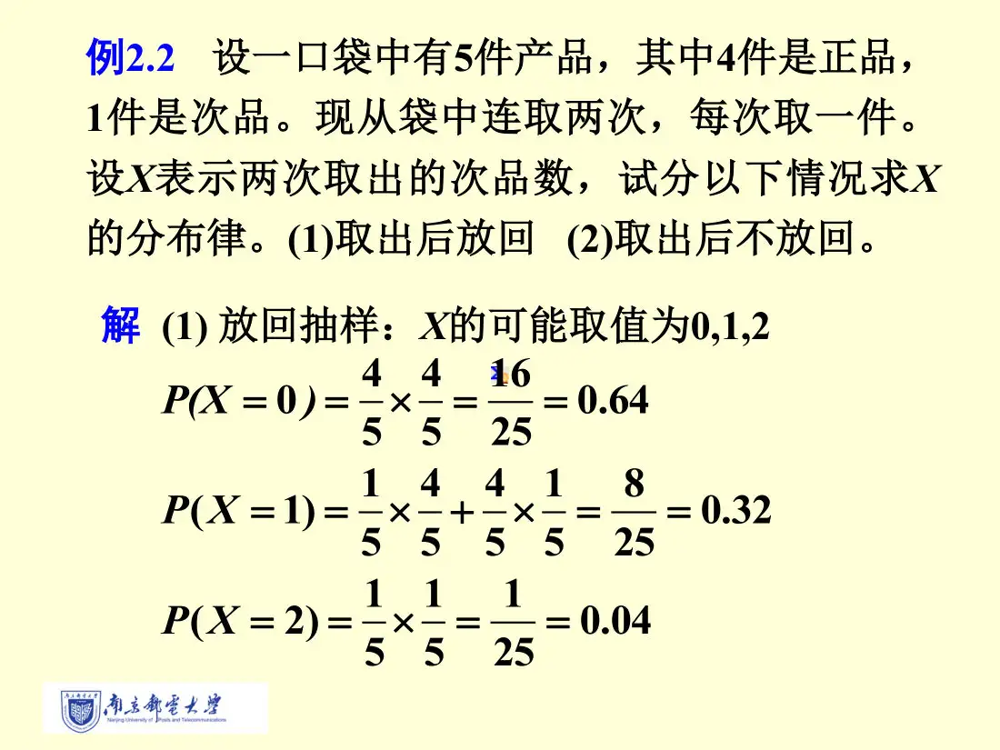

原文：

解 (1) 放回抽样：X的可能取值为0,1,2

$$
P (X = 0) = \frac {4}{5} \times \frac {4}{5} = \frac {1 6}{2 5} = 0. 6 4
$$

$$
P (X = 1) = \frac {1}{5} \times \frac {4}{5} + \frac {4}{5} \times \frac {1}{5} = \frac {8}{2 5} = 0. 3 2
$$

$$
P (X = 2) = \frac {1}{5} \times \frac {1}{5} = \frac {1}{2 5} = 0. 0 4
$$

南京郵電大學 Nanjing University ofPosts and Telecommunication

### 故X的分布律为

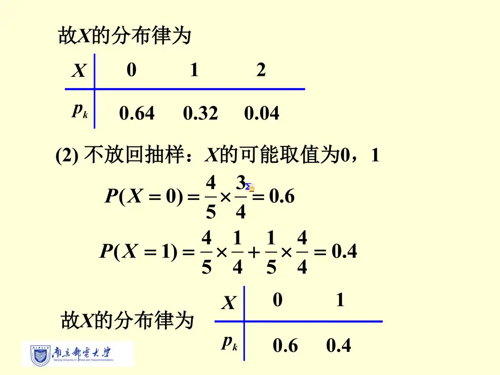

原文：

故X的分布律为

<table><tr><td>X</td><td>0</td><td>1</td><td>2</td></tr><tr><td> $p_k$ </td><td>0.64</td><td>0.32</td><td>0.04</td></tr></table>

(2)不放回抽样：X的可能取值为0，1

$$
P (X = 0) = \frac {4}{5} \times \frac {3 _ {\Sigma_ {1}}}{4} = 0. 6
$$

$$
P (X = 1) = \frac {4}{5} \times \frac {1}{4} + \frac {1}{5} \times \frac {4}{4} = 0. 4
$$

故X的分布律为 $\frac { X \mid 0 \mid 1 } { p _ { k } \mid 0 . 6 \mid 0 . 4 }$ 南京郵電大學 南京郵電大學 Nanjing University ofPosts and Telecommunications

### 2.2.2 常见离散型随机变量的概率分布

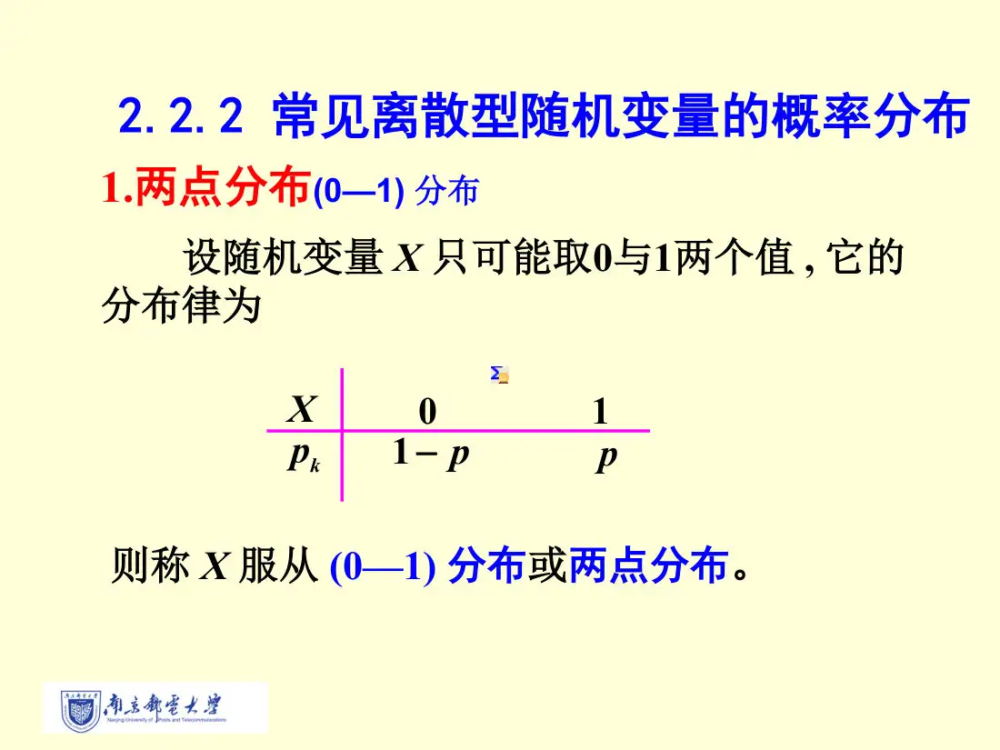

原文：

2.2.2 常见离散型随机变量的概率分布

1.两点分布(0—1) 分布

设随机变量X 只可能取0与1两个值, 它的分布律为

$$
\begin{array}{c c c} X & 0 & 1 \\ \hline p _ {k} & 1 - p & p \end{array}
$$

则称 X 服从 (0—1) 分布或两点分布。

南立都生大学 南京郵電大学 Nanjing University ofPosts and Telecommunication

### 取得不合格品, 取得合格品.

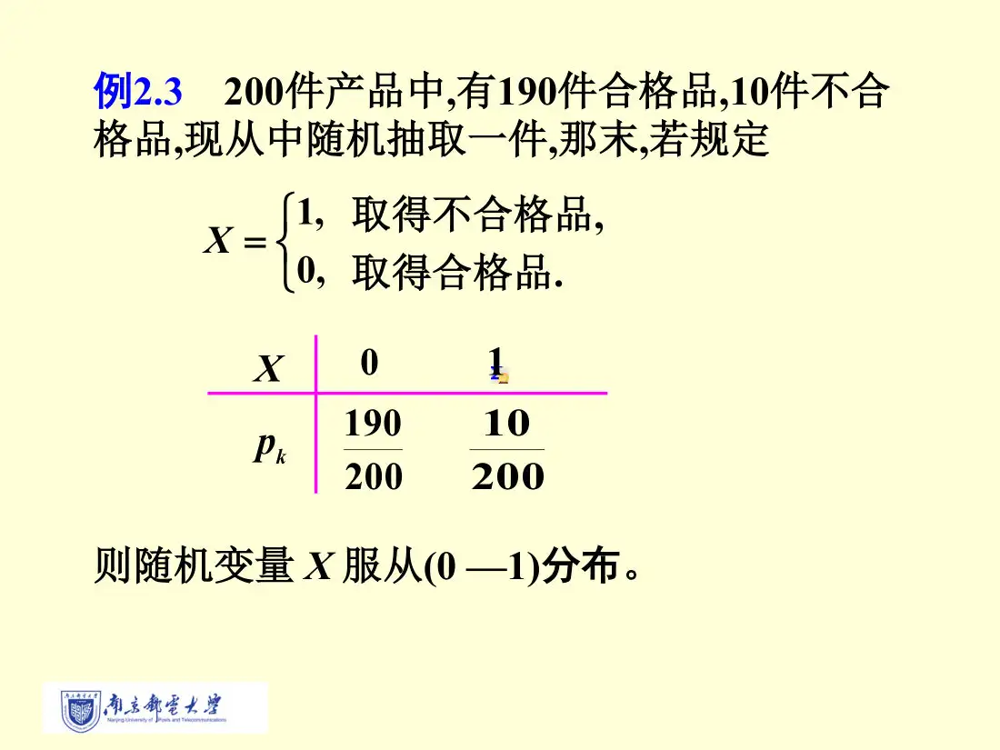

原文：

例2.3 200件产品中,有190件合格品,10件不合格品,现从中随机抽取一件,那末,若规定

取得不合格品, 取得合格品.

$$
\begin{array}{c c c} X & 0 & 1 \\ \hline p _ {k} & \frac {1 9 0}{2 0 0} & \frac {1 0}{2 0 0} \end{array}
$$

则随机变量X 服从(0 —1)分布。

南立都生大学 南京郵電大学 Nanjing University ofPosts and Telecommunication

### 说明

原文：

说明

两点分布是最简单的一种分布,任何一个只有两种可能结果的随机现象, 比如新生婴儿是男还是女、明天是否下雨、种籽是否发芽等, 都属于两点分布。

南京郵電大學 Nanjing University ofPosts and Telecommunication

### 2.二项分布

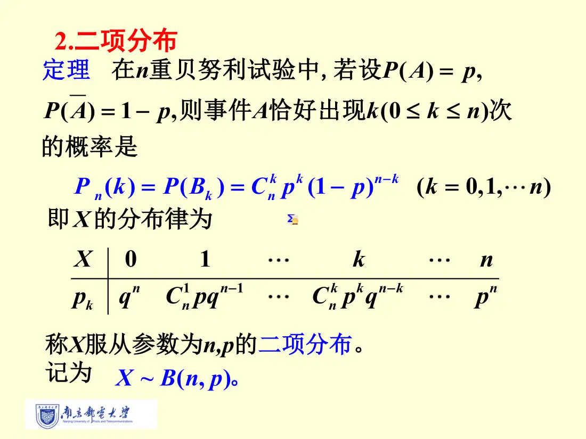

原文：

2.二项分布

定理 在n重贝努利试验中，若设 $P ( A ) = p$ $P ( { \overline { { A } } } ) = 1 - p$ ,则事件A恰好出现 $k ( 0 \leq k \leq n )$ 次的概率是

P n(k) = P(Bk) = C k (1 − p)ⁿ−k (k = 0,1, n) n p' 即X的分布律为

$$
\begin{array}{c c c c c c c} X & 0 & 1 & \dots & k & \dots & n \\ \hline p _ {k} & q ^ {n} & C _ {n} ^ {1} p q ^ {n - 1} & \dots & C _ {n} ^ {k} p ^ {k} q ^ {n - k} & \dots & p ^ {n} \end{array}
$$

称X服从参数为 ${ \bf \delta } _ { n , p }$ 的二项分布。

记为 $X \sim B ( n , p )$

南京郵電大學

### 在同一时刻同时被使用的设备数X

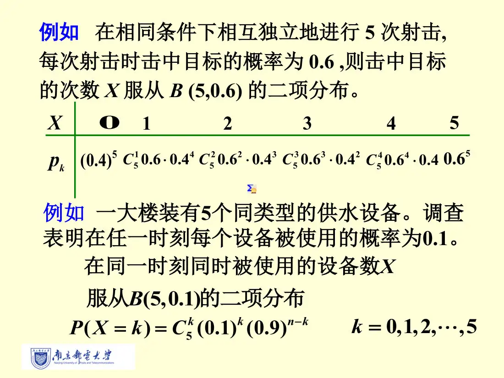

原文：

例如 在相同条件下相互独立地进行5 次射击,每次射击时击中目标的概率为0.6 ,则击中目标的次数X 服从 B (5,0.6) 的二项分布。

<table><tr><td>X</td><td>O</td><td>1</td><td>2</td><td>3</td><td>4</td><td>5</td></tr><tr><td> $p_k$ </td><td>(0.4) $^5$ </td><td> $C_5^1$ 0.6·0.4 $^4$ </td><td> $C_5^2$ 0.6 $^2$ ·0.4 $^3$ </td><td> $C_5^3$ 0.6 $^3$ ·0.4 $^2$ </td><td> $C_5^4$ 0.6 $^4$ ·0.4</td><td>0.6 $^5$ </td></tr></table>

例如 一大楼装有5个同类型的供水设备。调查表明在任一时刻每个设备被使用的概率为0.1。

在同一时刻同时被使用的设备数X

服从B(5,0.1)的二项分布

$$
P (X = k) = C _ {5} ^ {k} (0. 1) ^ {k} (0. 9) ^ {n - k} \quad k = 0, 1, 2, \dots , 5
$$

南京郵電大學 Nanjing University ofPosts and Telecommunication

### （1）进行了5次重复独立试验，求指示灯发出信号的概率。

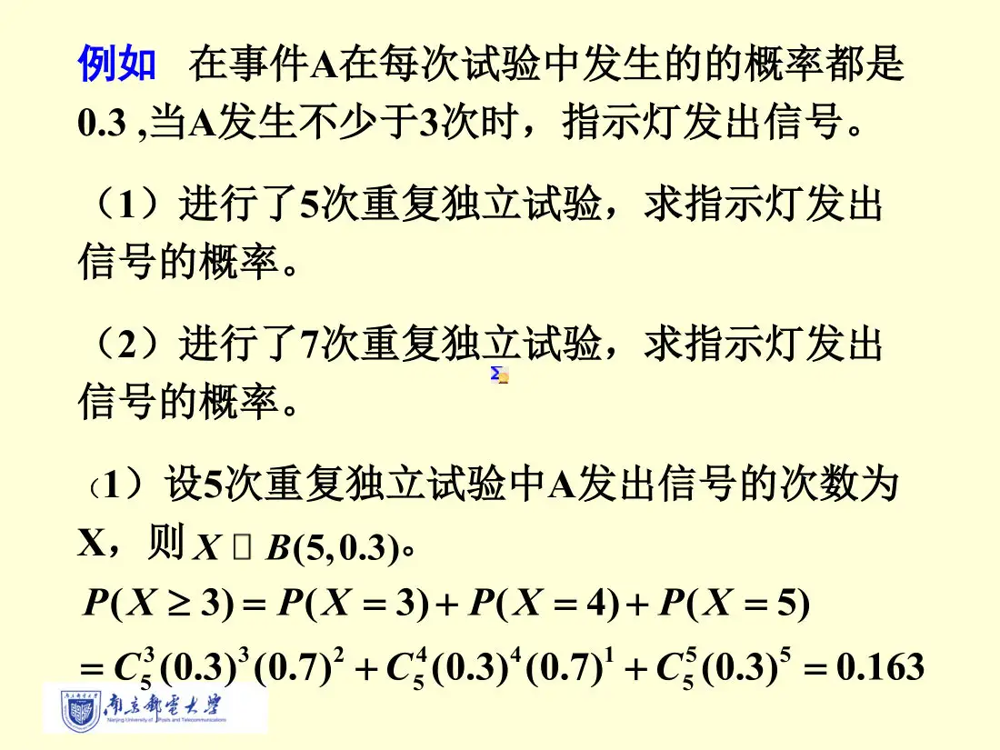

原文：

例如 在事件A在每次试验中发生的的概率都是0.3 ,当A发生不少于3次时，指示灯发出信号。

（1）进行了5次重复独立试验，求指示灯发出信号的概率。

（2）进行了7次重复独立试验，求指示灯发出信号的概率。

（1）设5次重复独立试验中A发出信号的次数为X，则 。

$P ( X \geq 3 ) = P ( X = 3 ) + P ( X = 4 ) + P ( X = 5 )$ $= C _ { 5 } ^ { 3 } ( \mathbf { 0 . 3 } ) ^ { 3 } ( \mathbf { 0 . 7 } ) ^ { 2 } + C _ { 5 } ^ { 4 } ( \mathbf { 0 . 3 } ) ^ { 4 } ( \mathbf { 0 . 7 } ) ^ { 1 } + C _ { 5 } ^ { 5 } ( \mathbf { 0 . 3 } ) ^ { 5 } = \mathbf { 0 . 1 6 3 }$

南京郵電大學 Nanjing University ofPosts and Telecommunication

### $$

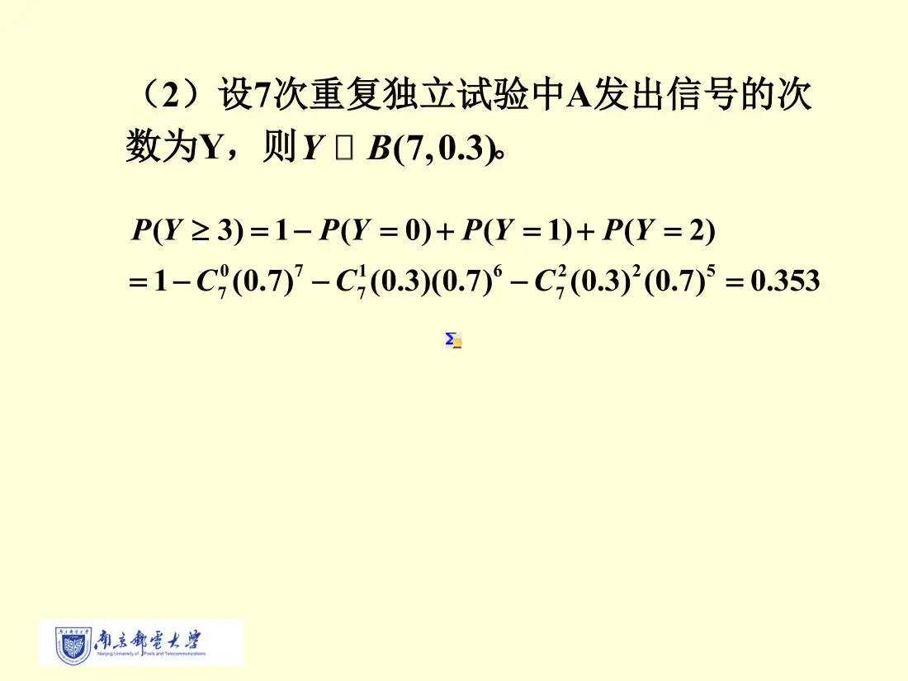

原文：

（2）设7次重复独立试验中A发出信号的次数为Y，则 $Y \perp B ( 7 , 0 . 3 ) \circ$

$$
\begin{array}{l} P (Y \geq 3) = 1 - P (Y = 0) + P (Y = 1) + P (Y = 2) \\ = 1 - C _ {7} ^ {0} (0. 7) ^ {7} - C _ {7} ^ {1} (0. 3) (0. 7) ^ {6} - C _ {7} ^ {2} (0. 3) ^ {2} (0. 7) ^ {5} = 0. 3 5 3 \end{array}
$$

南京郵電大學 Nanjing University ofPosts and Telecommunication

### 二项分布与(0-1)分布之间的关系。

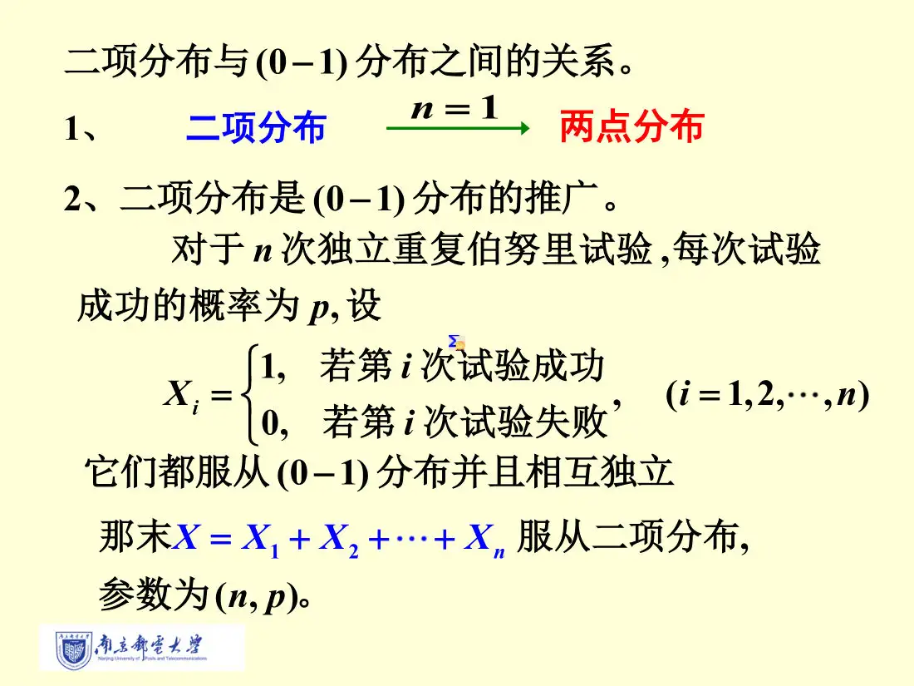

原文：

二项分布与(0-1)分布之间的关系。

1、 二项分布 $\underline { { \pmb { n } } } = \bf { 1 }$ 两点分布

2、二项分布是(0-1)分布的推广。

对于n次独立重复伯努里试验，每次试验成功的概率为 $p ,$ 设

$$
X _ {i} = \left\{ \begin{array}{l l} 1, & \text {若第} i \text {次试验成功} \\ 0, & \text {若第} i \text {次试验失败} \end{array} , \quad (i = 1, 2, \dots , n) \right.
$$

它们都服从(0-1)分布并且相互独立

那末 $X = X _ { 1 } + X _ { 2 } + \cdots + X _ { n }$ 服从二项分布，参数为 $( n , p )$ o

南立都生大学 南京郵電大学 Nanjing University ofPosts and Telecommunication

### 3. 泊松分布

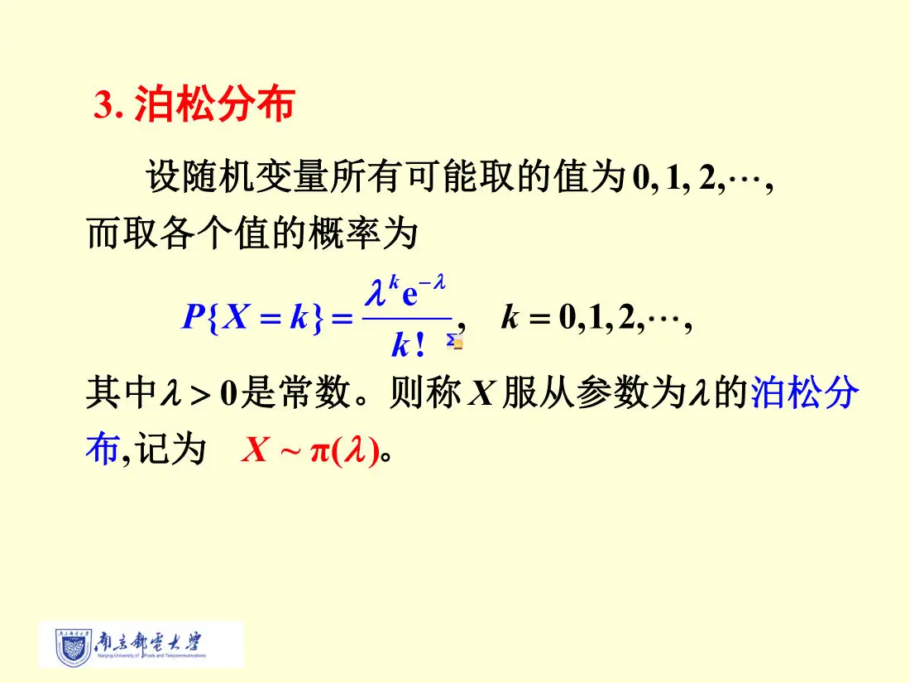

原文：

3. 泊松分布

设随机变量所有可能取的值为 $\mathbf { 0 , 1 , } 2 , \cdots$ 而取各个值的概率为

$$
P \{X = k \} = \frac {\lambda^ {k} \mathrm{e} ^ {- \lambda}}{k !}, \quad k = 0, 1, 2, \dots ,
$$

其中 $\lambda > 0$ 是常数。则称X服从参数为λ的泊松分布,记为 $X \sim \pi ( \lambda )$ o

南立都生大学 南京郵電大学 Nanjing University ofPosts and Telecommunication

### 例如意外事故，非常见病，自然灾害等）出现的次数，都服从泊松分布。

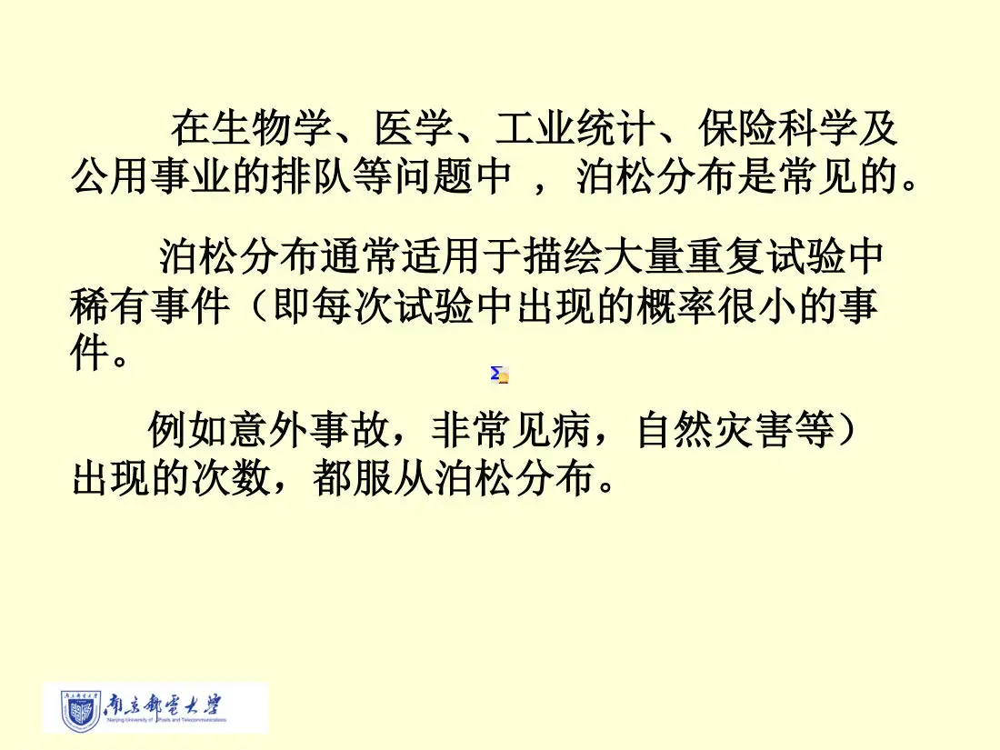

原文：

在生物学、医学、工业统计、保险科学及公用事业的排队等问题中 , 泊松分布是常见的。

泊松分布通常适用于描绘大量重复试验中稀有事件（即每次试验中出现的概率很小的事件。 Σ

例如意外事故，非常见病，自然灾害等）出现的次数，都服从泊松分布。

南京郵電大學 Nanjing University ofPosts and Telecommunication

### 观察二项分布与泊松分布

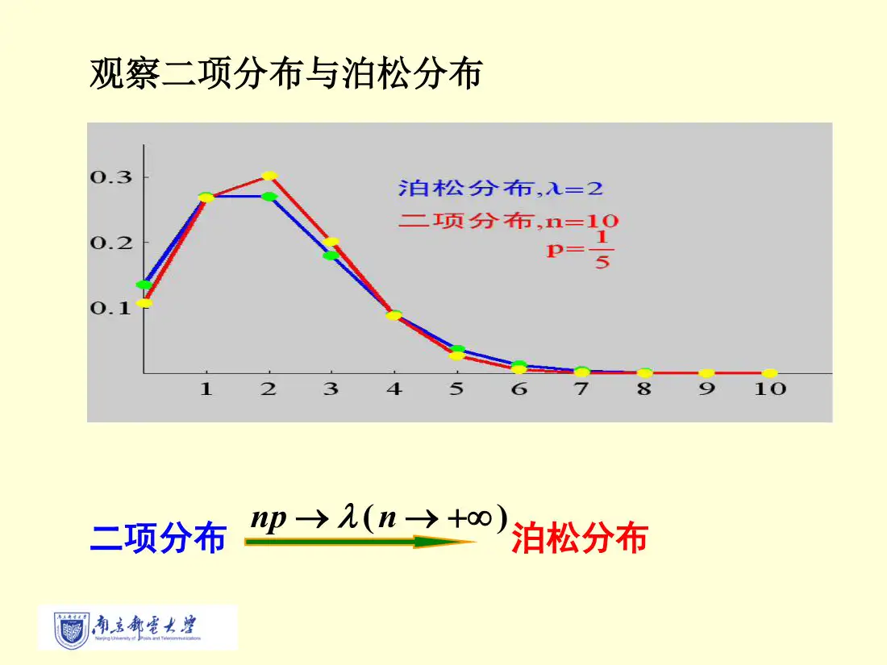

原文：

观察二项分布与泊松分布

二项分布 $\frac { n p \to \lambda ( n \to + \infty ) } { 2 }$ 泊松分布

南京郵電大學

### 定理（泊松Poisson定理）

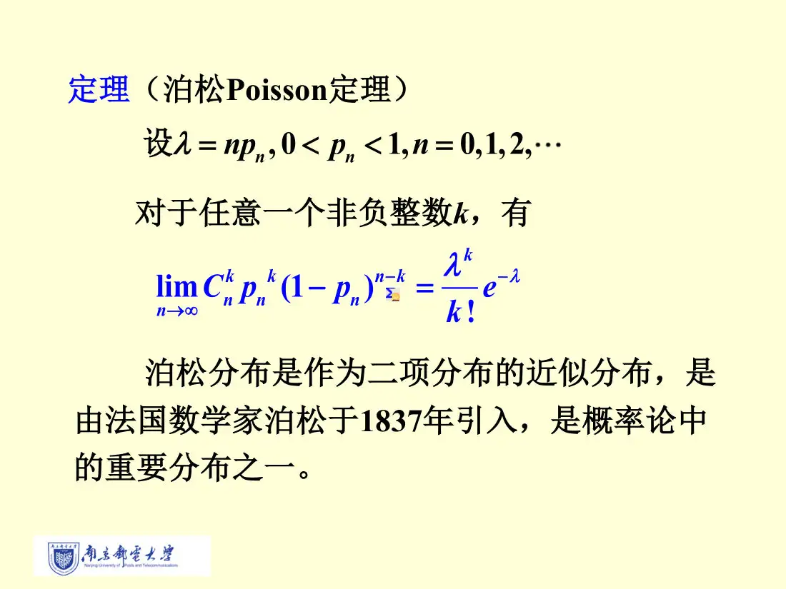

原文：

定理（泊松Poisson定理）

设λ = np, 0 < p < 1,n = 0,1,2,

对于任意一个非负整数k，有

$$
\lim _ {n \to \infty} C _ {n} ^ {k} p _ {n} ^ {k} (1 - p _ {n}) _ {\Sigma_ {\perp}} ^ {n - k} = \frac {\lambda^ {k}}{k !} e ^ {- \lambda}
$$

泊松分布是作为二项分布的近似分布，是由法国数学家泊松于1837年引入，是概率论中的重要分布之一。

南立都生大学 南京郵電大学 Nanjing University ofPosts and Telecommunication

### 南京郵電大學

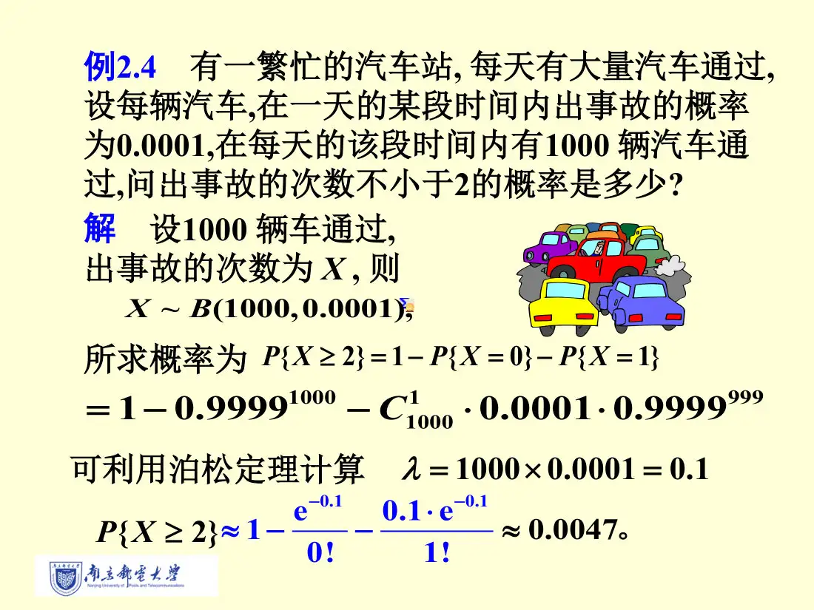

原文：

例2.4 有一繁忙的汽车站, 每天有大量汽车通过,设每辆汽车,在一天的某段时间内出事故的概率为0.0001,在每天的该段时间内有1000 辆汽车通过,问出事故的次数不小于2的概率是多少?

设1000 辆车通过,解出事故的次数为X , 则$X \sim B ( 1 0 0 0 , 0 . 0 0 0 1 ) _ { \bar { 9 } }$

所求概率为 $P \{ X \ge 2 \} = 1 - P \{ X = 0 \} - P \{ X = 1 \}$ $\mathbf { \Sigma } = 1 - 0 . 9 9 9 9 ^ { 1 0 0 0 } - C _ { 1 0 0 0 } ^ { 1 } \cdot 0 . 0 0 0 1 \cdot 0 . 9 9 9 9 ^ { 9 9 9 }$ 可利用泊松定理计算 $\lambda = 1 0 0 0 \times 0 . 0 0 0 1 = 0 . 1$ $P \{ X \ge 2 \} \approx 1 - \frac { \mathrm { e } ^ { - 0 . 1 } } { 0 ! } - \frac { 0 . 1 \cdot \mathrm { e } ^ { - 0 . 1 } } { 1 ! } \approx 0 . 0 0 4 7 \circ$

南京郵電大學

### 解 设击中的次数为 X，

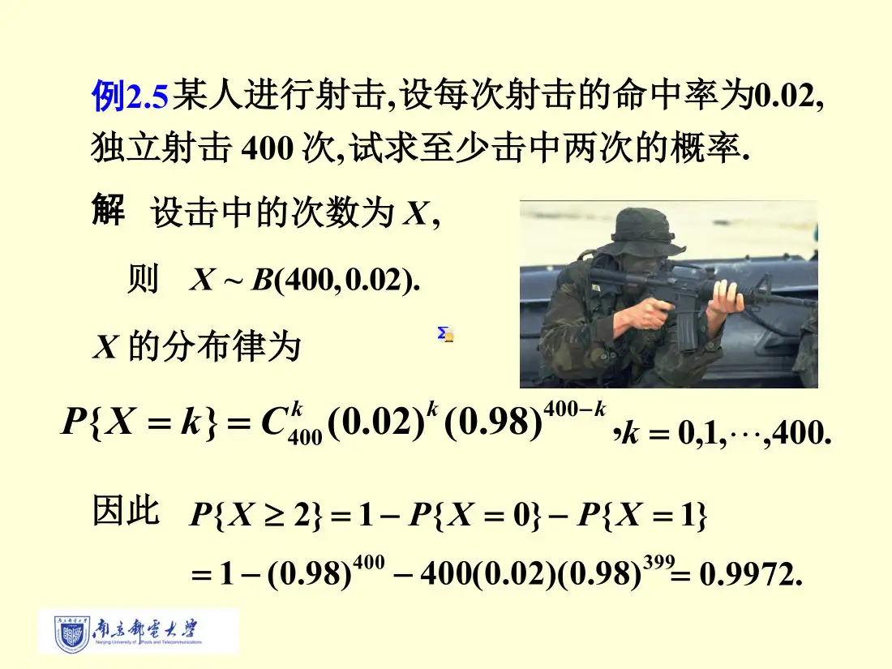

原文：

例2.5某人进行射击,设每次射击的命中率为0.02,独立射击400次,试求至少击中两次的概率.

解 设击中的次数为 X，

则 $X \sim B ( 4 0 0 , 0 . 0 2 )$

X的分布律为

$$
P \{X = k \} = C _ {4 0 0} ^ {k} (0. 0 2) ^ {k} (0. 9 8) ^ {4 0 0 - k}, k = 0, 1, \dots , 4 0 0.
$$

因此 $\begin{array} { r l } & { P \{ X \geq 2 \} = 1 - P \{ X = 0 \} - P \{ X = 1 \} } \\ & { = 1 - ( 0 . 9 8 ) ^ { 4 0 0 } - 4 0 0 ( 0 . 0 2 ) ( 0 . 9 8 ) ^ { 3 9 9 } = 0 . 9 9 7 2 . } \end{array}$ 例2.6 设有80台同类型设备,各台工作是相互独立的发生故障的概率都是 0.01,且一台设备的故障能由一个人处理. 考虑两种配备维修工人的方法 , 其一是由四人维护,每人负责20台; 其二是由3人共同维护台80.试比较这两种方法在设备发生故障时不能及时维修的概率的大小.

南立都生大学 南京郵電大学 Nanjing University ofPosts and Telecommunication

### 解 按第一种方法

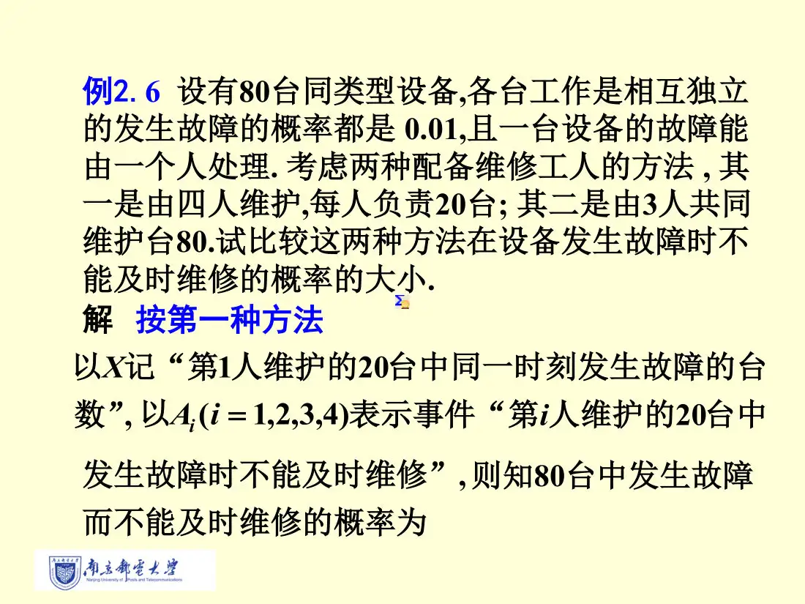

原文：

解 按第一种方法

以X记“第1人维护的20台中同一时刻发生故障的台数”,以A;(i =1,2,3,4)表示事件“第i人维护的20台中发生故障时不能及时维修”,则知80台中发生故障而不能及时维修的概率为

南立都生大学 南京郵電大学 Nanjing University ofPosts and Telecommunication

### $$

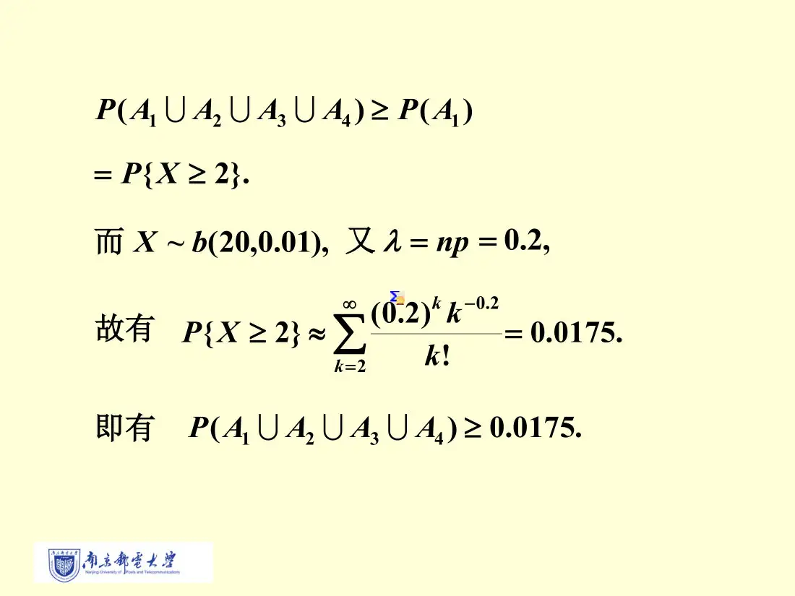

原文：

$$
\begin{array}{l} P (A _ {1} \cup A _ {2} \cup A _ {3} \cup A _ {4}) \geq P (A _ {1}) \\ = P \{X \geq 2 \}. \end{array}
$$

而 $X \sim b ( 2 0 , 0 . 0 1 )$ ，又 $\lambda = n p = 0 . 2$

故有 $P \{ X \ge 2 \} \approx \sum _ { k = 2 } ^ { \infty } \frac { ( \stackrel { 5 } { 0 . 2 } ) ^ { k } k ^ { - 0 . 2 } } { k ! } = 0 . 0 1 7 5 .$

即有 $P ( A _ { 1 } \cup A _ { 2 } \cup A _ { 3 } \cup A _ { 4 } ) \geq 0 . 0 1 7 5 .$

南立都生大学 南京郵電大学 Nanjing University ofPosts and Telecommunications

### 5. 几何分布

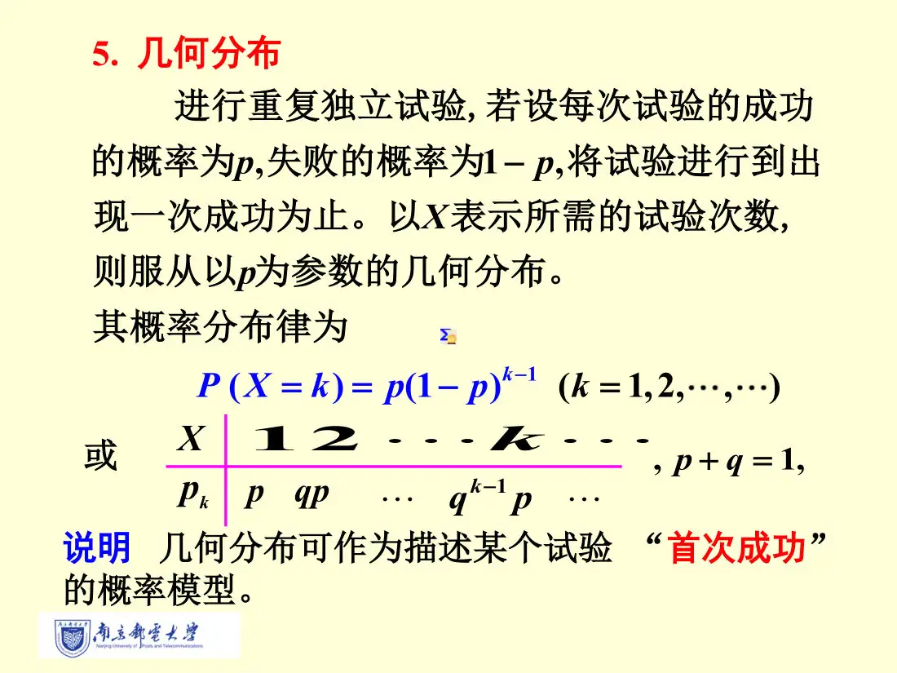

原文：

5. 几何分布

进行重复独立试验，若设每次试验的成功的概率为 $| p ,$ 失败的概率为 $1 1 - p ,$ 将试验进行到出现一次成功为止。以X表示所需的试验次数则服从 $\Delta p$ 为参数的几何分布。

其概率分布律为

$$
P (X = k) = p (1 - p) ^ {k - 1} \quad (k = 1, 2, \dots , \dots)
$$

或

$$
\begin{array}{c c c c c} X & \mathbf {1 2} & \dots & \mathbf {k} & \dots \\ \hline p _ {k} & p & q p & \dots & q ^ {k - 1} p & \dots \end{array} , p + q = 1,
$$

说明 几何分布可作为描述某个试验 “首次成功”的概率模型。

南志都生大学 南京郵電大学 Nanjing University ofPosts and Telecommunication

### 解 X 所取的可能值是 1,2,3,…。

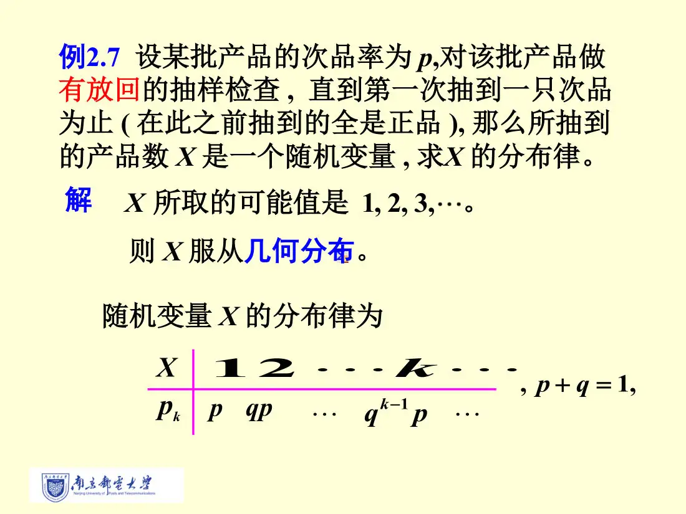

原文：

例2.7 设某批产品的次品率为 $p ,$ 对该批产品做有放回的抽样检查, 直到第一次抽到一只次品为止 ( 在此之前抽到的全是正品), 那么所抽到的产品数X是一个随机变量, 求X 的分布律。

解 X 所取的可能值是 1,2,3,…。

则X 服从几何分布。

随机变量X 的分布律为

$$
\begin{array}{c c c c c} X & 1 2 & \dots & k & \dots \\ \hline p _ {k} & p & q p & \dots & q ^ {k - 1} p & \dots \end{array} , p + q = 1,
$$

南京郵電大學 Nanjing University ofPosts and Telecommunication

### 6. 巴斯卡分布

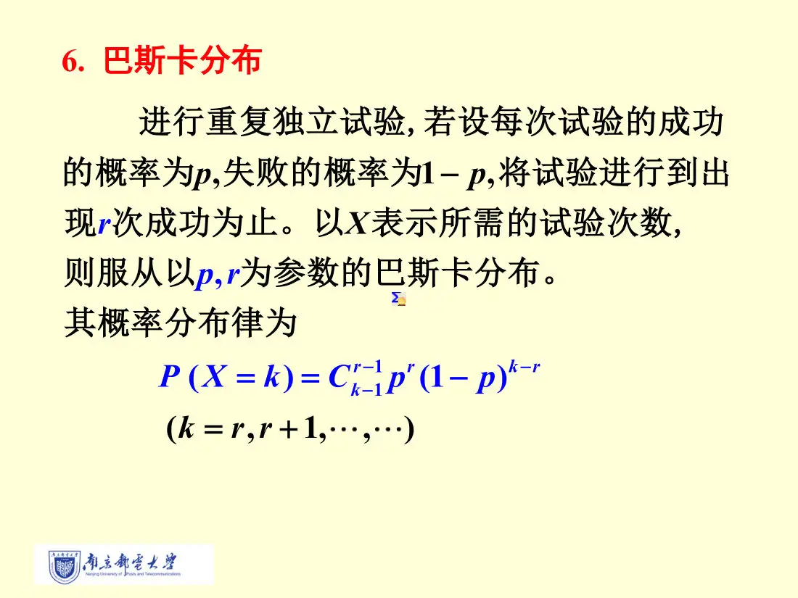

原文：

6. 巴斯卡分布

进行重复独立试验，若设每次试验的成功的概率为 $\boldsymbol { p }$ ,失败的概率为 $1 - p ,$ 将试验进行到出现r次成功为止。以X表示所需的试验次数，则服从以 $p , r$ 为参数的巴斯卡分布。

其概率分布律为

$$
\Sigma
$$

$$
P (X = k) = C _ {k - 1} ^ {r - 1} p ^ {r} (1 - p) ^ {k - r}
$$

$$
(k = r, r + 1, \dots , \dots)
$$

南京郵電大學 Nanjing University ofPosts and Telecommunication

### 7. 超几何分布

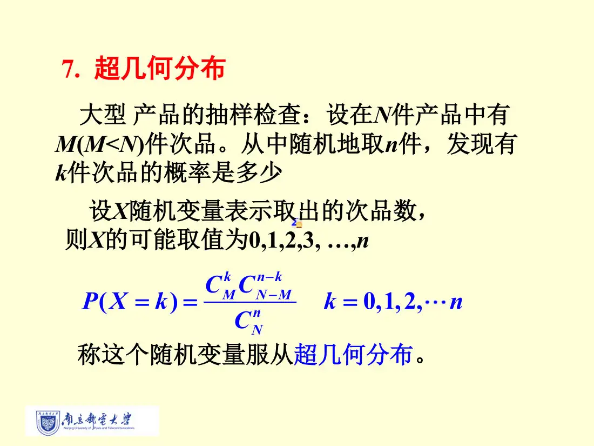

原文：

7. 超几何分布

大型产品的抽样检查：设在N件产品中有M(M<N)件次品。从中随机地取n件，发现有k件次品的概率是多少

设X随机变量表示取出的次品数，则X的可能取值为 $\mathbf { 0 } , \mathbf { 1 } , \bar { 2 } , 3 , . . . , n$

$$
P (X = k) = \frac {C _ {M} ^ {k} C _ {N - M} ^ {n - k}}{C _ {N} ^ {n}} \quad k = 0, 1, 2, \dots n
$$

称这个随机变量服从超几何分布。

南立都生大学 南京郵電大学 Nanjing University ofPosts and Telecommunication

### 即当N很大时，超几何分布近似二项分布。

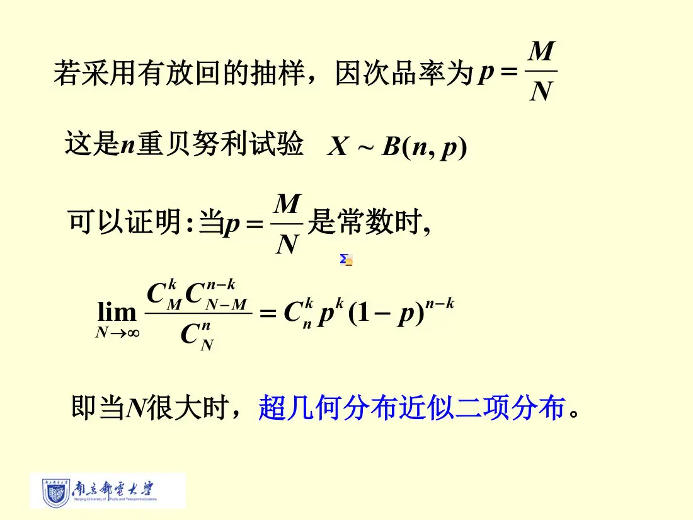

原文：

若采用有放回的抽样，因次品率为 $p = { \frac { M } { N } }$ 这是n重贝努利试验 $X \sim B ( n , p )$ 可以证明：当 $p = { \frac { M } { N } }$ 是常数时，$\operatorname* { l i m } _ { N \to \infty } { \frac { C _ { M } ^ { k } C _ { N - M } ^ { n - k } } { C _ { N } ^ { n } } } = C _ { n } ^ { k } p ^ { k } ( 1 - p ) ^ { n - k }$

即当N很大时，超几何分布近似二项分布。

南京郵電大学 Nanjing University ofPosts and Telecommunications

### 第 27 页

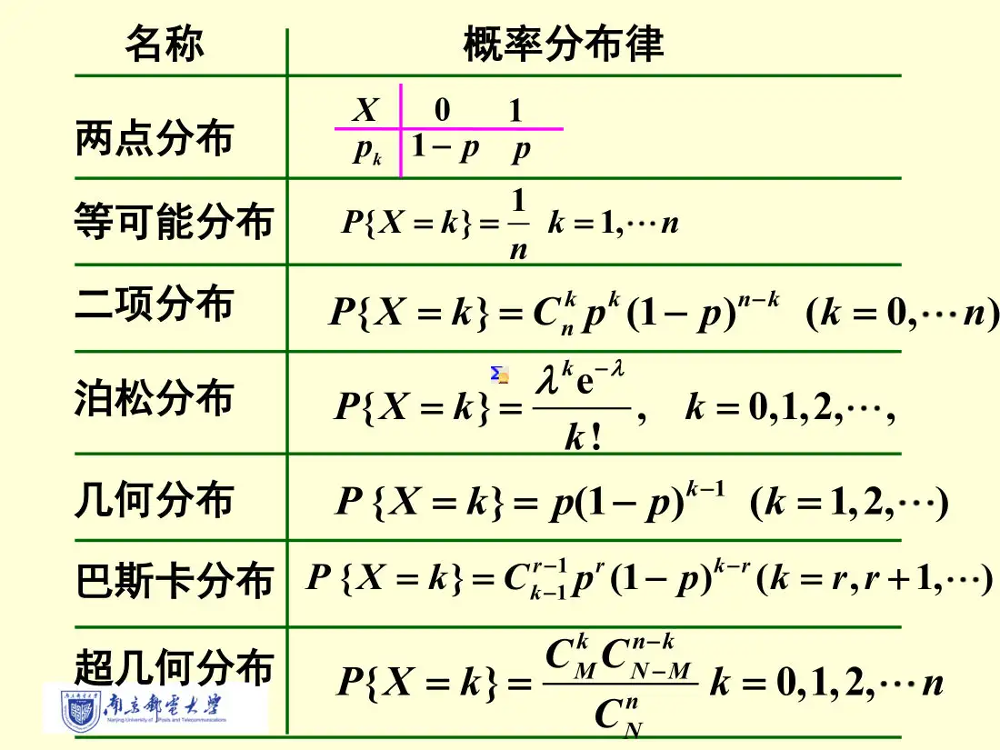

原文：

<table><tr><td>名称</td><td colspan="2">概率分布律</td></tr><tr><td>两点分布</td><td colspan="2"> $\begin{array}{c|cc} X & 0 & 1 \\ \hline p_k & 1-p & p \end{array}$ </td></tr><tr><td>等可能分布</td><td colspan="2"> $P\{X=k\}=\frac{1}{n} k=1,\cdots n$ </td></tr><tr><td>二项分布</td><td colspan="2"> $P\{X=k\}=C_n^k p^k(1-p)^{n-k} (k=0,\cdots n)$ </td></tr><tr><td>泊松分布</td><td colspan="2"> $P\{X=k\}=\frac{\lambda^k e^{-\lambda}}{k!}, k=0,1,2,\cdots,$ </td></tr><tr><td>几何分布</td><td colspan="2"> $P\{X=k\}=p(1-p)^{k-1} (k=1,2,\cdots)$ </td></tr><tr><td>巴斯卡分布</td><td colspan="2"> $P\{X=k\}=C_{k-1}^{r-1} p^r(1-p)^{k-r} (k=r,r+1,\cdots)$ </td></tr><tr><td>超几何分布</td><td colspan="2"> $P\{X=k\}=\frac{C_M^k C_{N-M}^{n-k}}{C_N^n} k=0,1,2,\cdots n$ </td></tr></table>

### 二项分布与(0-1)分布之间的关系.

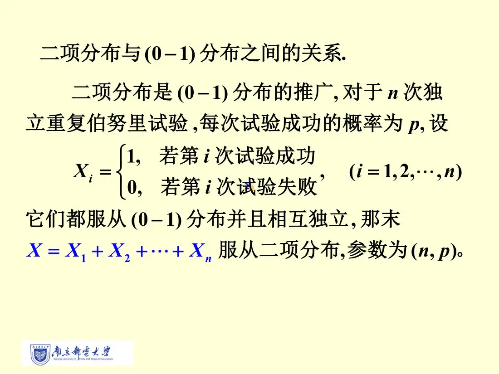

原文：

二项分布与(0-1)分布之间的关系.

二项分布是(0-1)分布的推广,对于n次独立重复伯努里试验,每次试验成功的概率为 $p _ { : }$ ,设

$$
X _ {i} = \left\{ \begin{array}{l l} 1, & \text {若第} i \text {次试验成功} \\ 0, & \text {若第} i \text {次试验失败} \end{array} , \quad (i = 1, 2, \dots , n) \right.
$$

它们都服从(0-1)分布并且相互独立,那末$X = X _ { 1 } + X _ { 2 } + \cdots + X _ { n }$ 服从二项分布,参数为 $( n , p )$ o二项分布与泊松分布之间的关系.

南立都生大学 南京郵電大学 Nanjing University ofPosts and Telecommunication

### $$

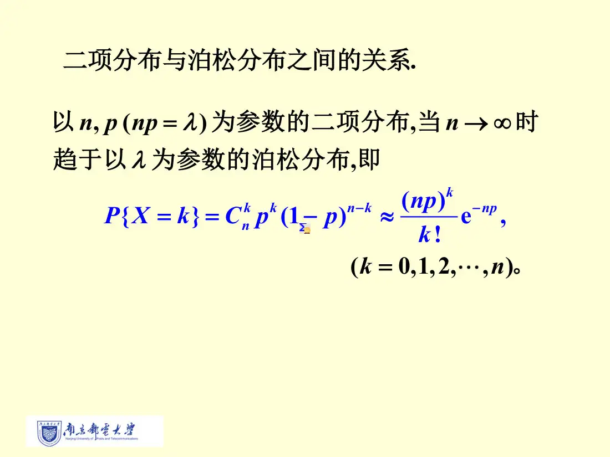

原文：

以 $n , p \left( n p = \lambda \right)$ 为参数的二项分布,当 ${ \pmb n }  \infty$ 时趋于以λ为参数的泊松分布,即

$$
\begin{array}{r} P \{X = k \} = C _ {n} ^ {k} p ^ {k} (1 _ {\Sigma_ {\perp}} - p) ^ {n - k} \approx \frac {(n p) ^ {k}}{k !} \mathrm{e} ^ {- n p}, \\ (k = 0, 1, 2, \dots , n) _ {\circ} \end{array}
$$

南京郵電大學 Nanjing University ofPosts and Telecommunications

### 二项分布与超几何分布之间的关系.

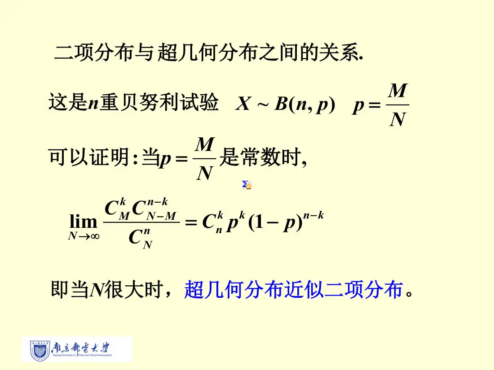

原文：

二项分布与超几何分布之间的关系.

这是n重贝努利试验 $X \sim B ( n , p ) p = \frac { M } { N }$ 可以证明：当 $p = { \frac { M } { N } }$ 是常数时，$\operatorname* { l i m } _ { N \to \infty } { \frac { C _ { M } ^ { k } C _ { N - M } ^ { n - k } } { C _ { N } ^ { n } } } = C _ { n } ^ { k } p ^ { k } ( 1 - p ) ^ { n - k }$

即当N很大时，超几何分布近似二项分布。

南立都生大学 南京郵電大学 Nanjing University ofPosts and Telecommunication
