# 《概率论与数理统计》第2章 随机变量及其分布 2.3 随机变量的分布函数（课件）

原件的每一页，下面附识别出的文字。

### 2.3 随机变量的分布函数

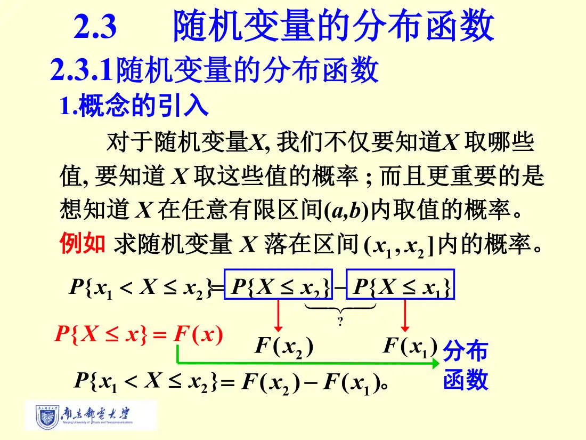

原文：

2.3 随机变量的分布函数

2.3.1 随机变量的分布函数

1. 概念的引入

对于随机变量X, 我们不仅要知道X取哪些值, 要知道X取这些值的概率; 而且更重要的是想知道X在任意有限区间(a,b)内取值的概率。例如求随机变量X落在区间 $(x_{1},x_{2}]$ 内的概率。

$$
\begin{array}{r l} & P \{x _ {1} <   X \leq x _ {2} \} = P \{X \leq x _ {2} \} - P \{X \leq x _ {1} \} \\ & P \{X \leq x \} = F (x) \quad F (x _ {2}) \quad F (x _ {1}) \\ & P \{x _ {1} <   X \leq x _ {2} \} = F (x _ {2}) - F (x _ {1}) 。 \end{array}
$$

南京邮电大学
Nanjing University of Posts and Telecommunications

### 2. 分布函数的定义

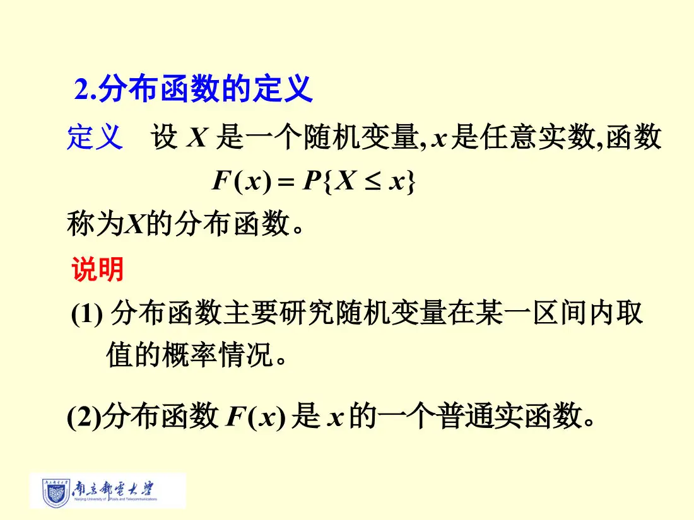

原文：

2. 分布函数的定义

定义 设 X 是一个随机变量, x 是任意实数, 函数

$$
F (x) = P \{X \leq x \}
$$

称为X的分布函数。

说明

(1) 分布函数主要研究随机变量在某一区间内取值的概率情况。

(2)分布函数 $F(x)$ 是 x 的一个普通实函数。

南京邮电大学
Nanjing University of Posts and Telecommunications

### 分布函数的性质

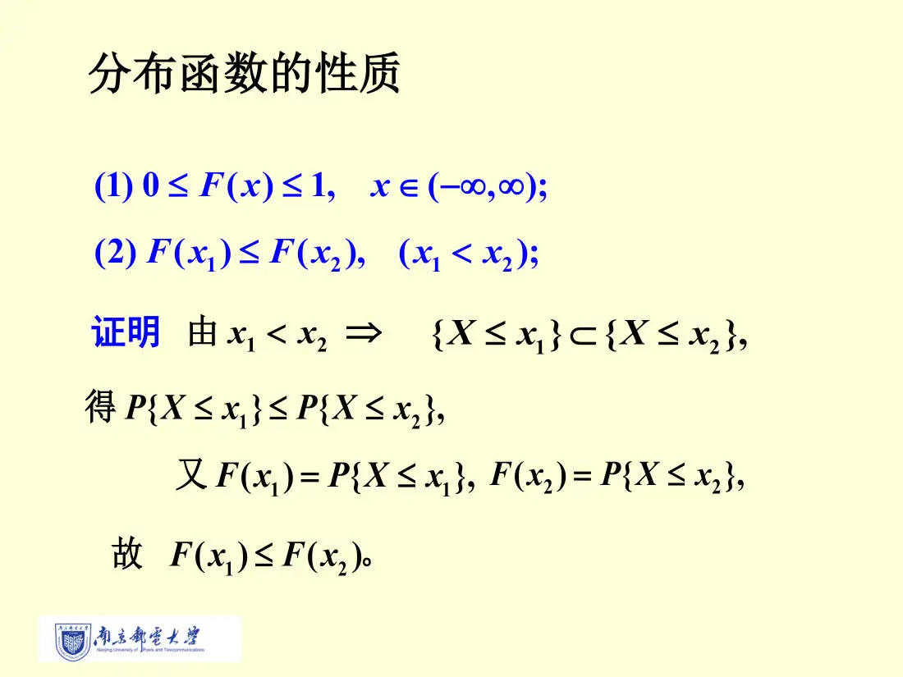

原文：

分布函数的性质

(1) $0 \leq F(x) \leq 1,\quad x \in (-\infty, \infty);$

(2) $F(x_{1})\leq F(x_{2}),\quad (x_{1} <   x_{2});$

证明 由 $x_{1} < x_{2} \Rightarrow \{X \leq x_{1}\} \subset \{X \leq x_{2}\}$ ,

得 $P\{X \leq x_1\} \leq P\{X \leq x_2\}$ ,

又 $F(x_{1}) = P\{X\leq x_{1}\} ,F(x_{2}) = P\{X\leq x_{2}\} ,$

故 $F(x_{1})\leq F(x_{2})$

南京邮电大学
Nanjing University of Posts and Telecommunications

### 证明 $F(x) = P\{X \leq x\}$ , 当 $x$ 越来越小时,

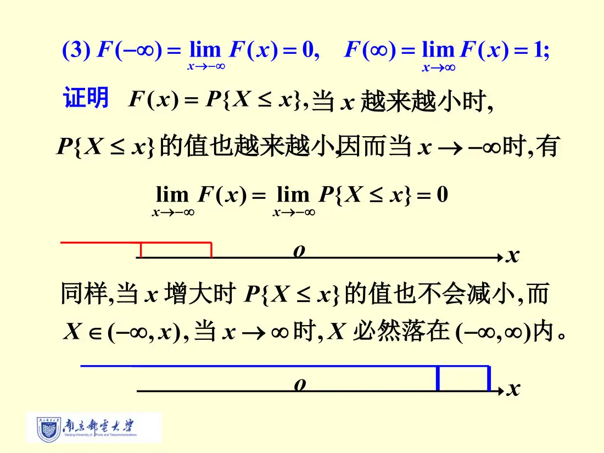

原文：

(3) $F(-\infty) = \lim_{x \to -\infty} F(x) = 0, \quad F(\infty) = \lim_{x \to \infty} F(x) = 1;$

证明 $F(x) = P\{X \leq x\}$ , 当 $x$ 越来越小时,

$P\{X \leq x\}$ 的值也越来越小因而当 $x \to -\infty$ 时,有

$$
\lim _ {x \to - \infty} F (x) = \lim _ {x \to - \infty} P \{X \leq x \} = 0
$$

同样,当 x 增大时 $P\{X \leq x\}$ 的值也不会减小,而 $X \in (-\infty, x)$ , 当 $x \to \infty$ 时, X 必然落在 $(-\infty, \infty)$ 内。

南京邮电大学
Nanjing University of Posts and Telecommunications

### 即任一分布函数处处右连续。

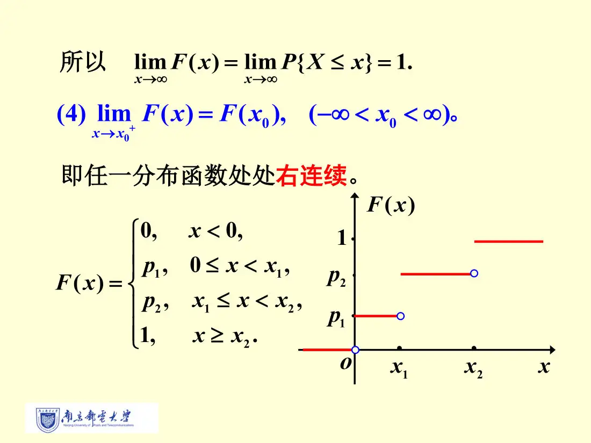

原文：

所以 $\lim_{x\to \infty}F(x) = \lim_{x\to \infty}P\{X\leq x\} = 1.$

(4) $\lim_{x\to x_0^+}F(x) = F(x_0), (-\infty < x_0 < \infty)$ 。

即任一分布函数处处右连续。

$$
F (x) = \left\{ \begin{array}{l l} 0, & x <   0, \\ p _ {1}, & 0 \leq x <   x _ {1}, \\ p _ {2}, & x _ {1} \leq x <   x _ {2}, \\ 1, & x \geq x _ {2}. \end{array} \right.
$$

南京邮电大学
Nanjing University of Posts and Telecommunications

### 重要公式

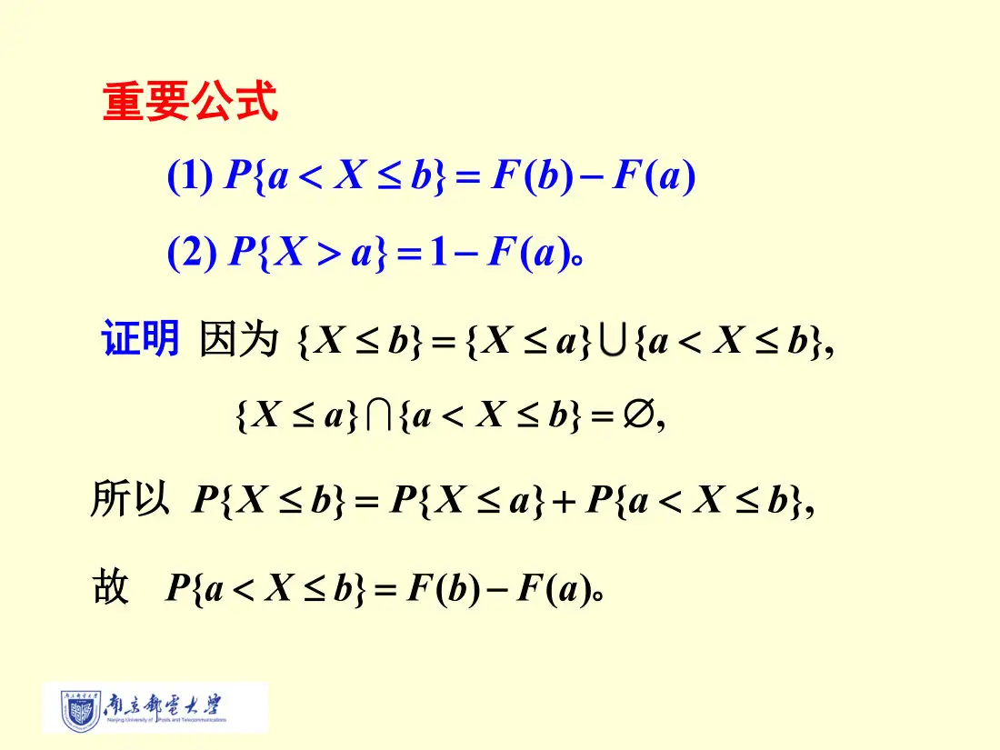

原文：

重要公式

(1) $P\{a < X \leq b\} = F(b) - F(a)$

(2) $P\{X > a\} = 1 - F(a)$ 。

证明 因为 $\{X \leq b\} = \{X \leq a\} \cup \{a < X \leq b\}$ ,

$$
\{X \leq a \} \cap \{a <   X \leq b \} = \varnothing ,
$$

所以 $P\{X \leq b\} = P\{X \leq a\} + P\{a < X \leq b\}$ ,

故 $P\{a < X \leq b\} = F(b) - F(a)$ 。

南京邮电大学
Nanjing University of Posts and Telecommunications

### 解 根据题意得: $X \sim B(3, \frac{1}{2})$ 。

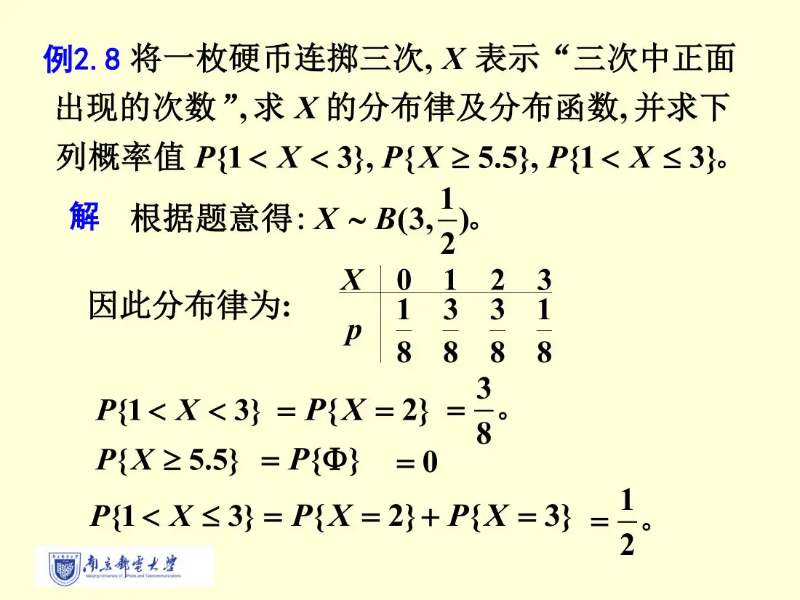

原文：

例2.8 将一枚硬币连掷三次, X 表示 “三次中正面出现的次数”, 求 X 的分布律及分布函数, 并求下列概率值 $P\{1 < X < 3\}$ , $P\{X \geq 5.5\}$ , $P\{1 < X \leq 3\}$ 。

解 根据题意得: $X \sim B(3, \frac{1}{2})$ 。

因此分布律为: $X \mid 0 \quad 1 \quad 2 \quad 3$ $p \mid \begin{array}{cccc} 1 & 3 & 3 & 1 \\ \hline 8 & 8 & 8 & 8 \end{array}$

$P\{1 < X < 3\} = P\{X = 2\} = \frac{3}{8}$ $P\{X \geq 5.5\} = P\{\Phi\} = 0$

$P\{1 < X \leq 3\} = P\{X = 2\} + P\{X = 3\} = \frac{1}{2}$ 。

南京邮电大学
Nanjing University of Posts and Telecommunications

### 求分布函数:

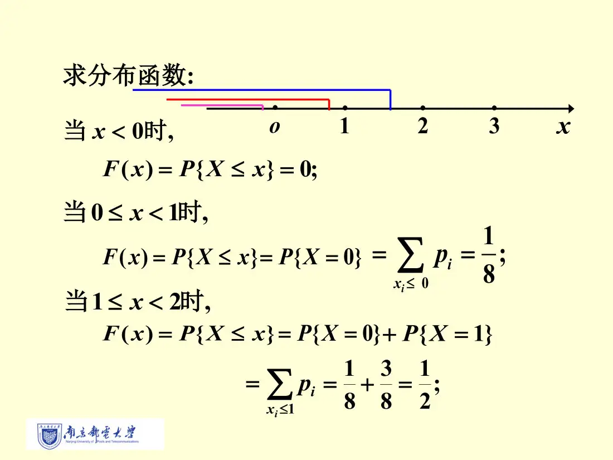

原文：

求分布函数:

当 $x < 0$ 时，

$$
F (x) = P \{X \leq x \} = 0;
$$

当 $0 \leq x < 1$ 时，

$$
F (x) = P \{X \leq x \} = P \{X = 0 \} = \sum_ {x _ {i} \leq 0} p _ {i} = \frac {1}{8};
$$

当 $1 \leq x < 2$ 时，

$$
\begin{array}{r l} F (x) & = P \{X \leq x \} = P \{X = 0 \} + P \{X = 1 \} \\ & = \sum_ {x _ {i} \leq 1} p _ {i} = \frac {1}{8} + \frac {3}{8} = \frac {1}{2}; \end{array}
$$

南京邮电大学
Nanjing University of Posts and Telecommunications

### $$

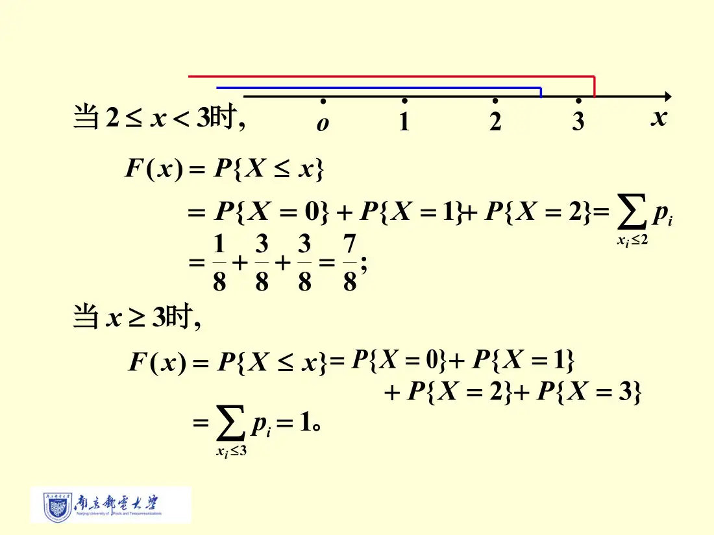

原文：

$$
2 \leq x <
$$

$$
\begin{array}{r l} F (x) & = P \{X \leq x \} \\ & = P \{X = 0 \} + P \{X = 1 \} + P \{X = 2 \} = \sum_ {x _ {i} \leq 2} p _ {i} \\ & = \frac {1}{8} + \frac {3}{8} + \frac {3}{8} = \frac {7}{8}; \end{array}
$$

当 $x \geq 3$ 时，

$$
\begin{array}{r l r} & & {F (x) = P \{X \leq x \} = P \{X = 0 \} + P \{X = 1 \}} \\ & & {+ P \{X = 2 \} + P \{X = 3 \}} \\ & & {= \sum_ {x _ {i} \leq 3} p _ {i} = 1 _ {\circ}} \end{array}
$$

南京邮电大学
Nanjing University of Posts and Telecommunications

### 分布函数

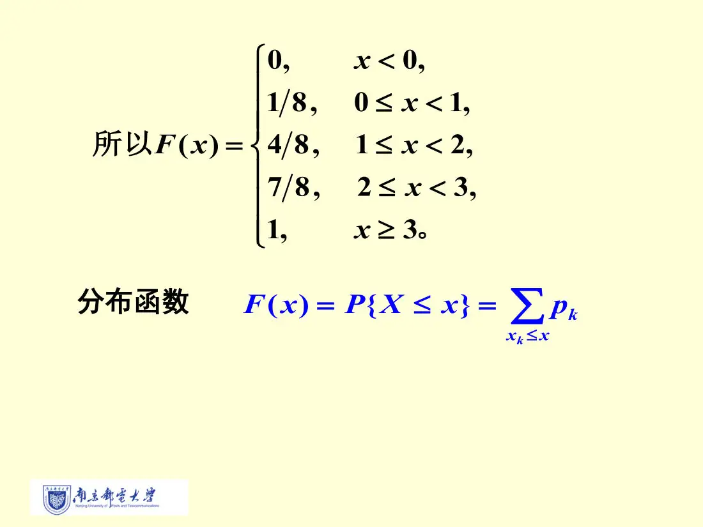

原文：

所以 $F(x)=\left\{\begin{aligned}&0,&x<0,\\ &1/8,&0\leq x<1,\\ &4/8,&1\leq x<2,\\ &7/8,&2\leq x<3,\\ &1,&x\geq3\text{。}\end{aligned}\right.$

分布函数

$$
F (x) = P \{X \leq x \} = \sum_ {x _ {k} \leq x} p _ {k}
$$

南京邮电大学
Nanjing University of Posts and Telecommunications

### $$

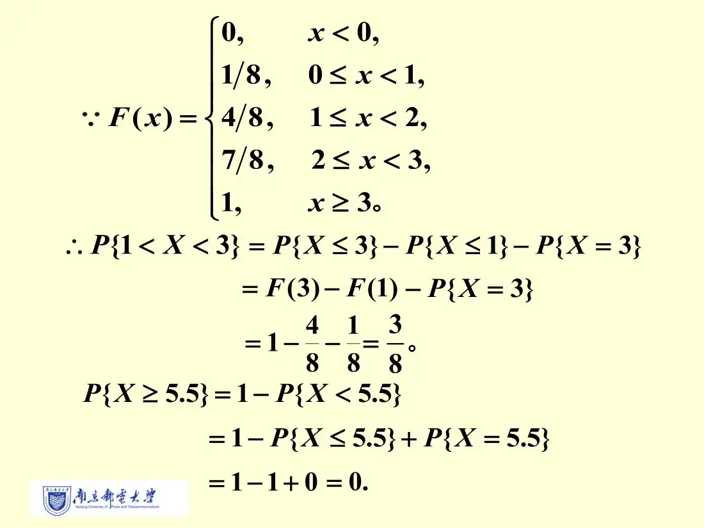

原文：

$$
\because F (x) = \left\{ \begin{array}{l l} 0, & x <   0, \\ 1 / 8, & 0 \leq x <   1, \\ 4 / 8, & 1 \leq x <   2, \\ 7 / 8, & 2 \leq x <   3, \\ 1, & x \geq 3. \end{array} \right.
$$

$$
\begin{array}{r l} \therefore P \{1 <   X <   3 \} & = P \{X \leq 3 \} - P \{X \leq 1 \} - P \{X = 3 \} \\ & = F (3) - F (1) - P \{X = 3 \} \\ & = 1 - \frac {4}{8} - \frac {1}{8} = \frac {3}{8}. \end{array}
$$

$$
\begin{array}{r l} {P \{X \geq 5. 5 \} = 1 - P \{X <   5. 5 \}} \\ & {= 1 - P \{X \leq 5. 5 \} + P \{X = 5. 5 \}} \\ & {= 1 - 1 + 0 = 0.} \end{array}
$$

南京邮电大学
Nanjing University of Posts and Telecommunications

### $$

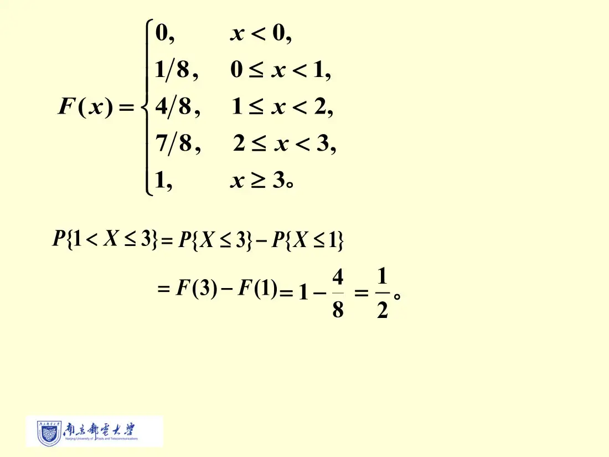

原文：

$$
F (x) = \left\{ \begin{array}{l l} 0, & x <   0, \\ 1 / 8, & 0 \leq x <   1, \\ 4 / 8, & 1 \leq x <   2, \\ 7 / 8, & 2 \leq x <   3, \\ 1, & x \geq 3. \end{array} \right.
$$

$$
\begin{array}{r l} P \{1 <   X \leq 3 \} & = P \{X \leq 3 \} - P \{X \leq 1 \} \\ & = F (3) - F (1) = 1 - \frac {4}{8} = \frac {1}{2}. \end{array}
$$

南京邮电大学
Nanjing University of Posts and Telecommunications

### 例2.9 设随机变量 $X$ 的分布律为

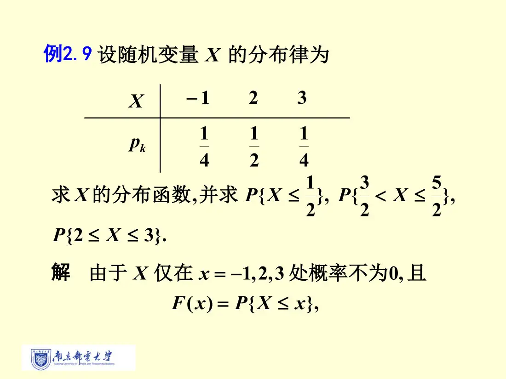

原文：

例2.9 设随机变量 $X$ 的分布律为

$$
\begin{array}{c c c c} X & - 1 & 2 & 3 \\ \hline p _ {k} & \frac {1}{4} & \frac {1}{2} & \frac {1}{4} \end{array}
$$

求 $X$ 的分布函数, 并求 $P\{X \leq \frac{1}{2}\}$ , $P\{\frac{3}{2} < X \leq \frac{5}{2}\}$ , $P\{2 \leq X \leq 3\}$ .

解 由于 X 仅在 x = -1, 2, 3 处概率不为 0, 且

$$
F (x) = P \{X \leq x \},
$$

南京邮电大学
Nanjing University of Posts and Telecommunications

### $$

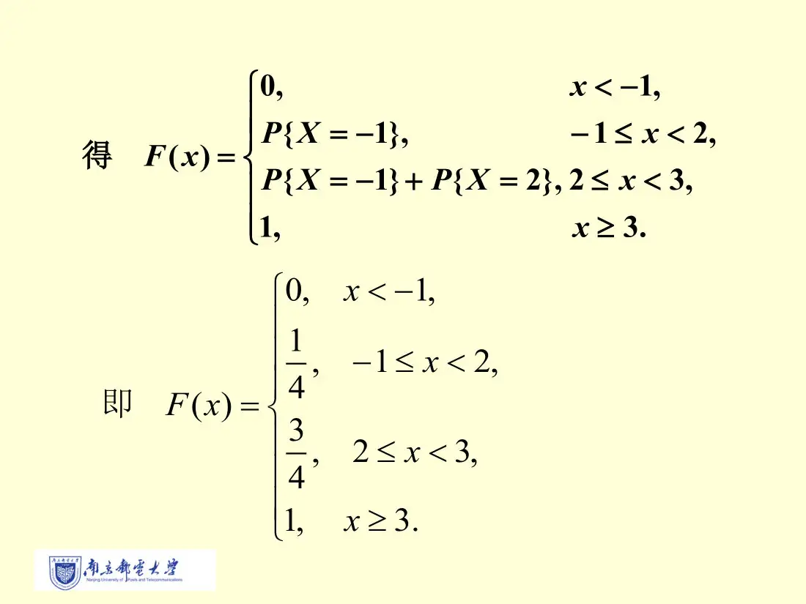

原文：

得 $F(x)=\left\{\begin{aligned}&0,&x<-1,\\ &P\{X=-1\},&-1\leq x<2,\\ &P\{X=-1\}+P\{X=2\},&2\leq x<3,\\ &1,&x\geq3.\end{aligned}\right.$

即

$$
F (x) = \left\{ \begin{array}{l l} 0, & x <   - 1, \\ \frac {1}{4}, & - 1 \leq x <   2, \\ \frac {3}{4}, & 2 \leq x <   3, \\ 1, & x \geq 3. \end{array} \right.
$$

南京邮电大学
Nanjing University of Posts and Telecommunications

### 由 $F(x) = P\{X \leq x\}$ ,

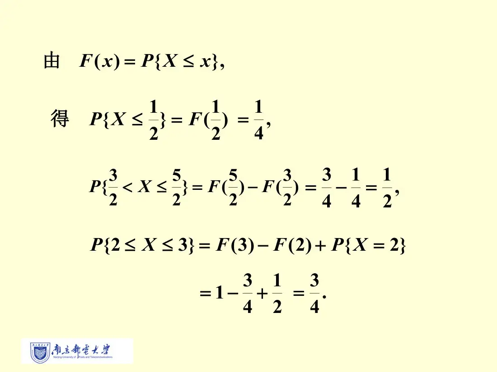

原文：

由 $F(x) = P\{X \leq x\}$ ,

得 $P\{X \leq \frac{1}{2}\} = F(\frac{1}{2}) = \frac{1}{4},$

$$
P \{\frac {3}{2} <   X \leq \frac {5}{2} \} = F (\frac {5}{2}) - F (\frac {3}{2}) = \frac {3}{4} - \frac {1}{4} = \frac {1}{2},
$$

$$
\begin{array}{r l} P \{2 \leq X \leq 3 \} & = F (3) - F (2) + P \{X = 2 \} \\ & = 1 - \frac {3}{4} + \frac {1}{2} = \frac {3}{4}. \end{array}
$$

南京邮电大学
Nanjing University of Posts and Telecommunications

### 请同学们思考

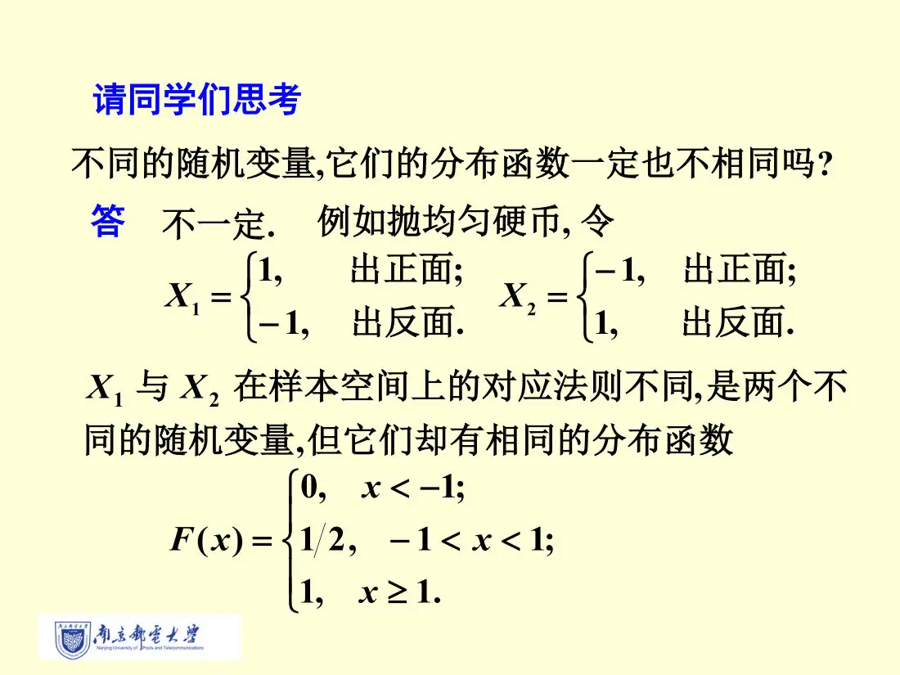

原文：

请同学们思考

不同的随机变量,它们的分布函数一定也不相同吗?

答 不一定. 例如抛均匀硬币, 令

$$
X _ {1} = \left\{ \begin{array}{l l} 1, & \text {出正面}; \\ - 1, & \text {出反面}. \end{array} \quad X _ {2} = \left\{ \begin{array}{l l} - 1, & \text {出正面}; \\ 1, & \text {出反面}. \end{array} \right. \right.
$$

$X_{1}$ 与 $X_{2}$ 在样本空间上的对应法则不同, 是两个不同的随机变量, 但它们却有相同的分布函数

$$
F (x) = \left\{ \begin{array}{l l} 0, & x <   - 1; \\ 1 / 2, & - 1 <   x <   1; \\ 1, & x \geq 1. \end{array} \right.
$$

南京邮电大学
Nanjing University of Posts and Telecommunications

### 离散型随机变量分布律与分布函数的关系

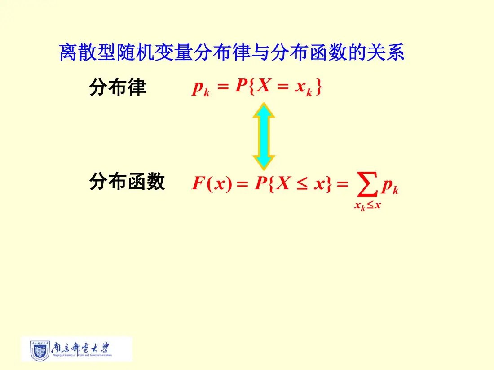

原文：

离散型随机变量分布律与分布函数的关系

分布律

$$
p _ {k} = P \{X = x _ {k} \}
$$

分布函数

$$
F (x) = P \{X \leq x \} = \sum_ {x _ {k} \leq x} p _ {k}
$$

南京邮电大学
Nanjing University of Posts and Telecommunications
