# 《概率论与数理统计》第2章 随机变量及其分布 2.5 一维随机变量函数的分布（课件）

原件的每一页，下面附识别出的文字。

### 2.5 一维随机变量的函数的分布

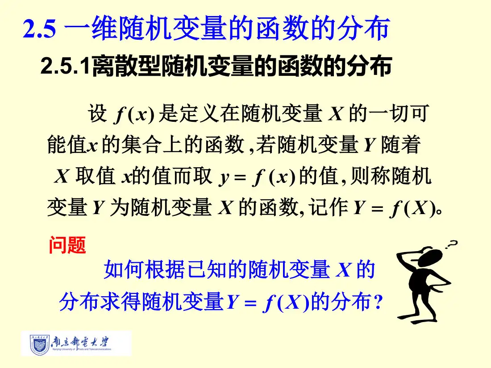

原文：

2.5 一维随机变量的函数的分布

2.5.1 离散型随机变量的函数的分布

设 $f(x)$ 是定义在随机变量 X 的一切可能值 x 的集合上的函数, 若随机变量 Y 随着 X 取值 x 的值而取 $y = f(x)$ 的值, 则称随机变量 Y 为随机变量 X 的函数, 记作 $Y = f(X)$ 。

问题

如何根据已知的随机变量 X 的分布求得随机变量 $Y = f(X)$ 的分布？

南京邮电大学
Nanjing University of Posts and Telecommunications

### 例2.20 设 $X$ 的分布律为

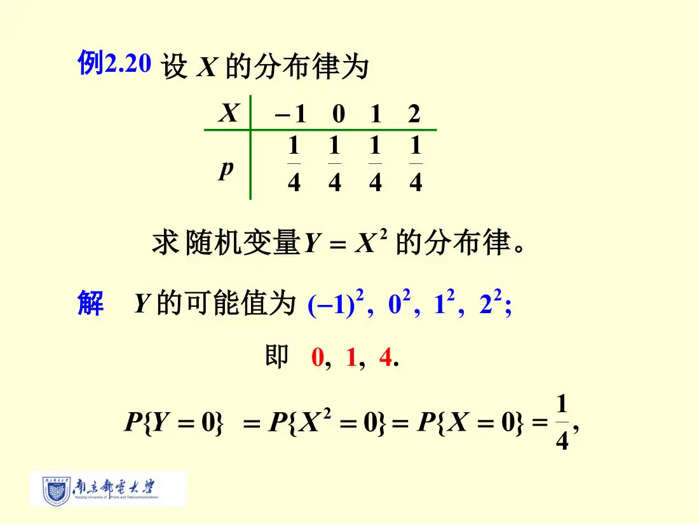

原文：

例2.20 设 $X$ 的分布律为

$$
\begin{array}{c c c c c} X & - 1 & 0 & 1 & 2 \\ \hline & \frac {1}{4} & \frac {1}{4} & \frac {1}{4} & \frac {1}{4} \end{array}
$$

求随机变量 $Y = X^{2}$ 的分布律。

解 Y 的可能值为 $(-1)^{2}$ , $0^{2}$ , $1^{2}$ , $2^{2}$ ;

即 0, 1, 4.

$$
P \{Y = 0 \} = P \{X ^ {2} = 0 \} = P \{X = 0 \} = \frac {1}{4},
$$

南京邮电大学
Nanjing University of Posts and Telecommunications

### $$

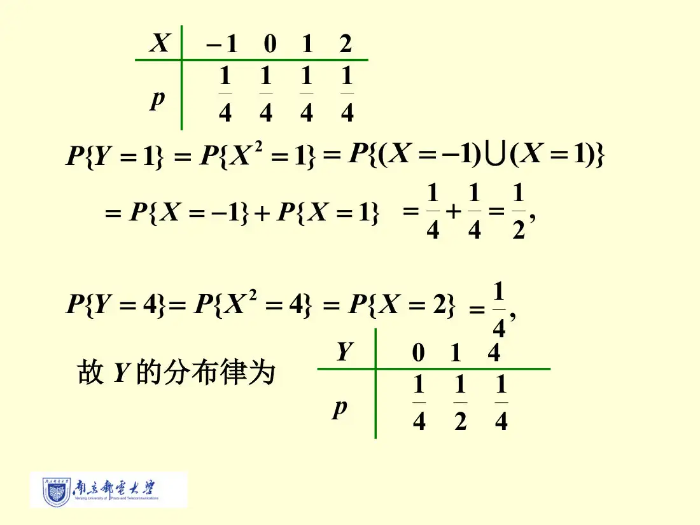

原文：

$$
\begin{array}{c c c c c} X & - 1 & 0 & 1 & 2 \\ \hline & \frac {1}{4} & \frac {1}{4} & \frac {1}{4} & \frac {1}{4} \end{array}
$$

$$
\begin{array}{r l} P \{Y = 1 \} & = P \{X ^ {2} = 1 \} = P \{(X = - 1) \bigcup (X = 1) \} \\ & = P \{X = - 1 \} + P \{X = 1 \} = \frac {1}{4} + \frac {1}{4} = \frac {1}{2}, \end{array}
$$

$P\{Y=4\}=P\{X^{2}=4\}=P\{X=2\}=\frac{1}{4},$ 故 Y 的分布律为
Y 0 1 4
p $\frac{1}{4}$ $\frac{1}{2}$ $\frac{1}{4}$

南京邮电大学
Nanjing University of Posts and Telecommunications

### 离散型随机变量的函数的分布

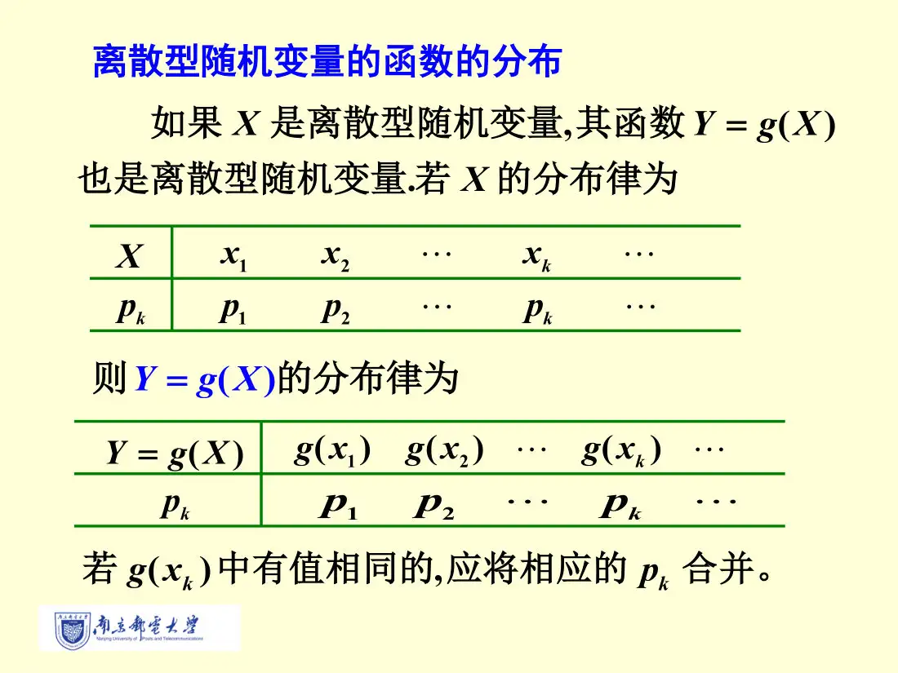

原文：

离散型随机变量的函数的分布

如果 X 是离散型随机变量, 其函数 $Y = g(X)$ 也是离散型随机变量. 若 X 的分布律为

<table><tr><td>X</td><td> $x_{1}$ </td><td> $x_{2}$ </td><td>...</td><td> $x_{k}$ </td><td>...</td></tr><tr><td> $p_{k}$ </td><td> $p_{1}$ </td><td> $p_{2}$ </td><td>...</td><td> $p_{k}$ </td><td>...</td></tr></table>

则 $Y = g(X)$ 的分布律为

<table><tr><td> $Y = g(X)$ </td><td> $g(x_1)$ </td><td> $g(x_2)$ </td><td> $\cdots$ </td><td> $g(x_k)$ </td><td> $\cdots$ </td></tr><tr><td> $p_k$ </td><td> $p_1$ </td><td> $p_2$ </td><td> $\cdots$ </td><td> $p_k$ </td><td> $\cdots$ </td></tr></table>

若 $g(x_{k})$ 中有值相同的,应将相应的 $p_{k}$ 合并。

南京邮电大学
Nanjing University of Posts and Telecommunications

### $$

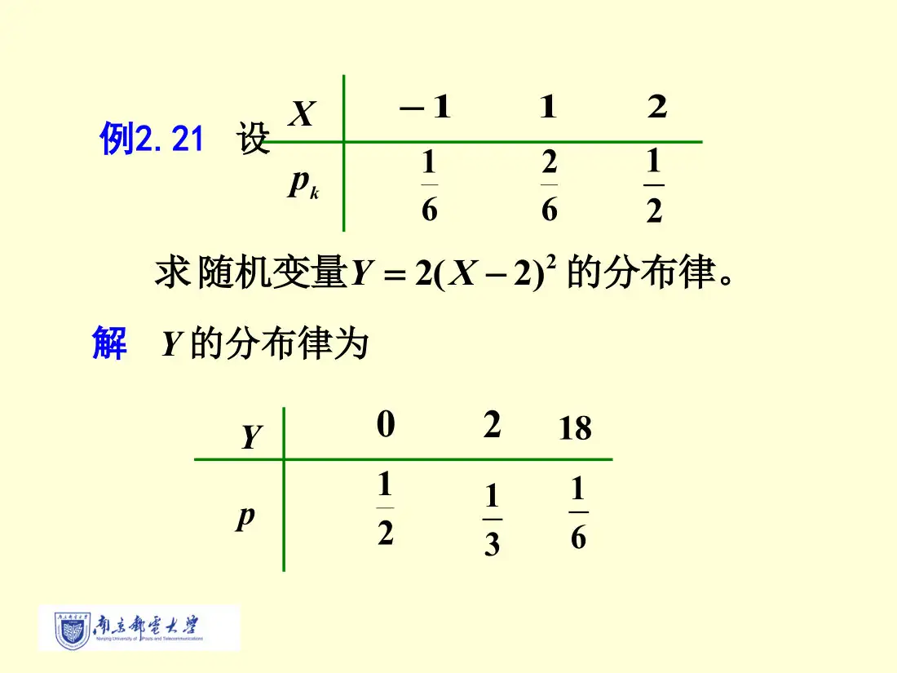

原文：

$$
\text {   例2.21   设   } \begin{array}{c c c c} X & - 1 & 1 & 2 \\ p _ {k} & \frac {1}{6} & \frac {2}{6} & \frac {1}{2} \end{array}
$$

求随机变量 $Y=2(X-2)^{2}$ 的分布律。

解 $Y$ 的分布律为

$$
\begin{array}{c c c c} Y & 0 & 2 & 1 8 \\ \hline p & \frac {1}{2} & \frac {1}{3} & \frac {1}{6} \end{array}
$$

南京邮电大学
Nanjing University of Posts and Telecommunications

### 二、连续型随机变量的函数的分布

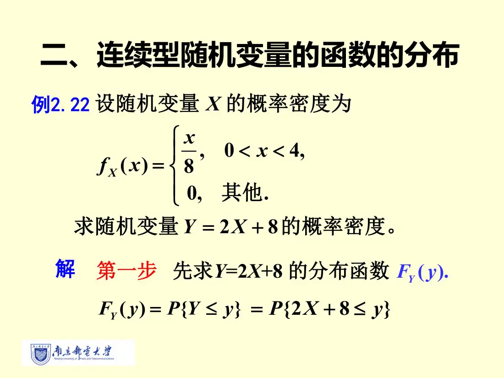

原文：

二、连续型随机变量的函数的分布

例2.22 设随机变量 X 的概率密度为

$$
f _ {X} (x) = \left\{ \begin{array}{l l} \frac {x}{8}, & 0 <   x <   4, \\ 0, & \text {其他.} \end{array} \right.
$$

求随机变量 $Y = 2X + 8$ 的概率密度。

解 第一步 先求 $Y = 2X + 8$ 的分布函数 $F_{Y}(y)$ .

$$
F _ {Y} (y) = P \{Y \leq y \} = P \{2 X + 8 \leq y \}
$$

南京邮电大学
Nanjing University of Posts and Telecommunications

### $$

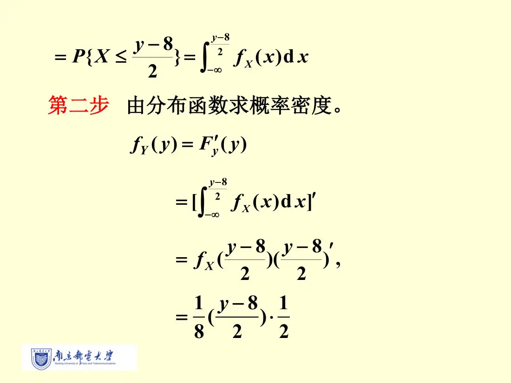

原文：

$$
= P \{X \leq \frac {y - 8}{2} \} = \int_ {- \infty} ^ {\frac {y - 8}{2}} f _ {X} (x) d x
$$

第二步 由分布函数求概率密度。

$$
\begin{array}{r l} f _ {Y} (y) & = F _ {y} ^ {\prime} (y) \\ & = [ \int_ {- \infty} ^ {\frac {y - 8}{2}} f _ {X} (x) \mathrm{d} x ] ^ {\prime} \\ & = f _ {X} (\frac {y - 8}{2}) (\frac {y - 8}{2}) ^ {\prime}, \\ & = \frac {1}{8} (\frac {y - 8}{2}) \cdot \frac {1}{2} \end{array}
$$

南京邮电大学
Nanjing University of Posts and Telecommunications

### 南京邮电大学

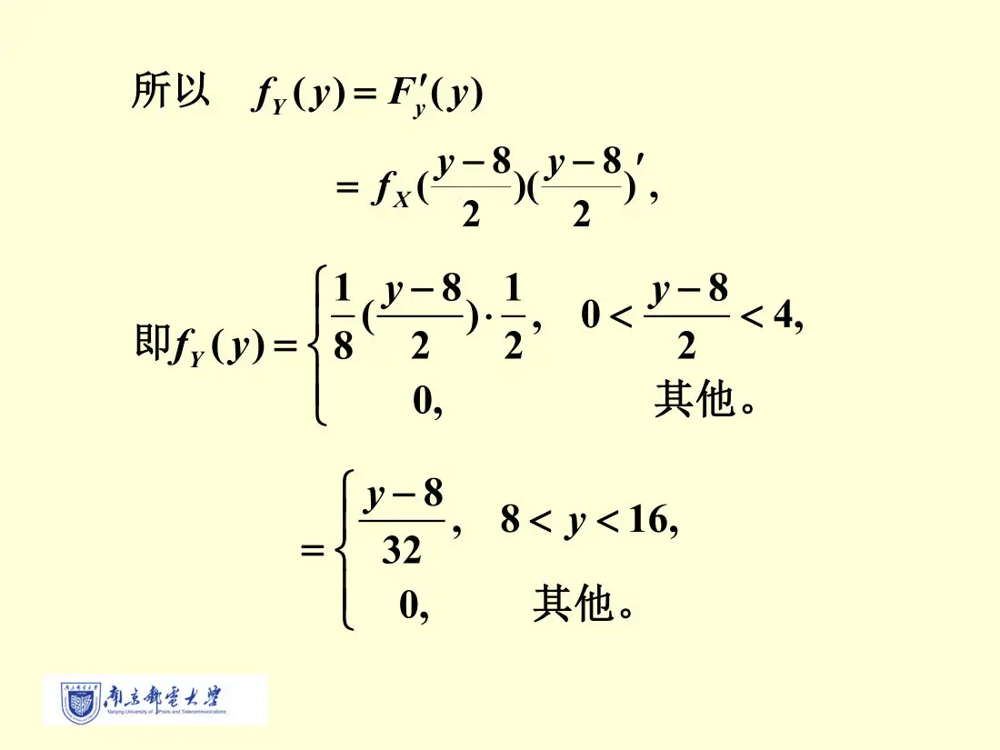

原文：

所以 $f_{Y}(y)=F_{y}^{\prime}(y)$ $=f_{X}\left(\frac{y-8}{2}\right)\left(\frac{y-8}{2}\right)^{\prime},$ 即 $f_{Y}(y)=\left\{\begin{aligned}&\frac{1}{8}\left(\frac{y-8}{2}\right)\cdot\frac{1}{2},&0<\frac{y-8}{2}<4,\\ &0,& 其他。\end{aligned}\right.$ $=\left\{\begin{aligned}&\frac{y-8}{32},&8<y<16,\\ &0,& 其他。\end{aligned}\right.$

南京邮电大学
Nanjing University of Posts and Telecommunications

### 例2.23 设随机变量 $X$ 的概率密度为

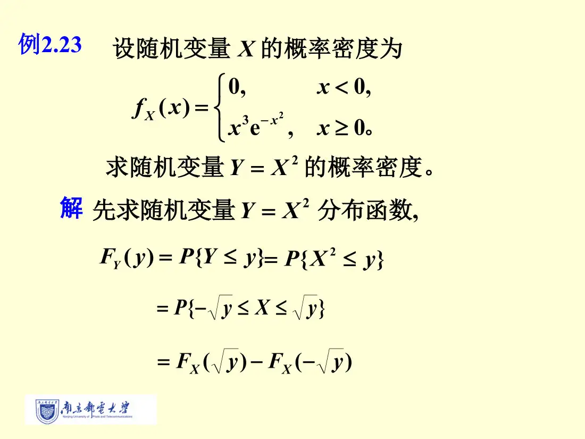

原文：

例2.23 设随机变量 $X$ 的概率密度为

$$
f _ {X} (x) = \left\{ \begin{array}{l l} 0, & x <   0, \\ x ^ {3} \mathrm{e} ^ {- x ^ {2}}, & x \geq 0. \end{array} \right.
$$

求随机变量 $Y = X^2$ 的概率密度。

解 先求随机变量 $Y = X^{2}$ 分布函数,

$$
\begin{array}{r l} & F _ {Y} (y) = P \{Y \leq y \} = P \{X ^ {2} \leq y \} \\ & \qquad = P \{- \sqrt {y} \leq X \leq \sqrt {y} \} \\ & \qquad = F _ {X} (\sqrt {y}) - F _ {X} (- \sqrt {y}) \end{array}
$$

南京邮电大学
Nanjing University of Posts and Telecommunications

### 再由分布函数求概率密度.

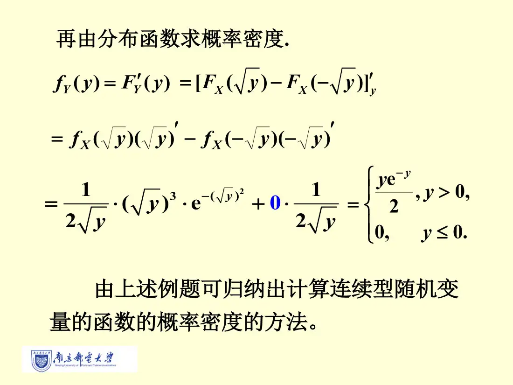

原文：

再由分布函数求概率密度.

$$
\begin{array}{l} f _ {Y} (y) = F _ {Y} ^ {\prime} (y) = [ F _ {X} (\sqrt {y}) - F _ {X} (- \sqrt {y}) ] _ {y} ^ {\prime} \\ = f _ {X} (\sqrt {y}) (\sqrt {y}) ^ {\prime} - f _ {X} (- \sqrt {y}) (- \sqrt {y}) ^ {\prime} \\ = \frac {1}{2 \sqrt {y}} \cdot (\sqrt {y}) ^ {3} \cdot \mathrm{e} ^ {- (\sqrt {y}) ^ {2}} + 0 \cdot \frac {1}{2 \sqrt {y}} = \left\{ \begin{array}{l l} \frac {y \mathrm{e} ^ {- y}}{2}, & y > 0, \\ 0, & y \leq 0. \end{array} \right. \end{array}
$$

由上述例题可归纳出计算连续型随机变量的函数的概率密度的方法。

南京邮电大学
Nanjing University of Posts and Telecommunications

### $$

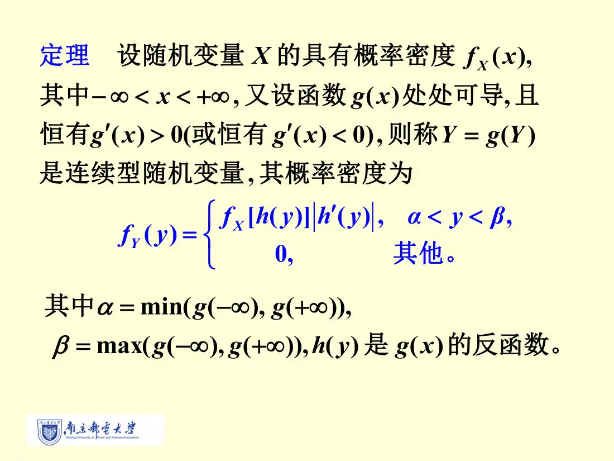

原文：

定理 设随机变量 X 的具有概率密度 $f_{X}(x)$ ，其中 $-\infty < x < +\infty$ ，又设函数 $g(x)$ 处处可导，且恒有 $g'(x) > 0$ （或恒有 $g'(x) < 0$ ），则称 $Y = g(Y)$ 是连续型随机变量，其概率密度为

$$
f _ {Y} (y) = \left\{ \begin{array}{c c} f _ {X} [ h (y) ] \big | h ^ {\prime} (y) \big |, & \alpha <   y <   \beta , \\ 0, & \text {其他。} \end{array} \right.
$$

其中 $\alpha=\min(g(-\infty),g(+\infty))$ ,

$\beta = \max (g(-\infty), g(+\infty)), h(y)$ 是 $g(x)$ 的反函数。

南京邮电大学
Nanjing University of Posts and Telecommunications

### 当 $y \geq \beta$ 时， $F_{Y}(y) = 1;$

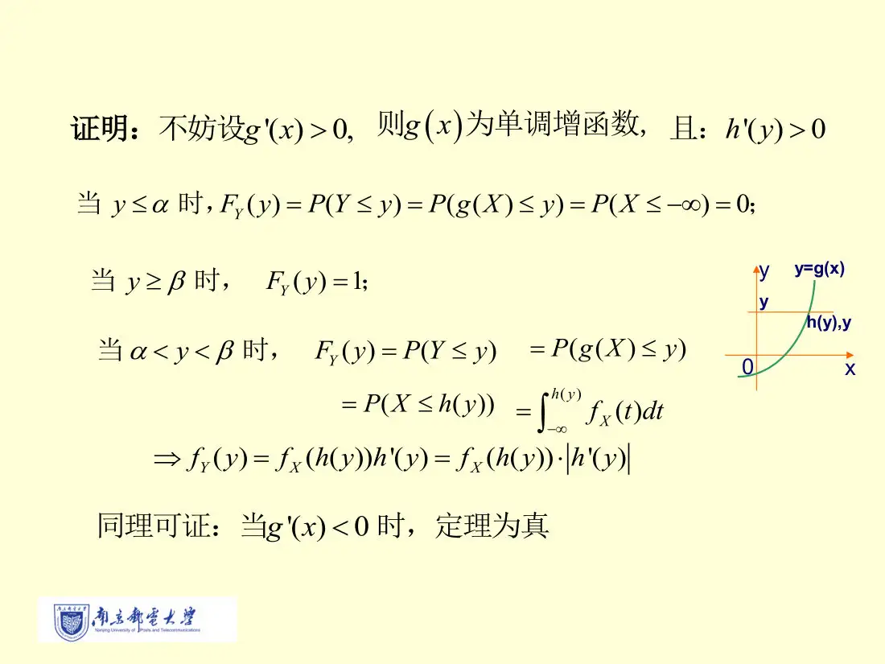

原文：

证明：不妨设 $g'(x)>0$ ，则 $g(x)$ 为单调增函数，且： $h'(y)>0$

当 $y \leq \alpha$ 时， $F_{Y}(y) = P(Y \leq y) = P(g(X) \leq y) = P(X \leq -\infty) = 0;$

当 $y \geq \beta$ 时， $F_{Y}(y) = 1;$

当 $\alpha < y < \beta$ 时， $F_{Y}(y) = P(Y \leq y) = P(g(X) \leq y)$ $= P(X \leq h(y)) = \int_{-\infty}^{h(y)} f_{X}(t) dt$ $\Rightarrow f_{Y}(y) = f_{X}(h(y)) h'(y) = f_{X}(h(y)) \cdot |h'(y)|$

同理可证：当 $g'(x)<0$ 时，定理为真例2.24 随机变量服从 $[0, \frac{\pi}{2}]$ 上的均匀分布， $Y = \cos X$ ，求 $Y$ 的密度函数。解：方法1(用公式) $f_X(x) = \begin{cases} \frac{2}{\pi}, & 0 \leq x \leq \frac{\pi}{2} \\ 0, & \text{其它} \end{cases}$ 由 $y = \cos x$ (单减)，得反函数为 $x = h(y) = \arccos y$ $h'(y) = -\frac{1}{\sqrt{1 - y^2}}$ 且 $0 \leq x \leq \frac{\pi}{2} \Leftrightarrow 0 \leq y \leq 1$ （原函数的值域是反函数的定义域）

南京邮电大学
Nanjing University of Posts and Telecommunications

### 第 13 页

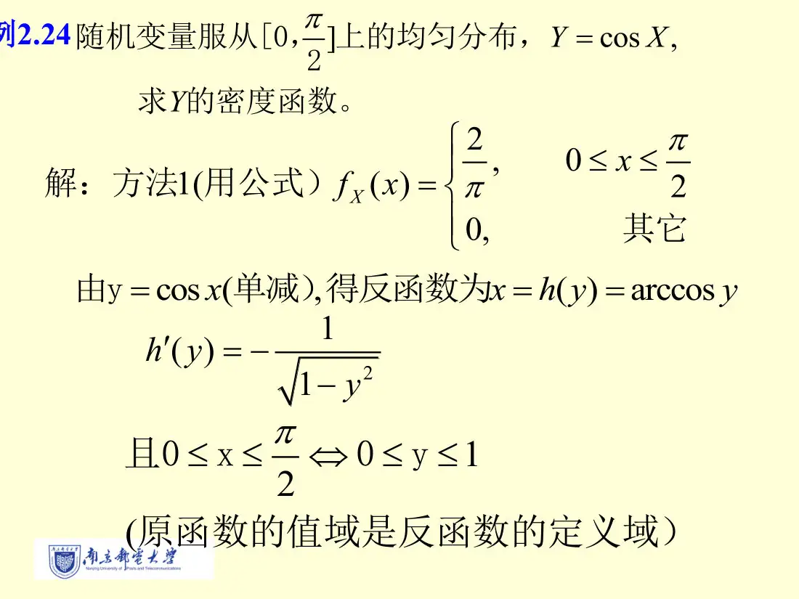

### $$

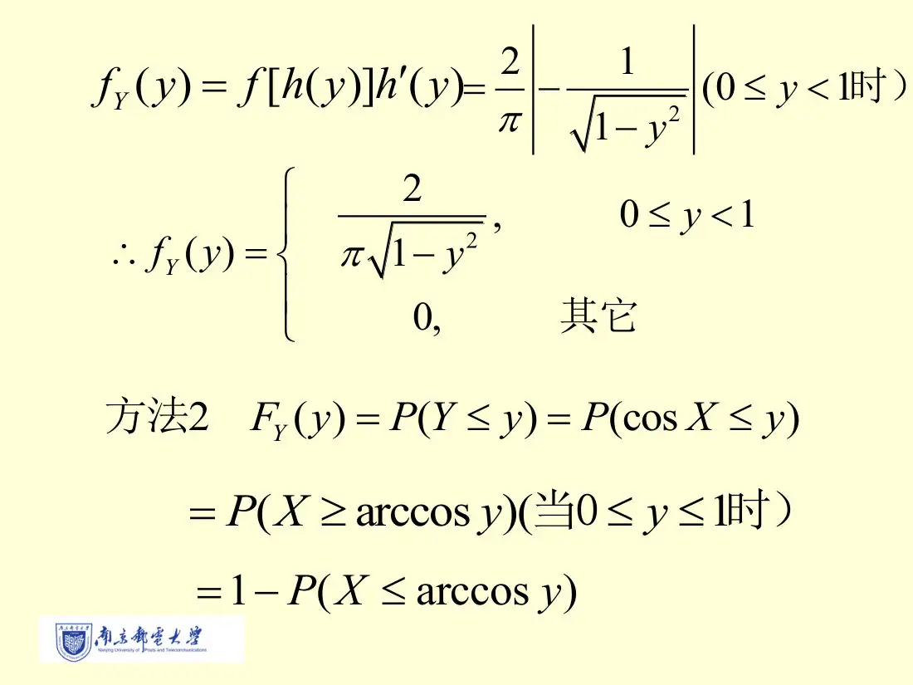

原文：

$$
\begin{array}{r l} & {f _ {Y} (y) = f [ h (y) ] h ^ {\prime} (y)   =   \frac {2}{\pi} \left| - \frac {1}{\sqrt {1 - y ^ {2}}} \right| (0 \leq y <   1 \text {时})} \\ & {\therefore f _ {Y} (y) = \left\{ \begin{array}{c c} {{\frac {2}{\pi \sqrt {1 - y ^ {2}}},}} & {{0 \leq y <   1}} \\ {{0,}} & {{\text {其它}}} \end{array} \right.} \end{array}
$$

方法2 $F_{Y}(y) = P(Y\leq y) = P(\cos X\leq y)$

$$
\begin{array}{r l} & = P (X \geq \arccos y) (\text {当} 0 \leq y \leq 1 \text {时}) \\ & = 1 - P (X \leq \arccos y) \end{array}
$$

南京邮电大学
Nanjing University of Posts and Telecommunications

### $$

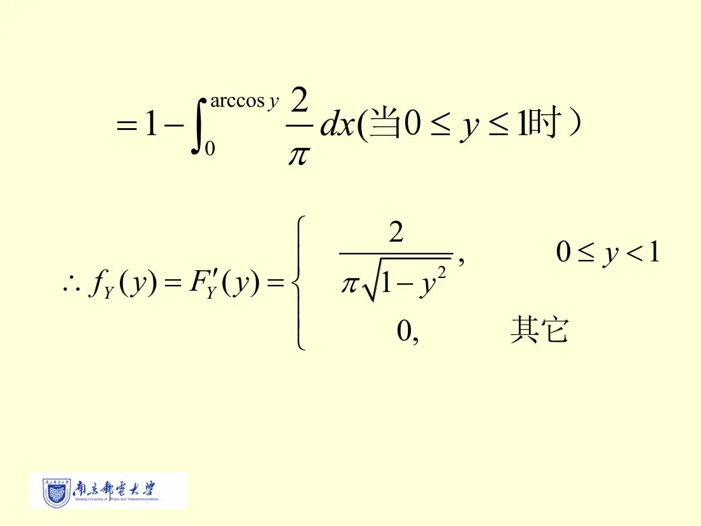

原文：

$$
= 1 - \int_ {0} ^ {\arccos y} \frac {2}{\pi} d x (\text {当} 0 \leq y \leq 1 \text {时})
$$

$$
\therefore f _ {Y} (y) = F _ {Y} ^ {\prime} (y) = \left\{ \begin{array}{c c} \frac {2}{\pi \sqrt {1 - y ^ {2}}}, & 0 \leq y <   1 \\ 0, & \text {其它} \end{array} \right.
$$

南京邮电大学
Nanjing University of Posts and Telecommunications

### 例2.25设随机变量X\~U(0,π),试求Y=sinX的概率密度。

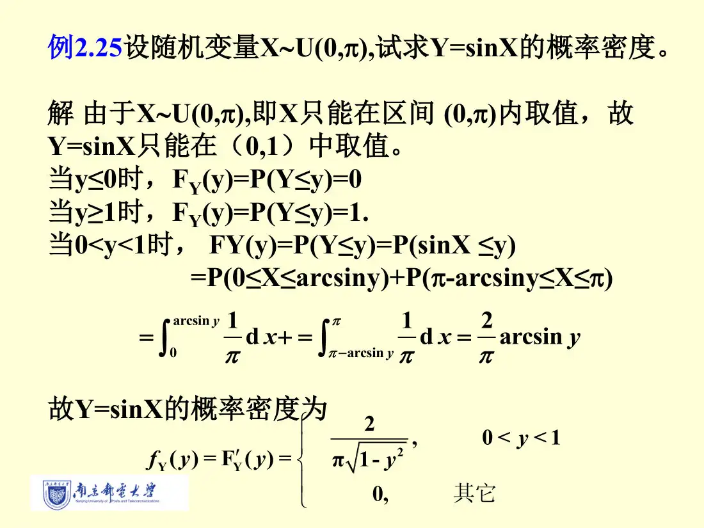

原文：

例2.25设随机变量X\~U(0,π),试求Y=sinX的概率密度。

解 由于X\~U(0,π),即X只能在区间(0,π)内取值，故Y=sinX只能在(0,1)中取值。

当 $\mathbf{y} \leq 0$ 时， $\mathrm{F}_{\mathrm{Y}}(\mathbf{y}) = \mathrm{P}(\mathbf{Y} \leq \mathbf{y}) = \mathbf{0}$

当 $y\geq1$ 时， $F_{Y}(y)=P(Y\leq y)=1$ .

$$
0 <   \mathbf {y} <   1
$$

$$
\begin{array}{r l} & \mathrm {FY(y) = P(Y\leq y) = P(sinX\leq y)} \\ & = \mathrm {P(0\leq X\leq arcsiny) + P(\pi - arcsiny\leq X\leq \pi)} \end{array}
$$

$$
= \int_ {0} ^ {\arcsin y} \frac {1}{\pi} d x + = \int_ {\pi - \arcsin y} ^ {\pi} \frac {1}{\pi} d x = \frac {2}{\pi} \arcsin y
$$

故Y=sinX的概率密度为 $f_{\mathrm{Y}}(y)=\mathrm{F}_{\mathrm{Y}}^{\prime}(y)=\left\{\begin{aligned}&\frac{2}{\pi\sqrt{1-y^{2}}},&0<y<1\\&0,& 其它\end{aligned}\right.$

### 证明 $X$ 的概率密度为

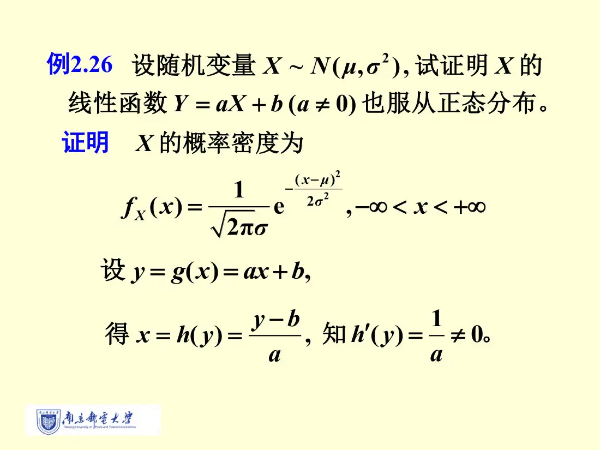

原文：

例2.26 设随机变量 $X \sim N(\mu, \sigma^{2})$ ，试证明 X 的线性函数 $Y = aX + b (a \neq 0)$ 也服从正态分布。

证明 $X$ 的概率密度为

$$
f _ {X} (x) = \frac {1}{\sqrt {2 \pi} \sigma} \mathrm{e} ^ {- \frac {(x - \mu) ^ {2}}{2 \sigma^ {2}}}, - \infty <   x <   + \infty
$$

设 $y = g(x) = ax + b,$

得 $x = h(y) = \frac{y - b}{a}$ ，知 $h'(y) = \frac{1}{a} \neq 0$ 。

南京邮电大学
Nanjing University of Posts and Telecommunications

### 得 $Y = aX + b$ 的概率密度为

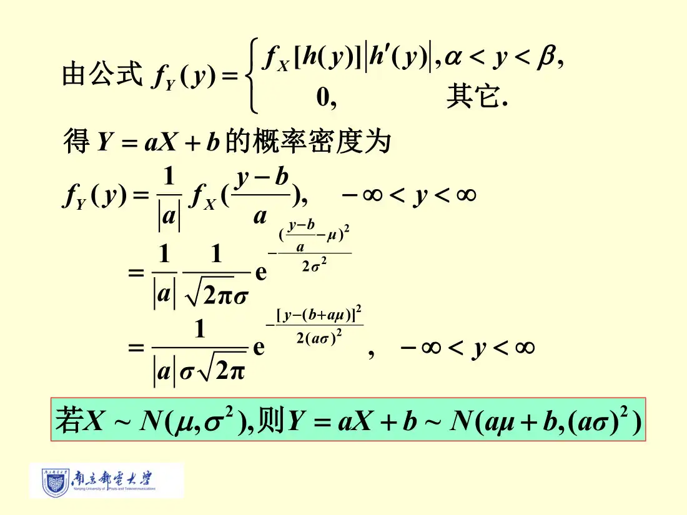

原文：

由公式 $f_{Y}(y)=\left\{\begin{aligned}f_{X}[h(y)]&|h'(y)|,\alpha<y<\beta,\\ 0,&\text{其它.}\end{aligned}\right.$

得 $Y = aX + b$ 的概率密度为

$$
\begin{array}{r l} & {f _ {Y} (y) = \frac {1}{| a |} f _ {X} (\frac {y - b}{a}), - \infty <   y <   \infty} \\ & {\qquad = \frac {1}{| a |} \frac {1}{\sqrt {2 \pi} \sigma} \mathrm{e} ^ {- \frac {(y - b / a - \mu) ^ {2}}{2 \sigma^ {2}}}} \\ & {\qquad = \frac {1}{| a | \sigma \sqrt {2 \pi}} \mathrm{e} ^ {- \frac {[ y - (b + a \mu) ] ^ {2}}{2 (a \sigma) ^ {2}}}, - \infty <   y <   \infty} \end{array}
$$

若 $X \sim N(\mu, \sigma^{2})$ ，则 $Y = aX + b \sim N(a\mu + b, (a\sigma)^{2})$

南京邮电大学
Nanjing University of Posts and Telecommunications

### 在 $(-∞,0)$ 和 $(0,+∞)$ 上严格单调，其反函数分别

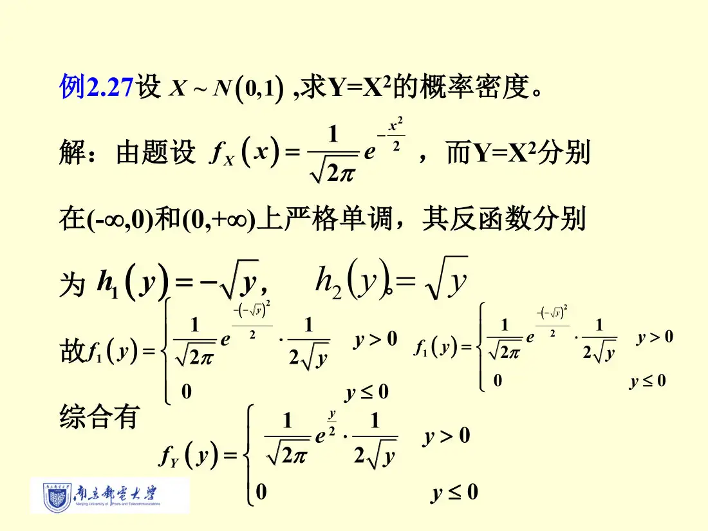

原文：

例2.27设 $X \sim N(0,1)$ ，求 $Y = X^{2}$ 的概率密度。

解：由题设 $f_{X}(x)=\frac{1}{\sqrt{2\pi}}e^{-\frac{x^{2}}{2}}$ ，而Y=X²分别
在 $(-∞,0)$ 和 $(0,+∞)$ 上严格单调，其反函数分别
为 $h_{1}(y)=-\sqrt{y},\quad h_{2}(y)=\sqrt{y}$ 故 $f_{1}(y)=\left\{\begin{aligned}&\frac{1}{\sqrt{2\pi}}e^{\frac{(-\sqrt{y})^{2}}{2}}\cdot\frac{1}{2\sqrt{y}}&y>0\\&0&y≤0\end{aligned}\right.$ $f_{1}(y)=\left\{\begin{aligned}&\frac{1}{\sqrt{2\pi}}e^{\frac{(-\sqrt{y})^{2}}{2}}\cdot\frac{1}{2\sqrt{y}}&y>0\\&0&y≤0\end{aligned}\right.$ 综合有 $f_{Y}(y)=\left\{\begin{aligned}&\frac{1}{\sqrt{2\pi}}e^{\frac{y}{2}}\cdot\frac{1}{2\sqrt{y}}&y>0\\&0&y≤0\end{aligned}\right.$

### 三、小结

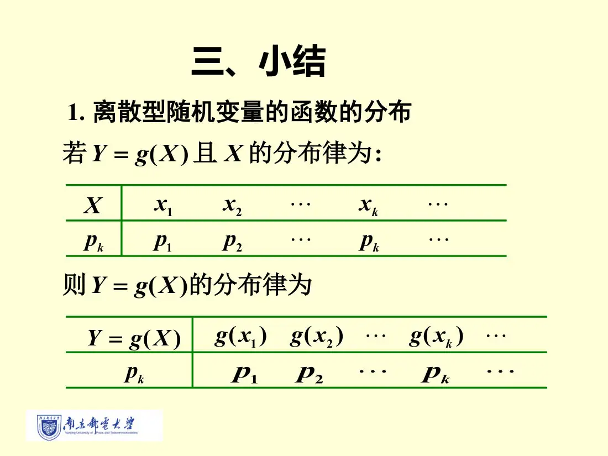

原文：

三、小结

1. 离散型随机变量的函数的分布

若 $Y = g(X)$ 且 $X$ 的分布律为：

<table><tr><td>X</td><td> $x_{1}$ </td><td> $x_{2}$ </td><td>...</td><td> $x_{k}$ </td><td>...</td></tr><tr><td> $p_{k}$ </td><td> $p_{1}$ </td><td> $p_{2}$ </td><td>...</td><td> $p_{k}$ </td><td>...</td></tr></table>

则 $Y = g(X)$ 的分布律为

<table><tr><td> $Y = g(X)$ </td><td> $g(x_1)$ </td><td> $g(x_2)$ </td><td> $\cdots$ </td><td> $g(x_k)$ </td><td> $\cdots$ </td></tr><tr><td> $p_k$ </td><td> $p_1$ </td><td> $p_2$ </td><td> $\cdots$ </td><td> $p_k$ </td><td> $\cdots$ </td></tr></table>

南京邮电大学
Nanjing University of Posts and Telecommunications

### 2. 连续型随机变量的函数的分布

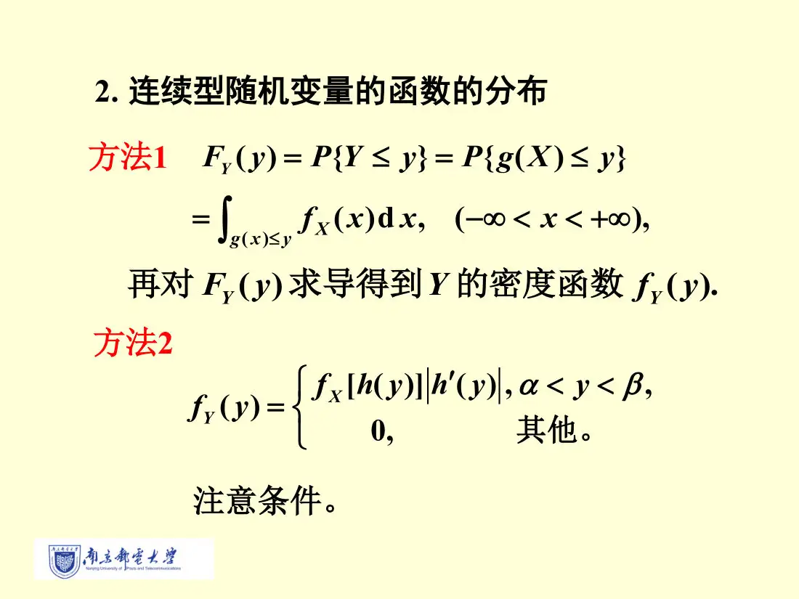

原文：

2. 连续型随机变量的函数的分布

方法1 $F_{Y}(y) = P\{Y \leq y\} = P\{g(X) \leq y\}$ $= \int_{g(x) \leq y} f_{X}(x) \mathrm{d}x, (-\infty < x < +\infty),$

再对 $F_{Y}(y)$ 求导得到 Y 的密度函数 $f_{Y}(y)$ .
方法2

$$
f _ {Y} (y) = \left\{ \begin{array}{c c} f _ {X} [ h (y) ] \big | h ^ {\prime} (y) \big |, & \alpha <   y <   \beta , \\ 0, & \text {其他。} \end{array} \right.
$$

注意条件。

南京邮电大学
Nanjing University of Posts and Telecommunications
