# 《概率论与数理统计》第2章 随机变量及其分布（2.4 连续型随机变量及其分布）（课件）

原件的每一页，下面附识别出的文字。

### 2.4 连续型随机变量及其分布

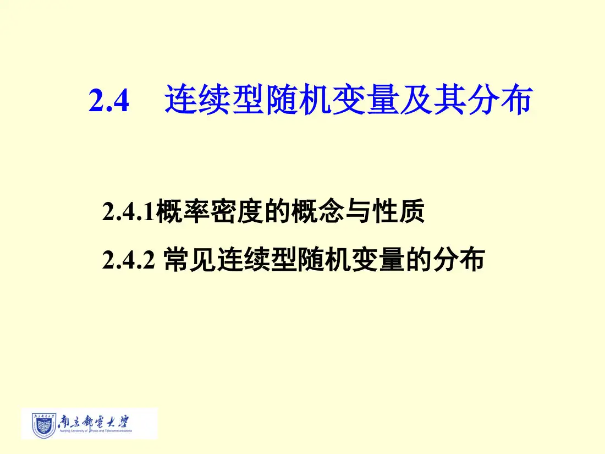

原文：

2.4 连续型随机变量及其分布

2.4.1 概率密度的概念与性质

2.4.2 常见连续型随机变量的分布

南京邮电大学
Nanjing University of Posts and Telecommunications

### 2.4.1 连续型随机变量的概率密度

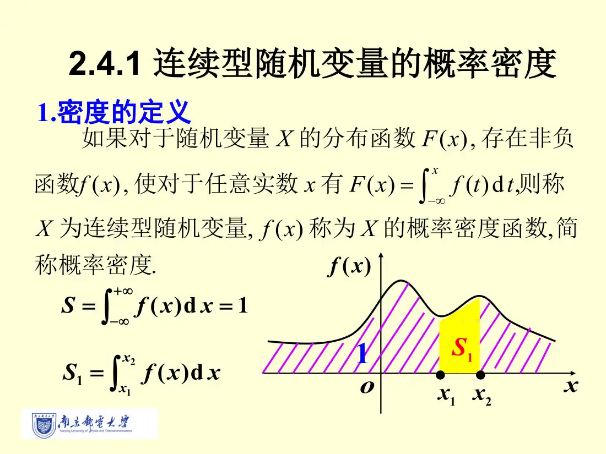

原文：

2.4.1 连续型随机变量的概率密度

1. 密度的定义

如果对于随机变量 X 的分布函数 $F(x)$ ，存在非负函数 $f(x)$ ，使对于任意实数 x 有 $F(x)=\int_{-\infty}^{x}f(t)\mathrm{d}t$ ，则称 X 为连续型随机变量， $f(x)$ 称为 X 的概率密度函数，简

称概率密度.

$$
S = \int_ {- \infty} ^ {+ \infty} f (x) \mathrm{d} x = 1
$$

$$
S _ {1} = \int_ {x _ {1}} ^ {x _ {2}} f (x) \mathrm{d} x
$$

南京邮电大学
Nanjing University of Posts and Telecommunications

### 性质 (1) $f(x)\geq 0$

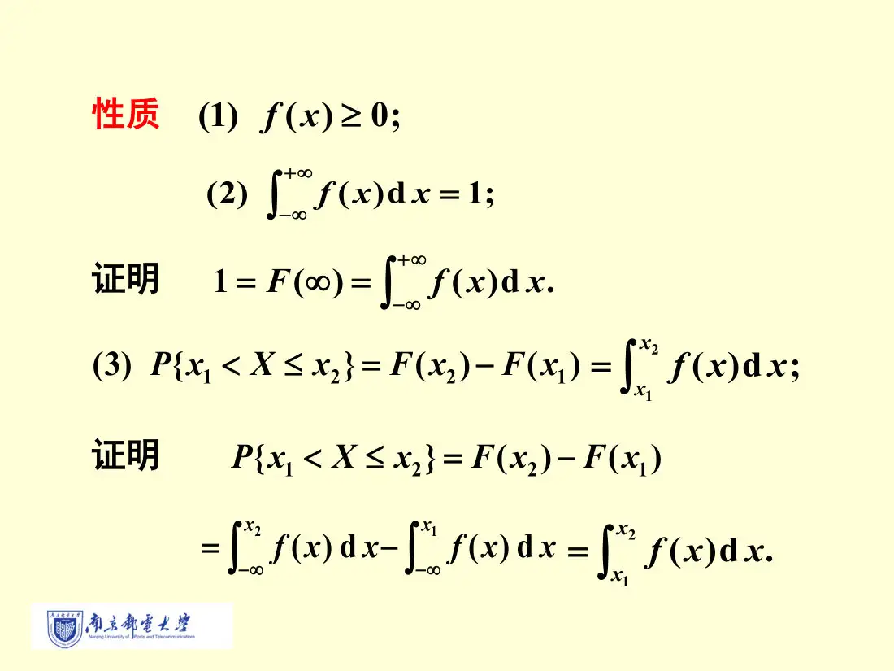

原文：

性质 (1) $f(x)\geq 0$

(2) $\int_{-\infty}^{+\infty} f(x) \, \mathrm{d}x = 1$ ;

证明 $1 = F(\infty) = \int_{-\infty}^{+\infty}f(x)\mathrm{d}x.$

(3) $P\{x_{1} < X \leq x_{2}\} = F(x_{2}) - F(x_{1}) = \int_{x_{1}}^{x_{2}} f(x) \, \mathrm{d}x;$

证明 $P\{x_{1} < X \leq x_{2}\} = F(x_{2}) - F(x_{1})$ $= \int_{-\infty}^{x_2} f(x) \, \mathrm{d}x - \int_{-\infty}^{x_1} f(x) \, \mathrm{d}x = \int_{x_1}^{x_2} f(x) \, \mathrm{d}x.$

南京邮电大学
Nanjing University of Posts and Telecommunications

### 同时得以下计算公式

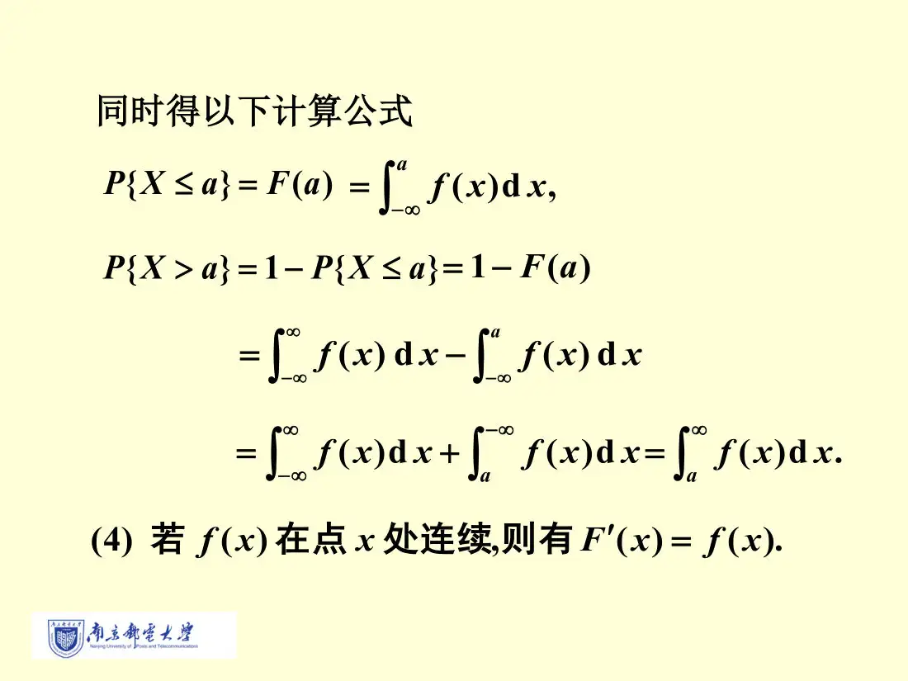

原文：

同时得以下计算公式

$$
P \{X \leq a \} = F (a) = \int_ {- \infty} ^ {a} f (x) \mathrm{d} x,
$$

$$
\begin{array}{r l} & P \{X > a \} = 1 - P \{X \leq a \} = 1 - F (a) \\ & \qquad = \int_ {- \infty} ^ {\infty} f (x) \mathrm{d} x - \int_ {- \infty} ^ {a} f (x) \mathrm{d} x \\ & \qquad = \int_ {- \infty} ^ {\infty} f (x) \mathrm{d} x + \int_ {a} ^ {- \infty} f (x) \mathrm{d} x = \int_ {a} ^ {\infty} f (x) \mathrm{d} x. \end{array}
$$

(4) 若 $f(x)$ 在点 x 处连续, 则有 $F'(x) = f(x)$ .

南京邮电大学
Nanjing University of Posts and Telecommunications

### 注意 对于任意可能值 a , 连续型随机变量取 a 的概率等于零. 即

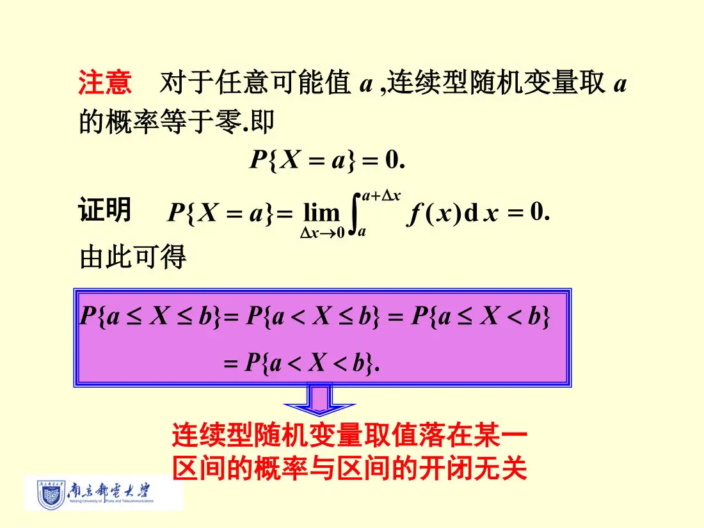

原文：

注意 对于任意可能值 a , 连续型随机变量取 a 的概率等于零. 即

$$
P \{X = a \} = 0.
$$

证明 $P\{X=a\}=\lim_{\Delta x\to0}\int_{a}^{a+\Delta x}f(x)\mathrm{d}x=0.$ 由此可得

$$
\begin{array}{r l} & P \{a \leq X \leq b \} = P \{a <   X \leq b \} = P \{a \leq X <   b \} \\ & \qquad = P \{a <   X <   b \}. \end{array}
$$

连续型随机变量取值落在某一区间的概率与区间的开闭无关

南京邮电大学
Nanjing University of Posts and Telecommunications

### 注意

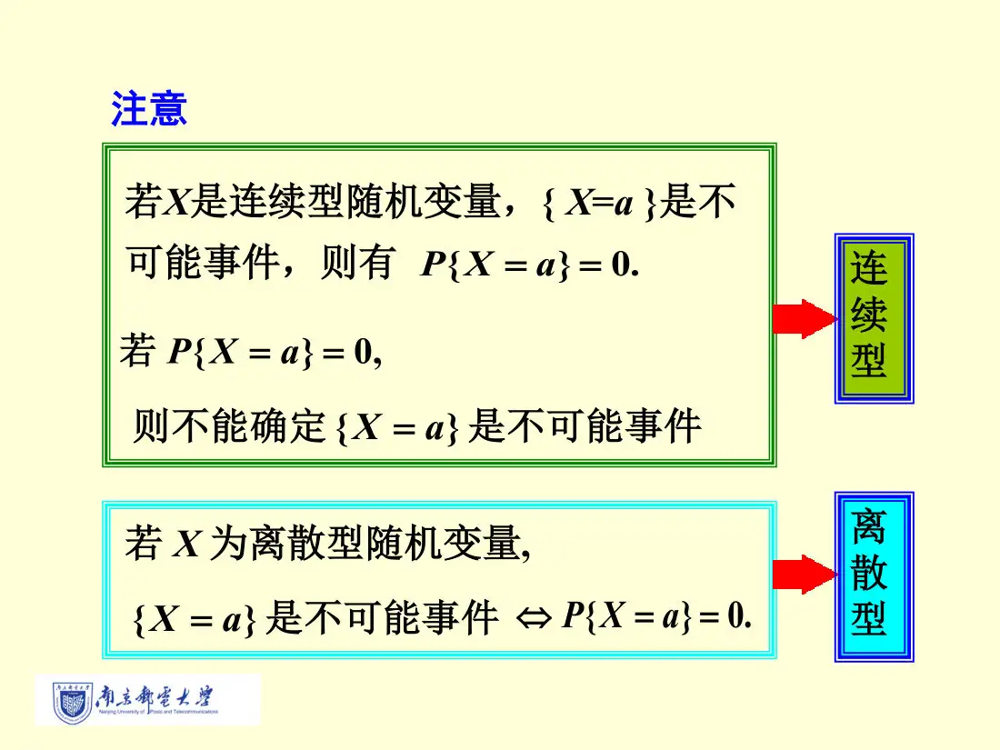

原文：

注意

若X是连续型随机变量，{X=a}是不可能事件，则有 $P\{X=a\}=0$ .

若 $P\{X = a\} = 0,$

连续型

则不能确定 $\{X = a\}$ 是不可能事件

离散型

若 X 为离散型随机变量,

$\{X = a\}$ 是不可能事件 $\Leftrightarrow P\{X = a\} = 0.$

南京邮电大学
Nanjing University of Posts and Telecommunications

### 试求随机变量 X 的分布函数.

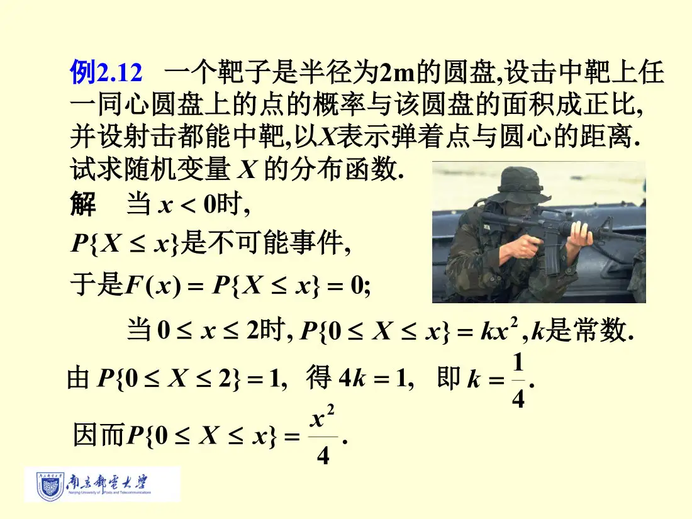

原文：

例2.12 一个靶子是半径为2m的圆盘,设击中靶上任一同心圆盘上的点的概率与该圆盘的面积成正比,并设射击都能中靶,以X表示弹着点与圆心的距离.

试求随机变量 X 的分布函数.
解 当 x < 0 时, $P\{X \leq x\}$ 是不可能事件,
于是 $F(x)=P\{X \leq x\}=0;$

当 $0 \leq x \leq 2$ 时, $P\{0 \leq X \leq x\} = kx^2, k$ 是常数. 由 $P\{0 \leq X \leq 2\} = 1$ , 得 $4k = 1$ , 即 $k = \frac{1}{4}$ . 因而 $P\{0 \leq X \leq x\} = \frac{x^2}{4}$ .

南京邮电大学
Nanjing University of Posts and Telecommunications

### 于是

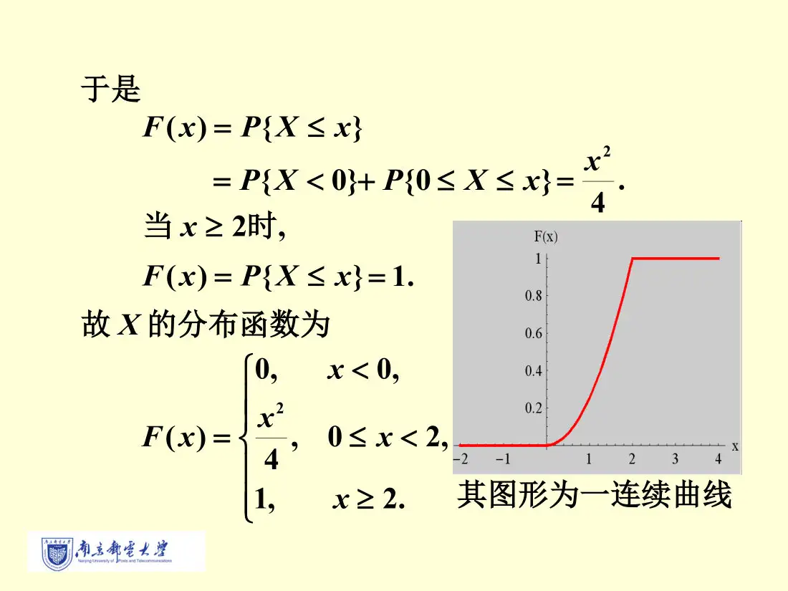

原文：

于是

$$
\begin{array}{r l} F (x) & = P \{X \leq x \} \\ & = P \{X <   0 \} + P \{0 \leq X \leq x \} = \frac {x ^ {2}}{4}. \end{array}
$$

当 $x \geq 2$ 时，

$$
F (x) = P \{X \leq x \} = 1.
$$

故 $X$ 的分布函数为

$$
F (x) = \left\{ \begin{array}{l l} 0, & x <   0, \\ \frac {x ^ {2}}{4}, & 0 \leq x <   2, \\ 1, & x \geq 2. \end{array} \right.
$$

其图形为一连续曲线

南京邮电大学
Nanjing University of Posts and Telecommunications

### $F(x)$ 恰是非负函数 $f(t)$ 在区间 $(-∞, x]$ 上的积分，

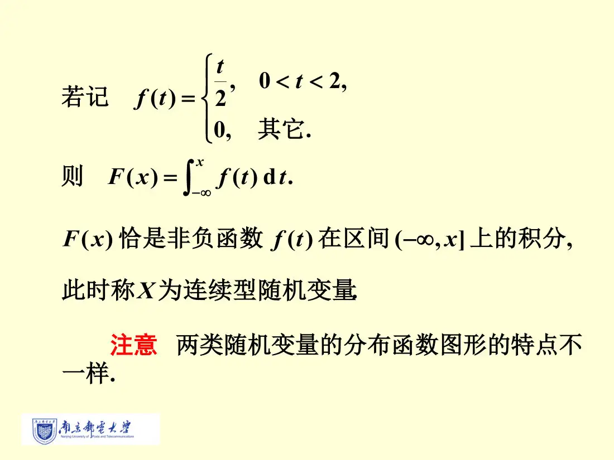

原文：

若记 $f(t) = \left\{ \begin{array}{ll}\frac{t}{2}, & 0 < t < 2,\\ 0, & \text{其它}. \end{array} \right.$

则 $F(x) = \int_{-\infty}^{x}f(t)\mathrm{d}t.$

$F(x)$ 恰是非负函数 $f(t)$ 在区间 $(-∞, x]$ 上的积分，
此时称X为连续型随机变量

注意 两类随机变量的分布函数图形的特点不一样.

南京邮电大学
Nanjing University of Posts and Telecommunications

### 例2.13 设随机变量 $X$ 具有概率密度

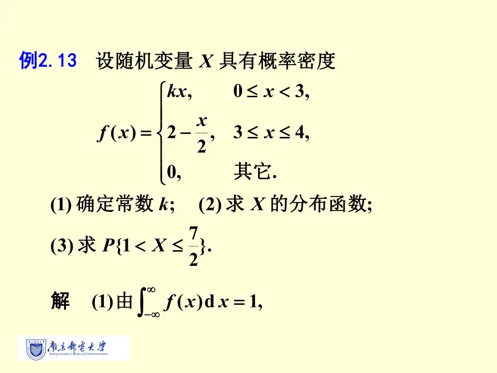

原文：

例2.13 设随机变量 $X$ 具有概率密度

$$
f (x) = \left\{ \begin{array}{l l} k x, & 0 \leq x <   3, \\ 2 - \frac {x}{2}, & 3 \leq x \leq 4, \\ 0, & \text {其它.} \end{array} \right.
$$

(1) 确定常数 k; (2) 求 X 的分布函数;

(3) 求 $P\{1 < X \leq \frac{7}{2}\}$ .

解 (1) 由 $\int_{-\infty}^{\infty} f(x) \, \mathrm{d}x = 1$ ,

南京邮电大学
Nanjing University of Posts and Telecommunications

### (2)由 $k = \frac{1}{6}$ 知 $X$ 的概率密度为

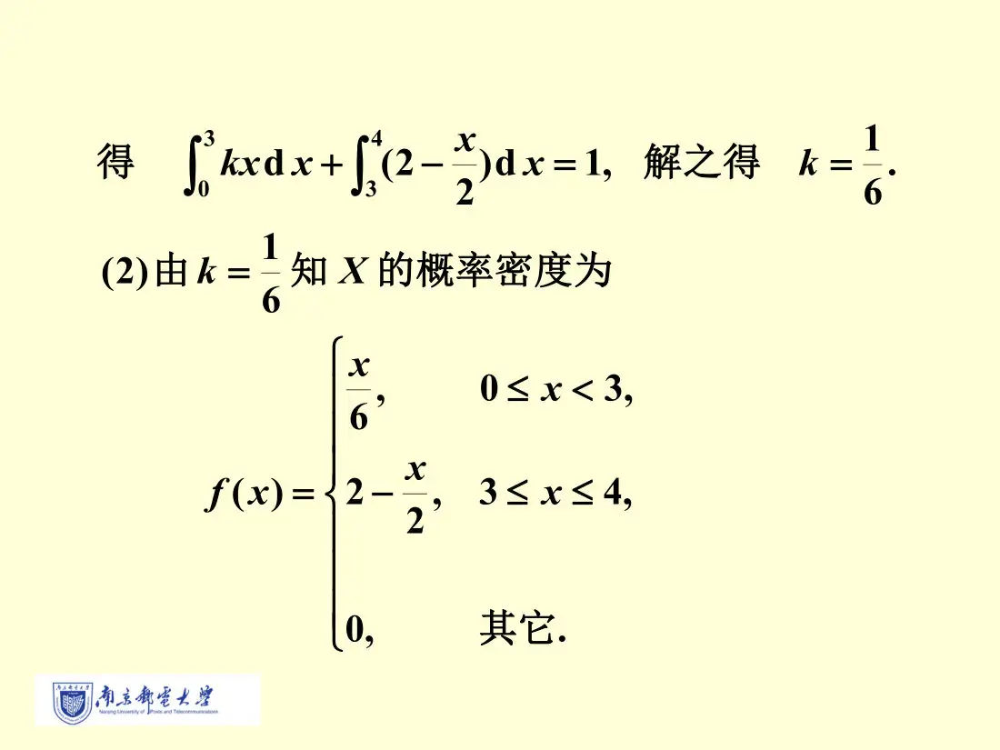

原文：

得 $\int_0^3 kx\mathrm{d}x + \int_3^4 (2 - \frac{x}{2})\mathrm{d}x = 1,$ 解之得 $k = \frac{1}{6}$

(2)由 $k = \frac{1}{6}$ 知 $X$ 的概率密度为

$$
f (x) = \left\{ \begin{array}{l l} \frac {x}{6}, & 0 \leq x <   3, \\ 2 - \frac {x}{2}, & 3 \leq x \leq 4, \\ 0, & \text {其它.} \end{array} \right.
$$

南京邮电大学
Nanjing University of Posts and Telecommunications

### $$

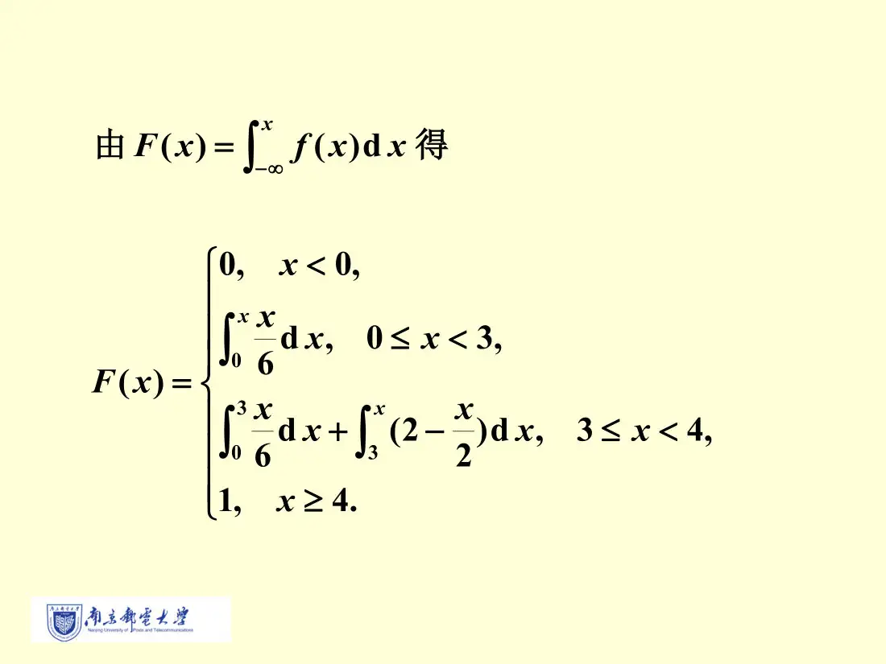

原文：

由 $F(x) = \int_{-\infty}^{x}f(x)\mathrm{d}x$ 得

$$
F (x) = \left\{ \begin{array}{l l} 0, & x <   0, \\ \int_ {0} ^ {x} \frac {x}{6} \mathrm{d} x, & 0 \leq x <   3, \\ \int_ {0} ^ {3} \frac {x}{6} \mathrm{d} x + \int_ {3} ^ {x} \left(2 - \frac {x}{2}\right) \mathrm{d} x, & 3 \leq x <   4, \\ 1, & x \geq 4. \end{array} \right.
$$

南京邮电大学
Nanjing University of Posts and Telecommunications

### $$

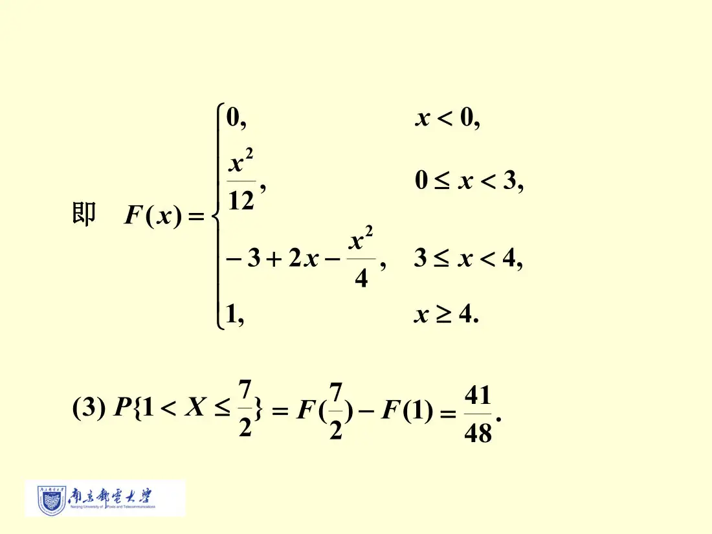

原文：

即

$$
F (x) = \left\{ \begin{array}{l l} 0, & x <   0, \\ \frac {x ^ {2}}{1 2}, & 0 \leq x <   3, \\ - 3 + 2 x - \frac {x ^ {2}}{4}, & 3 \leq x <   4, \\ 1, & x \geq 4. \end{array} \right.
$$

$$
P \{1 <   X \leq \frac {7}{2} \} = F (\frac {7}{2}) - F (1) = \frac {4 1}{4 8}. \tag {3}
$$

南京邮电大学
Nanjing University of Posts and Telecommunications

### 例2.14 设连续型随机变量 $X$ 的分布函数为

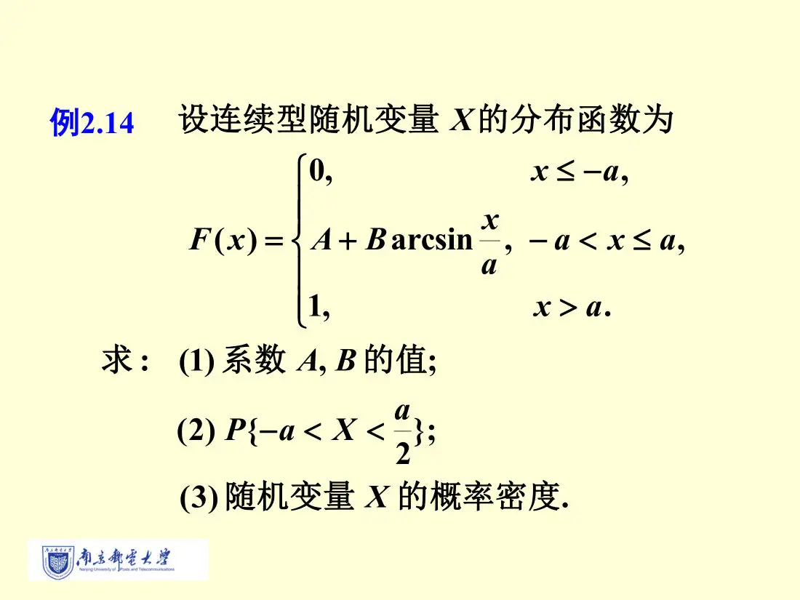

原文：

例2.14 设连续型随机变量 $X$ 的分布函数为

$$
F (x) = \left\{ \begin{array}{l l} 0, & x \leq - a, \\ A + B \arcsin \frac {x}{a}, & - a <   x \leq a, \\ 1, & x > a. \end{array} \right.
$$

求：(1) 系数 A, B 的值;

(2) $P\{-a < X < \frac{a}{2}\}$ ;

(3)随机变量 X 的概率密度.

南京邮电大学
Nanjing University of Posts and Telecommunications

### $$

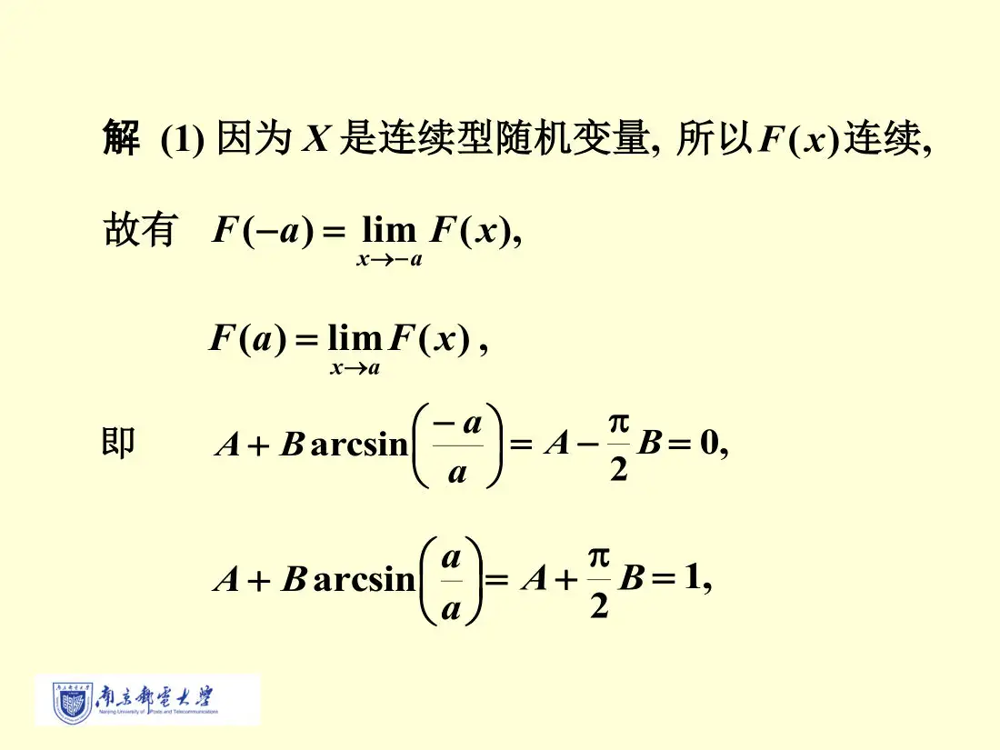

原文：

解 (1) 因为 $X$ 是连续型随机变量, 所以 $F(x)$ 连续, 故有 $F(-a) = \lim_{x \to -a} F(x)$ ,

$$
F (a) = \lim _ {x \to a} F (x),
$$

即 $A + B\arcsin \left(\frac{-a}{a}\right) = A - \frac{\pi}{2} B = 0,$

$$
A + B \arcsin \left(\frac {a}{a}\right) = A + \frac {\pi}{2} B = 1,
$$

南京邮电大学
Nanjing University of Posts and Telecommunications

### 南京邮电大学

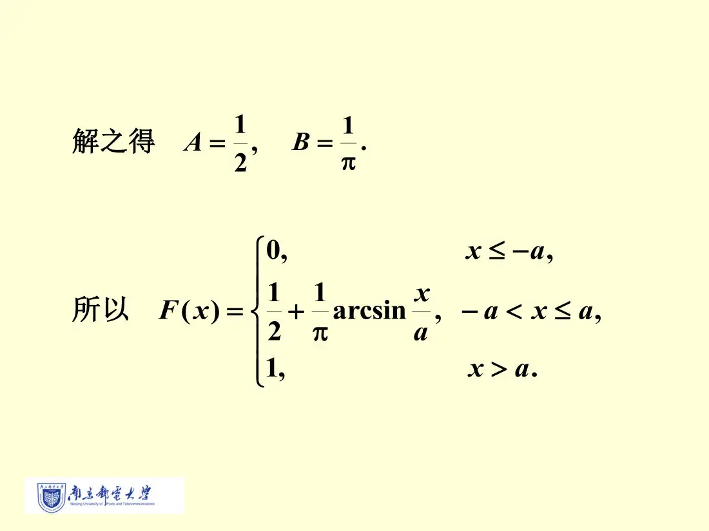

原文：

解之得 $A=\frac{1}{2}$ ， $B=\frac{1}{\pi}$ .

所以 $F(x) = \left\{ \begin{array}{ll}0, & x\leq -a,\\ \frac{1}{2} +\frac{1}{\pi}\arcsin \frac{x}{a}, & -a <   x\leq a,\\ 1, & x > a. \end{array} \right.$

南京邮电大学
Nanjing University of Posts and Telecommunications

### $$

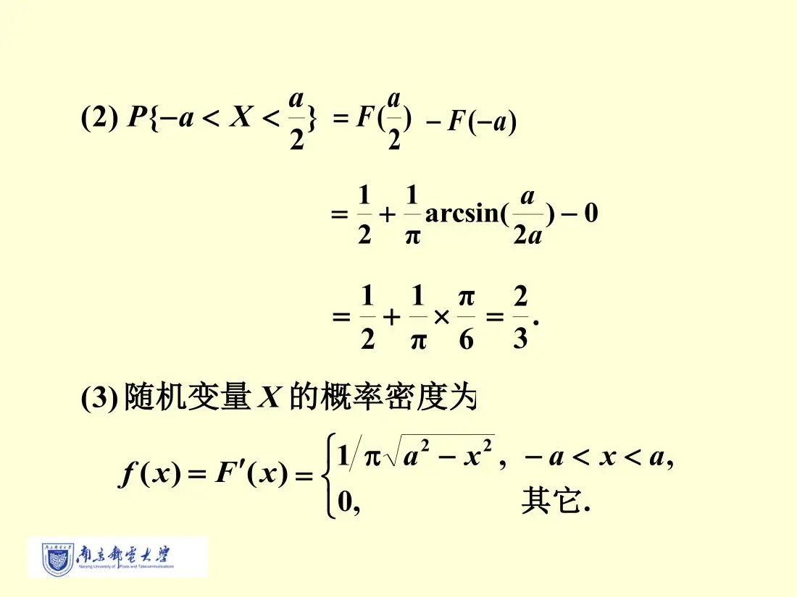

原文：

$$
\begin{array}{r l} P \{- a <   X <   \frac {a}{2} \} & = F (\frac {a}{2}) - F (- a) \\ & = \frac {1}{2} + \frac {1}{\pi} \arcsin (\frac {a}{2 a}) - 0 \\ & = \frac {1}{2} + \frac {1}{\pi} \times \frac {\pi}{6} = \frac {2}{3}. \end{array} \tag {2}
$$

(3)随机变量 $X$ 的概率密度为

$$
f (x) = F ^ {\prime} (x) = \left\{ \begin{array}{l l} 1 / \pi \sqrt {a ^ {2} - x ^ {2}}, & - a <   x <   a, \\ 0, & \text {其它. } \end{array} \right.
$$

南京邮电大学
Nanjing University of Posts and Telecommunications

### 2.4 常见连续型随机变量的分布 1. 均匀分布

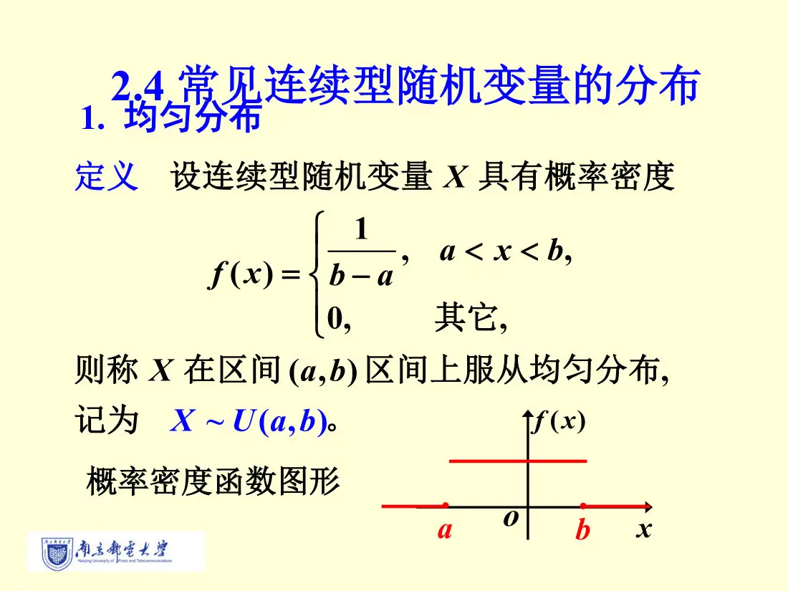

原文：

2.4 常见连续型随机变量的分布 1. 均匀分布

定义 设连续型随机变量 X 具有概率密度

$$
f (x) = \left\{ \begin{array}{l l} \frac {1}{b - a}, & a <   x <   b, \\ 0, & \text {其它,} \end{array} \right.
$$

则称 X 在区间 $(a,b)$ 区间上服从均匀分布,

记为 $X \sim U(a, b)$ 。

概率密度函数图形

南京邮电大学
Nanjing University of Posts and Telecommunications

### 均匀分布的意义

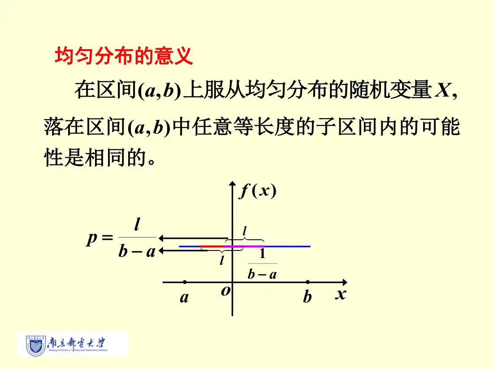

原文：

均匀分布的意义

在区间 $(a, b)$ 上服从均匀分布的随机变量 $X$ , 落在区间 $(a, b)$ 中任意等长度的子区间内的可能性是相同的。

南京邮电大学
Nanjing University of Posts and Telecommunications

### 分布函数

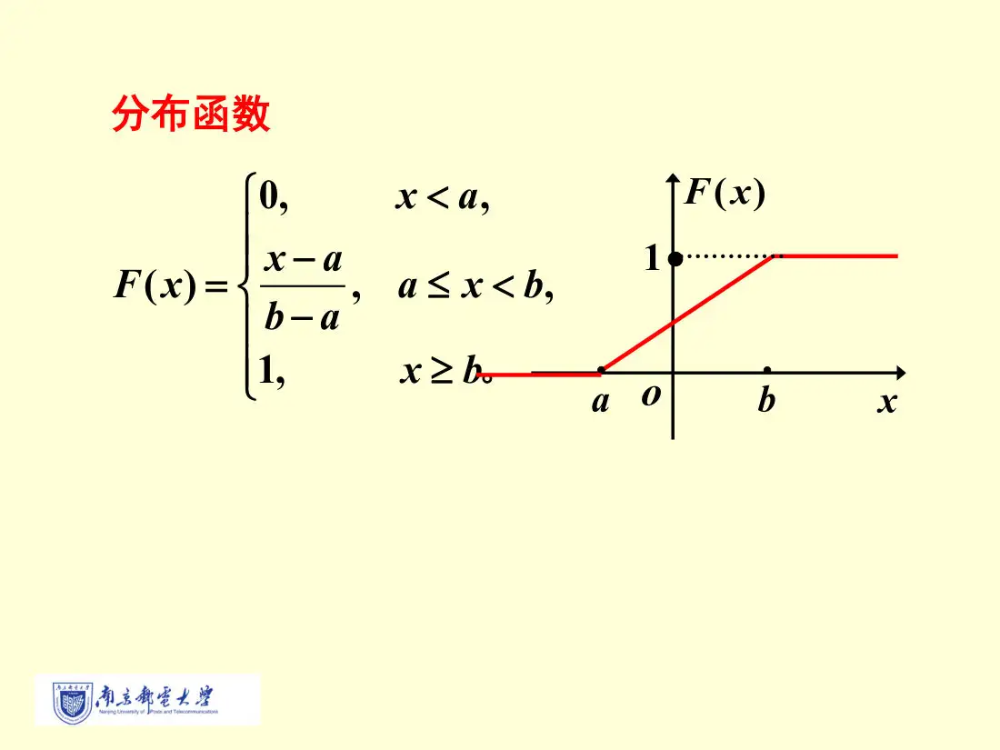

原文：

分布函数

$$
F (x) = \left\{ \begin{array}{l l} 0, & x <   a, \\ \frac {x - a}{b - a}, & a \leq x <   b, \\ 1, & x \geq b. \end{array} \right.
$$

南京邮电大学
Nanjing University of Posts and Telecommunications

### 解 由题意,R 的概率密度为

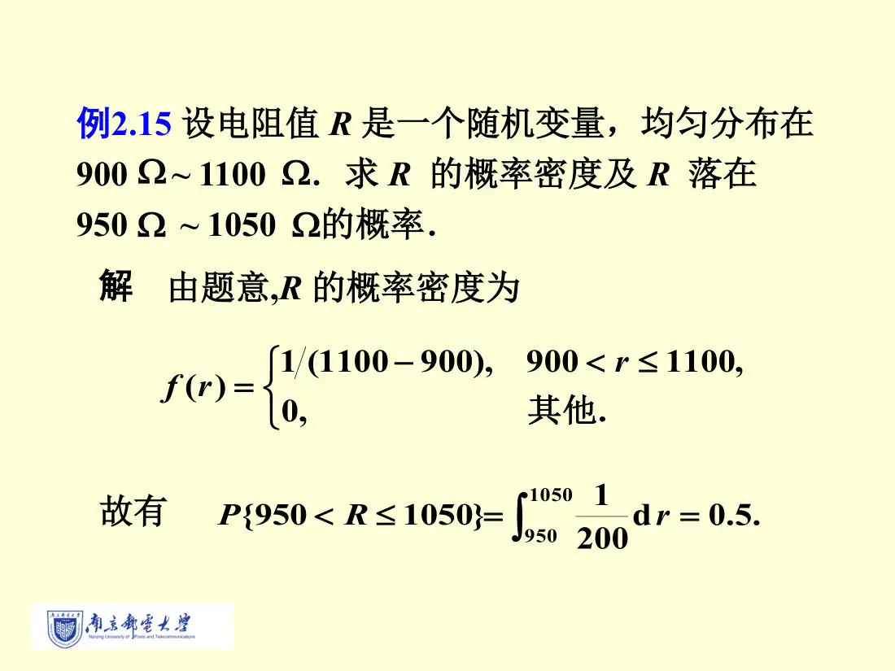

原文：

例2.15 设电阻值 R 是一个随机变量，均匀分布在 $900 \Omega \sim 1100 \Omega$ 。求 R 的概率密度及 R 落在 $950 \Omega \sim 1050 \Omega$ 的概率。

解 由题意,R 的概率密度为

$$
f (r) = \left\{ \begin{array}{l l} 1 / (1 1 0 0 - 9 0 0), & 9 0 0 <   r \leq 1 1 0 0, \\ 0, & \text {其他.} \end{array} \right.
$$

故有 $P\{950 < R \leq 1050\} = \int_{950}^{1050} \frac{1}{200} \, dr = 0.5.$

南京邮电大学
Nanjing University of Posts and Telecommunications

### 解 因为 $X \sim U[2, 5]$ ，所以 $X$ 的概率密度函数为

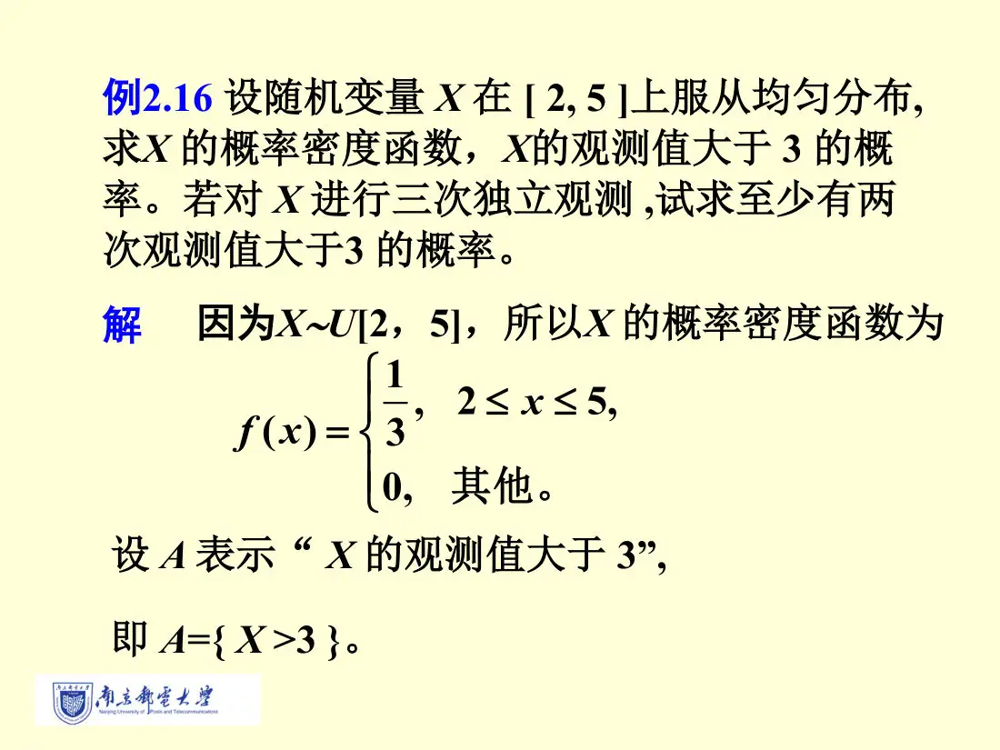

原文：

例2.16 设随机变量 X 在 [2, 5] 上服从均匀分布, 求 X 的概率密度函数, X 的观测值大于 3 的概率。若对 X 进行三次独立观测, 试求至少有两次观测值大于 3 的概率。

解 因为 $X \sim U[2, 5]$ ，所以 $X$ 的概率密度函数为

$$
f (x) = \left\{ \begin{array}{l l} \frac {1}{3}, & 2 \leq x \leq 5, \\ 0, & \text {其他。} \end{array} \right.
$$

设 A 表示 “X 的观测值大于 3”,

即 $A = \{X > 3\}$ 。

南京邮电大学
Nanjing University of Posts and Telecommunications

### 因而有

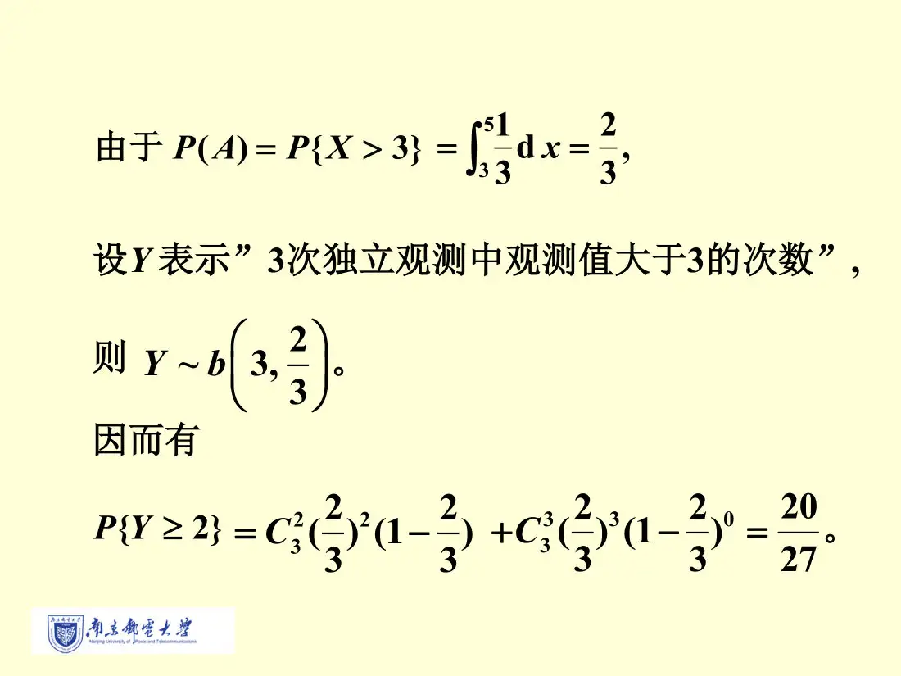

原文：

由于 $P(A) = P\{X > 3\} = \int_{3}^{5}\frac{1}{3}\mathrm{d}x = \frac{2}{3},$

设Y表示”3次独立观测中观测值大于3的次数”，则 $Y \sim b\left(3, \frac{2}{3}\right)$ 。

因而有

$$
P \{Y \geq 2 \} = C _ {3} ^ {2} (\frac {2}{3}) ^ {2} (1 - \frac {2}{3}) + C _ {3} ^ {3} (\frac {2}{3}) ^ {3} (1 - \frac {2}{3}) ^ {0} = \frac {2 0}{2 7} 。
$$

南京邮电大学
Nanjing University of Posts and Telecommunications

### 指数分布密度

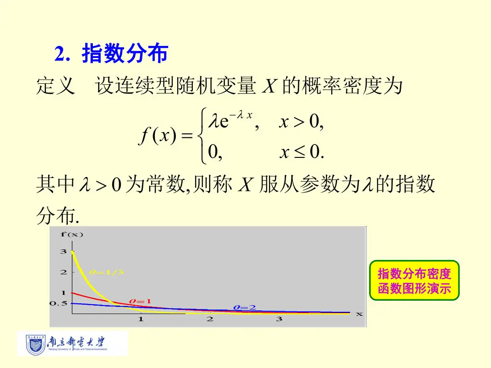

原文：

指数分布密度
函数图形演示

2. 指数分布

定义 设连续型随机变量 X 的概率密度为

$$
f (x) = \left\{ \begin{array}{l l} \lambda \mathrm{e} ^ {- \lambda x}, & x > 0, \\ 0, & x \leq 0. \end{array} \right.
$$

其中 $\lambda > 0$ 为常数, 则称 X 服从参数为 $\lambda$ 的指数分布.

南京邮电大学
Nanjing University of Posts and Telecommunications

### 分布函数

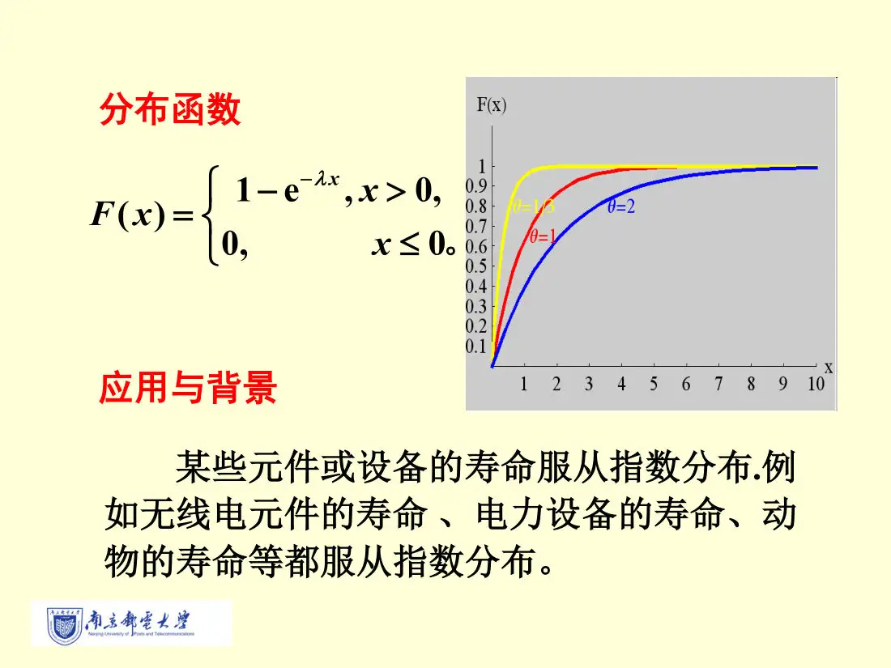

原文：

分布函数

$$
F (x) = \left\{ \begin{array}{l l} 1 - \mathrm{e} ^ {- \lambda x}, & x > 0, \\ 0, & x \leq 0. \end{array} \right.
$$

应用与背景

某些元件或设备的寿命服从指数分布.例如无线电元件的寿命、电力设备的寿命、动物的寿命等都服从指数分布。

南京邮电大学
Nanjing University of Posts and Telecommunications

### (1)任取一只这种灯管, 求能正常使用1000小时以上的概率.

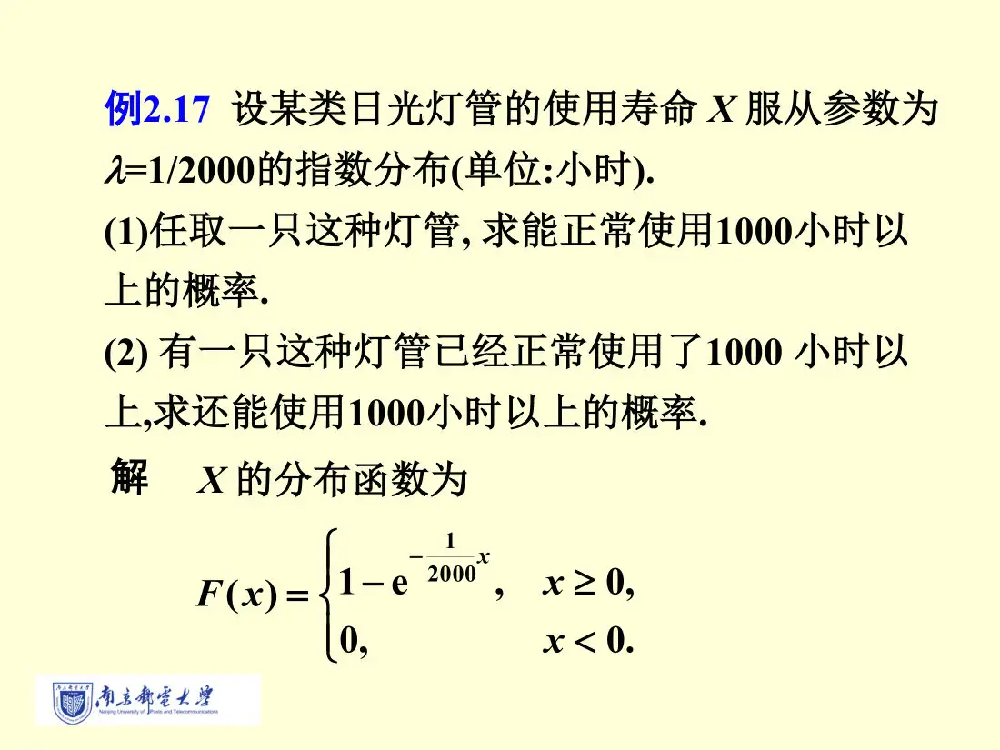

原文：

例2.17 设某类日光灯管的使用寿命 X 服从参数为 $\lambda=1/2000$ 的指数分布(单位:小时).

(1)任取一只这种灯管, 求能正常使用1000小时以上的概率.

(2) 有一只这种灯管已经正常使用了1000小时以上,求还能使用1000小时以上的概率.

解 $X$ 的分布函数为

$$
F (x) = \left\{ \begin{array}{l l} 1 - \mathrm{e} ^ {- \frac {1}{2 0 0 0} x}, & x \geq 0, \\ 0, & x <   0. \end{array} \right.
$$

南京邮电大学
Nanjing University of Posts and Telecommunications

### $$

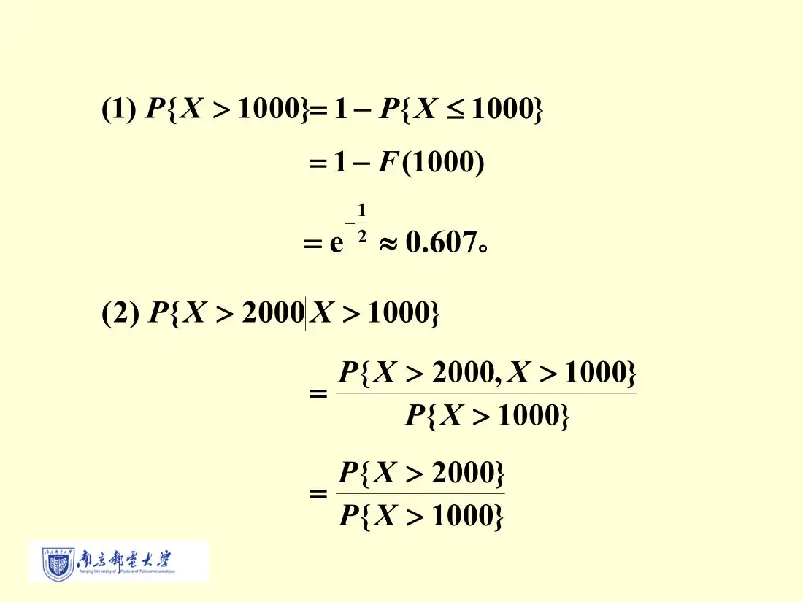

原文：

$$
\begin{array}{r l} P \{X > 1 0 0 0 \} & = 1 - P \{X \leq 1 0 0 0 \} \\ & = 1 - F (1 0 0 0) \\ & = e ^ {- \frac {1}{2}} \approx 0. 6 0 7 _ {\circ} \end{array} \tag {1}
$$

$$
\begin{array}{r l} (2) P \{X > 2 0 0 0 | X > 1 0 0 0 \} & = \frac {P \{X > 2 0 0 0 , X > 1 0 0 0 \}}{P \{X > 1 0 0 0 \}} \\ & = \frac {P \{X > 2 0 0 0 \}}{P \{X > 1 0 0 0 \}} \end{array}
$$

南京邮电大学
Nanjing University of Posts and Telecommunications

### $$

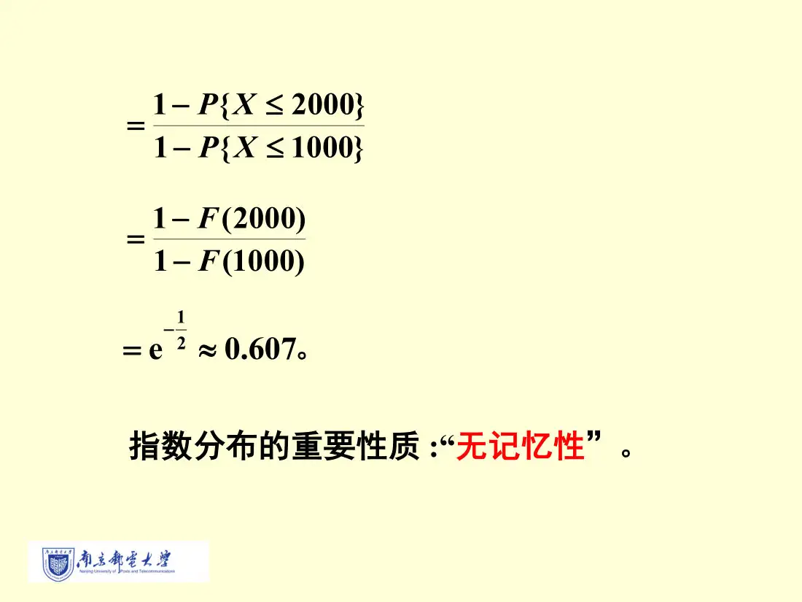

原文：

$$
\begin{array}{l} = \frac {1 - P \{X \leq 2 0 0 0 \}}{1 - P \{X \leq 1 0 0 0 \}} \\ = \frac {1 - F (2 0 0 0)}{1 - F (1 0 0 0)} \\ = e ^ {- \frac {1}{2}} \approx 0. 6 0 7 _ {\circ} \end{array}
$$

指数分布的重要性质：“无记忆性”。

南京邮电大学
Nanjing University of Posts and Telecommunications

### 例2.18 设X服从参数 $\lambda=1$ 的指数分布，求方程

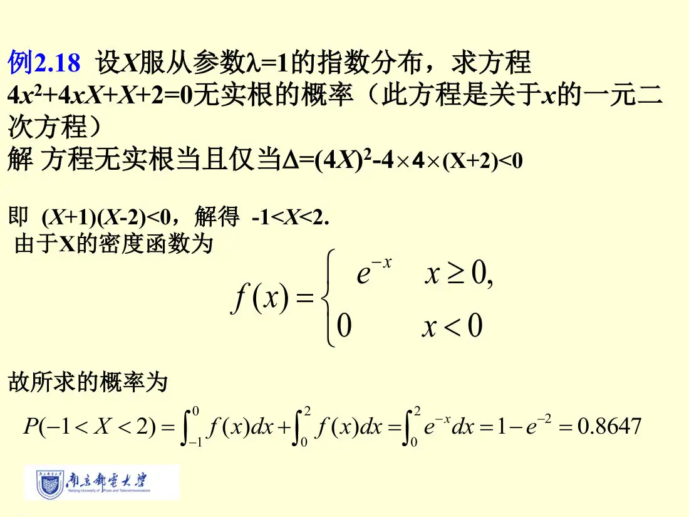

原文：

例2.18 设X服从参数 $\lambda=1$ 的指数分布，求方程

$4x^{2}+4xX+X+2=0$ 无实根的概率（此方程是关于x的一元二次方程）

解 方程无实根当且仅当 $\Delta = (4X)^2 - 4 \times 4 \times (X + 2) < 0$

即 $(X+1)(X-2)<0$ ，解得 -1<X<2.

由于X的密度函数为

$$
f (x) = \left\{ \begin{array}{l l} e ^ {- x} & x \geq 0, \\ 0 & x <   0 \end{array} \right.
$$

故所求的概率为

$$
P (- 1 <   X <   2) = \int_ {- 1} ^ {0} f (x) d x + \int_ {0} ^ {2} f (x) d x = \int_ {0} ^ {2} e ^ {- x} d x = 1 - e ^ {- 2} = 0. 8 6 4 7
$$

南京邮电大学
Nanjing University of Posts and Telecommunications

### 3. 正态分布(或高斯分布)

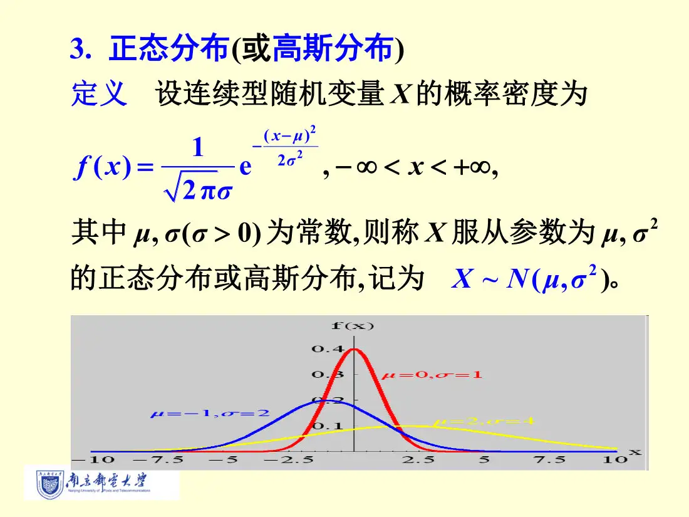

原文：

3. 正态分布(或高斯分布)

定义 设连续型随机变量 X 的概率密度为

$$
f (x) = \frac {1}{\sqrt {2 \pi} \sigma} \mathrm{e} ^ {- \frac {(x - \mu) ^ {2}}{2 \sigma^ {2}}}, - \infty <   x <   + \infty ,
$$

其中 $\mu,\sigma(\sigma>0)$ 为常数,则称 X 服从参数为 $\mu,\sigma^{2}$ 的正态分布或高斯分布,记为 $X\sim N(\mu,\sigma^{2})$ 。

南京邮电大学
Nanjing University of Posts and Telecommunications

### 正态概率密度函数的几何特征

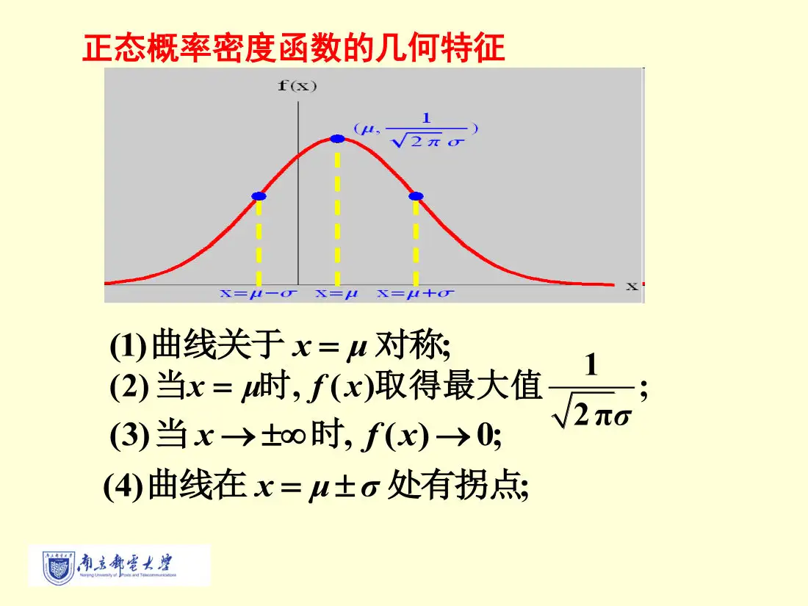

原文：

正态概率密度函数的几何特征

(1)曲线关于 $x = \mu$ 对称;

(2) 当 $x = \mu$ 时, $f(x)$ 取得最大值 $\frac{1}{\sqrt{2\pi}\sigma}$ ;

(3) 当 $x \to \pm \infty$ 时, $f(x) \to 0$ ; $\sqrt{2}\pi \sigma$

(4)曲线在 $x = \mu \pm \sigma$ 处有拐点;

南京邮电大学
Nanjing University of Posts and Telecommunications

### (5)曲线以 x 轴为渐近线;

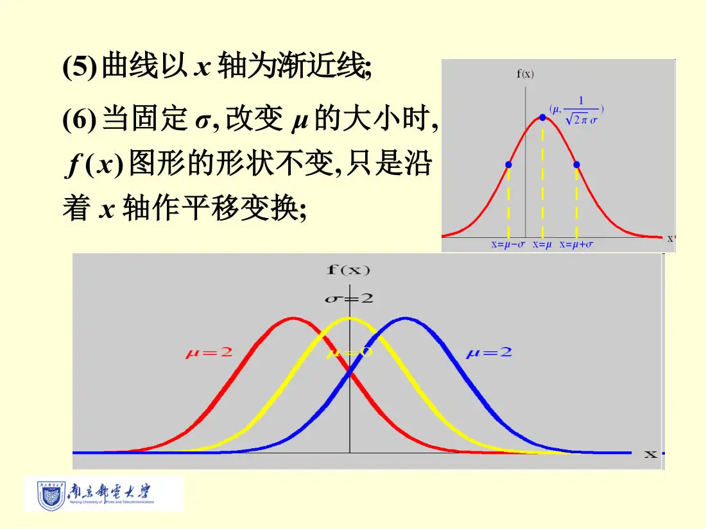

原文：

(5)曲线以 x 轴为渐近线;

(6)当固定 $\sigma$ , 改变 $\mu$ 的大小时, $f(x)$ 图形的形状不变, 只是沿着 x 轴作平移变换;

X

南京邮电大学
Nanjing University of Posts and Telecommunications

### 南京邮电大学

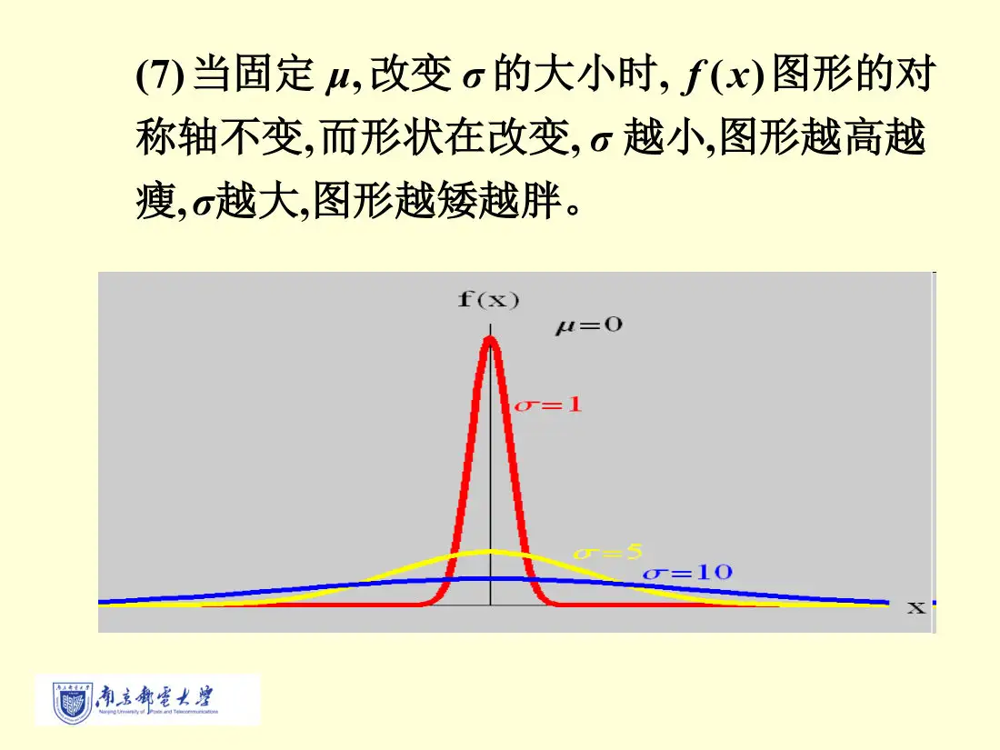

原文：

(7)当固定 $\mu$ , 改变 $\sigma$ 的大小时, $f(x)$ 图形的对称轴不变, 而形状在改变, $\sigma$ 越小, 图形越高越瘦, $\sigma$ 越大, 图形越矮越胖。

X

南京邮电大学
Nanjing University of Posts and Telecommunications

### 正态分布的分布函数

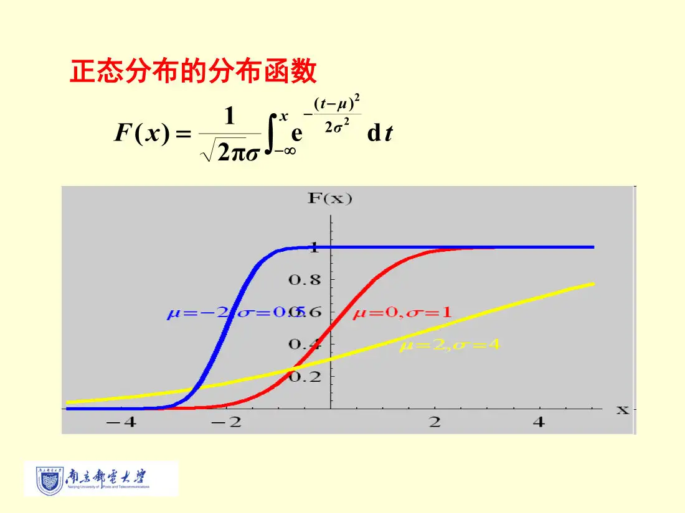

原文：

正态分布的分布函数

$$
F (x) = \frac {1}{\sqrt {2 \pi} \sigma} \int_ {- \infty} ^ {x} \mathrm{e} ^ {- \frac {(t - \mu) ^ {2}}{2 \sigma^ {2}}} \mathrm{d} t
$$

南京邮电大学
Nanjing University of Posts and Telecommunications

### 正态分布的应用与背景

原文：

正态分布的应用与背景

正态分布是最常见最重要的一种分布,例如测量误差,人的生理特征尺寸如身高、体重等;正常情况下生产的产品尺寸:直径、长度、重量高度等都近似服从正态分布。

南京邮电大学
Nanjing University of Posts and Telecommunications

### 标准正态分布

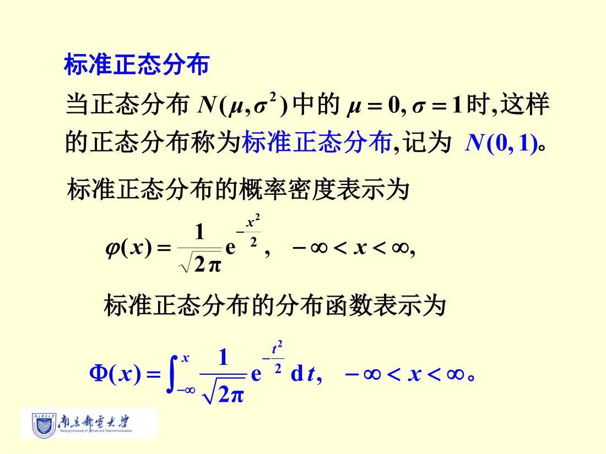

原文：

标准正态分布

当正态分布 $N(\mu,\sigma^{2})$ 中的 $\mu=0,\sigma=1$ 时,这样的正态分布称为标准正态分布,记为 $N(0,1)$ 。标准正态分布的概率密度表示为

$$
\varphi (x) = \frac {1}{\sqrt {2 \pi}} \mathrm{e} ^ {- \frac {x ^ {2}}{2}}, - \infty <   x <   \infty ,
$$

标准正态分布的分布函数表示为

$$
\Phi (x) = \int_ {- \infty} ^ {x} \frac {1}{\sqrt {2 \pi}} \mathrm{e} ^ {- \frac {t ^ {2}}{2}} \mathrm{d} t, - \infty <   x <   \infty 。
$$

南京邮电大学
Nanjing University of Posts and Telecommunications

### 标准正态分布的图形

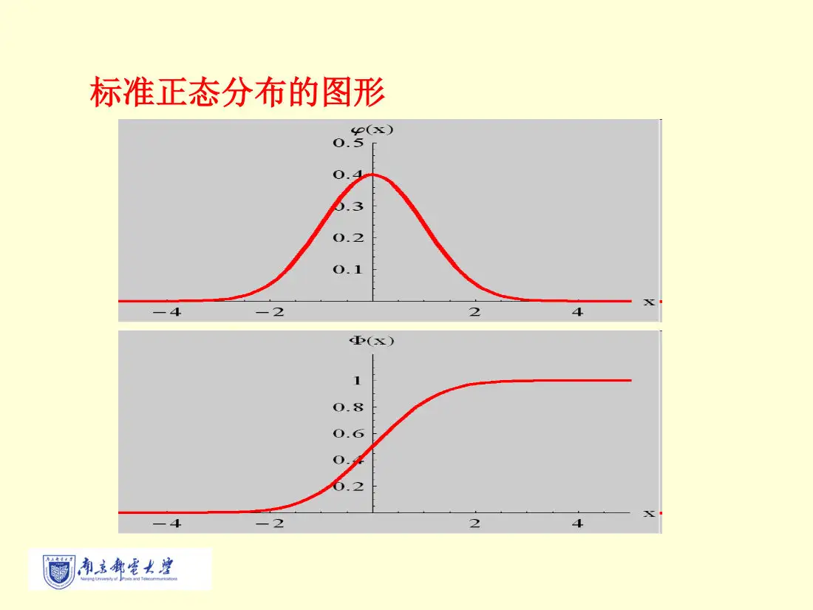

原文：

标准正态分布的图形

南京邮电大学
Nanjing University of Posts and Telecommunications

### 这表明对于标准型态分布的概率，可以直接代入公式，再查表求得。

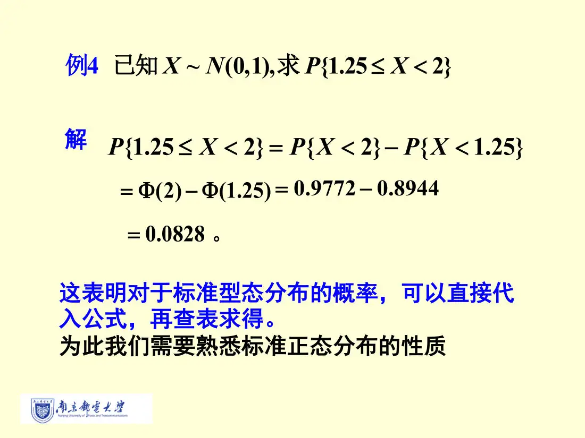

原文：

例4 已知 $X \sim N(0,1)$ , 求 $P\{1.25 \leq X < 2\}$

解 $P\{1.25 \leq X < 2\} = P\{X < 2\} - P\{X < 1.25\}$ $= \Phi(2) - \Phi(1.25) = 0.9772 - 0.8944$ $= 0.0828$ 。

这表明对于标准型态分布的概率，可以直接代入公式，再查表求得。

为此我们需要熟悉标准正态分布的性质

南京邮电大学
Nanjing University of Posts and Telecommunications

### 定理2.3

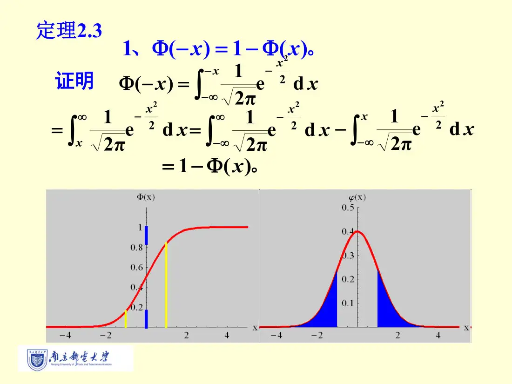

原文：

定理2.3

$$
\begin{array}{r l} & 1, \Phi (- x) = 1 - \Phi (x) _ {\circ} \\ & \text {证明} \quad \Phi (- x) = \int_ {- \infty} ^ {- x} \frac {1}{\sqrt {2 \pi}} \mathrm{e} ^ {- \frac {x ^ {2}}{2}} \mathrm{d} x \\ & = \int_ {x} ^ {\infty} \frac {1}{\sqrt {2 \pi}} \mathrm{e} ^ {- \frac {x ^ {2}}{2}} \mathrm{d} x = \int_ {- \infty} ^ {\infty} \frac {1}{\sqrt {2 \pi}} \mathrm{e} ^ {- \frac {x ^ {2}}{2}} \mathrm{d} x - \int_ {- \infty} ^ {x} \frac {1}{\sqrt {2 \pi}} \mathrm{e} ^ {- \frac {x ^ {2}}{2}} \mathrm{d} x \\ & = 1 - \Phi (x) _ {\circ} \end{array}
$$

南京邮电大学
Nanjing University of Posts and Telecommunications

### 这表明可以将一般的正态分布转化为标准正态分布计算。

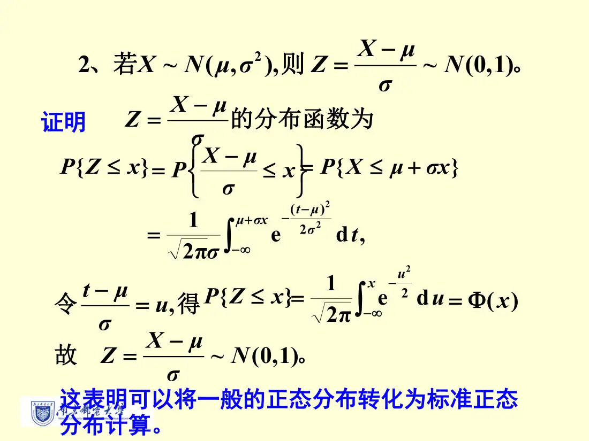

原文：

2、若 $X \sim N(\mu, \sigma^2)$ ，则 $Z = \frac{X - \mu}{\sigma} \sim N(0, 1)$ 。
证明 $Z = \frac{X - \mu}{\sigma}$ 的分布函数为 $P\{Z \leq x\} = P\left\{\frac{X - \mu}{\sigma} \leq x\right\} = P\{X \leq \mu + \sigma x\}$ $= \frac{1}{\sqrt{2\pi}\sigma} \int_{-\infty}^{\mu + \sigma x} e^{-\frac{(t - \mu)^2}{2\sigma^2}} dt,$ 令 $\frac{t - \mu}{\sigma} = u$ ，得 $P\{Z \leq x\} = \frac{1}{\sqrt{2\pi}} \int_{-\infty}^{x} e^{-\frac{u^2}{2}} du = \Phi(x)$ 故 $Z = \frac{X - \mu}{\sigma} \sim N(0, 1)$ 。
这表明可以将一般的正态分布转化为标准正态分布计算。

### 3、若 $X \sim N(\mu, \sigma^{2})$ ，则

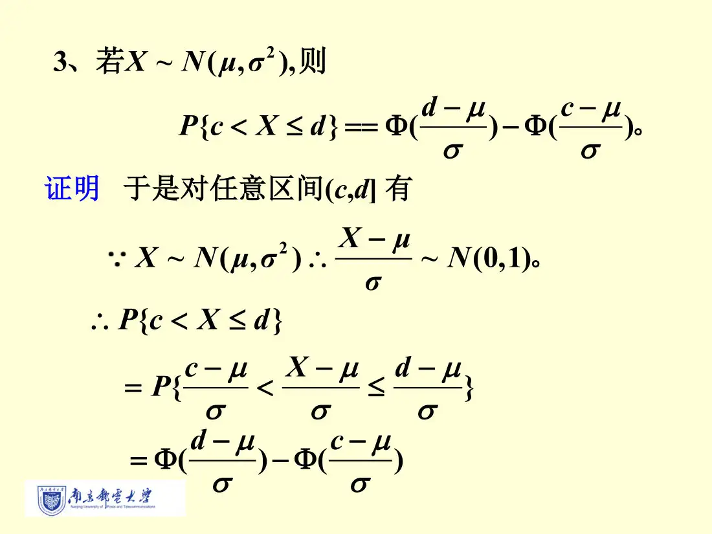

原文：

3、若 $X \sim N(\mu, \sigma^{2})$ ，则

$$
P \{c <   X \leq d \} = = \Phi (\frac {d - \mu}{\sigma}) - \Phi (\frac {c - \mu}{\sigma}) _ {\circ}
$$

证明 于是对任意区间 $(c,d]$ 有

$$
\begin{array}{r l} & {\because X \sim N (\mu , \sigma^ {2}) \therefore \frac {X - \mu}{\sigma} \sim N (0, 1) _ {\circ}} \\ & {\therefore P \{c <   X \leq d \}} \\ & {\qquad = P \{\frac {c - \mu}{\sigma} <   \frac {X - \mu}{\sigma} \leq \frac {d - \mu}{\sigma} \}} \\ & {\qquad = \Phi (\frac {d - \mu}{\sigma}) - \Phi (\frac {c - \mu}{\sigma})} \end{array}
$$

南京邮电大学
Nanjing University of Posts and Telecommunications

### $$

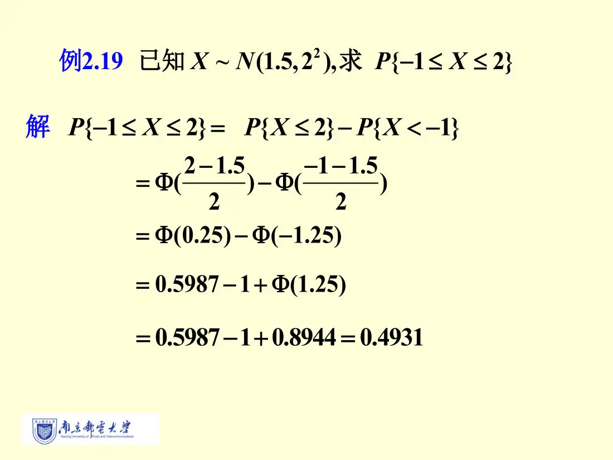

原文：

例2.19 已知 $X \sim N(1.5, 2^{2})$ , 求 $P\{-1 \leq X \leq 2\}$

$$
{ \begin{array}{r l} {{\mathrm{浑}} P \{- 1 \leq X \leq 2 \} =} & {P \{X \leq 2 \} - P \{X <   - 1 \}} \\ & {= \Phi ({\frac {2 - 1 . 5}{2}}) - \Phi ({\frac {- 1 - 1 . 5}{2}})} \\ & {= \Phi (0. 2 5) - \Phi (- 1. 2 5)} \\ & {= 0. 5 9 8 7 - 1 + \Phi (1. 2 5)} \\ & {= 0. 5 9 8 7 - 1 + 0. 8 9 4 4 = 0. 4 9 3 1} \end{array} }
$$

南京邮电大学
Nanjing University of Posts and Telecommunications

### 4、若 $X \sim N(\mu, \sigma^{2})$ ，则

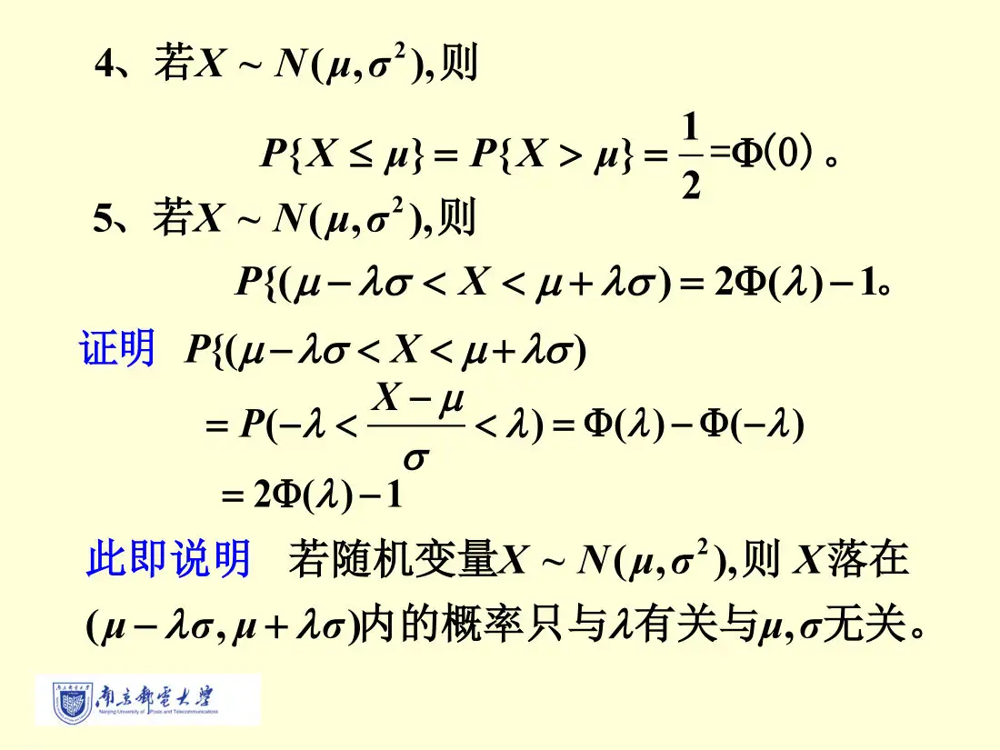

原文：

4、若 $X \sim N(\mu, \sigma^{2})$ ，则

$$
P \{X \leq \mu \} = P \{X > \mu \} = \frac {1}{2} = \Phi (0) 。
$$

5、若 $X \sim N(\mu, \sigma^{2})$ ，则

$$
P \{(\mu - \lambda \sigma <   X <   \mu + \lambda \sigma) = 2 \Phi (\lambda) - 1 。
$$

证明 $P\{(\mu - \lambda \sigma < X < \mu + \lambda \sigma)$ $= P(-\lambda < \frac{X - \mu}{\sigma} < \lambda) = \Phi(\lambda) - \Phi(-\lambda)$ $= 2\Phi(\lambda) - 1$

此即说明 若随机变量 $X \sim N(\mu, \sigma^2)$ , 则 $X$ 落在 $(\mu - \lambda \sigma, \mu + \lambda \sigma)$ 内的概率只与 $\lambda$ 有关与 $\mu, \sigma$ 无关。

南京邮电大学
Nanjing University of Posts and Telecommunications

### 特别当 $\lambda = 1$ ，2，3时，可查表求得

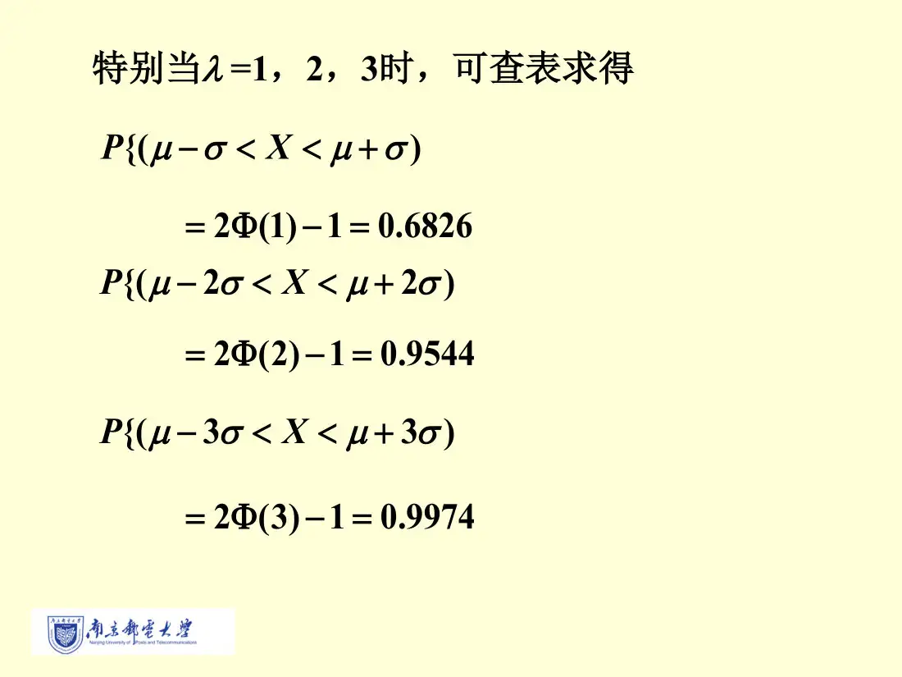

原文：

特别当 $\lambda = 1$ ，2，3时，可查表求得

$$
\begin{array}{r l} P \{(\mu - \sigma <   X <   \mu + \sigma) & \\ = 2 \Phi (1) - 1 = 0. 6 8 2 6 \end{array}
$$

$$
\begin{array}{r l} P \{(\mu - 2 \sigma <   X <   \mu + 2 \sigma) & \\ = 2 \Phi (2) - 1 = 0. 9 5 4 4 \end{array}
$$

$$
\begin{array}{r l} P \{(\mu - 3 \sigma <   X <   \mu + 3 \sigma) & \\ = 2 \Phi (3) - 1 = 0. 9 9 7 4 \end{array}
$$

南京邮电大学
Nanjing University of Posts and Telecommunications

### 南京邮电大学

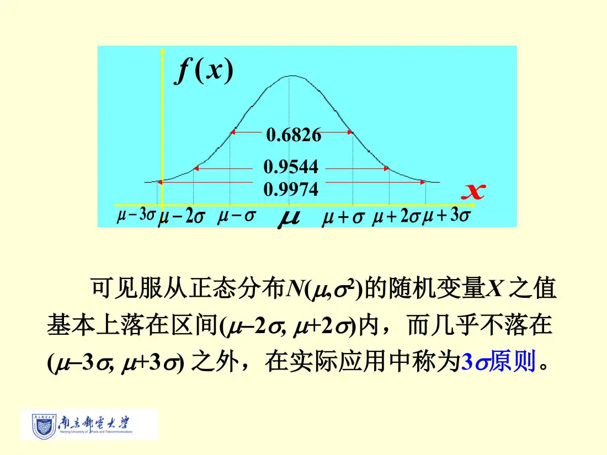

原文：

可见服从正态分布 $N(\mu,\sigma^{2})$ 的随机变量X之值基本上落在区间 $(\mu-2\sigma,\mu+2\sigma)$ 内，而几乎不落在 $(\mu-3\sigma,\mu+3\sigma)$ 之外，在实际应用中称为3σ原则。

南京邮电大学
Nanjing University of Posts and Telecommunications

### 三、小结

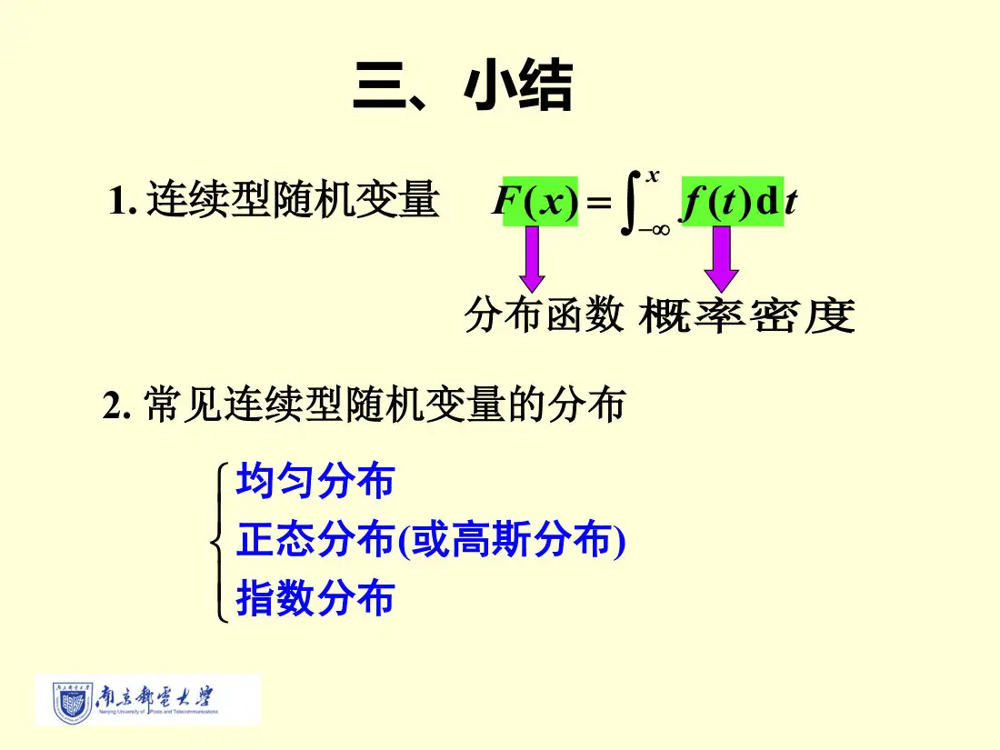

原文：

三、小结

1. 连续型随机变量 $F(x)=\int_{-\infty}^{x}f(t)\mathrm{d}t$ 分布函数 概率密度

2. 常见连续型随机变量的分布

均匀分布
正态分布(或高斯分布)
指数分布

南京邮电大学
Nanjing University of Posts and Telecommunications

### 南京邮电大学

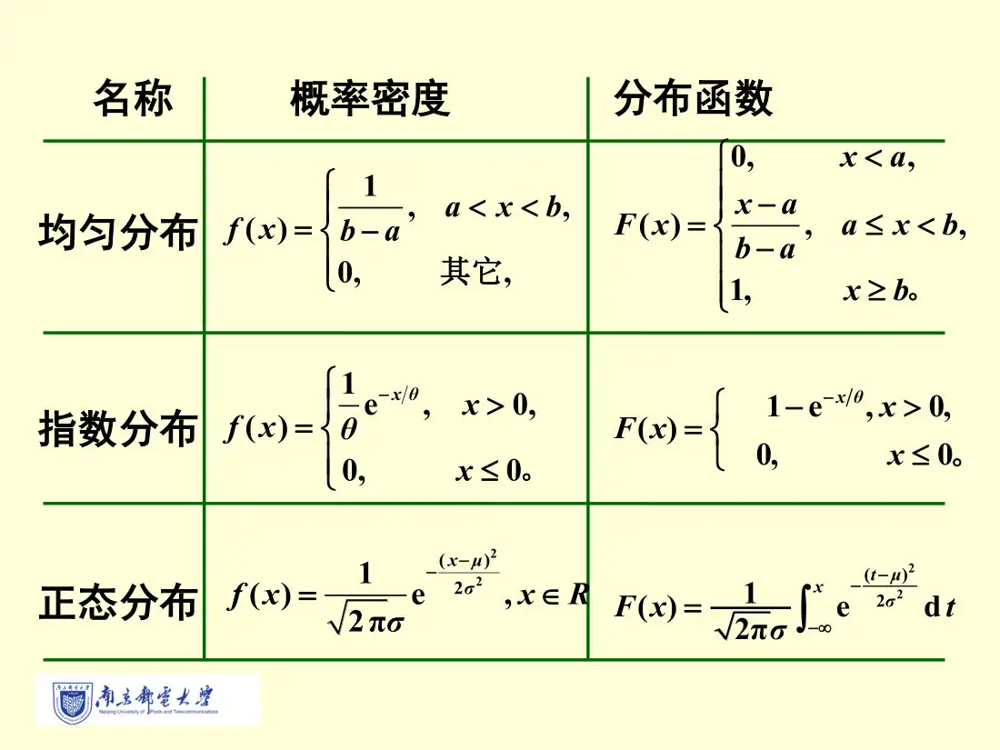

原文：

<table><tr><td>名称</td><td>概率密度</td><td>分布函数</td></tr><tr><td>均匀分布</td><td>\( f(x)=\begin{cases}\frac{1}{b-a},&amp;a</td><td></td></tr></table>

南京邮电大学
Nanjing University of Posts and Telecommunications

### 3. 重要结论

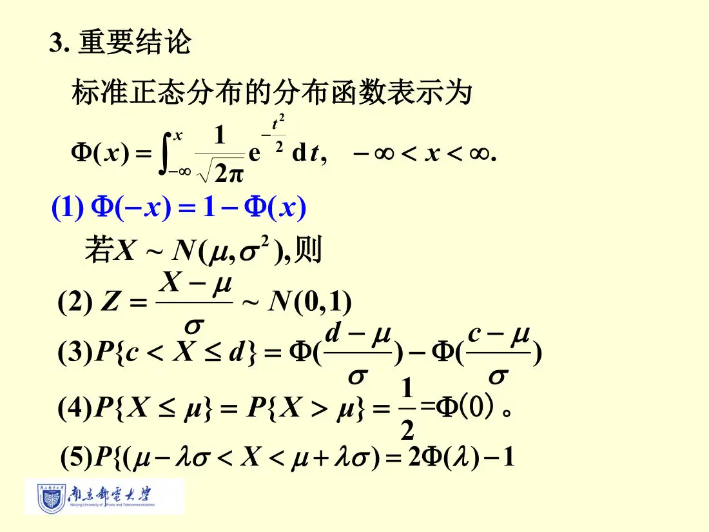

原文：

3. 重要结论

标准正态分布的分布函数表示为

$\Phi (x) = \int_{-\infty}^{x}\frac{1}{\sqrt{2\pi}}\mathrm{e}^{-\frac{t^2}{2}}\mathrm{d}t,\quad -\infty <  x <   \infty .$

(1) $\Phi(-x) = 1 - \Phi(x)$

若 $X \sim N(\mu, \sigma^{2})$ ，则

(2) $Z = \frac{X - \mu}{\sim} N(0,1)$

(3) $P\{c < X \leq d\} = \Phi(\frac{d - \mu}{c}) - \Phi(\frac{c - \mu}{c})$

(4) $P\{X \leq \mu\} = P\{X > \mu\} = \frac{1}{2} = \Phi(0)$ 。

(5) $P\{(\mu - \lambda \sigma < X < \mu + \lambda \sigma) = 2\Phi (\lambda) - 1$

南京邮电大学
Nanjing University of Posts and Telecommunications

### 3. 正态分布是概率论中最重要的分布

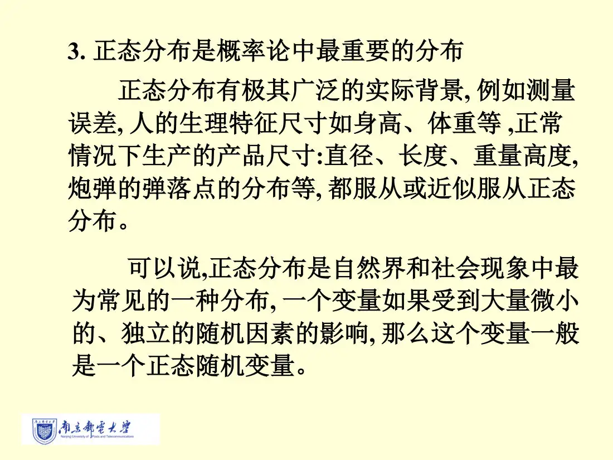

原文：

3. 正态分布是概率论中最重要的分布

正态分布有极其广泛的实际背景,例如测量误差,人的生理特征尺寸如身高、体重等,正常情况下生产的产品尺寸:直径、长度、重量高度,炮弹的弹落点的分布等,都服从或近似服从正态分布。

可以说,正态分布是自然界和社会现象中最为常见的一种分布,一个变量如果受到大量微小的、独立的随机因素的影响,那么这个变量一般是一个正态随机变量。

南京邮电大学
Nanjing University of Posts and Telecommunications

### 南京邮电大学

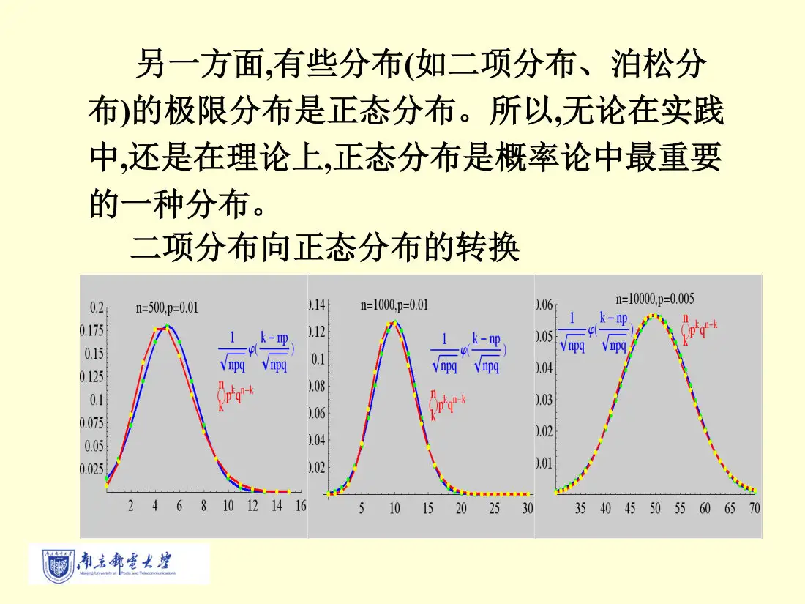

原文：

另一方面,有些分布(如二项分布、泊松分布)的极限分布是正态分布。所以,无论在实践中,还是在理论上,正态分布是概率论中最重要的一种分布。

南京邮电大学
Nanjing University of Posts and Telecommunications
