# 《概率论与数理统计》第2章 随机变量及其分布习题课（课件）

原件的每一页，下面附识别出的文字。

### 第2章 随机变量及其分布习题课

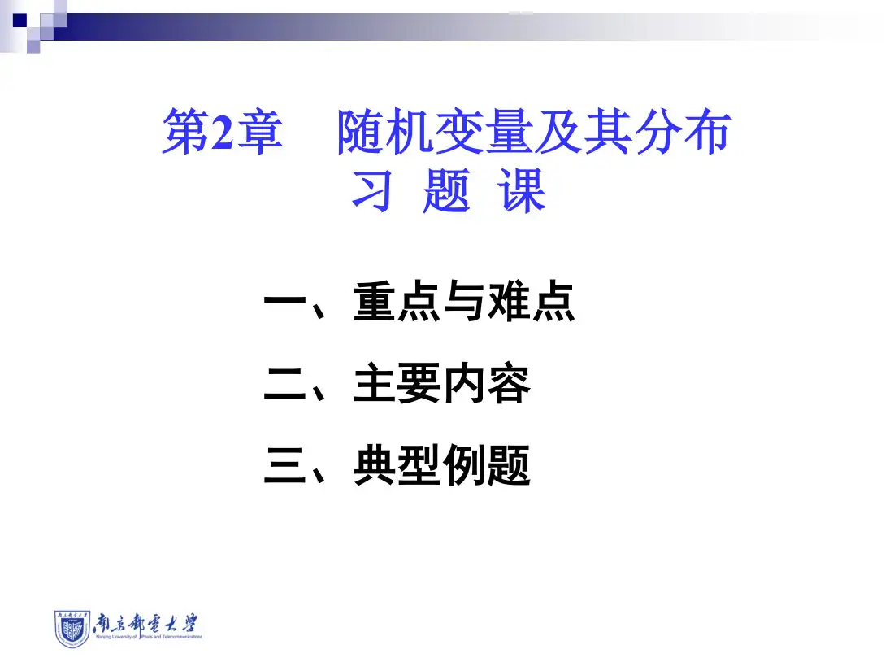

原文：

第2章 随机变量及其分布习题课
一、重点与难点
二、主要内容
三、典型例题

南京邮电大学
Nanjing University of Posts and Telecommunications

### 一、重点与难点

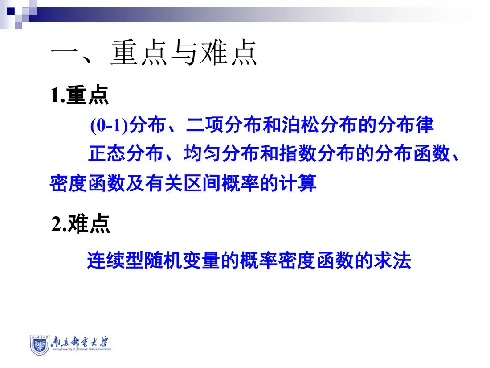

原文：

一、重点与难点

1.重点

(0-1)分布、二项分布和泊松分布的分布律
正态分布、均匀分布和指数分布的分布函数、
密度函数及有关区间概率的计算

2.难点

连续型随机变量的概率密度函数的求法

南京邮电大学
Nanjing University of Posts and Telecommunications

### 二、主要内容

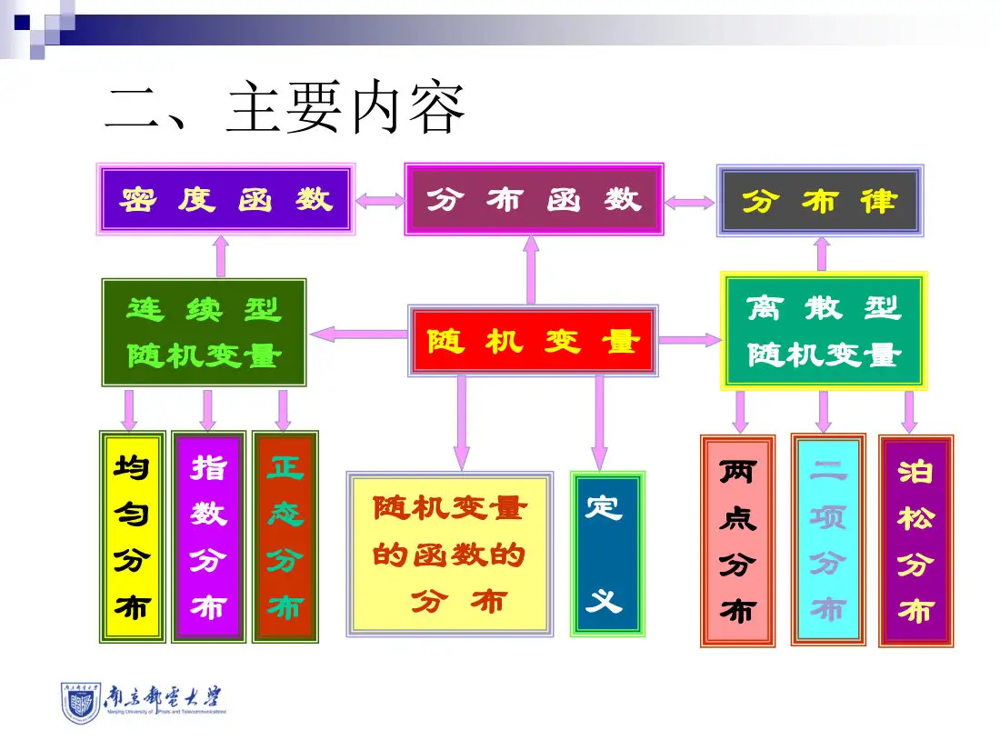

原文：

二、主要内容

密度函数

连续型随机变量分布函数

随机变量

分布律

离散型随机变量

泊松分布

两点分布项分布

均匀分布指数分布正态分布

随机变量的函数的分布

定

义

南京邮电大学
Nanjing University of Posts and Telecommunications

### 随机变量

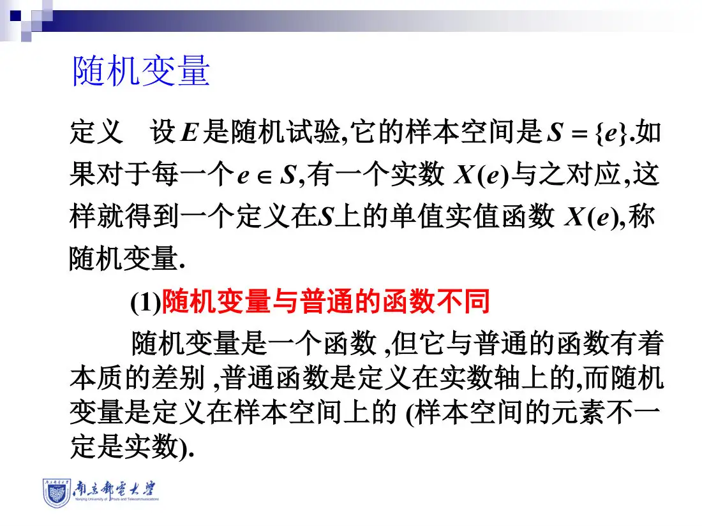

原文：

随机变量

定义 设 $E$ 是随机试验, 它的样本空间是 $S = \{e\}$ . 如果对于每一个 $e \in S$ , 有一个实数 $X(e)$ 与之对应, 这样就得到一个定义在 $S$ 上的单值实值函数 $X(e)$ , 称随机变量.

(1)随机变量与普通的函数不同

随机变量是一个函数,但它与普通的函数有着本质的差别,普通函数是定义在实数轴上的,而随机变量是定义在样本空间上的(样本空间的元素不一定是实数).

南京邮电大学
Nanjing University of Posts and Telecommunications

### (2)随机变量的取值具有一定的概率规律

原文：

(2)随机变量的取值具有一定的概率规律

随机变量随着试验的结果不同而取不同的值,由于试验的各个结果的出现具有一定的概率,因此随机变量的取值也有一定的概率规律.

(3)随机变量与随机事件的关系

随机事件包容在随机变量这个范围更广的概念之内。或者说：随机事件是从静态的观点来研究随机现象，而随机变量则是从动态的观点来研究随机现象。

南京邮电大学
Nanjing University of Posts and Telecommunications

### 随机变量的分类

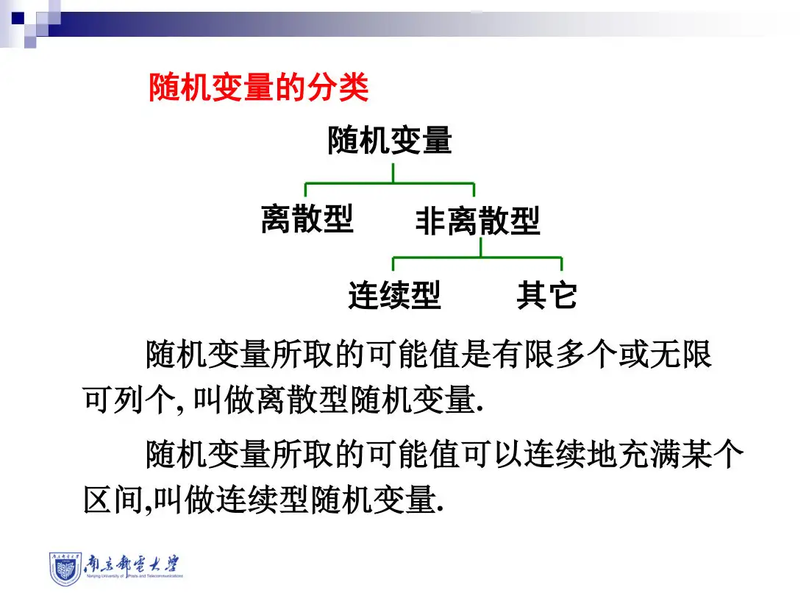

原文：

随机变量的分类

随机变量所取的可能值是有限多个或无限可列个, 叫做离散型随机变量.

随机变量所取的可能值可以连续地充满某个区间,叫做连续型随机变量.

南京邮电大学
Nanjing University of Posts and Telecommunications

### 离散型随机变量的分布律

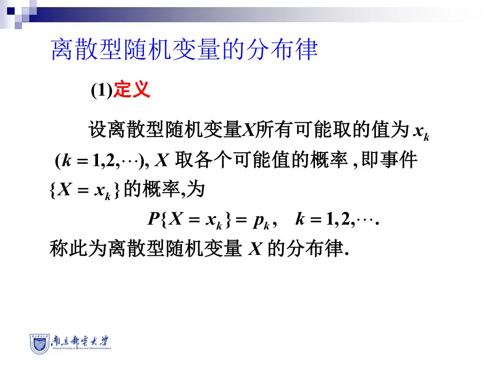

原文：

离散型随机变量的分布律

(1)定义

设离散型随机变量X所有可能取的值为 $x_{k}$ $(k=1,2,\cdots)$ , X 取各个可能值的概率, 即事件 $\{X=x_{k}\}$ 的概率,为

$$
P \{X = x _ {k} \} = p _ {k}, \quad k = 1, 2, \dots .
$$

称此为离散型随机变量 X 的分布律.

南京邮电大学
Nanjing University of Posts and Telecommunications

### (2)说明

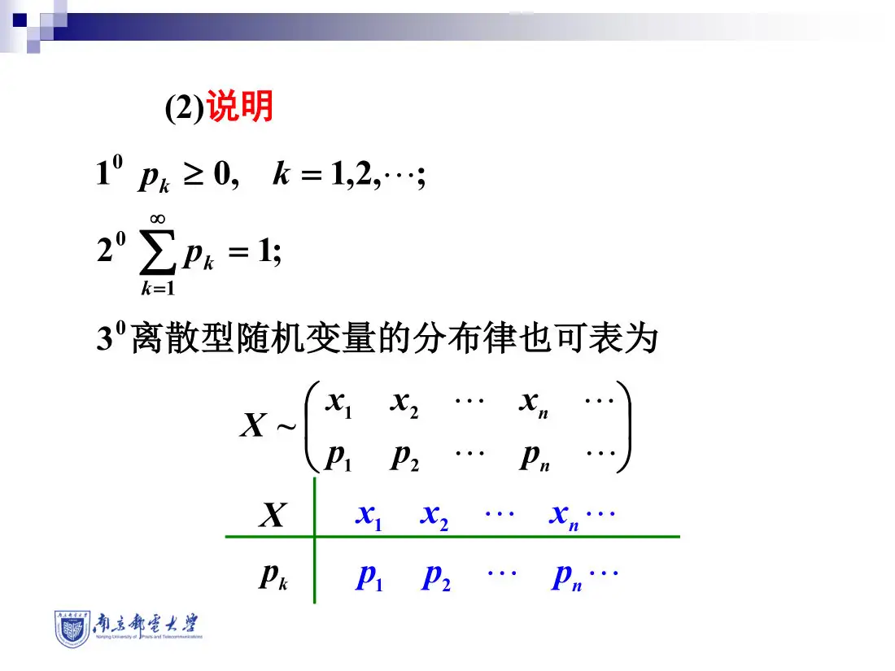

原文：

(2)说明

$$
1 ^ {0} p _ {k} \geq 0, k = 1, 2, \dots ;
$$

$$
2 ^ {0} \sum_ {k = 1} ^ {\infty} p _ {k} = 1;
$$

$3^{0}$ 离散型随机变量的分布律也可表为

$$
\begin{array}{c c c c c} X \sim \left( \begin{array}{c c c c c} x _ {1} & x _ {2} & \dots & x _ {n} & \dots \\ p _ {1} & p _ {2} & \dots & p _ {n} & \dots \end{array} \right) \\ X & x _ {1} & x _ {2} & \dots & x _ {n} \dots \\ \hline p _ {k} & p _ {1} & p _ {2} & \dots & p _ {n} \dots \end{array}
$$

南京邮电大学
Nanjing University of Posts and Telecommunications

### 两点分布

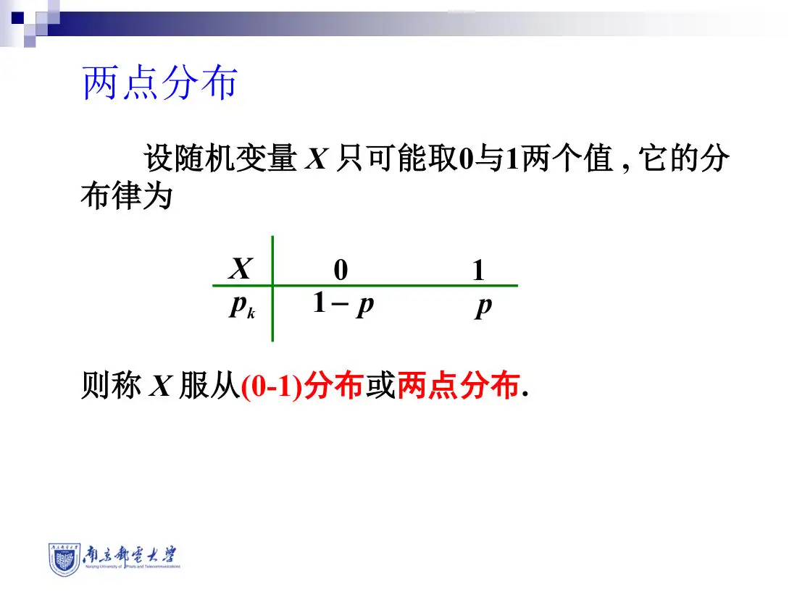

原文：

两点分布

设随机变量 X 只可能取0与1两个值, 它的分布律为

$$
\begin{array}{c c c} X & 0 & 1 \\ \hline p _ {k} & 1 - p & p \end{array}
$$

则称 X 服从(0-1)分布或两点分布.

南京邮电大学
Nanjing University of Posts and Telecommunications

### 二项分布

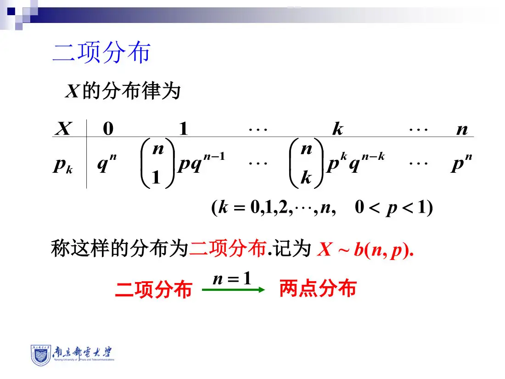

原文：

二项分布

X的分布律为

$$
\begin{array}{c c c c c c c c} X & 0 & 1 & \dots & k & \dots & n \\ \hline p _ {k} & q ^ {n} & \binom {n} {1} p q ^ {n - 1} & \dots & \binom {n} {k} p ^ {k} q ^ {n - k} & \dots & p ^ {n} \end{array}
$$

$$
(k = 0, 1, 2, \dots , n, \quad 0 <   p <   1)
$$

称这样的分布为二项分布.记为 $X \sim b(n, p)$ .

二项分布 $\xrightarrow{n=1}$ 两点分布

南京邮电大学
Nanjing University of Posts and Telecommunications

### 泊松分布

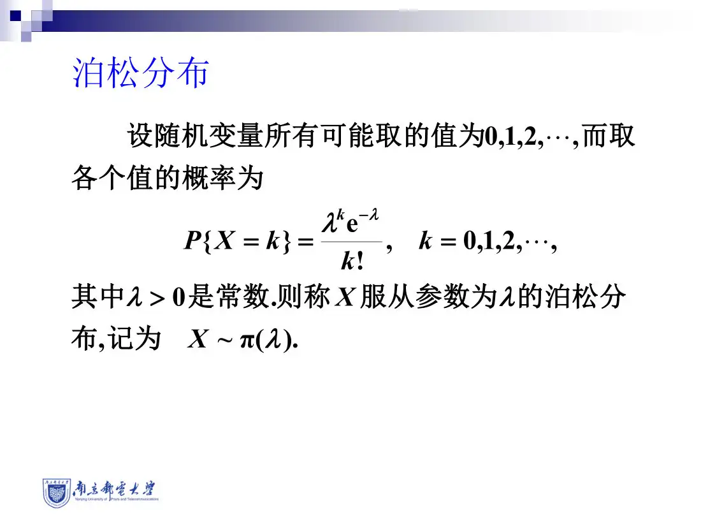

原文：

泊松分布

设随机变量所有可能取的值为0,1,2,…,而取各个值的概率为

$$
P \{X = k \} = \frac {\lambda^ {k} \mathrm{e} ^ {- \lambda}}{k !}, \quad k = 0, 1, 2, \dots ,
$$

其中 $\lambda > 0$ 是常数. 则称 $X$ 服从参数为 $\lambda$ 的泊松分布, 记为 $X \sim \pi(\lambda)$ .

南京邮电大学
Nanjing University of Posts and Telecommunications

### 随机变量的分布函数

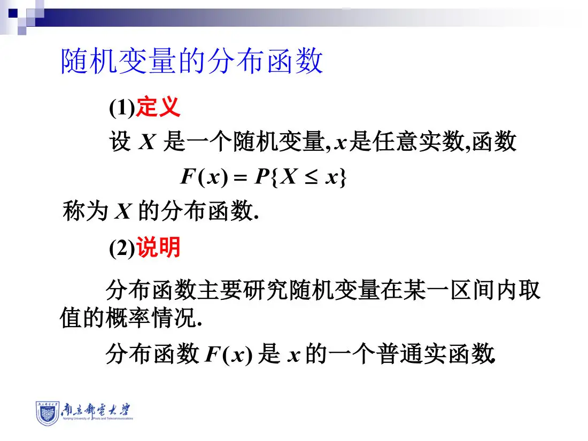

原文：

随机变量的分布函数

(1)定义

设 X 是一个随机变量, x 是任意实数, 函数

$$
F (x) = P \{X \leq x \}
$$

称为 X 的分布函数.

(2)说明

分布函数主要研究随机变量在某一区间内取值的概率情况.

分布函数 $F(x)$ 是 x 的一个普通实函数.

南京邮电大学
Nanjing University of Posts and Telecommunications

### (3)性质

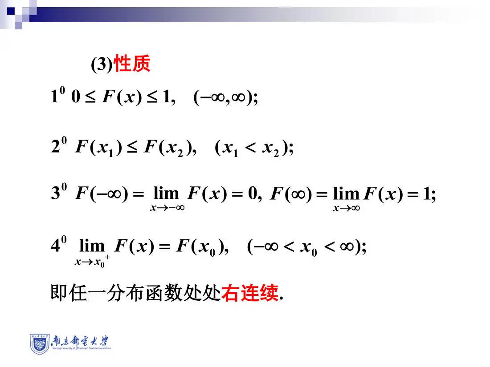

原文：

(3)性质

$$
1 ^ {0} 0 \leq F (x) \leq 1, (- \infty , \infty);
$$

$$
2 ^ {0} F (x _ {1}) \leq F (x _ {2}), (x _ {1} <   x _ {2});
$$

$$
3 ^ {0} F (- \infty) = \lim _ {x \rightarrow - \infty} F (x) = 0, F (\infty) = \lim _ {x \rightarrow \infty} F (x) = 1;
$$

$$
4 ^ {0} \lim _ {x \to x _ {0} ^ {+}} F (x) = F (x _ {0}), \quad (- \infty <   x _ {0} <   \infty);
$$

即任一分布函数处处右连续.

南京邮电大学
Nanjing University of Posts and Telecommunications

### (4)重要公式

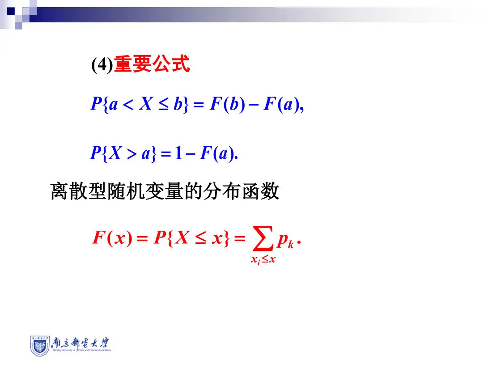

原文：

(4)重要公式

$$
P \{a <   X \leq b \} = F (b) - F (a),
$$

$$
P \{X > a \} = 1 - F (a).
$$

离散型随机变量的分布函数

$$
F (x) = P \{X \leq x \} = \sum_ {x _ {i} \leq x} p _ {k}.
$$

南京邮电大学
Nanjing University of Posts and Telecommunications

### 连续型随机变量的概率密度

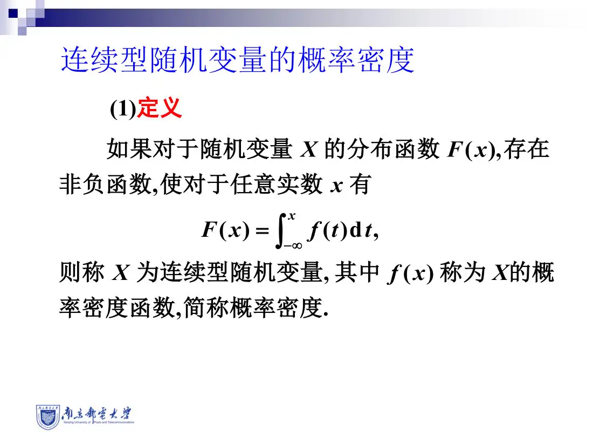

原文：

连续型随机变量的概率密度

(1)定义

如果对于随机变量 X 的分布函数 $F(x)$ ，存在非负函数，使对于任意实数 x 有

$$
F (x) = \int_ {- \infty} ^ {x} f (t) \mathrm{d} t,
$$

则称 X 为连续型随机变量, 其中 $f(x)$ 称为 X 的概率密度函数, 简称概率密度.

南京邮电大学
Nanjing University of Posts and Telecommunications

### (2)性质

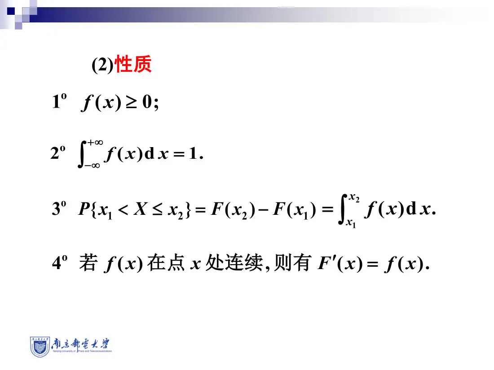

原文：

(2)性质

$1^{0} f(x)\geq 0;$

$$
2 ^ {0} \int_ {- \infty} ^ {+ \infty} f (x) d x = 1
$$

$3^{0} P\{x_{1}< X \leq x_{2}\}=F(x_{2})-F(x_{1})=\int_{x_{1}}^{x_{2}}f(x)\mathrm{d}x.$

$4^{0}$ 若 $f(x)$ 在点 $x$ 处连续, 则有 $F'(x) = f(x)$ .

南京邮电大学
Nanjing University of Posts and Telecommunications

### (3)注意

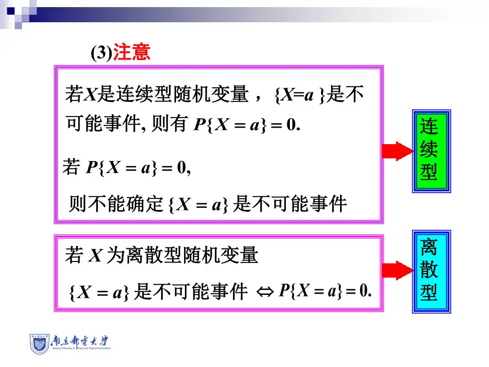

原文：

(3)注意

若X是连续型随机变量， $\{X=a\}$ 是不可能事件，则有 $P\{X=a\}=0$ .

连续型

若 $P\{X = a\} = 0,$

则不能确定 $\{X = a\}$ 是不可能事件

离散型

若 $X$ 为离散型随机变量

$\{X = a\}$ 是不可能事件 $\Leftrightarrow P\{X = a\} = 0.$

南京邮电大学
Nanjing University of Posts and Telecommunications

### 均匀分布

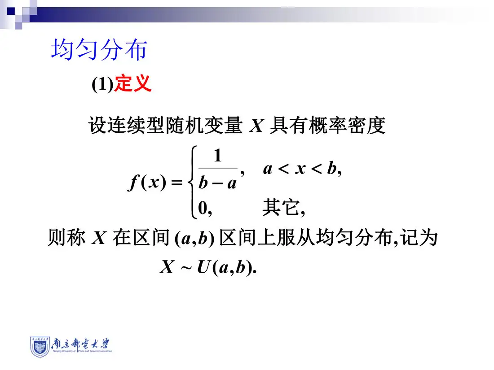

原文：

均匀分布

(1)定义

设连续型随机变量 X 具有概率密度

$$
f (x) = \left\{ \begin{array}{l l} \frac {1}{b - a}, & a <   x <   b, \\ 0, & \text {其它}, \end{array} \right.
$$

则称 X 在区间 $(a,b)$ 区间上服从均匀分布,记为

$$
X \sim U (a, b).
$$

南京邮电大学
Nanjing University of Posts and Telecommunications

### (2)分布函数

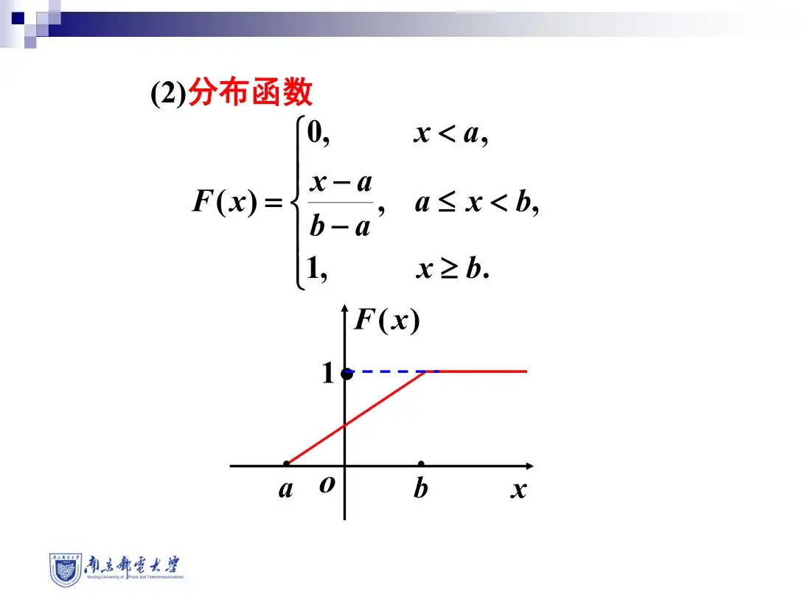

原文：

(2)分布函数

$$
F (x) = \left\{ \begin{array}{l l} 0, & x <   a, \\ \frac {x - a}{b - a}, & a \leq x <   b, \\ 1, & x \geq b. \end{array} \right.
$$

南京邮电大学
Nanjing University of Posts and Telecommunications

### 指数分布

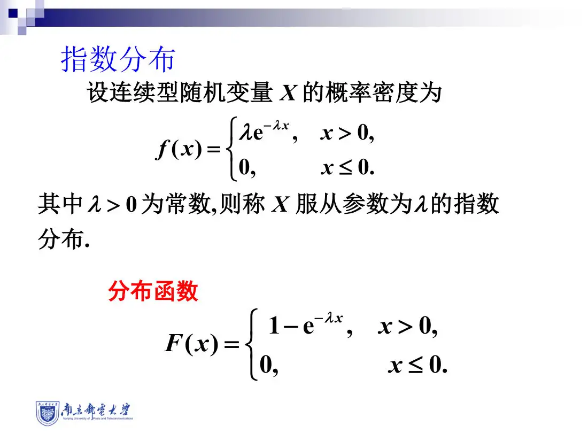

原文：

指数分布

设连续型随机变量 X 的概率密度为

$$
f (x) = \left\{ \begin{array}{l l} \lambda \mathrm{e} ^ {- \lambda x}, & x > 0, \\ 0, & x \leq 0. \end{array} \right.
$$

其中 $\lambda > 0$ 为常数, 则称 X 服从参数为 $\lambda$ 的指数分布.

分布函数

$$
F (x) = \left\{ \begin{array}{l l} 1 - \mathrm{e} ^ {- \lambda x}, & x > 0, \\ 0, & x \leq 0. \end{array} \right.
$$

南京邮电大学
Nanjing University of Posts and Telecommunications

### 正态分布(或高斯分布)

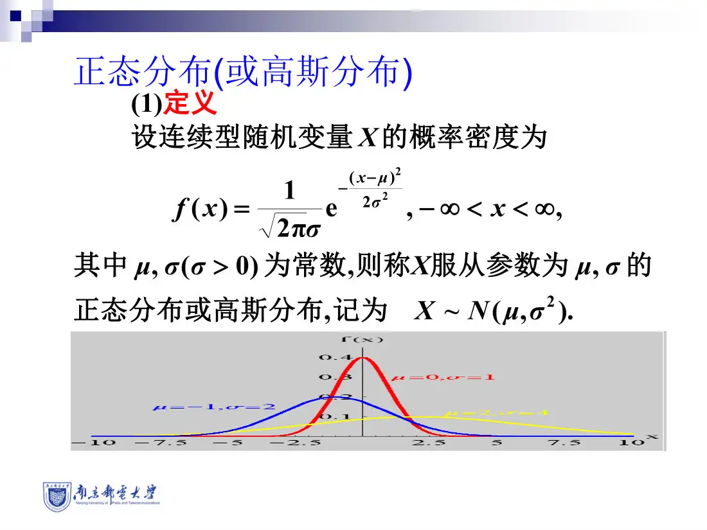

原文：

正态分布(或高斯分布)

(1)定义

设连续型随机变量 X 的概率密度为

$$
f (x) = \frac {1}{\sqrt {2 \pi} \sigma} \mathrm{e} ^ {- \frac {(x - \mu) ^ {2}}{2 \sigma^ {2}}}, - \infty <   x <   \infty ,
$$

其中 $\mu,\sigma(\sigma>0)$ 为常数,则称 X 服从参数为 $\mu,\sigma$ 的正态分布或高斯分布,记为 $X\sim N(\mu,\sigma^{2})$ .

南京邮电大学
Nanjing University of Posts and Telecommunications

### (2)分布函数

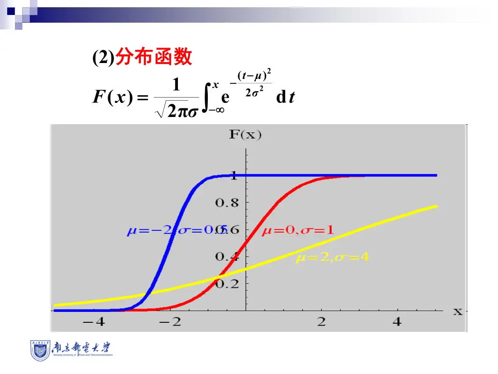

原文：

(2)分布函数

$$
F (x) = \frac {1}{\sqrt {2 \pi} \sigma} \int_ {- \infty} ^ {x} \mathrm{e} ^ {- \frac {(t - \mu) ^ {2}}{2 \sigma^ {2}}} \mathrm{d} t
$$

南京邮电大学
Nanjing University of Posts and Telecommunications

### (3)标准正态分布

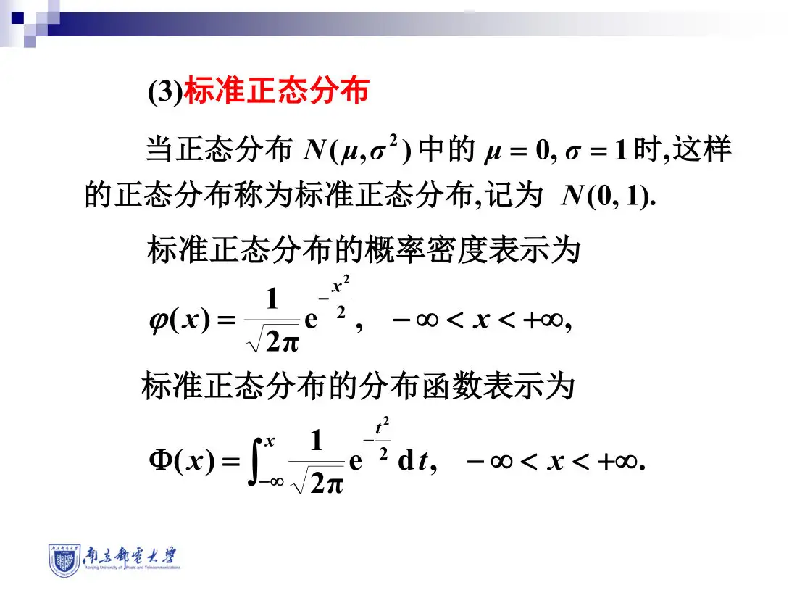

原文：

(3)标准正态分布

当正态分布 $N(\mu,\sigma^{2})$ 中的 $\mu=0,\sigma=1$ 时,这样的正态分布称为标准正态分布,记为 $N(0,1)$ .

标准正态分布的概率密度表示为

$$
\varphi (x) = \frac {1}{\sqrt {2 \pi}} \mathrm{e} ^ {- \frac {x ^ {2}}{2}}, - \infty <   x <   + \infty ,
$$

标准正态分布的分布函数表示为

$$
\Phi (x) = \int_ {- \infty} ^ {x} \frac {1}{\sqrt {2 \pi}} \mathrm{e} ^ {- \frac {t ^ {2}}{2}} \mathrm{d} t, - \infty <   x <   + \infty .
$$

南京邮电大学
Nanjing University of Posts and Telecommunications

### 标准正态分布的图形

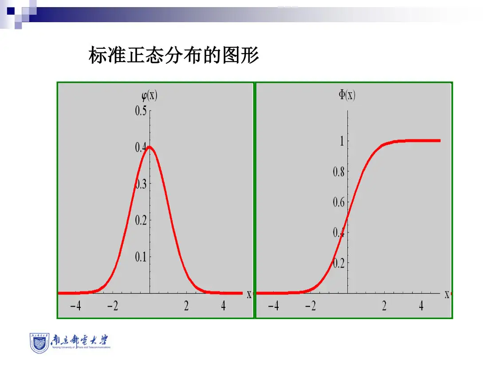

原文：

标准正态分布的图形

南京邮电大学
Nanjing University of Posts and Telecommunications

### (4)重要公式

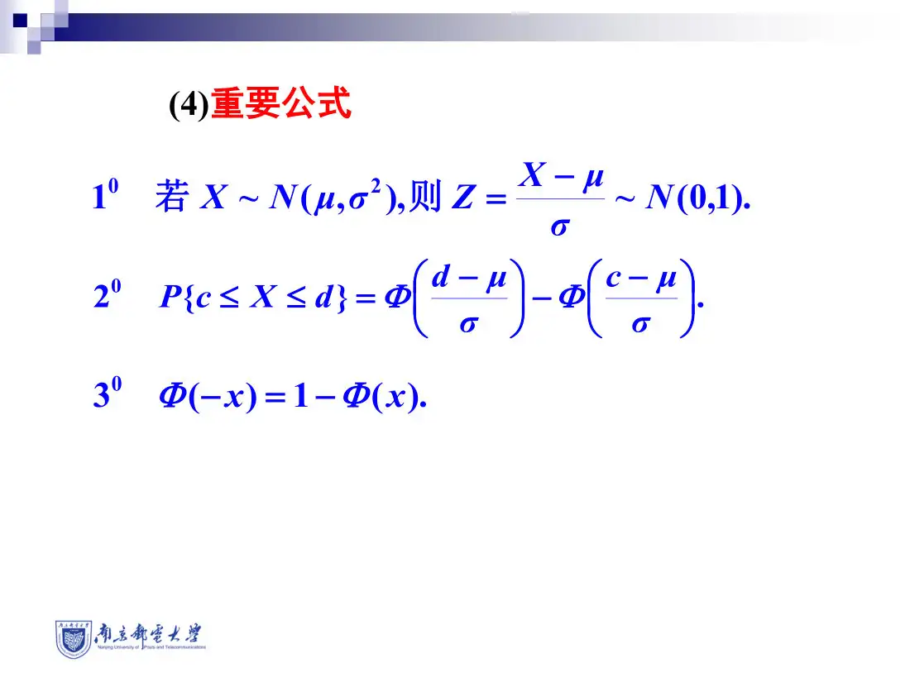

原文：

(4)重要公式

$1^{0}$ 若 $X \sim N(\mu, \sigma^{2})$ , 则 $Z = \frac{X - \mu}{\sigma} \sim N(0, 1)$ .

$2^{0}$ $P\{c \leq X \leq d\} = \Phi\left(\frac{d - \mu}{\sigma}\right) - \Phi\left(\frac{c - \mu}{\sigma}\right).$

$3^{0}$ $\Phi (-x) = 1 - \Phi (x).$

南京邮电大学
Nanjing University of Posts and Telecommunications

### 随机变量的函数的分布

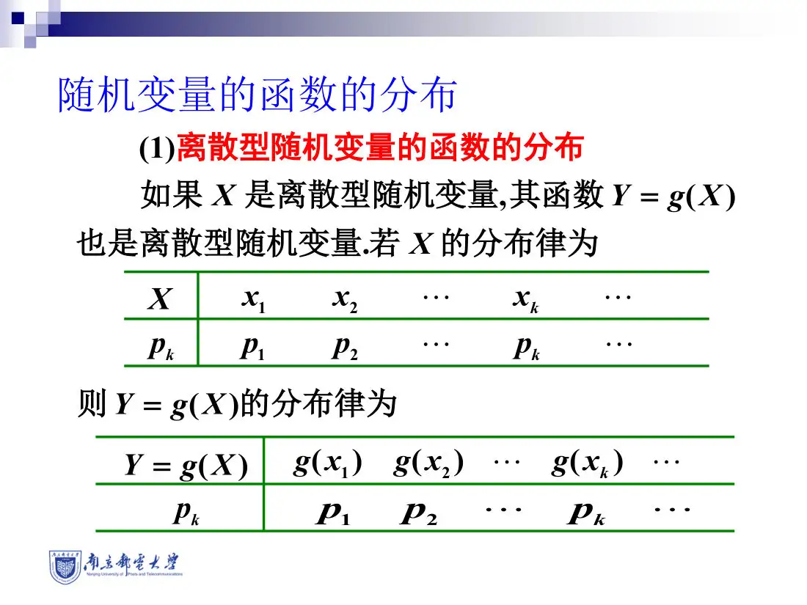

原文：

随机变量的函数的分布

(1)离散型随机变量的函数的分布

如果 X 是离散型随机变量, 其函数 $Y = g(X)$ 也是离散型随机变量.若 X 的分布律为

<table><tr><td>X</td><td> $x_{1}$ </td><td> $x_{2}$ </td><td>...</td><td> $x_{k}$ </td><td>...</td></tr><tr><td> $p_{k}$ </td><td> $p_{1}$ </td><td> $p_{2}$ </td><td>...</td><td> $p_{k}$ </td><td>...</td></tr></table>

则 $Y = g(X)$ 的分布律为

<table><tr><td> $Y = g(X)$ </td><td> $g(x_1)$ </td><td> $g(x_2)$ </td><td> $\cdots$ </td><td> $g(x_k)$ </td><td> $\cdots$ </td></tr><tr><td> $p_k$ </td><td> $p_1$ </td><td> $p_2$ </td><td> $\cdots$ </td><td> $p_k$ </td><td> $\cdots$ </td></tr></table>

南京邮电大学
Nanjing University of Posts and Telecommunications

### (2)连续型随机变量的函数的分布

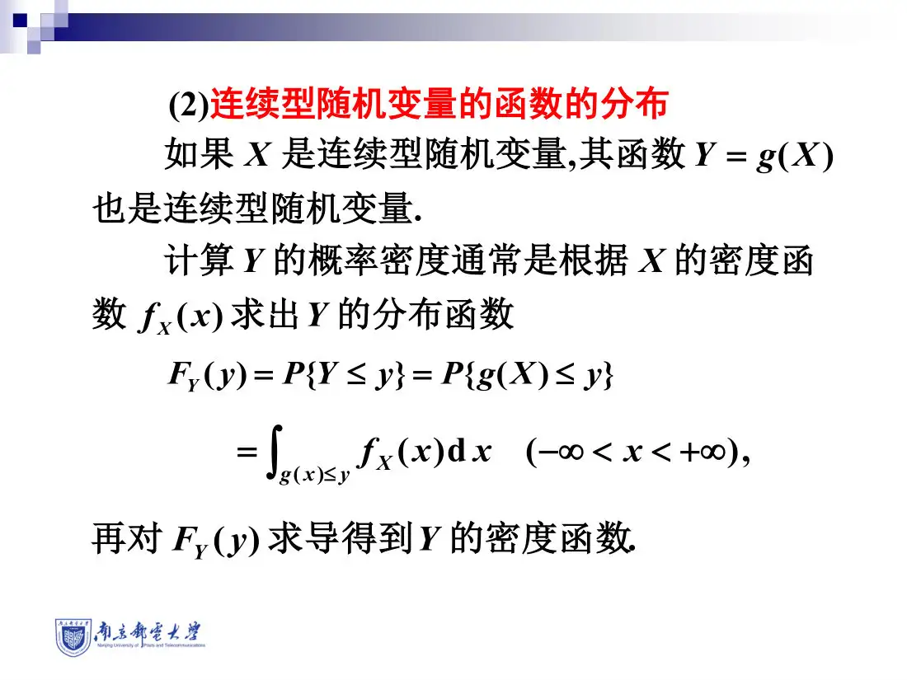

原文：

(2)连续型随机变量的函数的分布

如果 X 是连续型随机变量, 其函数 $Y = g(X)$ 也是连续型随机变量.

计算 $Y$ 的概率密度通常是根据 $X$ 的密度函数 $f_{X}(x)$ 求出 $Y$ 的分布函数

$$
\begin{array}{r l} & F _ {Y} (y) = P \{Y \leq y \} = P \{g (X) \leq y \} \\ & \qquad = \int_ {g (x) \leq y} f _ {X} (x) \mathrm{d} x \quad (- \infty <   x <   + \infty), \end{array}
$$

再对 $F_{Y}(y)$ 求导得到 Y 的密度函数.

南京邮电大学
Nanjing University of Posts and Telecommunications

### 定理

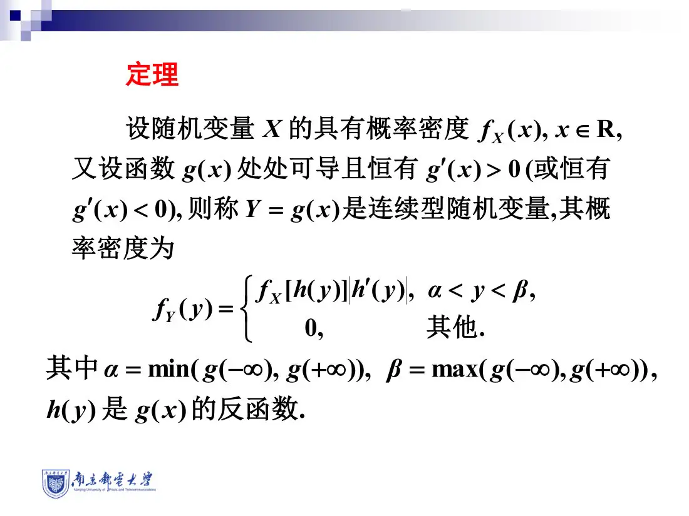

原文：

定理

设随机变量 X 的具有概率密度 $f_{X}(x)$ , $x \in R$ , 又设函数 $g(x)$ 处处可导且恒有 $g'(x) > 0$ (或恒有 $g'(x) < 0$ ), 则称 $Y = g(x)$ 是连续型随机变量, 其概率密度为

$$
f _ {Y} (y) = \left\{ \begin{array}{c l} f _ {X} [ h (y) ] \big | h ^ {\prime} (y) \big |, & \alpha <   y <   \beta , \\ 0, & \text {其他.} \end{array} \right.
$$

其中 $\alpha = \min(g(-\infty), g(+\infty))$ , $\beta = \max(g(-\infty), g(+\infty))$ , $h(y)$ 是 $g(x)$ 的反函数.

南京邮电大学
Nanjing University of Posts and Telecommunications

### 三、典型例题

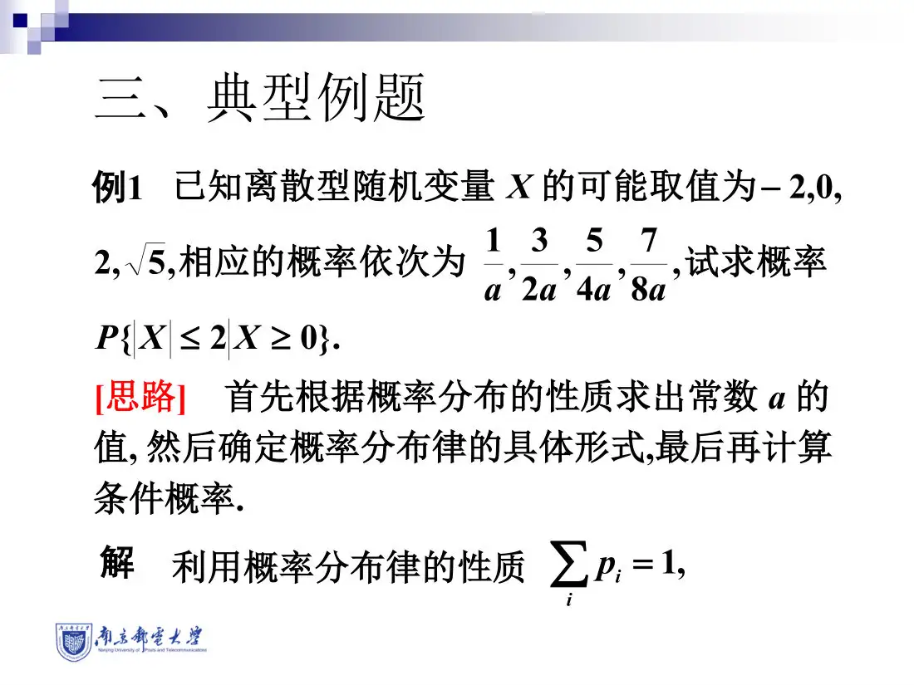

原文：

三、典型例题

例1 已知离散型随机变量 X 的可能取值为 -2,0,
2, $\sqrt{5}$ ,相应的概率依次为 $\frac{1}{a},\frac{3}{2a},\frac{5}{4a},\frac{7}{8a}$ ,试求概率 $P\{|X|\leq2|X\geq0\}$ .

[思路] 首先根据概率分布的性质求出常数 a 的值, 然后确定概率分布律的具体形式, 最后再计算条件概率.

解 利用概率分布律的性质 $\sum_{i}p_{i} = 1,$

### 因此 $X$ 的分布律为

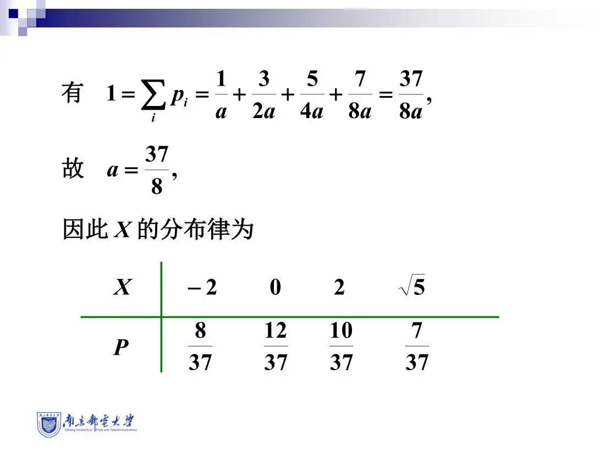

原文：

有 $1=\sum_{i}p_{i}=\frac{1}{a}+\frac{3}{2a}+\frac{5}{4a}+\frac{7}{8a}=\frac{37}{8a},$ 故 $a=\frac{37}{8}$ ,

因此 $X$ 的分布律为

<table><tr><td>X</td><td>-2</td><td>0</td><td>2</td><td> $\sqrt{5}$ </td></tr><tr><td>P</td><td> $\frac{8}{37}$ </td><td> $\frac{12}{37}$ </td><td> $\frac{10}{37}$ </td><td> $\frac{7}{37}$ </td></tr></table>

南京邮电大学
Nanjing University of Posts and Telecommunications

### 例2 设离散型随机变量 $X$ 的分布函数为

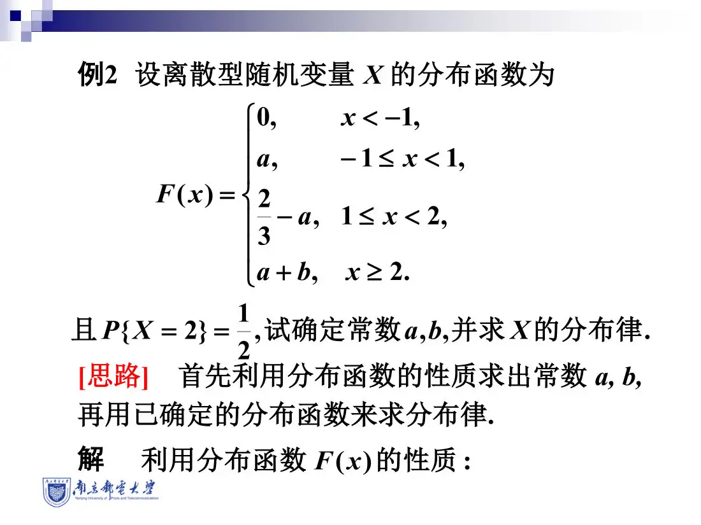

原文：

例2 设离散型随机变量 $X$ 的分布函数为

$$
F (x) = \left\{ \begin{array}{l l} 0, & x <   - 1, \\ a, & - 1 \leq x <   1, \\ \frac {2}{3} - a, & 1 \leq x <   2, \\ a + b, & x \geq 2. \end{array} \right.
$$

且 $P\{X = 2\} = \frac{1}{2}$ , 试确定常数 $a, b$ , 并求 $X$ 的分布律.

[思路] 首先利用分布函数的性质求出常数 a, b, 再用已确定的分布函数来求分布律.

解 利用分布函数 $F(x)$ 的性质：

南京邮电大学
Nanjing University of Posts and Telecommunications

### $$

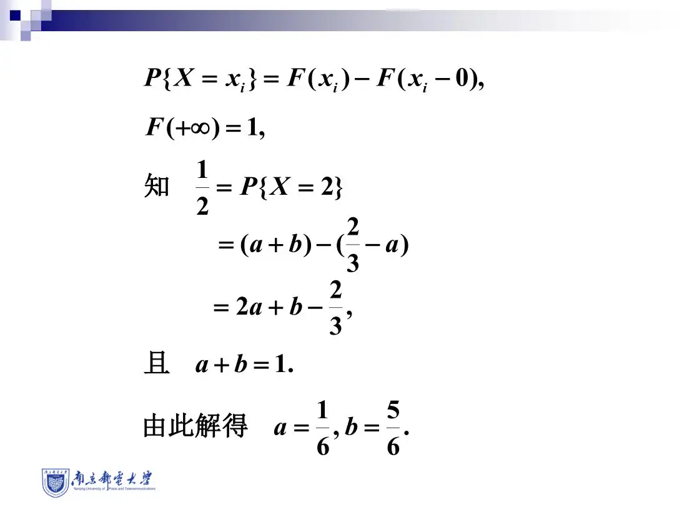

原文：

$$
P \{X = x _ {i} \} = F (x _ {i}) - F (x _ {i} - 0),
$$

$$
F (+ \infty) = 1,
$$

知 $\frac{1}{2} = P\{X = 2\}$ $= (a + b) - (\frac{2}{3} - a)$ $= 2a + b - \frac{2}{3},$

且 $a + b = 1.$

由此解得 $a=\frac{1}{6}, b=\frac{5}{6}.$

南京邮电大学
Nanjing University of Posts and Telecommunications

### 因此有

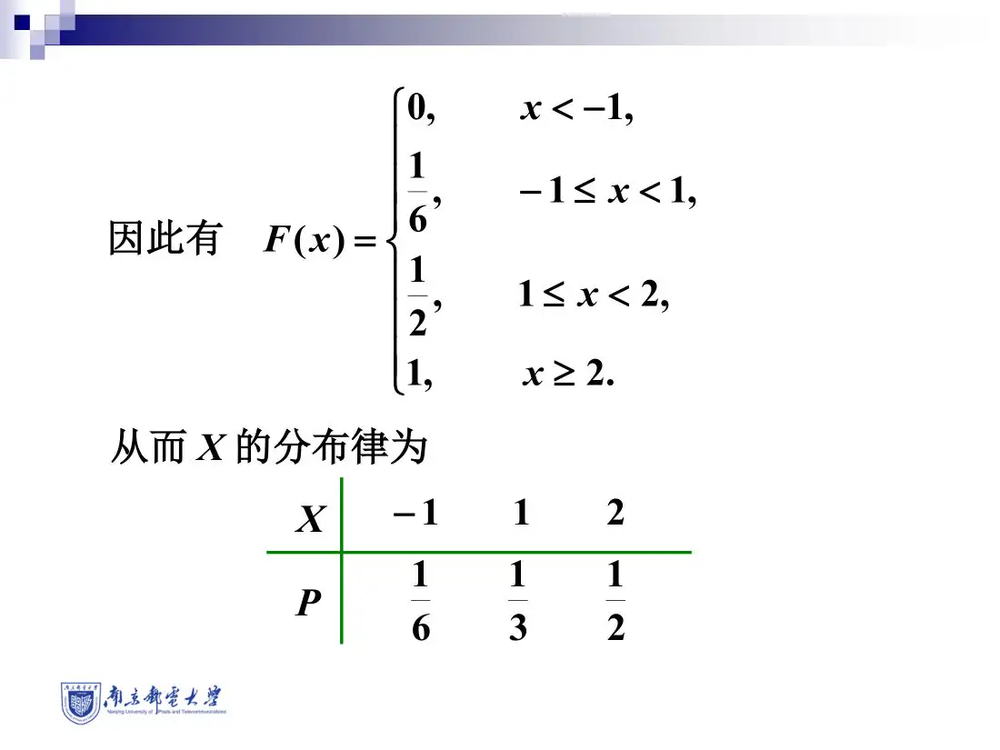

原文：

因此有

$$
F (x) = \left\{ \begin{array}{l l} 0, & x <   - 1, \\ \frac {1}{6}, & - 1 \leq x <   1, \\ \frac {1}{2}, & 1 \leq x <   2, \\ 1, & x \geq 2. \end{array} \right.
$$

从而 $X$ 的分布律为

$$
\begin{array}{c c c c} X & - 1 & 1 & 2 \\ \hline P & \frac {1}{6} & \frac {1}{3} & \frac {1}{2} \end{array}
$$

南京邮电大学
Nanjing University of Posts and Telecommunications

### 例3 已知随机变量 $X$ 的概率密度为

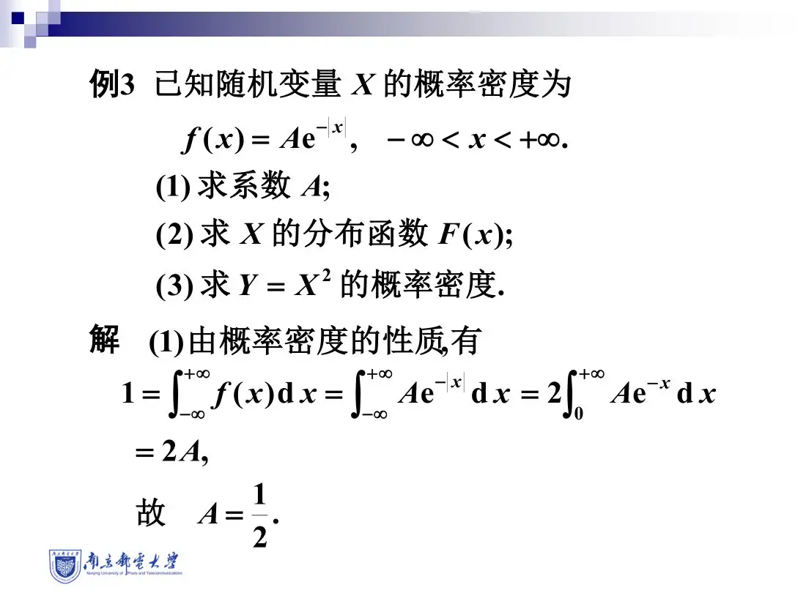

原文：

例3 已知随机变量 $X$ 的概率密度为

$$
f (x) = A \mathrm{e} ^ {- | x |}, - \infty <   x <   + \infty .
$$

(1) 求系数 A;

(2) 求 X 的分布函数 $F(x)$ ;

(3) 求 $Y = X^{2}$ 的概率密度.

解 (1)由概率密度的性质,有

$$
\begin{array}{l} 1 = \int_ {- \infty} ^ {+ \infty} f (x) \mathrm{d} x = \int_ {- \infty} ^ {+ \infty} A \mathrm{e} ^ {- | x |} \mathrm{d} x = 2 \int_ {0} ^ {+ \infty} A \mathrm{e} ^ {- x} \mathrm{d} x \\ = 2 A, \end{array}
$$

故 $A = \frac{1}{2}$ .

南京邮电大学
Nanjing University of Posts and Telecommunications

### 南京邮电大学

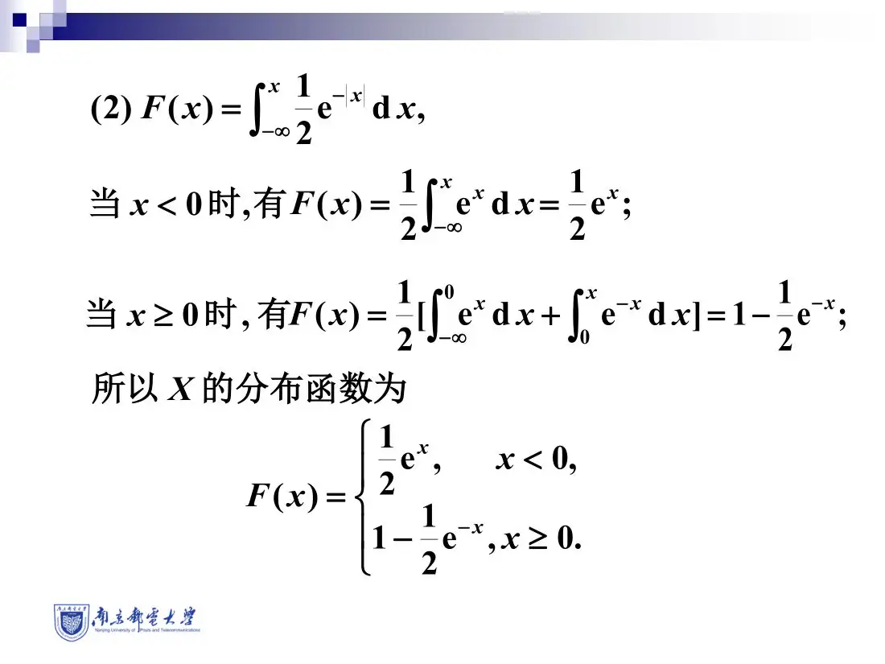

原文：

(2) $F(x)=\int_{-\infty}^{x}\frac{1}{2}\mathrm{e}^{-|x|}\mathrm{d}x,$ 当 x<0 时,有 $F(x)=\frac{1}{2}\int_{-\infty}^{x}\mathrm{e}^{x}\mathrm{d}x=\frac{1}{2}\mathrm{e}^{x};$ 当 $x \geq 0$ 时,有 $F(x)=\frac{1}{2}\left[\int_{-\infty}^{0}\mathrm{e}^{x}\mathrm{d}x+\int_{0}^{x}\mathrm{e}^{-x}\mathrm{d}x\right]=1-\frac{1}{2}\mathrm{e}^{-x};$ 所以 X 的分布函数为 $F(x)=\left\{\begin{aligned}&\frac{1}{2}\mathrm{e}^{x},&x<0,\\ &1-\frac{1}{2}\mathrm{e}^{-x},&x\geq0.\end{aligned}\right.$

南京邮电大学
Nanjing University of Posts and Telecommunications

### (3)由于 $Y = X^{2}\geq 0$

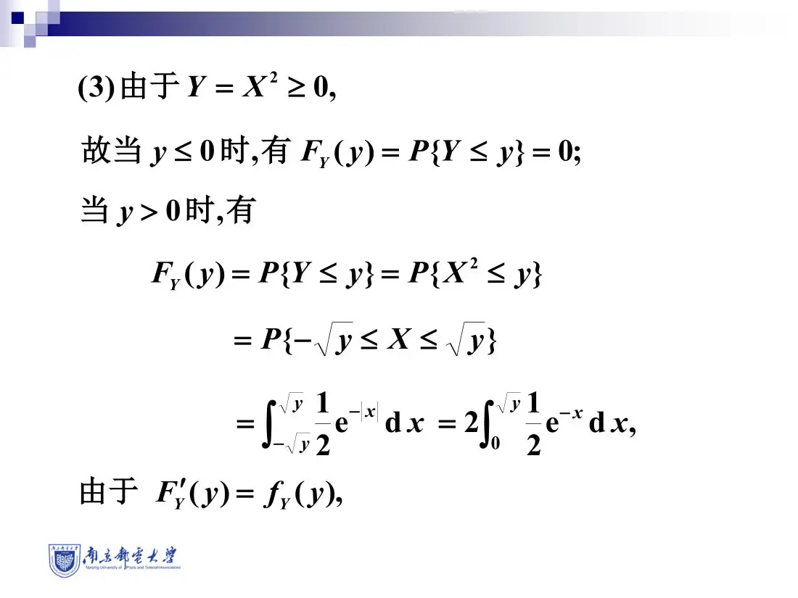

原文：

(3)由于 $Y = X^{2}\geq 0$

故当 $y \leq 0$ 时, 有 $F_{Y}(y) = P\{Y \leq y\} = 0$ ;

当 y > 0 时,有

$$
\begin{array}{r l} F _ {Y} (y) & = P \{Y \leq y \} = P \{X ^ {2} \leq y \} \\ & = P \{- \sqrt {y} \leq X \leq \sqrt {y} \} \\ & = \int_ {- \sqrt {y}} ^ {\sqrt {y}} \frac {1}{2} e ^ {- | x |} d x = 2 \int_ {0} ^ {\sqrt {y}} \frac {1}{2} e ^ {- x} d x, \end{array}
$$

由于 $F_{Y}^{\prime}(y)=f_{Y}(y)$ ,

南京邮电大学
Nanjing University of Posts and Telecommunications

### 故当 y > 0 时,有

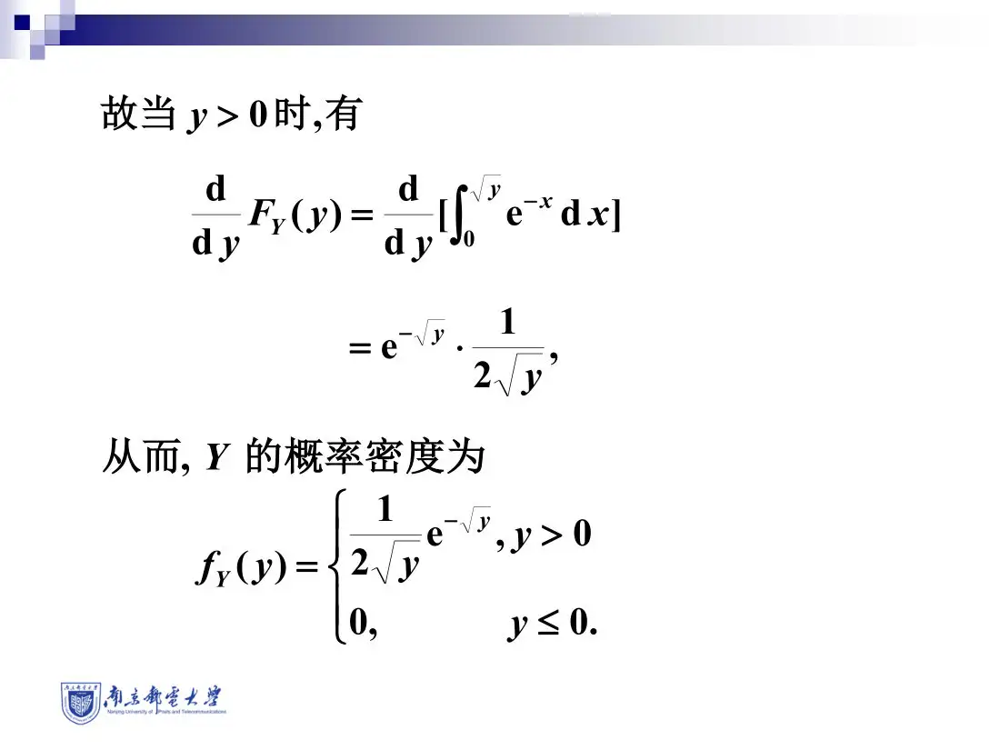

原文：

故当 y > 0 时,有

$$
\begin{array}{r l} \frac {\mathrm{d}}{\mathrm{d} y} F _ {Y} (y) & = \frac {\mathrm{d}}{\mathrm{d} y} [ \int_ {0} ^ {\sqrt {y}} \mathrm{e} ^ {- x} \mathrm{d} x ] \\ & = \mathrm{e} ^ {- \sqrt {y}} \cdot \frac {1}{2 \sqrt {y}}, \end{array}
$$

从而, Y 的概率密度为

$$
f _ {Y} (y) = \left\{ \begin{array}{l l} \frac {1}{2 \sqrt {y}} \mathrm{e} ^ {- \sqrt {y}}, y > 0 \\ 0, & y \leq 0. \end{array} \right.
$$

南京邮电大学
Nanjing University of Posts and Telecommunications

### (1)问应如何设计公共汽车车门的高度,使男子与车门顶碰头的几率小于0.01?

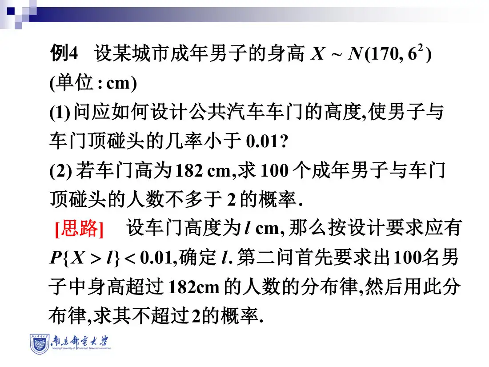

原文：

例4 设某城市成年男子的身高 $X \sim N(170, 6^{2})$ (单位:cm)

(1)问应如何设计公共汽车车门的高度,使男子与车门顶碰头的几率小于0.01?

(2) 若车门高为 182 cm, 求 100 个成年男子与车门顶碰头的人数不多于 2 的概率.

[思路] 设车门高度为 $l \mathrm{~cm}$ , 那么按设计要求应有 $P\{X > l\} < 0.01$ , 确定 $l$ . 第二问首先要求出 100 名男子中身高超过 $182 \mathrm{~cm}$ 的人数的分布律, 然后用此分布律, 求其不超过 2 的概率.

南京邮电大学
Nanjing University of Posts and Telecommunications

### 南京邮电大学

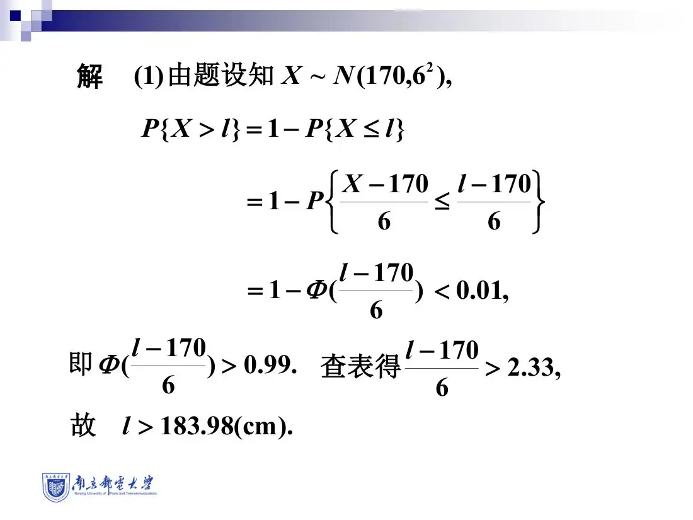

原文：

解 (1)由题设知 $X \sim N(170,6^2)$ , $P\{X > l\} = 1 - P\{X \leq l\}$ $= 1 - P\left\{\frac{X - 170}{6} \leq \frac{l - 170}{6}\right\}$ $= 1 - \Phi\left(\frac{l - 170}{6}\right) < 0.01,$ 即 $\Phi\left(\frac{l - 170}{6}\right) > 0.99.$ 查表得 $\frac{l - 170}{6} > 2.33,$ 故 $l > 183.98(\mathrm{cm})$

南京邮电大学
Nanjing University of Posts and Telecommunications

### (2) 设任一男子身高超过182cm的概率为 p.

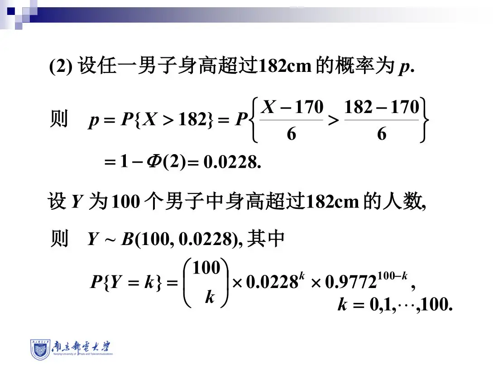

原文：

(2) 设任一男子身高超过182cm的概率为 p.

则 $p = P\{X > 182\} = P\left\{\frac{X - 170}{6} >\frac{182 - 170}{6}\right\}$ $= 1 - \varPhi (2) = 0.0228.$

设 Y 为100个男子中身高超过182cm的人数,

则 $Y \sim B(100, 0.0228)$ , 其中

$$
P \{Y = k \} = \binom {1 0 0} {k} \times 0. 0 2 2 8 ^ {k} \times 0. 9 7 7 2 ^ {1 0 0 - k},   k = 0, 1, \dots , 1 0 0.
$$

南京邮电大学
Nanjing University of Posts and Telecommunications

### 所求概率为

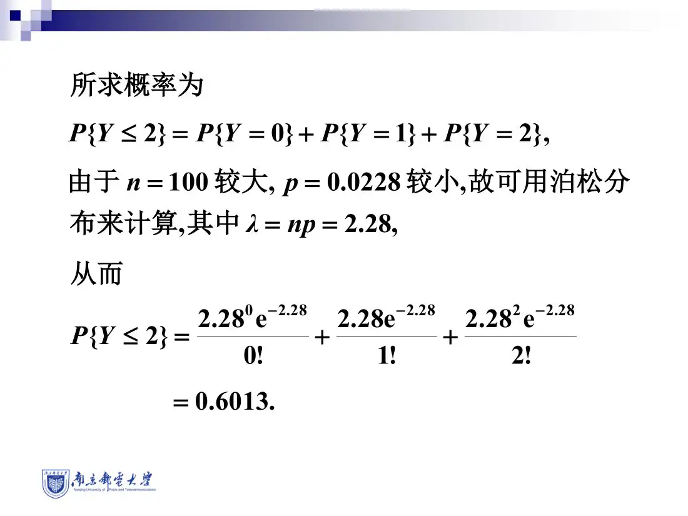

原文：

所求概率为

$$
P \{Y \leq 2 \} = P \{Y = 0 \} + P \{Y = 1 \} + P \{Y = 2 \},
$$

由于 n=100 较大, p=0.0228 较小, 故可用泊松分布来计算, 其中 $\lambda=np=2.28$ ,

从而

$$
\begin{array}{r l} P \{Y \leq 2 \} & = \frac {2 . 2 8 ^ {0} \mathrm{e} ^ {- 2 . 2 8}}{0 !} + \frac {2 . 2 8 \mathrm{e} ^ {- 2 . 2 8}}{1 !} + \frac {2 . 2 8 ^ {2} \mathrm{e} ^ {- 2 . 2 8}}{2 !} \\ & = 0. 6 0 1 3. \end{array}
$$

南京邮电大学
Nanjing University of Posts and Telecommunications

### $$

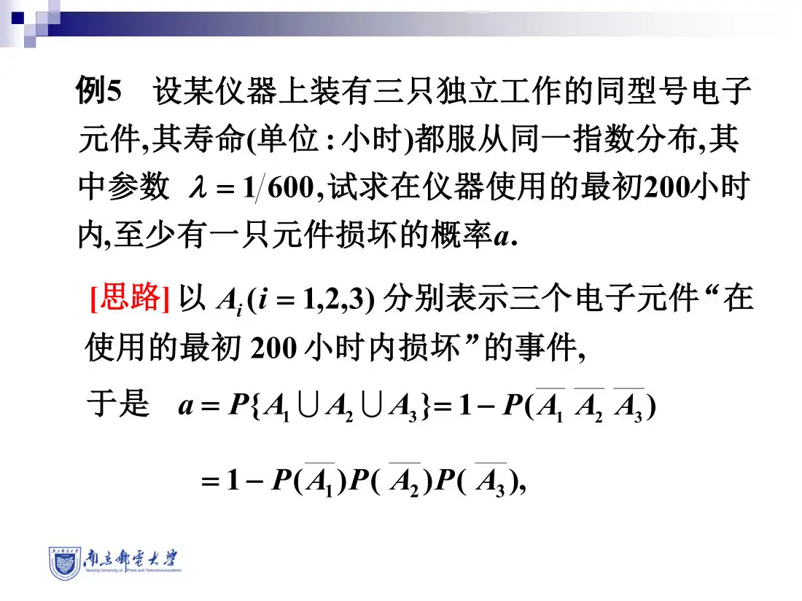

原文：

例5 设某仪器上装有三只独立工作的同型号电子元件,其寿命(单位:小时)都服从同一指数分布,其中参数 $\lambda = 1/600$ ,试求在仪器使用的最初200小时内,至少有一只元件损坏的概率a.

[思路] 以 $A_{i}(i = 1,2,3)$ 分别表示三个电子元件“在使用的最初200小时内损坏”的事件，

于是 $a = P\{A_1 \cup A_2 \cup A_3\} = 1 - P(\overline{A_1} \overline{A_2} \overline{A_3})$

$$
= 1 - P \left(\overline {{A _ {1}}}\right) P \left(\overline {{A _ {2}}}\right) P \left(\overline {{A _ {3}}}\right),
$$

南京邮电大学
Nanjing University of Posts and Telecommunications

### 由三个电子元件服从同一分布,

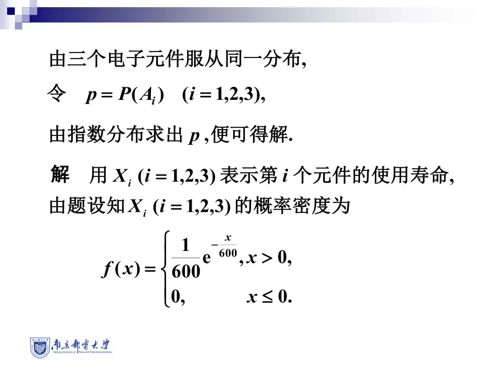

原文：

由三个电子元件服从同一分布,

令 $p = P(A_{i})$ $(i = 1,2,3),$

由指数分布求出 p, 便可得解.

解 用 $X_{i}(i = 1,2,3)$ 表示第 $i$ 个元件的使用寿命，由题设知 $X_{i}(i = 1,2,3)$ 的概率密度为

$$
f (x) = \left\{ \begin{array}{l l} \frac {1}{6 0 0} \mathrm{e} ^ {- \frac {x}{6 0 0}}, & x > 0, \\ 0, & x \leq 0. \end{array} \right.
$$

南京邮电大学
Nanjing University of Posts and Telecommunications

### 从而

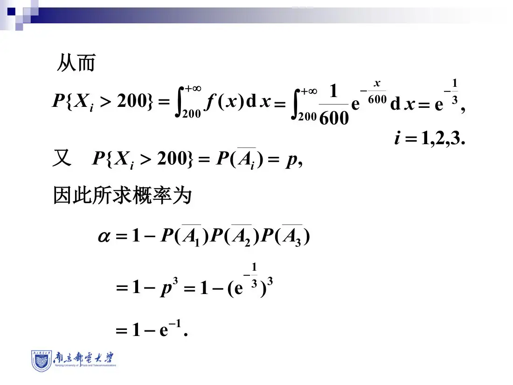

原文：

从而

$$
P \{X _ {i} > 2 0 0 \} = \int_ {2 0 0} ^ {+ \infty} f (x) d x = \int_ {2 0 0} ^ {+ \infty} \frac {1}{6 0 0} e ^ {- \frac {x}{6 0 0}} d x = e ^ {- \frac {1}{3}},
$$

$$
i = 1, 2, 3.
$$

又 $P\{X_{i} > 200\} = P(\overline{A_{i}}) = p,$

因此所求概率为

$$
\begin{array}{r l} \alpha & = 1 - P (\overline {{A _ {1}}}) P (\overline {{A _ {2}}}) P (\overline {{A _ {3}}}) \\ & = 1 - p ^ {3} = 1 - (e ^ {- \frac {1}{3}}) ^ {3} \\ & = 1 - e ^ {- 1}. \end{array}
$$

南京邮电大学
Nanjing University of Posts and Telecommunications

### 例6 设随机变量 $X$ 的密度函数为 $f(x)$

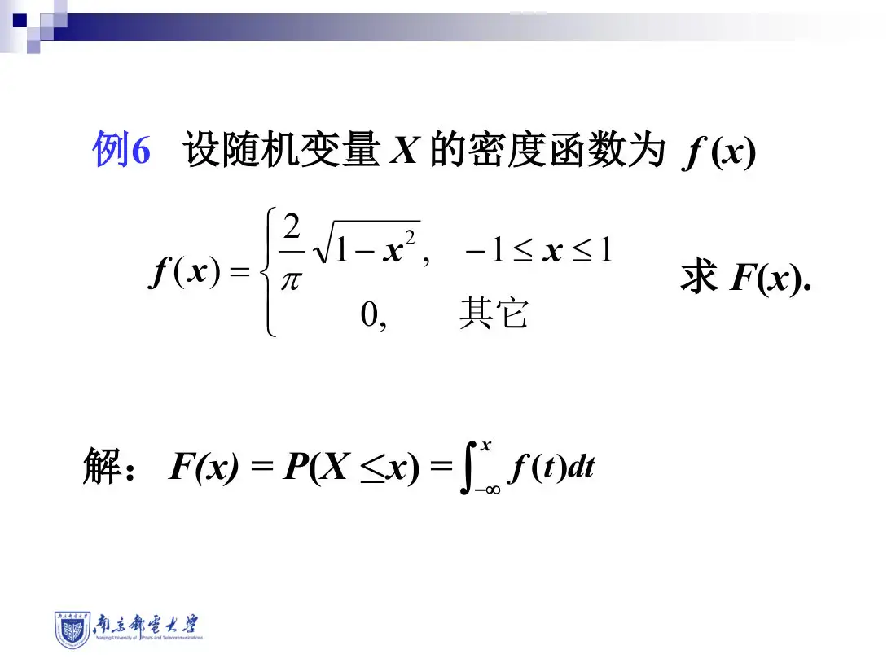

原文：

例6 设随机变量 $X$ 的密度函数为 $f(x)$

$$
f (x) = \left\{ \begin{array}{c c} \frac {2}{\pi} \sqrt {1 - x ^ {2}}, & - 1 \leq x \leq 1 \\ 0, & \text {其它} \end{array} \right.
$$

解： $F(x) = P(X\leq x) = \int_{-\infty}^{x}f(t)dt$

求 $F(x)$

南京邮电大学
Nanjing University of Posts and Telecommunications

### $$

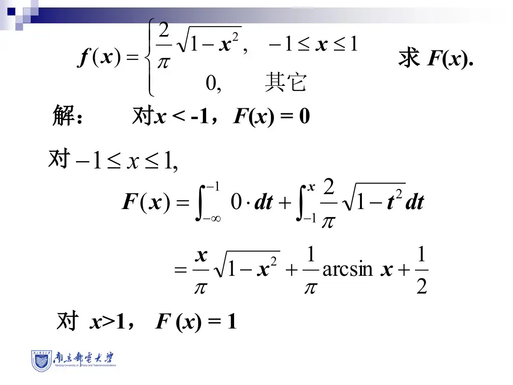

原文：

$$
\boldsymbol {f} (\boldsymbol {x}) = \left\{ \begin{array}{c c} \frac {2}{\pi} \sqrt {1 - \boldsymbol {x} ^ {2}}, & - 1 \leq \boldsymbol {x} \leq 1 \\ 0, & \text {其它} \end{array} \right.
$$

求 $F(x)$

解：对 $x < -1$ ， $F(x) = 0$

对 $-1 \leq x \leq 1,$

$$
\begin{array}{r l} & F (x) = \int_ {- \infty} ^ {- 1} 0 \cdot d t + \int_ {- 1} ^ {x} \frac {2}{\pi} \sqrt {1 - t ^ {2}} d t \\ & = \frac {x}{\pi} \sqrt {1 - x ^ {2}} + \frac {1}{\pi} \arcsin x + \frac {1}{2} \end{array}
$$

对 $x > 1$ ， $F(x) = 1$

南京邮电大学
Nanjing University of Posts and Telecommunications

### $$

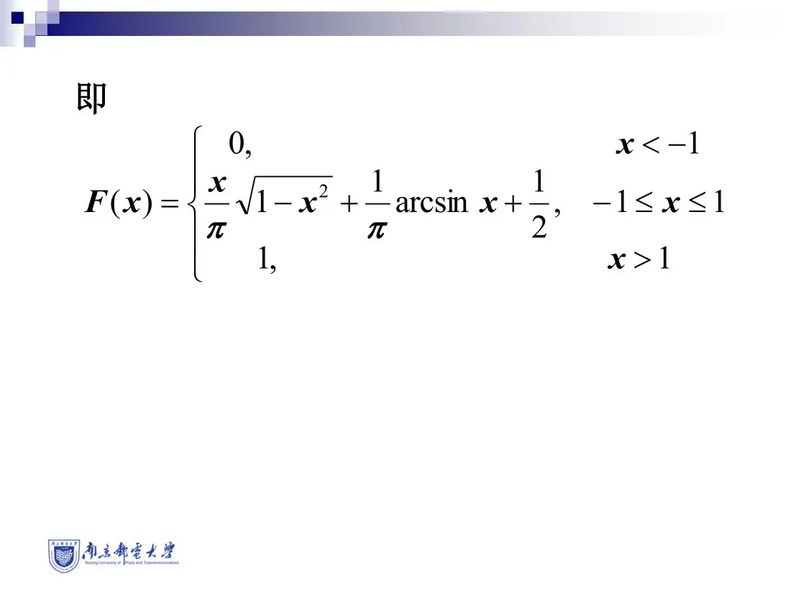

原文：

即

$$
F (x) = \left\{ \begin{array}{c c} 0, & x <   - 1 \\ \frac {x}{\pi} \sqrt {1 - x ^ {2}} + \frac {1}{\pi} \arcsin x + \frac {1}{2}, & - 1 \leq x \leq 1 \\ 1, & x > 1 \end{array} \right.
$$

南京邮电大学
Nanjing University of Posts and Telecommunications

### 一．填空题：

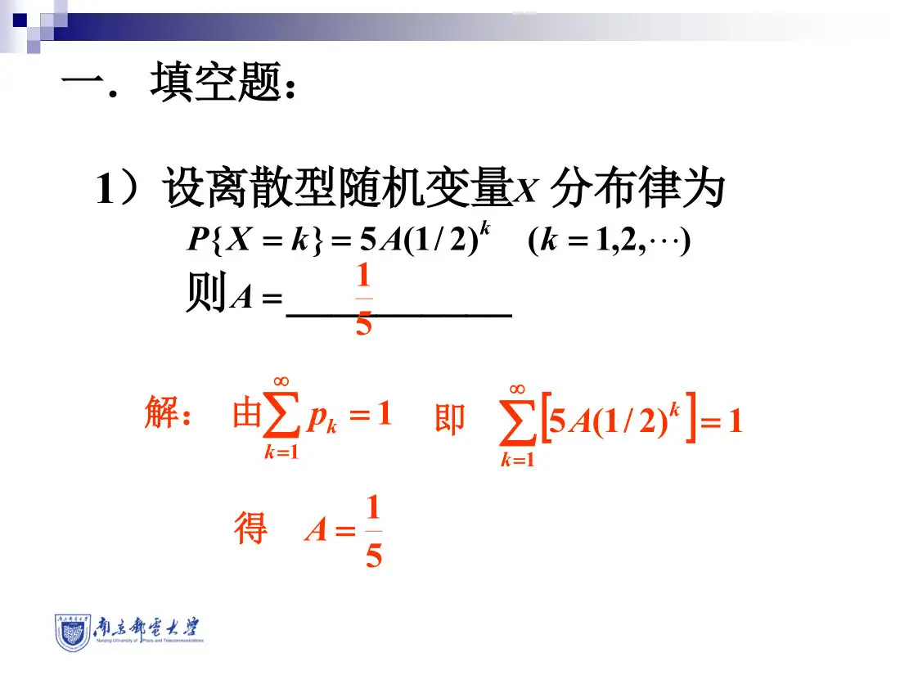

原文：

一．填空题：

1）设离散型随机变量x分布律为

$$
P \{X = k \} = 5 A (1 / 2) ^ {k} \quad (k = 1, 2, \dots)
$$

则 $A = \frac{1}{5}$

解：由 $\sum_{k = 1}^{\infty}p_k = 1$ 即 $\sum_{k = 1}^{\infty}\left[5A(1 / 2)^k\right] = 1$

得 $A = \frac{1}{5}$

南京邮电大学
Nanjing University of Posts and Telecommunications

### 解得： $a=1,\quad b=\frac{1}{2}$

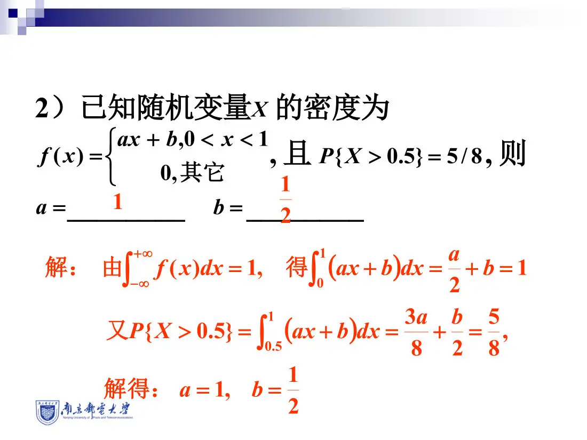

原文：

2）已知随机变量x的密度为 $f(x)=\left\{\begin{aligned}ax+b,0<x<1\\ 0,\text{其它}\end{aligned}\right.$ ，且 $P\{X>0.5\}=5/8$ ，则 $a=\frac{1}{2}$ 解：由 $\int_{-\infty}^{+\infty}f(x)dx=1$ ，得 $\int_{0}^{1}(ax+b)dx=\frac{a}{2}+b=1$ 又 $P\{X>0.5\}=\int_{0.5}^{1}(ax+b)dx=\frac{3a}{8}+\frac{b}{2}=\frac{5}{8}$ ,
解得： $a=1,\quad b=\frac{1}{2}$

### 南京邮电大学

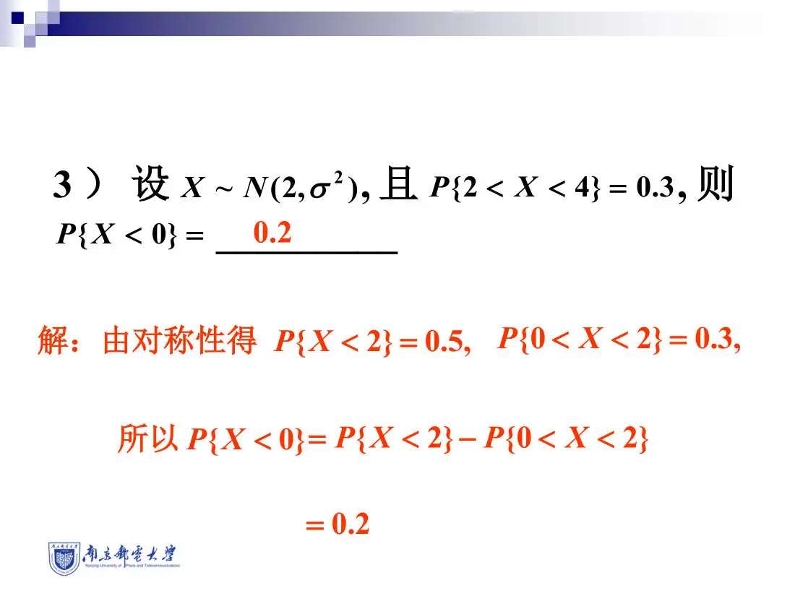

原文：

3）设 $X \sim N(2, \sigma^{2})$ ，且 $P\{2 < X < 4\} = 0.3$ ，则 $P\{X<0\}=\underline{0.2}$

解：由对称性得 $P\{X < 2\} = 0.5,\quad P\{0 < X < 2\} = 0.3,$

所以 $P\{X < 0\} = P\{X < 2\} - P\{0 < X < 2\}$

南京邮电大学
Nanjing University of Posts and Telecommunications

### 二、选择题：

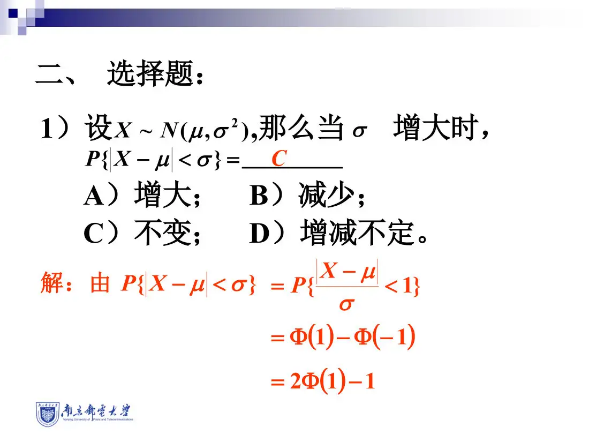

原文：

二、选择题：

1）设 $X \sim N(\mu, \sigma^{2})$ ，那么当 $\sigma$ 增大时， $P\{|X-\mu|<\sigma\}=\underline{C}$ A）增大； B）减少；
C）不变； D）增减不定。

解：由 $P\{|X - \mu| < \sigma\} = P\{\frac{|X - \mu|}{\sigma} < 1\}$ $= \Phi(1) - \Phi(-1)$ $= 2\Phi(1) - 1$

南京邮电大学
Nanjing University of Posts and Telecommunications

### 解：由对称性得 $F(0)=P\{X \leq 0\}=0.5,$

原文：

2) 设 $X$ 的密度函数为 $f(x)$ , 分布函数为 $F(x)$ , 且 $f(x) = f(-x)$ , 那么对任意给定的 $a$ 都有 $\underline{B}$ A) $f(-a) = 1 - \int_{0}^{a} f(x) dx$ ;

B) $F(-a) = \frac{1}{2} - \int_{0}^{a} f(x) dx$ ;

C) $F(a) = F(-a)$ ; D) $F(-a) = 2F(a) - 1$

解：由对称性得 $F(0)=P\{X \leq 0\}=0.5,$

$$
\begin{array}{r l} \therefore F (- a) & = P \{X \leq - a \} = \int_ {- \infty} ^ {- a} f (x) d x = \int_ {a} ^ {+ \infty} f (x) d x \\ & = \frac {1}{2} - \int_ {0} ^ {a} f (x) d x \end{array}
$$

### 3）下列函数中，可作为某一随机变量的分布函数是 B

原文：

3）下列函数中，可作为某一随机变量的分布函数是 B
A) $F(x)=1+\frac{1}{x^{2}}$ B) $F(x)=\frac{1}{2}+\frac{1}{\pi}\arctan x$ C) $F(x)=\left\{\begin{aligned}&0.5(1-e^{-x}),&x>0\\ &0,&x\leq0\end{aligned}\right.$ D) $F(x)=\int_{-\infty}^{x}f(t)dt$ ，其中 $\int_{-\infty}^{+\infty}f(t)dt=1$ 解：由 $F(x)$ 的性质 $0 \leq F(x) \leq 1$ $F(x)$ 不减 $F(-\infty)=0$ $F(+\infty)=1$ $F(x)$ 右连续
以及 $f(x)\geq0$ 得 B 正确

### 三、解答题

原文：

三、解答题

1）从一批有10个合格品与3个次品的产品中一件一件地抽取产品，各种产品被抽到的可能性相同，求在二种情况下，直到取出合格品为止，所需抽取次数的分布率。

(1) 放回 (2) 不放回

解: (1) 放回: 设抽取次数为随机变量 $X$ ,

则 X 的所有可能取值为: $X = 1, 2, \cdots$

分布律为： $P\{X=k\}=\left(\frac{3}{13}\right)^{k-1}\frac{10}{13}\quad k=1,2,\cdots$ 解：(2)不放回：设抽取次数为随机变量 X，
则 X 的所有可能取值为 X = 1, 2, 3, 4
分布律为： $P\{X=1\}=\frac{10}{13}$ ， $P\{X=2\}=\frac{3}{13}\times\frac{10}{12}=\frac{5}{26}$ $P\{X=3\}=\frac{3}{13}\times\frac{2}{12}\times\frac{10}{11}=\frac{5}{143}$ $P\{X=4\}=\frac{3}{13}\times\frac{2}{12}\times\frac{1}{11}\times\frac{10}{10}=\frac{1}{286}$

南京邮电大学
Nanjing University of Posts and Telecommunications

### 南京邮电大学

原文：

南京邮电大学
Nanjing University of Posts and Telecommunications

### 南京邮电大学

原文：

2）设随机变量 $X$ 的密度函数为 $f(x) = Ae^{-|x|}$ $(- \infty < x < +\infty)$ ，求（1）系数 $A$ ；（2） $P\{0 \leq X \leq 1\}$ ；（3）分布函数 $F(x)$ .

解：(1)由 $\int_{-\infty}^{+\infty}f(x)dx = \int_{-\infty}^{+\infty}Ae^{-|x|}dx$ $= 2\int_0^{+\infty}Ae^{-x}dx = 2A = 1$ 得： $A = \frac{1}{2}$ (2) $P\{0\leq X\leq 1\} = \frac{1}{2}\int_0^1 e^{-x}dx = \frac{1}{2}\left(1 - \frac{1}{e}\right)$

南京邮电大学
Nanjing University of Posts and Telecommunications

### 2）设随机变量 $X$ 的密度函数为

原文：

2）设随机变量 $X$ 的密度函数为

$$
f (x) = A e ^ {- | x |} \quad (- \infty <   x <   + \infty),
$$

求：(1)系数A；(2) $P\{0 \leq X \leq 1\}$ ; (3)分布函数 $F(x)$ .

解：(3) $F(x) = P\{X \leq x\}$

$$
= \left\{ \begin{array}{l l} \frac {1}{2} \int_ {- \infty} ^ {x} e ^ {t} d t, & x <   0 \\ \frac {1}{2} \int_ {- \infty} ^ {0} e ^ {t} d t + \frac {1}{2} \int_ {0} ^ {x} e ^ {- t} d t, & x \geq 0 \end{array} = \left\{ \begin{array}{l l} \frac {1}{2} e ^ {x}, & x <   0 \\ 1 - \frac {1}{2} e ^ {x}, & x \geq 0 \end{array} \right. \right.
$$

南京邮电大学
Nanjing University of Posts and Telecommunications

### 3）对球的直径作测量，设其值均匀地分布在[a,b]内。求体积的密度函数。

原文：

3）对球的直径作测量，设其值均匀地分布在[a,b]内。求体积的密度函数。

解：(3) 直径X的密度函数为 $f(x)=\left\{\begin{aligned}&\frac{1}{b-a},&a<x<b\\ &0,& 其它\end{aligned}\right.$ 体积 $Y=\frac{\pi}{6}X^{3}$ $F_{Y}(y)=P\{Y\leq y\}=P\left\{\frac{\pi}{6}X^{3}\leq y\right\}=P\left\{X\leq\sqrt[3]{\frac{6y}{\pi}}\right\}$ $=\int_{-\infty}^{\sqrt[3]{6y}/\pi}f(x)dx$

南京邮电大学
Nanjing University of Posts and Telecommunications

### $$

原文：

$$
F _ {Y} (y) = \left\{ \begin{array}{l l} 0, & y <   \frac {\pi}{6} a ^ {3} \\ \int_ {a} ^ {\sqrt [ 3 ]{6 y / \pi}} \frac {1}{b - a} d x, & \frac {\pi}{6} a ^ {3} \leq y <   \frac {\pi}{6} b ^ {3} \\ 1, & y \geq \frac {\pi}{6} b ^ {3} \end{array} \right.
$$

$$
\begin{array}{r l} f _ {Y} (y) & = F _ {Y} ^ {\prime} (y) \neq \left\{ \begin{array}{l l} \left(\sqrt [ 3 ]{6 y / \pi}\right) ^ {\prime} \frac {1}{b - a}, & \frac {\pi}{6} a ^ {3} <   y <   \frac {\pi}{6} b ^ {3} \\ 0, & \text {其它} \end{array} \right. \\ & = \left\{ \begin{array}{l l} \frac {2}{\pi (b - a)} \left(\frac {6 y}{\pi}\right) ^ {- \frac {2}{3}}, & \frac {\pi}{6} a ^ {3} <   y <   \frac {\pi}{6} b ^ {3} \\ 0, & \text {其它} \end{array} \right. \end{array}
$$

南京邮电大学
Nanjing University of Posts and Telecommunications

### 解: (4) 设需要 $N$ 次, 由 $X \sim b(N, 0.5)$

原文：

4）设在独立重复实验中，每次实验成功概率为0.5，问需要进行多少次实验，才能使至少成功一次的概率不小于0.9

解: (4) 设需要 $N$ 次, 由 $X \sim b(N, 0.5)$

至少成功一次概率： $P\{X \geq 1\} = 1 - P\{X < 1\}$

$$
= 1 - P \{X = 0 \} = 1 - 0. 5 ^ {N} \geq 0. 9
$$

得N≥4
南京邮电大学
Nanjing University of Posts and Telecommunications

### 四、证明题

原文：

四、证明题

设随即变量 $X$ 的参数为 $\mathfrak{p}$ 的指数分布，

证明： $Y = 1 - e^{-2X}$ 在区间(0,1)上服从均匀分布。

证明： $X$ 的概率密度为 $f(x) = \left\{ \begin{array}{ll}2e^{-2x}, & x > 0\\ 0, & \text{其它} \end{array} \right.$

$$
\begin{array}{r l} & F _ {Y} (y) = P \{Y \leq y \} = P \left\{1 - e ^ {- 2 X} \leq y \right\} \\ & = \left\{ \begin{array}{l l} 0, & y <   0 \\ P \left\{X \geq - \frac {\ln (1 - y)}{2} \right\}, & 0 \leq y <   1 \\ 1, & y \geq 1 \end{array} \right. \end{array}
$$

南京邮电大学
Nanjing University of Posts and Telecommunications

### $$

原文：

$$
F _ {Y} (y) = \left\{ \begin{array}{l l} 0, & y <   0 \\ \int_ {- \frac {\ln (1 - y)}{2}} ^ {+ \infty} 2 e ^ {- 2 x} d x, & 0 \leq y <   1 \\ 1, & y \geq 1 \end{array} \right.
$$

$$
\begin{array}{r l} f _ {Y} (y) = F _ {Y} ^ {\prime} (y) & = \left\{ \begin{array}{l l} - \left(- \frac {\ln (1 - y)}{2}\right) ^ {\prime} 2 e ^ {- 2 \left(- \frac {\ln (1 - y)}{2}\right)}, & 0 <   y <   1 \\ 0, & \text {其它} \end{array} \right. \\ & = \left\{ \begin{array}{l l} 1, & 0 <   y <   1 \\ 0, & \text {其它} \end{array} \right. \end{array}
$$

南京邮电大学
Nanjing University of Posts and Telecommunications
