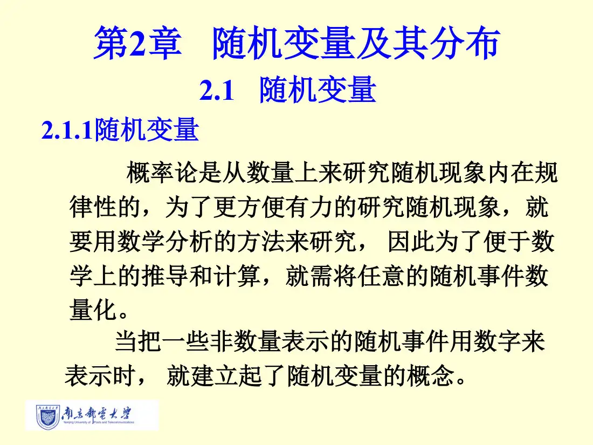
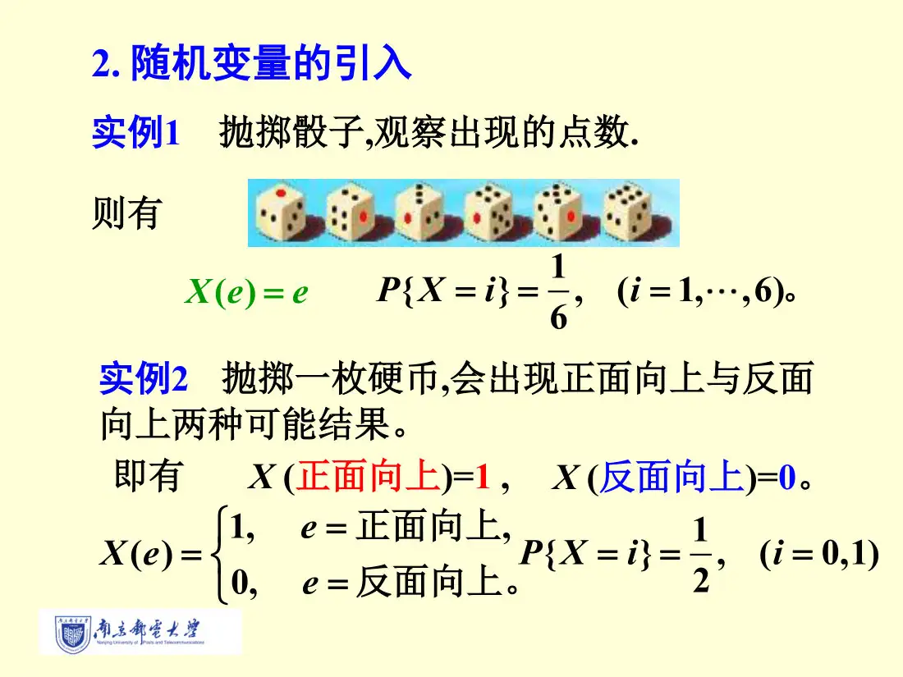
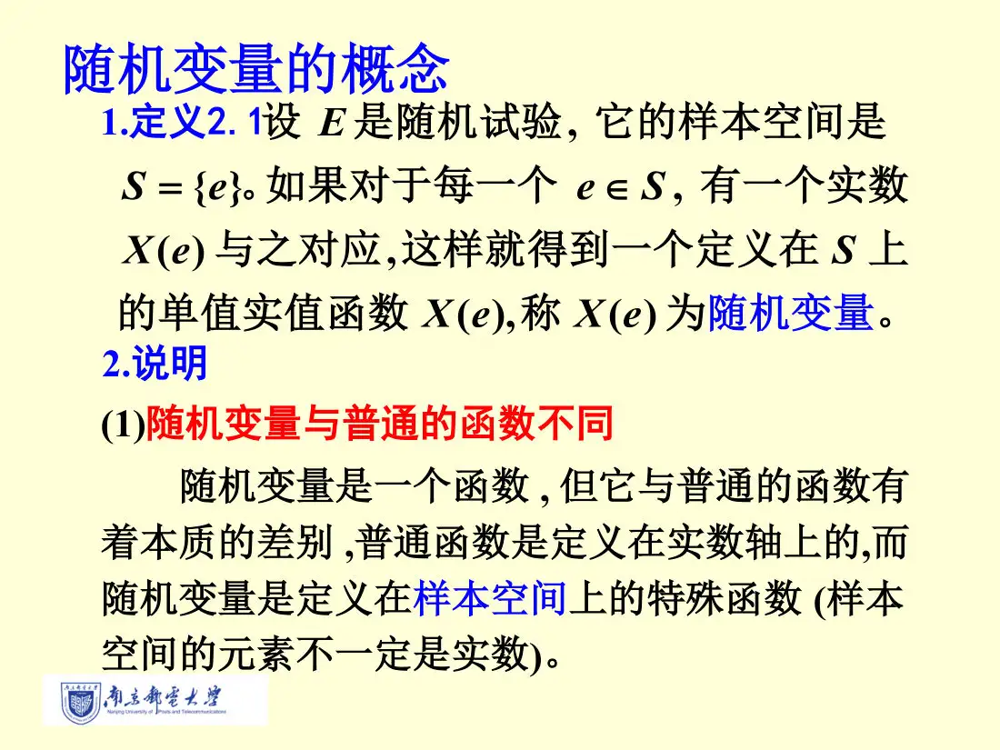
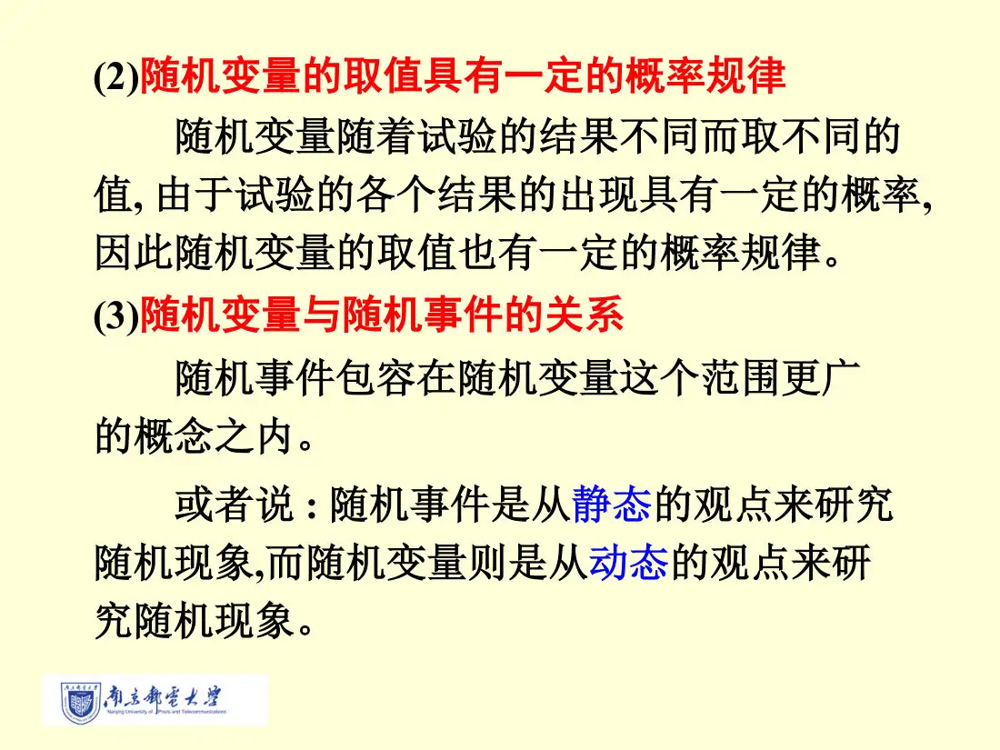
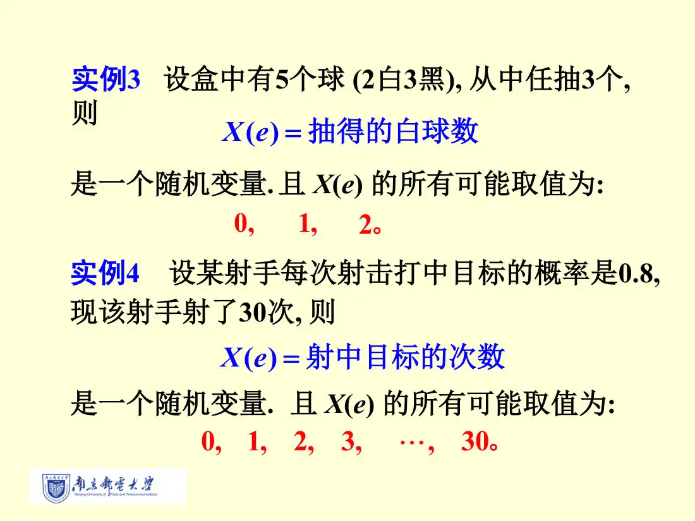
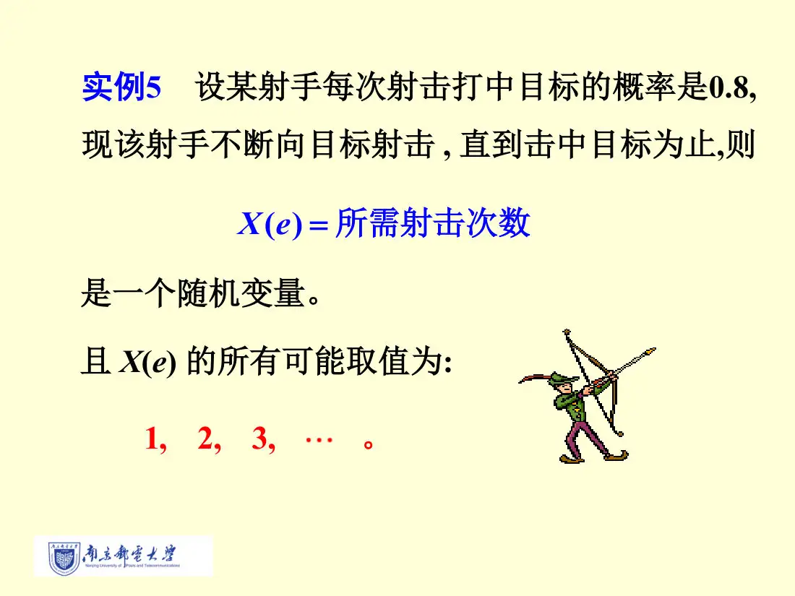
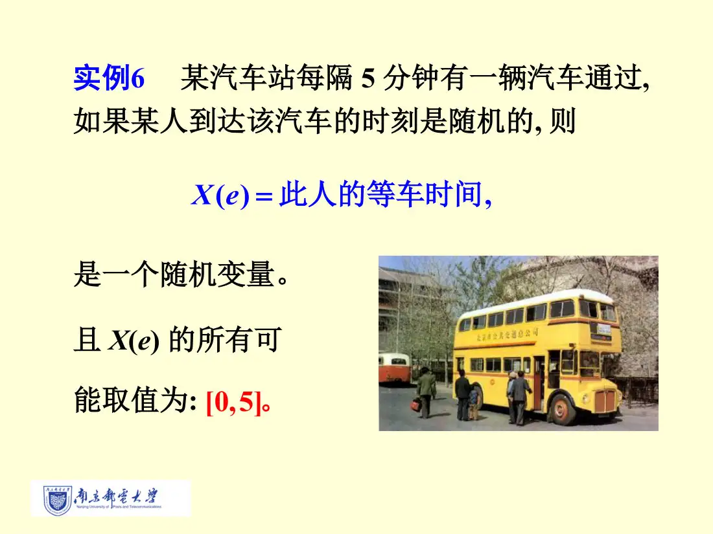
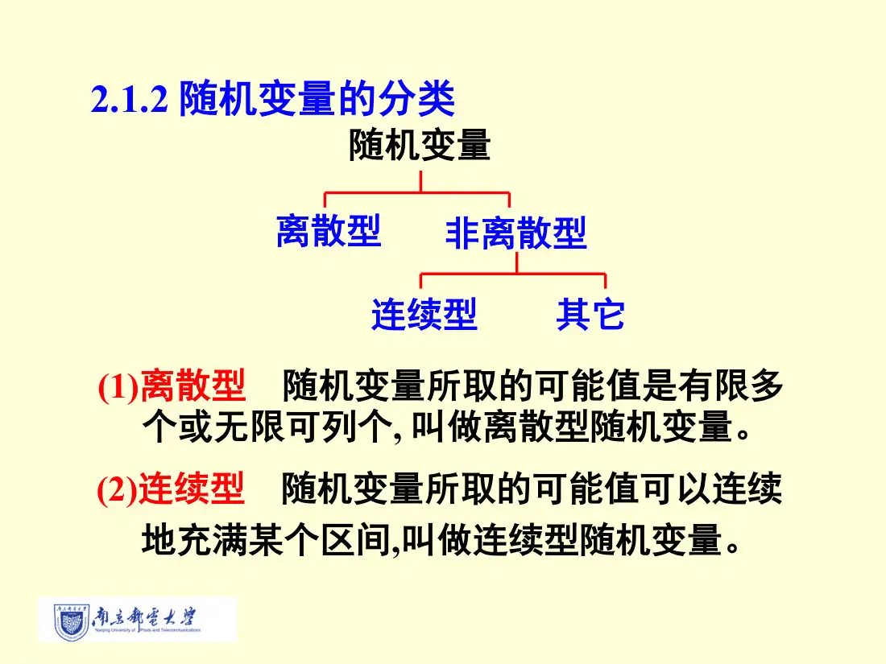
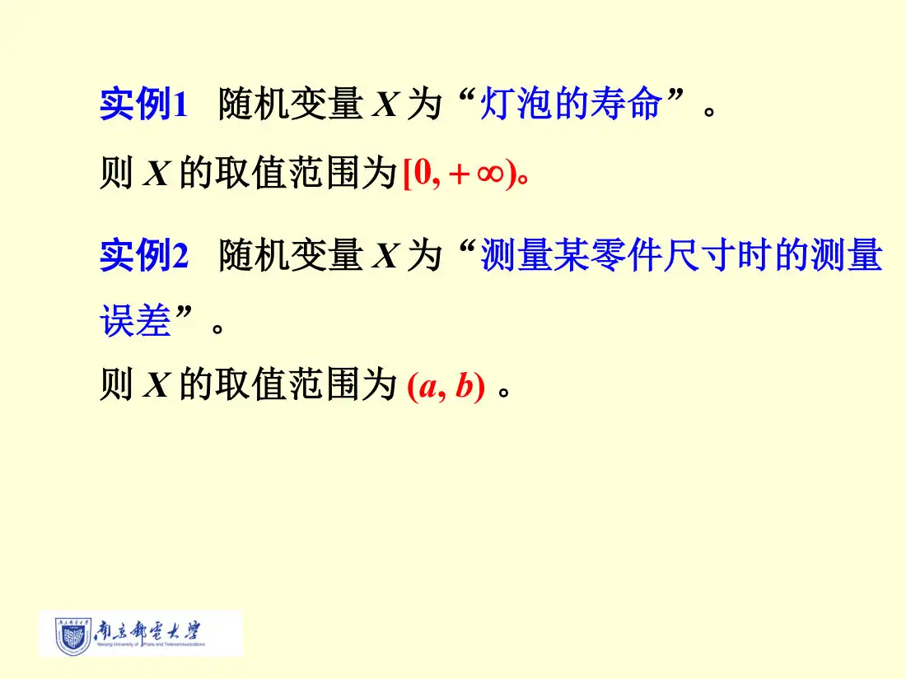

# 《概率论与数理统计》第2章 随机变量及其分布（课件）

原件的每一页，下面附识别出的文字。

### 第2章 随机变量及其分布

原文：

第2章 随机变量及其分布

2.1 随机变量

2.1.1随机变量

概率论是从数量上来研究随机现象内在规律性的，为了更方便有力的研究随机现象，就要用数学分析的方法来研究，因此为了便于数学上的推导和计算，就需将任意的随机事件数量化。

当把一些非数量表示的随机事件用数字来表示时，就建立起了随机变量的概念。

南立歌生大学 南京郵電大學 Nanjing University ofPosts and Telecommunication

### 2. 随机变量的引入

原文：

2. 随机变量的引入

实例1 抛掷骰子,观察出现的点数.

则有

$$
X (e) = e \quad P \{X = i \} = \frac {1}{6}, (i = 1, \dots , 6) 。
$$

实例2 抛掷一枚硬币,会出现正面向上与反面向上两种可能结果。

即有 X (正面向 $\mathrm { \underline { { ~ E ~ } } } ) { = } 1$ , X (反面向 $\underline { { \mathbf { \Pi } } } ( \mathbf { \partial } \mathbf { \hat { \Pi } } ) { = } \mathbf { 0 }$ 。

$X ( e ) = \left\{ { \begin{array} { l l } { 1 , } & { e = { \overline { { \mathrm { I E } } } } { \overline { { \mathbb { H } } } } \left| { \check { \Xi } } \right| } \\ { 0 , } & { e = { \overline { { \mathrm { I C } } } } { \overline { { \mathbb { H } } } } \left| { \check { \Xi } } \right| } \end{array} } \right.$ $P \{ X = i \} = \frac { 1 } { 2 } , ~ ( i = 0 , 1 )$

南京郵電大學

### 随机变量的概念

原文：

随机变量的概念

1.定义2.1设E是随机试验，它的样本空间是$S = \{ e \} \circ$ 如果对于每一个 $e \in S$ ，有一个实数X(e)与之对应,这样就得到一个定义在S上的单值实值函数 $X ( e )$ ,称 $X ( e )$ 为随机变量。

2.说明

(1)随机变量与普通的函数不同

随机变量是一个函数 , 但它与普通的函数有着本质的差别 ,普通函数是定义在实数轴上的,而随机变量是定义在样本空间上的特殊函数 (样本空间的元素不一定是实数)。

南立歌生大学 南京郵電大学 Nanjing University ofPosts and Telecommunication

### (2)随机变量的取值具有一定的概率规律

原文：

(2)随机变量的取值具有一定的概率规律

随机变量随着试验的结果不同而取不同的值, 由于试验的各个结果的出现具有一定的概率,因此随机变量的取值也有一定的概率规律。

(3)随机变量与随机事件的关系

随机事件包容在随机变量这个范围更广的概念之内。

或者说 : 随机事件是从静态的观点来研究随机现象,而随机变量则是从动态的观点来研究随机现象。

南京郵電大學 Nanjing University ofPosts and Telecommunication

### 实例3 设盒中有5个球(2白3黑), 从中任抽3个,则X(e)=抽得的白球数

原文：

实例3 设盒中有5个球(2白3黑), 从中任抽3个,则X(e)=抽得的白球数

是一个随机变量.且X(e) 的所有可能取值为:

$$
0, \quad 1, \quad 2 。
$$

实例4 设某射手每次射击打中目标的概率是0.8, 现该射手射了30次, 则

X(e)=射中目标的次数

是一个随机变量. 且X(e) 的所有可能取值为:

$$
\begin{array}{l l l l l l} 0, & 1, & 2, & 3, & \dots , & 3 0 _ {\circ} \end{array}
$$

南京郵電大學

### $$

原文：

实例5 设某射手每次射击打中目标的概率是0.8,现该射手不断向目标射击, 直到击中目标为止,则

$$
X (e) = \text {所需射击次数}
$$

是一个随机变量。

且 X(e) 的所有可能取值为:

南京郵電大學

### X(e)=此人的等车时间，

原文：

实例6 某汽车站每隔 5 分钟有一辆汽车通过,如果某人到达该汽车的时刻是随机的, 则

X(e)=此人的等车时间，

是一个随机变量。

且 X(e) 的所有可能取值为:

南京郵電大學

### 2.1.2 随机变量的分类随机变量

原文：

2.1.2 随机变量的分类随机变量

离散型 非离散型

连续型 其它

(1)离散型 随机变量所取的可能值是有限多个或无限可列个, 叫做离散型随机变量。

(2)连续型 随机变量所取的可能值可以连续地充满某个区间,叫做连续型随机变量。

南立歌生大学 南京郵電大学 Nanjing University ofPosts and Telecommunication

### 实例1 随机变量X 为“灯泡的寿命”。

原文：

实例1 随机变量X 为“灯泡的寿命”。

则X 的取值范围为 $[ \mathbf { 0 } , + \infty )$ 。

实例2 随机变量X 为“测量某零件尺寸时的测量误差”。

则X 的取值范围为 $( a , b )$ 0

南京郵電大學 Nanjing University ofPosts and Telecommunicationg
