# 《概率论与数理统计》第2章 随机变量的分布函数（课件）

原件的每一页，下面附识别出的文字。

### § 3. 随机变量的分布函数

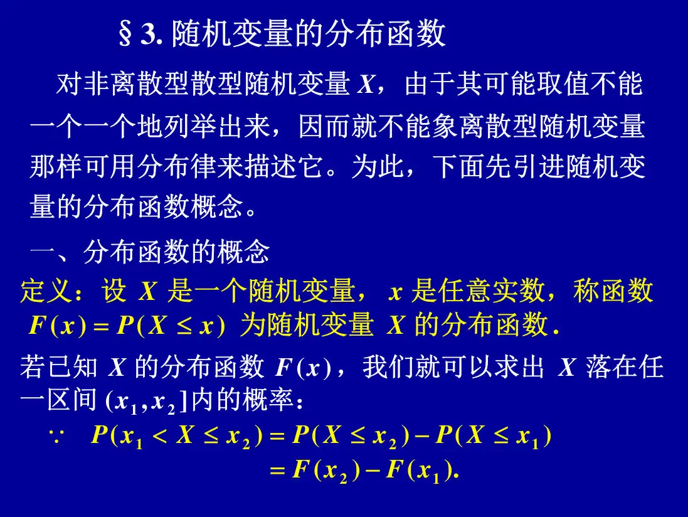

原文：

§ 3. 随机变量的分布函数

对非离散型散型随机变量 X， 由于其可能取值不能一个一个地列举出来， 因而就不能象离散型随机变量那样可用分布律来描述它。 为此， 下面先引进随机变量的分布函数概念。

一、 分布函数的概念

定义： 设 是一个随机变量， 是任意实数， 称函数X x$1 2 ( k - 3 ) - 1 2 ( k - 4 )$ 为随机变量 的分布函数 .X

若已知 的分布函数X $| \pmb { I } ( \pmb { \mathbb { E } } ) |$ 我们就可以求出 落在任X一区 间 $( 1 0 \% )$ 内 的概率：]

$$
\begin{array}{r l} P (x _ {1} <   X \leq x _ {2}) & = P (X \leq x _ {2}) - P (X \leq x _ {1}) \\ & = F (x _ {2}) - F (x _ {1}). \end{array}
$$

### 一、 分布函数的性质:

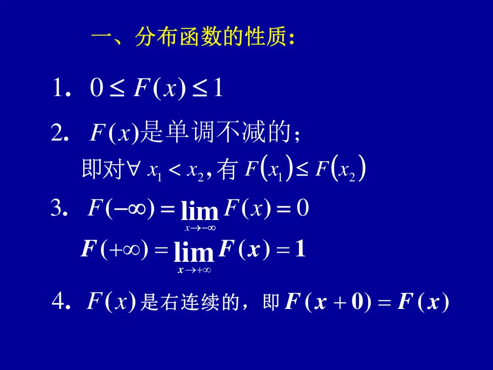

原文：

一、 分布函数的性质:

.1 $\textcircled { 1 } 1 2 ( 6 3 ) = 1 1$

2 xF )(. 是单调不减 的 ；即对∀ $a ^ { 2 } = ( a + 1 ) ^ { 2 }$ 有 $1 2 ( c m ) = 1 2 ( c m )$

$1 2 ( - \infty ) - 1 1 \cdots 2 ( - 3 ) = 0$ −∞→x $1 2 ( 1 0 0 ) 2 1 1 1 1 1 2 ( 1 0 0 ) 2 1 1$ +∞→x

4 F x)(. 是右连续 的 ， 即 $1 2 ( 1 0 - 1 1 ) = 1 2 ( 1 0 - 2 )$

### 离散型随机变量分布函数的计算举例

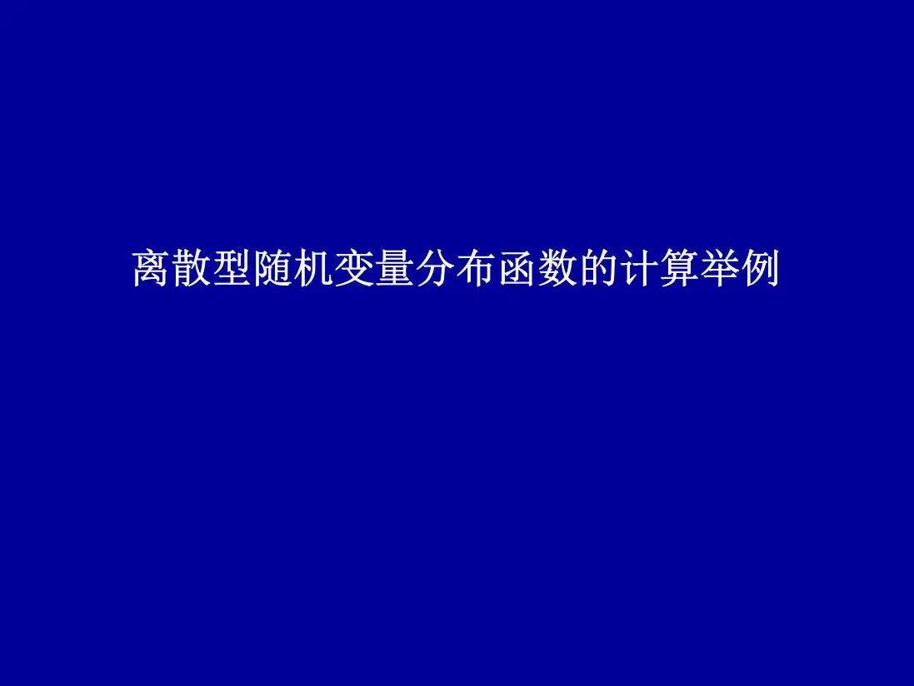

原文：

离散型随机变量分布函数的计算举例

### 第 4 页

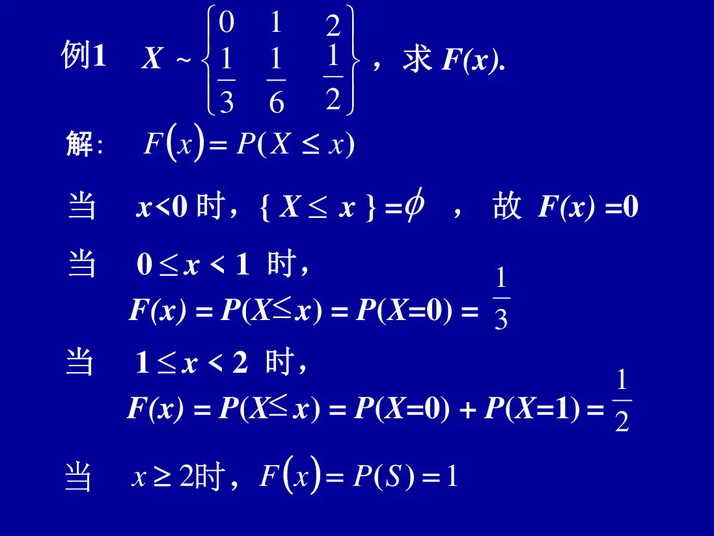

原文：

例1 $\therefore \angle B = 9 0 ^ { \circ }$ 求 $I _ { 2 } ( \phi )$ $1 2 ( 0 . 0 ) = 1 2 ( 0 . 0 - 0 . 0 )$ $v = 0$ 时 ， $( 1 0 0 \div \cdots 0 ) = ( 1 )$ 故 $l a ( \infty ) = 0$ $0 \times 0 = 1 1$ 时 ，$1 2 ( \cdot 9 ) = 1 2 ( \cdot 9 ) = 1 2 ( \cdot 9 ) = 1 2 ( \cdot 9 ) = 1 2 ( \cdot 9 ) = 1 2 ( \cdot 9 )$ $1 4 \leq x _ { 1 } \leq 0$ 时 ，$U ( \Theta ) = U _ { 2 } ( \Theta , \Theta , \chi ) = U _ { 2 } ( \Theta , \Theta , \chi ) = 0 , \chi _ { 2 } ( \phi , \Theta , \chi ) = 0 ,$ ≥ 2时 ， x $1 2 ( 0 - 3 ) = 1 2 ( 0 - 3 ) = 7 1$

### $$

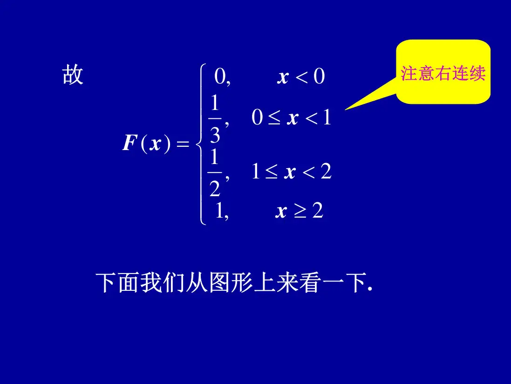

原文：

故

$$
F (x) = \left\{ \begin{array}{l l} 0, & x <   0 \\ \frac {1}{3}, & 0 \leq x <   1 \\ \frac {1}{2}, & 1 \leq x <   2 \\ 1, & x \geq 2 \end{array} \right.
$$

注意右连续

下面我们从图形上来看一下.

### $$

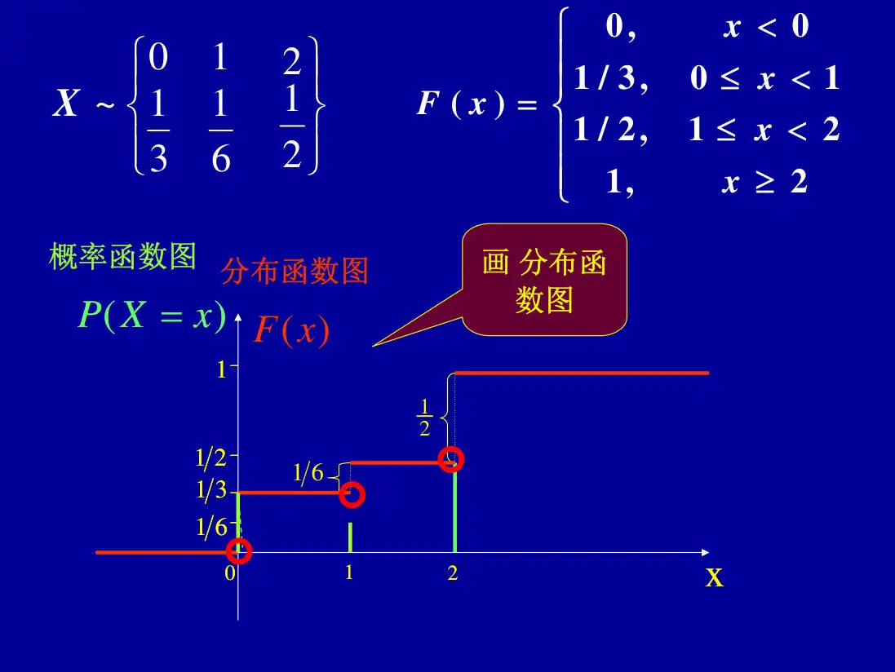

原文：

$$
X \sim \left\{ \begin{array}{l l l} 0 & 1 & 2 \\ \frac {1}{3} & \frac {1}{6} & \frac {1}{2} \end{array} \right\}
$$

$$
F (x) = \left\{ \begin{array}{c c} 0, & x <   0 \\ 1 / 3, & 0 \leq x <   1 \\ 1 / 2, & 1 \leq x <   2 \\ 1, & x \geq 2 \end{array} \right.
$$

概率函数图

分布函数图画 分布函数图

### 第 7 页

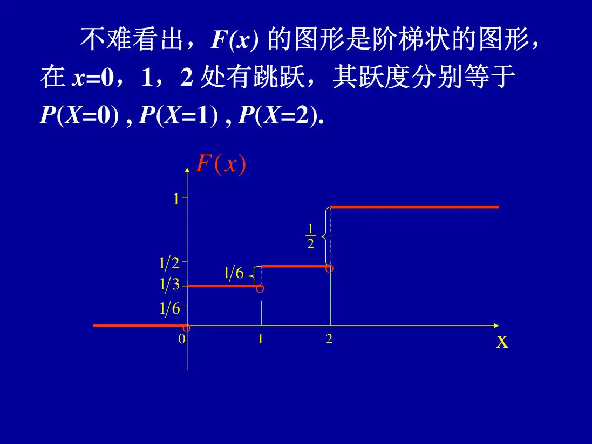

原文：

不难看出 ， F(x) 的 图形是阶梯状的 图形，在 $i 9 { = } 0$ ， 1， 2 处有跳跃， 其跃度分别等于$l _ { 4 } ^ { D } ( \mathbf { \mu } ) ^ { 2 } \in \mu$ $| \pmb { \mathbb { \ell } } ( \pmb { \ell } ) | \mathbf { \equiv } | \mathbf { \mathbb { 0 } } |$ , P(X=2) .

### 一般地， 设离散型随机变量 X 的分布律为

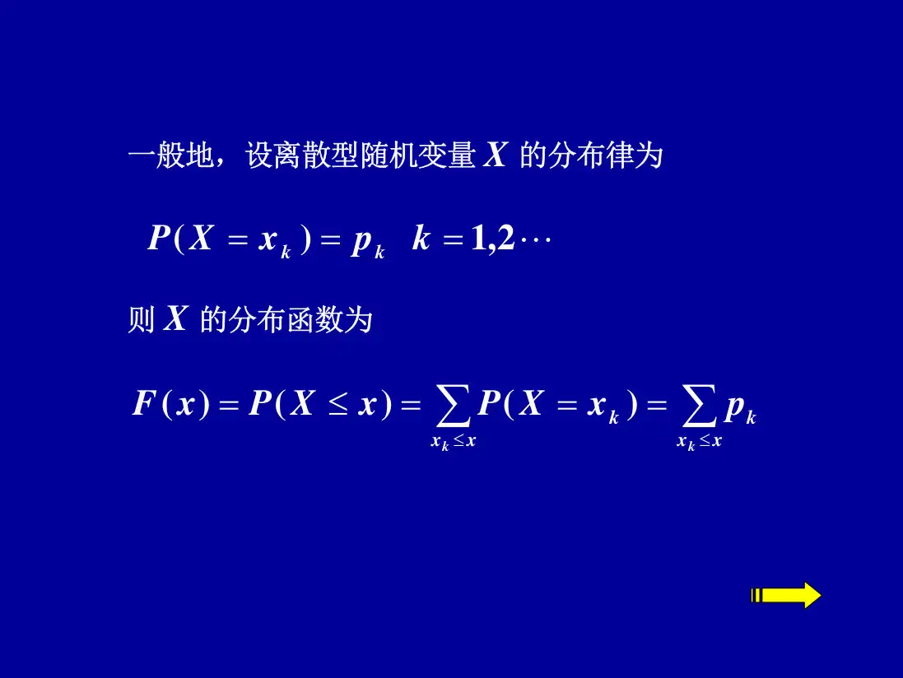

原文：

一般地， 设离散型随机变量 X 的分布律为

$$
P (X = x _ {k}) = p _ {k} \quad k = 1, 2 \dots
$$

则 X 的分布函数为

$$
F (x) = P (X \leq x) = \sum_ {x _ {k} \leq x} P (X = x _ {k}) = \sum_ {x _ {k} \leq x} p _ {k}
$$

### 第 9 页

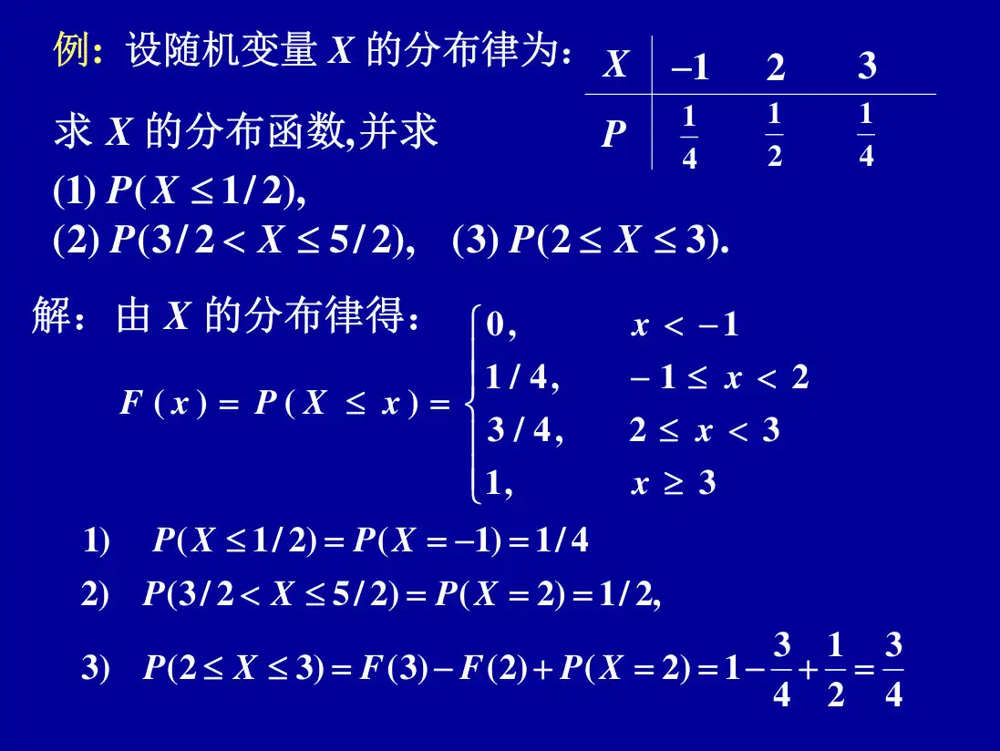

原文：

例: 设随机变量 X 的分布律为： X −1 2 3求 X 的分布函数 并求 P 1 21 41)1( $/ 2 ( 0 . 4 \leq 1 1 0 . 4 )$ )2( $1 2 ( k J / \beta ) ( - \beta ) ( - \beta - 1 \beta )$ )3( $1 2 ( k + 1 ) : ( - 4 - 1 )$

解： 由 X 的分布律得： ,0 −< 1x,4/1 <≤− 21 x=≤= )()( xXPxF,4/3 <≤ 32 x⎩ ,1 ≥ 3x

)1 $\angle A ( \theta , \zeta , \theta , \zeta ) = \angle A ( \theta , \zeta , \zeta ) = \angle D = 1 1 , \angle \zeta$

)2 $1 2 ( 1 1 0 0 0 0 0 0 0 0 0 0 0 0 0 0 0 0 0 0 0 0 0 0 0 0 0 0 0 0 0 0 0 0 0 0 0 0 0 0 0 0 0 0 0 0 0 0 0 0 0 0 0 0 0 0 0 0 0 0 0 0 0 0 0 0 0 0 0 0 0 0 0 0 0 0 0 0 0 0 0 0 0 0 0 0 0 0 0 0 0 0 0 0 0 0 0 0 0 0 0 0 0 0 0 0 0 0 0 0 0 0 0 0 0 0 0 0 0 0 0 0 0 0 0 0 0 0 0 0 0 0 0 0$

3XPFFXP 1)2()2()3()32()3 +−==+−=≤≤ =4 4例 2 ： 设随机变量 X 在区间 ]20[ 上取值,当 $( 1 ) \leq x ^ { 2 } - 4 y ^ { 2 }$ 时,概率 $1 2 ( 0 ) = 0 : ( 0 . 0 )$ 与 $a ^ { 2 } + 2 a = \frac { 3 } { 2 }$ 成正比,求 X 的分布函数F x)( 。

### 第 10 页

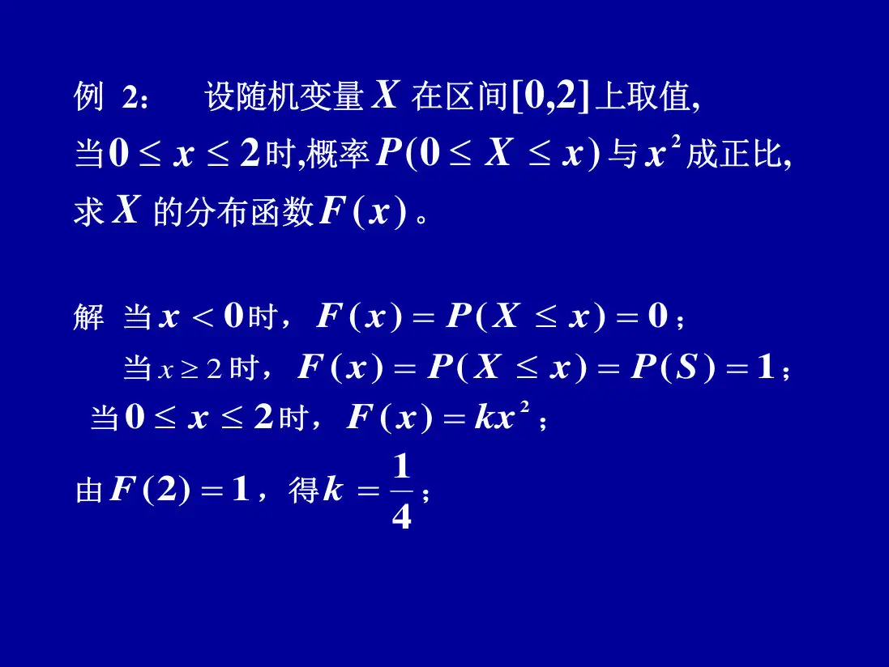

原文：

解 当 $\bigstar$ $1 2 ( 0 . 9 2 - 1 . 1 0 ) \times ( 0 . 9 2 - 0 . 0 2 ) = 1 1$ C；$\angle B = \angle A$ 时 $1 2 ( \mathrm { e } 9 2 - 7 2 ( \mathrm { e } 3 3 9 ) = 1 2 ( \mathrm { e } 9 2 - 9 2 ) = 1 2 ( \mathrm { e } 9 2 - 9 1 ) = 1 1$ $( 1 ) \leq x _ { 1 } ( 1 + \frac { 1 } { 2 } )$ 时 $1 0 ( 1 0 - 2 ) = 1 5 0 ($ $| P ( \phi ) | = 1 1$ 得 $1 3 - 1 = 1 9$

### 因此， X 的分布函数为

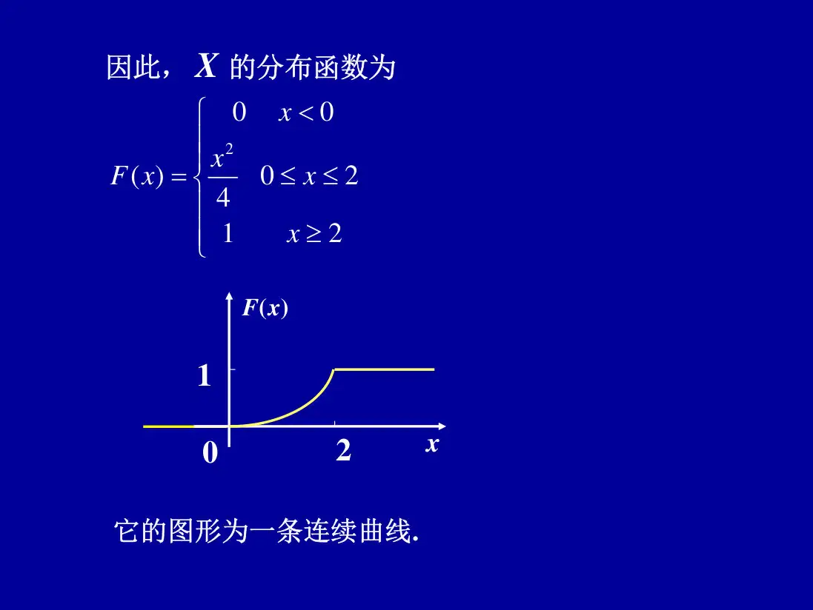

原文：

因此， X 的分布函数为

$$
F (x) = \left\{ \begin{array}{c c} 0 & x <   0 \\ \frac {x ^ {2}}{4} & 0 \leq x \leq 2 \\ 1 & x \geq 2 \end{array} \right.
$$

它的图形为一条连续曲线.

### 此例

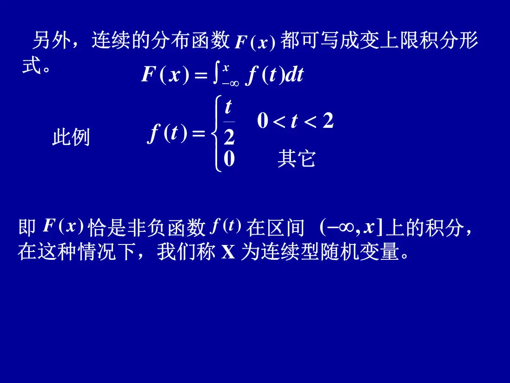

原文：

另外， 连续的分布函数 $1 0 \times ( 1 0 0 )$ 都可写成变上限积分形式 。 dttfxF x )()( = ∫

此例

$$
f (t) = \left\{ \begin{array}{l l} \frac {t}{2} & 0 <   t <   2 \\ 0 & \text {其它} \end{array} \right.
$$

即 $\boxed { 2 } \boxed { ( 6 9 ) }$ 恰是非负函数 在区 间tf )( $( 1 0 0 \% ) \times 3 = 1 0 0 \%$ 上的积分，在这种情况下， 我们称 X 为连续型随机变量。

### 2 .4 连续型随机变量及其概率密度

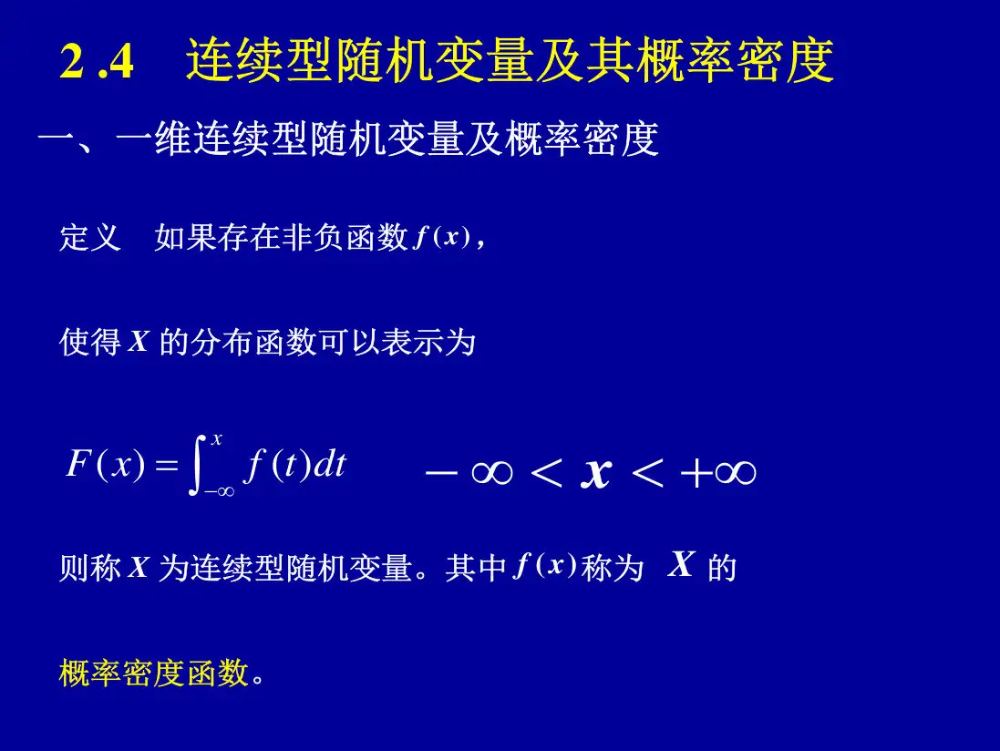

原文：

2 .4 连续型随机变量及其概率密度

一、 一维连续型随机变量及概率密度

定义 如果存在非负函数f x)( ，

使得X 的分布函数可以表示为

$$
F (x) = \int_ {- \infty} ^ {x} f (t) d t
$$

$$
- \infty <   x <   + \infty
$$

则称X 为连续型随机变量。 其中 xf )( 称为 X 的

概率密度函数。

### 概率密度函数的性质

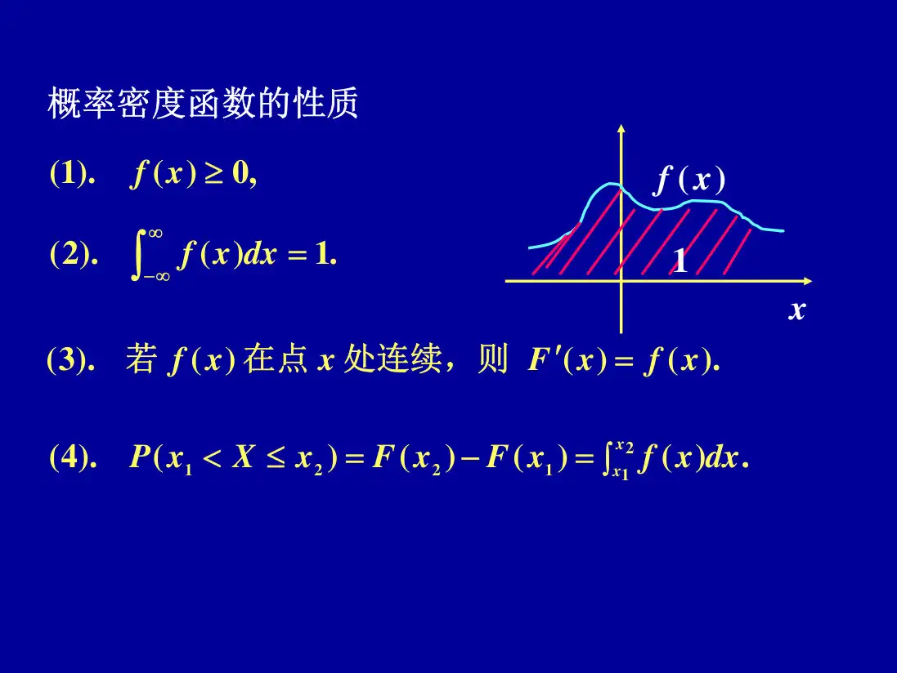

原文：

概率密度函数的性质

) .1( $1 1 0 0 0 0$

) .2( $[ 1 0 0 , 1 1 , 1 0 0 , 1 0 0 , 1 0 0 ] = 1 0$

)().3( xxf若 在 点 处连续 ， 则 $| \Omega ( 0 ) = \Omega ( 0 )$

) .4( $1 \times ( - 1 + 1 + 1 + 1 + 1 + 1 + 1 + 1 + 1 + 1 + 1 + 1 + 1 + 1 + 1 + 1 + 1 + 1 + 1 + 1 + 1 + 1 + 1 + 1 + 1 + 1 + 1 + 1 + 1 + 1 + 1 + 1 + 1 + 1 + 1 + 1 + 1 + 1 + 1 + 1 + 1 + 1 + 1 + 1 + 1 + 1 + 1 + 1 + 1 + 1 + 1 + 1 + 1 + 1 + 1 + 1 + 1 + 1 + 1 + 1 + 1 + 1 + 1 + 1 + 1 + 1 + 1 + 1 + 1 + 1 + 1 + 1 + 1 + 1 + 1 + 1 + 1 + 1 + 1 + 1 + 1 + 1 + 1 + 1 + 1 + 1 + 1 + 1 + 1 + 1 + 1 + 1 + 1 + 1 + 1 + 1 + 1 + 1 + 1 + 1 + 1 + 1 + 1 + 1 + 1 + 1 + 1 + 1 + 1 + 1 + 1 + 1 + 1 + 1 + 1 + 1 + 1 + 1 + 1 + 1 + 1 + 1 + 1 + 1 + 1 + 1 + 1 + 1 + 1 + 1 + 1 + 1 + 1 + 1 + 1 + 1 + 1 + 1 + 1 + 1 + 1 + 1 + 1 + 1 + 1 + 1 + 1 + 1 + 1 + 1 + 1 + 1 + 1 + 1 + 1 + 1 + 1 + 1 + 1 + 1 + 1 + 1 + 1 + 1 + 1 + 1 + 1 + 1 + 1 + 1 + 1 + 1 + 1 + 1 + 1 + 1 + 1 + 1 + 1 + 1 + 1 + 1 + 1 + 1 + 1 + 1 + 1 + 1 + 1 + 1 + 1 + 1 + 1 + 1 + 1 + 1 + 1 + 1 + 1 + 1 + 1 + 1 + 1 + 1 + 1 + 1 + 1 + 1 + 1 + 1 + 1 + 1 + 1 + 1 + 1 + 1 + 1 + 1 + 1 + 1 + 1 + 1 + 1 + 1 + 1 + 1 + 1 + 1 + 1 + 1 + 1 + 1 + 1 + 1 + 1 + 1 + 1 + 1 + 1 + 1 + 1 + 1 + 1 + 1 + 1 + 1 + 1 + 1 + 1 + 1 + 1 + 1 + 1 + 1 + 1 + 1 + 1 + 1 + 1 + 1 + 1 + 1 + 1 + 1 + 1 + 1 + 1 + 1 + 1 + 1 + 1 + 1 + 1 + 1 + 1 + 1 + 1 + 1 + 1 + 1 + 1 + 1 + 1 + 1 + 1 + 1 $ 注： )1 对连续型随机变量 X 它取任一定值的概率为 零.即对任一实数 $\sin ^ { 2 } \alpha = \frac { \sqrt { 3 } } { 2 }$ 有 $1 2 ( 0 . 0 - 0 . 0 ) - 0 . 0 2 ( 0 . 0 )$

### $$

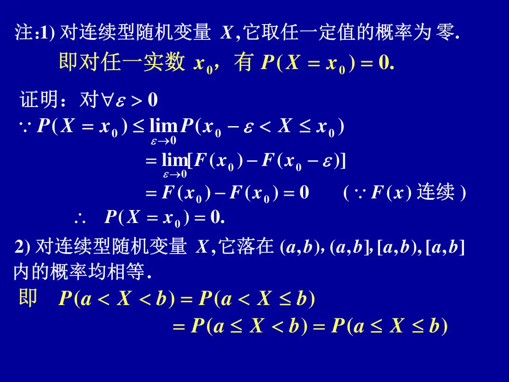

原文：

证明 ： 对 $\pmb { \nabla } \pmb { \beta } = \pmb { \nabla } \pmb { \Omega }$

$$
\begin{array}{r l} & {\because P (X = x _ {0}) \leq \lim _ {\varepsilon \to 0} P (x _ {0} - \varepsilon <   X \leq x _ {0})} \\ & {\qquad = \lim _ {\varepsilon \to 0} [ F (x _ {0}) - F (x _ {0} - \varepsilon) ]} \\ & {\qquad = F (x _ {0}) - F (x _ {0}) = 0 \qquad (\because F (x) \text {连续})} \\ & {\therefore \quad P (X = x _ {0}) = 0.} \end{array}
$$

)2 对连续型随机变量 X 它落在 $( \cos \alpha \cos \alpha \sin \alpha \cos \alpha \cos \alpha \cos \alpha \cos \beta )$ .内 的概率均相等

即 $( 1 8 + 1 0 0 0 0 0 0 0 0 0 0 0 0 0 0 0 0 0 0 0 0 0 0 0 0 0 0 0 0 0 0 0 0 0 0 0 0 0 0 0 0 0 0 0 0 0 0 0 0 0 0 0 0 0 0 0 0 0 0 0 0 0 0 0 0 0 0 0 0 0 0 0 0 0 0 0 0 0 0 0 0 0 0 0 0 0 0 0 0 0 0 0 0 0 0 0 0 0 0 0 0 0 0 0 0 0 0 0 0 0 0 0 0 0 0 0 0 0 0 0 0 0 0 0 0 0 0 0 0 0 0 0 0 0 0 0 0 0 0 0 0 0 0 0 0 0 0 0 0 0 0 0 0 0 0 0 0 0 0 0 0 0 0 0 0 0 0 0 0 0 0 0 0 0 0 0 0 0 0 0 0 0 0 0 0 0 0 0 0 0 0 0 0 0 0 0 0 0 0 0 0 0 0 0 0 0 0 0 0 0 0 0 0 0 0 0 0 0 0 0 0 0 0 0 0 0 0 0 0 0 0 0 0 0 0 0 0 0 0 0 0 0 0 0 0 0 0 0 0 0 0 0 0 0 0 0 0 0 0 0 0 0 0 0 0 0 0 0 0 0 0 0 0 0 0 0 0 0 0 0 0 0 0 0 0 0 0 0 0 0 0 0 0 0 0 0 0 0 0 0 0 0 0 0 0 0 0 0 0 0 0 0 0 0 0 0 0 0 0 0 0 0 0 0 0 0 0 0 0 0 0 0 0 0 0 0 0 0 0 0 0 0 0 0 0 0 0 0 0 0 0 0 0 0 0 0 0 0 0 0 0 0 0 0 0 0 0 0 0 0 0 0 0 0 0 0 0 0 0 0 0 0 0 0 0 0 0 0 0 0 0 0 0 0 0 0 0 0 0 0 0 0 0 0 0 0 0 0 0 0 0 0 0 0 0 0 0 0 0 0 0 0 0 0 0 0 0 0 0 0 0 0 0 0 0 0 0 0 0 0 0 0 0 0 0 0 0 0 0 0 0 0 0 0 0 0 0 0 0 0 0 0 0 0 0 0 0 0 0 0 0 0 0 0 0 0 0 0 0 0 0 0 0 0 0 0 0 0 0 0 0 0 0 0 0 0 0 0 0 0 0 0 0 0 0 0 0 0 0 0 0 0 0 0 0 0 0 0 0 0 0 0 0 0 0 0 0 0 0 0 0 0 0 0 0 0 0 0 0 0 0 0 0 0 0 0 0 0 0 0 0 0 0 0 0 0 0 0 0 0 0 0 0 0 0 0 0 0 0 0 0 0$

### 例 1 设随机变量 X 的密度函数为

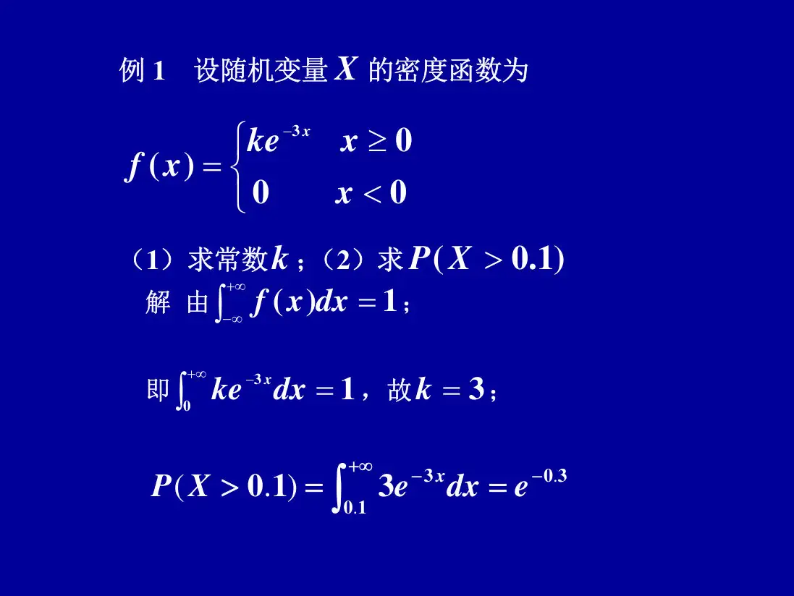

原文：

例 1 设随机变量 X 的密度函数为

$$
f (x) = \left\{ \begin{array}{l l} k e ^ {- 3 x} & x \geq 0 \\ 0 & x <   0 \end{array} \right.
$$

（ 1 ） 求常数 k ； （ 2 ） 求 $l 2 ( 0 . 7 5 2 0 5 0 )$ 解 由 $( 1 - \frac { 2 0 } { 5 } ) \times ( 0 . 2 ) \times 2 0 = 1 1$ C；

即 $1 1 0 0 - 2 0 0 0 = 1 1$ ， 故 $l i s \equiv 8 1$

$$
P (X > 0. 1) = \int_ {0. 1} ^ {+ \infty} 3 e ^ {- 3 x} d x = e ^ {- 0. 3}
$$

### 例2: 设连续型随机变量 X 的分布函数为

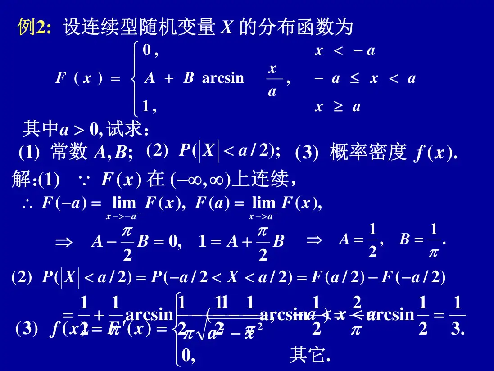

原文：

例2: 设连续型随机变量 X 的分布函数为

−< ax x =xF )( + BA arcsin , <≤− axa a ,1 ≥x a

其中 $\textcircled { 1 } \textcircled { > } \textcircled { 1 }$ 试求：常 数)1( $\angle A = \angle B$ )2( $1 2 ( k ^ { 2 } - 1 ) < ( 1 2 ) k ^ { 2 } + 2 k$ )3( 概 率 密 度 xf ) .(解 ： )1( $| \pmb { \mathrm { z } } ( \pmb { \mathrm { z } } ) |$ 在 $\left( \left( - \sqrt { 2 } , \sqrt { 2 } \right) \right)$ 上连续，$C O _ { 2 } C O _ { 3 } = H _ { 2 } O _ { 3 } \vert 2 C O _ { 2 } \vert 2 C O _ { 2 } = 1 \vert 1 0 0 \vert 2 C O _ { 2 }$ $\angle A = \angle B = \angle C A E = \angle E C = \angle C = \angle C = \angle C = \angle C$ )2( $( \because , \angle A ) = \angle B = \angle C A D = \angle C A D = \angle A C B = \angle C A D = \angle A C B$ ⎧1 11 1 2 11\_ + arcsin <−, xa ) arcsin = < aarcsin \_ =⎨= −= ′ )()()3( 22xFxf π xa 222 π π 2 π 2 .3⎩ ,0 .其它

### 二、 三个重要的连续型随机变量的分布

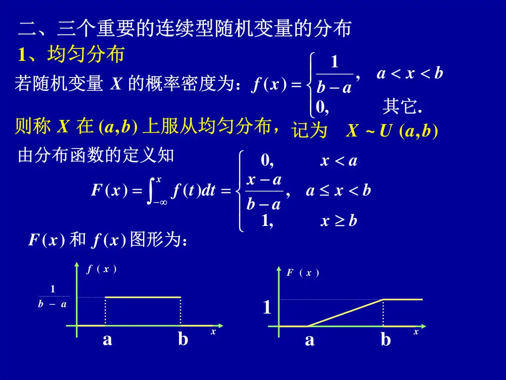

原文：

二、 三个重要的连续型随机变量的分布

若随机变量 的概率密度为：X 1、 均匀分布 $1 0 0 - 1 6 = 1 0 0 ( c m )$ 则称 在 baX ),( 上服从均匀分布， 记为 $: ( - \infty , 0 ) \cup ( 0 , 1 ) \cup$ 由分布函数的定义知 < ax= =∫ dttfxF )()( −− ab ax , <≤ bxa≥ bx

和 xfxF )()( 图 形为 ：

### $$

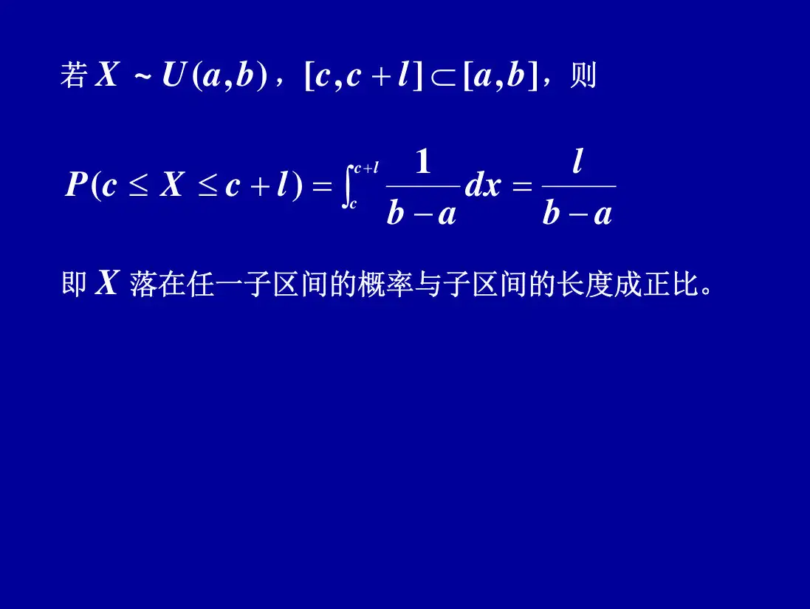

原文：

$$
\text { 若 } X \sim U (a, b), [ c, c + l ] \subset [ a, b ], \text { 则 }
$$

$$
P (c \leq X \leq c + l) = \int_ {c} ^ {c + l} \frac {1}{b - a} d x = \frac {l}{b - a}
$$

即 X 落在任一子区间的概率与子区间的长度成正比。

### 例 3 设电阻 R 是随机变量， 均匀分布在 900Ω \~1100Ω ，

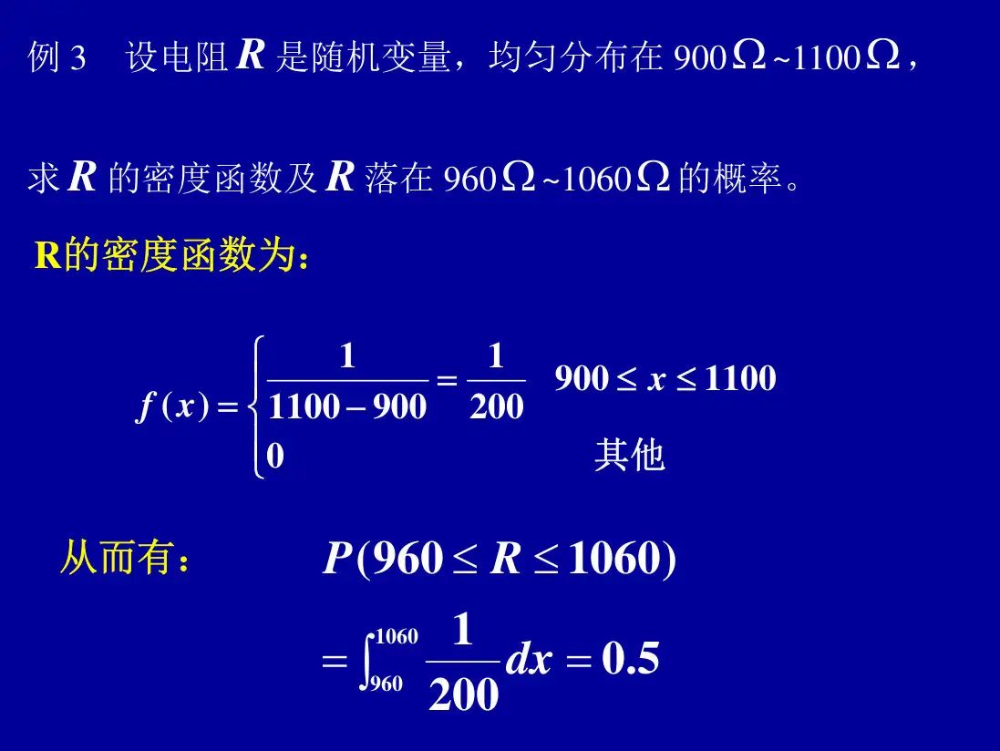

原文：

例 3 设电阻 R 是随机变量， 均匀分布在 900Ω \~1100Ω ，

求R 的密度函数及 R 落在 $\mathrm  \Omega _ { 0 } ^ { 0 } / \Omega _ { 0 } ^ { 0 } / \Omega _ { 0 } ^ { 0 } / \Omega _ { 0 } ^ { 0 } / \Omega _ { 0 } ^ { 0 } / \Omega _ { 0 } ^ { 0 } / \Omega _ { 0 } ^ { 0 } / \Omega _ { 0 } ^ { 0 } / \Omega _ { 0 } ^ { 0 } / \Omega _ { 0 } ^ { 0 }$ 的概率。

R的密度函数为：

$$
f (x) = \left\{ \begin{array}{l l} \frac {1}{1 1 0 0 - 9 0 0} = \frac {1}{2 0 0} & 9 0 0 \leq x \leq 1 1 0 0 \\ 0 & \text {其他} \end{array} \right.
$$

从而有：

$$
= \int_ {9 6 0} ^ {1 0 6 0} \frac {1}{2 0 0} d x = 0. 5
$$

### (2) 指数分布

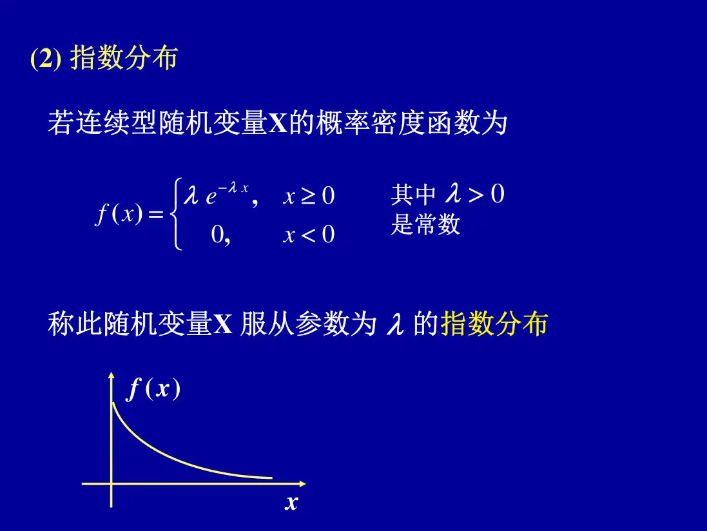

原文：

(2) 指数分布

若连续型随机变量X的概率密度函数为

$$
f (x) = \left\{ \begin{array}{c c} \lambda e ^ {- \lambda x}, & x \geq 0 \\ 0, & x <   0 \end{array} \right.
$$

其 中 λ > 0

是常数

称此随机变量X 服从参数为 的λ 指数分布

### 指数分布的分布函数：

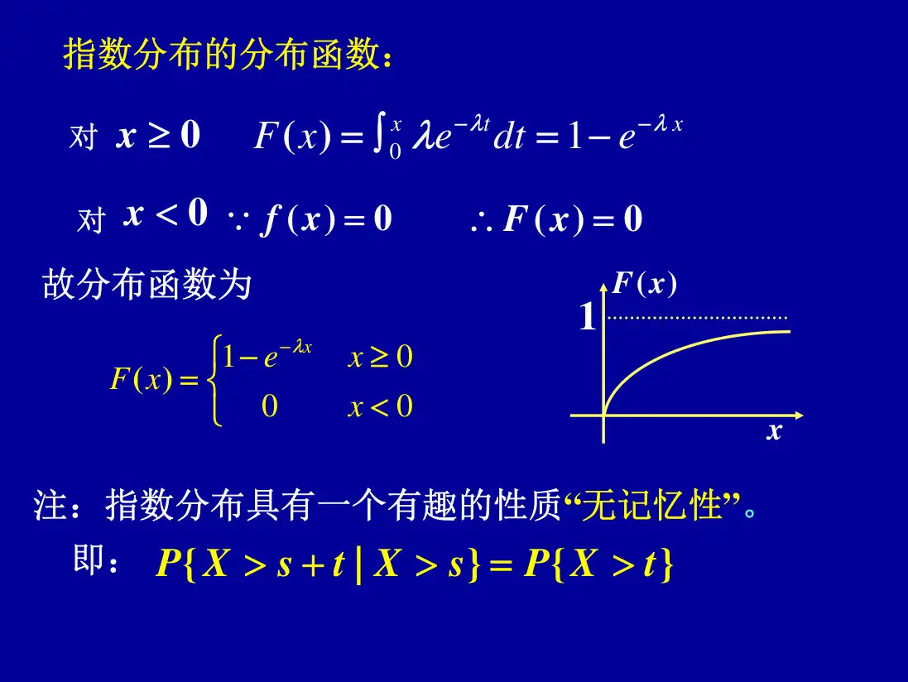

原文：

指数分布的分布函数：

对 $\mathfrak { Q } ^ { \sharp } \sharp \sharp$ $1 2 ( 1 3 ) = 1 1 0 ( 1 2 0 ) = 1 1 ( 1 3 ) = 1 1 ( 1 3 )$

对 $\angle B = \angle C D = \angle C B = 9 0 ^ { \circ }$

$$
\therefore F (x) = 0
$$

故分布函数为

$$
F (x) = \left\{ \begin{array}{c c} 1 - e ^ {- \lambda x} & x \geq 0 \\ 0 & x <   0 \end{array} \right.
$$

注： 指数分布具有一个有趣的性质“无记忆性”。即 ： $1 2 0 . 0 2 \times 1 . 0 2 = 1 2 0 . 0 2 ( c m )$

### 解: 要方程无实根， 必须满足

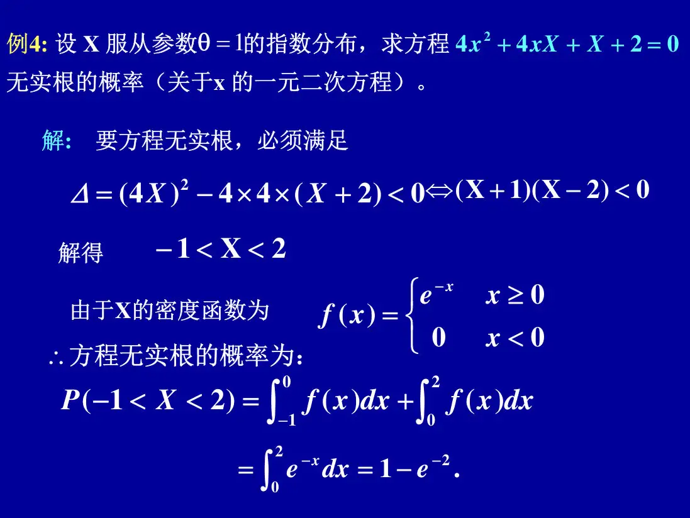

原文：

例4: 设 X 服从参数 的指数分布， 求方程θ = 1 $\angle B = \angle B = \angle C = \angle C = \angle C = \angle D$ 无实根的概率 （关于x 的一元二次方程） 。

解: 要方程无实根， 必须满足

$$
\varDelta = (4 X) ^ {2} - 4 \times 4 \times (X + 2) <   0 \Leftrightarrow (\mathrm{X} + 1) (\mathrm{X} - 2) <   0
$$

解得 − < < 2X1

由于X的密度函数为

$$
f (x) = \left\{ \begin{array}{c c} e ^ {- x} & x \geq 0 \\ 0 & x <   0 \end{array} \right.
$$

∴ 方程无实根的概率为：

∫=<<− XP )21( 0 ∫+ )( dxxf 2 )( dxxf 2 .1 2 − −−= edxe x
