# 《概率论与数理统计》第3章 两个随机变量的函数的分布（课件）

原件的每一页，下面附识别出的文字。

### 3.5 二维随机变量函数的分布

原文：

3.5 二维随机变量函数的分布
3.5.1 问题的引入
3.5.2 离散型随机变量函数的分布
3.5.3 连续型随机变量函数的分布

南京邮电大学
Nanjing University of Posts and Telecommunications

### 南京邮电大学

原文：

设(X,Y)是二维随机变量，g(x,y)是二元函数，则Z=g(X,Y)是一维随机变量。如果已知(X,Y)的概率密度函数f(x,y)(或联合分布律)，我们如何求Z=g(X,Y)的分布呢？下面，我们分离散型和连续型两种类型说明其解法。

南京邮电大学
Nanjing University of Posts and Telecommunications

### 3.5.1 问题的引入

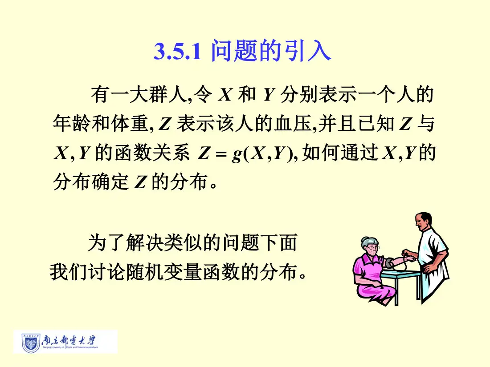

原文：

3.5.1 问题的引入

有一大群人,令 X 和 Y 分别表示一个人的年龄和体重, Z 表示该人的血压,并且已知 Z 与 X,Y 的函数关系 $Z = g(X,Y)$ , 如何通过 X,Y 的分布确定 Z 的分布。

为了解决类似的问题下面我们讨论随机变量函数的分布。

南京邮电大学
Nanjing University of Posts and Telecommunications

### 3.5.2 离散型随机变量函数的分布

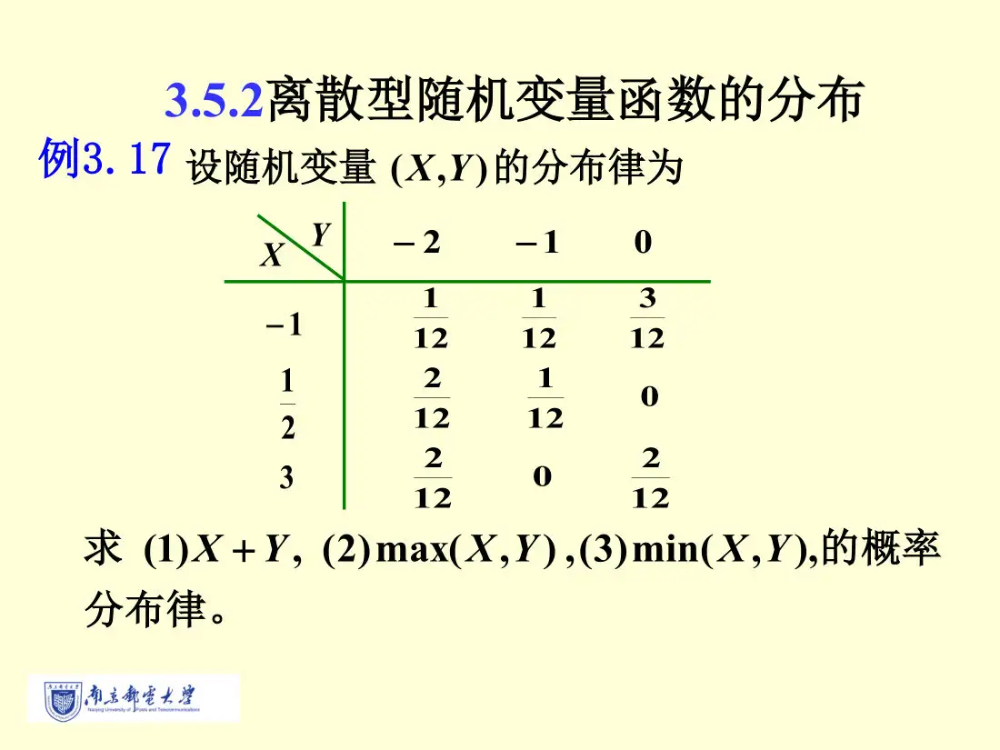

原文：

3.5.2 离散型随机变量函数的分布
例3.17 设随机变量 $(X,Y)$ 的分布律为

$$
\begin{array}{c c c c} X \searrow Y & - 2 & - 1 & 0 \\ \hline - 1 & \frac {1}{1 2} & \frac {1}{1 2} & \frac {3}{1 2} \\ \frac {1}{2} & \frac {2}{1 2} & \frac {1}{1 2} & 0 \\ 3 & \frac {2}{1 2} & 0 & \frac {2}{1 2} \end{array}
$$

求 (1) $X + Y$ , (2) $\max(X, Y)$ , (3) $\min(X, Y)$ , 的概率分布律。

南京邮电大学
Nanjing University of Posts and Telecommunications

### 南京邮电大学

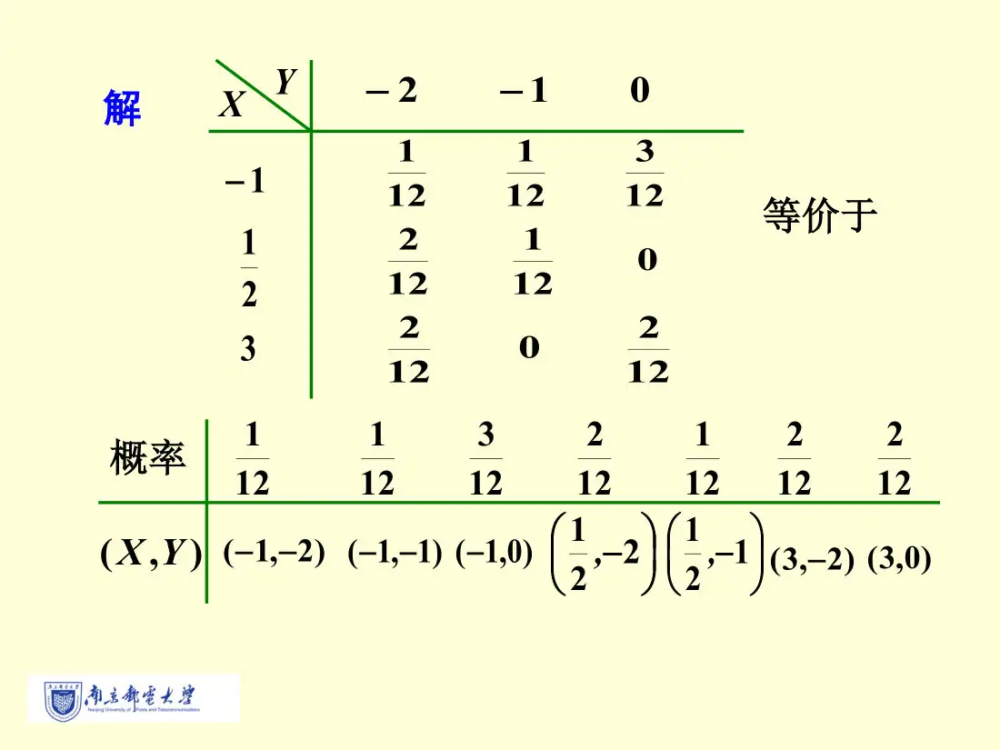

原文：

<table><tr><td rowspan="4">解</td><td>X\Y</td><td>-2</td><td>-1</td><td>0</td><td rowspan="4">等价于</td></tr><tr><td>-1</td><td> $\frac{1}{12}$ </td><td> $\frac{1}{12}$ </td><td> $\frac{3}{12}$ </td></tr><tr><td> $\frac{1}{2}$ </td><td> $\frac{2}{12}$ </td><td> $\frac{1}{12}$ </td><td>0</td></tr><tr><td>3</td><td> $\frac{2}{12}$ </td><td>0</td><td> $\frac{2}{12}$ </td></tr><tr><td>概率</td><td> $\frac{1}{12}$ </td><td> $\frac{1}{12}$ </td><td> $\frac{3}{12}$ </td><td> $\frac{2}{12}$ </td><td> $\frac{1}{12}$ </td></tr><tr><td>(X,Y)</td><td>(-1,-2)</td><td>(-1,-1)</td><td>(-1,0)</td><td> $\left( \frac{1}{2}, -2 \right) \left( \frac{1}{2}, -1 \right)$ </td><td>(3,-2)</td></tr></table>

南京邮电大学
Nanjing University of Posts and Telecommunications

### 南京邮电大学

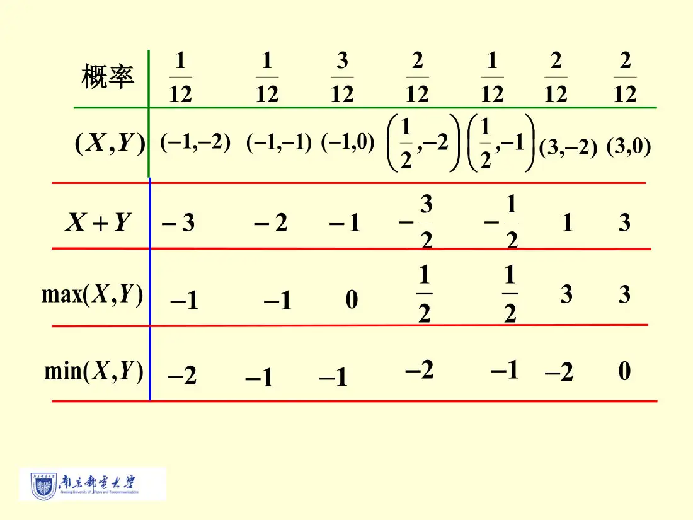

原文：

<table><tr><td>概率</td><td> $\frac{1}{12}$ </td><td> $\frac{1}{12}$ </td><td> $\frac{3}{12}$ </td><td> $\frac{2}{12}$ </td><td> $\frac{1}{12}$ </td><td> $\frac{2}{12}$ </td><td> $\frac{2}{12}$ </td></tr><tr><td>(X,Y)</td><td>(-1,-2)</td><td>(-1,-1)</td><td>(-1,0)</td><td> $\left( \frac{1}{2},-2 \right)$ </td><td> $\left( \frac{1}{2},-1 \right)$ </td><td>(3,-2)</td><td>(3,0)</td></tr><tr><td>X+Y</td><td>-3</td><td>-2</td><td>-1</td><td> $-\frac{3}{2}$ </td><td> $-\frac{1}{2}$ </td><td>1</td><td>3</td></tr><tr><td>max(X,Y)</td><td>-1</td><td>-1</td><td>0</td><td> $\frac{1}{2}$ </td><td> $\frac{1}{2}$ </td><td>3</td><td>3</td></tr><tr><td>min(X,Y)</td><td>-2</td><td>-1</td><td>-1</td><td>-2</td><td>-1</td><td>-2</td><td>0</td></tr></table>

南京邮电大学
Nanjing University of Posts and Telecommunications

### ∴ X + Y 的概率分布律为

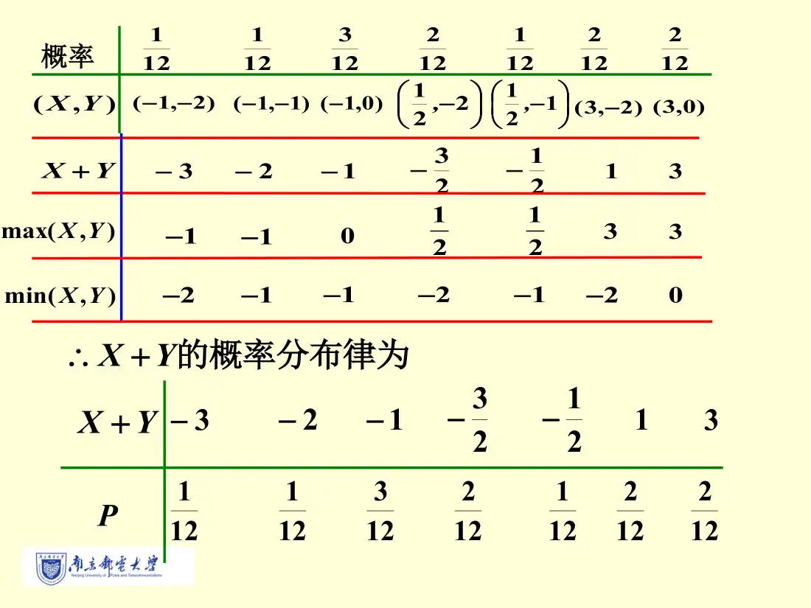

原文：

∴ X + Y 的概率分布律为

$$
\begin{array}{c c c c c c c c} X + Y & - 3 & - 2 & - 1 & - \frac {3}{2} & - \frac {1}{2} & 1 & 3 \\ \hline P & \frac {1}{1 2} & \frac {1}{1 2} & \frac {3}{1 2} & \frac {2}{1 2} & \frac {1}{1 2} & \frac {2}{1 2} & \frac {2}{1 2} \end{array}
$$

### ∴ $\max(X,Y)$ , $\min(X,Y)$ 的概率分布律为:

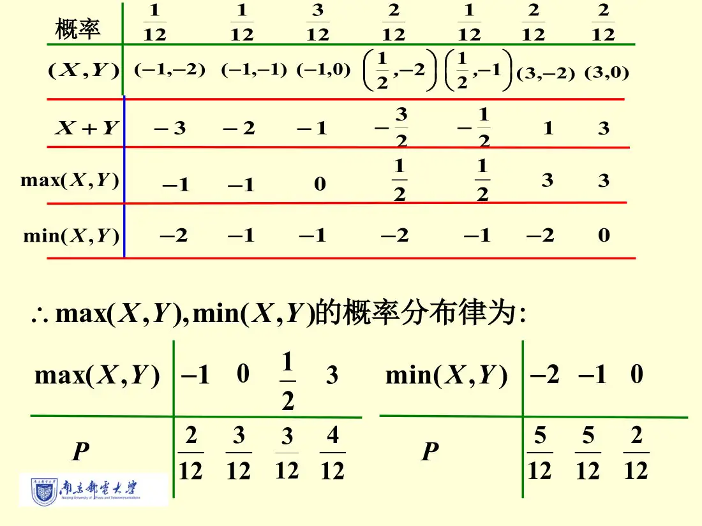

原文：

<table><tr><td>概率</td><td> $\frac{1}{12}$ </td><td> $\frac{1}{12}$ </td><td> $\frac{3}{12}$ </td><td> $\frac{2}{12}$ </td><td> $\frac{1}{12}$ </td><td> $\frac{2}{12}$ </td><td> $\frac{2}{12}$ </td></tr><tr><td>(X,Y)</td><td>(-1,-2)</td><td>(-1,-1)</td><td>(-1,0)</td><td> $\left( \frac{1}{2},-2 \right)$ </td><td> $\left( \frac{1}{2},-1 \right)$ </td><td>(3,-2)</td><td>(3,0)</td></tr><tr><td>X+Y</td><td>-3</td><td>-2</td><td>-1</td><td> $-\frac{3}{2}$ </td><td> $-\frac{1}{2}$ </td><td>1</td><td>3</td></tr><tr><td>max(X,Y)</td><td>-1</td><td>-1</td><td>0</td><td> $\frac{1}{2}$ </td><td> $\frac{1}{2}$ </td><td>3</td><td>3</td></tr><tr><td>min(X,Y)</td><td>-2</td><td>-1</td><td>-1</td><td>-2</td><td>-1</td><td>-2</td><td>0</td></tr></table>

∴ $\max(X,Y)$ , $\min(X,Y)$ 的概率分布律为:

$$
\begin{array}{c c c c c} \max (X, Y) & - 1 & 0 & \frac {1}{2} & 3 \\ \hline P & \frac {2}{1 2} & \frac {3}{1 2} & \frac {3}{1 2} & \frac {4}{1 2} \end{array} \quad \begin{array}{c c c c c} \min (X, Y) & - 2 & - 1 & 0 \\ \hline P & \frac {5}{1 2} & \frac {5}{1 2} & \frac {2}{1 2} \end{array}
$$

### 结论

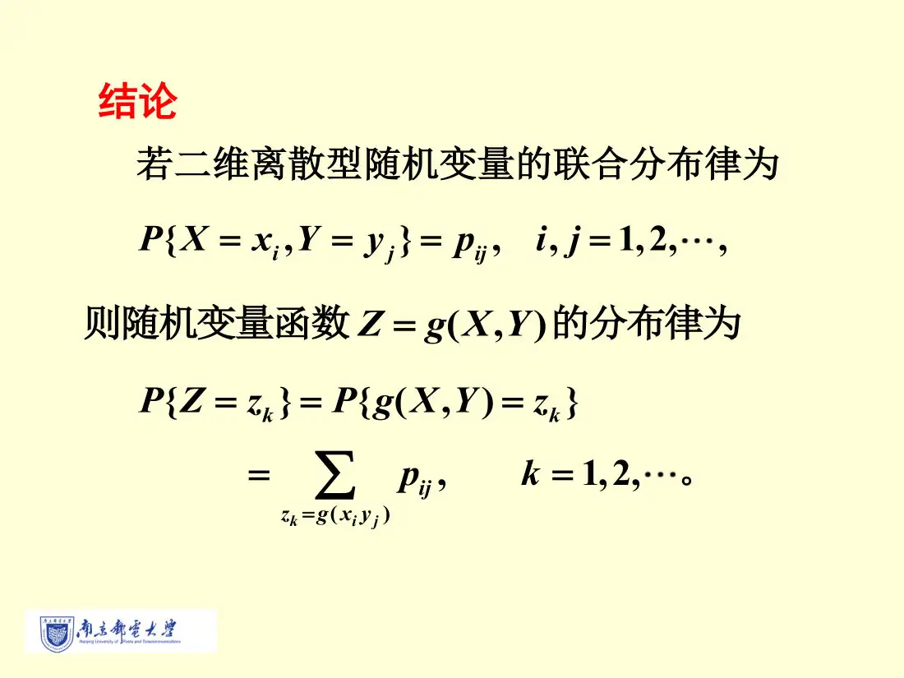

原文：

结论

若二维离散型随机变量的联合分布律为

$$
P \{X = x _ {i}, Y = y _ {j} \} = p _ {i j}, i, j = 1, 2, \dots ,
$$

则随机变量函数 $Z = g(X,Y)$ 的分布律为

$$
\begin{array}{r l} & P \{Z = z _ {k} \} = P \{g (X, Y) = z _ {k} \} \\ & \qquad = \sum_ {z _ {k} = g (x _ {i} y _ {j})} p _ {i j}, \qquad k = 1, 2, \dots 。 \end{array}
$$

南京邮电大学
Nanjing University of Posts and Telecommunications

### 证明

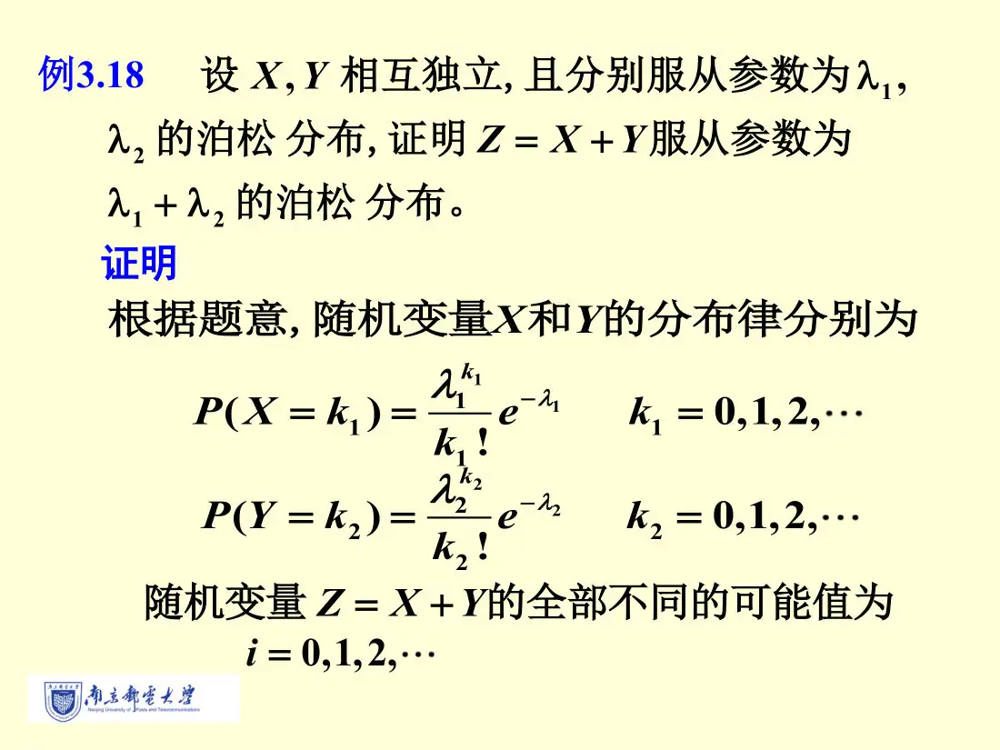

原文：

例3.18 设 X, Y 相互独立, 且分别服从参数为 $\lambda_{1}$ , $\lambda_{2}$ 的泊松分布,证明 $Z = X + Y$ 服从参数为 $\lambda_{1}+\lambda_{2}$ 的泊松分布。

证明

根据题意, 随机变量X和Y的分布律分别为

$$
\begin{array}{l l} P (X = k _ {1}) = \frac {\lambda_ {1} ^ {k _ {1}}}{k _ {1} !} e ^ {- \lambda_ {1}} & k _ {1} = 0, 1, 2, \dots \\ P (Y = k _ {2}) = \frac {\lambda_ {2} ^ {k _ {2}}}{k _ {2} !} e ^ {- \lambda_ {2}} & k _ {2} = 0, 1, 2, \dots \end{array}
$$

随机变量 $Z = X + Y$ 的全部不同的可能值为 $i=0,1,2,\cdots$

南京邮电大学
Nanjing University of Posts and Telecommunications

### $$

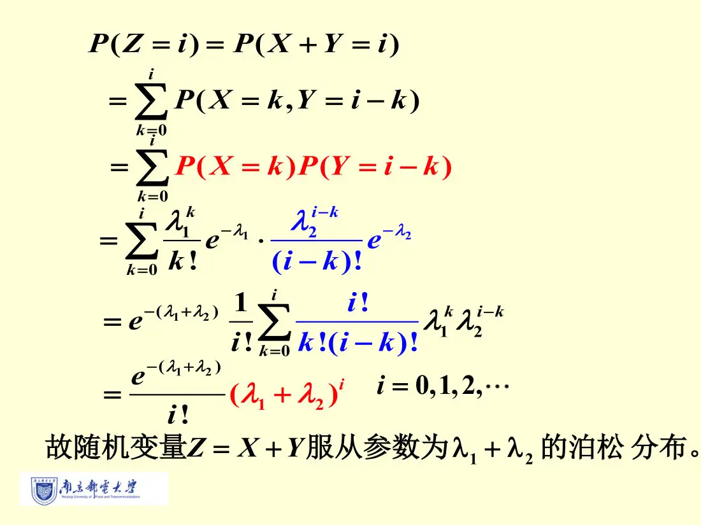

原文：

$$
\begin{array}{r l} & P (Z = i) = P (X + Y = i) \\ & \quad = \sum_ {k = 0} ^ {i} P (X = k, Y = i - k) \\ & \quad = \sum_ {k = 0} ^ {i} P (X = k) P (Y = i - k) \\ & \quad = \sum_ {k = 0} ^ {i} \frac {\lambda_ {1} ^ {k}}{k !} e ^ {- \lambda_ {1}} \cdot \frac {\lambda_ {2} ^ {i - k}}{(i - k) !} e ^ {- \lambda_ {2}} \\ & \quad = e ^ {- (\lambda_ {1} + \lambda_ {2})} \frac {1}{i !} \sum_ {k = 0} ^ {i} \frac {i !}{k ! (i - k) !} \lambda_ {1} ^ {k} \lambda_ {2} ^ {i - k} \\ & \quad = \frac {e ^ {- (\lambda_ {1} + \lambda_ {2})}}{i !} (\lambda_ {1} + \lambda_ {2}) ^ {i} \quad i = 0, 1, 2, \dots \end{array}
$$

故随机变量 $Z = X + Y$ 服从参数为 $\lambda_{1} + \lambda_{2}$ 的泊松分布。

南京邮电大学
Nanjing University of Posts and Telecommunications

### 南京邮电大学

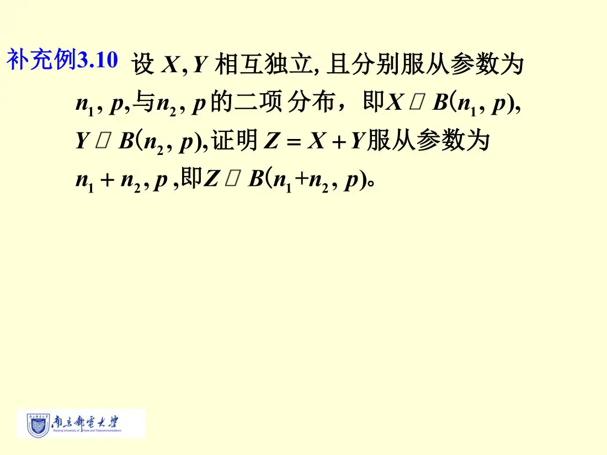

原文：

补充例3.10 设 X, Y 相互独立, 且分别服从参数为 $n_{1}, p$ , 与 $n_{2}, p$ 的二项分布, 即 $X \square B(n_{1}, p)$ , $Y \square B(n_{2}, p)$ , 证明 $Z = X + Y$ 服从参数为 $n_{1} + n_{2}, p$ , 即 $Z \square B(n_{1} + n_{2}, p)$ 。

南京邮电大学
Nanjing University of Posts and Telecommunications

### $$

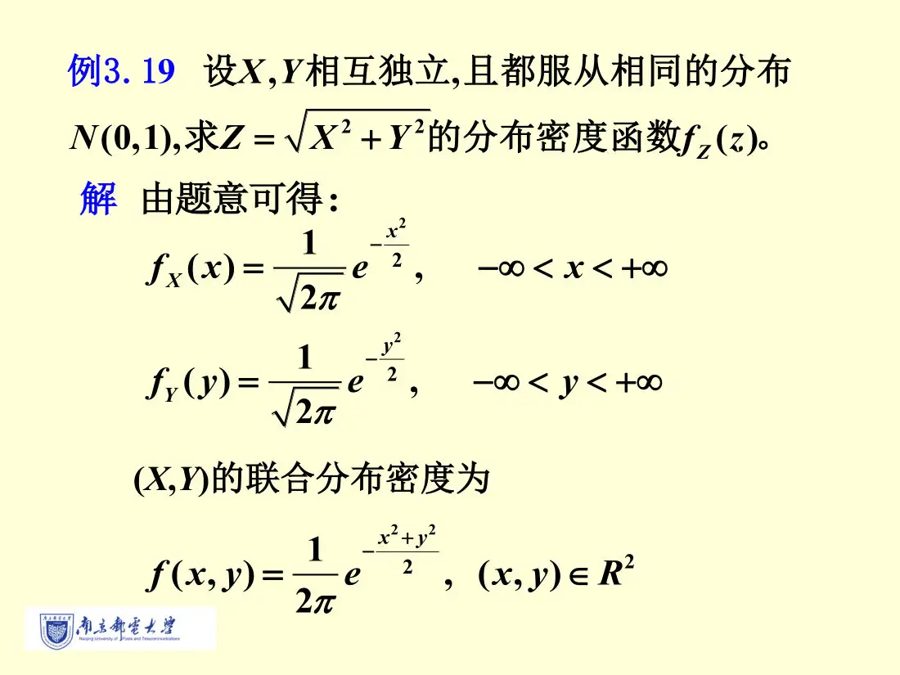

原文：

例3.19 设X,Y相互独立,且都服从相同的分布 $N(0,1)$ ,求 $Z=\sqrt{X^{2}+Y^{2}}$ 的分布密度函数 $f_{z}(z)$ 。解 由题意可得:

$$
f _ {X} (x) = \frac {1}{\sqrt {2 \pi}} e ^ {- \frac {x ^ {2}}{2}}, \quad - \infty <   x <   + \infty
$$

$$
f _ {Y} (y) = \frac {1}{\sqrt {2 \pi}} e ^ {- \frac {y ^ {2}}{2}}, \quad - \infty <   y <   + \infty
$$

$(X,Y)$ 的联合分布密度为

$$
f (x, y) = \frac {1}{2 \pi} e ^ {- \frac {x ^ {2} + y ^ {2}}{2}}, (x, y) \in R ^ {2}
$$

南京邮电大学
Nanjing University of Posts and Telecommunications

### 由分布函数定义

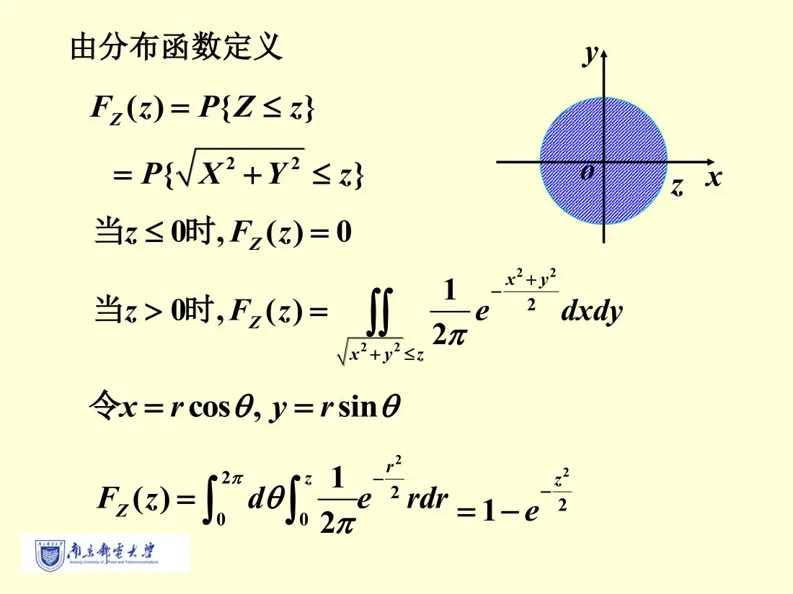

原文：

由分布函数定义

$$
\begin{array}{r l} & F _ {Z} (z) = P \{Z \leq z \} \\ & = P \{\sqrt {X ^ {2} + Y ^ {2}} \leq z \} \end{array}
$$

当 $z \leq 0$ 时, $F_{z}(z) = 0$

当 $z > 0$ 时， $F_{z}(z) = \iint_{\sqrt{x^{2} + y^{2}} \leq z} \frac{1}{2\pi} e^{-\frac{x^{2} + y^{2}}{2}} dx dy$

令 $x = r\cos \theta ,y = r\sin \theta$

$$
F _ {z} (z) = \int_ {0} ^ {2 \pi} d \theta \int_ {0} ^ {z} \frac {1}{2 \pi} e ^ {- \frac {r ^ {2}}{2}} r d r = 1 - e ^ {- \frac {z ^ {2}}{2}}
$$

南京邮电大学
Nanjing University of Posts and Telecommunications

### 于是，Z的分布函数为

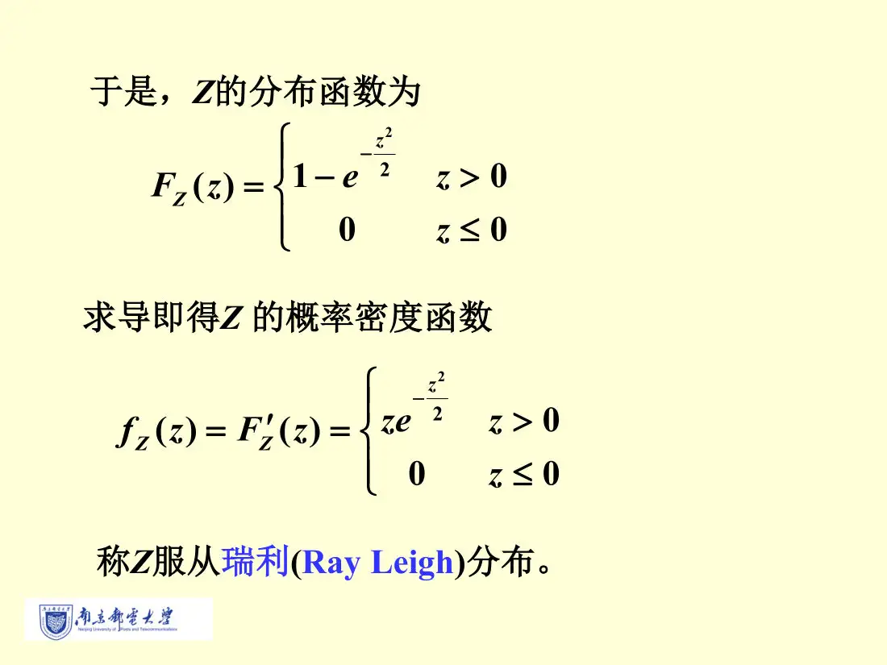

原文：

于是，Z的分布函数为

$$
F _ {Z} (z) = \left\{ \begin{array}{c c} 1 - e ^ {- \frac {z ^ {2}}{2}} & z > 0 \\ 0 & z \leq 0 \end{array} \right.
$$

求导即得Z的概率密度函数

$$
f _ {Z} (z) = F _ {Z} ^ {\prime} (z) = \left\{ \begin{array}{c c} z e ^ {- \frac {z ^ {2}}{2}} & z > 0 \\ 0 & z \leq 0 \end{array} \right.
$$

称Z服从瑞利(Ray Leigh)分布。

南京邮电大学
Nanjing University of Posts and Telecommunications

### 3.5.2 连续型随机变量函数的分布

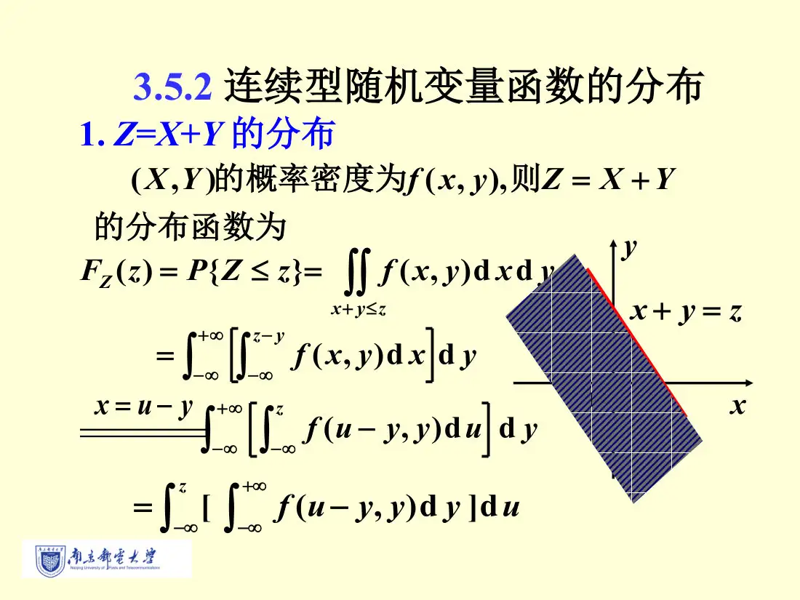

原文：

3.5.2 连续型随机变量函数的分布

1. $Z = X + Y$ 的分布

(X,Y)的概率密度为 $f(x,y)$ ，则 $Z=X+Y$ 的分布函数为

$$
\begin{array}{r l} & F _ {Z} (z) = P \{Z \leq z \} = \iint_ {x + y \leq z} f (x, y) \mathrm{d} x \mathrm{d} y \\ & \quad = \int_ {- \infty} ^ {+ \infty} \left[ \int_ {- \infty} ^ {z - y} f (x, y) \mathrm{d} x \right] \mathrm{d} y \\ & \frac {x = u - y}{- \infty} \int_ {- \infty} ^ {+ \infty} \left[ \int_ {- \infty} ^ {z} f (u - y, y) \mathrm{d} u \right] \mathrm{d} y \\ & \quad = \int_ {- \infty} ^ {z} [ \int_ {- \infty} ^ {+ \infty} f (u - y, y) \mathrm{d} y ] \mathrm{d} u \end{array}
$$

南京邮电大学
Nanjing University of Posts and Telecommunications

### 由此可得概率密度函数为

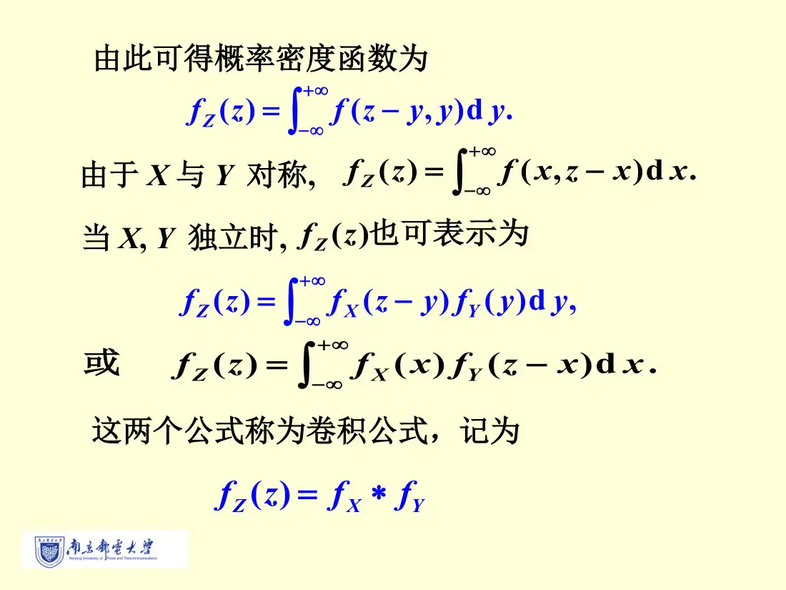

原文：

由此可得概率密度函数为

$f_{Z}(z) = \int_{-\infty}^{+\infty}f(z - y,y)\mathrm{d}y.$ 由于 $X$ 与 $Y$ 对称， $f_{Z}(z) = \int_{-\infty}^{+\infty}f(x,z - x)\mathrm{d}x.$ 当 $X,Y$ 独立时， $f_{Z}(z)$ 也可表示为

$f_{Z}(z) = \int_{-\infty}^{+\infty}f_{X}(z - y)f_{Y}(y)\mathrm{d}y,$ 或 $f_{Z}(z) = \int_{-\infty}^{+\infty}f_{X}(x)f_{Y}(z - x)\mathrm{d}x.$ 这两个公式称为卷积公式，记为

$$
f _ {Z} (z) = f _ {X} * f _ {Y}
$$

南京邮电大学
Nanjing University of Posts and Telecommunications

### 例3.22 设 $(X, Y)$ 的联合密度函数为

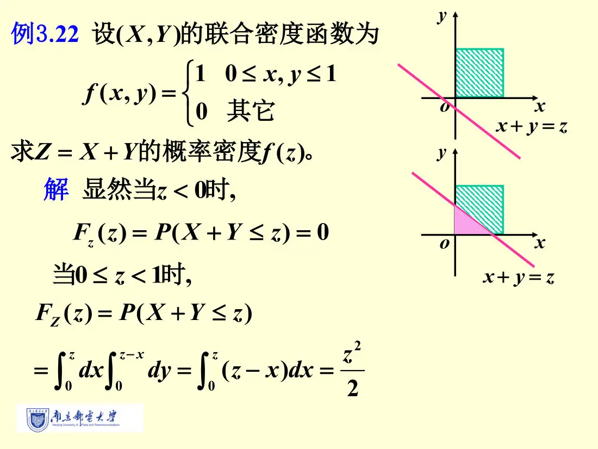

原文：

例3.22 设 $(X, Y)$ 的联合密度函数为

$f(x,y) = \left\{ \begin{array}{ll}1 & 0\leq x,y\leq 1\\ 0 & \text{其它} \end{array} \right.$ 求 $Z = X + Y$ 的概率密度 $f(z)$ 。

解 显然当z<0时,

$$
F _ {z} (z) = P (X + Y \leq z) = 0
$$

当 $0 \leq z < 1$ 时，

$$
F _ {z} (z) = P (X + Y \leq z)
$$

$$
= \int_ {0} ^ {z} d x \int_ {0} ^ {z - x} d y = \int_ {0} ^ {z} (z - x) d x = \frac {z ^ {2}}{2}
$$

南京邮电大学
Nanjing University of Posts and Telecommunications

### 当 $1 \leq z < 2$ 时,

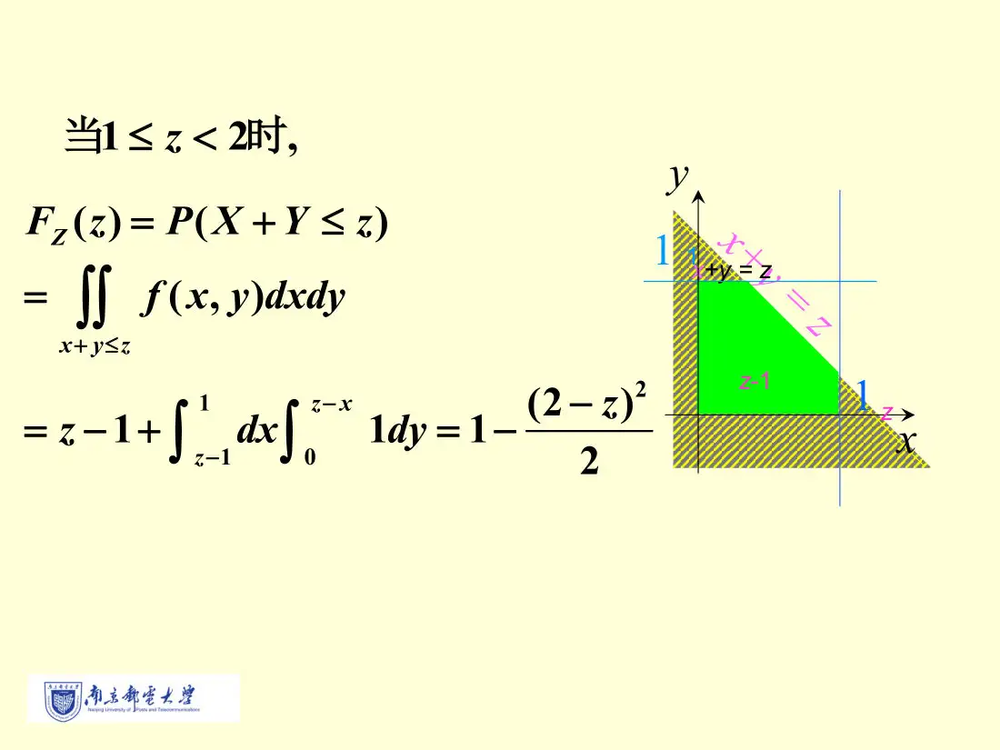

原文：

当 $1 \leq z < 2$ 时,

$$
\begin{array}{l} F _ {z} (z) = P (X + Y \leq z) \\ = \iint_ {x + y \leq z} f (x, y) d x d y \\ = z - 1 + \int_ {z - 1} ^ {1} d x \int_ {0} ^ {z - x} 1 d y = 1 - \frac {(2 - z) ^ {2}}{2} \end{array}
$$

南京邮电大学
Nanjing University of Posts and Telecommunications

### 所以， $X + Y$ 的分布函数为

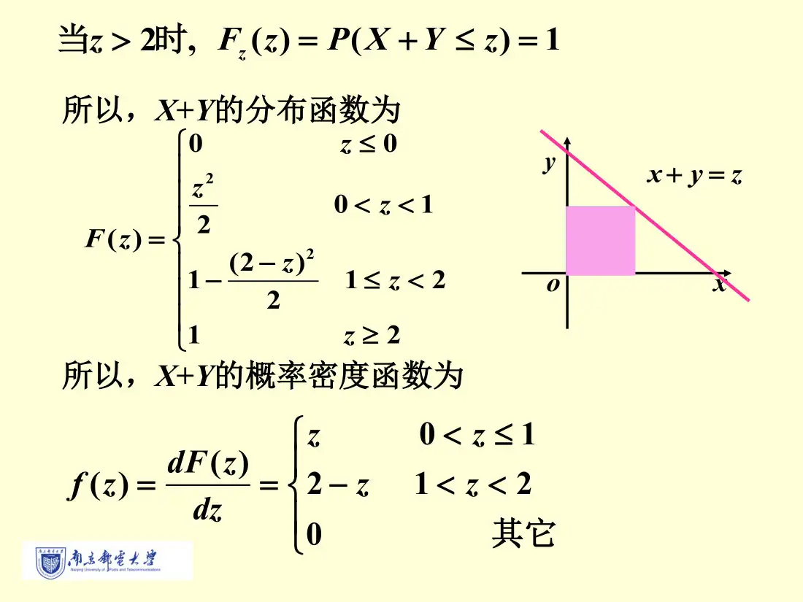

原文：

当 $z > 2$ 时， $F_{z}(z) = P(X + Y \leq z) = 1$

所以， $X + Y$ 的分布函数为

$$
F (z) = \left\{ \begin{array}{l l} 0 & z \leq 0 \\ \frac {z ^ {2}}{2} & 0 <   z <   1 \\ 1 - \frac {(2 - z) ^ {2}}{2} & 1 \leq z <   2 \\ 1 & z \geq 2 \end{array} \right. \quad \text {   and   } x + y = z
$$

所以， $X + Y$ 的概率密度函数为

$$
f (z) = \frac {d F (z)}{d z} = \left\{ \begin{array}{l l} z & 0 <   z \leq 1 \\ 2 - z & 1 <   z <   2 \\ 0 & \text {其它} \end{array} \right.
$$

南京邮电大学
Nanjing University of Posts and Telecommunications

### 解法2

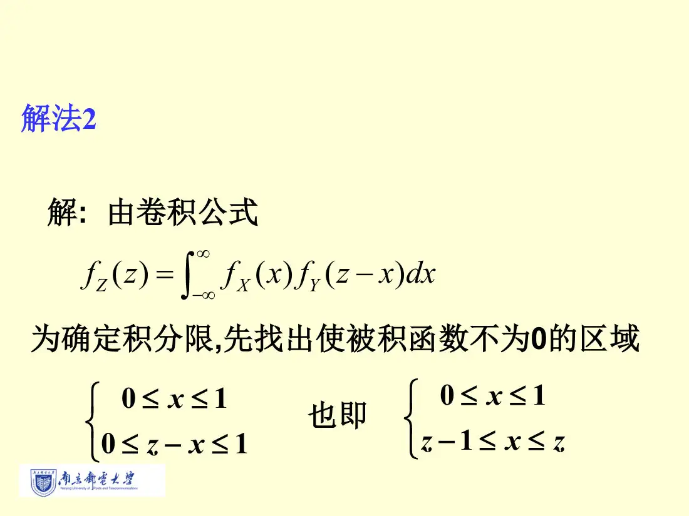

原文：

解法2

解：由卷积公式

$$
f _ {Z} (z) = \int_ {- \infty} ^ {\infty} f _ {X} (x) f _ {Y} (z - x) d x
$$

为确定积分限,先找出使被积函数不为0的区域

$$
\left\{ \begin{array}{l l} {0 \leq x \leq 1} \\ {0 \leq z - x \leq 1} \end{array} \right. \quad \text {也即} \quad \left\{ \begin{array}{l l} {0 \leq x \leq 1} \\ {z - 1 \leq x \leq z} \end{array} \right.
$$

南京邮电大学
Nanjing University of Posts and Telecommunications

### $$

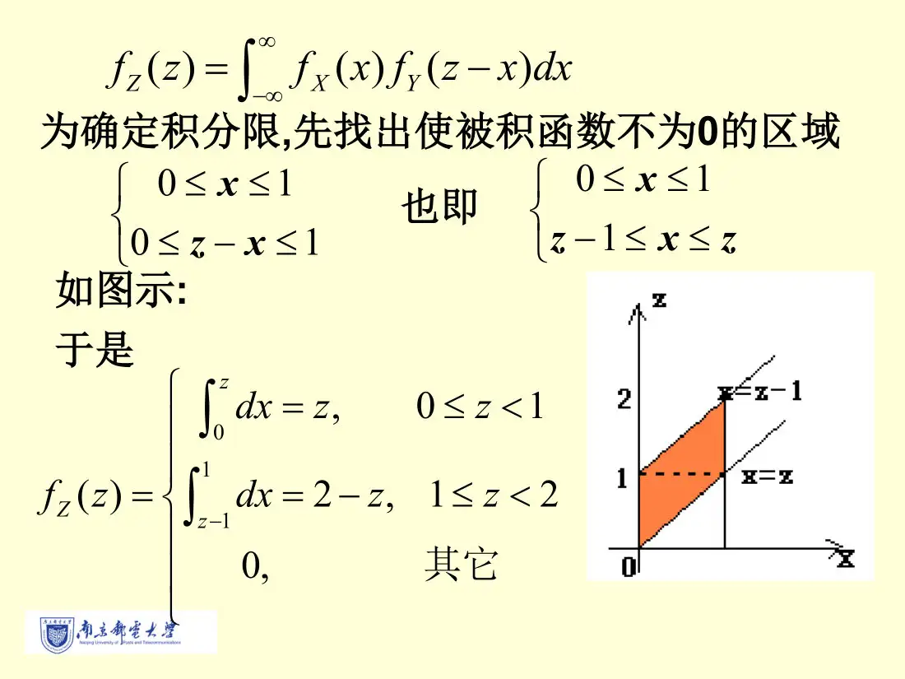

原文：

$$
f _ {Z} (z) = \int_ {- \infty} ^ {\infty} f _ {X} (x) f _ {Y} (z - x) d x
$$

为确定积分限,先找出使被积函数不为0的区域

$$
\left\{ \begin{array}{l} 0 \leq x \leq 1 \\ 0 \leq z - x \leq 1 \end{array} \right.
$$

也即

$$
\left\{ \begin{array}{c} 0 \leq x \leq 1 \\ z - 1 \leq x \leq z \end{array} \right.
$$

如图示:

于是

$$
f _ {Z} (z) = \left\{ \begin{array}{c l} \int_ {0} ^ {z} d x = z, & 0 \leq z <   1 \\ \int_ {z - 1} ^ {1} d x = 2 - z, & 1 \leq z <   2 \\ 0, & \text {其它} \end{array} \right.
$$

南京邮电大学
Nanjing University of Posts and Telecommunications

### 例3.20 设X与Y相互独立,

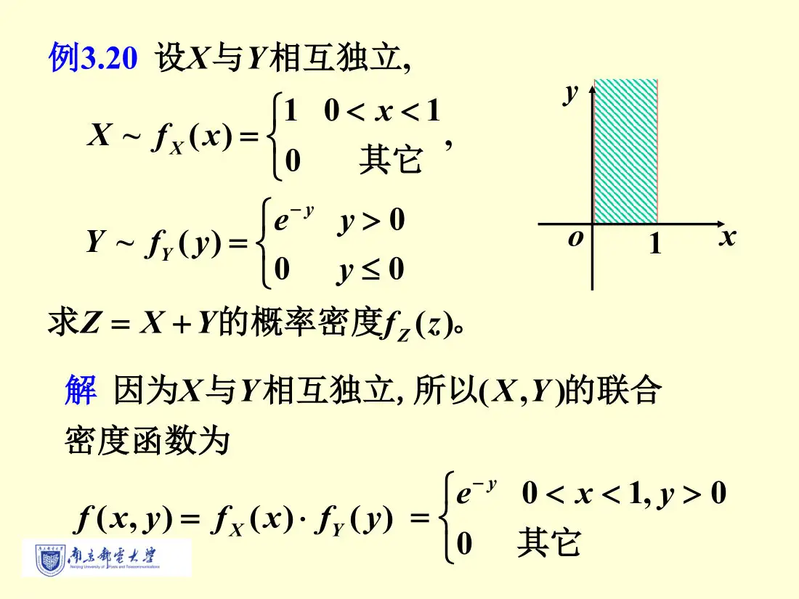

原文：

例3.20 设X与Y相互独立,

$X \sim f_{X}(x) = \begin{cases} 1 & 0 < x < 1 \\ 0 & \text{其它} \end{cases}$ ,

$$
Y \sim f _ {Y} (y) = \left\{ \begin{array}{l l} e ^ {- y} & y > 0 \\ 0 & y \leq 0 \end{array} \right.
$$

求 $Z=X+Y$ 的概率密度 $f_{Z}(z)$ 。

解 因为X与Y相互独立, 所以 $(X,Y)$ 的联合密度函数为

$$
f (x, y) = f _ {X} (x) \cdot f _ {Y} (y) = \left\{ \begin{array}{l l} e ^ {- y} & 0 <   x <   1, y > 0 \\ 0 & \text {其它} \end{array} \right.
$$

南京邮电大学
Nanjing University of Posts and Telecommunications

### $$

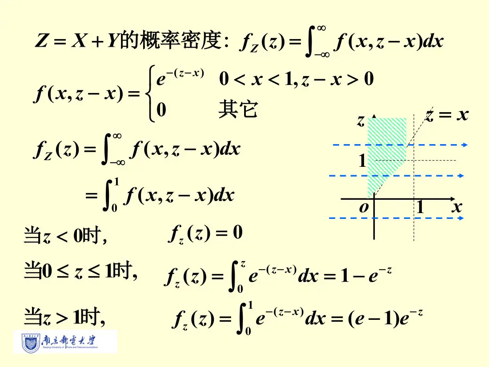

原文：

$Z = X + Y$ 的概率密度： $f_{Z}(z) = \int_{-\infty}^{\infty}f(x,z - x)dx$

$f(x,z - x) = \left\{ \begin{array}{ll}e^{-(z - x)} & 0 <   x <   1,z - x > 0\\ 0 & \text{其它} \end{array} \right.$

$$
\begin{array}{r l} f _ {Z} (z) & = \int_ {- \infty} ^ {\infty} f (x, z - x) d x \\ & = \int_ {0} ^ {1} f (x, z - x) d x \end{array}
$$

当 $z < 0$ 时， $f_{z}(z) = 0$

当 $0 \leq z \leq 1$ 时， $f_{z}(z) = \int_{0}^{z} e^{-(z - x)} dx = 1 - e^{-z}$

当 $z > 1$ 时，

$$
f _ {z} (z) = \int_ {0} ^ {1} e ^ {- (z - x)} d x = (e - 1) e ^ {- z}
$$

南京邮电大学
Nanjing University of Posts and Telecommunications

### $Z = X + Y$ 的概率密度:

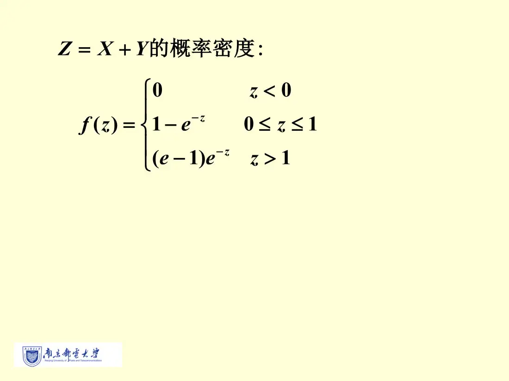

原文：

$Z = X + Y$ 的概率密度:

$$
f (z) = \left\{ \begin{array}{l l} 0 & z <   0 \\ 1 - e ^ {- z} & 0 \leq z \leq 1 \\ (e - 1) e ^ {- z} & z > 1 \end{array} \right.
$$

南京邮电大学
Nanjing University of Posts and Telecommunications

### $$

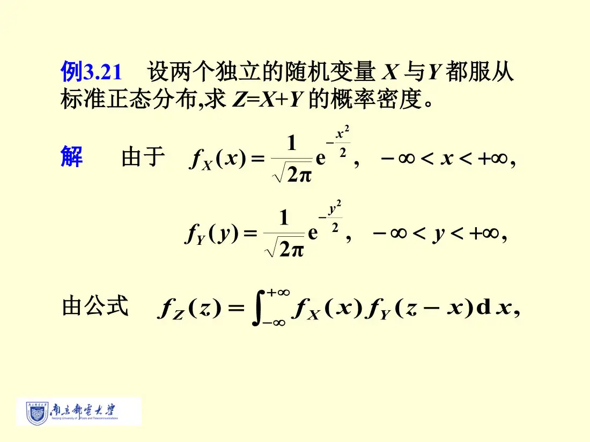

原文：

例3.21 设两个独立的随机变量 X 与 Y 都服从标准正态分布,求 $Z=X+Y$ 的概率密度。

解 由于 $f_{X}(x) = \frac{1}{\sqrt{2\pi}}\mathrm{e}^{-\frac{x^{2}}{2}}, -\infty < x < +\infty,$

$$
f _ {Y} (y) = \frac {1}{\sqrt {2 \pi}} \mathrm{e} ^ {- \frac {y ^ {2}}{2}}, - \infty <   y <   + \infty ,
$$

由公式 $f_{Z}(z) = \int_{-\infty}^{+\infty}f_{X}(x)f_{Y}(z - x)\mathrm{d}x,$

南京邮电大学
Nanjing University of Posts and Telecommunications

### 由公式

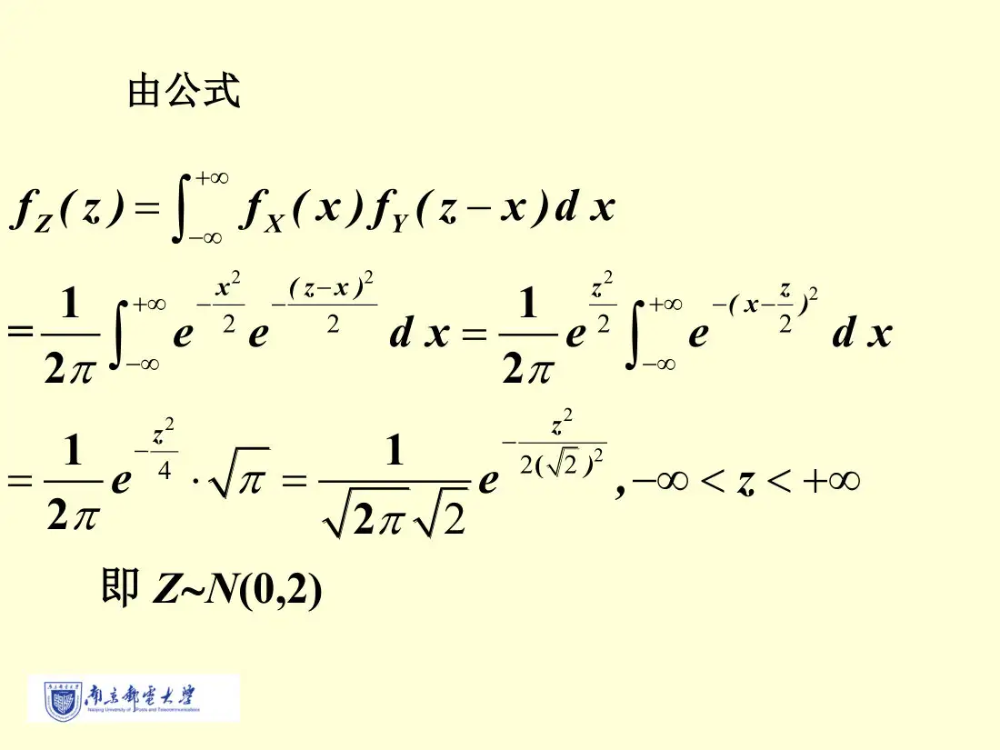

原文：

由公式

$$
\begin{array}{l} f _ {Z} (z) = \int_ {- \infty} ^ {+ \infty} f _ {X} (x) f _ {Y} (z - x) d x \\ = \frac {1}{2 \pi} \int_ {- \infty} ^ {+ \infty} e ^ {- \frac {x ^ {2}}{2}} e ^ {- \frac {(z - x) ^ {2}}{2}} d x = \frac {1}{2 \pi} e ^ {\frac {z ^ {2}}{2}} \int_ {- \infty} ^ {+ \infty} e ^ {- (x - \frac {z}{2}) ^ {2}} d x \\ = \frac {1}{2 \pi} e ^ {- \frac {z ^ {2}}{4}} \cdot \sqrt {\pi} = \frac {1}{\sqrt {2 \pi} \sqrt {2}} e ^ {- \frac {z ^ {2}}{2 (\sqrt {2}) ^ {2}}}, - \infty <   z <   + \infty \end{array}
$$

即 $Z \sim N(0,2)$

南京邮电大学
Nanjing University of Posts and Telecommunications

### $$

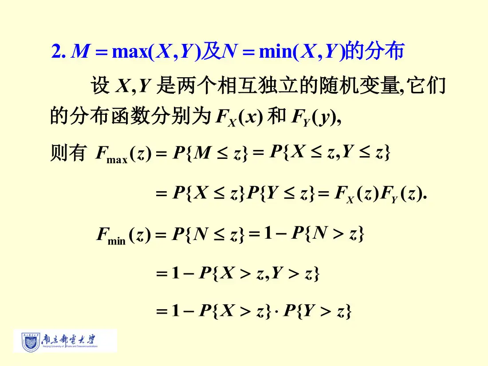

原文：

2. $M = \max(X, Y)$ 及 $N = \min(X, Y)$ 的分布

设 X,Y 是两个相互独立的随机变量,它们的分布函数分别为 $F_{X}(x)$ 和 $F_{Y}(y)$ ,

$$
\begin{array}{r l} & F _ {\max} (z) = P \{M \leq z \} = P \{X \leq z, Y \leq z \} \\ & \qquad = P \{X \leq z \} P \{Y \leq z \} = F _ {X} (z) F _ {Y} (z). \end{array}
$$

$$
\begin{array}{r l} F _ {\min} (z) & = P \{N \leq z \} = 1 - P \{N > z \} \\ & = 1 - P \{X > z, Y > z \} \\ & = 1 - P \{X > z \} \cdot P \{Y > z \} \end{array}
$$

南京邮电大学
Nanjing University of Posts and Telecommunications

### $$

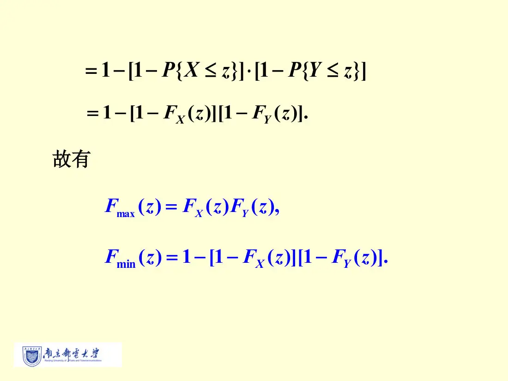

原文：

$$
\begin{array}{r l} & {= 1 - [ 1 - P \{X \leq z \} ] \cdot [ 1 - P \{Y \leq z \} ]} \\ & {= 1 - [ 1 - F _ {X} (z) ] [ 1 - F _ {Y} (z) ].} \end{array}
$$

故有

$$
F _ {\max} (z) = F _ {X} (z) F _ {Y} (z),
$$

$$
F _ {\mathrm{min}} (z) = 1 - [ 1 - F _ {X} (z) ] [ 1 - F _ {Y} (z) ].
$$

南京邮电大学
Nanjing University of Posts and Telecommunications

### 推广

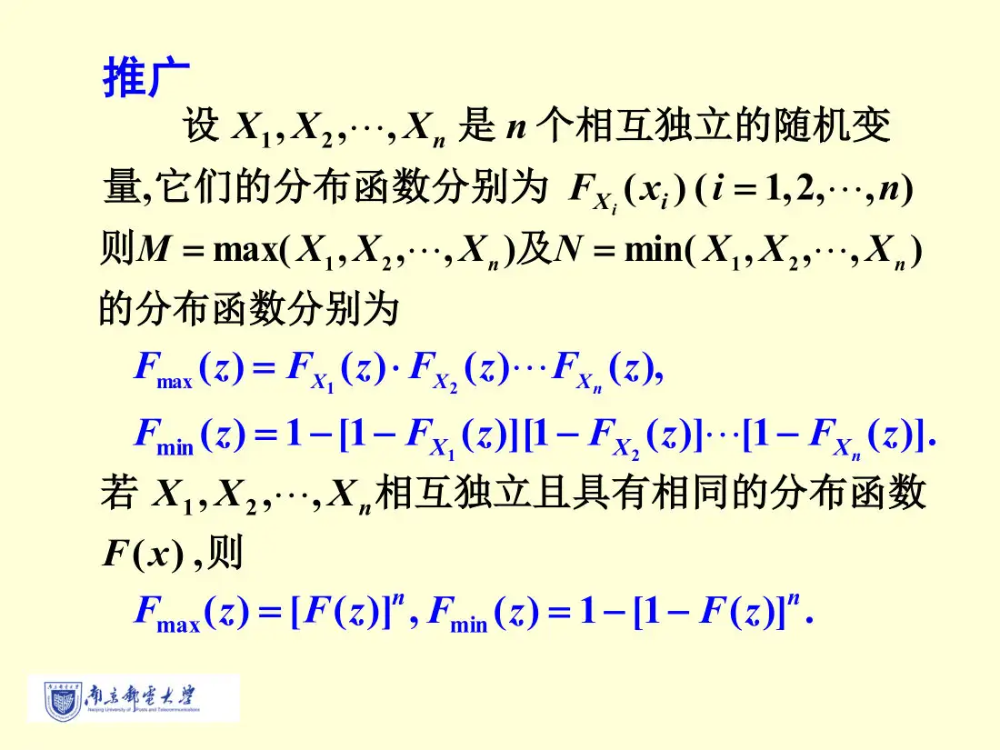

原文：

推广

设 $X_{1}, X_{2}, \cdots, X_{n}$ 是 n 个相互独立的随机变量, 它们的分布函数分别为 $F_{X_{i}}(x_{i}) (i = 1, 2, \cdots, n)$ 则 $M = \max(X_{1}, X_{2}, \cdots, X_{n})$ 及 $N = \min(X_{1}, X_{2}, \cdots, X_{n})$ 的分布函数分别为

$F_{\max}(z)=F_{X_{1}}(z)\cdot F_{X_{2}}(z)\cdots F_{X_{n}}(z),$ $F_{\min}(z)=1-[1-F_{X_{1}}(z)][1-F_{X_{2}}(z)]\cdots[1-F_{X_{n}}(z)].$ 若 $X_{1},X_{2},\cdots,X_{n}$ 相互独立且具有相同的分布函数 $F(x)$ ，则

$$
F _ {\max} (z) = [ F (z) ] ^ {n}, F _ {\min} (z) = 1 - [ 1 - F (z) ] ^ {n}.
$$

南京邮电大学
Nanjing University of Posts and Telecommunications

### 南京邮电大学

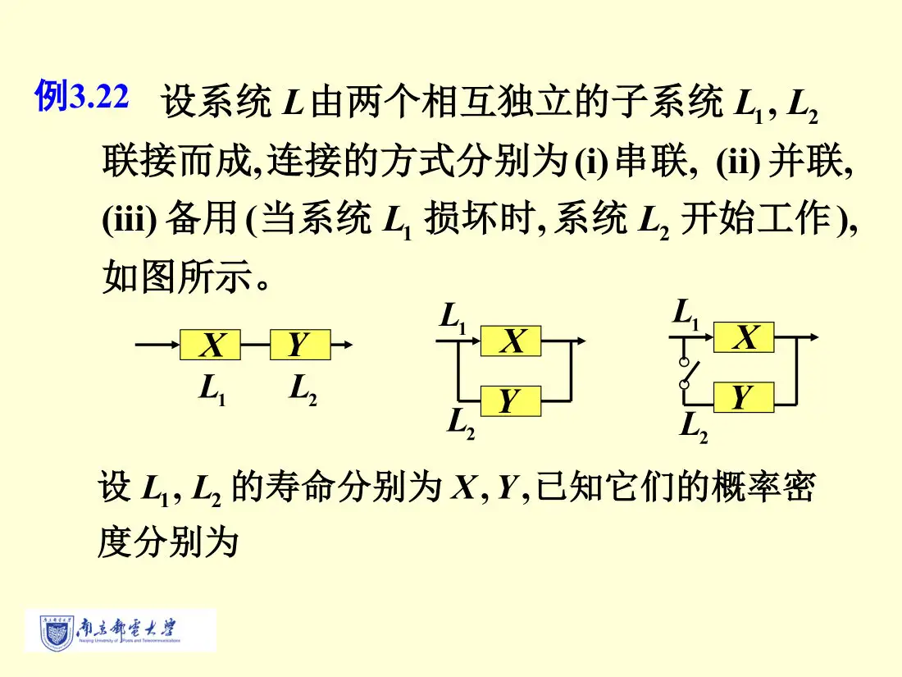

原文：

例3.22 设系统 L 由两个相互独立的子系统 $L_{1}, L_{2}$ 联接而成, 连接的方式分别为 (i) 串联, (ii) 并联, (iii) 备用 (当系统 $L_{1}$ 损坏时, 系统 $L_{2}$ 开始工作), 如图所示。

设 $L_{1}, L_{2}$ 的寿命分别为 X, Y, 已知它们的概率密度分别为

南京邮电大学
Nanjing University of Posts and Telecommunications

### $$

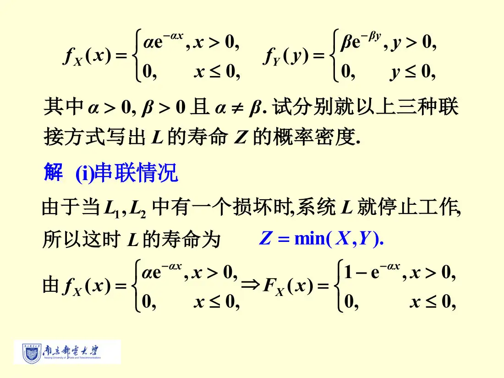

原文：

$$
f _ {X} (x) = \left\{ \begin{array}{l l} \alpha \mathrm{e} ^ {- \alpha x}, x > 0, \\ 0, & x \leq 0, \end{array} \right. f _ {Y} (y) = \left\{ \begin{array}{l l} \beta \mathrm{e} ^ {- \beta y}, y > 0, \\ 0, & y \leq 0, \end{array} \right.
$$

其中 $\alpha > 0, \beta > 0$ 且 $\alpha \neq \beta$ . 试分别就以上三种联接方式写出 L 的寿命 Z 的概率密度.

解 (i)串联情况

由于当 $L_{1},L_{2}$ 中有一个损坏时,系统L就停止工作,所以这时L的寿命为 $Z=\min(X,Y)$ .

$$
f _ {X} (x) = \left\{ \begin{array}{l l} \alpha \mathrm{e} ^ {- \alpha x}, & x > 0, \\ 0, & x \leq 0, \end{array} \right. \Rightarrow F _ {X} (x) = \left\{ \begin{array}{l l} 1 - \mathrm{e} ^ {- \alpha x}, & x > 0, \\ 0, & x \leq 0, \end{array} \right.
$$

南京邮电大学
Nanjing University of Posts and Telecommunications

### $$

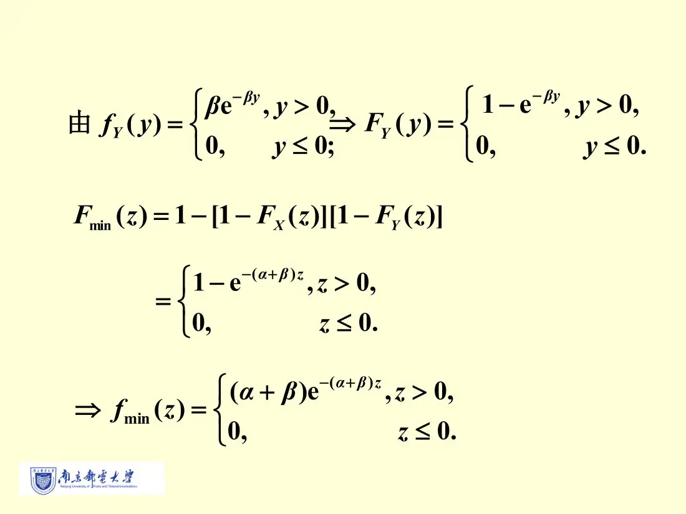

原文：

由 $f_{Y}(y) = \left\{ \begin{array}{ll}\beta \mathrm{e}^{-\beta y},y > 0,\\ 0,y\leq 0; \end{array} \right.\Rightarrow F_{Y}(y) = \left\{ \begin{array}{ll}1 - \mathrm{e}^{-\beta y},y > 0,\\ 0,y\leq 0. \end{array} \right.$

$$
\begin{array}{r l} F _ {\min} (z) & = 1 - [ 1 - F _ {X} (z) ] [ 1 - F _ {Y} (z) ] \\ & = \left\{ \begin{array}{l l} 1 - \mathrm{e} ^ {- (\alpha + \beta) z}, z > 0, \\ 0, & z \leq 0. \end{array} \right. \end{array}
$$

$$
\Rightarrow f _ {\min} (z) = \left\{ \begin{array}{l l} (\alpha + \beta) \mathrm{e} ^ {- (\alpha + \beta) z}, & z > 0, \\ 0, & z \leq 0. \end{array} \right.
$$

南京邮电大学
Nanjing University of Posts and Telecommunications

### (ii)并联情况

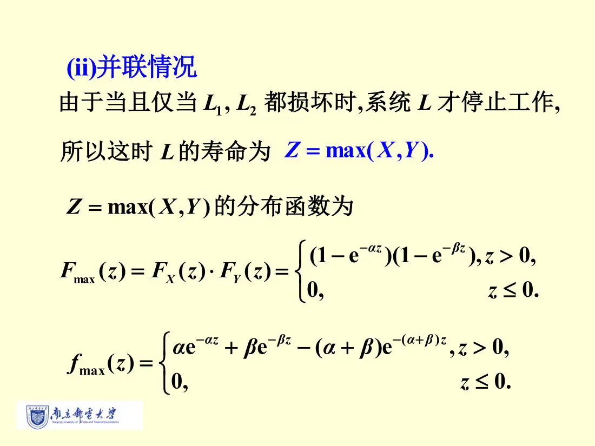

原文：

(ii)并联情况

由于当且仅当 $L_{1}, L_{2}$ 都损坏时, 系统 L 才停止工作,
所以这时 L 的寿命为 $Z = \max(X, Y)$ .

$Z = \max(X,Y)$ 的分布函数为

$$
F _ {\max} (z) = F _ {X} (z) \cdot F _ {Y} (z) = \left\{ \begin{array}{l l} (1 - \mathrm{e} ^ {- \alpha z}) (1 - \mathrm{e} ^ {- \beta z}), z > 0, \\ 0, & z \leq 0. \end{array} \right.
$$

$$
f _ {\max} (z) = \left\{ \begin{array}{l l} \alpha \mathrm{e} ^ {- \alpha z} + \beta \mathrm{e} ^ {- \beta z} - (\alpha + \beta) \mathrm{e} ^ {- (\alpha + \beta) z}, & z > 0, \\ 0, & z \leq 0. \end{array} \right.
$$

南京邮电大学
Nanjing University of Posts and Telecommunications

### (iii)备用的情况

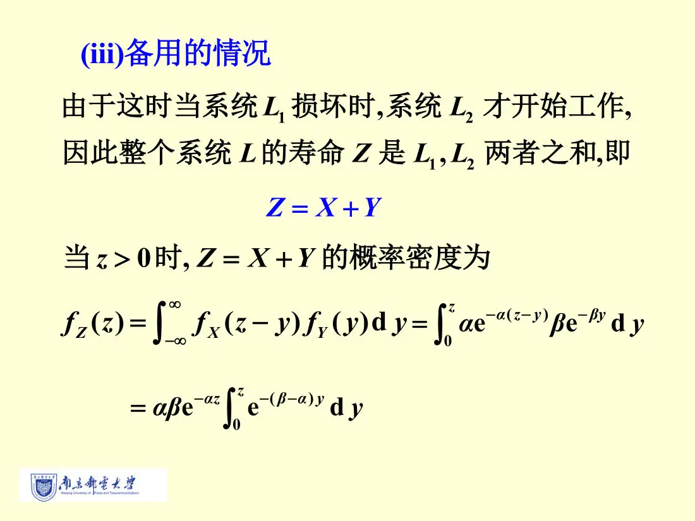

原文：

(iii)备用的情况

由于这时当系统 $L_{1}$ 损坏时, 系统 $L_{2}$ 才开始工作, 因此整个系统 $L$ 的寿命 $Z$ 是 $L_{1}, L_{2}$ 两者之和, 即

$$
Z = X + Y
$$

当 z > 0 时, $Z = X + Y$ 的概率密度为

$$
\begin{array}{r l} f _ {Z} (z) & = \int_ {- \infty} ^ {\infty} f _ {X} (z - y) f _ {Y} (y) \mathbf {d} y = \int_ {0} ^ {z} \alpha \mathrm{e} ^ {- \alpha (z - y)} \beta \mathrm{e} ^ {- \beta y} \mathbf {d} y \\ & = \alpha \beta \mathrm{e} ^ {- \alpha z} \int_ {0} ^ {z} \mathrm{e} ^ {- (\beta - \alpha) y} \mathbf {d} y \end{array}
$$

南京邮电大学
Nanjing University of Posts and Telecommunications

### $$

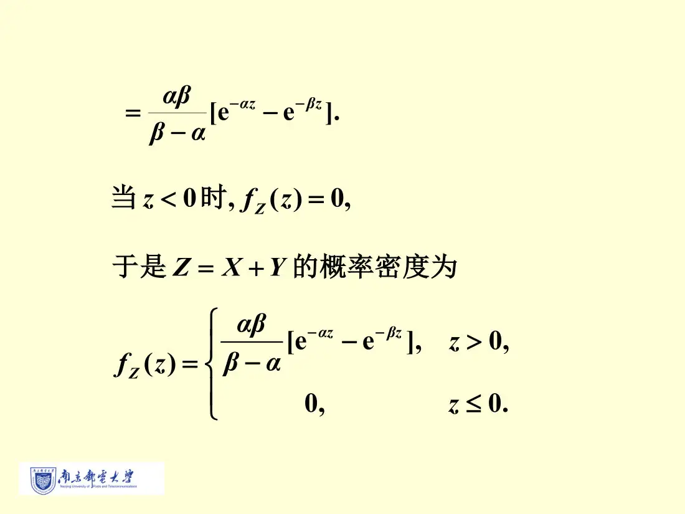

原文：

$$
= \frac {\alpha \beta}{\beta - \alpha} [ \mathrm{e} ^ {- \alpha z} - \mathrm{e} ^ {- \beta z} ].
$$

当 z < 0 时, $f_{z}(z) = 0$ ,

于是 $Z = X + Y$ 的概率密度为

$$
f _ {z} (z) = \left\{ \begin{array}{c c} \frac {\alpha \beta}{\beta - \alpha} [ \mathrm{e} ^ {- \alpha z} - \mathrm{e} ^ {- \beta z} ], & z > 0, \\ 0, & z \leq 0. \end{array} \right.
$$

南京邮电大学
Nanjing University of Posts and Telecommunications

### 小结

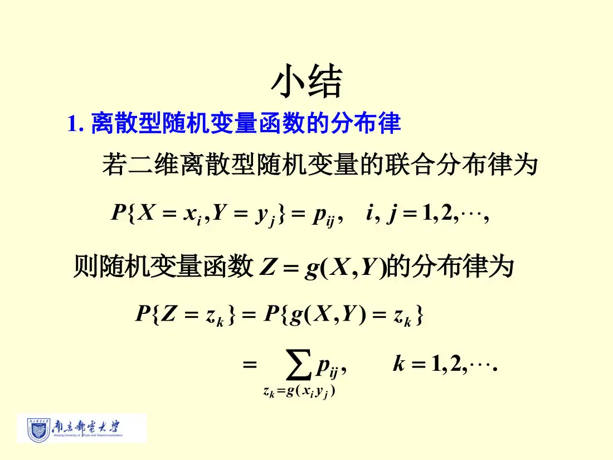

原文：

小结

1. 离散型随机变量函数的分布律

若二维离散型随机变量的联合分布律为

$$
P \{X = x _ {i}, Y = y _ {j} \} = p _ {i j}, i, j = 1, 2, \dots ,
$$

则随机变量函数 $Z = g(X,Y)$ 的分布律为

$$
\begin{array}{r l} P \{Z = z _ {k} \} & = P \{g (X, Y) = z _ {k} \} \\ & = \sum_ {z _ {k} = g (x _ {i} y _ {j})} p _ {i j}, \qquad k = 1, 2, \dots . \end{array}
$$

南京邮电大学
Nanjing University of Posts and Telecommunications
