# 《概率论与数理统计》第3章 二维随机变量函数的分布（课件）

原件的每一页，下面附识别出的文字。

### § 3.5 二维随机变量函数的分布

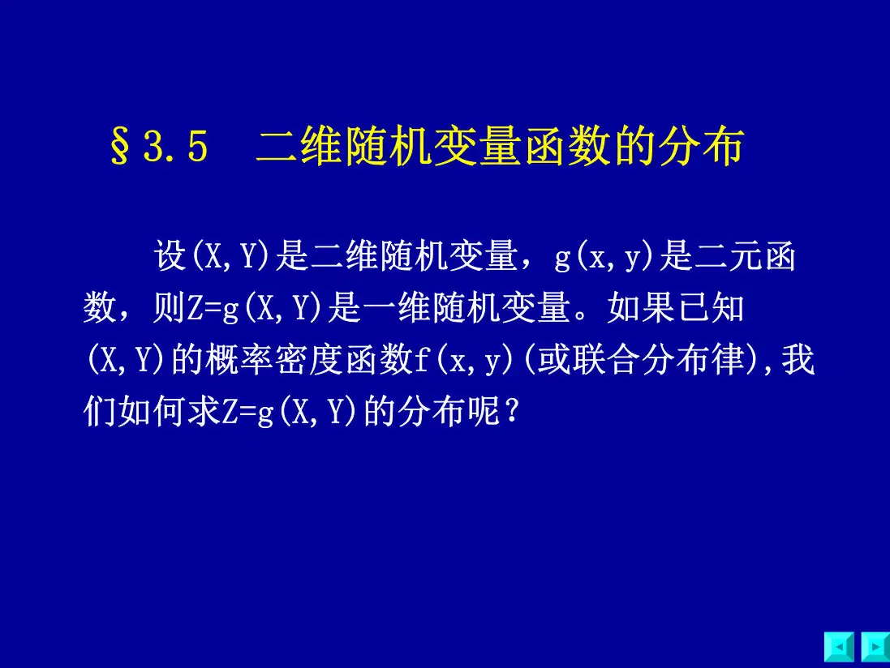

原文：

§ 3.5 二维随机变量函数的分布

设(X, Y)是二维随机变量，g(x, y)是二元函数，则Z=g(X, Y)是一维随机变量。如果已知(X, Y)的概率密度函数f(x, y)(或联合分布律)，我们如何求Z=g(X, Y)的分布呢？

### 一、分布函数法

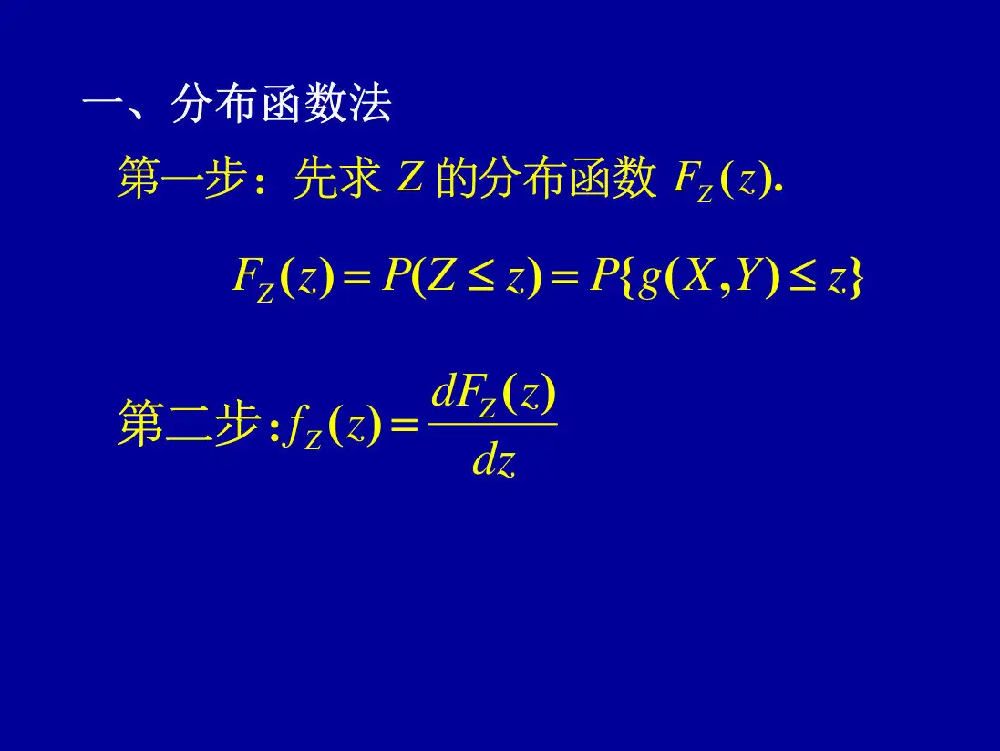

原文：

一、分布函数法

第一步：先求 Z 的分布函数 $F_{Z}(z)$ .

$$
F _ {Z} (z) = P (Z \leq z) = P \{g (X, Y) \leq z \}
$$

第二步: $f_{z}(z)=\frac{dF_{z}(z)}{dz}$ 例: 设X、Y相互独立, 且都服从相同的分布 $N(0,1)$ , 求 $Z = \sqrt{X^2 + Y^2}$ 的分布密度 $f_Z(z)$

### $$

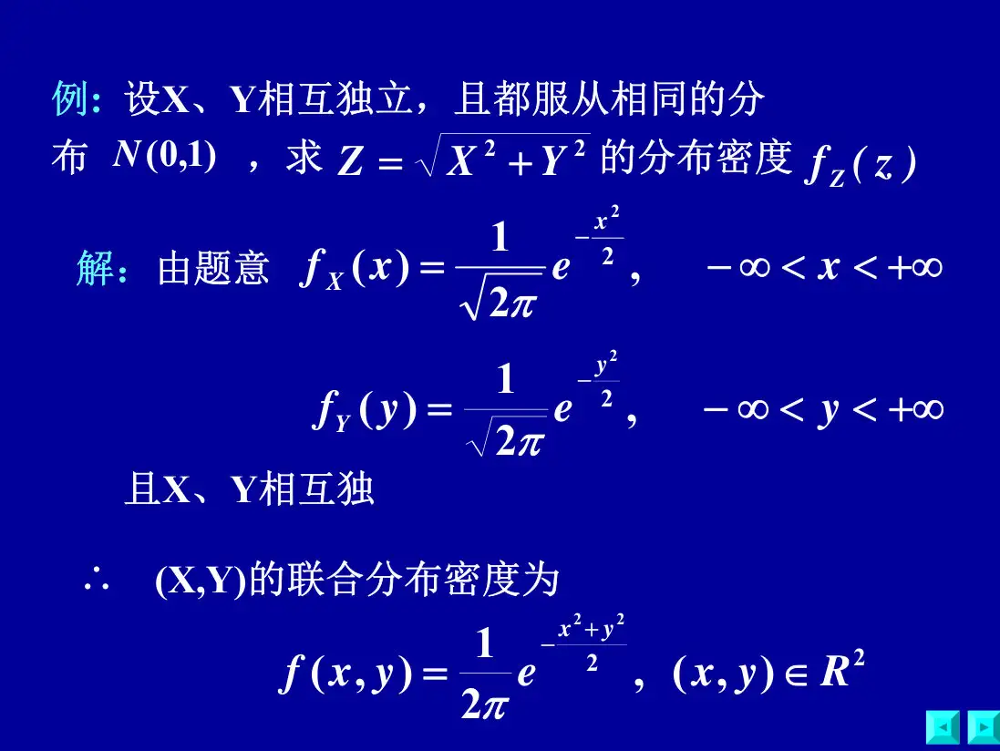

原文：

解：由题意 $f_{X}(x) = \frac{1}{\sqrt{2\pi}} e^{-\frac{x^{2}}{2}}, -\infty < x < +\infty$

$$
f _ {Y} (y) = \frac {1}{\sqrt {2 \pi}} e ^ {- \frac {y ^ {2}}{2}}, - \infty <   y <   + \infty
$$

且X、Y相互独

∴ (X,Y)的联合分布密度为

$$
f (x, y) = \frac {1}{2 \pi} e ^ {- \frac {x ^ {2} + y ^ {2}}{2}}, (x, y) \in R ^ {2}
$$

### 由分布函数定义

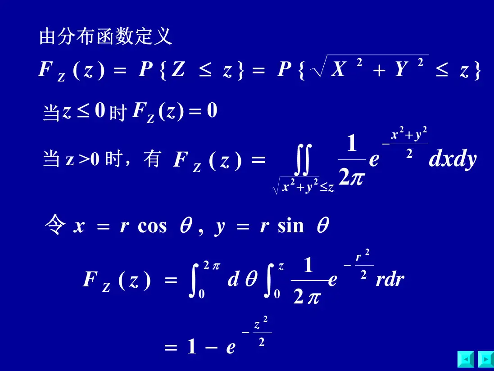

原文：

由分布函数定义

$$
F _ {z} (z) = P \{Z \leq z \} = P \{\sqrt {X ^ {2} + Y ^ {2}} \leq z \}
$$

当 $z \leq 0$ 时 $F_{z}(z) = 0$

当 $z > 0$ 时，有 $F_{z}(z) = \iint_{\sqrt{x^2 + y^2} \leq z} \frac{1}{2\pi} e^{-\frac{x^2 + y^2}{2}} dx dy$

令 $x = r \cos \theta, y = r \sin \theta$

$$
\begin{array}{l} F _ {z} (z) = \int_ {0} ^ {2 \pi} d \theta \int_ {0} ^ {z} \frac {1}{2 \pi} e ^ {- \frac {r ^ {2}}{2}} r d r \\ = 1 - e ^ {- \frac {z ^ {2}}{2}} \end{array}
$$

### 于是，Z的分布函数为

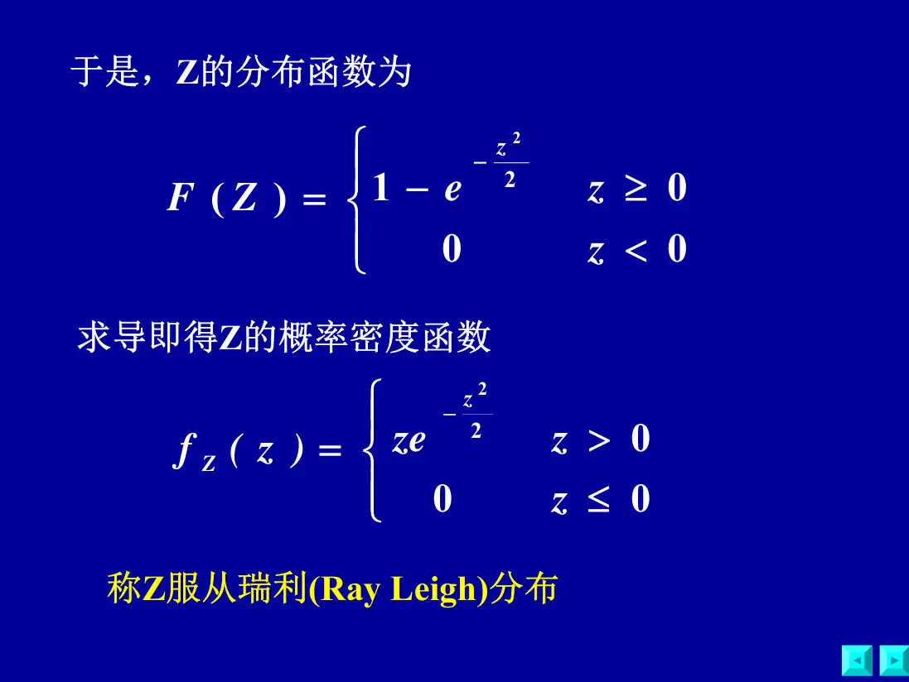

原文：

于是，Z的分布函数为

$$
F (Z) = \left\{ \begin{array}{c c} 1 - e ^ {- \frac {z ^ {2}}{2}} & z \geq 0 \\ 0 & z <   0 \end{array} \right.
$$

求导即得Z的概率密度函数

$$
f _ {z} (z) = \left\{ \begin{array}{c c} z e ^ {- \frac {z ^ {2}}{2}} & z > 0 \\ 0 & z \leq 0 \end{array} \right.
$$

称Z服从瑞利(Ray Leigh)分布

### 二、二维随机变量函数和X+Y的分布

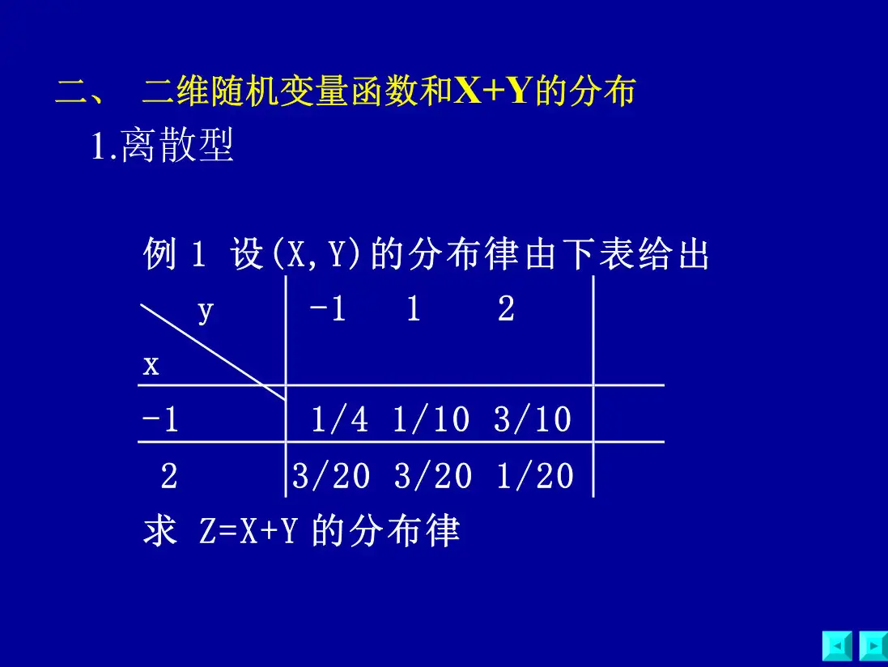

原文：

二、二维随机变量函数和X+Y的分布

1. 离散型

例 1 设(X, Y)的分布律由下表给出

1/4 1/10 3/10

3/20 3/20 1/20

求 $Z = X + Y$ 的分布律

### 解：由上表可得(X, Y)的所有取值, 重新列表如下:

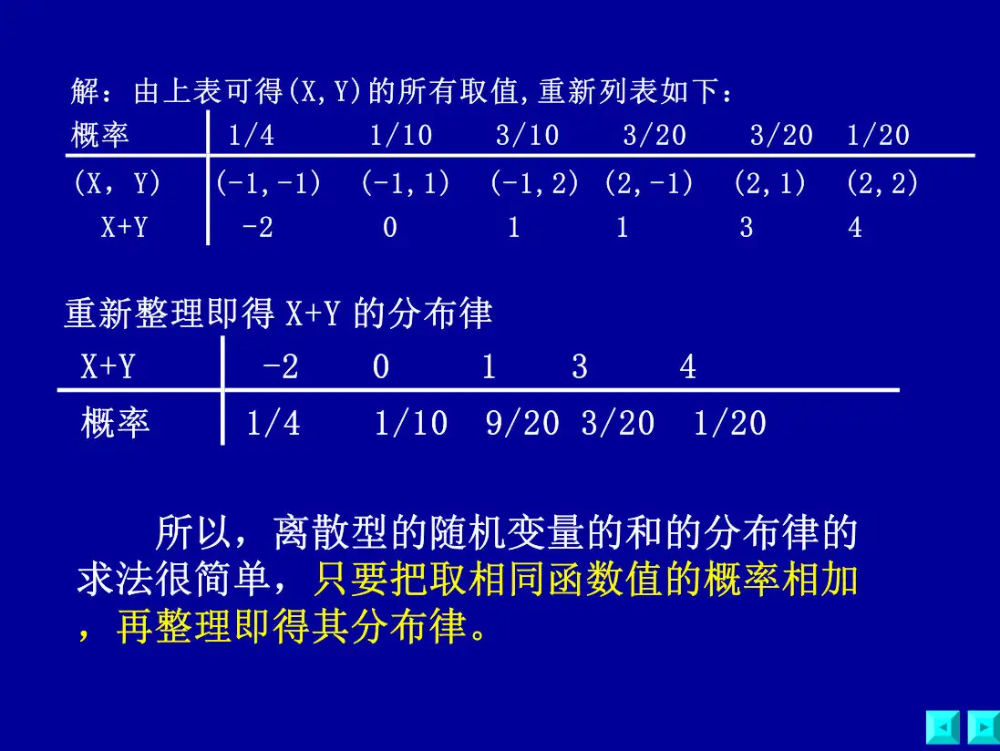

原文：

解：由上表可得(X, Y)的所有取值, 重新列表如下:
概率 | 1/4 | 1/10 | 3/10 | 3/20 | 3/20 | 1/20

(X, Y)
X+Y (-1, 1)

(2, 2)

重新整理即得 $X + Y$ 的分布律

X+Y

-2

3

4

概率

1/4 1/10 9/20 3/20 1/20

所以，离散型的随机变量的和的分布律的求法很简单，只要把取相同函数值的概率相加，再整理即得其分布律。

### $$

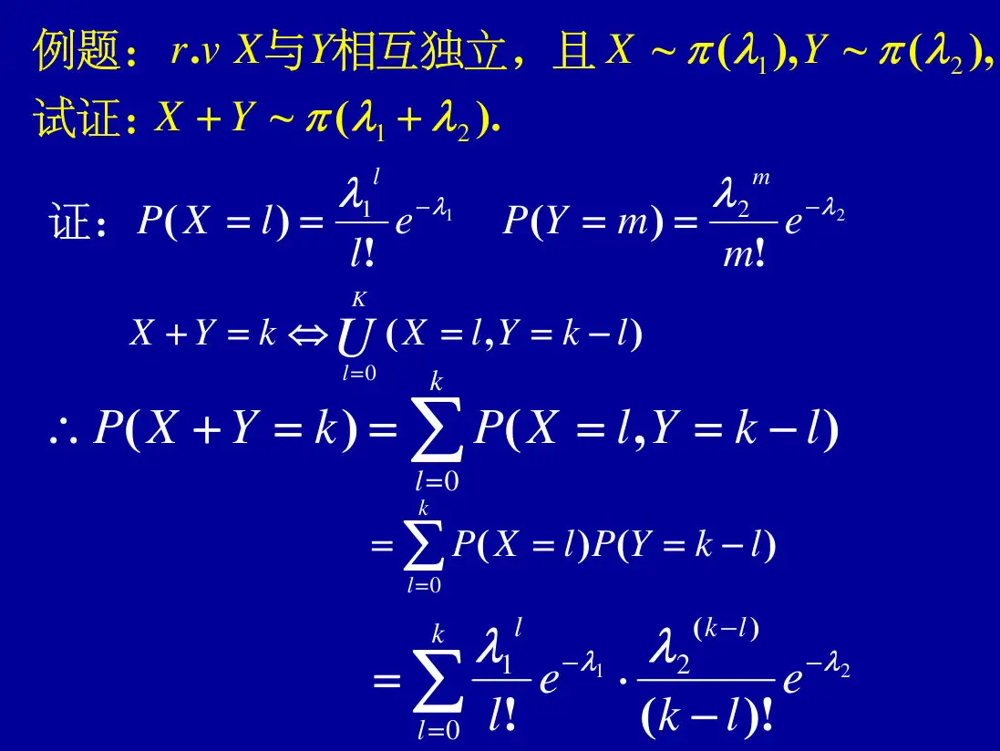

原文：

例题: $r \cdot v X$ 与 $Y$ 相互独立, 且 $X \sim \pi(\lambda_1), Y \sim \pi(\lambda_2)$ , 试证: $X + Y \sim \pi(\lambda_1 + \lambda_2)$ .

证： $P(X=l)=\frac{\lambda_{1}^{l}}{l!}e^{-\lambda_{1}}$ $P(Y=m)=\frac{\lambda_{2}^{m}}{m!}e^{-\lambda_{2}}$

$$
X + Y = k \Leftrightarrow \bigcup_ {l = 0} ^ {K} (X = l, Y = k - l)
$$

$$
\begin{array}{r l} & {\therefore P (X + Y = k) = \sum_ {l = 0} ^ {k} P (X = l, Y = k - l)} \\ & {\qquad = \sum_ {l = 0} ^ {k} P (X = l) P (Y = k - l)} \\ & {\qquad = \sum_ {l = 0} ^ {k} \frac {\lambda_ {1} ^ {l}}{l !} e ^ {- \lambda_ {1}} \cdot \frac {\lambda_ {2} ^ {(k - l)}}{(k - l) !} e ^ {- \lambda_ {2}}} \end{array}
$$

### $$

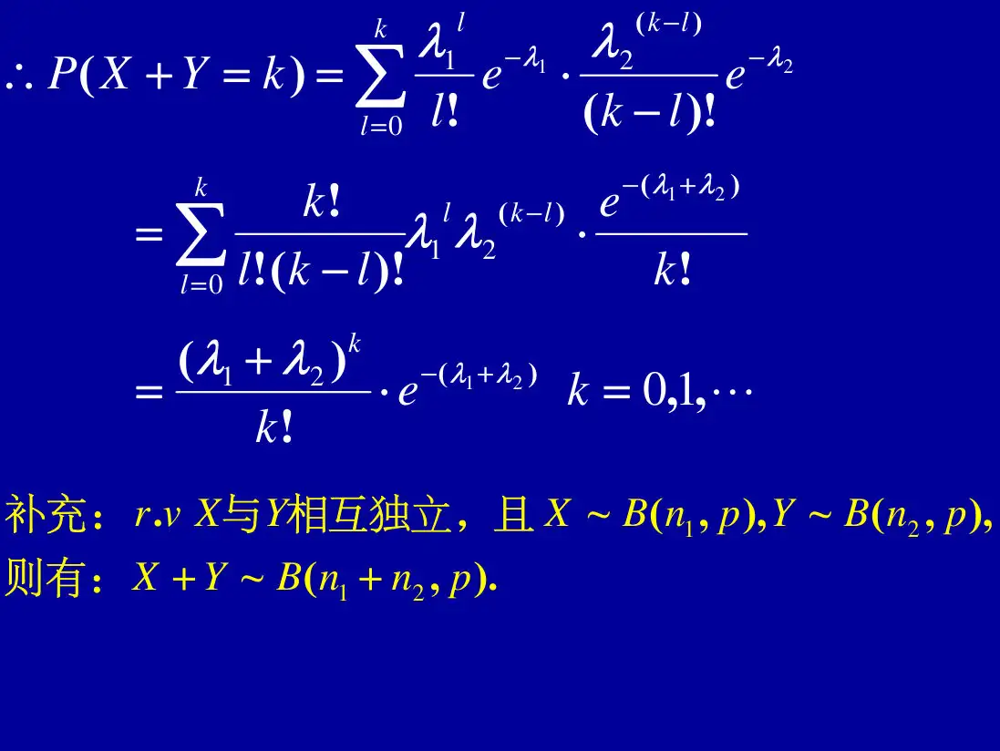

原文：

$$
\begin{array}{r l} & {\therefore P (X + Y = k) = \sum_ {l = 0} ^ {k} \frac {\lambda_ {1} ^ {l}}{l !} e ^ {- \lambda_ {1}} \cdot \frac {\lambda_ {2} ^ {(k - l)}}{(k - l) !} e ^ {- \lambda_ {2}}} \\ & {\qquad = \sum_ {l = 0} ^ {k} \frac {k !}{l ! (k - l) !} \lambda_ {1} ^ {l} \lambda_ {2} ^ {(k - l)} \cdot \frac {e ^ {- (\lambda_ {1} + \lambda_ {2})}}{k !}} \\ & {\qquad = \frac {(\lambda_ {1} + \lambda_ {2}) ^ {k}}{k !} \cdot e ^ {- (\lambda_ {1} + \lambda_ {2})} k = 0, 1, \dots} \end{array}
$$

补充：r.v X与Y相互独立，且 $X \sim B(n_{1}, p), Y \sim B(n_{2}, p)$ ，则有： $X + Y \sim B(n_{1} + n_{2}, p)$ .

### 2、连续型

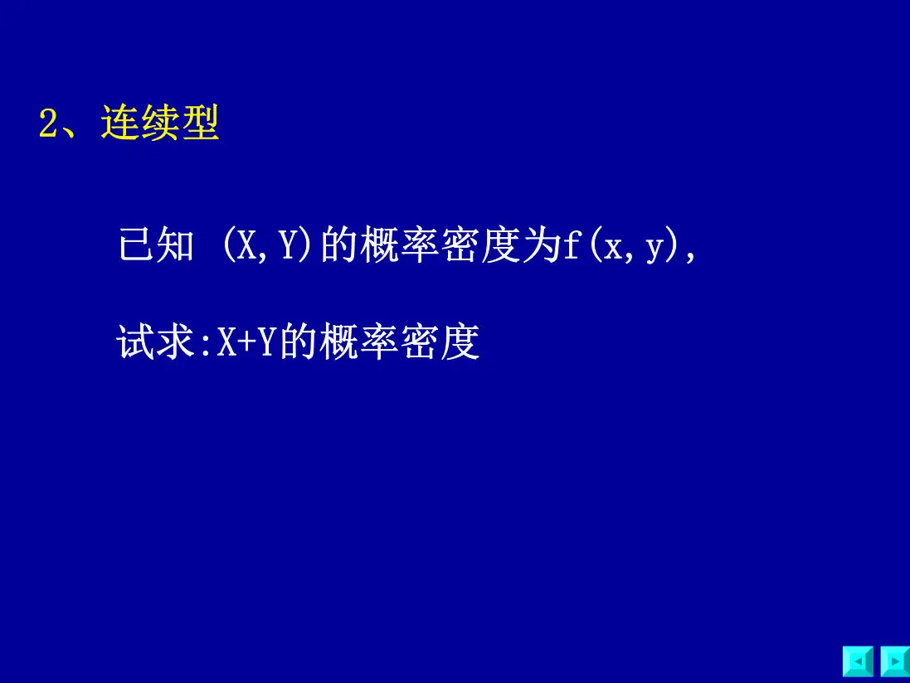

原文：

2、连续型

已知 $(X, Y)$ 的概率密度为 $f(x, y)$ ,

试求: X+Y的概率密度

### $$

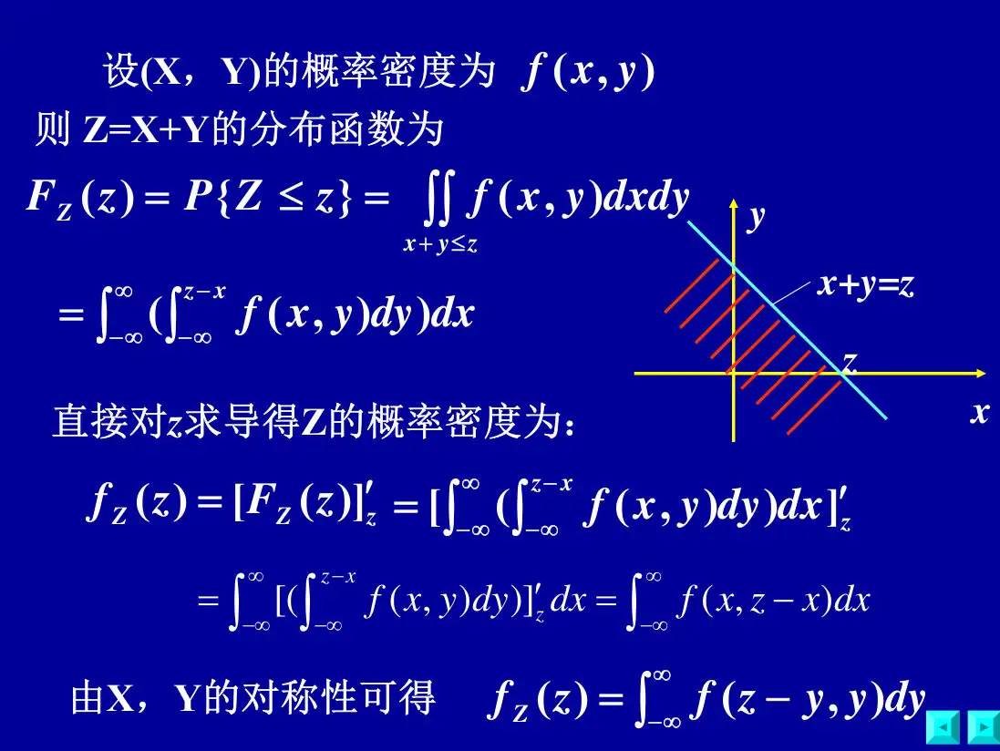

原文：

设(X, Y)的概率密度为 $f(x, y)$ 则 $\mathbf{Z} = \mathbf{X} + \mathbf{Y}$ 的分布函数为

$$
F _ {z} (z) = P \{Z \leq z \} = \iint_ {x + y \leq z} f (x, y) d x d y
$$

$$
= \int_ {- \infty} ^ {\infty} (\int_ {- \infty} ^ {z - x} f (x, y) d y) d x
$$

$$
x + y = z
$$

直接对z求导得Z的概率密度为:

$$
f _ {z} (z) = [ F _ {z} (z) ] _ {z} ^ {\prime} = [ \int_ {- \infty} ^ {\infty} (\int_ {- \infty} ^ {z - x} f (x, y) d y) d x ] _ {z} ^ {\prime}
$$

$$
= \int_ {- \infty} ^ {\infty} [ (\int_ {- \infty} ^ {z - x} f (x, y) d y) ] _ {z} ^ {\prime} d x = \int_ {- \infty} ^ {\infty} f (x, z - x) d x
$$

由X，Y的对称性可得 $f_{Z}(z) = \int_{-\infty}^{\infty}f(z - y,y)dy$

### $$

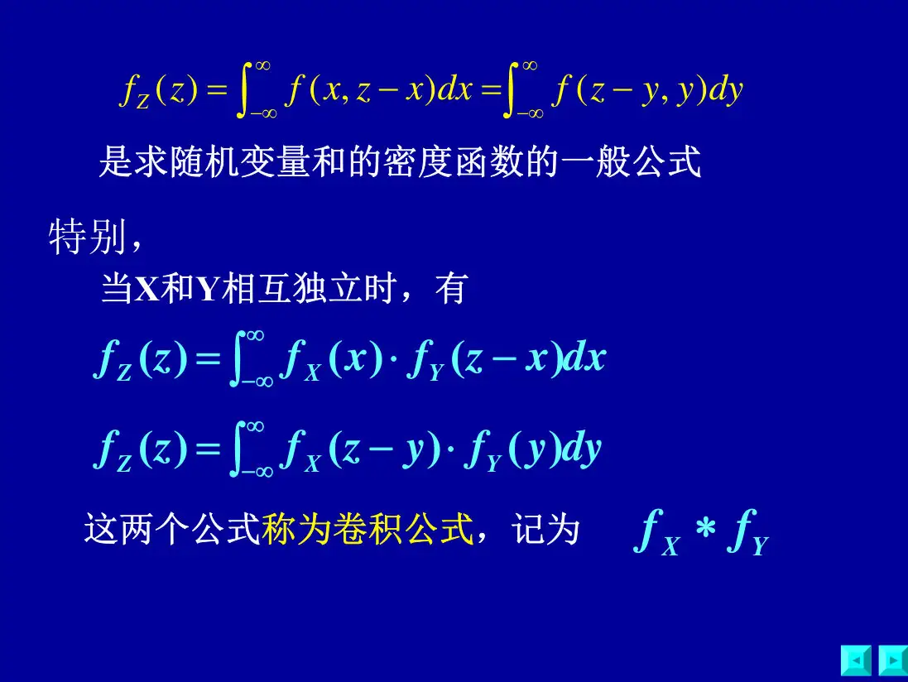

原文：

$$
f _ {z} (z) = \int_ {- \infty} ^ {\infty} f (x, z - x) d x = \int_ {- \infty} ^ {\infty} f (z - y, y) d y
$$

是求随机变量和的密度函数的一般公式

特别，

当X和Y相互独立时，有

$$
f _ {Z} (z) = \int_ {- \infty} ^ {\infty} f _ {X} (x) \cdot f _ {Y} (z - x) d x
$$

$$
f _ {Z} (z) = \int_ {- \infty} ^ {\infty} f _ {X} (z - y) \cdot f _ {Y} (y) d y
$$

这两个公式称为卷积公式，记为 $f_{X} * f_{Y}$ 例2: 已知随机变量X, Y都服从N(0,1)分布, 且X与Y相互独立, 试证 $Z = X + Y \sim N(0,2)$

### 证: 由 $X, Y \sim N(0,1)$ 得

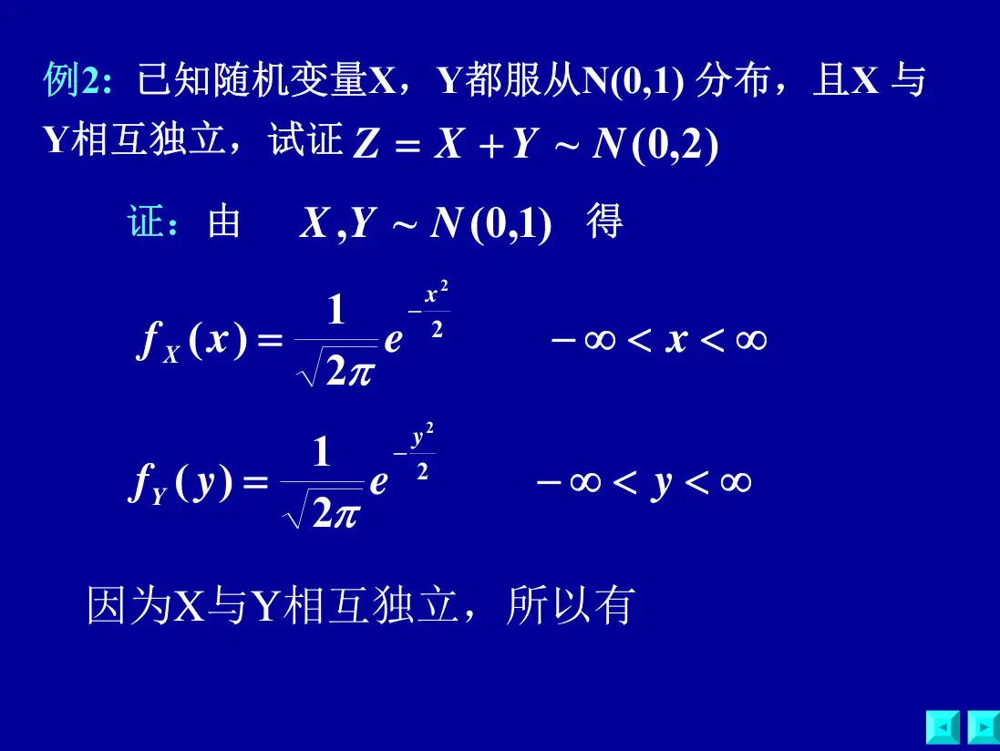

原文：

证: 由 $X, Y \sim N(0,1)$ 得

$$
f _ {X} (x) = \frac {1}{\sqrt {2 \pi}} e ^ {- \frac {x ^ {2}}{2}} - \infty <   x <   \infty
$$

$$
f _ {Y} (y) = \frac {1}{\sqrt {2 \pi}} e ^ {- \frac {y ^ {2}}{2}} - \infty <   y <   \infty
$$

因为X与Y相互独立，所以有

### $$

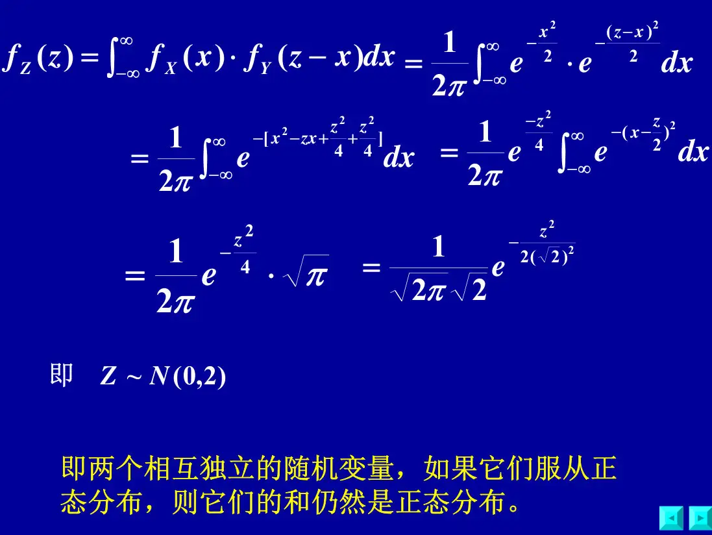

原文：

$$
\begin{array}{r l} f _ {Z} (z) & = \int_ {- \infty} ^ {\infty} f _ {X} (x) \cdot f _ {Y} (z - x) d x = \frac {1}{2 \pi} \int_ {- \infty} ^ {\infty} e ^ {- \frac {x ^ {2}}{2}} \cdot e ^ {- \frac {(z - x) ^ {2}}{2}} d x \\ & = \frac {1}{2 \pi} \int_ {- \infty} ^ {\infty} e ^ {- [ x ^ {2} - z x + \frac {z ^ {2}}{4} + \frac {z ^ {2}}{4} ]} d x = \frac {1}{2 \pi} e ^ {\frac {- z ^ {2}}{4}} \int_ {- \infty} ^ {\infty} e ^ {- (x - \frac {z}{2}) ^ {2}} d x \\ & = \frac {1}{2 \pi} e ^ {- \frac {z ^ {2}}{4}} \cdot \sqrt {\pi} = \frac {1}{\sqrt {2 \pi} \sqrt {2}} e ^ {- \frac {z ^ {2}}{2 (\sqrt {2}) ^ {2}}} \end{array}
$$

即 $Z \sim N(0,2)$

即两个相互独立的随机变量，如果它们服从正态分布，则它们的和仍然是正态分布。

### 一般，设X，Y相互独立且

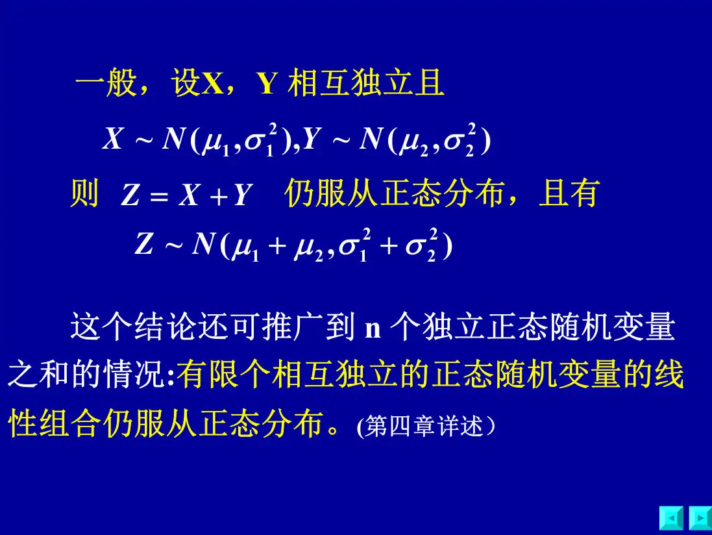

原文：

一般，设X，Y相互独立且

$X \sim N(\mu_{1}, \sigma_{1}^{2}), Y \sim N(\mu_{2}, \sigma_{2}^{2})$ 则 $Z = X + Y$ 仍服从正态分布，且有 $Z \sim N(\mu_{1} + \mu_{2}, \sigma_{1}^{2} + \sigma_{2}^{2})$

这个结论还可推广到 n 个独立正态随机变量之和的情况:有限个相互独立的正态随机变量的线性组合仍服从正态分布。(第四章详述)

### 例3: 已知 $(X, Y)$ 的概率密度为

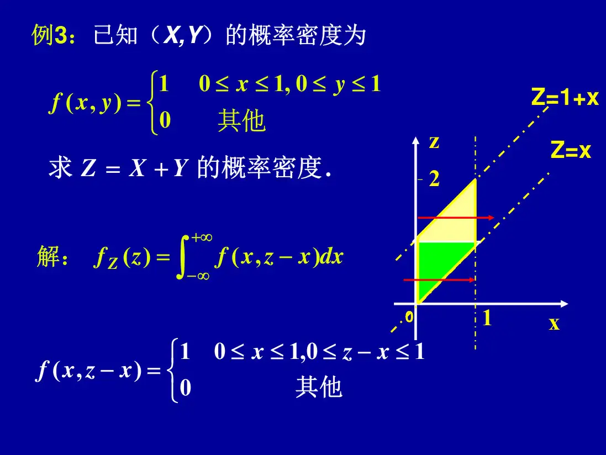

原文：

例3: 已知 $(X, Y)$ 的概率密度为

$$
f (x, y) = \left\{ \begin{array}{l l} 1 & 0 \leq x \leq 1, 0 \leq y \leq 1 \\ 0 & \text {其他} \end{array} \right.
$$

求 $Z = X + Y$ 的概率密度.

解： $f_{Z}(z) = \int_{-\infty}^{+\infty}f(x,z - x)dx$

$f(x,z - x) = \left\{ \begin{array}{ll}1 & 0\leq x\leq 1,0\leq z - x\leq 1\\ 0 & \text{其他} \end{array} \right.$

### $$

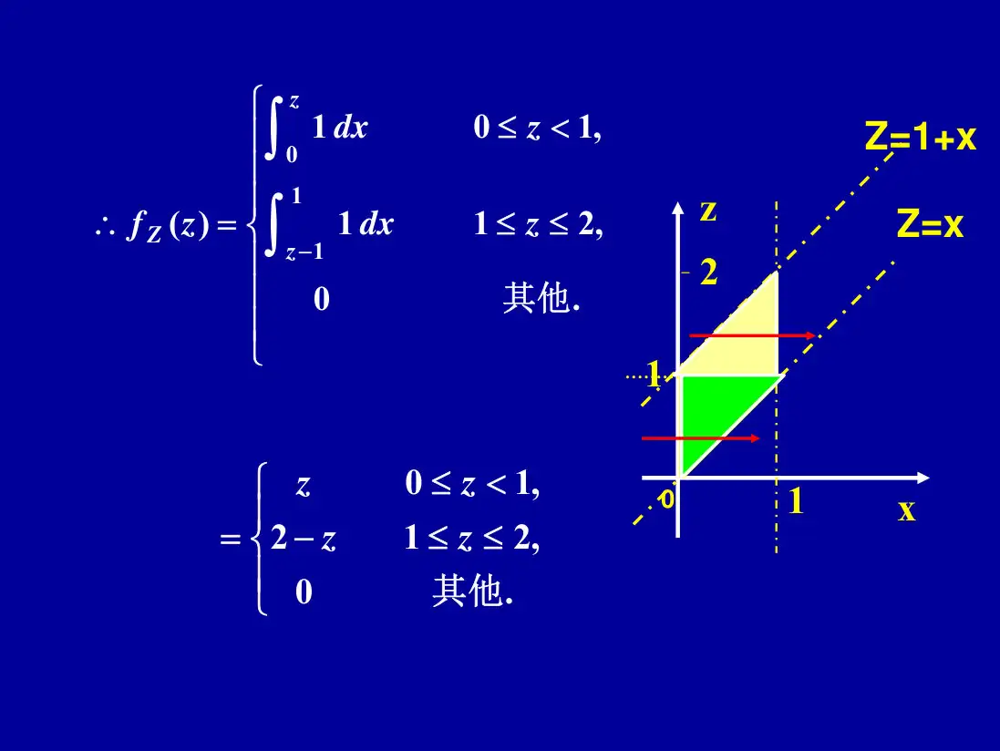

原文：

$$
\therefore f _ {Z} (z) = \left\{ \begin{array}{c} \int_ {0} ^ {z} 1 d x \\ \int_ {z - 1} ^ {1} 1 d x \\ 0 \end{array} \right.
$$

$$
= \left\{ \begin{array}{c} z \\ 2 - z \\ 0 \end{array} \right.
$$

$$
0 \le z <   1,
$$

$$
1 \le z \le 2,
$$

其他.

其他.

$Z = 1 + X$

### 练习: 设二维随机变量 (X,Y)

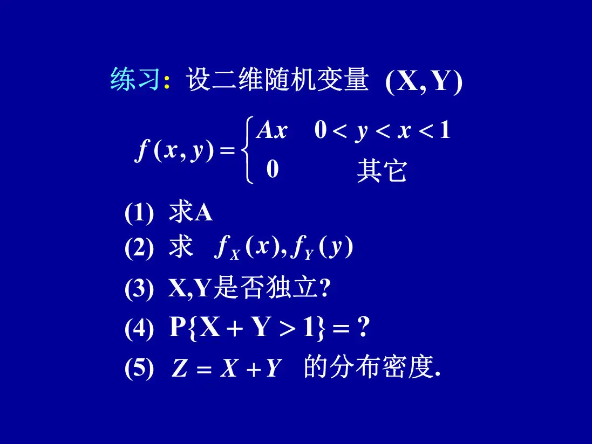

原文：

练习: 设二维随机变量 (X,Y)

$f(x,y) = \left\{ \begin{array}{ll}Ax & 0 <   y <   x <   1\\ 0 & \text{其它} \end{array} \right.$

(1) 求A

(2) 求 $f_{X}(x), f_{Y}(y)$

(3) X,Y是否独立?

(4) $\mathrm{P}\{\mathrm{X} + \mathrm{Y} > 1\} = ?$

(5) $Z = X + Y$ 的分布密度.

### 三、随机变量的最大最小值分布

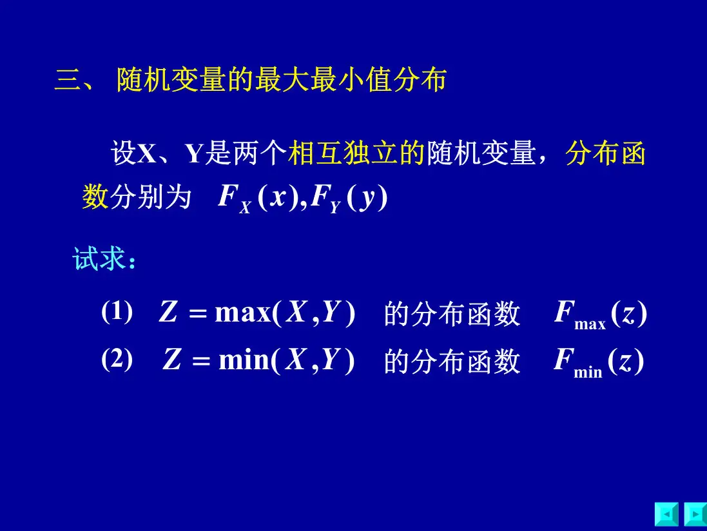

原文：

三、随机变量的最大最小值分布

设X、Y是两个相互独立的随机变量，分布函数分别为 $F_{X}(x), F_{Y}(y)$

试求:

(1) $Z = \max (X,Y)$ 的分布函数 $F_{\max}(z)$

(2) $Z = \min (X,Y)$ 的分布函数 $F_{\mathrm{min}}(z)$

### (1) 最大值 $Z = \max(X, Y)$ 分布

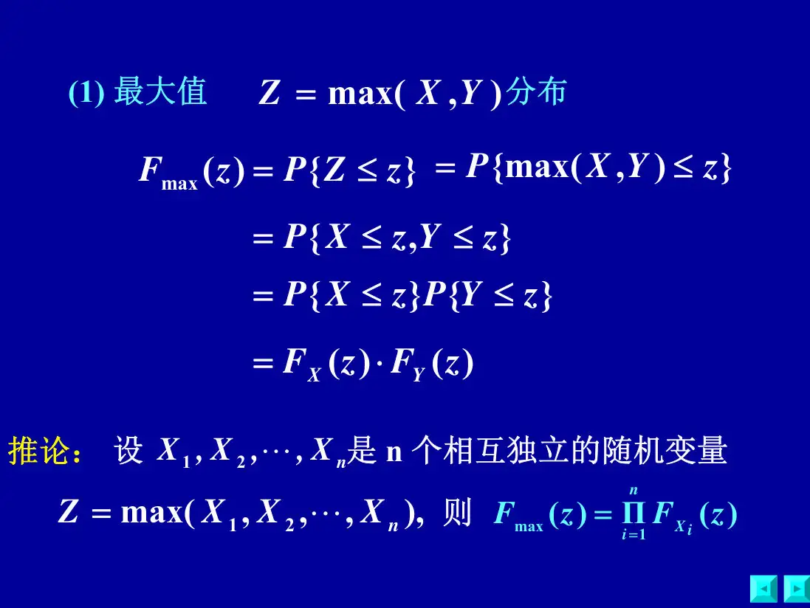

原文：

(1) 最大值 $Z = \max(X, Y)$ 分布

$$
\begin{array}{r l} & F _ {\max} (z) = P \{Z \leq z \} = P \{\max (X, Y) \leq z \} \\ & \qquad = P \{X \leq z, Y \leq z \} \\ & \qquad = P \{X \leq z \} P \{Y \leq z \} \\ & \qquad = F _ {X} (z) \cdot F _ {Y} (z) \end{array}
$$

推论：设 $X_{1}, X_{2}, \cdots, X_{n}$ 是 n 个相互独立的随机变量

$Z = \max(X_{1}, X_{2}, \cdots, X_{n})$ ，则 $F_{\max}(z) = \prod_{i=1}^{n} F_{X_{i}}(z)$

### (2) 最小值 $Z = \min(X, Y)$ 的分布

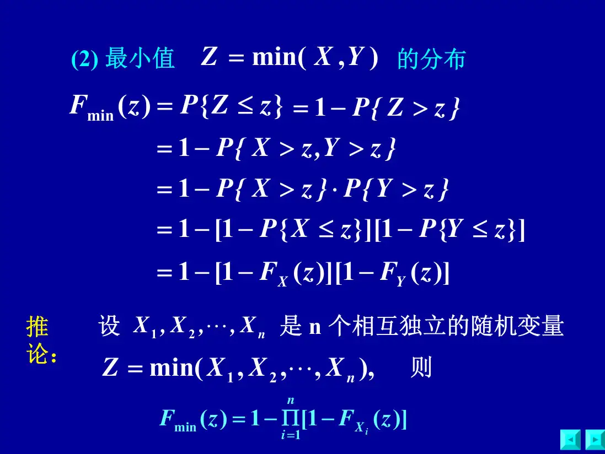

原文：

(2) 最小值 $Z = \min(X, Y)$ 的分布

$$
\begin{array}{r l} & F _ {\min} (z) = P \{Z \leq z \} = 1 - P \{Z > z \} \\ & \quad = 1 - P \{X > z, Y > z \} \\ & \quad = 1 - P \{X > z \} \cdot P \{Y > z \} \\ & \quad = 1 - [ 1 - P \{X \leq z \} ] [ 1 - P \{Y \leq z \} ] \\ & \quad = 1 - [ 1 - F _ {X} (z) ] [ 1 - F _ {Y} (z) ] \end{array}
$$

推论:

推 设 $X_{1}, X_{2}, \cdots, X_{n}$ 是 n 个相互独立的随机变量

$$
Z = \min (X _ {1}, X _ {2}, \dots , X _ {n}), \quad \text {则}
$$

$$
F _ {\mathrm{min}} (z) = 1 - \prod_ {i = 1} ^ {n} [ 1 - F _ {X _ {i}} (z) ]
$$

### 例4：已知r.v X、Y相互独立且同分布，分布律为

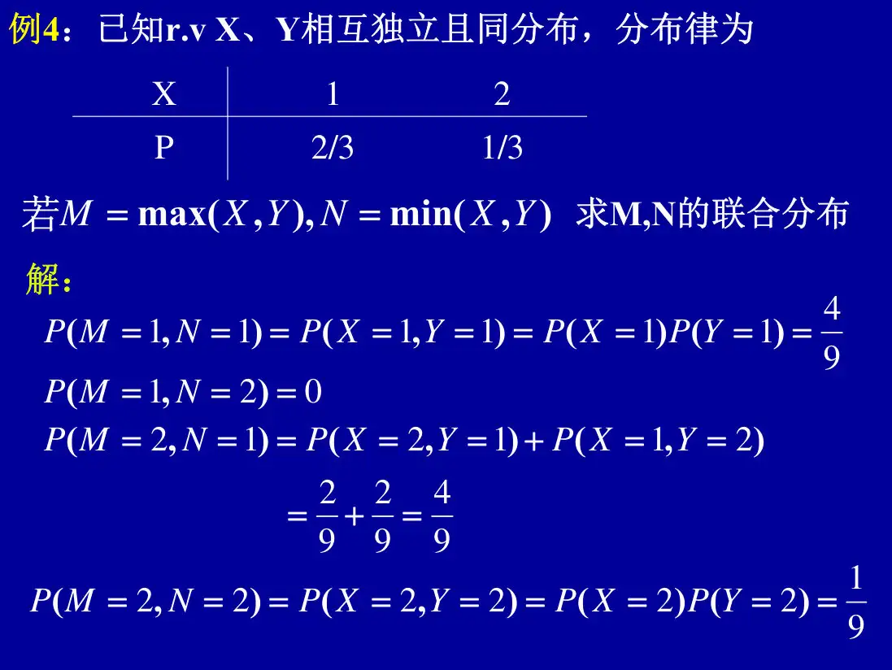

原文：

例4：已知r.v X、Y相互独立且同分布，分布律为

$$
\begin{array}{c c c} \text {X} & 1 & 2 \\ \hline \text {P} & 2 / 3 & 1 / 3 \end{array}
$$

若 $M = \max (X, Y), N = \min (X, Y)$ 求M,N的联合分布解:

$$
P (M = 1, N = 1) = P (X = 1, Y = 1) = P (X = 1) P (Y = 1) = \frac {4}{9}
$$

$$
P (M = 1, N = 2) = 0
$$

$$
\begin{array}{c} P (M = 2, N = 1) = P (X = 2, Y = 1) + P (X = 1, Y = 2) \\ = \frac {2}{9} + \frac {2}{9} = \frac {4}{9} \end{array}
$$

$$
P (M = 2, N = 2) = P (X = 2, Y = 2) = P (X = 2) P (Y = 2) = \frac {1}{9}
$$

### 即M,N的联合分布律为:

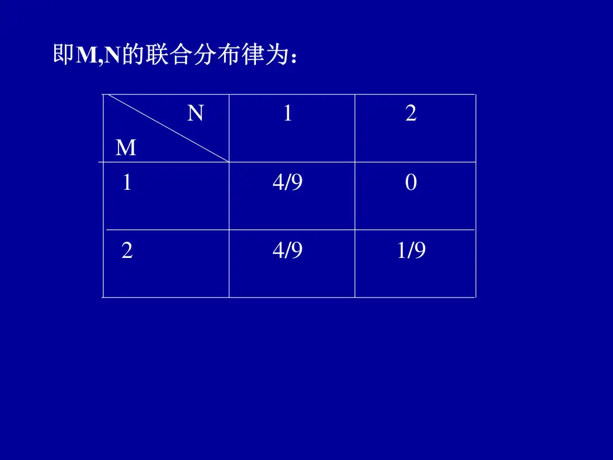

原文：

即M,N的联合分布律为:

<table><tr><td>M\N</td><td>1</td><td>2</td></tr><tr><td>1</td><td>4/9</td><td>0</td></tr><tr><td>2</td><td>4/9</td><td>1/9</td></tr></table>

### (2) 并联, 特点: $L_{1}, L_{2}$ 都损坏, 系统L停止工作;

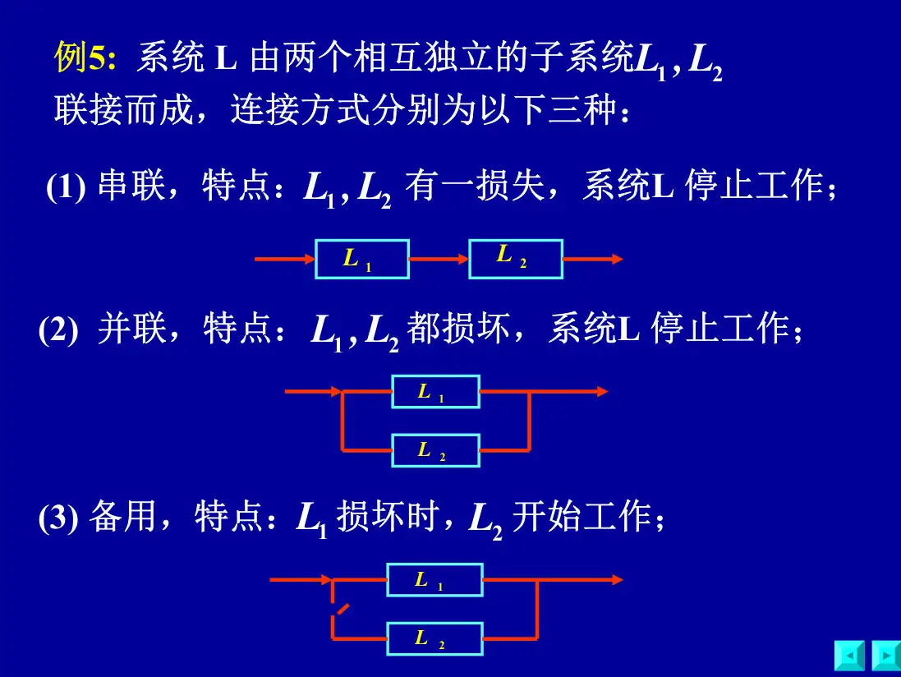

原文：

例5: 系统 L 由两个相互独立的子系统 $L_{1}, L_{2}$ 联接而成，连接方式分别为以下三种：

(1) 串联, 特点: $L_{1}, L_{2}$ 有一损失, 系统 $\mathrm{L}$ 停止工作;

(2) 并联, 特点: $L_{1}, L_{2}$ 都损坏, 系统L停止工作;

(3) 备用, 特点: $L_{1}$ 损坏时, $L_{2}$ 开始工作;

### 设X、Y分别为 $L_{1}, L_{2}$ 的寿命，其概率密度函数为：

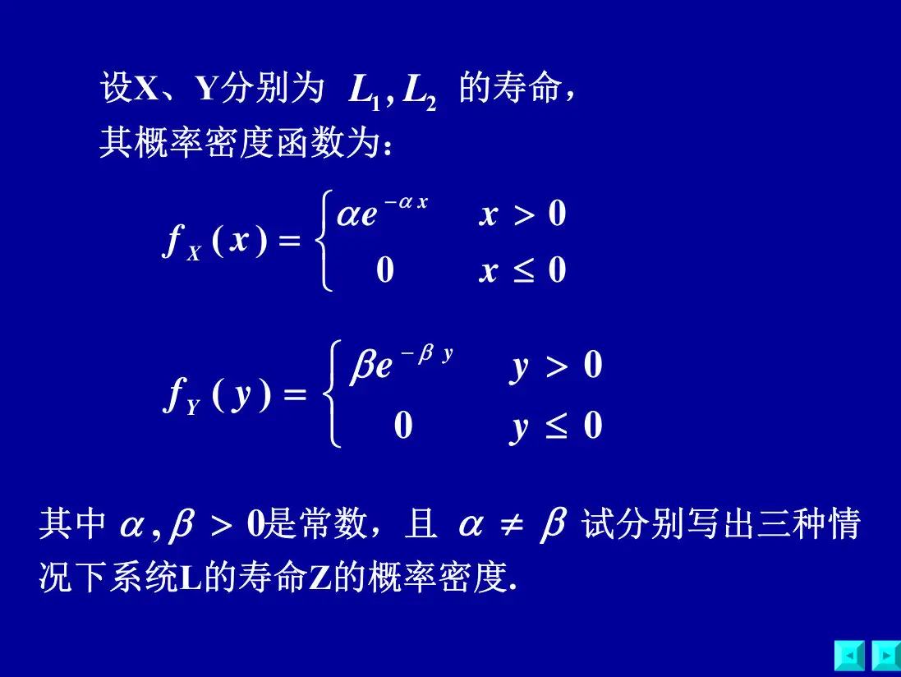

原文：

设X、Y分别为 $L_{1}, L_{2}$ 的寿命，其概率密度函数为：

$$
f _ {X} (x) = \left\{ \begin{array}{c c} \alpha e ^ {- \alpha x} & x > 0 \\ 0 & x \leq 0 \end{array} \right.
$$

$$
f _ {Y} (y) = \left\{ \begin{array}{c c} \beta e ^ {- \beta y} & y > 0 \\ 0 & y \leq 0 \end{array} \right.
$$

其中 $\alpha, \beta > 0$ 是常数，且 $\alpha \neq \beta$ 试分别写出三种情况下系统L的寿命Z的概率密度.

### 解：∵ X, Y 的分布函数为

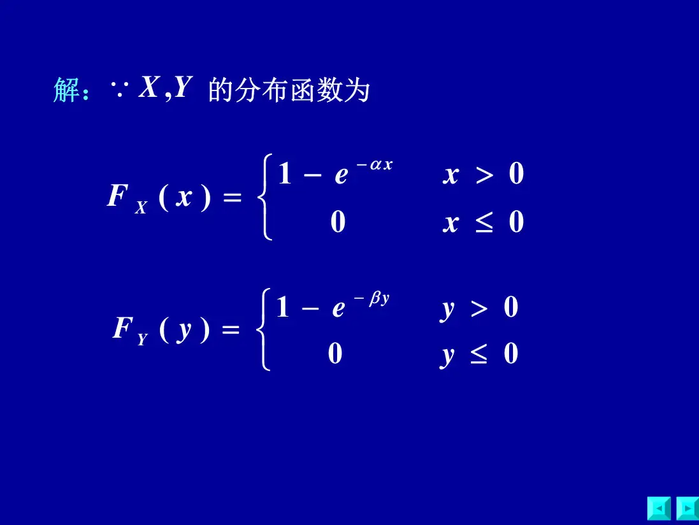

原文：

解：∵ X, Y 的分布函数为

$$
F _ {X} (x) = \left\{ \begin{array}{c c} 1 - e ^ {- \alpha x} & x > 0 \\ 0 & x \leq 0 \end{array} \right.
$$

$$
F _ {Y} (y) = \left\{ \begin{array}{c c} 1 - e ^ {- \beta y} & y > 0 \\ 0 & y \leq 0 \end{array} \right.
$$

### (1) 串联情况，该系统L的寿命为Z，则

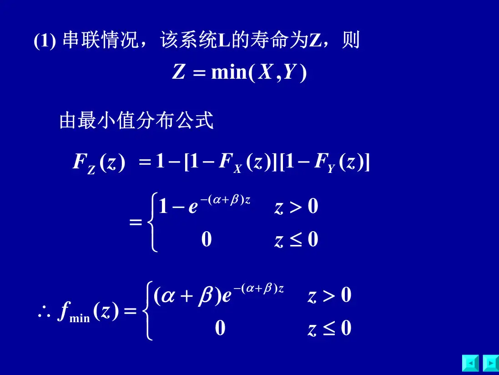

原文：

(1) 串联情况，该系统L的寿命为Z，则

$$
Z = \min (X, Y)
$$

由最小值分布公式

$$
\begin{array}{r l} {F _ {Z} (z)} & {= 1 - [ 1 - F _ {X} (z) ] [ 1 - F _ {Y} (z) ]} \\ & {= \left\{ \begin{array}{c c} 1 - e ^ {- (\alpha + \beta) z} & z > 0 \\ 0 & z \leq 0 \end{array} \right.} \end{array}
$$

$$
\therefore f _ {\min} (z) = \left\{ \begin{array}{c c} (\alpha + \beta) e ^ {- (\alpha + \beta) z} & z > 0 \\ 0 & z \leq 0 \end{array} \right.
$$

### (2) 并联情况，这时 $Z = \max(X, Y)$

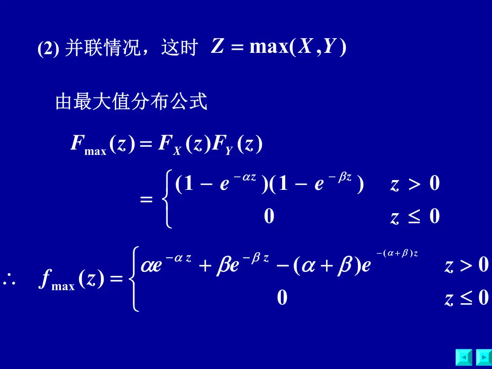

原文：

(2) 并联情况，这时 $Z = \max(X, Y)$

由最大值分布公式

$$
\begin{array}{r l} & F _ {\max} (z) = F _ {X} (z) F _ {Y} (z) \\ & \qquad = \left\{ \begin{array}{c c} (1 - e ^ {- \alpha z}) (1 - e ^ {- \beta z}) & z > 0 \\ 0 & z \leq 0 \end{array} \right. \end{array}
$$

$$
\therefore f _ {\max} (z) = \left\{ \begin{array}{c c} \alpha e ^ {- \alpha z} + \beta e ^ {- \beta z} - (\alpha + \beta) e ^ {- (\alpha + \beta) z} & z > 0 \\ 0 & z \leq 0 \end{array} \right.
$$

### $$

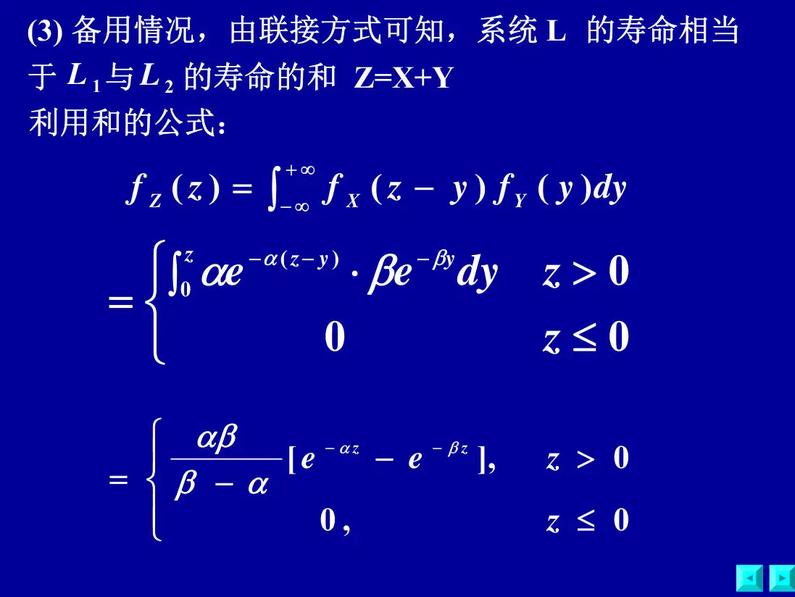

原文：

(3) 备用情况, 由联接方式可知, 系统 $\mathrm{L}$ 的寿命相当于 $L_{1}$ 与 $L_{2}$ 的寿命的和 $\mathrm{Z} = \mathrm{X} + \mathrm{Y}$ 利用和的公式:

$$
\begin{array}{r l} & f _ {z} (z) = \int_ {- \infty} ^ {+ \infty} f _ {X} (z - y) f _ {Y} (y) d y \\ & = \left\{ \begin{array}{c c} \int_ {0} ^ {z} \alpha e ^ {- \alpha (z - y)} \cdot \beta e ^ {- \beta y} d y & z > 0 \\ 0 & z \leq 0 \end{array} \right. \end{array}
$$

$$
= \left\{ \begin{array}{c c} \frac {\alpha \beta}{\beta - \alpha} [ e ^ {- \alpha z} - e ^ {- \beta z} ], & z > 0 \\ 0, & z \leq 0 \end{array} \right.
$$
