# 《概率论与数理统计》第3章 多维随机变量及其分布 3.1 二维随机变量及其分布（课件）

原件的每一页，下面附识别出的文字。

### 第3章 多维随机变量及其分布

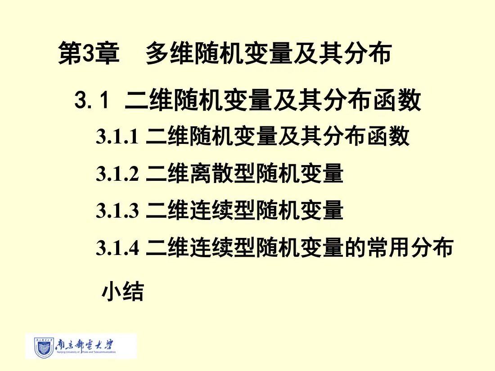

原文：

第3章 多维随机变量及其分布
3.1 二维随机变量及其分布函数
3.1.1 二维随机变量及其分布函数
3.1.2 二维离散型随机变量
3.1.3 二维连续型随机变量
3.1.4 二维连续型随机变量的常用分布
小结

南京邮电大学
Nanjing University of Posts and Telecommunications

### 第 2 页

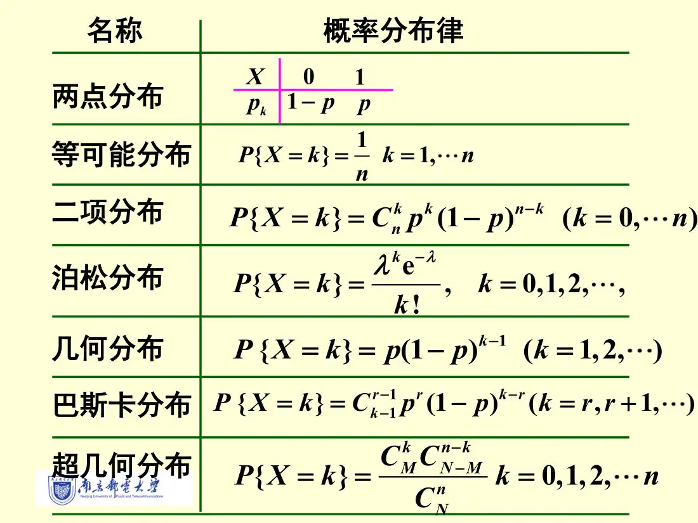

原文：

<table><tr><td>名称</td><td colspan="2">概率分布律</td></tr><tr><td>两点分布</td><td colspan="2"> $\begin{array}{c|cc} X & 0 & 1 \\ \hline p_k & 1-p & p \end{array}$ </td></tr><tr><td>等可能分布</td><td colspan="2"> $P\{X=k\}=\frac{1}{n} k=1,\cdots n$ </td></tr><tr><td>二项分布</td><td colspan="2"> $P\{X=k\}=C_n^k p^k(1-p)^{n-k} (k=0,\cdots n)$ </td></tr><tr><td>泊松分布</td><td colspan="2"> $P\{X=k\}=\frac{\lambda^k e^{-\lambda}}{k!}, k=0,1,2,\cdots,$ </td></tr><tr><td>几何分布</td><td colspan="2"> $P\{X=k\}=p(1-p)^{k-1} (k=1,2,\cdots)$ </td></tr><tr><td>巴斯卡分布</td><td colspan="2"> $P\{X=k\}=C_{k-1}^{r-1} p^r(1-p)^{k-r} (k=r,r+1,\cdots)$ </td></tr><tr><td>超几何分布</td><td colspan="2"> $P\{X=k\}=\frac{C_M^k C_{N-M}^{n-k}}{C_N^n} k=0,1,2,\cdots n$ </td></tr></table>

### 3.1.1 二维随机变量及其分布函数

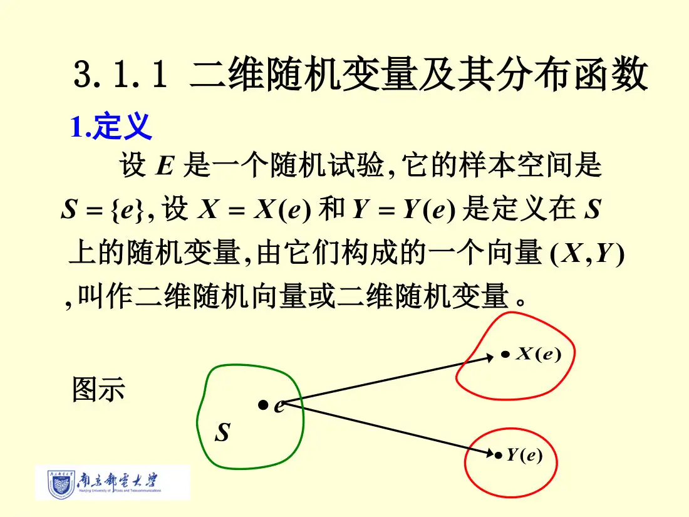

原文：

3.1.1 二维随机变量及其分布函数

1. 定义

设 E 是一个随机试验, 它的样本空间是 $S = \{e\}$ , 设 $X = X(e)$ 和 $Y = Y(e)$ 是定义在 S 上的随机变量, 由它们构成的一个向量 $(X, Y)$ , 叫作二维随机向量或二维随机变量。

图示

南京邮电大学
Nanjing University of Posts and Telecommunications

### 实例1 炮弹的弹着点的位置 $(X, Y)$ 就是一个二维随机变量。

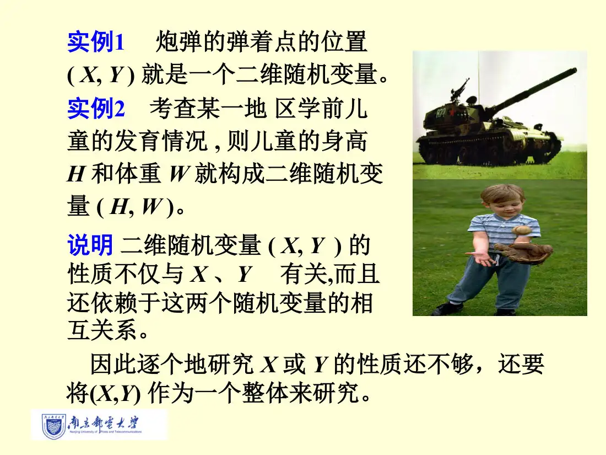

原文：

实例1 炮弹的弹着点的位置 $(X, Y)$ 就是一个二维随机变量。

实例2 考查某一地区学前儿童的发育情况, 则儿童的身高 H 和体重 W 就构成二维随机变量 $(H, W)$ 。

说明 二维随机变量 $(X, Y)$ 的性质不仅与 X、Y 有关,而且还依赖于这两个随机变量的相互关系。

因此逐个地研究 X 或 Y 的性质还不够，还要将 $(X,Y)$ 作为一个整体来研究。

南京邮电大学
Nanjing University of Posts and Telecommunications

### 2. 二维随机变量的分布函数

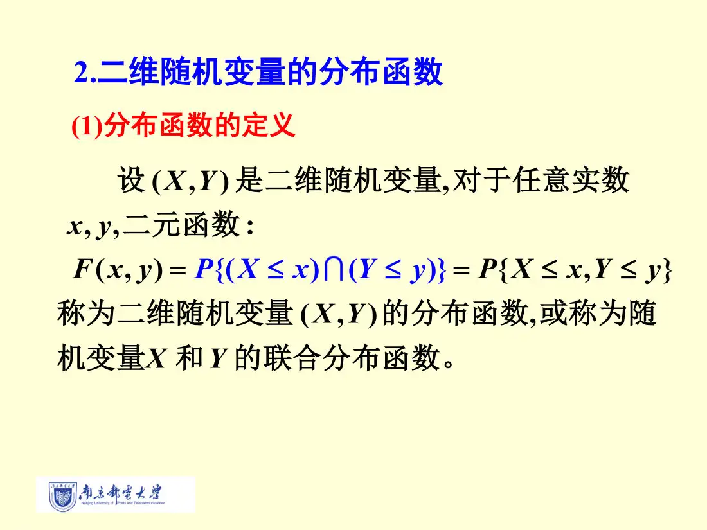

原文：

2. 二维随机变量的分布函数

(1)分布函数的定义

设 $(X,Y)$ 是二维随机变量,对于任意实数x,y,二元函数:

$F(x,y)=P\{(X\leq x)\cap(Y\leq y)\}=P\{X\leq x,Y\leq y\}$ 称为二维随机变量 $(X,Y)$ 的分布函数,或称为随机变量X和Y的联合分布函数。

南京邮电大学
Nanjing University of Posts and Telecommunications

### 南京邮电大学

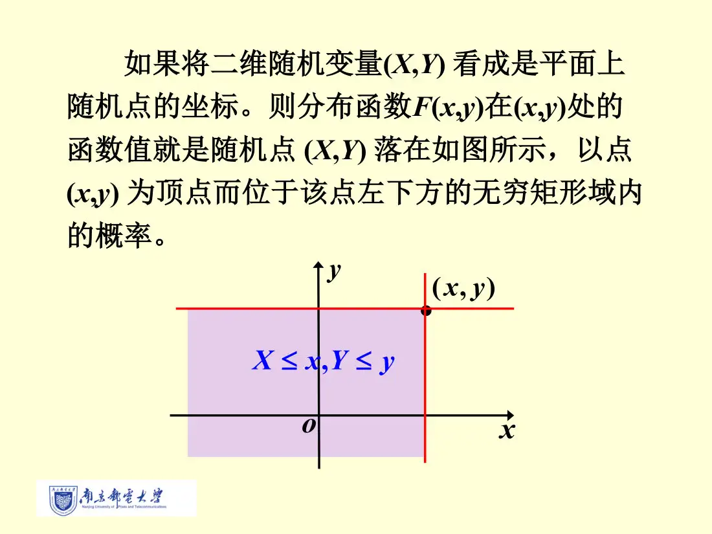

原文：

如果将二维随机变量 $(X, Y)$ 看成是平面上随机点的坐标。则分布函数 $F(x, y)$ 在 $(x, y)$ 处的函数值就是随机点 $(X, Y)$ 落在如图所示，以点 $(x, y)$ 为顶点而位于该点左下方的无穷矩形域内的概率。

南京邮电大学
Nanjing University of Posts and Telecommunications

### 南京邮电大学

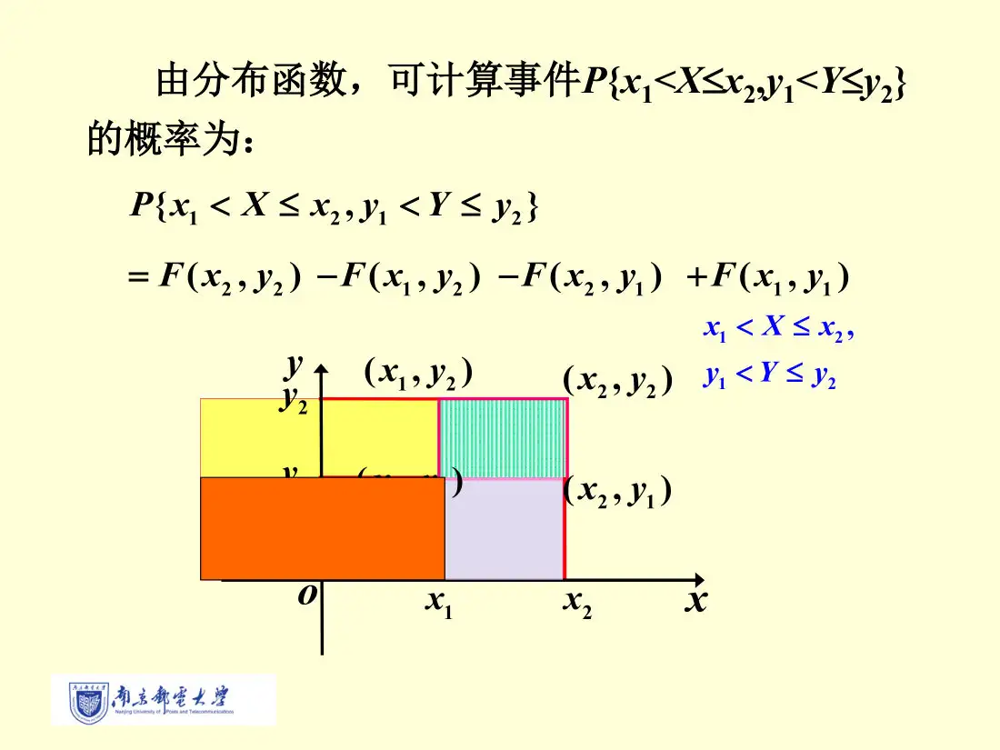

原文：

由分布函数，可计算事件 $P\{x_{1}<X\leq x_{2},y_{1}<Y\leq y_{2}\}$ 的概率为：

南京邮电大学
Nanjing University of Posts and Telecommunications

### (2) 分布函数的性质

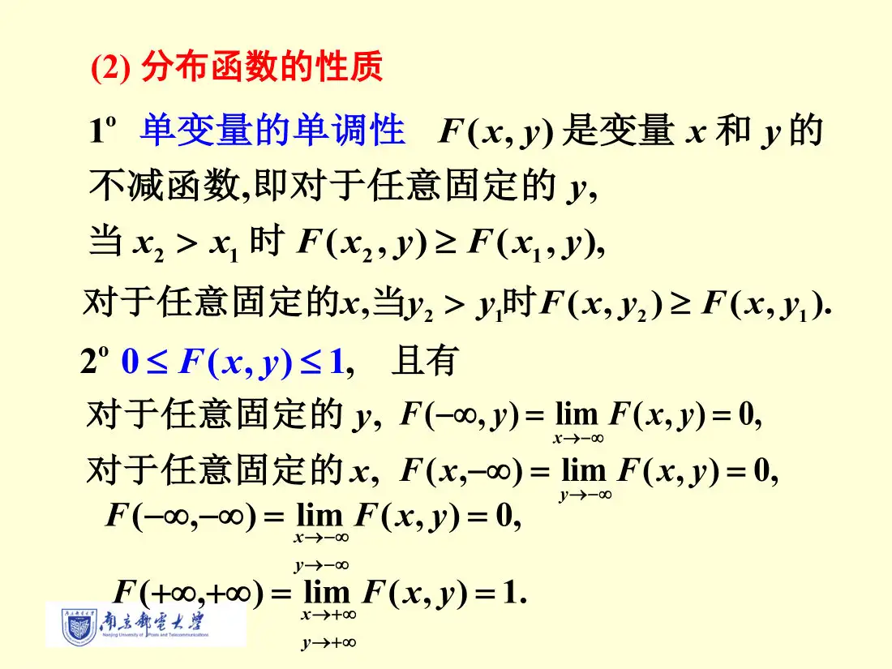

原文：

(2) 分布函数的性质

1° 单变量的单调性 $F(x,y)$ 是变量 x 和 y 的不减函数, 即对于任意固定的 y,
当 $x_{2}>x_{1}$ 时 $F(x_{2},y)\geq F(x_{1},y)$ ,
对于任意固定的x, 当 $y_{2}>y_{1}$ 时 $F(x,y_{2})\geq F(x,y_{1})$ $2^{0}0\leq F(x,y)\leq1$ ，且有
对于任意固定的 y， $F(-\infty,y)=\lim_{x\to-\infty}F(x,y)=0$ 对于任意固定的 x， $F(x,-\infty)=\lim_{y\to-\infty}F(x,y)=0$ $F(-\infty,-\infty)=\lim_{x\to-\infty}F(x,y)=0,$ $F(+\infty,+\infty)=\lim_{x\to+\infty}F(x,y)=1.$ 南京邮电大学 Nanjing University of Posts and Telecommunications

### $3^{0}$ 单变量的右连续性

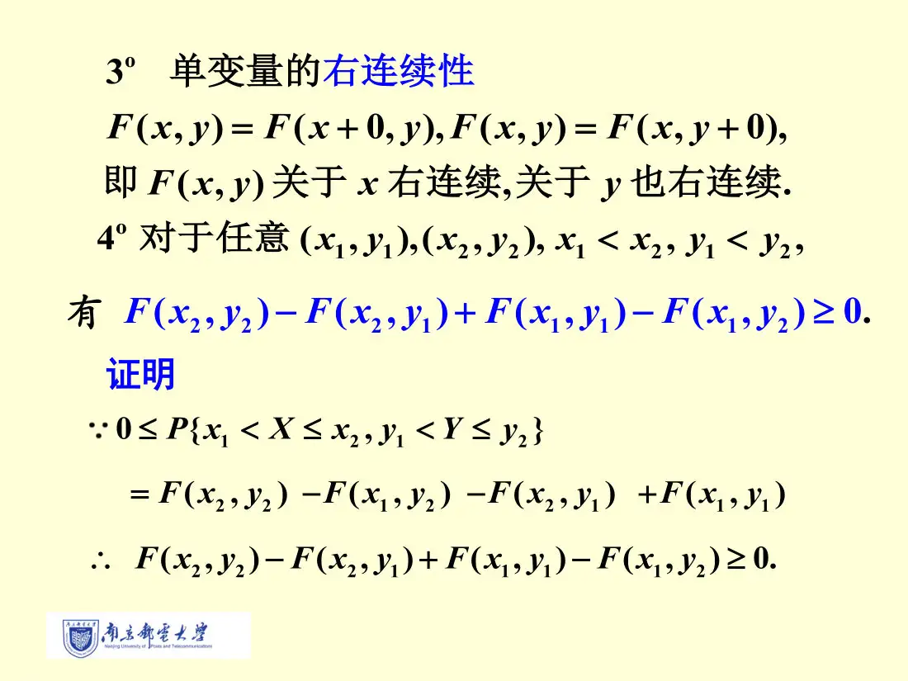

原文：

$3^{0}$ 单变量的右连续性

$$
F (x, y) = F (x + 0, y), F (x, y) = F (x, y + 0),
$$

即 $F(x,y)$ 关于 x 右连续, 关于 y 也右连续.

$4^{0}$ 对于任意 $(x_{1},y_{1}),(x_{2},y_{2}),x_{1}<x_{2},y_{1}<y_{2},$

有 $F(x_{2},y_{2})-F(x_{2},y_{1})+F(x_{1},y_{1})-F(x_{1},y_{2})\geq0.$

证明

$$
\begin{array}{r l} & {\because 0 \leq P \{x _ {1} <   X \leq x _ {2}, y _ {1} <   Y \leq y _ {2} \}} \\ & {\qquad = F (x _ {2}, y _ {2}) - F (x _ {1}, y _ {2}) - F (x _ {2}, y _ {1}) + F (x _ {1}, y _ {1})} \end{array}
$$

$$
\therefore F (x _ {2}, y _ {2}) - F (x _ {2}, y _ {1}) + F (x _ {1}, y _ {1}) - F (x _ {1}, y _ {2}) \geq 0.
$$

南京邮电大学
Nanjing University of Posts and Telecommunications

### 3.1.2 二维离散型随机变量 定义3.3

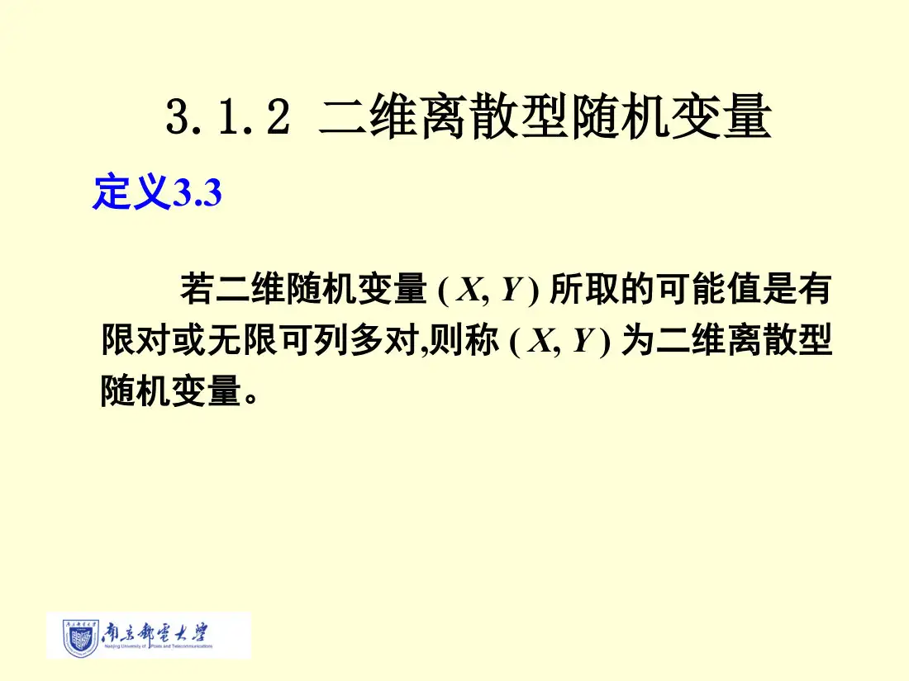

原文：

3.1.2 二维离散型随机变量 定义3.3

若二维随机变量 $(X, Y)$ 所取的可能值是有限对或无限可列多对, 则称 $(X, Y)$ 为二维离散型随机变量。

南京邮电大学
Nanjing University of Posts and Telecommunications

### 2. 二维离散型随机变量的分布律

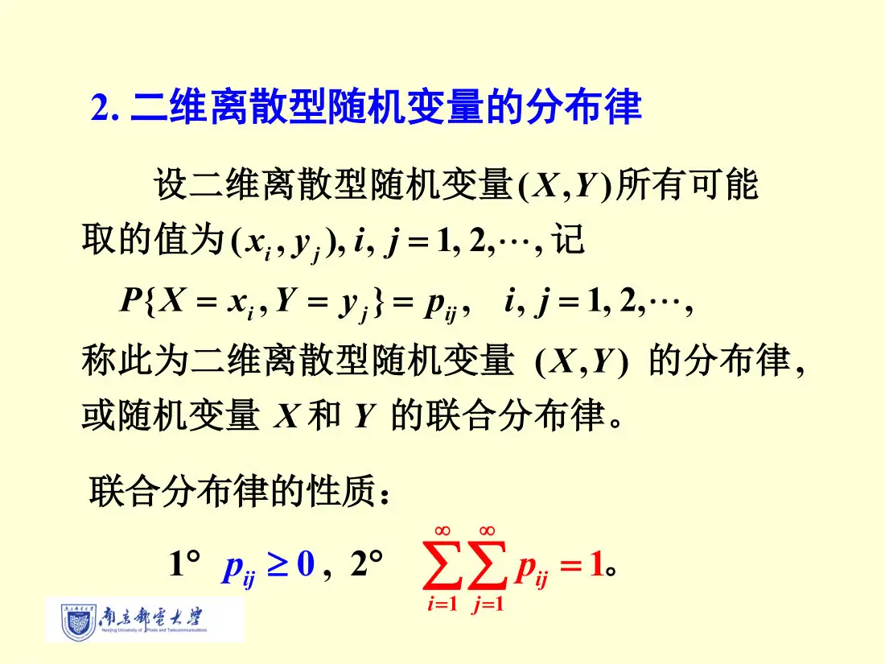

原文：

2. 二维离散型随机变量的分布律

设二维离散型随机变量 $(X,Y)$ 所有可能取的值为 $(x_{i},y_{j}),i,j=1,2,\cdots,$ 记

$$
P \{X = x _ {i}, Y = y _ {j} \} = p _ {i j}, i, j = 1, 2, \dots ,
$$

称此为二维离散型随机变量 $(X,Y)$ 的分布律，或随机变量 X 和 Y 的联合分布律。

联合分布律的性质：

$$
1 ^ {\circ} p _ {i j} \geq 0, 2 ^ {\circ} \sum_ {i = 1} ^ {\infty} \sum_ {j = 1} ^ {\infty} p _ {i j} = 1 。
$$

南京邮电大学
Nanjing University of Posts and Telecommunications

### 二维随机变量 $(X,Y)$ 的分布律也可表示为

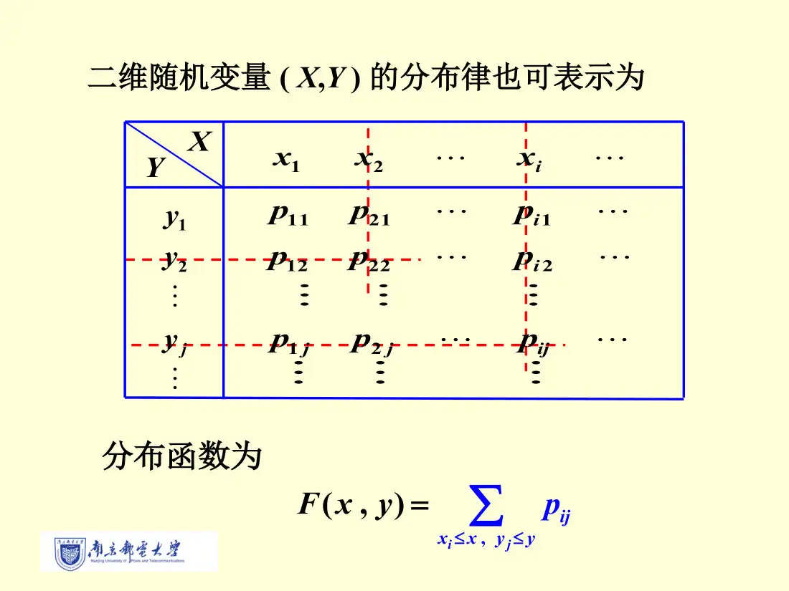

原文：

二维随机变量 $(X,Y)$ 的分布律也可表示为

<table><tr><td>Y\X</td><td> $x_1$ </td><td> $x_2$ </td><td>...</td><td> $x_i$ </td><td>...</td></tr><tr><td> $y_1$ </td><td> $p_{11}$ </td><td> $p_{21}$ </td><td>...</td><td> $p_{i1}$ </td><td>...</td></tr><tr><td> $y_2$ </td><td> $p_{12}$ </td><td> $p_{22}$ </td><td>...</td><td> $p_{i2}$ </td><td>...</td></tr><tr><td>...</td><td>...</td><td>...</td><td>...</td><td>...</td><td></td></tr><tr><td> $y_j$ </td><td> $p_{1j}$ </td><td> $p_{2j}$ </td><td>...</td><td> $p_{ij}$ </td><td>...</td></tr><tr><td>...</td><td>...</td><td>...</td><td>...</td><td>...</td><td></td></tr></table>

分布函数为

$$
F (x, y) = \sum_ {x _ {i} \leq x, y _ {j} \leq y} p _ {i j}
$$

南京邮电大学
Nanjing University of Posts and Telecommunications

### $$

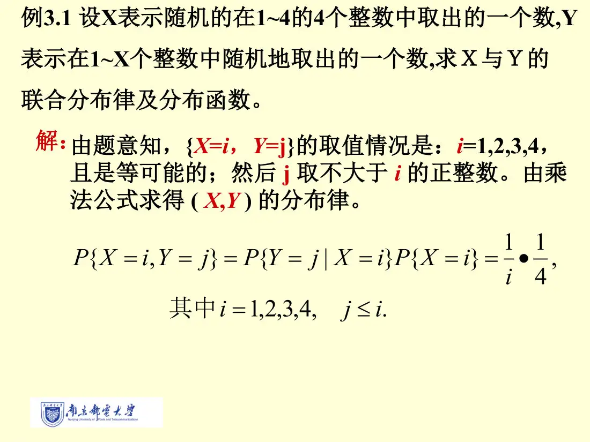

原文：

例3.1 设X表示随机的在1\~4的4个整数中取出的一个数,Y表示在1\~X个整数中随机地取出的一个数,求X与Y的联合分布律及分布函数。

解: 由题意知, $\{X = i, Y = j\}$ 的取值情况是: $i = 1,2,3,4$ , 且是等可能的; 然后 $j$ 取不大于 $i$ 的正整数。由乘法公式求得 $(X,Y)$ 的分布律。

$$
P \{X = i, Y = j \} = P \{Y = j | X = i \} P \{X = i \} = \frac {1}{i} \bullet \frac {1}{4},
$$

$$
\text { 其中 } i = 1, 2, 3, 4, \quad j \leq i.
$$

南京邮电大学
Nanjing University of Posts and Telecommunications

### $$

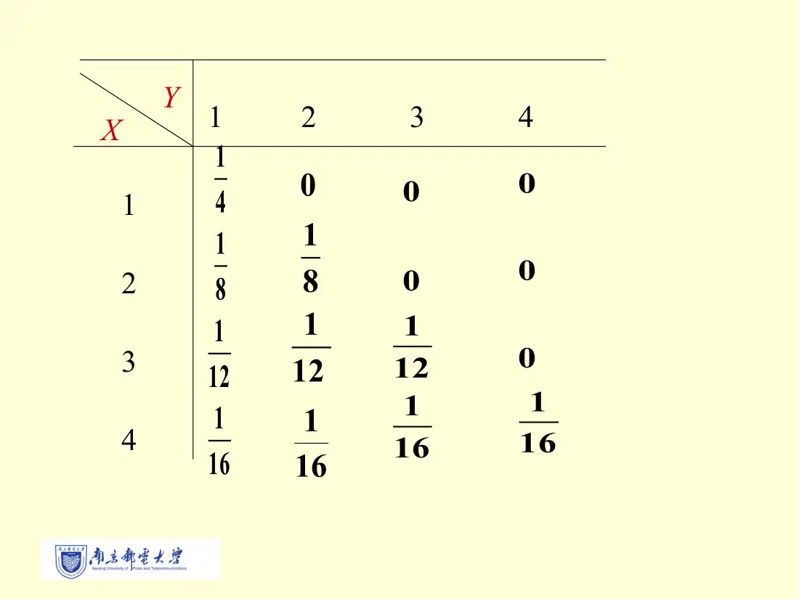

原文：

$$
\begin{array}{c c c c c} \hline Y & 1 & 2 & 3 & 4 \\ X & 1 & 0 & 0 & 0 \\ \hline 1 & \frac {1}{4} & \frac {1}{8} & 0 & 0 \\ 2 & \frac {1}{8} & \frac {1}{1 2} & \frac {1}{1 6} & 0 \\ 3 & \frac {1}{1 2} & \frac {1}{1 6} & \frac {1}{1 6} & \frac {1}{1 6} \\ 4 & \frac {1}{1 6} & \frac {1}{1 6} & \frac {1}{1 6} & \frac {1}{1 6} \end{array}
$$

南京邮电大学
Nanjing University of Posts and Telecommunications

### 补充例3.1 设随机变量(X,Y)的联合分布律为

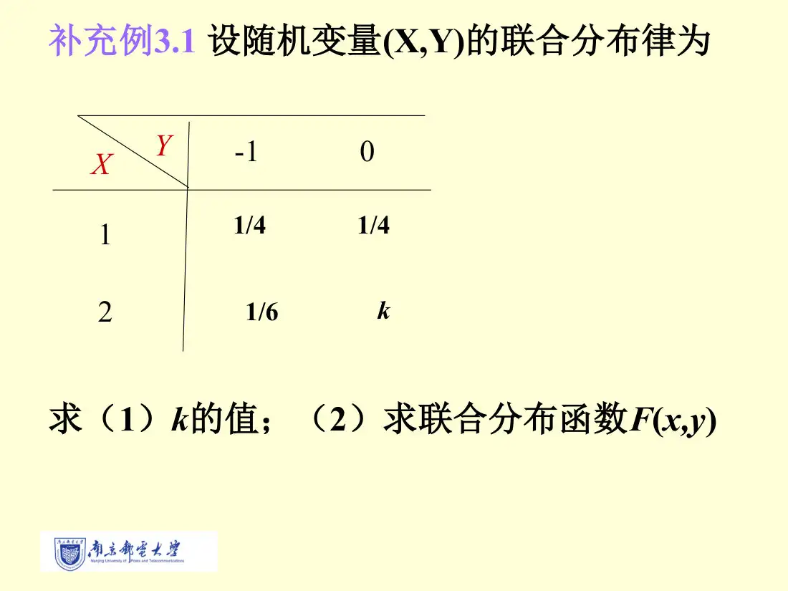

原文：

补充例3.1 设随机变量(X,Y)的联合分布律为

<table><tr><td>X\Y</td><td>-1</td><td>0</td></tr><tr><td>1</td><td> $1/4$ </td><td> $1/4$ </td></tr><tr><td>2</td><td> $1/6$ </td><td>k</td></tr></table>

求（1）k的值；（2）求联合分布函数 $F(x,y)$

南京邮电大学
Nanjing University of Posts and Telecommunications

### 解（1）由联合分布的意义所有概率之和为1，得到

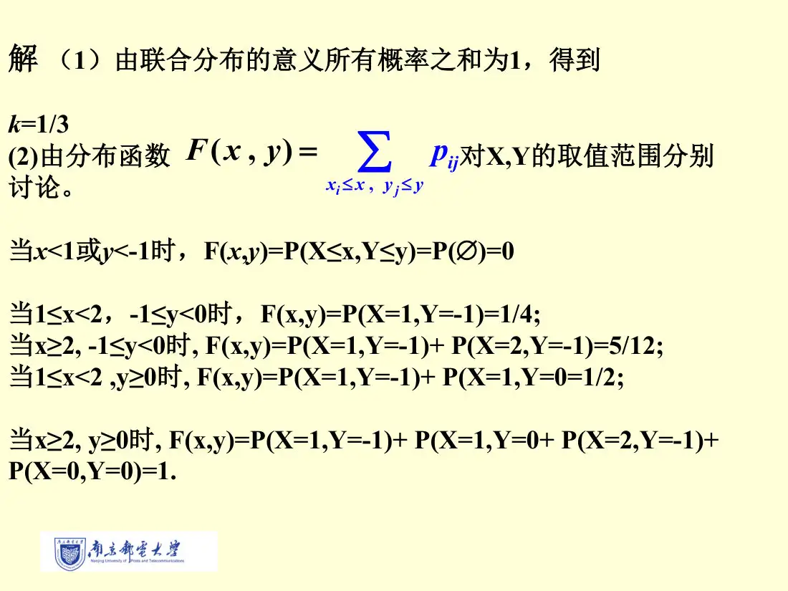

原文：

解（1）由联合分布的意义所有概率之和为1，得到

$$
k = 1 / 3
$$

(2)由分布函数 $F(x, y) = \sum_{x_i \leq x, y_j \leq y} p_{ij}$ 对 X,Y 的取值范围分别讨论。

当 $x < 1$ 或 $y < -1$ 时， $\mathrm{F}(x,y) = \mathrm{P}(\mathrm{X}\leq \mathrm{x},\mathrm{Y}\leq \mathrm{y}) = \mathrm{P}(\emptyset) = 0$

当 $1 \leq x < 2$ ， $-1 \leq y < 0$ 时， $F(x, y) = P(X = 1, Y = -1) = 1/4$ ;  
当 $x \geq 2$ ， $-1 \leq y < 0$ 时， $F(x, y) = P(X = 1, Y = -1) + P(X = 2, Y = -1) = 5/12$ ;  
当 $1 \leq x < 2$ ， $y \geq 0$ 时， $F(x, y) = P(X = 1, Y = -1) + P(X = 1, Y = 0 = 1/2$ ;

当 $x\geq2$ , $y\geq0$ 时, $F(x,y)=P(X=1,Y=-1)+P(X=1,Y=0+P(X=2,Y=-1)+P(X=0,Y=0)=1.$

南京邮电大学
Nanjing University of Posts and Telecommunications

### 所求的分布函数为

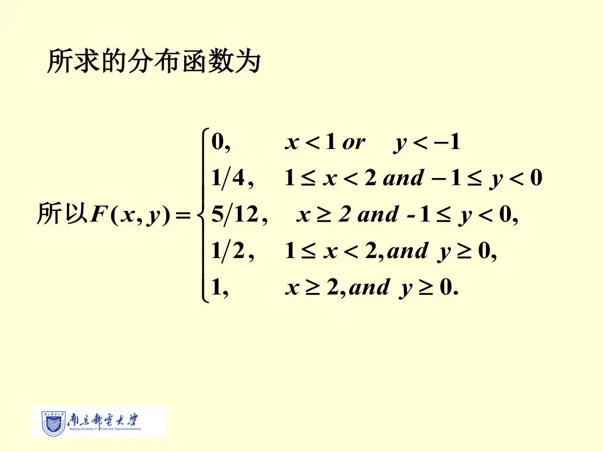

原文：

所求的分布函数为

所以 $F(x,y)=\left\{\begin{aligned}&0,&x<1 or y<-1\\ &1/4,&1\leq x<2 and-1\leq y<0\\ &5/12,&x\geq2 and-1\leq y<0,\\ &1/2,&1\leq x<2,and y\geq0,\\ &1,&x\geq2,and y\geq0.\end{aligned}\right.$

南京邮电大学
Nanjing University of Posts and Telecommunications

### $$

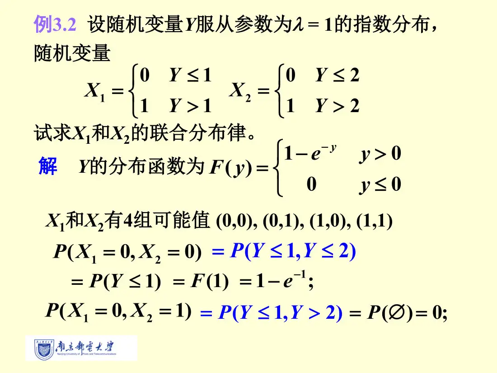

原文：

例3.2 设随机变量 $Y$ 服从参数为 $\lambda = 1$ 的指数分布，随机变量

$$
X _ {1} = \left\{ \begin{array}{l l} 0 & Y \leq 1 \\ 1 & Y > 1 \end{array} \quad X _ {2} = \left\{ \begin{array}{l l} 0 & Y \leq 2 \\ 1 & Y > 2 \end{array} \right. \right.
$$

试求 $X_{1}$ 和 $X_{2}$ 的联合分布律。

解 Y的分布函数为 $F(y)=\left\{\begin{aligned}&1-e^{-y}&y>0\\ &0&y\leq0\end{aligned}\right.$

$X_{1}$ 和 $X_{2}$ 有 4 组可能值 $(0,0)$ , $(0,1)$ , $(1,0)$ , $(1,1)$

$$
= P (Y \leq 1) = F (1) = 1 - e ^ {- 1}
$$

$$
P (X _ {1} = 0, X _ {2} = 1) = P (Y \leq 1, Y > 2) = P (\emptyset) = 0;
$$

南京邮电大学
Nanjing University of Posts and Telecommunications

### $$

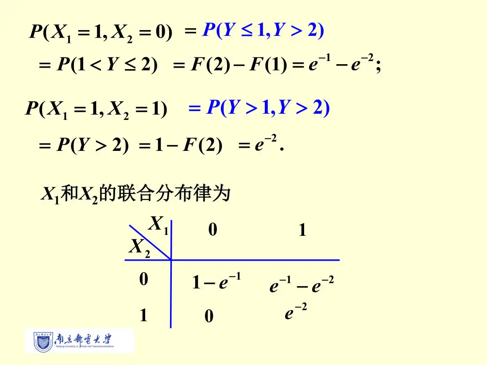

原文：

$$
\begin{array}{r l} P (X _ {1} = 1, X _ {2} = 0) & = P (Y \leq 1, Y > 2) \\ & = P (1 <   Y \leq 2) = F (2) - F (1) = e ^ {- 1} - e ^ {- 2}; \end{array}
$$

$$
\begin{array}{r l} P (X _ {1} = 1, X _ {2} = 1) & = P (Y > 1, Y > 2) \\ & = P (Y > 2) = 1 - F (2) = e ^ {- 2}. \end{array}
$$

$X_{1}$ 和 $X_{2}$ 的联合分布律为

$$
\begin{array}{c c c} X _ {1} & 0 & 1 \\ \hline X _ {2} & & \\ \hline 0 & 1 - e ^ {- 1} & e ^ {- 1} - e ^ {- 2} \\ 1 & 0 & e ^ {- 2} \end{array}
$$

南京邮电大学
Nanjing University of Posts and Telecommunications

### 解 $(X, Y)$ 所取的可能值是

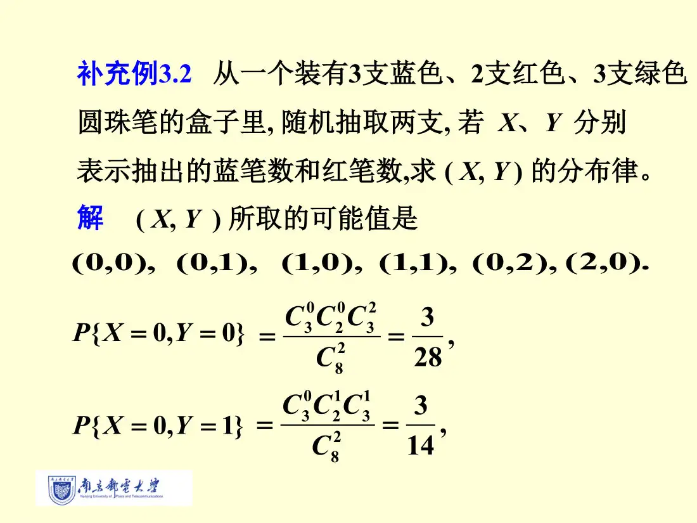

原文：

补充例3.2 从一个装有3支蓝色、2支红色、3支绿色圆珠笔的盒子里, 随机抽取两支, 若 X、Y 分别表示抽出的蓝笔数和红笔数, 求 $(X, Y)$ 的分布律。

解 $(X, Y)$ 所取的可能值是

$$
P \{X = 0, Y = 0 \} = \frac {C _ {3} ^ {0} C _ {2} ^ {0} C _ {3} ^ {2}}{C _ {8} ^ {2}} = \frac {3}{2 8},
$$

$$
P \{X = 0, Y = 1 \} = \frac {C _ {3} ^ {0} C _ {2} ^ {1} C _ {3} ^ {1}}{C _ {8} ^ {2}} = \frac {3}{1 4},
$$

南京邮电大学
Nanjing University of Posts and Telecommunications

### $$

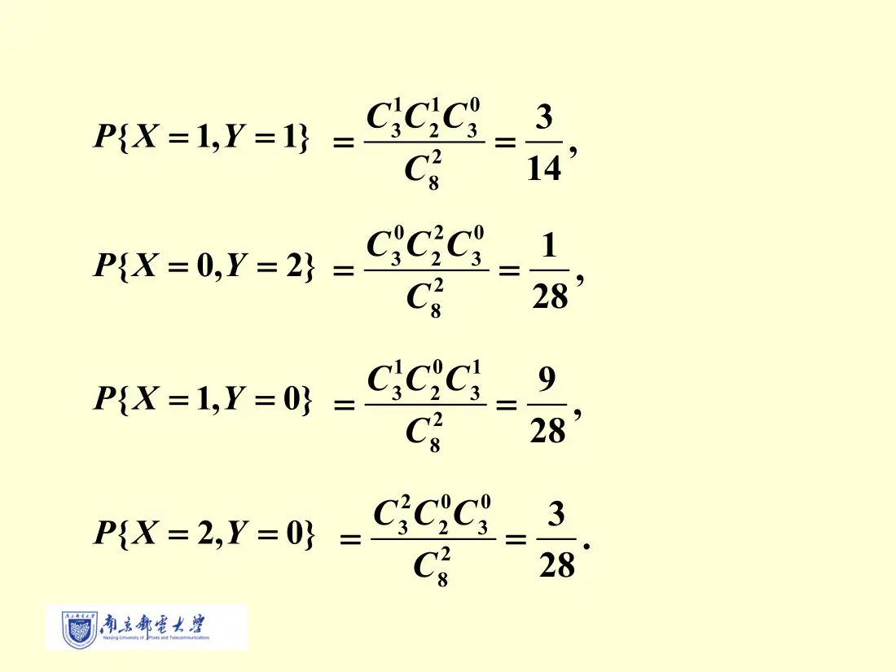

原文：

$$
P \{X = 1, Y = 1 \} = \frac {C _ {3} ^ {1} C _ {2} ^ {1} C _ {3} ^ {0}}{C _ {8} ^ {2}} = \frac {3}{1 4},
$$

$$
P \{X = 0, Y = 2 \} = \frac {C _ {3} ^ {0} C _ {2} ^ {2} C _ {3} ^ {0}}{C _ {8} ^ {2}} = \frac {1}{2 8},
$$

$$
P \{X = 1, Y = 0 \} = \frac {C _ {3} ^ {1} C _ {2} ^ {0} C _ {3} ^ {1}}{C _ {8} ^ {2}} = \frac {9}{2 8},
$$

$$
P \{X = 2, Y = 0 \} = \frac {C _ {3} ^ {2} C _ {2} ^ {0} C _ {3} ^ {0}}{C _ {8} ^ {2}} = \frac {3}{2 8}.
$$

南京邮电大学
Nanjing University of Posts and Telecommunications

### 故所求分布律为

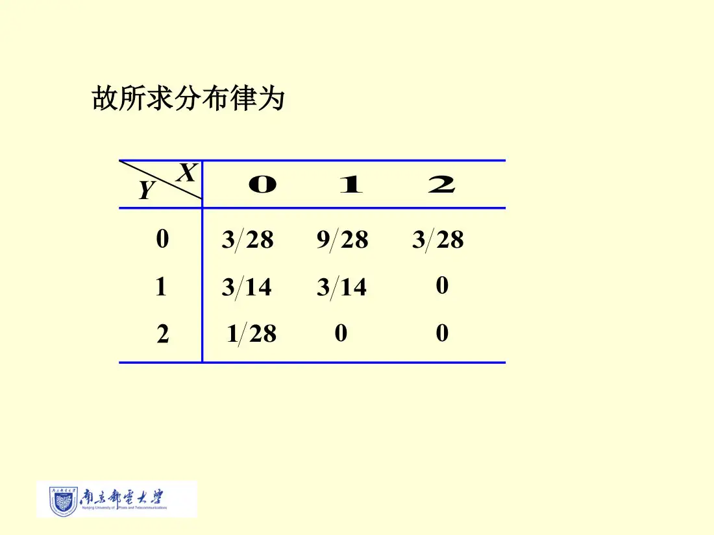

原文：

故所求分布律为

<table><tr><td>Y\X</td><td>0</td><td>1</td><td>2</td></tr><tr><td>0</td><td>3/28</td><td>9/28</td><td>3/28</td></tr><tr><td>1</td><td>3/14</td><td>3/14</td><td>0</td></tr><tr><td>2</td><td>1/28</td><td>0</td><td>0</td></tr></table>

南京邮电大学
Nanjing University of Posts and Telecommunications

### 3.1.3 二维连续型随机变量定义 3.5

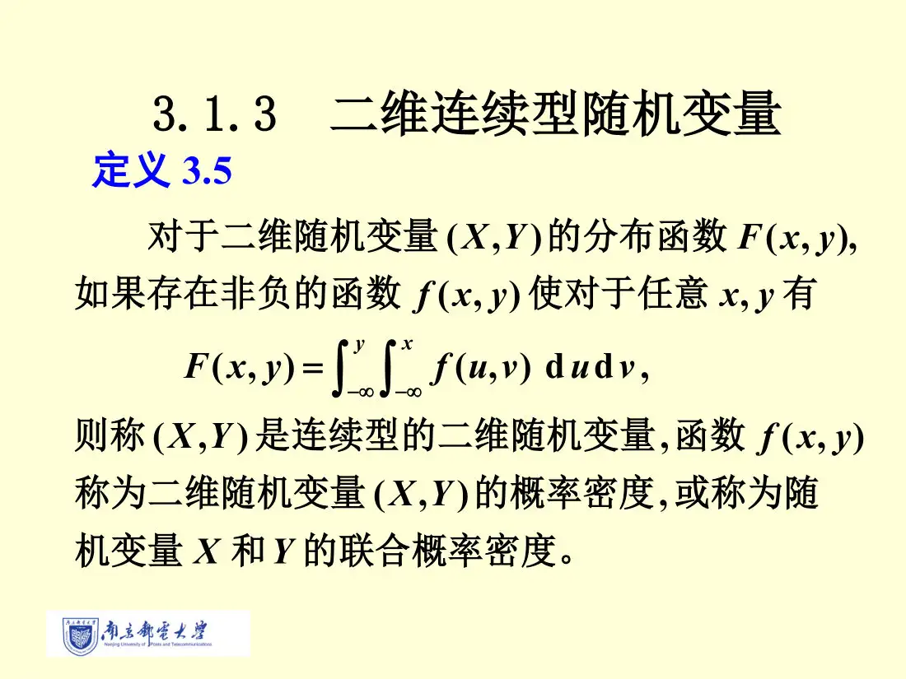

原文：

3.1.3 二维连续型随机变量定义 3.5

对于二维随机变量 $(X,Y)$ 的分布函数 $F(x,y)$ , 如果存在非负的函数 $f(x,y)$ 使对于任意 $x,y$ 有

$$
F (x, y) = \int_ {- \infty} ^ {y} \int_ {- \infty} ^ {x} f (u, v) d u d v,
$$

则称 $(X,Y)$ 是连续型的二维随机变量,函数 $f(x,y)$ 称为二维随机变量 $(X,Y)$ 的概率密度,或称为随机变量 X 和 Y 的联合概率密度。

南京邮电大学
Nanjing University of Posts and Telecommunications

### 2. 性质

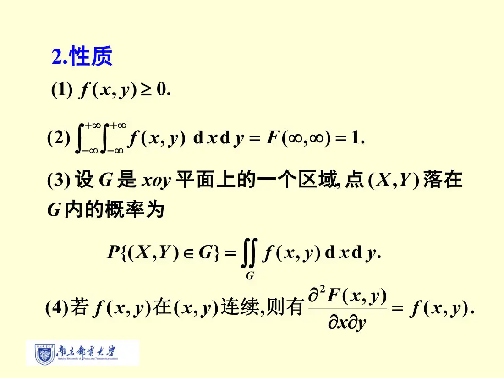

原文：

2. 性质

(1) $f(x,y) \geq 0.$

(2) $\int_{-\infty}^{+\infty}\int_{-\infty}^{+\infty}f(x,y)\mathrm{d}x\mathrm{d}y = F(\infty ,\infty) = 1.$

(3) 设 G 是 xoy 平面上的一个区域, 点 $(X,Y)$ 落在 G 内的概率为

$$
P \{(X, Y) \in G \} = \iint_ {G} f (x, y) d x d y.
$$

(4)若 $f(x,y)$ 在 $(x,y)$ 连续, 则有 $\frac{\partial^{2}F(x,y)}{\partial x\partial y}=f(x,y)$ .

南京邮电大学
Nanjing University of Posts and Telecommunications

### 3.说明

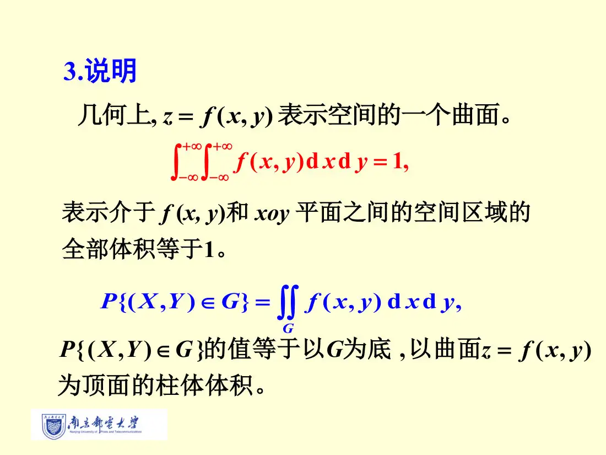

原文：

3.说明

几何上, $z=f(x,y)$ 表示空间的一个曲面。

$$
\int_ {- \infty} ^ {+ \infty} \int_ {- \infty} ^ {+ \infty} f (x, y) \mathrm{d} x \mathrm{d} y = 1,
$$

表示介于 $f(x, y)$ 和 xoy 平面之间的空间区域的全部体积等于1。

$P\{(X,Y)\in G\}=\iint_{G}f(x,y)\mathrm{d}x\mathrm{d}y,$ $P\{(X,Y)\in G\}$ 的值等于以 G 为底，以曲面 z=f(x,y) 为顶面的柱体体积。

南京邮电大学
Nanjing University of Posts and Telecommunications

### 例3.3 设 $(X,Y)$ 的密度函数为

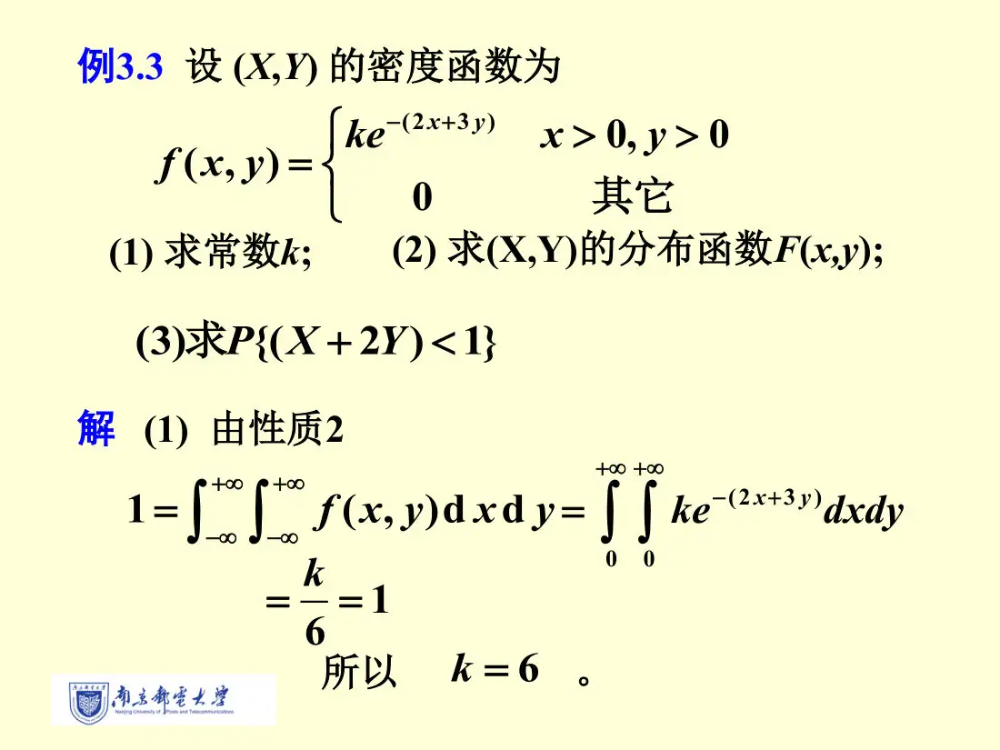

原文：

例3.3 设 $(X,Y)$ 的密度函数为

$$
f (x, y) = \left\{ \begin{array}{c c} k e ^ {- (2 x + 3 y)} & x > 0, y > 0 \\ 0 & \text {其它} \end{array} \right.
$$

(1) 求常数 $k$ ; (2) 求 $(X, Y)$ 的分布函数 $F(x, y)$ ;

(3)求 $P\{(X+2Y)<1\}$

解 (1) 由性质2

$$
\begin{array}{r l} 1 & = \int_ {- \infty} ^ {+ \infty} \int_ {- \infty} ^ {+ \infty} f (x, y) \mathrm{d} x \mathrm{d} y = \int_ {0} ^ {+ \infty} \int_ {0} ^ {+ \infty} k e ^ {- (2 x + 3 y)} d x d y \\ & = \frac {k}{6} = 1 \\ & \text {所以} \quad k = 6 。 \end{array}
$$

南京邮电大学
Nanjing University of Posts and Telecommunications

### 当 $x < 0$ 时，

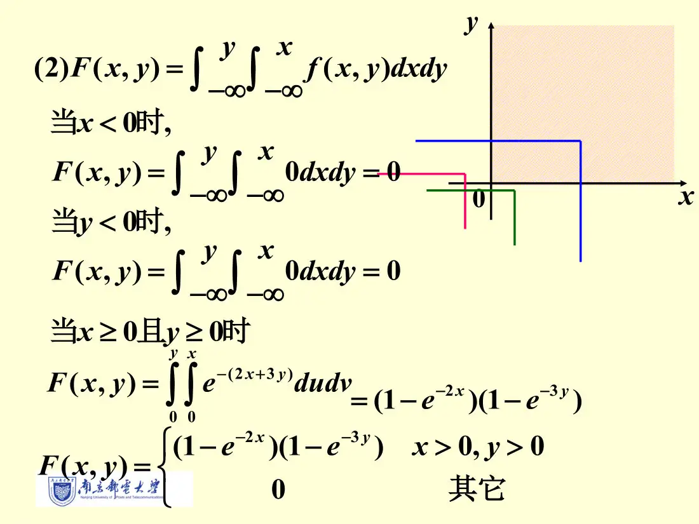

原文：

(2) $F(x,y)=\int\limits_{-\infty}^{y}\int\limits_{-\infty}^{x}f(x,y)dxdy$

当 $x < 0$ 时，

$$
\begin{array}{l} {F (x, y) = \int_ {- \infty} ^ {y}    \int_ {- \infty} ^ {x} 0 d x d y = 0} \\ {\text {当} y <   0 \text {时},} \end{array}
$$

$$
F (x, y) = \int_ {- \infty} ^ {y} \int_ {- \infty} ^ {x} 0 d x d y = 0
$$

当 $x \geq 0$ 且 $y \geq 0$ 时

$$
\begin{array}{r l} & F (x, y) = \int_ {0} ^ {y} \int_ {0} ^ {x} e ^ {- (2 x + 3 y)} d u d v = (1 - e ^ {- 2 x}) (1 - e ^ {- 3 y}) \\ & F (x, y) = \left\{ \begin{array}{c c} (1 - e ^ {- 2 x}) (1 - e ^ {- 3 y}) & x > 0, y > 0 \\ 0 & \text {其它} \end{array} \right. \end{array}
$$

### $$

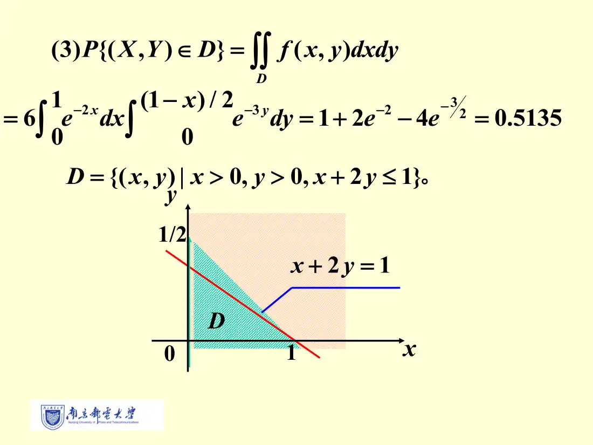

原文：

$$
\begin{array}{c} (3) P \{(X, Y) \in D \} = \iint_ {D} f (x, y) d x d y \\ = 6 \int_ {0} ^ {1} e ^ {- 2 x} d x \int_ {0} ^ {(1 - x) / 2} e ^ {- 3 y} d y = 1 + 2 e ^ {- 2} - 4 e ^ {- 3 / 2} = 0. 5 1 3 5 \end{array}
$$

南京邮电大学
Nanjing University of Posts and Telecommunications

### 3.1.4 两个常用的分布

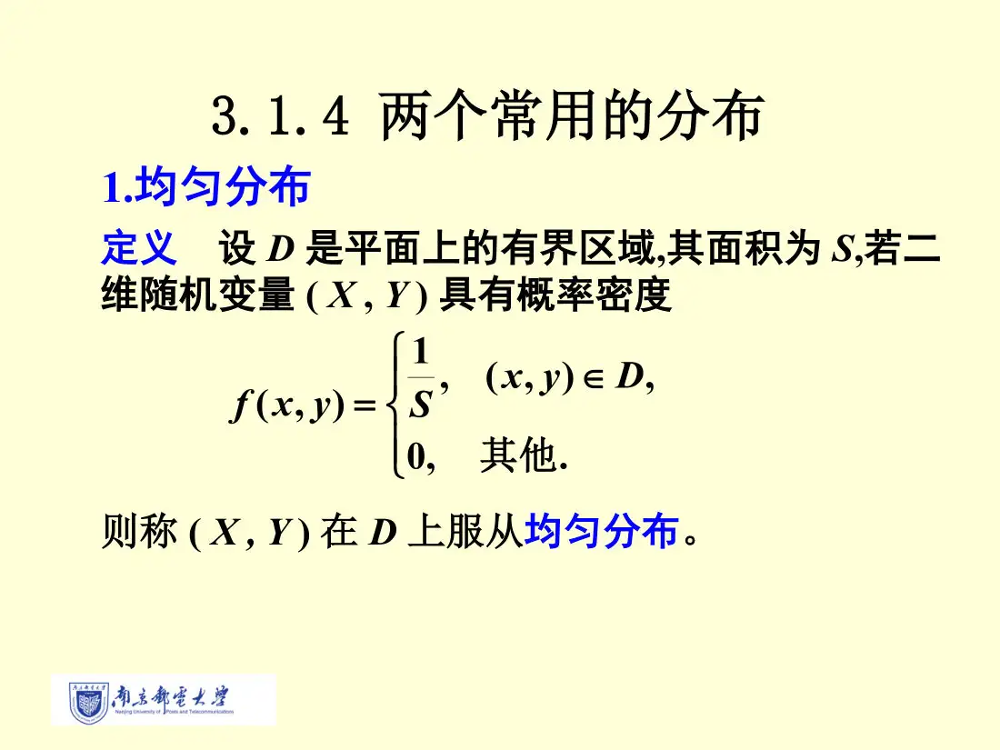

原文：

3.1.4 两个常用的分布

1.均匀分布

定义 设 D 是平面上的有界区域, 其面积为 S, 若二维随机变量 $(X, Y)$ 具有概率密度

$$
f (x, y) = \left\{ \begin{array}{l l} \frac {1}{S}, & (x, y) \in D, \\ 0, & \text {其他.} \end{array} \right.
$$

则称 $(X,Y)$ 在D上服从均匀分布。

南京邮电大学
Nanjing University of Posts and Telecommunications

### 2.二维正态分布

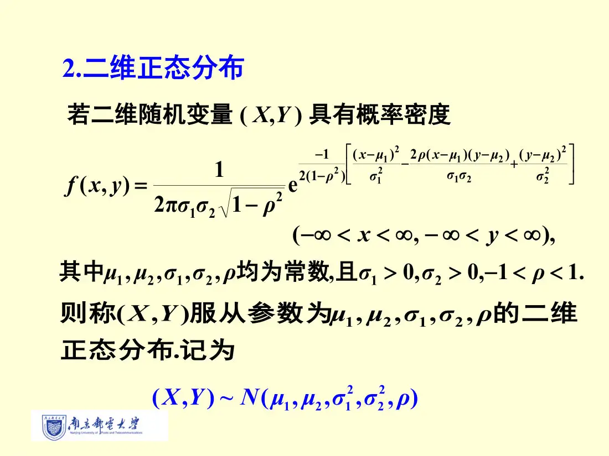

原文：

2.二维正态分布

若二维随机变量 $(X,Y)$ 具有概率密度

$$
f (x, y) = \frac {1}{2 \pi \sigma_ {1} \sigma_ {2} \sqrt {1 - \rho^ {2}}} \mathrm{e} ^ {\frac {- 1}{2 (1 - \rho^ {2})} \left[ \frac {(x - \mu_ {1}) ^ {2}}{\sigma_ {1} ^ {2}} - \frac {2 \rho (x - \mu_ {1}) (y - \mu_ {2})}{\sigma_ {1} \sigma_ {2}} + \frac {(y - \mu_ {2}) ^ {2}}{\sigma_ {2} ^ {2}} \right]} (- \infty <   x <   \infty , - \infty <   y <   \infty),
$$

其中 $\mu_{1},\mu_{2},\sigma_{1},\sigma_{2},\rho$ 均为常数,且 $\sigma_{1}>0,\sigma_{2}>0,-1<\rho<1$ .
则称 $(X,Y)$ 服从参数为 $\mu_{1},\mu_{2},\sigma_{1},\sigma_{2},\rho$ 的二维
正态分布.记为

$$
(X, Y) \sim N (\mu_ {1}, \mu_ {2}, \sigma_ {1} ^ {2}, \sigma_ {2} ^ {2}, \rho)
$$

南京邮电大学
Nanjing University of Posts and Telecommunications

### 二维正态分布的图形

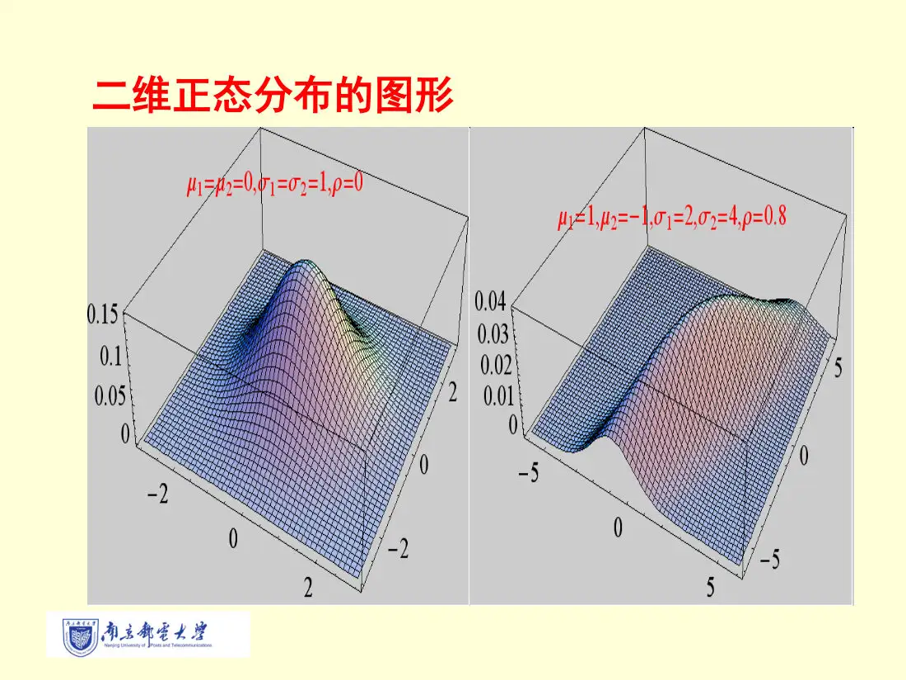

原文：

二维正态分布的图形

南京邮电大学
Nanjing University of Posts and Telecommunications

### 推广 n 维随机变量的概念

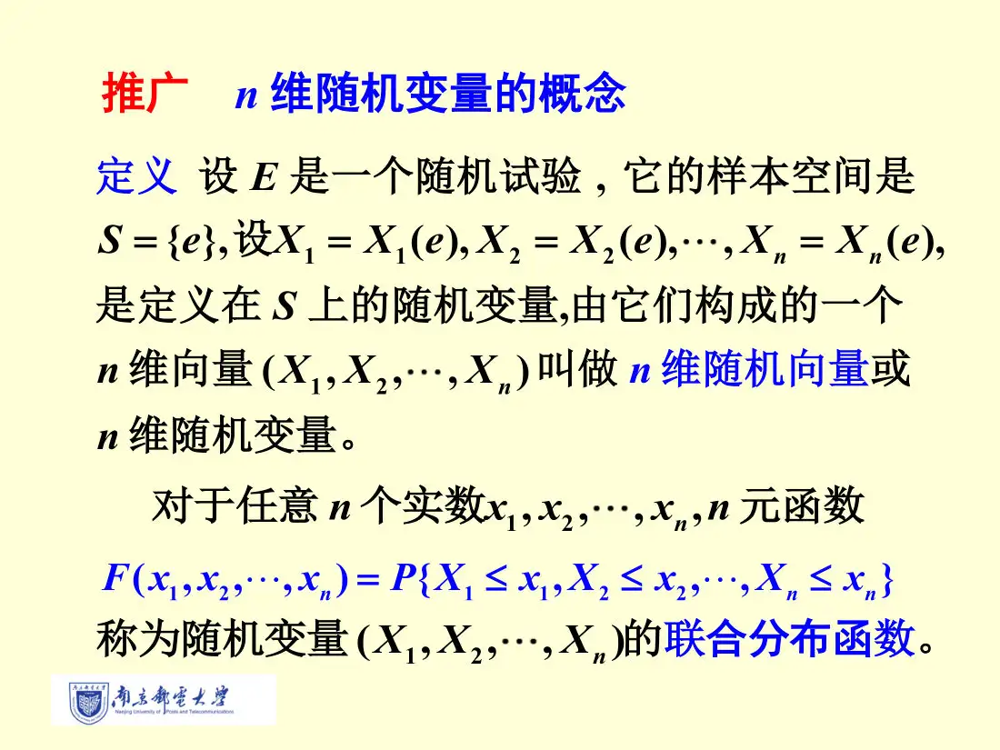

原文：

推广 n 维随机变量的概念

定义 设 E 是一个随机试验，它的样本空间是 $S=\{e\}$ ，设 $X_{1}=X_{1}(e)$ ， $X_{2}=X_{2}(e)$ ， $\cdots$ ， $X_{n}=X_{n}(e)$ ，是定义在 S 上的随机变量，由它们构成的一个 n 维向量 $(X_{1},X_{2},\cdots,X_{n})$ 叫做 n 维随机向量或 n 维随机变量。

对于任意 n 个实数 $x_{1}, x_{2}, \cdots, x_{n}, n$ 元函数 $F(x_{1}, x_{2}, \cdots, x_{n}) = P\{X_{1} \leq x_{1}, X_{2} \leq x_{2}, \cdots, X_{n} \leq x_{n}\}$ 称为随机变量 $(X_{1}, X_{2}, \cdots, X_{n})$ 的联合分布函数。

南京邮电大学
Nanjing University of Posts and Telecommunications
