# 《概率论与数理统计》第3章 多维随机变量及其分布 3.2 边缘分布（课件）

原件的每一页，下面附识别出的文字。

### 3.2 边缘分布

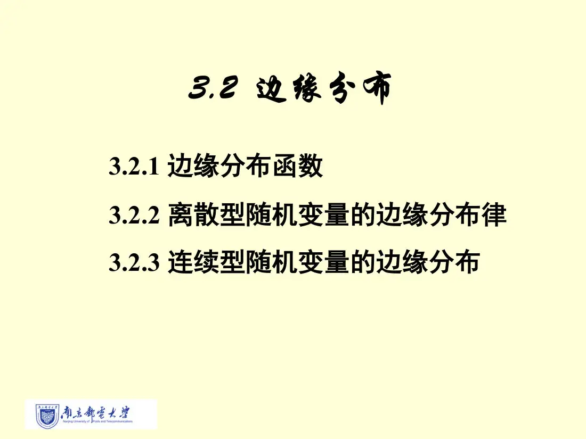

原文：

3.2 边缘分布

3.2.1 边缘分布函数

3.2.2 离散型随机变量的边缘分布律

3.2.3 连续型随机变量的边缘分布

南京邮电大学
Nanjing University of Posts and Telecommunications

### 3.2.1 边缘分布函数

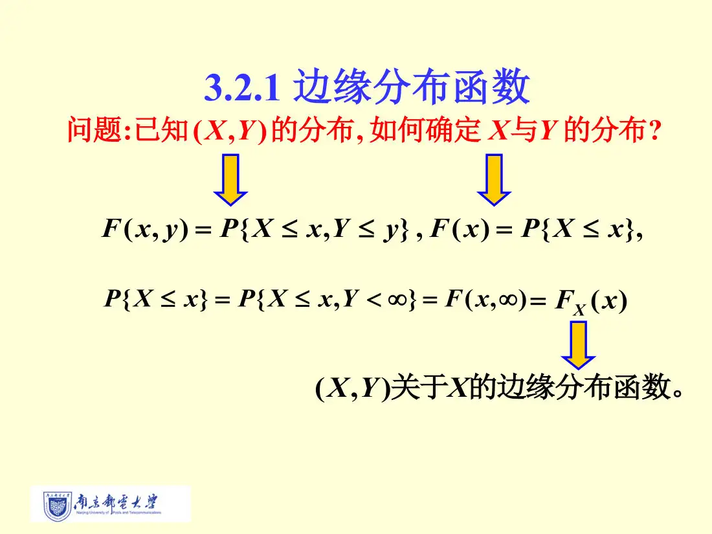

原文：

3.2.1 边缘分布函数

问题:已知 $(X,Y)$ 的分布,如何确定X与Y的分布?

$$
P \{X \leq x \} = P \{X \leq x, Y <   \infty \} = F (x, \infty) = F _ {X} (x)
$$

$(X,Y)$ 关于 $X$ 的边缘分布函数。

南京邮电大学
Nanjing University of Posts and Telecommunications

### 令 $y \to \infty$

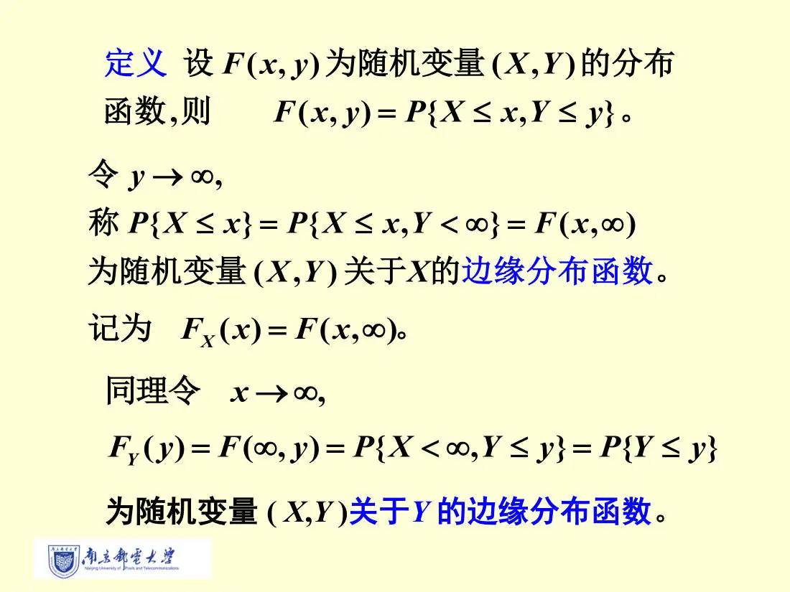

原文：

定义 设 $F(x,y)$ 为随机变量 $(X,Y)$ 的分布函数, 则 $F(x,y)=P\{X\leq x,Y\leq y\}$ 。

令 $y \to \infty$

称 $P\{X \leq x\} = P\{X \leq x, Y < \infty\} = F(x, \infty)$ 为随机变量 $(X, Y)$ 关于 $X$ 的边缘分布函数。

记为 $F_{X}(x) = F(x,\infty)$ 。

同理令 $x \to \infty,$

$$
F _ {Y} (y) = F (\infty , y) = P \{X <   \infty , Y \leq y \} = P \{Y \leq y \}
$$

为随机变量 $(X,Y)$ 关于Y的边缘分布函数。

南京邮电大学
Nanjing University of Posts and Telecommunications

### 3.2.2二维离散型随机变量的边缘分布律

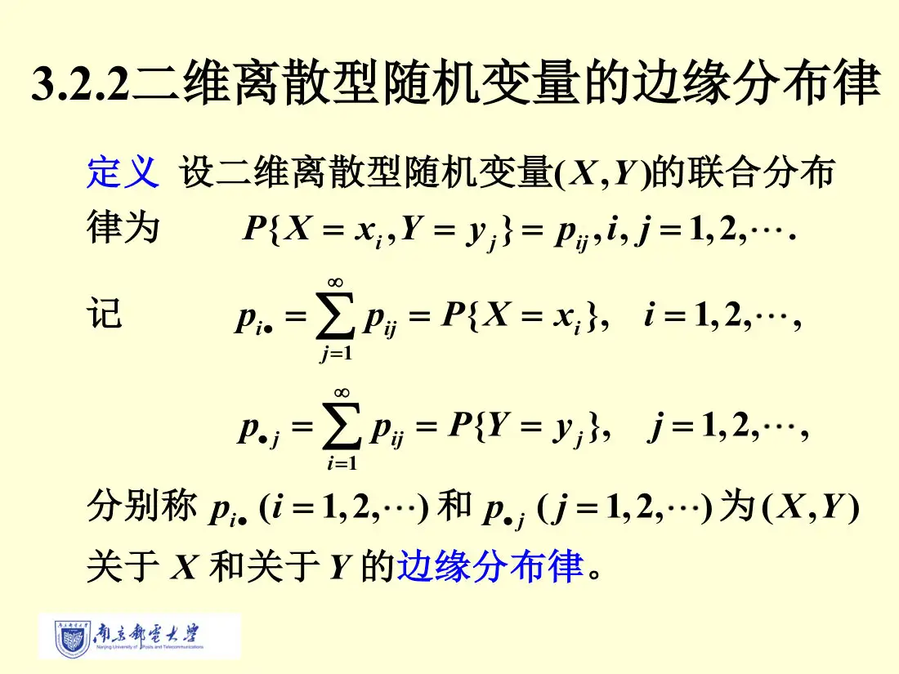

原文：

3.2.2二维离散型随机变量的边缘分布律

定义 设二维离散型随机变量(X,Y)的联合分布

律为 $P\{X=x_{i},Y=y_{j}\}=p_{ij},i,j=1,2,\cdots.$

记

$$
p _ {i \bullet} = \sum_ {j = 1} ^ {\infty} p _ {i j} = P \{X = x _ {i} \}, \quad i = 1, 2, \dots ,
$$

$$
p _ {\bullet j} = \sum_ {i = 1} ^ {\infty} p _ {i j} = P \{Y = y _ {j} \}, \quad j = 1, 2, \dots ,
$$

分别称 $p_{i\bullet}(i=1,2,\cdots)$ 和 $p_{\bullet j}(j=1,2,\cdots)$ 为 $(X,Y)$ 关于 X 和关于 Y 的边缘分布律。

南京邮电大学
Nanjing University of Posts and Telecommunications

### 二维离散型随机变量的边缘分布

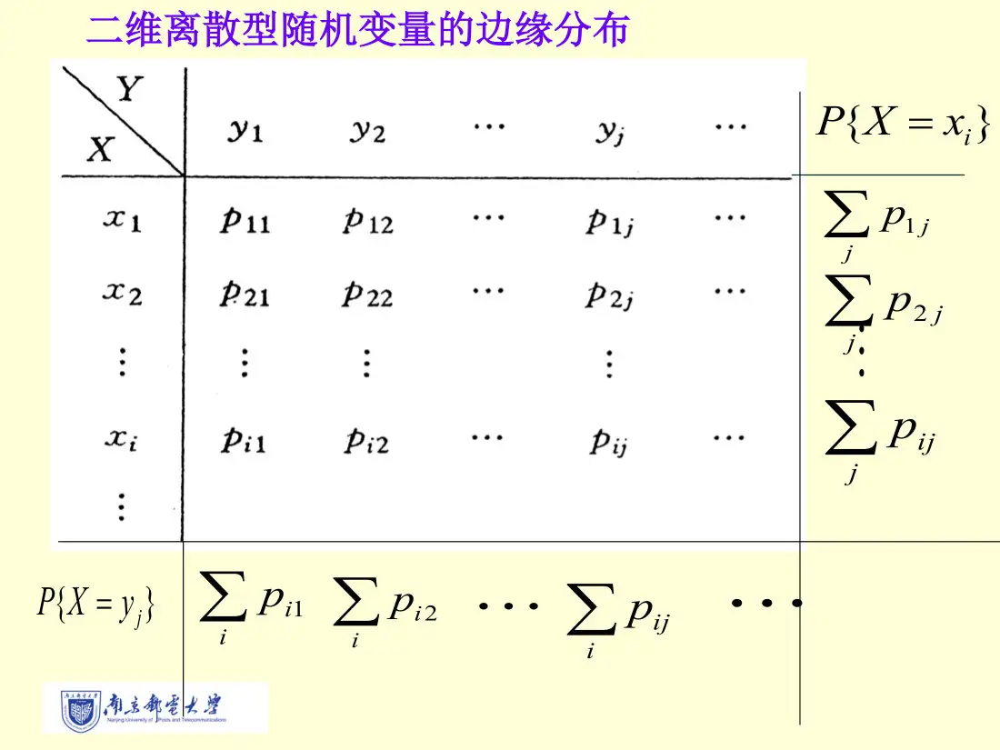

原文：

二维离散型随机变量的边缘分布

<table><tr><td>X\Y</td><td> $y_1$ </td><td> $y_2$ </td><td>...</td><td> $y_j$ </td><td>...</td><td> $P\{X=x_i\}$ </td></tr><tr><td> $x_1$ </td><td> $p_{11}$ </td><td> $p_{12}$ </td><td>...</td><td> $p_{1j}$ </td><td>...</td><td> $\sum_j p_{1j}$ </td></tr><tr><td> $x_2$ </td><td> $p_{21}$ </td><td> $p_{22}$ </td><td>...</td><td> $p_{2j}$ </td><td>...</td><td> $\sum_j p_{2j}$ </td></tr><tr><td> $\vdots$ </td><td> $\vdots$ </td><td> $\vdots$ </td><td></td><td> $\vdots$ </td><td></td><td rowspan="3"> $\sum_j p_{ij}$ </td></tr><tr><td> $x_i$ </td><td> $p_{i1}$ </td><td> $p_{i2}$ </td><td>...</td><td> $p_{ij}$ </td><td>...</td></tr><tr><td> $\vdots$ </td><td></td><td></td><td></td><td></td><td></td></tr><tr><td> $P\{X=y_j\}$ </td><td> $\sum_i p_{i1}$ </td><td> $\sum_i p_{i2}$ </td><td>...</td><td> $\sum_i p_{ij}$ </td><td>...</td><td></td></tr></table>

### 因此得离散型随机变量关于X和Y的边缘分布函数分别为

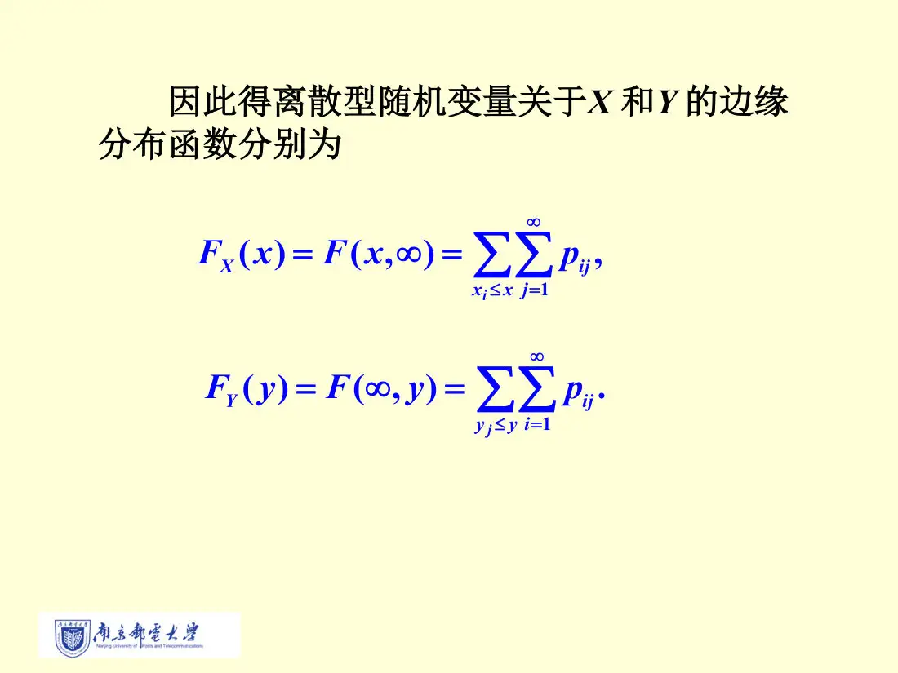

原文：

因此得离散型随机变量关于X和Y的边缘分布函数分别为

$$
F _ {X} (x) = F (x, \infty) = \sum_ {x _ {i} \leq x} \sum_ {j = 1} ^ {\infty} p _ {i j},
$$

$$
F _ {Y} (y) = F (\infty , y) = \sum_ {y _ {j} \leq y} \sum_ {i = 1} ^ {\infty} p _ {i j}.
$$

南京邮电大学
Nanjing University of Posts and Telecommunications

### 解：将试验样本 $X, Y$ 可能取值列表如下

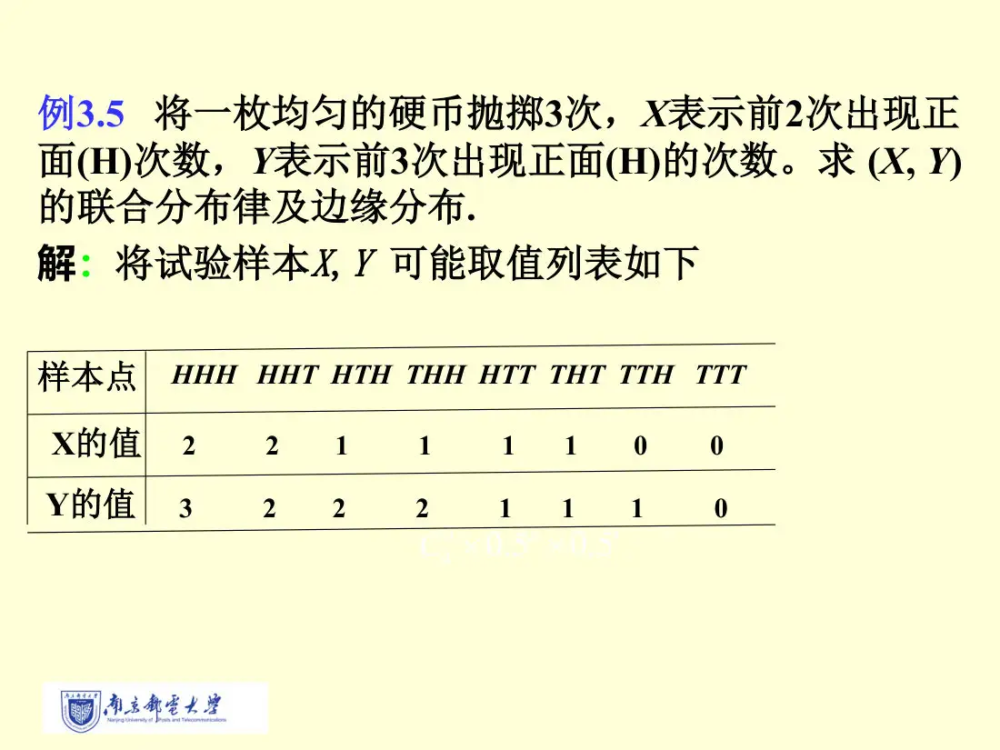

原文：

例3.5 将一枚均匀的硬币抛掷3次，X表示前2次出现正面(H)次数，Y表示前3次出现正面(H)的次数。求 $(X, Y)$ 的联合分布律及边缘分布.

解：将试验样本 $X, Y$ 可能取值列表如下

<table><tr><td>样本点</td><td>HHH</td><td>HHT</td><td>HTH</td><td>THH</td><td>HTT</td><td>THT</td><td>TTH</td><td>TTT</td></tr><tr><td>X的值</td><td>2</td><td>2</td><td>1</td><td>1</td><td>1</td><td>1</td><td>0</td><td>0</td></tr><tr><td>Y的值</td><td>3</td><td>2</td><td>2</td><td>2</td><td>1</td><td>1</td><td>1</td><td>0</td></tr></table>

$C_4^3 \times 0.5^3 \times 0.5^1$

南京邮电大学
Nanjing University of Posts and Telecommunications

### $$

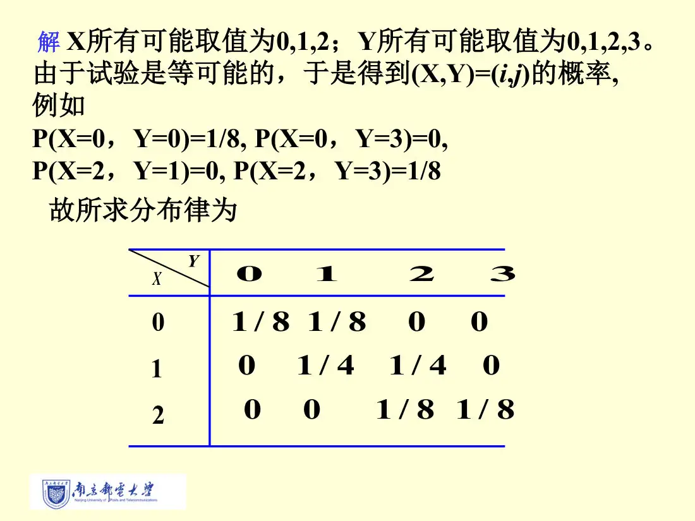

原文：

解 X所有可能取值为0,1,2；Y所有可能取值为0,1,2,3。由于试验是等可能的，于是得到 $(X,Y)=(i,j)$ 的概率，例如

$$
\mathrm{P} (\mathrm{X} = 0, \quad \mathrm{Y} = 0) = 1 / 8, \mathrm{P} (\mathrm{X} = 0, \quad \mathrm{Y} = 3) = 0,
$$

$$
\mathrm{P} (\mathrm{X} = 2, \quad \mathrm{Y} = 1) = 0, \mathrm{P} (\mathrm{X} = 2, \quad \mathrm{Y} = 3) = 1 / 8
$$

故所求分布律为

<table><tr><td>X\Y</td><td>0</td><td>1</td><td>2</td><td>3</td></tr><tr><td>0</td><td>1/8</td><td>1/8</td><td>0</td><td>0</td></tr><tr><td>1</td><td>0</td><td>1/4</td><td>1/4</td><td>0</td></tr><tr><td>2</td><td>0</td><td>0</td><td>1/8</td><td>1/8</td></tr></table>

南京邮电大学
Nanjing University of Posts and Telecommunications

### $$

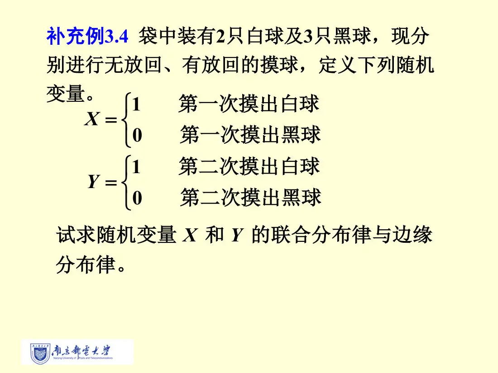

原文：

补充例3.4 袋中装有2只白球及3只黑球，现分别进行无放回、有放回的摸球，定义下列随机变量。 [1] 第一次摸出白球

$$
X = \left\{ \begin{array}{l l} 1 & \text {第一次摸出白球} \\ 0 & \text {第一次摸出黑球} \end{array} \right.
$$

$$
Y = \left\{ \begin{array}{l l} 1 & \text {第二次摸出白球} \\ 0 & \text {第二次摸出黑球} \end{array} \right.
$$

试求随机变量 X 和 Y 的联合分布律与边缘分布律。

南京邮电大学
Nanjing University of Posts and Telecommunications

### 解 (1) 无放回 2只白球及3只黑球

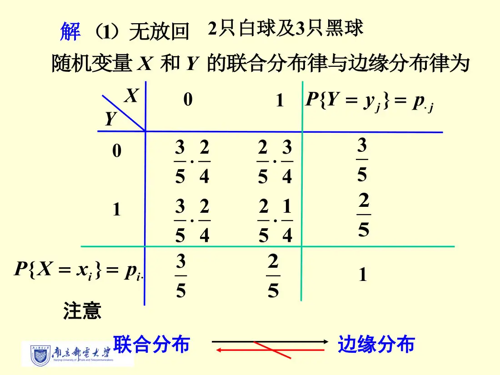

原文：

解 (1) 无放回 2只白球及3只黑球

随机变量 $X$ 和 $Y$ 的联合分布律与边缘分布律为

$$
\begin{array}{c c c c} \hline X & 0 & 1 & P \{Y = y _ {j} \} = p _ {\cdot j} \\ Y & & & \\ \hline 0 & \frac {3}{5} \cdot \frac {2}{4} & \frac {2}{5} \cdot \frac {3}{4} & \frac {3}{5} \\ 1 & \frac {3}{5} \cdot \frac {2}{4} & \frac {2}{5} \cdot \frac {1}{4} & \frac {2}{5} \\ \hline P \{X = x _ {i} \} = p _ {i}. & \frac {3}{5} & \frac {2}{5} & 1 \\ \hline \end{array}
$$

注意

联合分布

边缘分布

南京邮电大学
Nanjing University of Posts and Telecommunications

### $$

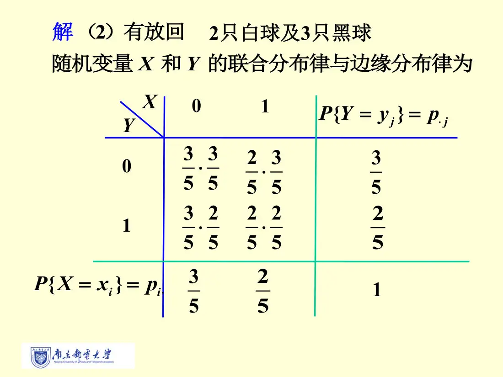

原文：

解 (2) 有放回 2只白球及3只黑球随机变量 $X$ 和 $Y$ 的联合分布律与边缘分布律为

$$
\begin{array}{c c c c} \hline X & 0 & 1 & P \{Y = y _ {j} \} = p _ {\cdot j} \\ Y & & & \\ \hline 0 & \frac {3}{5} \cdot \frac {3}{5} & \frac {2}{5} \cdot \frac {3}{5} & \frac {3}{5} \\ 1 & \frac {3}{5} \cdot \frac {2}{5} & \frac {2}{5} \cdot \frac {2}{5} & \frac {2}{5} \\ \hline P \{X = x _ {i} \} = p _ {i}. & \frac {3}{5} & \frac {2}{5} & 1 \end{array}
$$

南京邮电大学
Nanjing University of Posts and Telecommunications

### 例3.6 已知随机变量(X,Y)的边缘分布律分别是

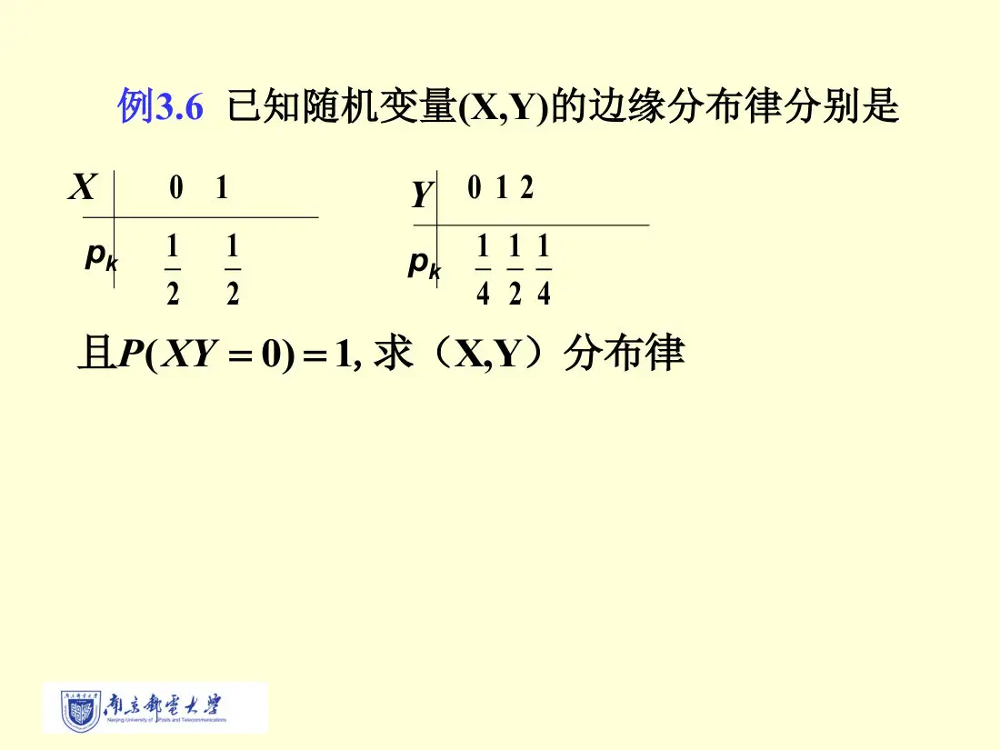

原文：

例3.6 已知随机变量(X,Y)的边缘分布律分别是

$$
\begin{array}{c c c} X & 0 & 1 \\ \hline p _ {k} & \frac {1}{2} & \frac {1}{2} \end{array}
$$

$$
\begin{array}{c c} Y & 0   1   2 \\ \hline p _ {k} & \frac {1}{4}   \frac {1}{2}   \frac {1}{4} \end{array}
$$

且 $P(XY=0)=1$ ，求 $(X,Y)$ 分布律

南京邮电大学
Nanjing University of Posts and Telecommunications

### 3.2.3 连续型随机变量的边缘分布

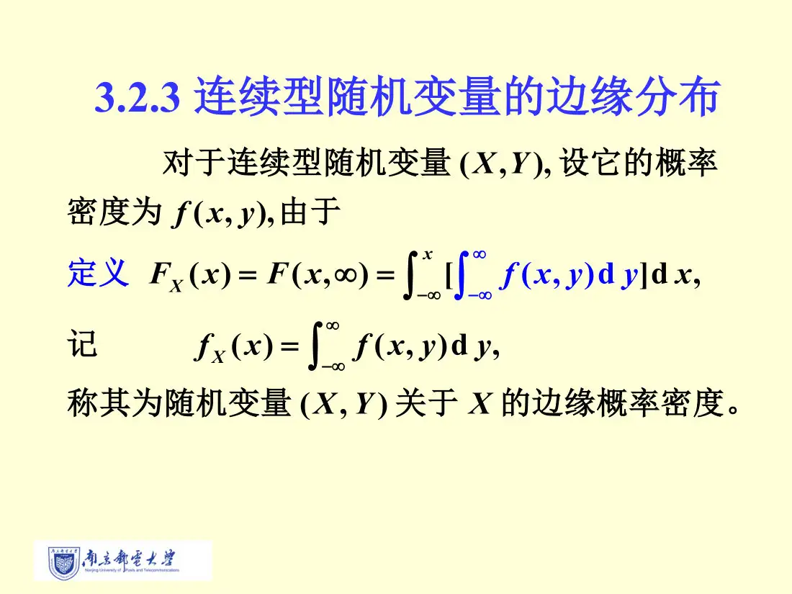

原文：

3.2.3 连续型随机变量的边缘分布

对于连续型随机变量 $(X,Y)$ , 设它的概率密度为 $f(x,y)$ , 由于定义 $F_{X}(x) = F(x,\infty) = \int_{-\infty}^{x}[\int_{-\infty}^{\infty}f(x,y)\mathrm{d}y]\mathrm{d}x,$ 记 $f_{X}(x) = \int_{-\infty}^{\infty}f(x,y)\mathrm{d}y,$ 称其为随机变量 $(X,Y)$ 关于 $X$ 的边缘概率密度同理可得 $Y$ 的边缘分布函数

南京邮电大学
Nanjing University of Posts and Telecommunications

### $$

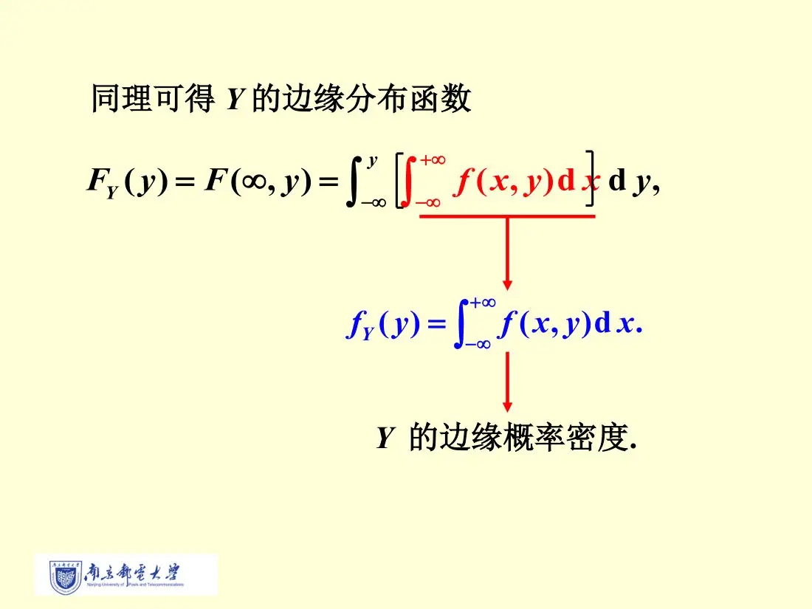

原文：

$$
\begin{array}{r l} & {F _ {Y} (y) = F (\infty , y) = \int_ {- \infty} ^ {y} \left[ \int_ {- \infty} ^ {+ \infty} f (x, y) \mathrm{d} x \right] \mathrm{d} y,} \\ & {\qquad \qquad \qquad \qquad \qquad \qquad \qquad \qquad \qquad \qquad \qquad \qquad \qquad \qquad \qquad \qquad f _ {Y} (y) = \int_ {- \infty} ^ {+ \infty} f (x, y) \mathrm{d} x.} \\ & {\qquad \qquad \qquad \qquad \qquad \qquad \qquad \qquad \qquad \qquad \qquad Y   \text {的边缘概率密度}.} \end{array}
$$

南京邮电大学
Nanjing University of Posts and Telecommunications

### 补充例3.5 设随机变量 $X$ 和 $Y$ 具有联合概率密度

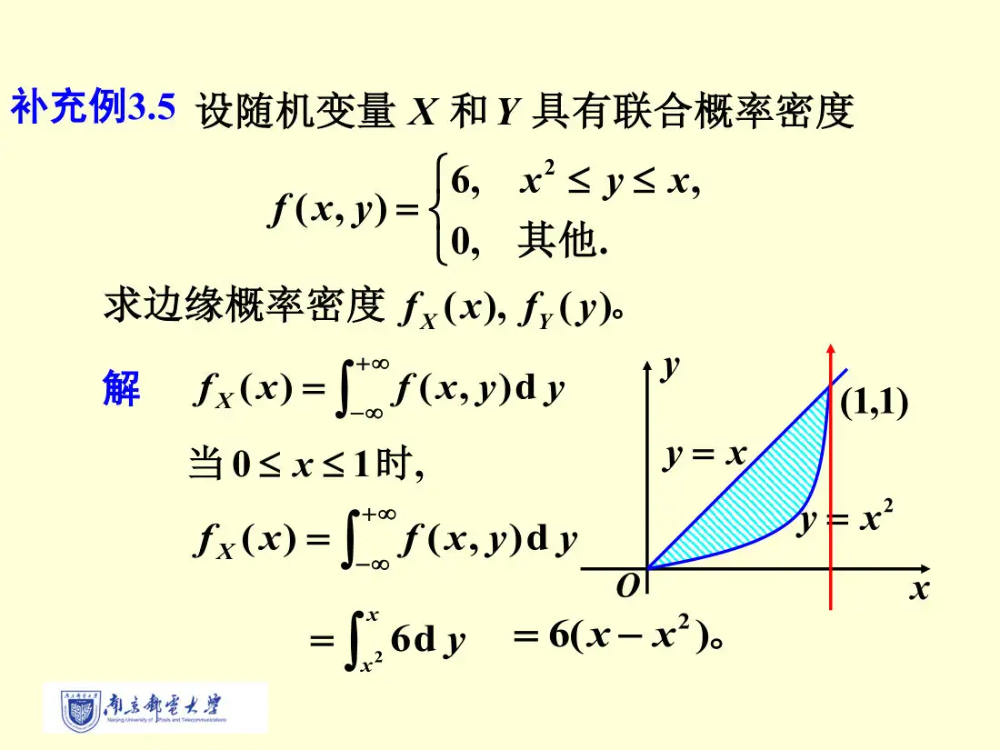

原文：

补充例3.5 设随机变量 $X$ 和 $Y$ 具有联合概率密度

$$
f (x, y) = \left\{ \begin{array}{l l} 6, & x ^ {2} \leq y \leq x, \\ 0, & \text {其他.} \end{array} \right.
$$

求边缘概率密度 $f_{X}(x)$ , $f_{Y}(y)$ 。

解 $f_{X}(x)=\int_{-\infty}^{+\infty}f(x,y)\mathrm{d}y$ 当 $0 \leq x \leq 1$ 时,

南京邮电大学
Nanjing University of Posts and Telecommunications

### 当 $x  1$ 时，

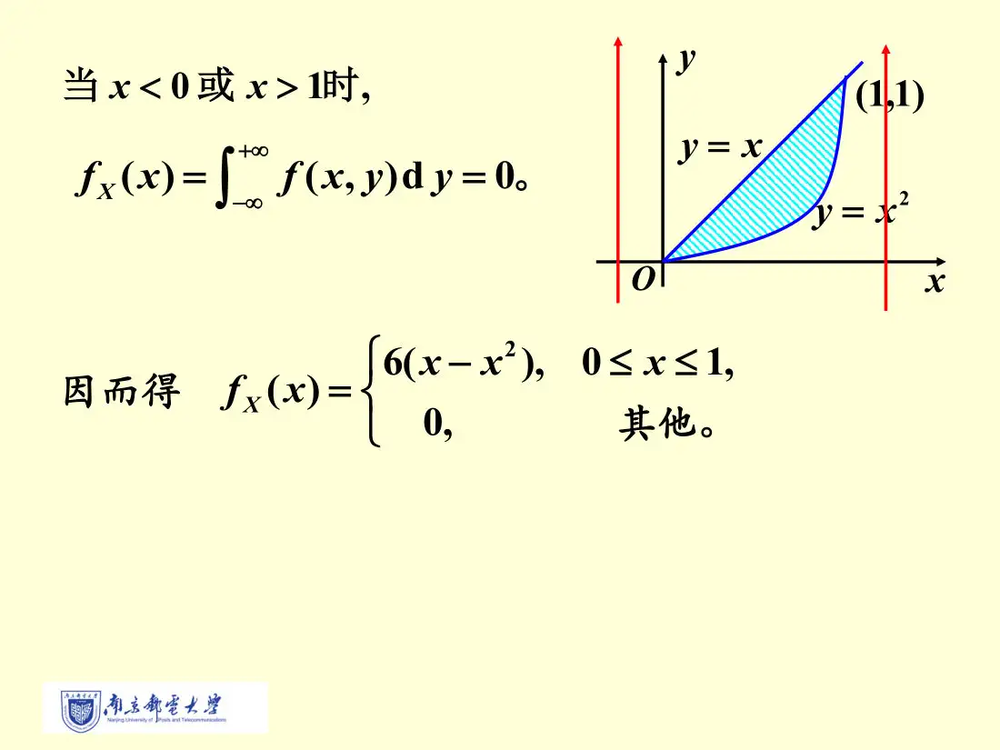

原文：

当 $x < 0$ 或 $x > 1$ 时，

$$
f _ {X} (x) = \int_ {- \infty} ^ {+ \infty} f (x, y) d y = 0 。
$$

因而得 $f_{X}(x)=\left\{\begin{aligned}&6(x-x^{2}),&0\leq x\leq1,\\ &0,& 其他。\end{aligned}\right.$

南京邮电大学
Nanjing University of Posts and Telecommunications

### 当 $0 \leq y \leq 1$ 时，

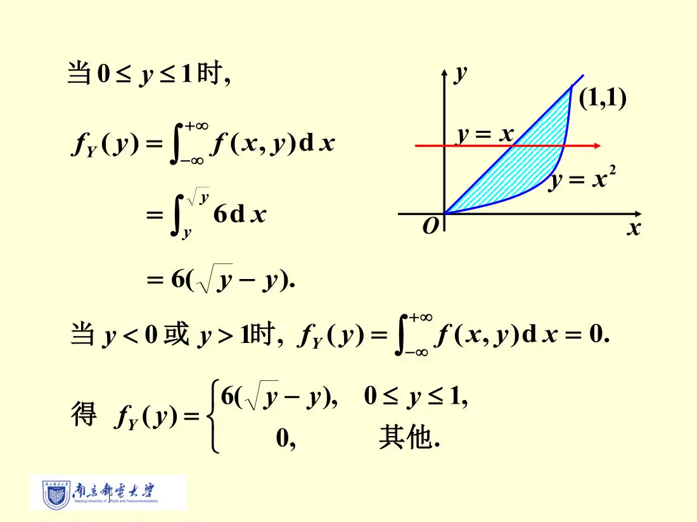

原文：

当 $0 \leq y \leq 1$ 时，

$$
\begin{array}{r l} f _ {Y} (y) & = \int_ {- \infty} ^ {+ \infty} f (x, y) \mathrm{d} x \\ & = \int_ {y} ^ {\sqrt {y}} 6 \mathrm{d} x \\ & = 6 (\sqrt {y} - y). \end{array}
$$

当 $y < 0$ 或 $y > 1$ 时， $f_{Y}(y) = \int_{-\infty}^{+\infty} f(x, y) \mathrm{d}x = 0$ .

得 $f_{Y}(y) = \left\{ \begin{array}{ll}6(\sqrt{y} - y), & 0\leq y\leq 1,\\ 0, & \text{其他}. \end{array} \right.$

南京邮电大学
Nanjing University of Posts and Telecommunications

### $$

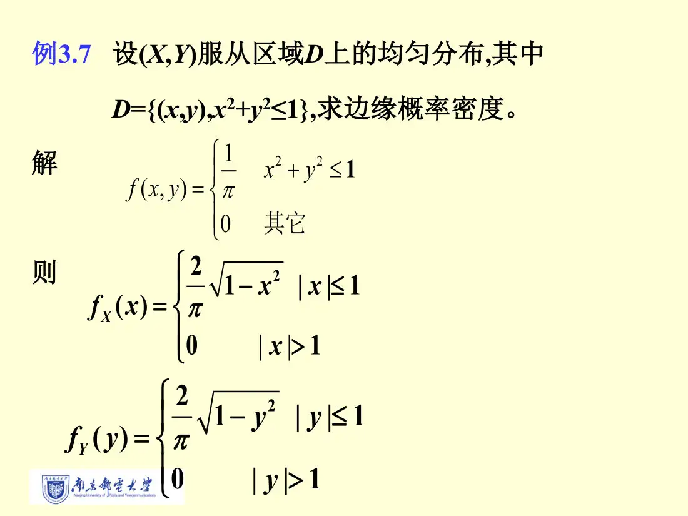

原文：

例3.7 设 $(X,Y)$ 服从区域D上的均匀分布,其中 $D=\{(x,y),x^{2}+y^{2}\leq1\}$ ,求边缘概率密度。

解

$$
f (x, y) = \left\{ \begin{array}{l l} \frac {1}{\pi} & x ^ {2} + y ^ {2} \leq 1 \\ 0 & \text {其它} \end{array} \right.
$$

则

$$
f _ {X} (x) = \left\{ \begin{array}{l l} \frac {2}{\pi} \sqrt {1 - x ^ {2}} & | x | \leq 1 \\ 0 & | x | > 1 \end{array} \right.
$$

$$
f _ {Y} (y) = \left\{ \begin{array}{l l} \frac {2}{\pi} \sqrt {1 - y ^ {2}} & | y | \leq 1 \\ 0 & | y | > 1 \end{array} \right.
$$

### 例3.8 设二维随机变量 $(X, Y)$ 的概率密度为

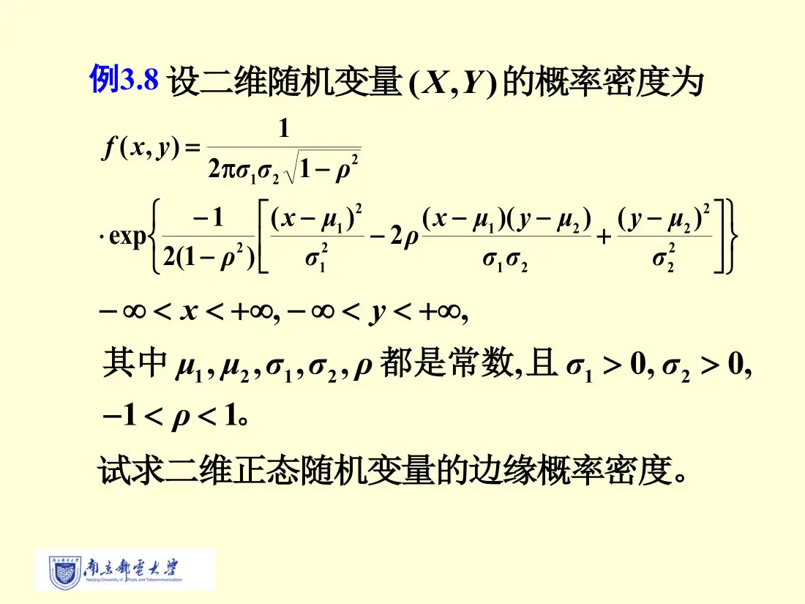

原文：

例3.8 设二维随机变量 $(X, Y)$ 的概率密度为

$$
\begin{array}{l} f (x, y) = \frac {1}{2 \pi \sigma_ {1} \sigma_ {2} \sqrt {1 - \rho^ {2}}} \\ \cdot \exp \left\{\frac {- 1}{2 (1 - \rho^ {2})} \left[ \frac {(x - \mu_ {1}) ^ {2}}{\sigma_ {1} ^ {2}} - 2 \rho \frac {(x - \mu_ {1}) (y - \mu_ {2})}{\sigma_ {1} \sigma_ {2}} + \frac {(y - \mu_ {2}) ^ {2}}{\sigma_ {2} ^ {2}} \right] \right\} \\ - \infty <   x <   + \infty , - \infty <   y <   + \infty , \end{array}
$$

其中 $\mu_{1},\mu_{2},\sigma_{1},\sigma_{2},\rho$ 都是常数,且 $\sigma_{1}>0,\sigma_{2}>0,-1<\rho<1$ 。

试求二维正态随机变量的边缘概率密度。

南京邮电大学
Nanjing University of Posts and Telecommunications

### 由于

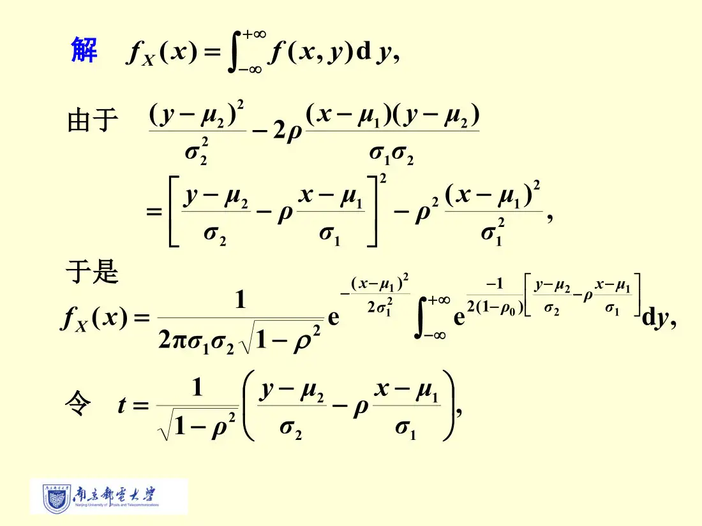

原文：

解 $f_{X}(x) = \int_{-\infty}^{+\infty}f(x,y)\mathrm{d}y,$

由于

$$
\begin{array}{l} \frac {(y - \mu_ {2}) ^ {2}}{\sigma_ {2} ^ {2}} - 2 \rho \frac {(x - \mu_ {1}) (y - \mu_ {2})}{\sigma_ {1} \sigma_ {2}} \\ = \left[ \frac {y - \mu_ {2}}{\sigma_ {2}} - \rho \frac {x - \mu_ {1}}{\sigma_ {1}} \right] ^ {2} - \rho^ {2} \frac {(x - \mu_ {1}) ^ {2}}{\sigma_ {1} ^ {2}}, \end{array}
$$

$$
\begin{array}{l} \text {于是} \\ f _ {X} (x) = \frac {1}{2 \pi \sigma_ {1} \sigma_ {2} \sqrt {1 - \rho^ {2}}} \mathrm{e} ^ {- \frac {(x - \mu_ {1}) ^ {2}}{2 \sigma_ {1} ^ {2}}} \int_ {- \infty} ^ {+ \infty} \mathrm{e} ^ {\frac {- 1}{2 (1 - \rho_ {0})} \left[ \frac {y - \mu_ {2}}{\sigma_ {2}} - \rho \frac {x - \mu_ {1}}{\sigma_ {1}} \right]} \mathrm{d} y, \\ \text {令} t = \frac {1}{\sqrt {1 - \rho^ {2}}} \left(\frac {y - \mu_ {2}}{\sigma_ {2}} - \rho \frac {x - \mu_ {1}}{\sigma_ {1}}\right), \end{array}
$$

南京邮电大学
Nanjing University of Posts and Telecommunications

### 则有

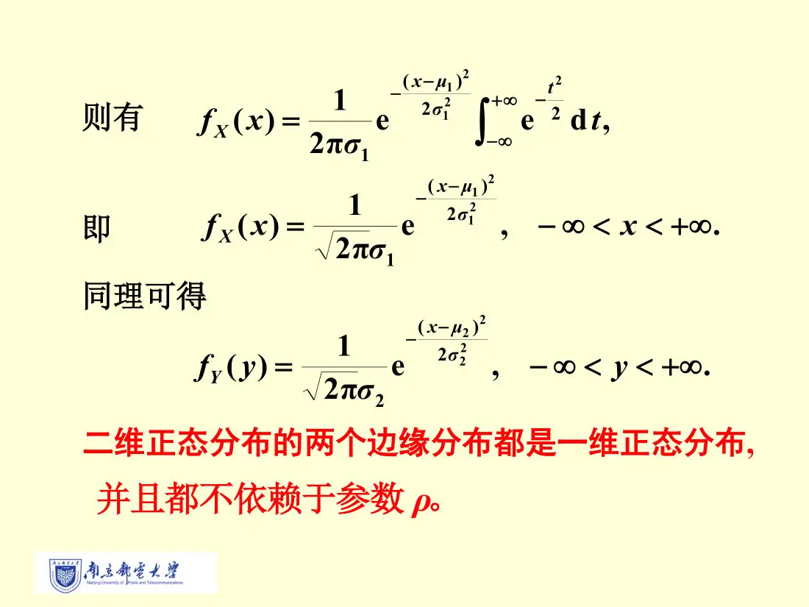

原文：

则有

$$
f _ {X} (x) = \frac {1}{2 \pi \sigma_ {1}} \mathrm{e} ^ {- \frac {(x - \mu_ {1}) ^ {2}}{2 \sigma_ {1} ^ {2}}} \int_ {- \infty} ^ {+ \infty} \mathrm{e} ^ {- \frac {t ^ {2}}{2}} \mathrm{d} t,
$$

即

$$
f _ {X} (x) = \frac {1}{\sqrt {2 \pi} \sigma_ {1}} \mathrm{e} ^ {- \frac {(x - \mu_ {1}) ^ {2}}{2 \sigma_ {1} ^ {2}}}, - \infty <   x <   + \infty .
$$

同理可得

$$
f _ {Y} (y) = \frac {1}{\sqrt {2 \pi} \sigma_ {2}} \mathrm{e} ^ {- \frac {(x - \mu_ {2}) ^ {2}}{2 \sigma_ {2} ^ {2}}}, - \infty <   y <   + \infty .
$$

二维正态分布的两个边缘分布都是一维正态分布，并且都不依赖于参数 $\rho$ 。

南京邮电大学
Nanjing University of Posts and Telecommunications

### $$

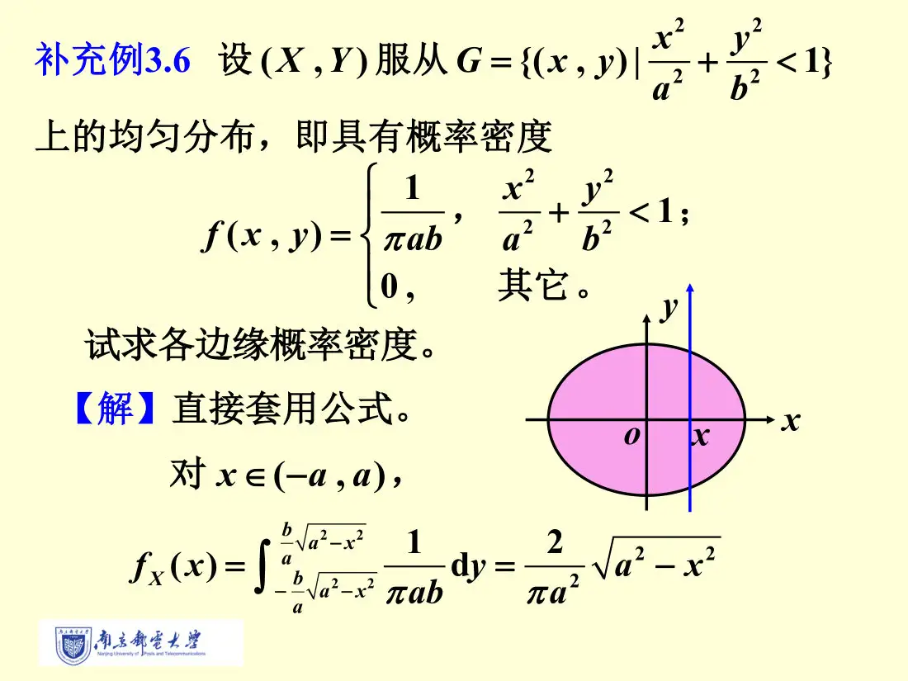

原文：

补充例3.6 设 $(X, Y)$ 服从 $G = \{(x, y) \mid \frac{x^2}{a^2} + \frac{y^2}{b^2} < 1\}$ 上的均匀分布，即具有概率密度

$$
f (x, y) = \left\{ \begin{array}{l l} \frac {1}{\pi a b}, & \frac {x ^ {2}}{a ^ {2}} + \frac {y ^ {2}}{b ^ {2}} <   1; \\ 0, & \text {其它。} \end{array} \right.
$$

试求各边缘概率密度。

【解】直接套用公式。

对 $x \in (-a, a)$ ,

$$
f _ {X} (x) = \int_ {- \frac {b}{a} \sqrt {a ^ {2} - x ^ {2}}} ^ {\frac {b}{a} \sqrt {a ^ {2} - x ^ {2}}} \frac {1}{\pi a b} d y = \frac {2}{\pi a ^ {2}} \sqrt {a ^ {2} - x ^ {2}}
$$

南京邮电大学
Nanjing University of Posts and Telecommunications

### 因此

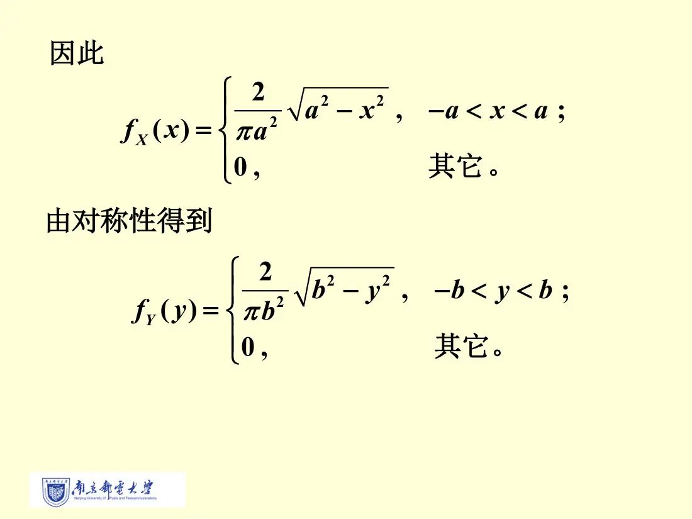

原文：

因此

$$
f _ {X} (x) = \left\{ \begin{array}{l l} \frac {2}{\pi a ^ {2}} \sqrt {a ^ {2} - x ^ {2}}, & - a <   x <   a; \\ 0, & \text {其它。} \end{array} \right.
$$

由对称性得到

$$
f _ {Y} (y) = \left\{ \begin{array}{l l} \frac {2}{\pi b ^ {2}} \sqrt {b ^ {2} - y ^ {2}}, & - b <   y <   b; \\ 0, & \text {其它。} \end{array} \right.
$$

南京邮电大学
Nanjing University of Posts and Telecommunications

### 南京邮电大学

原文：

二维正态分布的两个边缘分布都是正态分布，并且都不依赖参数 $\rho$ ，所以联合分布一般不能由边缘分布来确定，也就是说二维随机变量的性质并不能由两个随机变量的个别性质来确定，这时还必须考虑它们之间的联系。

南京邮电大学
Nanjing University of Posts and Telecommunications

### 四、小结

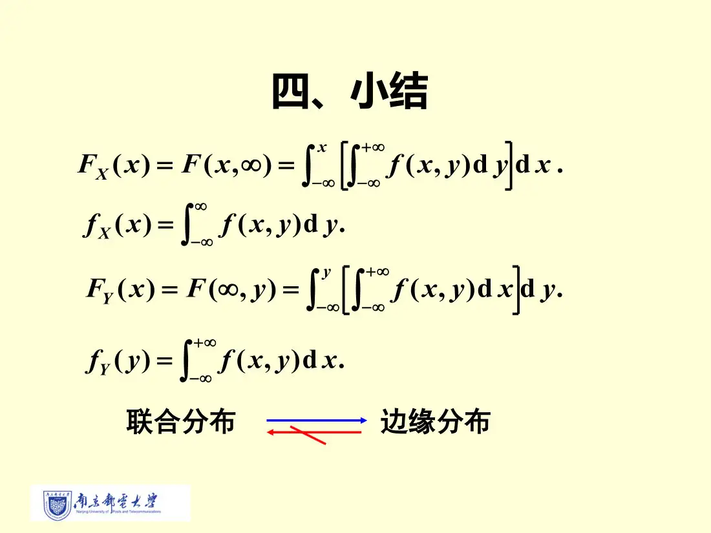

原文：

四、小结

$$
F _ {X} (x) = F (x, \infty) = \int_ {- \infty} ^ {x} \left[ \int_ {- \infty} ^ {+ \infty} f (x, y) \mathrm{d} y \right] \mathrm{d} x.
$$

$$
f _ {X} (x) = \int_ {- \infty} ^ {\infty} f (x, y) \mathrm{d} y.
$$

$$
F _ {Y} (x) = F (\infty , y) = \int_ {- \infty} ^ {y} \left[ \int_ {- \infty} ^ {+ \infty} f (x, y) \mathrm{d} x \right] \mathrm{d} y.
$$

$$
f _ {Y} (y) = \int_ {- \infty} ^ {+ \infty} f (x, y) d x.
$$

联合分布 → 边缘分布

南京邮电大学
Nanjing University of Posts and Telecommunications
