# 《概率论与数理统计》第3章 多维随机变量及其分布 3.3 条件分布（课件）

原件的每一页，下面附识别出的文字。

### 3.3 条件分布

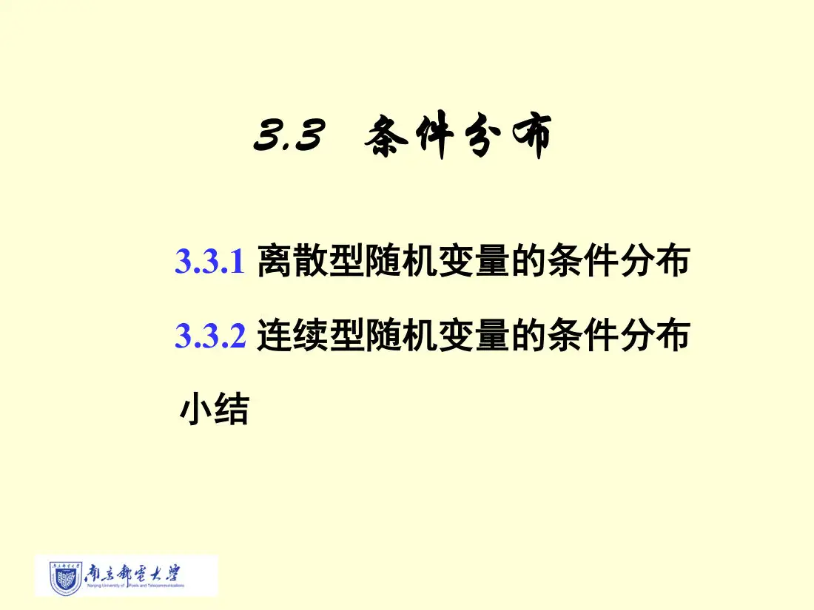

原文：

3.3 条件分布

3.3.1 离散型随机变量的条件分布

3.3.2 连续型随机变量的条件分布

小结

南京邮电大学
Nanjing University of Posts and Telecommunications

### 3.3.1 离散型随机变量的条件分布

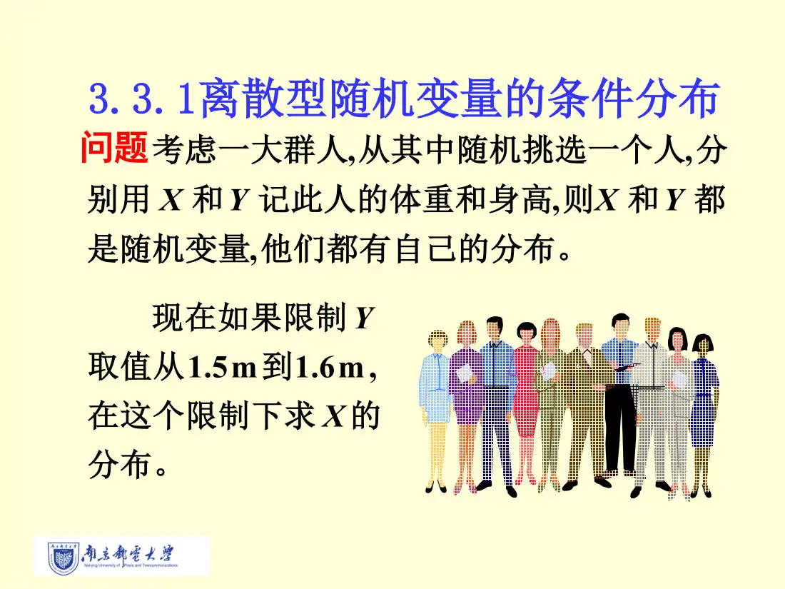

原文：

3.3.1 离散型随机变量的条件分布
问题考虑一大群人,从其中随机挑选一个人,分别用 X 和 Y 记此人的体重和身高,则 X 和 Y 都是随机变量,他们都有自己的分布。

现在如果限制 Y 取值从 1.5m 到 1.6m，在这个限制下求 X 的分布。

南京邮电大学
Nanjing University of Posts and Telecommunications

### $$

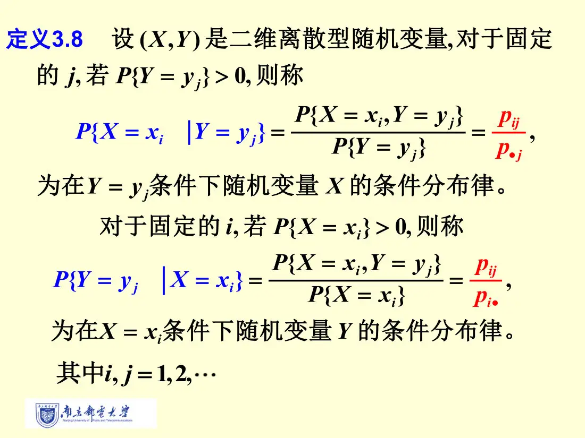

原文：

定义3.8 设 $(X,Y)$ 是二维离散型随机变量,对于固定的j,若 $P\{Y=y_{j}\}>0$ ,则称

$$
P \{X = x _ {i} \quad | Y = y _ {j} \} = \frac {P \{X = x _ {i} , Y = y _ {j} \}}{P \{Y = y _ {j} \}} = \frac {p _ {i j}}{p _ {\bullet j}},
$$

为在 $Y = y_{j}$ 条件下随机变量 $X$ 的条件分布律。

对于固定的 $i$ , 若 $P\{X = x_i\} > 0$ , 则称

$$
P \{Y = y _ {j} \mid X = x _ {i} \} = \frac {P \{X = x _ {i} , Y = y _ {j} \}}{P \{X = x _ {i} \}} = \frac {p _ {i j}}{p _ {i \bullet}},
$$

为在 $X = x_{i}$ 条件下随机变量 $Y$ 的条件分布律。

其中 $i, j = 1, 2, \cdots$

南京邮电大学
Nanjing University of Posts and Telecommunications

### 例3.10 一射手进行射击,击中目标的概率为

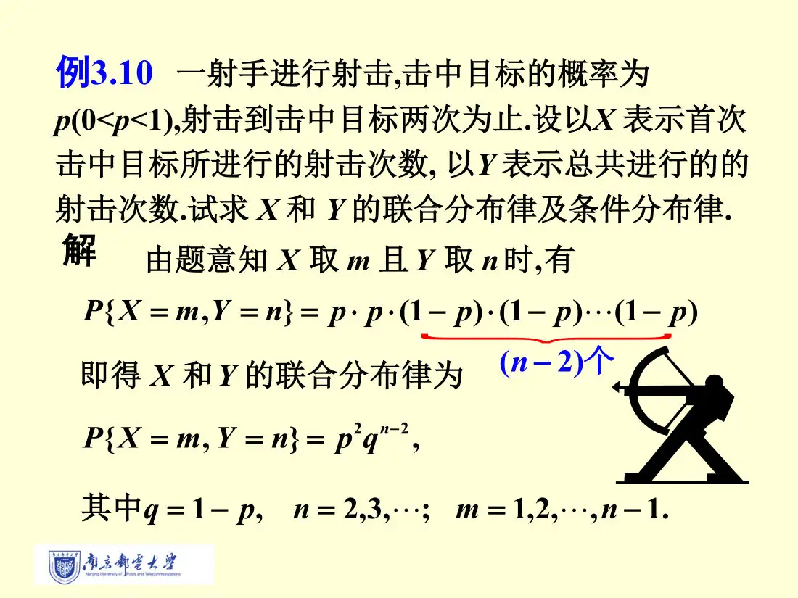

原文：

例3.10 一射手进行射击,击中目标的概率为

$p(0<p<1)$ ,射击到击中目标两次为止.设以X表示首次击中目标所进行的射击次数,以Y表示总共进行的的射击次数.试求X和Y的联合分布律及条件分布律.

解 由题意知 X 取 m 且 Y 取 n 时,有

$$
P \{X = m, Y = n \} = p \cdot p \cdot (1 - p) \cdot (1 - p) \dots (1 - p)
$$

即得 $X$ 和 $Y$ 的联合分布律为

$$
P \{X = m, Y = n \} = p ^ {2} q ^ {n - 2},
$$

(n-2)个

其中q=1-p, n=2,3,…; m=1,2,…,n-1.

南京邮电大学
Nanjing University of Posts and Telecommunications

### 现在求条件分布律.

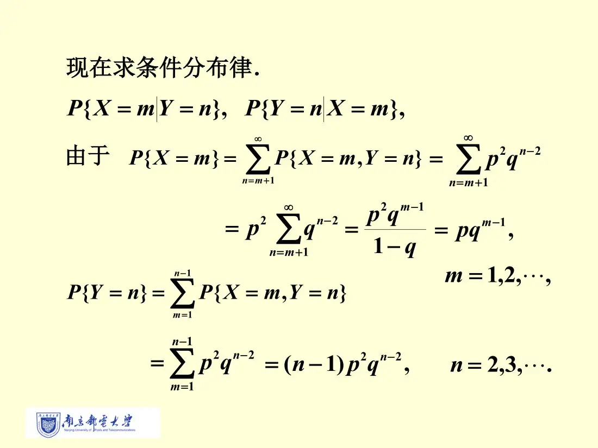

原文：

现在求条件分布律.

$P\{X = m|Y = n\} , P\{Y = n|X = m\} ,$

$$
\begin{array}{c} P \{X = m \} = \sum_ {n = m + 1} ^ {\infty} P \{X = m, Y = n \} = \sum_ {n = m + 1} ^ {\infty} p ^ {2} q ^ {n - 2} \\ = p ^ {2} \sum_ {n = m + 1} ^ {\infty} q ^ {n - 2} = \frac {p ^ {2} q ^ {m - 1}}{1 - q} = p q ^ {m - 1}, \end{array}
$$

$$
\begin{array}{r l r} P \{Y = n \} = \sum_ {m = 1} ^ {n - 1} P \{X = m, Y = n \} & & m = 1, 2, \dots , \\ & = \sum_ {m = 1} ^ {n - 1} p ^ {2} q ^ {n - 2} = (n - 1) p ^ {2} q ^ {n - 2}, & n = 2, 3, \dots . \end{array}
$$

南京邮电大学
Nanjing University of Posts and Telecommunications

### 所以当 $n=2,3,\cdots$ 时，

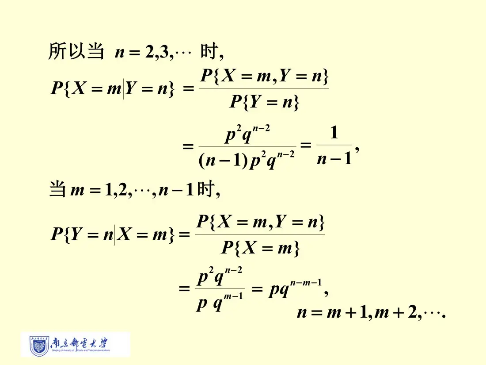

原文：

所以当 $n=2,3,\cdots$ 时，

$$
\begin{array}{r l} P \{X = m | Y = n \} & = \frac {P \{X = m , Y = n \}}{P \{Y = n \}} \\ & = \frac {p ^ {2} q ^ {n - 2}}{(n - 1) p ^ {2} q ^ {n - 2}} = \frac {1}{n - 1}, \end{array}
$$

当 $m=1,2,\cdots,n-1$ 时，

$$
\begin{array}{r l} P \{Y = n | X = m \} & = \frac {P \{X = m , Y = n \}}{P \{X = m \}} \\ & = \frac {p ^ {2} q ^ {n - 2}}{p q ^ {m - 1}} = p q ^ {n - m - 1}, \\ & \quad n = m + 1, m + 2, \dots . \end{array}
$$

南京邮电大学
Nanjing University of Posts and Telecommunications

### 南京邮电大学

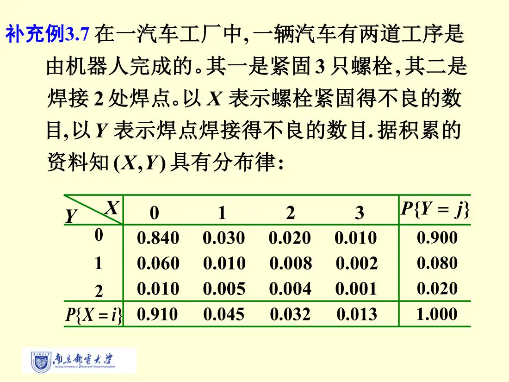

原文：

补充例3.7 在一汽车工厂中,一辆汽车有两道工序是由机器人完成的。其一是紧固3只螺栓,其二是焊接2处焊点。以X表示螺栓紧固得不良的数目,以Y表示焊点焊接得不良的数目.据积累的资料知 $(X,Y)$ 具有分布律:

<table><tr><td>Y\X</td><td>0</td><td>1</td><td>2</td><td>3</td><td>P{Y=j}</td></tr><tr><td>0</td><td>0.840</td><td>0.030</td><td>0.020</td><td>0.010</td><td>0.900</td></tr><tr><td>1</td><td>0.060</td><td>0.010</td><td>0.008</td><td>0.002</td><td>0.080</td></tr><tr><td>2</td><td>0.010</td><td>0.005</td><td>0.004</td><td>0.001</td><td>0.020</td></tr><tr><td>P{X=i}</td><td>0.910</td><td>0.045</td><td>0.032</td><td>0.013</td><td>1.000</td></tr></table>

南京邮电大学
Nanjing University of Posts and Telecommunications

### (1) 求在 X=1 的条件下, Y 的条件分布律;

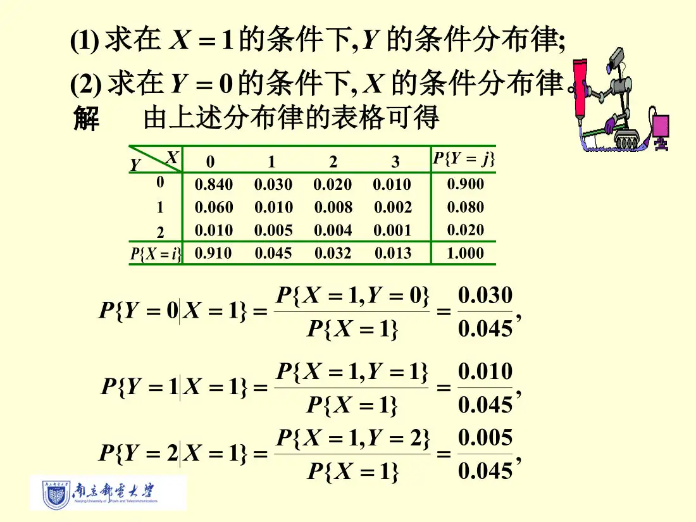

原文：

(1) 求在 X=1 的条件下, Y 的条件分布律;

(2) 求在 Y = 0 的条件下, X 的条件分布律解 由上述分布律的表格可得

<table><tr><td>Y\X</td><td>0</td><td>1</td><td>2</td><td>3</td><td>P{Y=j}</td></tr><tr><td>0</td><td>0.840</td><td>0.030</td><td>0.020</td><td>0.010</td><td>0.900</td></tr><tr><td>1</td><td>0.060</td><td>0.010</td><td>0.008</td><td>0.002</td><td>0.080</td></tr><tr><td>2</td><td>0.010</td><td>0.005</td><td>0.004</td><td>0.001</td><td>0.020</td></tr><tr><td>P{X=i}</td><td>0.910</td><td>0.045</td><td>0.032</td><td>0.013</td><td>1.000</td></tr></table>

$$
P \{Y = 0 | X = 1 \} = \frac {P \{X = 1 , Y = 0 \}}{P \{X = 1 \}} = \frac {0 . 0 3 0}{0 . 0 4 5},
$$

$$
P \{Y = 1 | X = 1 \} = \frac {P \{X = 1 , Y = 1 \}}{P \{X = 1 \}} = \frac {0 . 0 1 0}{0 . 0 4 5},
$$

$$
P \{Y = 2 | X = 1 \} = \frac {P \{X = 1 , Y = 2 \}}{P \{X = 1 \}} = \frac {0 . 0 0 5}{0 . 0 4 5},
$$

南京邮电大学
Nanjing University of Posts and Telecommunications

### 即在 X=1 的条件下, Y 的条件分布律为

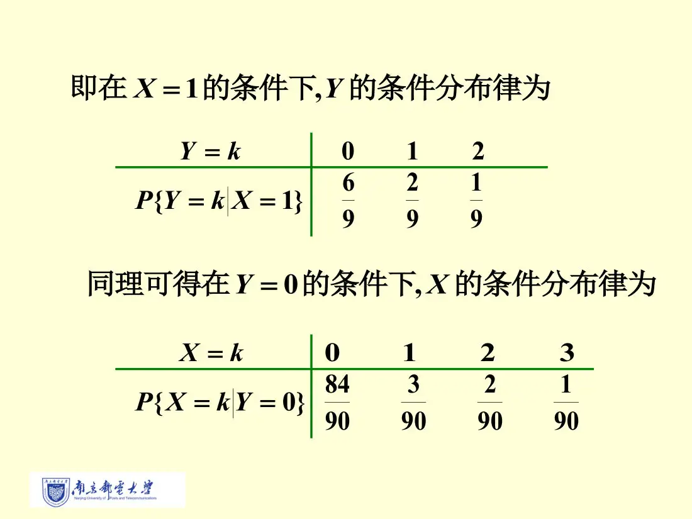

原文：

即在 X=1 的条件下, Y 的条件分布律为

$$
\begin{array}{c c c c} Y = k & 0 & 1 & 2 \\ \hline P \{Y = k | X = 1 \} & \frac {6}{9} & \frac {2}{9} & \frac {1}{9} \end{array}
$$

同理可得在 $Y = 0$ 的条件下, $X$ 的条件分布律为

$$
\begin{array}{c c c c c} X = k & 0 & 1 & 2 & 3 \\ \hline P \{X = k | Y = 0 \} & \frac {8 4}{9 0} & \frac {3}{9 0} & \frac {2}{9 0} & \frac {1}{9 0} \end{array}
$$

南京邮电大学
Nanjing University of Posts and Telecommunications

### 3.3.2 连续型随机变量的条件分布

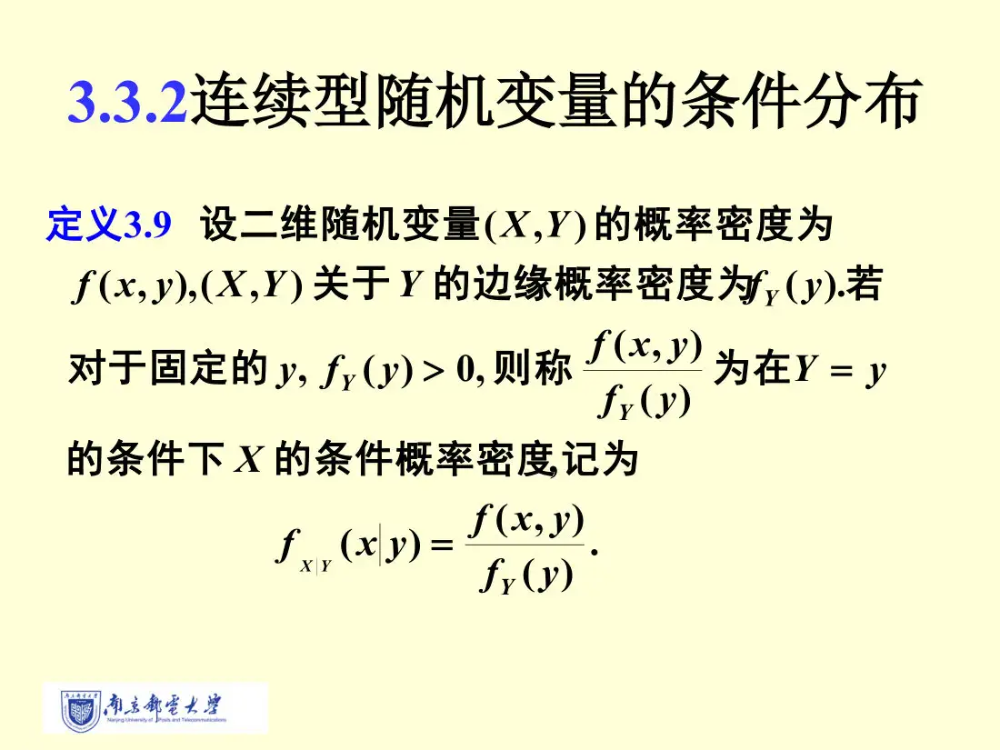

原文：

3.3.2 连续型随机变量的条件分布

定义3.9 设二维随机变量 $(X,Y)$ 的概率密度为 $f(x,y),(X,Y)$ 关于Y的边缘概率密度为 $f_{Y}(y)$ .若对于固定的y, $f_{Y}(y)>0$ ,则称 $\frac{f(x,y)}{f_{Y}(y)}$ 为在Y=y的条件下X的条件概率密度,记为

$$
f _ {X \mid Y} (x \mid y) = \frac {f (x , y)}{f _ {Y} (y)}.
$$

南京邮电大学
Nanjing University of Posts and Telecommunications

### $$

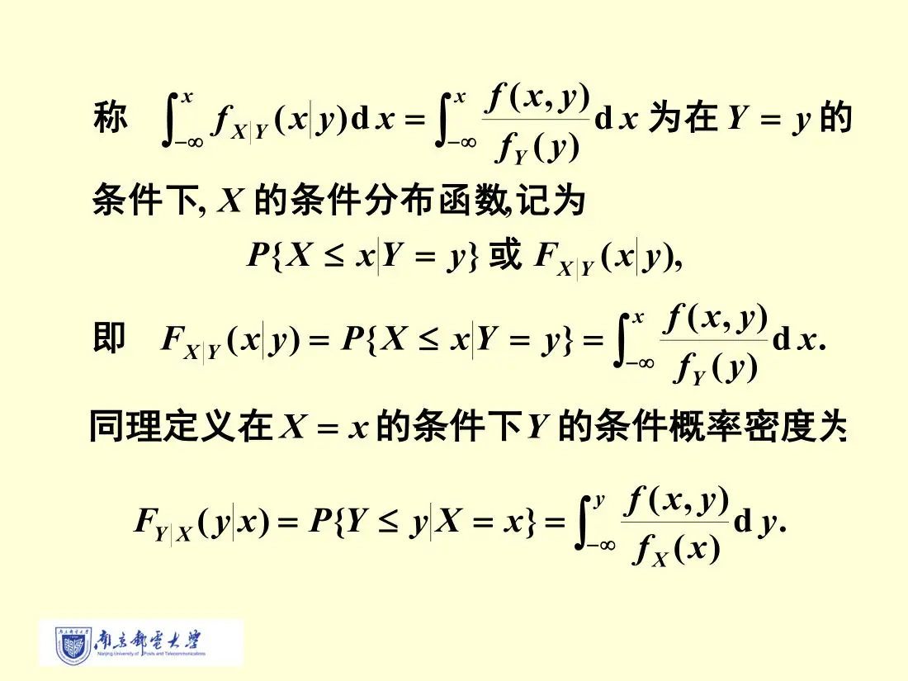

原文：

称 $\int_{-\infty}^{x}f_{X|Y}(x|y)\mathrm{d}x=\int_{-\infty}^{x}\frac{f(x,y)}{f_{Y}(y)}\mathrm{d}x$ 为在 Y=y 的条件下, X 的条件分布函数, 记为

$$
P \{X \leq x | Y = y \} \text {或} F _ {X | Y} (x | y),
$$

即 $F_{X|Y}(x|y) = P\{X \leq x | Y = y\} = \int_{-\infty}^{x} \frac{f(x, y)}{f_Y(y)} \mathrm{d}x.$

$$
X = x
$$

$$
F _ {Y \mid X} (y \mid x) = P \{Y \leq y \mid X = x \} = \int_ {- \infty} ^ {y} \frac {f (x , y)}{f _ {X} (x)} d y.
$$

南京邮电大学
Nanjing University of Posts and Telecommunications

### 条件分布函数与条件密度函数的关系

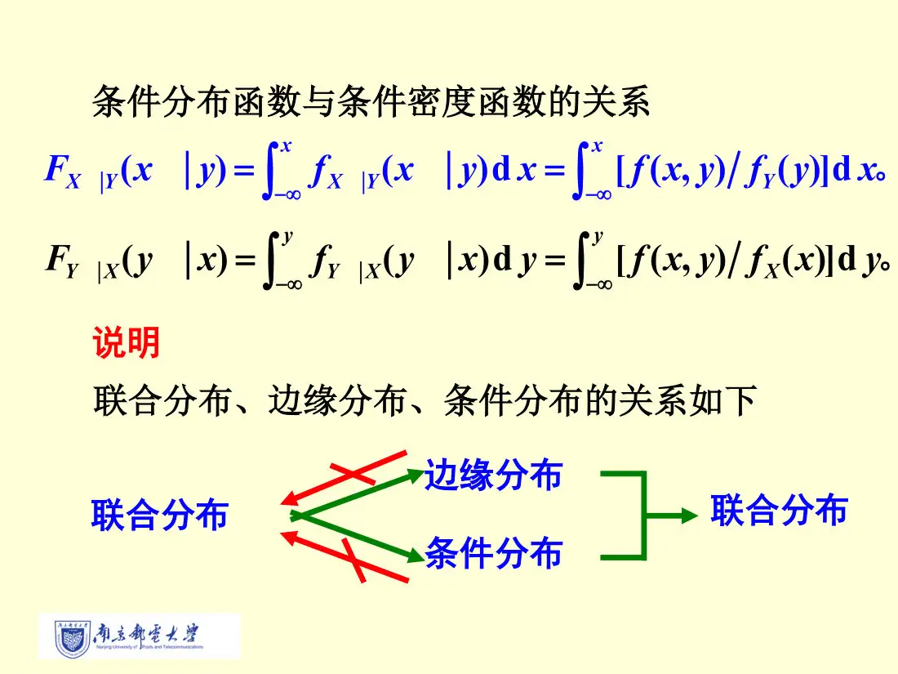

原文：

条件分布函数与条件密度函数的关系

$$
\begin{array}{l l} F _ {X \mid Y} (x & | y) = \int_ {- \infty} ^ {x} f _ {X \mid Y} (x \quad | y) \mathrm{d} x = \int_ {- \infty} ^ {x} [ f (x, y) / f _ {Y} (y) ] \mathrm{d} x _ {\circ} \\ F _ {Y \mid X} (y & | x) = \int_ {- \infty} ^ {y} f _ {Y \mid X} (y \quad | x) \mathrm{d} y = \int_ {- \infty} ^ {y} [ f (x, y) / f _ {X} (x) ] \mathrm{d} y _ {\circ} \end{array}
$$

说明

联合分布、边缘分布、条件分布的关系如下

联合分布

边缘分布

条件分布

联合分布

南京邮电大学
Nanjing University of Posts and Telecommunications

### 解 由题意知 $X$ 具有概率密度

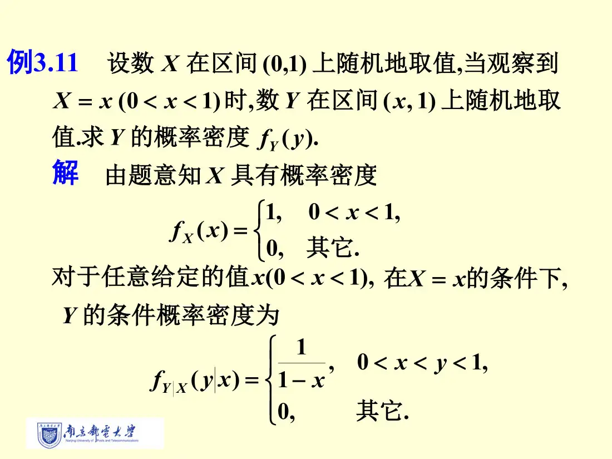

原文：

例3.11 设数 X 在区间 $(0,1)$ 上随机地取值, 当观察到 $X = x (0 < x < 1)$ 时, 数 Y 在区间 $(x,1)$ 上随机地取值. 求 Y 的概率密度 $f_{Y}(y)$ .

解 由题意知 $X$ 具有概率密度

$$
f _ {X} (x) = \left\{ \begin{array}{l l} 1, & 0 <   x <   1, \\ 0, & \text {其它.} \end{array} \right.
$$

对于任意给定的值 $x(0 < x < 1)$ , 在 $X = x$ 的条件下, $Y$ 的条件概率密度为

$$
f _ {Y \mid X} (y \mid x) = \left\{ \begin{array}{l l} \frac {1}{1 - x}, & 0 <   x <   y <   1, \\ 0, & \text {其它.} \end{array} \right.
$$

南京邮电大学
Nanjing University of Posts and Telecommunications

### 因此 X 和 Y 的联合概率密度为

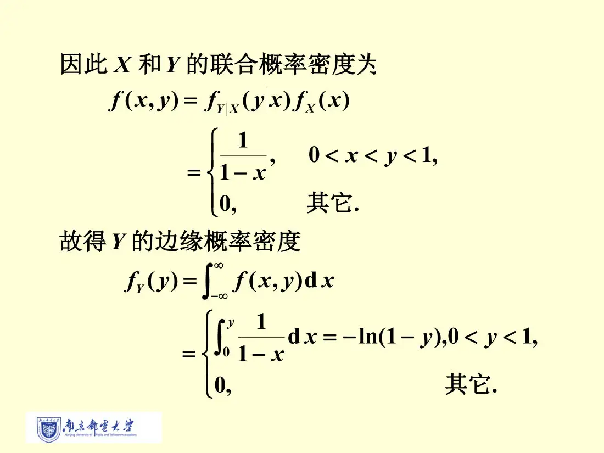

原文：

因此 X 和 Y 的联合概率密度为

$$
\begin{array}{r l} & f (x, y) = f _ {Y \mid X} (y \mid x) f _ {X} (x) \\ & = \left\{ \begin{array}{l l} \frac {1}{1 - x}, & 0 <   x <   y <   1, \\ 0, & \text {其它.} \end{array} \right. \end{array}
$$

故得 $Y$ 的边缘概率密度

$$
\begin{array}{r l} & {f _ {Y} (y) = \int_ {- \infty} ^ {\infty} f (x, y) \mathrm{d} x} \\ & {\qquad = \left\{ \begin{array}{l l} {\int_ {0} ^ {y} \frac {1}{1 - x} \mathrm{d} x = - \ln (1 - y), 0 <   y <   1,} \\ {0,} & {\text {其它}.} \end{array} \right.} \end{array}
$$

南京邮电大学
Nanjing University of Posts and Telecommunications

### 补充例3.8 设 G 是平面上的有界区域, 其面积为 A.

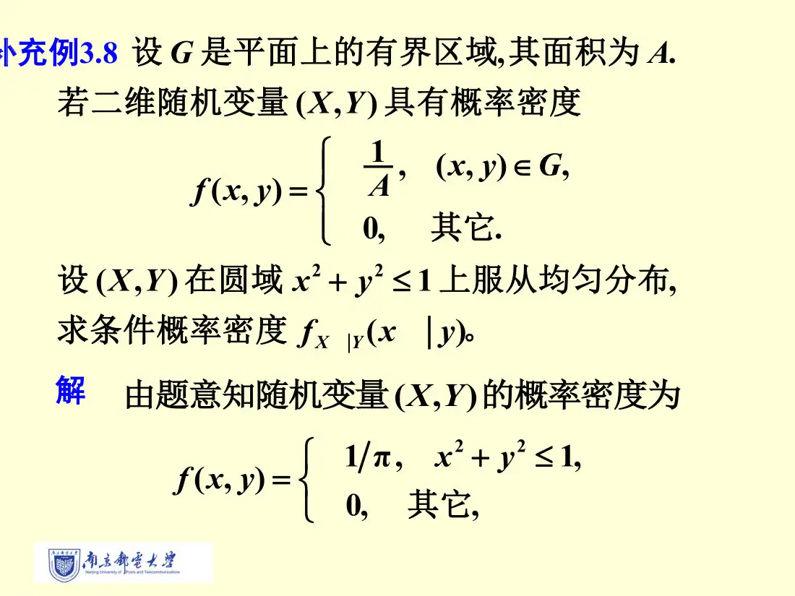

原文：

补充例3.8 设 G 是平面上的有界区域, 其面积为 A.

若二维随机变量 $(X,Y)$ 具有概率密度

$$
f (x, y) = \left\{ \begin{array}{l l} { \frac {1}{A},} & {(x, y) \in G,} \\ {0,} & {\text {其它}.} \end{array} \right.
$$

设 $(X,Y)$ 在圆域 $x^{2}+y^{2}\leq1$ 上服从均匀分布,求条件概率密度 $f_{X\mid Y}(x\mid y)$ 。

解 由题意知随机变量 $(X,Y)$ 的概率密度为

$$
f (x, y) = \left\{ \begin{array}{l l} & 1 / \pi , \quad x ^ {2} + y ^ {2} \leq 1, \\ & 0, \quad \text {其它}, \end{array} \right.
$$

南京邮电大学
Nanjing University of Posts and Telecommunications

### 又知边缘概率密度为

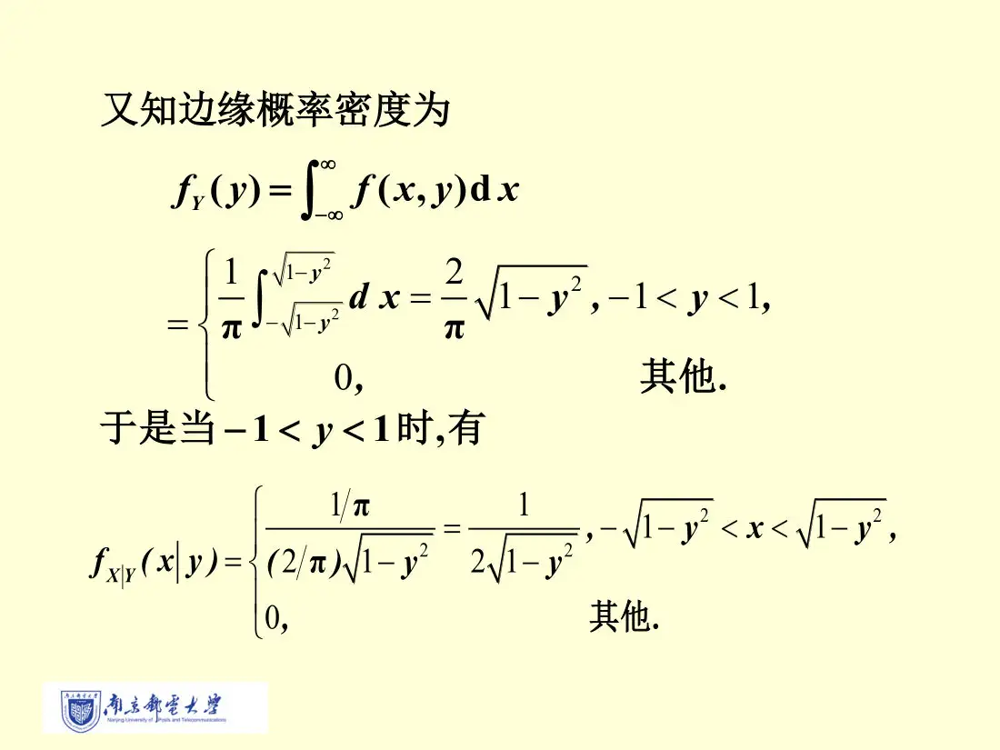

原文：

又知边缘概率密度为

$$
f _ {Y} (y) = \int_ {- \infty} ^ {\infty} f (x, y) \mathrm{d} x = \left\{ \begin{array}{c c} \frac {1}{\pi} \int_ {- \sqrt {1 - y ^ {2}}} ^ {\sqrt {1 - y ^ {2}}} d x = \frac {2}{\pi} \sqrt {1 - y ^ {2}}, - 1 <   y <   1, \\ 0, & \text {其他.} \end{array} \right.
$$

于是当-1<y<1时,有

$$
f _ {X \mid Y} (x \mid y) = \left\{ \begin{array}{l l} \frac {1 / \pi}{(2 / \pi) \sqrt {1 - y ^ {2}}} = \frac {1}{2 \sqrt {1 - y ^ {2}}}, - \sqrt {1 - y ^ {2}} <   x <   \sqrt {1 - y ^ {2}}, \\ 0, & \text {其他.} \end{array} \right.
$$

南京邮电大学
Nanjing University of Posts and Telecommunications

### 三、小结

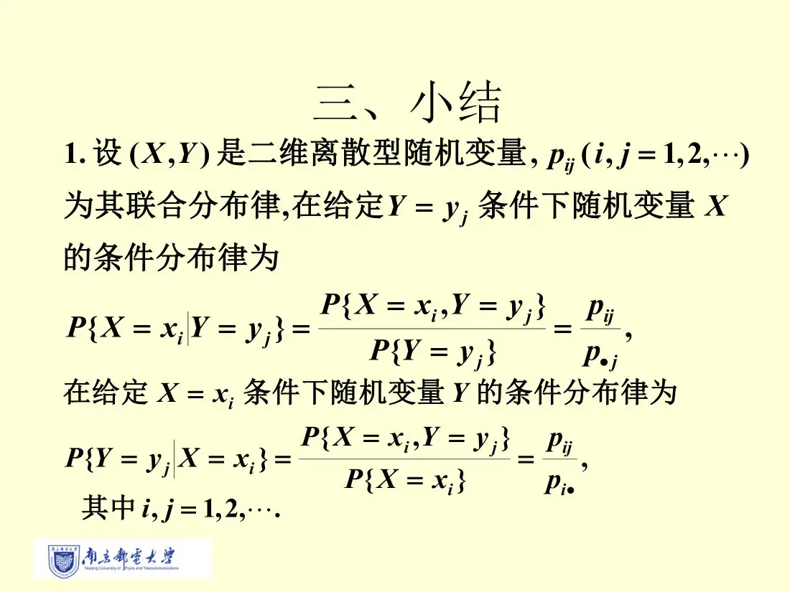

原文：

三、小结

1. 设 $(X,Y)$ 是二维离散型随机变量, $p_{ij}(i,j=1,2,\cdots)$ 为其联合分布律, 在给定 $Y=y_{j}$ 条件下随机变量 X 的条件分布律为

$$
P \{X = x _ {i} | Y = y _ {j} \} = \frac {P \{X = x _ {i} , Y = y _ {j} \}}{P \{Y = y _ {j} \}} = \frac {p _ {i j}}{p _ {\bullet j}},
$$

在给定 $X = x_{i}$ 条件下随机变量 $Y$ 的条件分布律为

$$
P \{Y = y _ {j} \mid X = x _ {i} \} = \frac {P \{X = x _ {i} , Y = y _ {j} \}}{P \{X = x _ {i} \}} = \frac {p _ {i j}}{p _ {i \bullet}},
$$

其中 $i,j=1,2,\cdots$

南京邮电大学
Nanjing University of Posts and Telecommunications
