# 《概率论与数理统计》第3章 多维随机变量及其分布 3.4 随机变量的独立性（课件）

原件的每一页，下面附识别出的文字。

### 3.4 随机变量的独立性

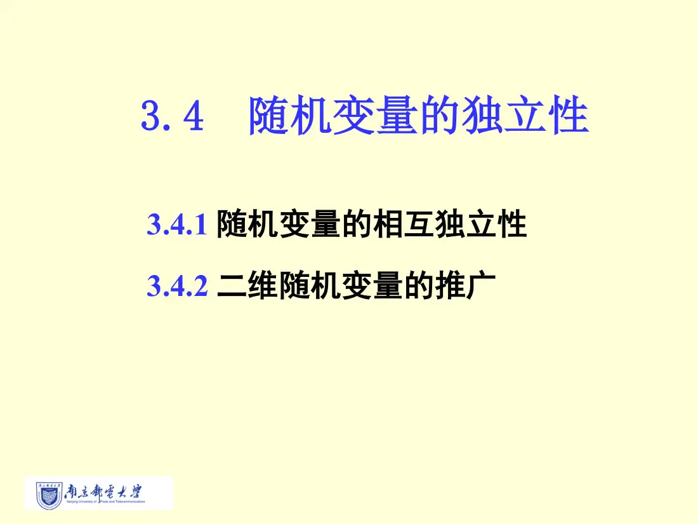

原文：

3.4 随机变量的独立性

3.4.1 随机变量的相互独立性

3.4.2 二维随机变量的推广

南京邮电大学
Nanjing University of Posts and Telecommunications

### 3.4.1 随机变量的相互独立性

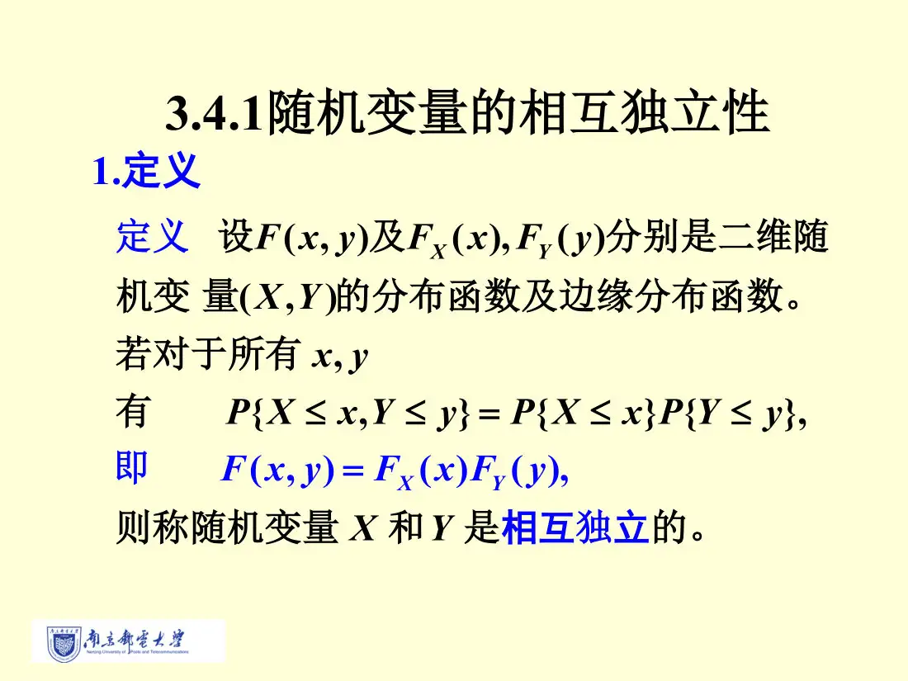

原文：

3.4.1 随机变量的相互独立性

1. 定义

定义 设 $F(x,y)$ 及 $F_{X}(x),F_{Y}(y)$ 分别是二维随机变量 $(X,Y)$ 的分布函数及边缘分布函数。

若对于所有 $x, y$

有 $P\{X \leq x, Y \leq y\} = P\{X \leq x\} P\{Y \leq y\}$ ,

即 $F(x,y)=F_{X}(x)F_{Y}(y),$

则称随机变量 X 和 Y 是相互独立的。

南京邮电大学
Nanjing University of Posts and Telecommunications

### (3) X 和 Y 相互独立, 则

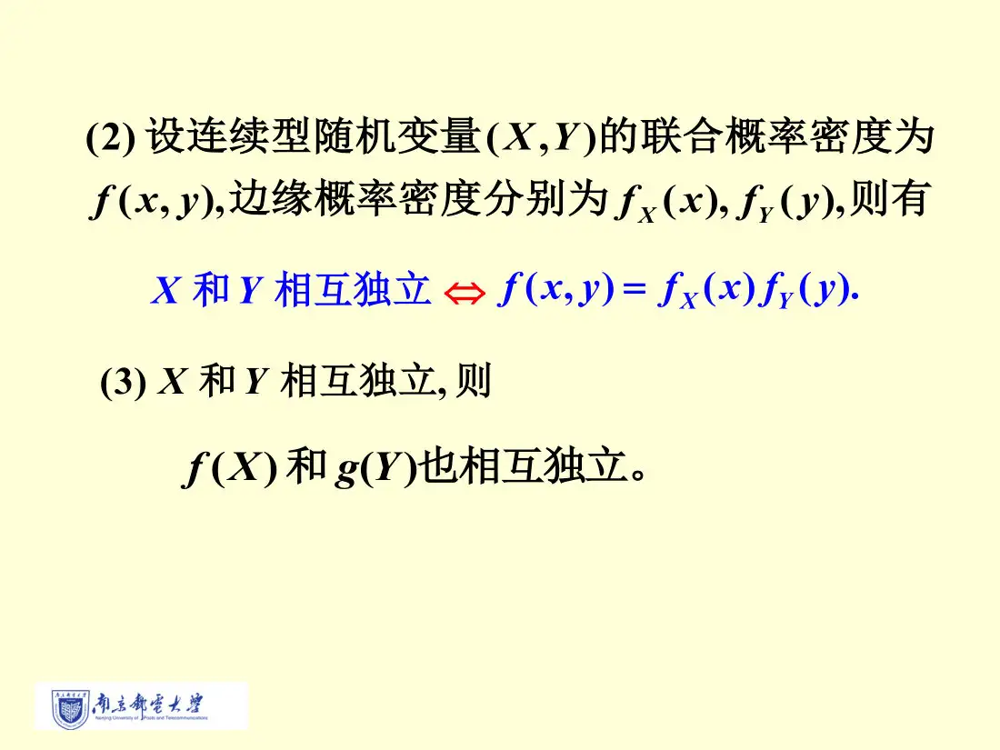

原文：

(2) 设连续型随机变量 $(X, Y)$ 的联合概率密度为 $f(x, y)$ , 边缘概率密度分别为 $f_{X}(x), f_{Y}(y)$ , 则有

X 和 Y 相互独立 $\Leftrightarrow f(x,y)=f_{X}(x)f_{Y}(y)$ .

(3) X 和 Y 相互独立, 则

$f(X)$ 和 $g(Y)$ 也相互独立。

南京邮电大学
Nanjing University of Posts and Telecommunications

### 2.说明

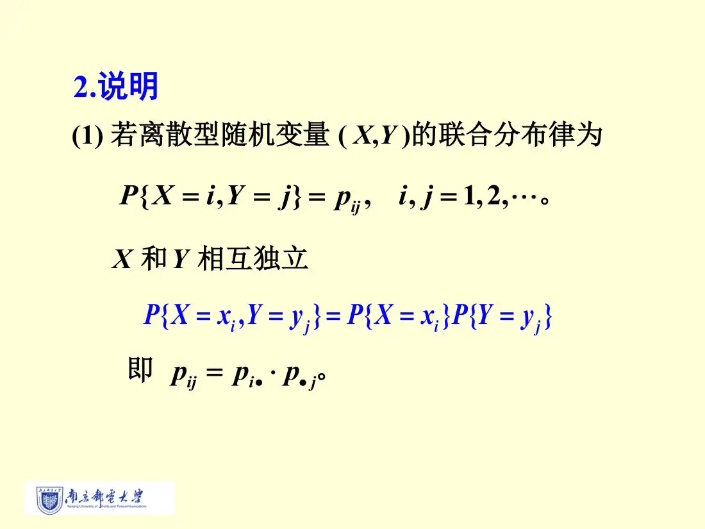

原文：

2.说明

(1) 若离散型随机变量 $(X,Y)$ 的联合分布律为

$$
P \{X = i, Y = j \} = p _ {i j}, \quad i, j = 1, 2, \dots 。
$$

X 和 Y 相互独立

$$
P \{X = x _ {i}, Y = y _ {j} \} = P \{X = x _ {i} \} P \{Y = y _ {j} \}
$$

即 $p_{ij} = p_{i\bullet}\cdot p_{\bullet j^{\circ}}$

南京邮电大学
Nanjing University of Posts and Telecommunications

### 南京邮电大学

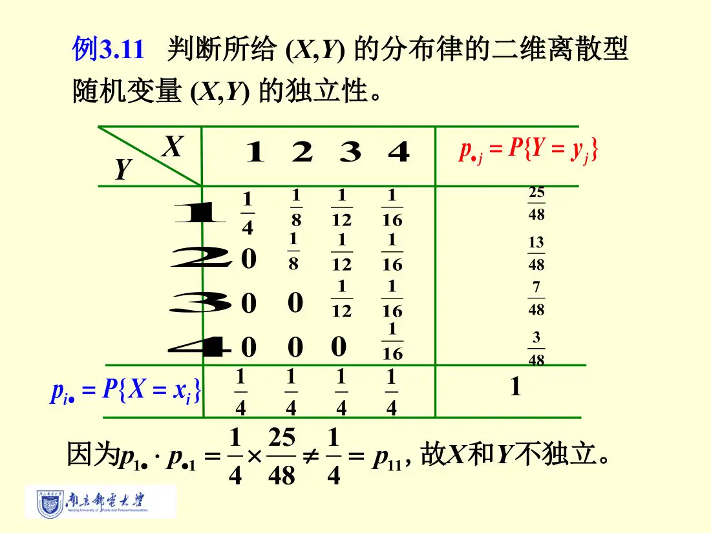

原文：

例3.11 判断所给 $(X,Y)$ 的分布律的二维离散型随机变量 $(X,Y)$ 的独立性。
<table><tr><td>Y\X</td><td>1</td><td>2</td><td>3</td><td>4</td><td> $p_{\bullet j} = P\{Y = y_j\}$ </td></tr><tr><td></td><td> $\frac{1}{4}$ </td><td> $\frac{1}{8}$ </td><td> $\frac{1}{12}$ </td><td> $\frac{1}{16}$ </td><td> $\frac{25}{48}$ </td></tr><tr><td></td><td>0</td><td> $\frac{1}{8}$ </td><td> $\frac{1}{12}$ </td><td> $\frac{1}{16}$ </td><td> $\frac{13}{48}$ </td></tr><tr><td></td><td>0</td><td>0</td><td> $\frac{1}{12}$ </td><td> $\frac{1}{16}$ </td><td> $\frac{7}{48}$ </td></tr><tr><td></td><td>0</td><td>0</td><td>0</td><td> $\frac{1}{16}$ </td><td> $\frac{3}{48}$ </td></tr><tr><td> $p_{i\bullet} = P\{X = x_i\}$ </td><td> $\frac{1}{4}$ </td><td> $\frac{1}{4}$ </td><td> $\frac{1}{4}$ </td><td> $\frac{1}{4}$ </td><td>1</td></tr></table>

因为 $p_{1\bullet}\cdot p_{\bullet1}=\frac{1}{4}\times\frac{25}{48}\neq\frac{1}{4}=p_{11}$ ，故X和Y不独立。

南京邮电大学
Nanjing University of Posts and Telecommunications

### 例3.12 设随机变量 $(X,Y)$ 的概率密度为 $y$

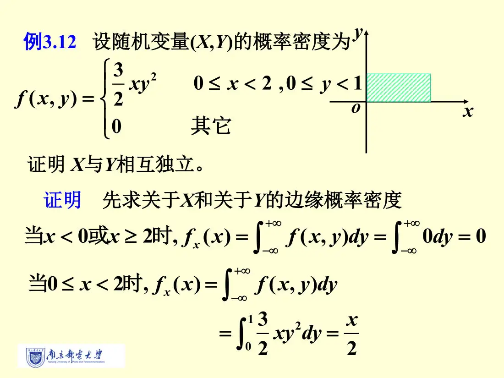

原文：

例3.12 设随机变量 $(X,Y)$ 的概率密度为 $y$

$$
f (x, y) = \left\{ \begin{array}{l l} \frac {3}{2} x y ^ {2} & 0 \leq x <   2, 0 \leq y <   1 \\ 0 & \text {其它} \end{array} \right. \quad \boxed {x}
$$

证明 X 与 Y 相互独立。

证明 先求关于 $X$ 和关于 $Y$ 的边缘概率密度

当x<0或 $x\geq2$ 时, $f_{x}(x)=\int_{-\infty}^{+\infty}f(x,y)dy=\int_{-\infty}^{+\infty}0dy=0$ 当 $0\leq x<2$ 时, $f_{x}(x)=\int_{-\infty}^{+\infty}f(x,y)dy$ $=\int_{0}^{1}\frac{3}{2}xy^{2}dy=\frac{x}{2}$

### 关于X的边缘概率密度

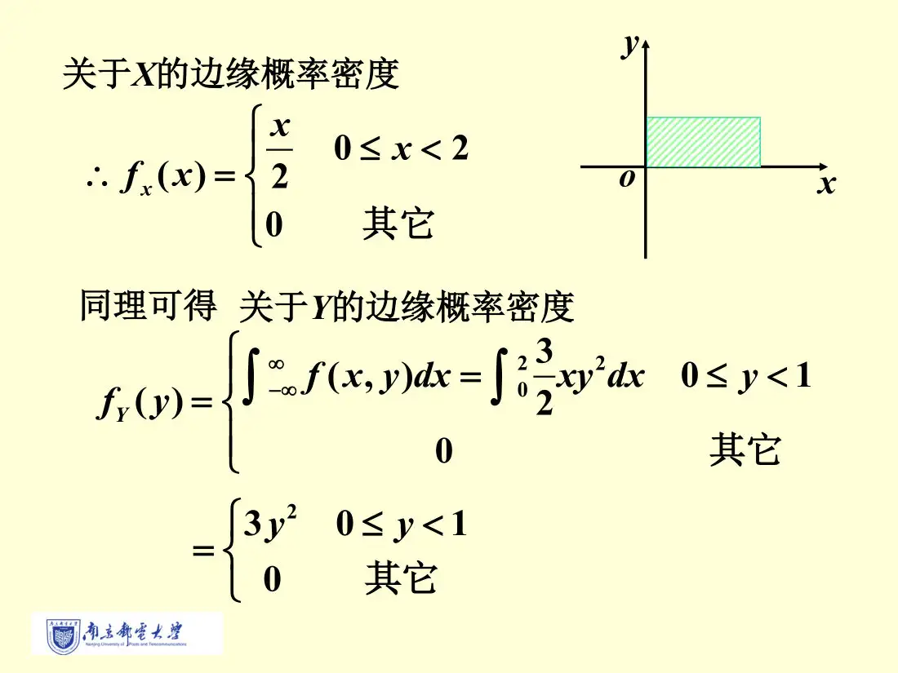

原文：

关于X的边缘概率密度

$$
\therefore f _ {x} (x) = \left\{ \begin{array}{l l} \frac {x}{2} & 0 \leq x <   2 \\ 0 & \text {其它} \end{array} \right.
$$

同理可得 关于Y的边缘概率密度

$$
\begin{array}{r l} f _ {Y} (y) & = \left\{ \begin{array}{c c} \int_ {- \infty} ^ {\infty} f (x, y) d x = \int_ {0} ^ {2} \frac {3}{2} x y ^ {2} d x & 0 \leq y <   1 \\ 0 & \text {其它} \end{array} \right. \\ & = \left\{ \begin{array}{c c} 3 y ^ {2} & 0 \leq y <   1 \\ 0 & \text {其它} \end{array} \right. \end{array}
$$

南京邮电大学
Nanjing University of Posts and Telecommunications

### $$

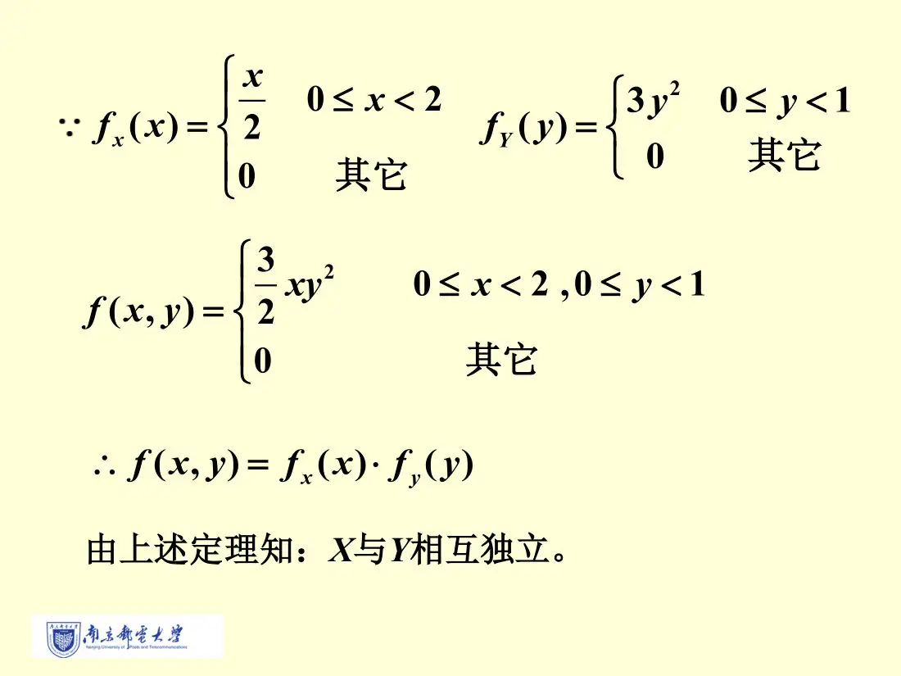

原文：

$$
\because f _ {x} (x) = \left\{ \begin{array}{l l} \frac {x}{2} & 0 \leq x <   2 \\ 0 & \text {其它} \end{array} \quad f _ {Y} (y) = \left\{ \begin{array}{c c} 3 y ^ {2} & 0 \leq y <   1 \\ 0 & \text {其它} \end{array} \right. \right.
$$

$$
f (x, y) = \left\{ \begin{array}{l l} \frac {3}{2} x y ^ {2} & 0 \leq x <   2, 0 \leq y <   1 \\ 0 & \text {其它} \end{array} \right.
$$

$$
\therefore f (x, y) = f _ {x} (x) \cdot f _ {y} (y)
$$

由上述定理知：X与Y相互独立。

南京邮电大学
Nanjing University of Posts and Telecommunications

### 例3.13 已知 $(X,Y)$ 的分布律为

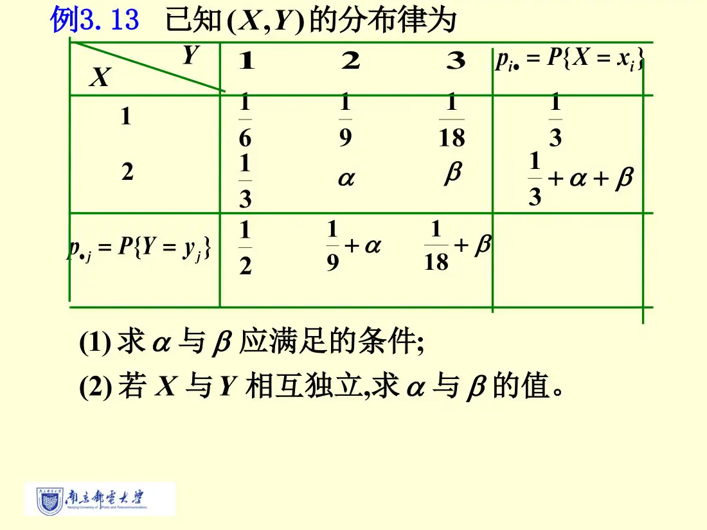

原文：

例3.13 已知 $(X,Y)$ 的分布律为
<table><tr><td>X\Y</td><td>1</td><td>2</td><td>3</td><td> $p_{i\bullet} = P\{X = x_i\}$ </td></tr><tr><td>1</td><td> $\frac{1}{6}$ </td><td> $\frac{1}{9}$ </td><td> $\frac{1}{18}$ </td><td> $\frac{1}{3}$ </td></tr><tr><td>2</td><td> $\frac{1}{3}$ </td><td> $\alpha$ </td><td> $\beta$ </td><td> $\frac{1}{3} + \alpha + \beta$ </td></tr><tr><td> $p_{\bullet j} = P\{Y = y_j\}$ </td><td> $\frac{1}{2}$ </td><td> $\frac{1}{9} + \alpha$ </td><td> $\frac{1}{18} + \beta$ </td><td></td></tr></table>

(1) 求 $\alpha$ 与 $\beta$ 应满足的条件;

(2) 若 X 与 Y 相互独立, 求 $\alpha$ 与 $\beta$ 的值。

南京邮电大学
Nanjing University of Posts and Telecommunications

### 南京邮电大学

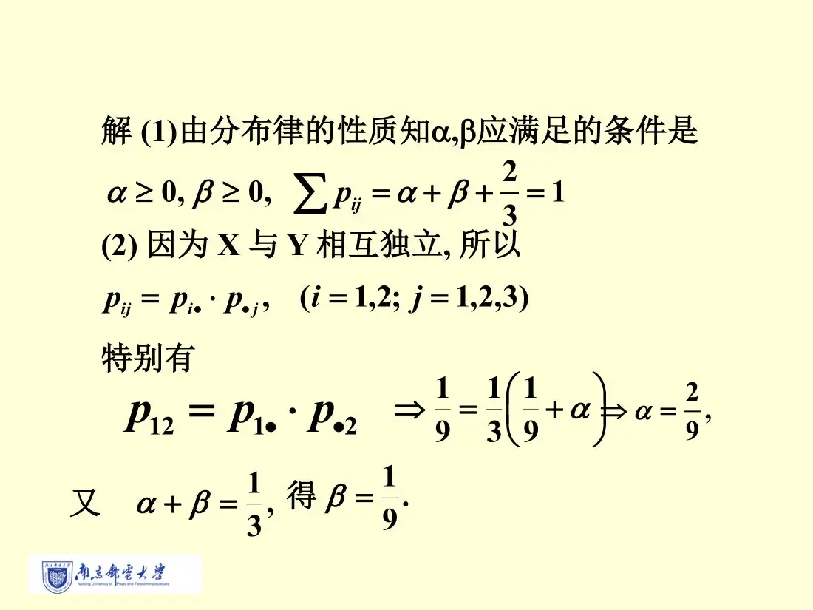

原文：

解(1)由分布律的性质知 $\alpha, \beta$ 应满足的条件是 $\alpha \geq 0, \beta \geq 0, \sum p_{ij} = \alpha + \beta + \frac{2}{3} = 1$ (2) 因为 X 与 Y 相互独立, 所以 $p_{ij} = p_{i\bullet} \cdot p_{\bullet j}, (i = 1,2; j = 1,2,3)$ 特别有 $p_{12} = p_{1\bullet} \cdot p_{\bullet 2} \Rightarrow \frac{1}{9} = \frac{1}{3}\left(\frac{1}{9} + \alpha\right) \Rightarrow \alpha = \frac{2}{9},$ 又 $\alpha + \beta = \frac{1}{3}$ , 得 $\beta = \frac{1}{9}$ .

南京邮电大学
Nanjing University of Posts and Telecommunications

### 例3.14 设随机变量(X,Y)在区域

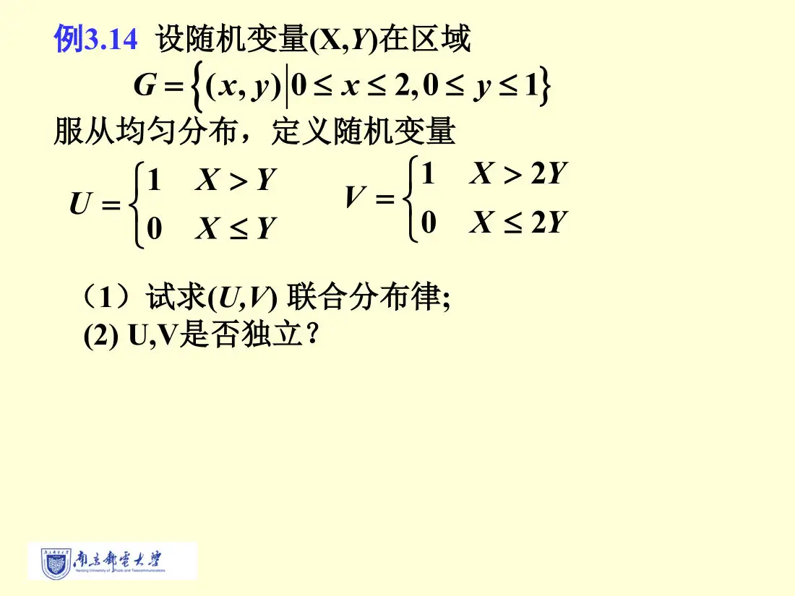

原文：

例3.14 设随机变量(X,Y)在区域

$$
G = \left\{(x, y) \mid 0 \leq x \leq 2, 0 \leq y \leq 1 \right\}
$$

服从均匀分布，定义随机变量

$$
U = \left\{ \begin{array}{l l} 1 & X > Y \\ 0 & X \leq Y \end{array} \right. \quad V = \left\{ \begin{array}{l l} 1 & X > 2 Y \\ 0 & X \leq 2 Y \end{array} \right.
$$

(1) 试求 $(U,V)$ 联合分布律;

(2) U,V是否独立?

南京邮电大学
Nanjing University of Posts and Telecommunications

### 解由题设知 $(U,V)$ 的联合密度函数为

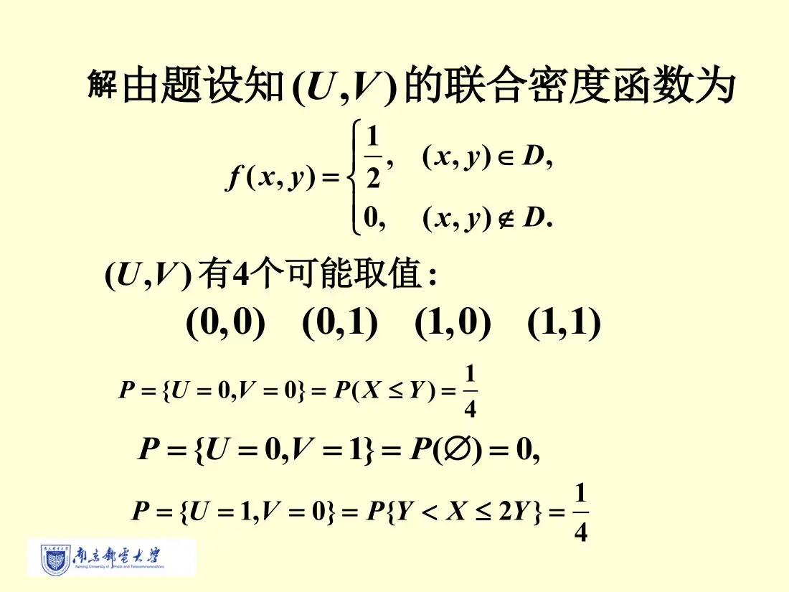

原文：

解由题设知 $(U,V)$ 的联合密度函数为

$$
f (x, y) = \left\{ \begin{array}{l l} \frac {1}{2}, & (x, y) \in D, \\ 0, & (x, y) \notin D. \end{array} \right.
$$

$(U,V)$ 有4个可能取值：

(0,0) (0,1) (1,0) (1,1)

$$
P = \{U = 0, V = 0 \} = P (X \leq Y) = \frac {1}{4}
$$

$$
P = \{U = 0, V = 1 \} = P (\emptyset) = 0,
$$

$$
P = \{U = 1, V = 0 \} = P \{Y <   X \leq 2 Y \} = \frac {1}{4}
$$

南京邮电大学
Nanjing University of Posts and Telecommunications

### $$

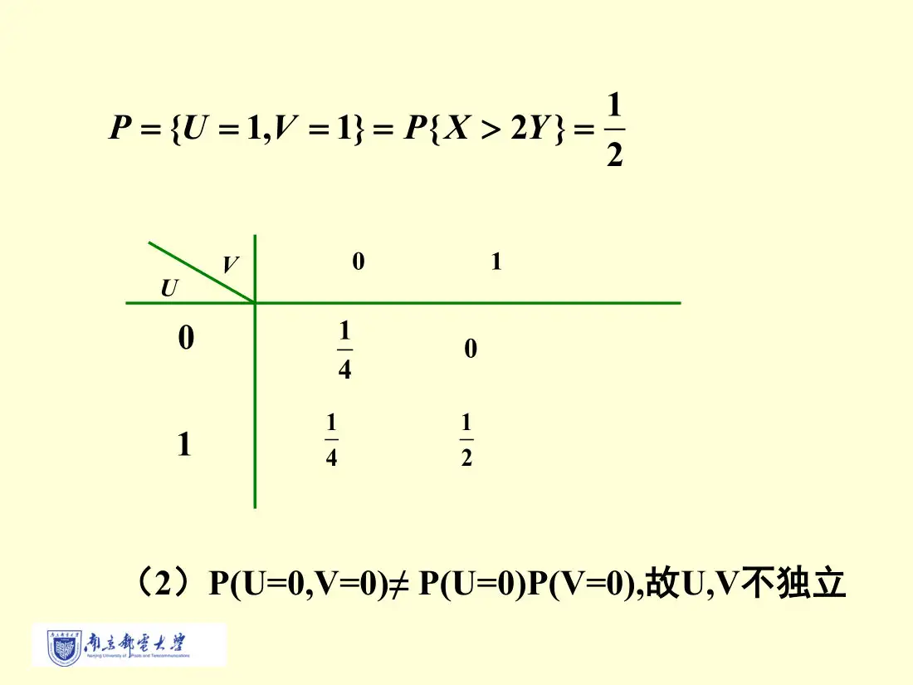

原文：

$$
P = \{U = 1, V = 1 \} = P \{X > 2 Y \} = \frac {1}{2}
$$

$$
\begin{array}{c c c c} & V & 0 & 1 \\ U & 0 & \frac {1}{4} & 0 \\ & 1 & \frac {1}{4} & \frac {1}{2} \end{array}
$$

(2) $\mathrm{P}(\mathrm{U} = 0, \mathrm{V} = 0) \neq \mathrm{P}(\mathrm{U} = 0) \mathrm{P}(\mathrm{V} = 0)$ , 故 $\mathrm{U}, \mathrm{V}$ 不独立例3.15 设随机变量 X 和 Y 相互独立,并且 X 服从 $N(a,\sigma^{2})$ , Y 在 $[-b,b]$ 上服从均匀分布,求 $(X,Y)$ 的联合概率密度。

南京邮电大学
Nanjing University of Posts and Telecommunications

### 解 由于X与Y相互独立,

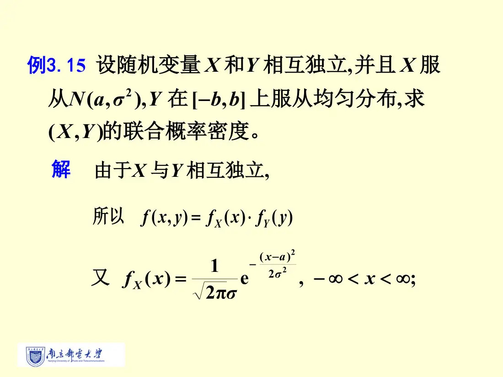

原文：

解 由于X与Y相互独立,

所以 $f(x,y) = f_{X}(x)\cdot f_{Y}(y)$

又 $f_{X}(x) = \frac{1}{\sqrt{2\pi}\sigma}\mathrm{e}^{-\frac{(x - a)^{2}}{2\sigma^{2}}}, - \infty <  x <   \infty ;$

南京邮电大学
Nanjing University of Posts and Telecommunications

### $$

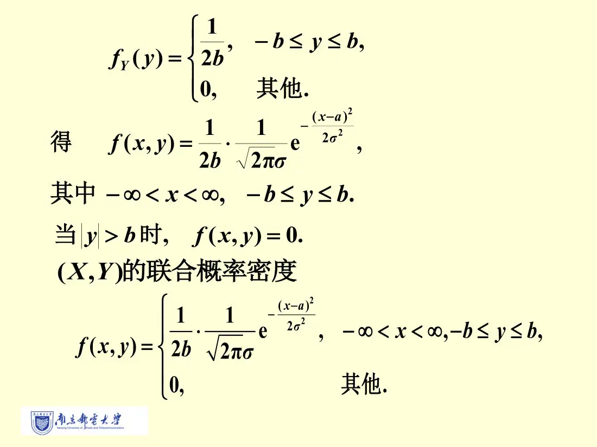

原文：

$$
f _ {Y} (y) = \left\{ \begin{array}{l l} \frac {1}{2 b}, & - b \leq y \leq b, \\ 0, & \text {其他.} \end{array} \right.
$$

得 $f(x,y) = \frac{1}{2b}\cdot \frac{1}{\sqrt{2\pi}\sigma}\mathrm{e}^{-\frac{(x - a)^2}{2\sigma^2}},$

其中 $-\infty < x < \infty, \quad -b \leq y \leq b.$

当 $|y| > b$ 时， $f(x, y) = 0$ .

$(X,Y)$ 的联合概率密度

$$
f (x, y) = \left\{ \begin{array}{l l} \frac {1}{2 b} \cdot \frac {1}{\sqrt {2 \pi} \sigma} \mathrm{e} ^ {- \frac {(x - a) ^ {2}}{2 \sigma^ {2}}}, & - \infty <   x <   \infty , - b \leq y \leq b, \\ 0, & \text {其他.} \end{array} \right.
$$

南京邮电大学
Nanjing University of Posts and Telecommunications
