# 《概率论与数理统计》第3章 多维随机变量及其分布（习题课）

原件的每一页，下面附识别出的文字。

### 第3章 多维随机变量及其分布

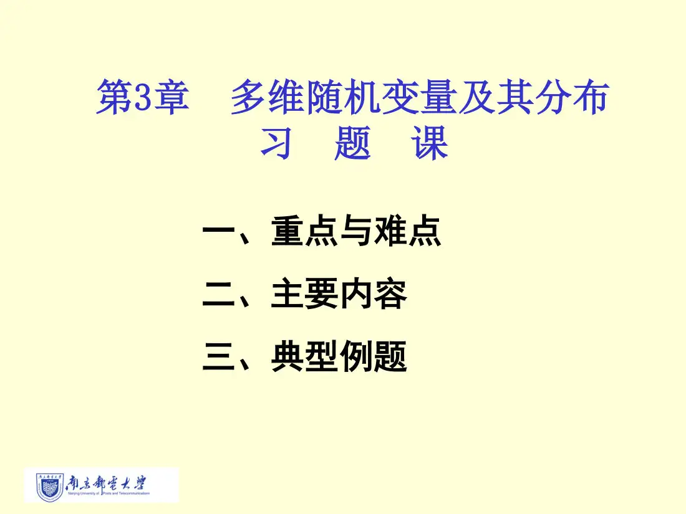

原文：

第3章 多维随机变量及其分布
习题课
一、重点与难点
二、主要内容
三、典型例题

南京邮电大学
Nanjing University of Posts and Telecommunications

### 一、重点与难点

原文：

一、重点与难点

1.重点

二维随机变量的分布

有关概率的计算和随机变量的独立性

2.难点

条件概率分布

随机变量函数的分布

南京邮电大学
Nanjing University of Posts and Telecommunications

### 二、主要内容

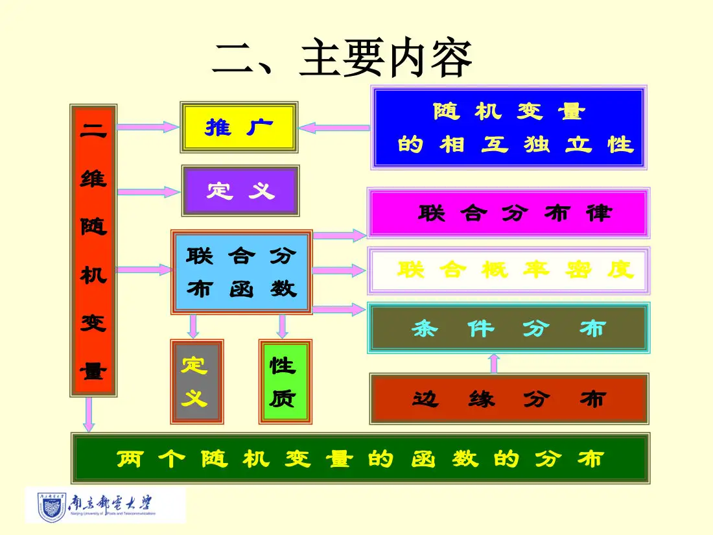

原文：

二、主要内容

维
随
机
变

量

推广

定义

联合分

布函数

定义

性质

随机变量

的相互独立性

联合分布律

联合概率密度

条件分布

边缘分布

两个随机变量的函数的分布

南京邮电大学
Nanjing University of Posts and Telecommunications

### 二维随机变量

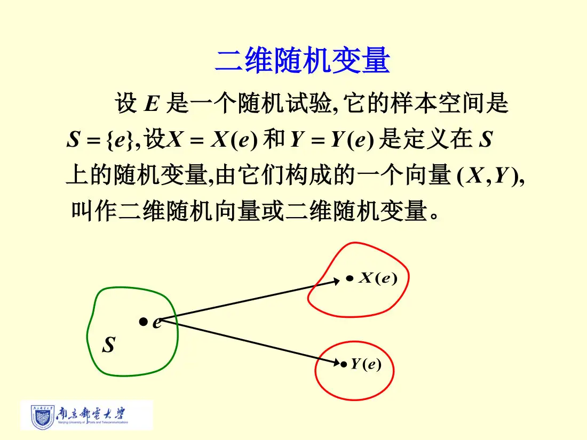

原文：

二维随机变量

设 E 是一个随机试验, 它的样本空间是 $S = \{e\}$ , 设 $X = X(e)$ 和 $Y = Y(e)$ 是定义在 S 上的随机变量, 由它们构成的一个向量 $(X, Y)$ , 叫作二维随机向量或二维随机变量。

南京邮电大学
Nanjing University of Posts and Telecommunications

### 二维随机变量的分布函数

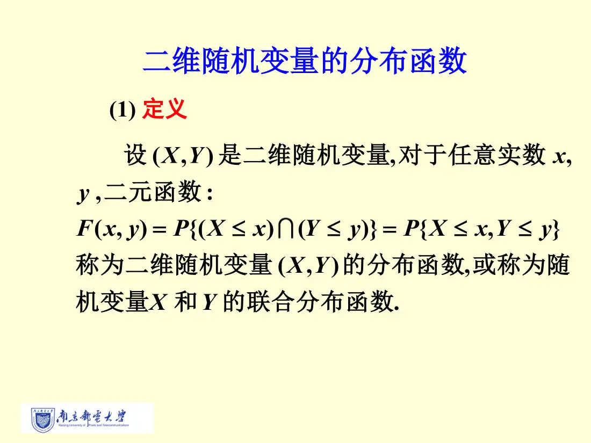

原文：

二维随机变量的分布函数

(1) 定义

设 $(X,Y)$ 是二维随机变量,对于任意实数x,y,二元函数:

$F(x,y)=P\{(X\leq x)\cap(Y\leq y)\}=P\{X\leq x,Y\leq y\}$ 称为二维随机变量 $(X,Y)$ 的分布函数,或称为随机变量X和Y的联合分布函数.

南京邮电大学
Nanjing University of Posts and Telecommunications

### (2) 性质

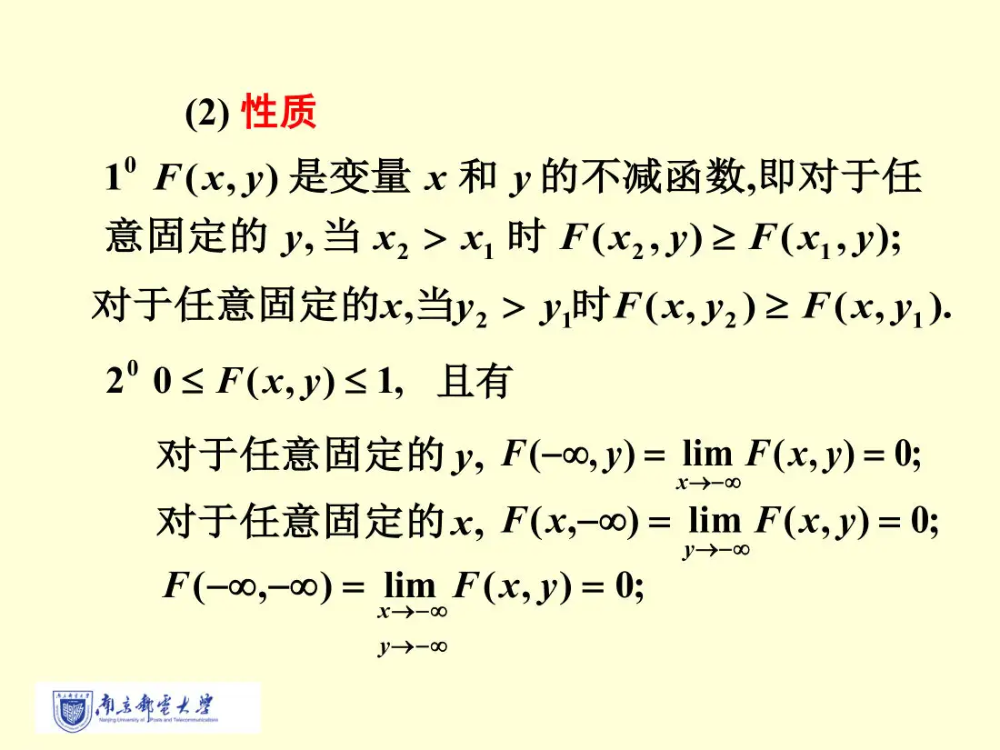

原文：

(2) 性质

$1^{0}F(x,y)$ 是变量 $x$ 和 $y$ 的不减函数,即对于任意固定的 $y$ , 当 $x_{2} > x_{1}$ 时 $F(x_{2},y) \geq F(x_{1},y)$ ; 对于任意固定的 $x$ , 当 $y_{2} > y_{1}$ 时 $F(x,y_{2}) \geq F(x,y_{1})$ . $2^{0}0 \leq F(x,y) \leq 1$ , 且有
对于任意固定的 $y$ , $F(-\infty,y) = \lim_{x \to -\infty} F(x,y) = 0$ ;
对于任意固定的 $x$ , $F(x,-\infty) = \lim_{y \to -\infty} F(x,y) = 0$ ; $F(-\infty,-\infty) = \lim_{x \to -\infty} F(x,y) = 0$ ;

南京邮电大学
Nanjing University of Posts and Telecommunications

### $$

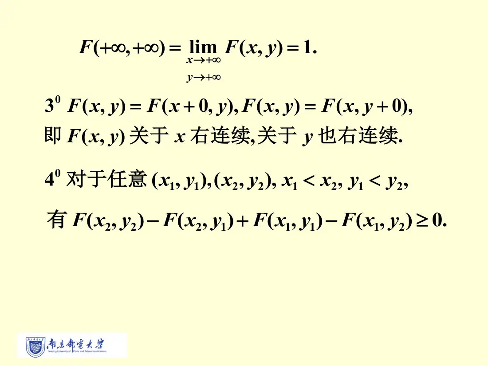

原文：

$$
F(+\infty , + \infty) = \lim_{\substack{x\to +\infty \\ y\to +\infty}}F(x,y) = 1.
$$

$$
3 ^ {0} F (x, y) = F (x + 0, y), F (x, y) = F (x, y + 0),
$$

即 $F(x,y)$ 关于 x 右连续, 关于 y 也右连续.

$4^{0}$ 对于任意 $(x_{1},y_{1}),(x_{2},y_{2}),x_{1}<x_{2},y_{1}<y_{2},$

有 $F(x_{2},y_{2}) - F(x_{2},y_{1}) + F(x_{1},y_{1}) - F(x_{1},y_{2})\geq 0.$

南京邮电大学
Nanjing University of Posts and Telecommunications

### (3) n 维随机变量的概念

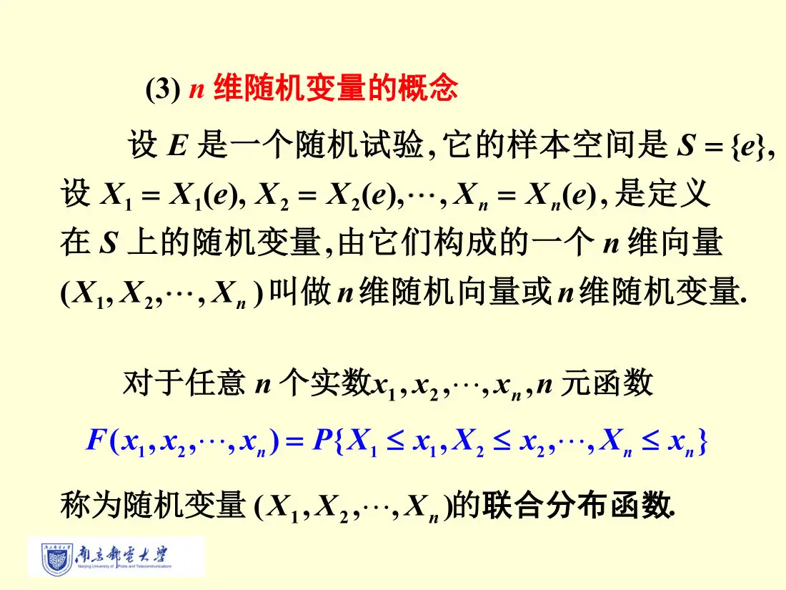

原文：

(3) n 维随机变量的概念

设 E 是一个随机试验, 它的样本空间是 $S = \{e\}$ ,
设 $X_{1}=X_{1}(e), X_{2}=X_{2}(e), \cdots, X_{n}=X_{n}(e)$ ，是定义
在 S 上的随机变量,由它们构成的一个 n 维向量 $(X_{1},X_{2},\cdots,X_{n})$ 叫做 n 维随机向量或 n 维随机变量.

对于任意 n 个实数 $x_{1}, x_{2}, \cdots, x_{n}, n$ 元函数 $F(x_{1}, x_{2}, \cdots, x_{n}) = P\{X_{1} \leq x_{1}, X_{2} \leq x_{2}, \cdots, X_{n} \leq x_{n}\}$ 称为随机变量 $(X_{1}, X_{2}, \cdots, X_{n})$ 的联合分布函数.

南京邮电大学
Nanjing University of Posts and Telecommunications

### 二维离散型随机变量的分布律

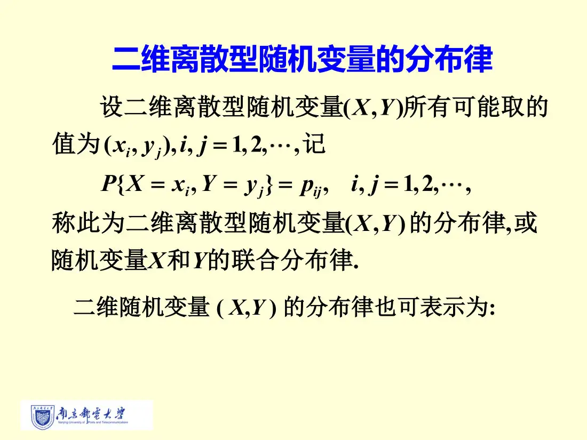

原文：

二维离散型随机变量的分布律

设二维离散型随机变量(X,Y)所有可能取的值为 $(x_{i},y_{j}),i,j=1,2,\cdots,$ 记

$$
P \{X = x _ {i}, Y = y _ {j} \} = p _ {i j}, i, j = 1, 2, \dots ,
$$

称此为二维离散型随机变量 $(X,Y)$ 的分布律,或随机变量X和Y的联合分布律.

二维随机变量 $(X,Y)$ 的分布律也可表示为:

南京邮电大学
Nanjing University of Posts and Telecommunications

### 离散型随机变量 $(X,Y)$ 的分布函数为

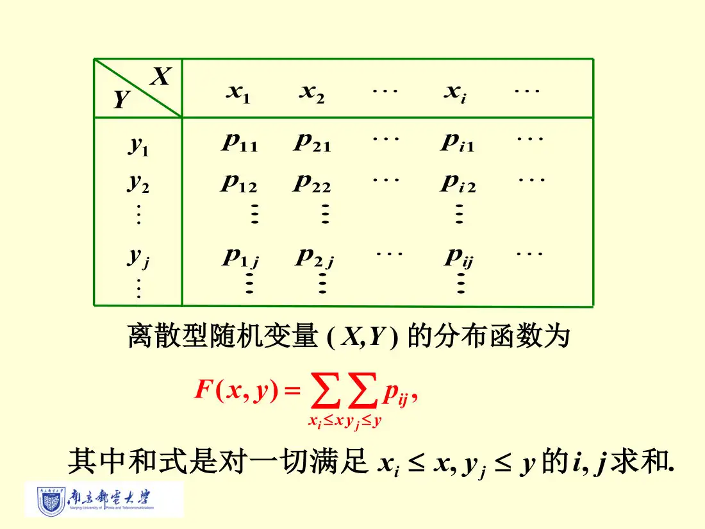

原文：

<table><tr><td rowspan="2"> $Y^{X}$ </td><td colspan="5"></td></tr><tr><td> $x_1$ </td><td> $x_2$ </td><td>...</td><td> $x_i$ </td><td>...</td></tr><tr><td> $y_1$ </td><td> $p_{11}$ </td><td> $p_{21}$ </td><td>...</td><td> $p_{i1}$ </td><td>...</td></tr><tr><td> $y_2$ </td><td> $p_{12}$ </td><td> $p_{22}$ </td><td>...</td><td> $p_{i2}$ </td><td>...</td></tr><tr><td> $\vdots$ </td><td> $\vdots$ </td><td> $\vdots$ </td><td></td><td> $\vdots$ </td><td></td></tr><tr><td> $y_j$ </td><td> $p_{1j}$ </td><td> $p_{2j}$ </td><td>...</td><td> $p_{ij}$ </td><td>...</td></tr><tr><td> $\vdots$ </td><td> $\vdots$ </td><td> $\vdots$ </td><td></td><td> $\vdots$ </td><td></td></tr></table>

离散型随机变量 $(X,Y)$ 的分布函数为

$$
F (x, y) = \sum_ {x _ {i} \leq x} \sum_ {y _ {j} \leq y} p _ {i j},
$$

其中和式是对一切满足 $x_{i} \leq x, y_{j} \leq y$ 的 $i, j$ 求和.

南京邮电大学
Nanjing University of Posts and Telecommunications

### 二维连续型随机变量的概率密度

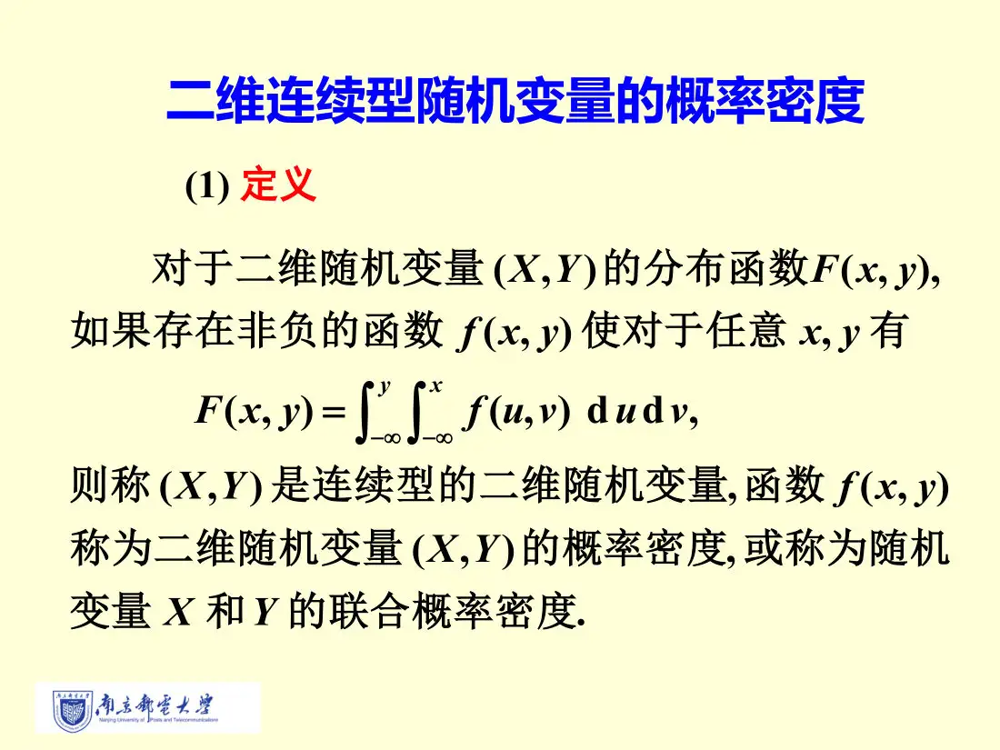

原文：

二维连续型随机变量的概率密度

(1) 定义

对于二维随机变量 $(X,Y)$ 的分布函数 $F(x,y)$ , 如果存在非负的函数 $f(x,y)$ 使对于任意 $x,y$ 有

$$
F (x, y) = \int_ {- \infty} ^ {y} \int_ {- \infty} ^ {x} f (u, v) d u d v,
$$

则称 $(X,Y)$ 是连续型的二维随机变量,函数 $f(x,y)$ 称为二维随机变量 $(X,Y)$ 的概率密度,或称为随机变量X和Y的联合概率密度.

南京邮电大学
Nanjing University of Posts and Telecommunications

### (2) 性质

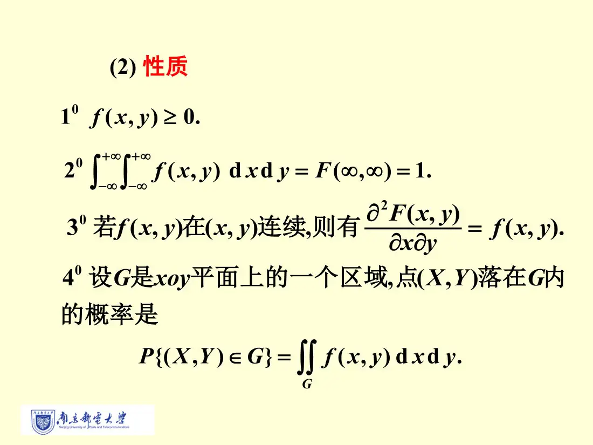

原文：

(2) 性质

$$
1 ^ {0} f (x, y) \geq 0.
$$

$$
2 ^ {0} \int_ {- \infty} ^ {+ \infty} \int_ {- \infty} ^ {+ \infty} f (x, y) d x d y = F (\infty , \infty) = 1.
$$

$3^{0}$ 若 $f(x,y)$ 在 $(x,y)$ 连续,则有 $\frac{\partial^{2}F(x,y)}{\partial x\partial y}=f(x,y)$ . $4^{0}$ 设G是xoy平面上的一个区域,点(X,Y)落在G内的概率是

$$
P \{(X, Y) \in G \} = \iint_ {G} f (x, y) \mathrm{d} x \mathrm{d} y.
$$

南京邮电大学
Nanjing University of Posts and Telecommunications

### (4) 两个常用的分布

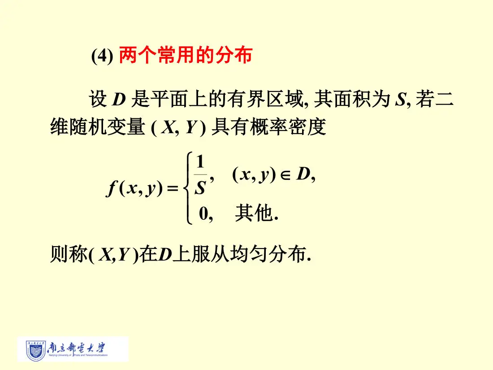

原文：

(4) 两个常用的分布

设 D 是平面上的有界区域, 其面积为 S, 若二维随机变量 $(X, Y)$ 具有概率密度

$$
f (x, y) = \left\{ \begin{array}{l l} \frac {1}{S}, & (x, y) \in D, \\ 0, & \text {其他.} \end{array} \right.
$$

则称 $(X,Y)$ 在D上服从均匀分布.

南京邮电大学
Nanjing University of Posts and Telecommunications

### 若二维随机变量 $(X,Y)$ 具有概率密度

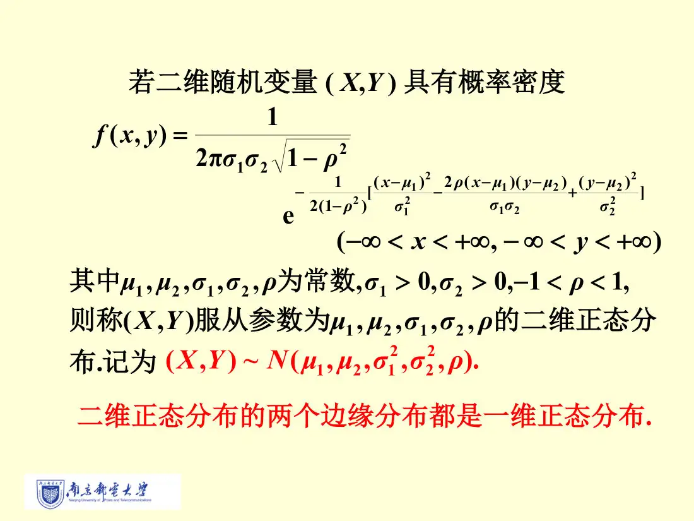

原文：

若二维随机变量 $(X,Y)$ 具有概率密度

$$
\begin{array}{c} f (x, y) = \frac {1}{2 \pi \sigma_ {1} \sigma_ {2} \sqrt {1 - \rho^ {2}}} \\ \mathrm{e} ^ {- \frac {1}{2 (1 - \rho^ {2})} [ \frac {(x - \mu_ {1}) ^ {2}}{\sigma_ {1} ^ {2}} - \frac {2 \rho (x - \mu_ {1}) (y - \mu_ {2})}{\sigma_ {1} \sigma_ {2}} + \frac {(y - \mu_ {2}) ^ {2}}{\sigma_ {2} ^ {2}} ]} \\ (- \infty <   x <   + \infty , - \infty <   y <   + \infty) \end{array}
$$

其中 $\mu_1, \mu_2, \sigma_1, \sigma_2, \rho$ 为常数， $\sigma_1 > 0, \sigma_2 > 0, -1 < \rho < 1$ ，则称 $(X, Y)$ 服从参数为 $\mu_1, \mu_2, \sigma_1, \sigma_2, \rho$ 的二维正态分布。记为 $(X, Y) \sim N(\mu_1, \mu_2, \sigma_1^2, \sigma_2^2, \rho)$ 。

二维正态分布的两个边缘分布都是一维正态分布.

南京邮电大学
Nanjing University of Posts and Telecommunications

### 边缘分布函数

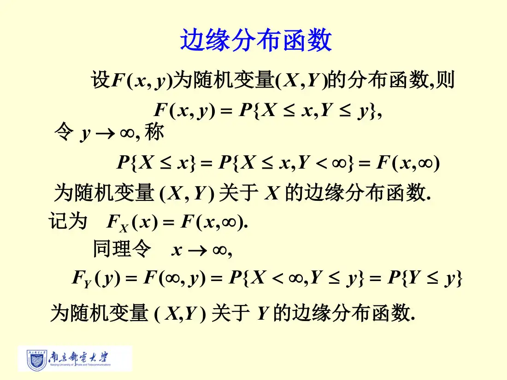

原文：

边缘分布函数

设 $F(x,y)$ 为随机变量 $(X,Y)$ 的分布函数,则

$$
F (x, y) = P \{X \leq x, Y \leq y \},
$$

令 $y \to \infty$ , 称

$$
P \{X \leq x \} = P \{X \leq x, Y <   \infty \} = F (x, \infty)
$$

为随机变量 $(X,Y)$ 关于 X 的边缘分布函数.

记为 $F_{X}(x) = F(x,\infty).$

同理令 $x\to \infty$

$$
F _ {Y} (y) = F (\infty , y) = P \{X <   \infty , Y \leq y \} = P \{Y \leq y \}
$$

为随机变量 $(X,Y)$ 关于Y的边缘分布函数.

南京邮电大学
Nanjing University of Posts and Telecommunications

### 离散型随机变量的边缘分布

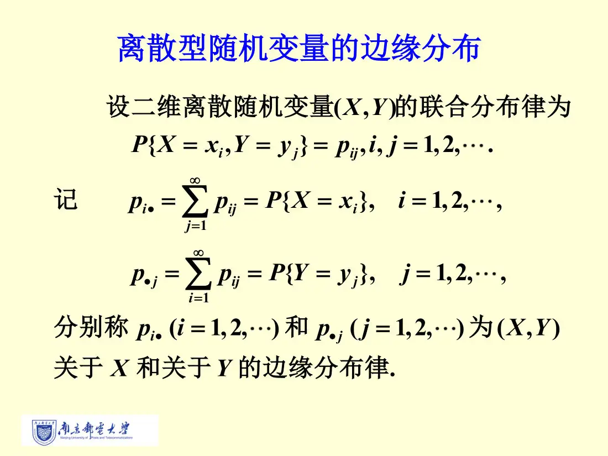

原文：

离散型随机变量的边缘分布

设二维离散随机变量 $(X,Y)$ 的联合分布律为

$$
P \{X = x _ {i}, Y = y _ {j} \} = p _ {i j}, i, j = 1, 2, \dots .
$$

记

$$
p _ {i \bullet} = \sum_ {j = 1} ^ {\infty} p _ {i j} = P \{X = x _ {i} \}, \quad i = 1, 2, \dots ,
$$

$$
p _ {\bullet j} = \sum_ {i = 1} ^ {\infty} p _ {i j} = P \{Y = y _ {j} \}, \quad j = 1, 2, \dots ,
$$

分别称 $p_{i\bullet}(i=1,2,\cdots)$ 和 $p_{\bullet j}(j=1,2,\cdots)$ 为 $(X,Y)$ 关于 X 和关于 Y 的边缘分布律.

南京邮电大学
Nanjing University of Posts and Telecommunications

### 联合分布 边缘分布

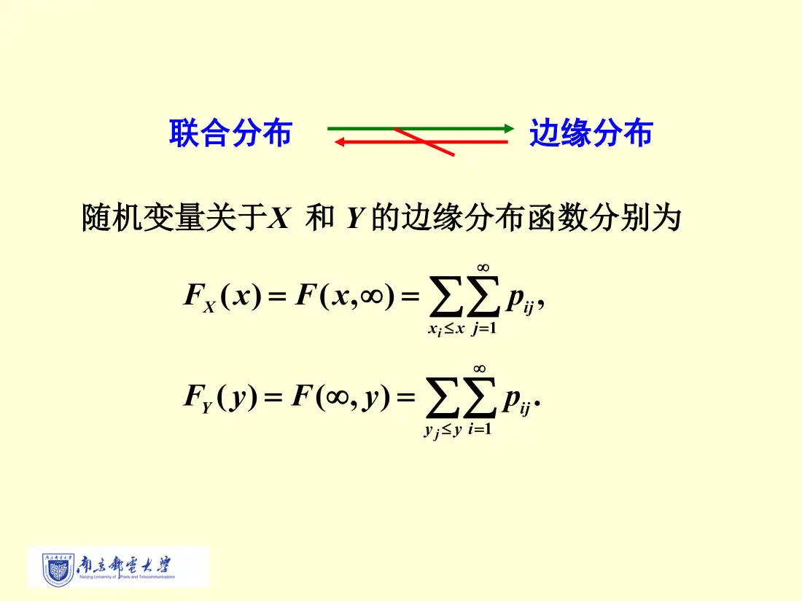

原文：

联合分布 边缘分布

随机变量关于X 和 Y 的边缘分布函数分别为

$$
F _ {X} (x) = F (x, \infty) = \sum_ {x _ {i} \leq x} \sum_ {j = 1} ^ {\infty} p _ {i j},
$$

$$
F _ {Y} (y) = F (\infty , y) = \sum_ {y _ {j} \leq y} \sum_ {i = 1} ^ {\infty} p _ {i j}.
$$

南京邮电大学
Nanjing University of Posts and Telecommunications

### 连续型随机变量的边缘分布

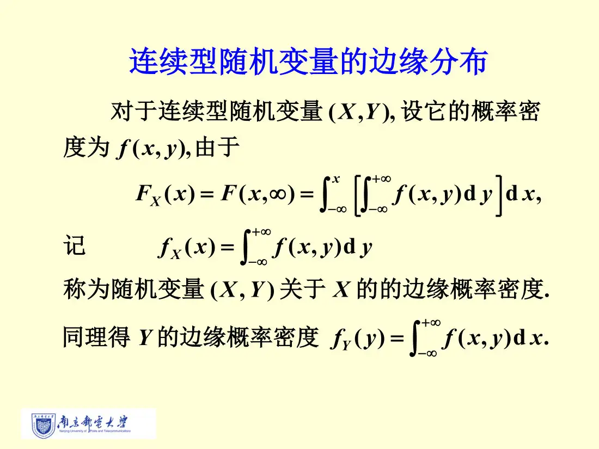

原文：

连续型随机变量的边缘分布

对于连续型随机变量 $(X,Y)$ ，设它的概率密度为 $f(x,y)$ ，由于

$$
F _ {X} (x) = F (x, \infty) = \int_ {- \infty} ^ {x} \left[ \int_ {- \infty} ^ {+ \infty} f (x, y) \mathrm{d} y \right] \mathrm{d} x,
$$

$$
f _ {X} (x) = \int_ {- \infty} ^ {+ \infty} f (x, y) d y
$$

称为随机变量 $(X,Y)$ 关于 $X$ 的的边缘概率密度.同理得 $Y$ 的边缘概率密度 $f_{Y}(y) = \int_{-\infty}^{+\infty}f(x,y)\mathrm{d}x.$

南京邮电大学
Nanjing University of Posts and Telecommunications

### 随机变量的相互独立性

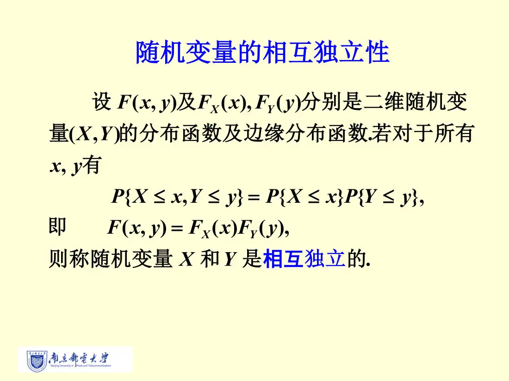

原文：

随机变量的相互独立性

设 $F(x,y)$ 及 $F_{X}(x)$ , $F_{Y}(y)$ 分别是二维随机变量 $(X,Y)$ 的分布函数及边缘分布函数. 若对于所有 x, y 有

$$
P \{X \leq x, Y \leq y \} = P \{X \leq x \} P \{Y \leq y \},
$$

即 $F(x,y)=F_{X}(x)F_{Y}(y),$

则称随机变量 X 和 Y 是相互独立的.

南京邮电大学
Nanjing University of Posts and Telecommunications

### 注意

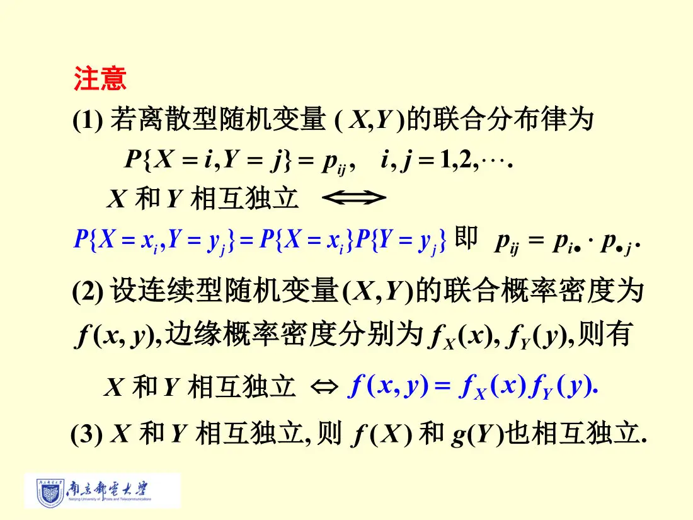

原文：

注意

(1) 若离散型随机变量 $(X,Y)$ 的联合分布律为

$$
P \{X = i, Y = j \} = p _ {i j}, \quad i, j = 1, 2, \dots .
$$

X 和 Y 相互独立 ⇌

$P\{X=x_{i},Y=y_{j}\}=P\{X=x_{i}\}P\{Y=y_{j}\}$ 即 $p_{ij}=p_{i\bullet}\cdot p_{\bullet j}$

(2) 设连续型随机变量 $(X, Y)$ 的联合概率密度为 $f(x, y)$ , 边缘概率密度分别为 $f_{X}(x), f_{Y}(y)$ , 则有

X 和 Y 相互独立 $\Leftrightarrow f(x,y)=f_{X}(x)f_{Y}(y).$

(3) X 和 Y 相互独立, 则 $f(X)$ 和 $g(Y)$ 也相互独立.

南京邮电大学
Nanjing University of Posts and Telecommunications

### 随机变量函数的分布

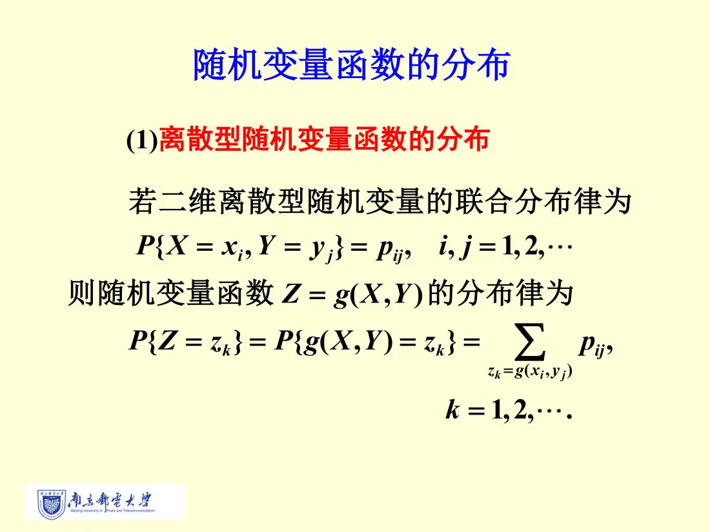

原文：

随机变量函数的分布

(1)离散型随机变量函数的分布

若二维离散型随机变量的联合分布律为

$$
P \{X = x _ {i}, Y = y _ {j} \} = p _ {i j}, \quad i, j = 1, 2, \dots
$$

则随机变量函数 $Z = g(X,Y)$ 的分布律为

$$
\begin{array}{c} P \{Z = z _ {k} \} = P \{g (X, Y) = z _ {k} \} = \sum_ {z _ {k} = g (x _ {i}, y _ {j})} p _ {i j}, \\ k = 1, 2, \dots . \end{array}
$$

南京邮电大学
Nanjing University of Posts and Telecommunications

### (2)连续型随机变量函数的分布

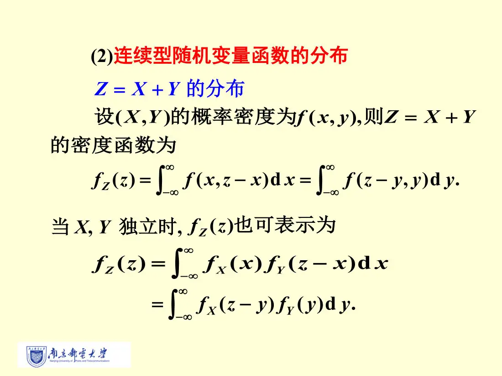

原文：

(2)连续型随机变量函数的分布

$Z = X + Y$ 的分布

设 $(X,Y)$ 的概率密度为 $f(x,y)$ ，则 $Z=X+Y$ 的密度函数为

$$
f _ {Z} (z) = \int_ {- \infty} ^ {\infty} f (x, z - x) \mathrm{d} x = \int_ {- \infty} ^ {\infty} f (z - y, y) \mathrm{d} y.
$$

当 X, Y 独立时, $f_{z}(z)$ 也可表示为

$$
\begin{array}{r l} f _ {Z} (z) & = \int_ {- \infty} ^ {\infty} f _ {X} (x) f _ {Y} (z - x) \mathrm{d} x \\ & = \int_ {- \infty} ^ {\infty} f _ {X} (z - y) f _ {Y} (y) \mathrm{d} y. \end{array}
$$

南京邮电大学
Nanjing University of Posts and Telecommunications

### $M = \max(X,Y)$ 及 $N = \min(X,Y)$ 的分布

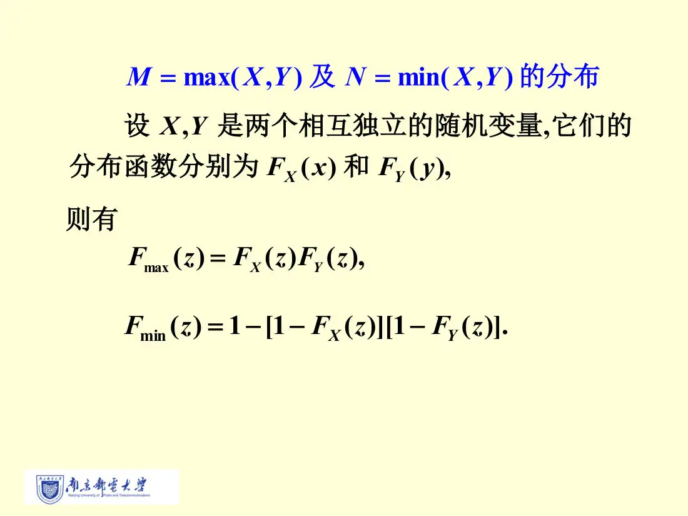

原文：

$M = \max(X,Y)$ 及 $N = \min(X,Y)$ 的分布

设 X,Y 是两个相互独立的随机变量,它们的分布函数分别为 $F_{X}(x)$ 和 $F_{Y}(y)$ ,

则有

$$
F _ {\mathrm{max}} (z) = F _ {X} (z) F _ {Y} (z),
$$

$$
F _ {\mathrm{min}} (z) = 1 - [ 1 - F _ {X} (z) ] [ 1 - F _ {Y} (z) ].
$$

南京邮电大学
Nanjing University of Posts and Telecommunications

### 推广

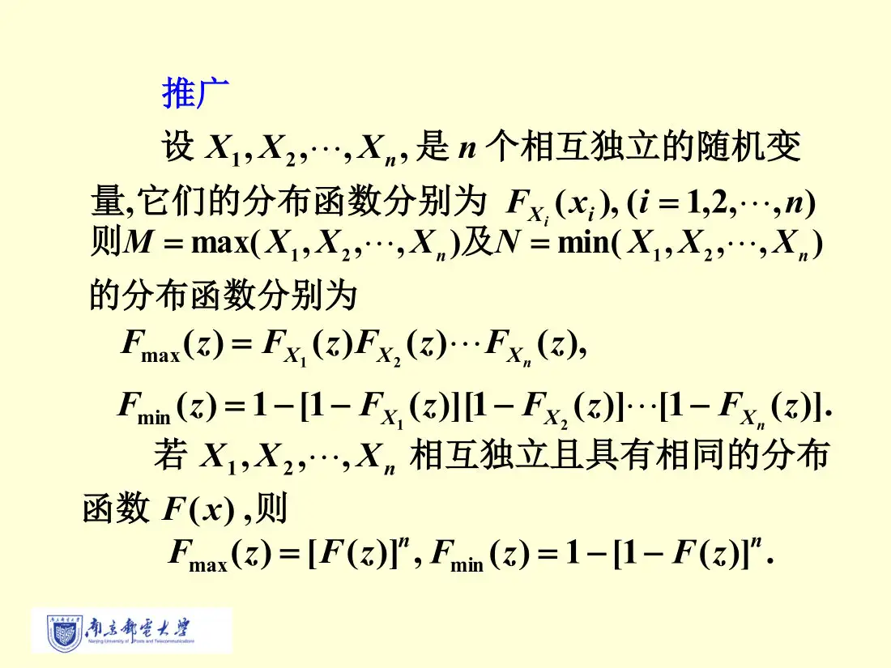

原文：

推广

设 $X_{1}, X_{2}, \cdots, X_{n}$ ，是 n 个相互独立的随机变量，它们的分布函数分别为 $F_{X_{i}}(x_{i}), (i=1,2,\cdots,n)$ 则 $M = \max(X_{1}, X_{2}, \cdots, X_{n})$ 及 $N = \min(X_{1}, X_{2}, \cdots, X_{n})$ 的分布函数分别为

$$
F _ {\max} (z) = F _ {X _ {1}} (z) F _ {X _ {2}} (z) \dots F _ {X _ {n}} (z),
$$

$$
F _ {\min} (z) = 1 - \left[ 1 - F _ {X _ {1}} (z) \right] \left[ 1 - F _ {X _ {2}} (z) \right] \dots \left[ 1 - F _ {X _ {n}} (z) \right].
$$

若 $X_{1}, X_{2}, \cdots, X_{n}$ 相互独立且具有相同的分布函数 $F(x)$ ，则

$$
F _ {\max} (z) = [ F (z) ] ^ {n}, F _ {\min} (z) = 1 - [ 1 - F (z) ] ^ {n}.
$$

南京邮电大学
Nanjing University of Posts and Telecommunications

### 三、典型例题

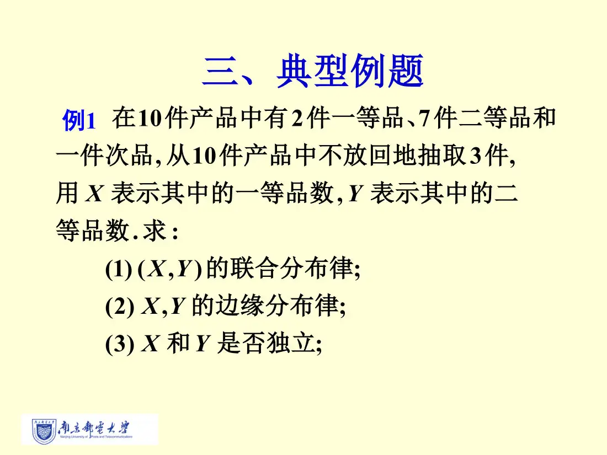

原文：

三、典型例题

例1 在10件产品中有2件一等品、7件二等品和一件次品,从10件产品中不放回地抽取3件,用 X 表示其中的一等品数,Y 表示其中的二等品数.求:

(1) $(X,Y)$ 的联合分布律;

(2) X, Y 的边缘分布律;

(3) X 和 Y 是否独立;

南京邮电大学
Nanjing University of Posts and Telecommunications

### 解 由题设知 X 只能取 0, 1, 2,

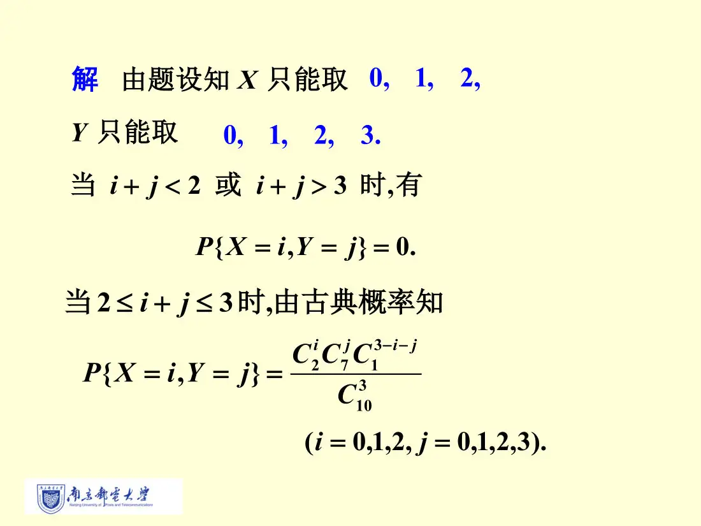

原文：

解 由题设知 X 只能取 0, 1, 2,

Y 只能取 0, 1, 2, 3.

当 $i+j<2$ 或 $i+j>3$ 时,有

$$
P \{X = i, Y = j \} = 0.
$$

当 $2 \leq i + j \leq 3$ 时,由古典概率知

$$
P \{X = i, Y = j \} = \frac {C _ {2} ^ {i} C _ {7} ^ {j} C _ {1} ^ {3 - i - j}}{C _ {1 0} ^ {3}}
$$

$$
(i = 0, 1, 2, j = 0, 1, 2, 3).
$$

南京邮电大学
Nanjing University of Posts and Telecommunications

### 因此的 $(X,Y)$ 的分布律为

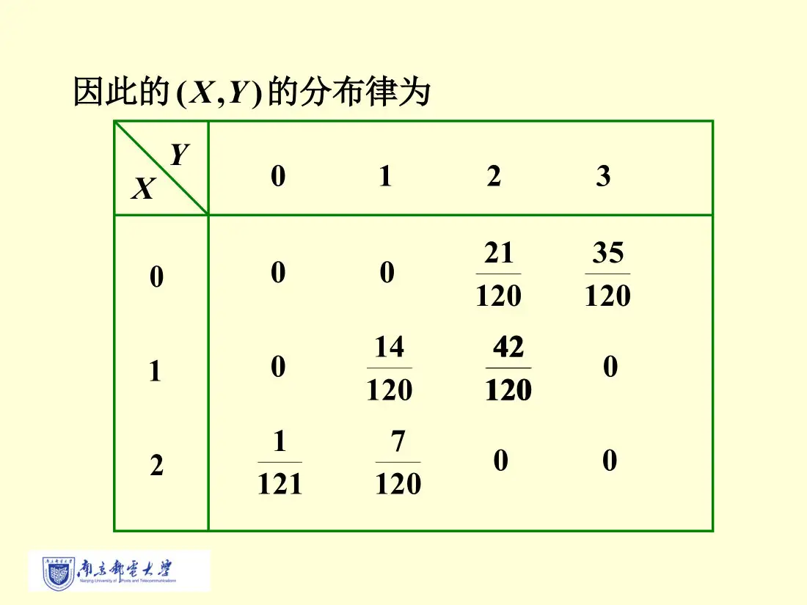

原文：

因此的 $(X,Y)$ 的分布律为

<table><tr><td>X\Y</td><td>0</td><td>1</td><td>2</td><td>3</td></tr><tr><td>0</td><td>0</td><td>0</td><td> $\frac{21}{120}$ </td><td> $\frac{35}{120}$ </td></tr><tr><td>1</td><td>0</td><td> $\frac{14}{120}$ </td><td> $\frac{42}{120}$ </td><td>0</td></tr><tr><td>2</td><td> $\frac{1}{121}$ </td><td> $\frac{7}{120}$ </td><td>0</td><td>0</td></tr></table>

南京邮电大学
Nanjing University of Posts and Telecommunications

### (2) $X, Y$ 的边缘分布律为

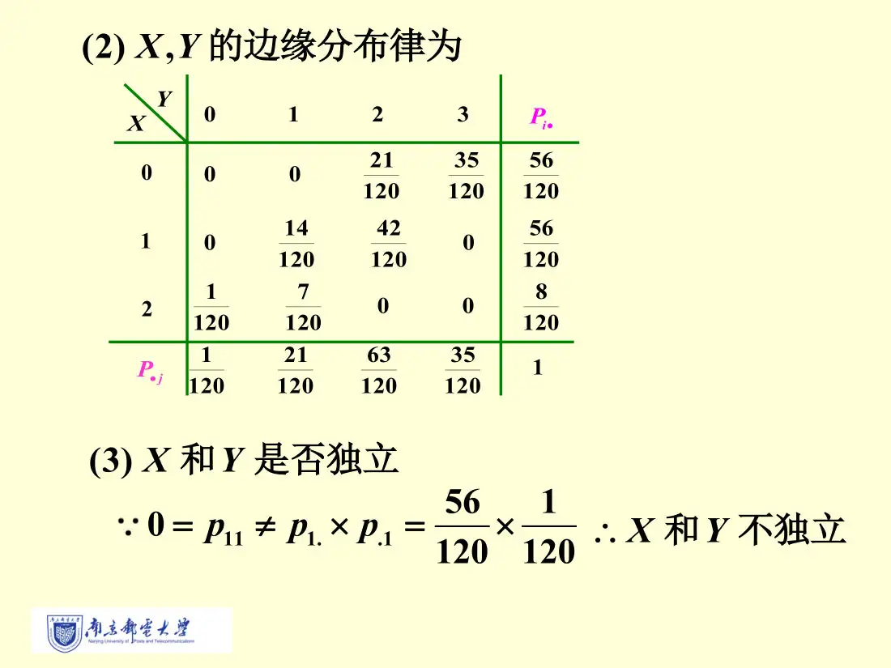

原文：

(2) $X, Y$ 的边缘分布律为

<table><tr><td>X\Y</td><td>0</td><td>1</td><td>2</td><td>3</td><td> $P_{i\bullet}$ </td></tr><tr><td>0</td><td>0</td><td>0</td><td> $\frac{21}{120}$ </td><td> $\frac{35}{120}$ </td><td> $\frac{56}{120}$ </td></tr><tr><td>1</td><td>0</td><td> $\frac{14}{120}$ </td><td> $\frac{42}{120}$ </td><td>0</td><td> $\frac{56}{120}$ </td></tr><tr><td>2</td><td> $\frac{1}{120}$ </td><td> $\frac{7}{120}$ </td><td>0</td><td>0</td><td> $\frac{8}{120}$ </td></tr><tr><td> $P_{\bullet j}$ </td><td> $\frac{1}{120}$ </td><td> $\frac{21}{120}$ </td><td> $\frac{63}{120}$ </td><td> $\frac{35}{120}$ </td><td>1</td></tr></table>

(3) $X$ 和 $Y$ 是否独立

$\because 0 = p_{11} \neq p_{1.} \times p_{.1} = \frac{56}{120} \times \frac{1}{120} \therefore X$ 和 $Y$ 不独立

南京邮电大学
Nanjing University of Posts and Telecommunications

### 例2 设X 和 Y 相互独立同分布,

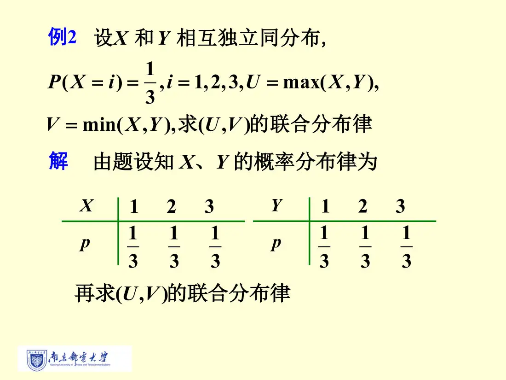

原文：

例2 设X 和 Y 相互独立同分布,

$$
P (X = i) = \frac {1}{3}, i = 1, 2, 3, U = \max (X, Y),
$$

$V = \min (X,Y)$ , 求 $(U,V)$ 的联合分布律

解 由题设知 $X$ 、 $Y$ 的概率分布律为

$$
\begin{array}{c c c c} X & 1 & 2 & 3 \\ \hline p & \frac {1}{3} & \frac {1}{3} & \frac {1}{3} \end{array} \quad \begin{array}{c c c c} Y & 1 & 2 & 3 \\ \hline p & \frac {1}{3} & \frac {1}{3} & \frac {1}{3} \end{array}
$$

再求 $(U,V)$ 的联合分布律

南京邮电大学
Nanjing University of Posts and Telecommunications

### 再求 $(U,V)$ 的联合分布律

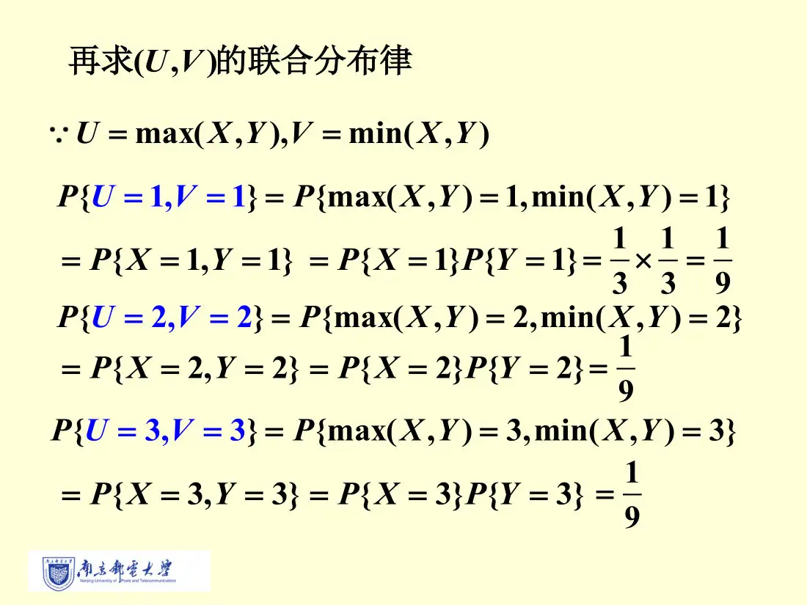

原文：

再求 $(U,V)$ 的联合分布律

$$
\because U = \max (X, Y), V = \min (X, Y)
$$

$$
P \{U = 1, V = 1 \} = P \{\max (X, Y) = 1, \min (X, Y) = 1 \}
$$

$$
= P \{X = 1, Y = 1 \} = P \{X = 1 \} P \{Y = 1 \} = \frac {1}{3} \times \frac {1}{3} = \frac {1}{9}
$$

$$
P \{U = 2, V = 2 \} = P \{\max (X, Y) = 2, \min (X, Y) = 2 \}
$$

$$
= P \{X = 2, Y = 2 \} = P \{X = 2 \} P \{Y = 2 \} = \frac {1}{9}
$$

$$
P \{U = 3, V = 3 \} = P \{\max (X, Y) = 3, \min (X, Y) = 3 \}
$$

$$
= P \{X = 3, Y = 3 \} = P \{X = 3 \} P \{Y = 3 \} = \frac {1}{9}
$$

南京邮电大学
Nanjing University of Posts and Telecommunications

### $$

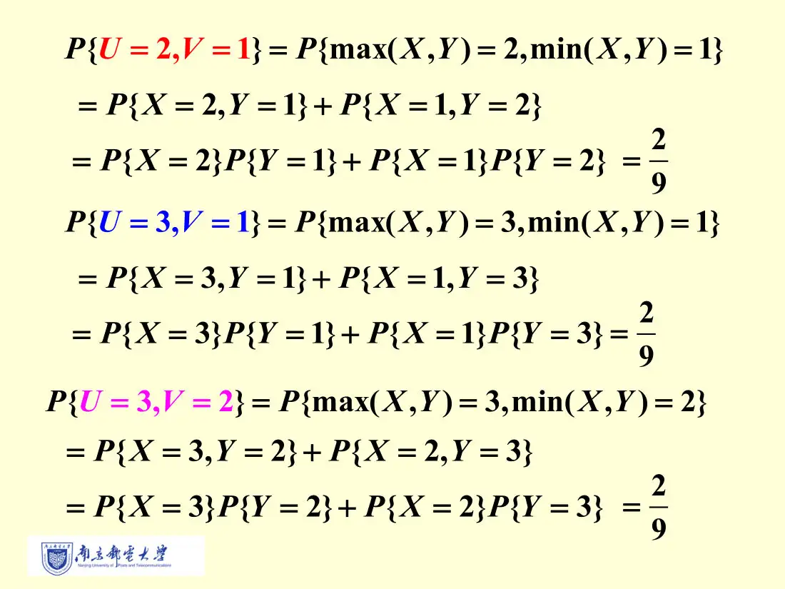

原文：

$$
\begin{array}{r l} & P \{U = 2, V = 1 \} = P \{\max (X, Y) = 2, \min (X, Y) = 1 \} \\ & \quad = P \{X = 2, Y = 1 \} + P \{X = 1, Y = 2 \} \\ & \quad = P \{X = 2 \} P \{Y = 1 \} + P \{X = 1 \} P \{Y = 2 \} = \frac {2}{9} \end{array}
$$

$$
\begin{array}{r l} & P \{U = 3, V = 1 \} = P \{\max (X, Y) = 3, \min (X, Y) = 1 \} \\ & \qquad = P \{X = 3, Y = 1 \} + P \{X = 1, Y = 3 \} \\ & \qquad = P \{X = 3 \} P \{Y = 1 \} + P \{X = 1 \} P \{Y = 3 \} = \frac {2}{9} \end{array}
$$

$$
\begin{array}{r l} & P \{U = 3, V = 2 \} = P \{\max (X, Y) = 3, \min (X, Y) = 2 \} \\ & \quad = P \{X = 3, Y = 2 \} + P \{X = 2, Y = 3 \} \\ & \quad = P \{X = 3 \} P \{Y = 2 \} + P \{X = 2 \} P \{Y = 3 \} = \frac {2}{9} \end{array}
$$

南京邮电大学
Nanjing University of Posts and Telecommunications

### $$

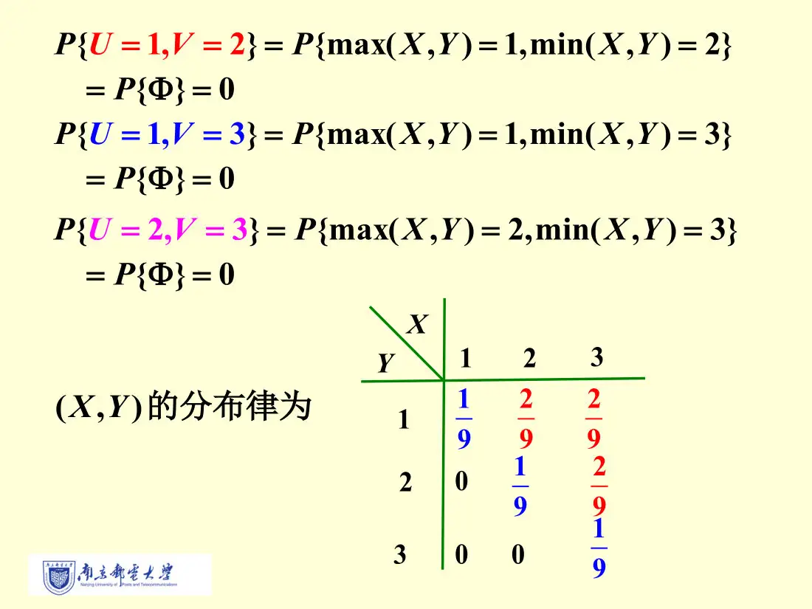

原文：

$$
\begin{array}{r l} & P \{U = 1, V = 2 \} = P \{\max (X, Y) = 1, \min (X, Y) = 2 \} \\ & = P \{\Phi \} = 0 \end{array}
$$

$$
\begin{array}{r l} & P \{U = 1, V = 3 \} = P \{\max (X, Y) = 1, \min (X, Y) = 3 \} \\ & \quad = P \{\Phi \} = 0 \end{array}
$$

$P\{U = 2,V = 3\} = P\{\max (X,Y) = 2,\min (X,Y) = 3\}$ $= P\{\Phi \} = 0$

$(X,Y)$ 的分布律为

$$
\begin{array}{c c c c} \hline X & & & \\ Y & 1 & 2 & 3 \\ \hline 1 & \frac {1}{9} & \frac {2}{9} & \frac {2}{9} \\ 2 & 0 & \frac {1}{9} & \frac {2}{9} \\ 3 & 0 & 0 & \frac {1}{9} \end{array}
$$

南京邮电大学
Nanjing University of Posts and Telecommunications

### 例3 设随机变量 $(X,Y)$ 的联合概率密度为

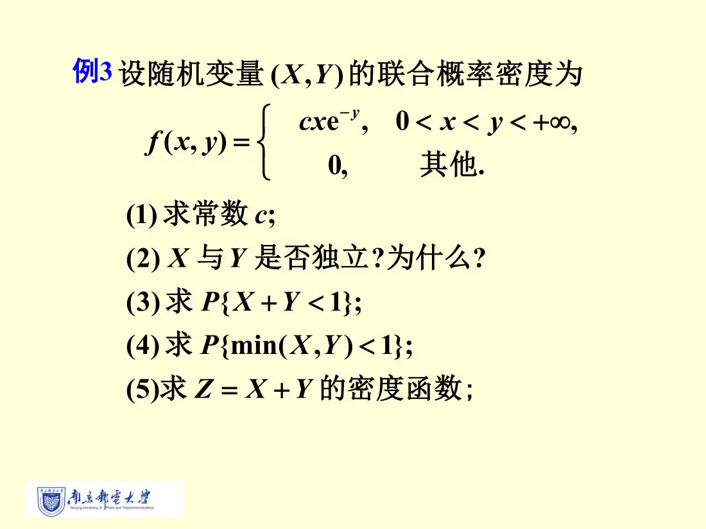

原文：

例3 设随机变量 $(X,Y)$ 的联合概率密度为

$$
f (x, y) = \left\{ \begin{array}{c c} {c x \mathrm{e} ^ {- y},} & {0 <   x <   y <   + \infty ,} \\ {0,} & {\text {其他}.} \end{array} \right.
$$

(1) 求常数 $c$ ;

(2) $X$ 与 $Y$ 是否独立?为什么?

(3) 求 $P\{X + Y < 1\}$ ;

(4) 求 $P\{\min(X, Y) < 1\}$ ;

(5)求 $Z = X + Y$ 的密度函数；

南京邮电大学
Nanjing University of Posts and Telecommunications

### $$

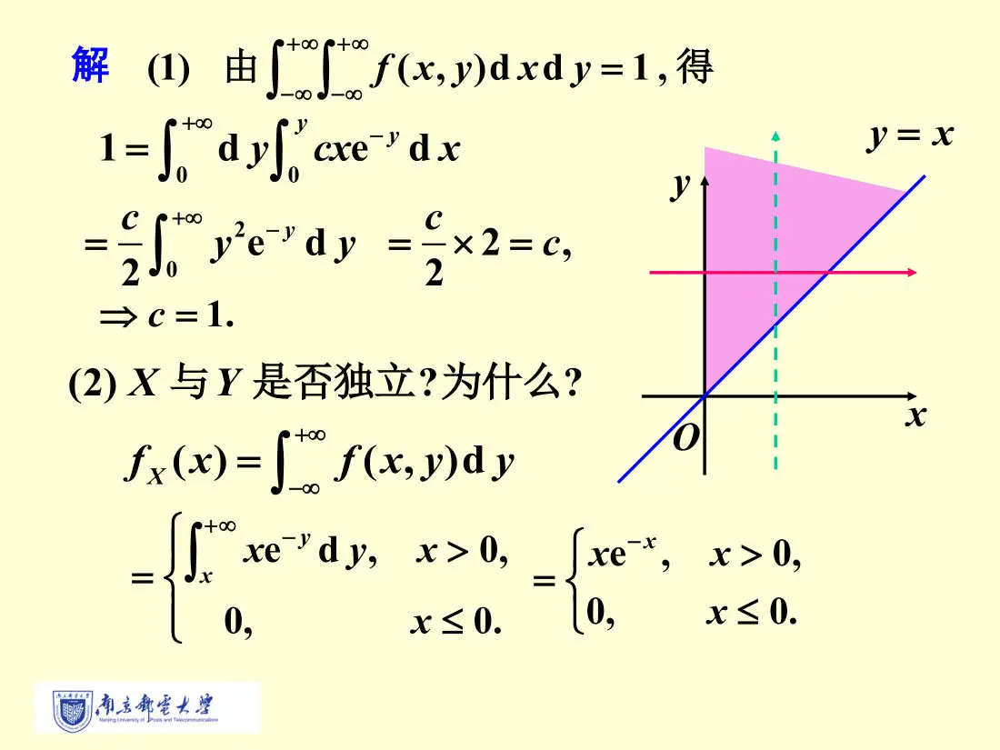

原文：

解 (1) 由 $\int_{-\infty}^{+\infty}\int_{-\infty}^{+\infty}f(x,y)\mathrm{d}x\mathrm{d}y = 1$ ，得

$$
\begin{array}{r l} & 1 = \int_ {0} ^ {+ \infty} \mathrm{d} y \int_ {0} ^ {y} c x \mathrm{e} ^ {- y} \mathrm{d} x \\ & = \frac {c}{2} \int_ {0} ^ {+ \infty} y ^ {2} \mathrm{e} ^ {- y} \mathrm{d} y = \frac {c}{2} \times 2 = c, \\ & \Rightarrow c = 1. \end{array}
$$

(2) $X$ 与 $Y$ 是否独立?为什么?

$$
\begin{array}{r l}&f _ {X} (x) = \int_ {- \infty} ^ {+ \infty} f (x, y) \textbf {d} y \quad \left/\begin{array}{c c}0\\0\end{array}\left. \right|\\&= \left\{\begin{array}{c c}\int_ {x} ^ {+ \infty} x \mathrm{e} ^ {- y} \textbf {d} y,&x > 0,\\0,&x \leq 0.\end{array}\right. = \left\{\begin{array}{c c}x \mathrm{e} ^ {- x},&x > 0,\\0,&x \leq 0.\end{array}\right.\end{array}
$$

南京邮电大学
Nanjing University of Posts and Telecommunications

### $$

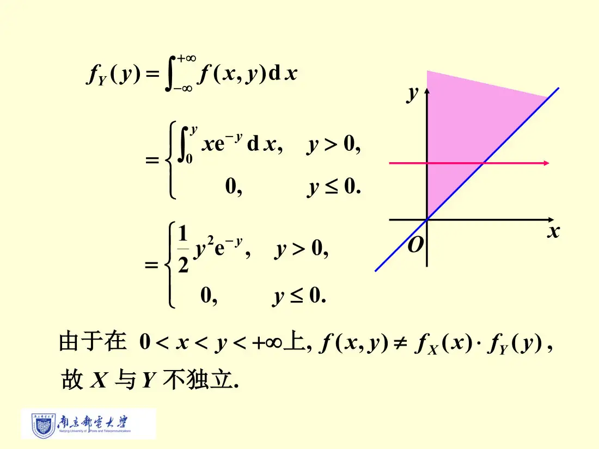

原文：

$$
\begin{array}{r l} f _ {Y} (y) & = \int_ {- \infty} ^ {+ \infty} f (x, y) \mathrm{d} x \\ & = \left\{ \begin{array}{c c} \int_ {0} ^ {y} x \mathrm{e} ^ {- y} \mathrm{d} x, & y > 0, \\ 0, & y \leq 0. \end{array} \right. \end{array}
$$

$$
= \left\{ \begin{array}{c c} \frac {1}{2} y ^ {2} \mathrm{e} ^ {- y}, & y > 0, \\ 0, & y \leq 0. \end{array} \right.
$$

由于在 $0 < x < y < +\infty$ 上， $f(x, y) \neq f_X(x) \cdot f_Y(y)$ ，故 $X$ 与 $Y$ 不独立.

南京邮电大学
Nanjing University of Posts and Telecommunications

### (3) 求 $P\{X + Y < 1\}$ ;

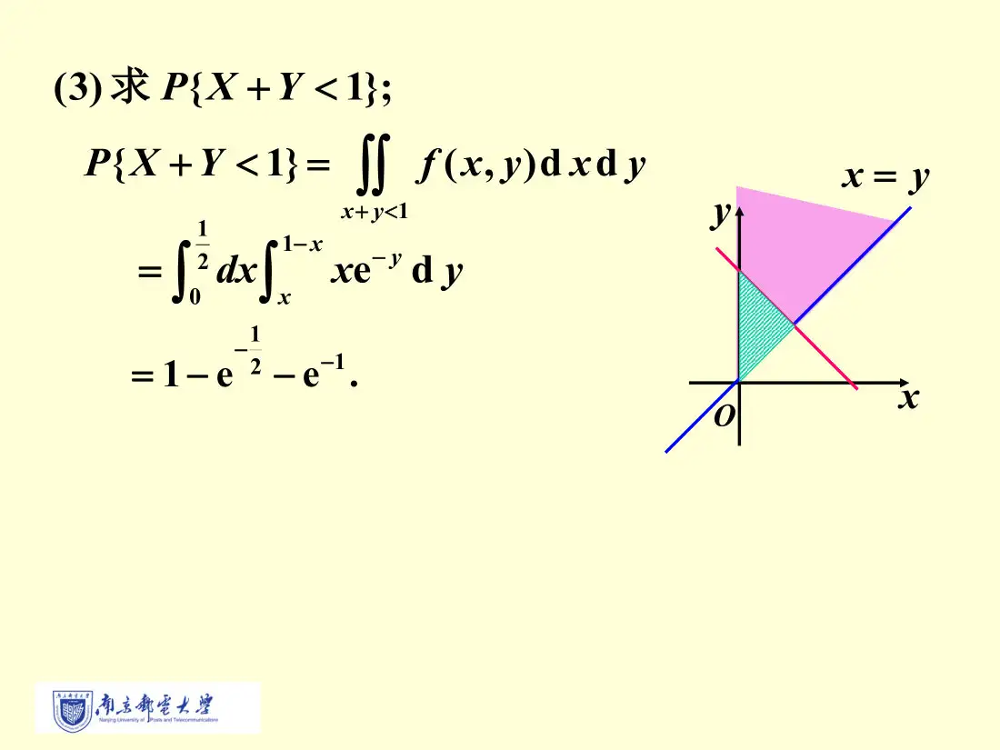

原文：

(3) 求 $P\{X + Y < 1\}$ ;

$$
\begin{array}{l} P \{X + Y <   1 \} = \iint_ {x + y <   1} f (x, y) \mathrm{d} x \mathrm{d} y \\ = \int_ {0} ^ {\frac {1}{2}} d x \int_ {x} ^ {1 - x} x \mathrm{e} ^ {- y} \mathrm{d} y \\ = 1 - \mathrm{e} ^ {- \frac {1}{2}} - \mathrm{e} ^ {- 1}. \end{array}
$$

南京邮电大学
Nanjing University of Posts and Telecommunications

### $$

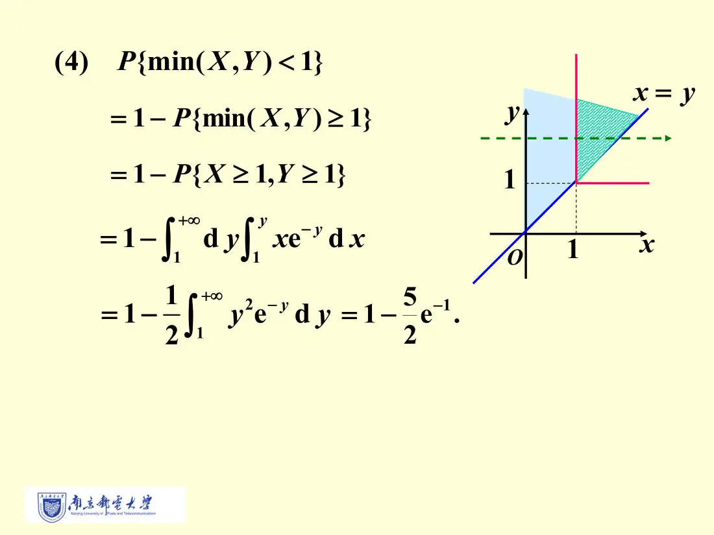

原文：

$$
\begin{array}{r l} & P \{\min (X, Y) <   1 \} \\ & = 1 - P \{\min (X, Y) \geq 1 \} \\ & = 1 - P \{X \geq 1, Y \geq 1 \} \\ & = 1 - \int_ {1} ^ {+ \infty} d y \int_ {1} ^ {y} x e ^ {- y} d x \\ & = 1 - \frac {1}{2} \int_ {1} ^ {+ \infty} y ^ {2} e ^ {- y} d y = 1 - \frac {5}{2} e ^ {- 1}. \end{array} \tag {4}
$$

南京邮电大学
Nanjing University of Posts and Telecommunications

### (5) 求 $Z = X + Y$ 的密度函数;

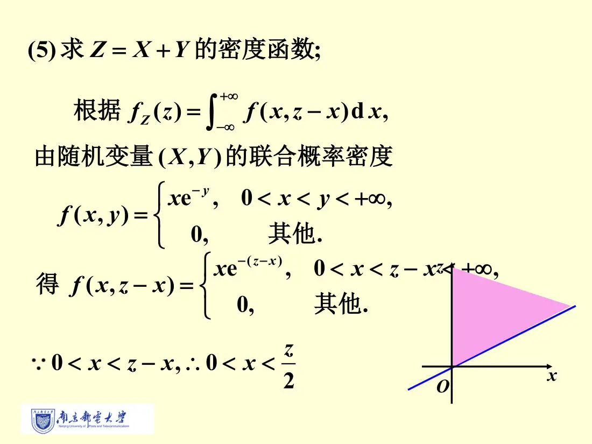

原文：

(5) 求 $Z = X + Y$ 的密度函数;

根据 $f_{z}(z)=\int_{-\infty}^{+\infty}f(x,z-x)\mathrm{d}x,$ 由随机变量 $(X,Y)$ 的联合概率密度

$$
f (x, y) = \left\{ \begin{array}{c c} x \mathrm{e} ^ {- y}, & 0 <   x <   y <   + \infty , \\ 0, & \text {其他.} \end{array} \right.
$$

$$
f (x, z - x) = \left\{ \begin{array}{c c} x \mathrm{e} ^ {- (z - x)}, & 0 <   x <   z - x z <   + \infty , \\ 0, & \text {其他.} \end{array} \right.
$$

$$
\because 0 <   x <   z - x, \therefore 0 <   x <   \frac {z}{2}
$$

南京邮电大学
Nanjing University of Posts and Telecommunications

### 当 z < 0 时， $f_{z}(z) = 0;$

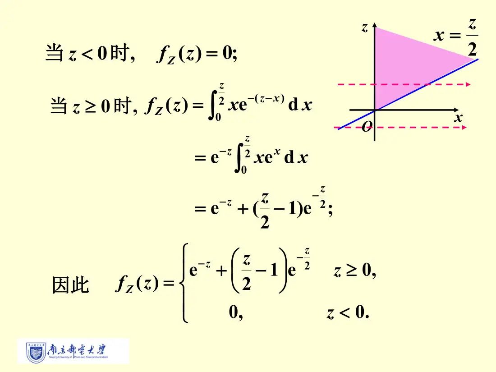

原文：

当 z < 0 时， $f_{z}(z) = 0;$

当 $z \geq 0$ 时, $f_{Z}(z) = \int_{0}^{\frac{z}{2}} x \mathrm{e}^{-(z - x)} \mathrm{d}x$

$$
\begin{array}{r l} f _ {Z} (z) & = \int_ {0} ^ {\frac {z}{2}} x \mathrm{e} ^ {- (z - x)} \mathrm{d} x \\ & = \mathrm{e} ^ {- z} \int_ {0} ^ {\frac {z}{2}} x \mathrm{e} ^ {x} \mathrm{d} x \\ & = \mathrm{e} ^ {- z} + (\frac {z}{2} - 1) \mathrm{e} ^ {- \frac {z}{2}}; \end{array}
$$

因此 $f_{Z}(z) = \left\{ \begin{array}{l} \mathrm{e}^{-z} + \left(\frac{z}{2} - 1\right)\mathrm{e}^{-\frac{z}{2}} \\ 0, \quad z < 0. \end{array} \right.$

南京邮电大学
Nanjing University of Posts and Telecommunications

### 例4 设随机变量 $(X, Y)$ 在矩形

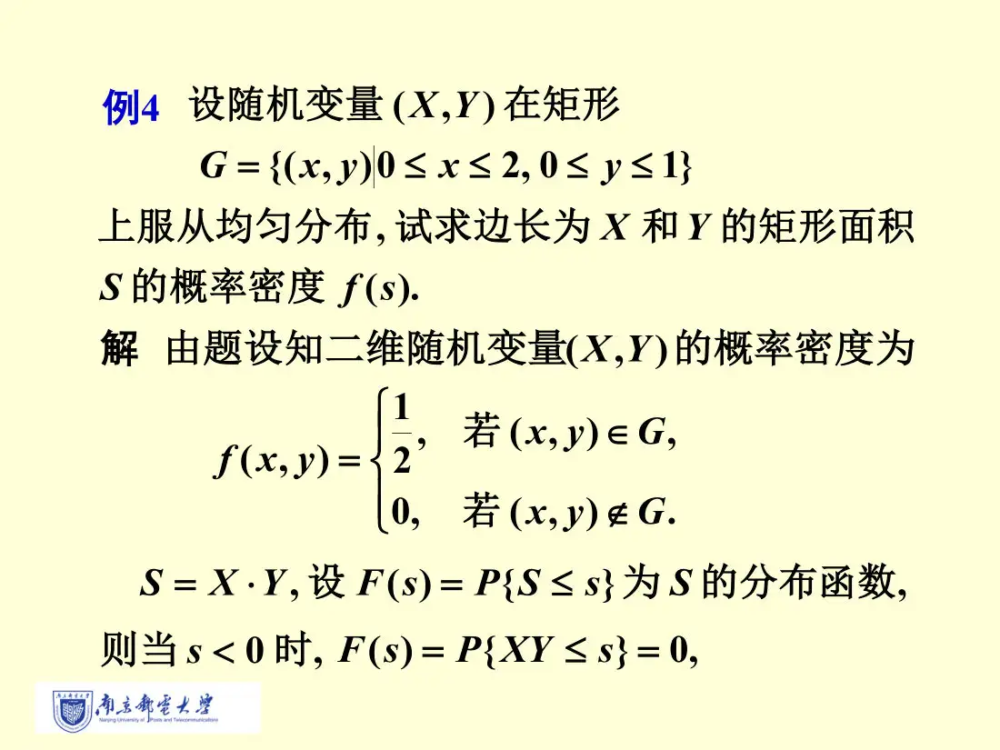

原文：

例4 设随机变量 $(X, Y)$ 在矩形

$$
G = \{(x, y) | 0 \leq x \leq 2, 0 \leq y \leq 1 \}
$$

上服从均匀分布, 试求边长为 X 和 Y 的矩形面积 S 的概率密度 $f(s)$ .

解 由题设知二维随机变量 $(X,Y)$ 的概率密度为

$$
f (x, y) = \left\{ \begin{array}{l l} \frac {1}{2}, & \text {若} (x, y) \in G, \\ 0, & \text {若} (x, y) \notin G. \end{array} \right.
$$

$S = X \cdot Y$ , 设 $F(s) = P\{S \leq s\}$ 为 $S$ 的分布函数, 则当 $s < 0$ 时, $F(s) = P\{XY \leq s\} = 0$ ,

南京邮电大学
Nanjing University of Posts and Telecommunications

### $$

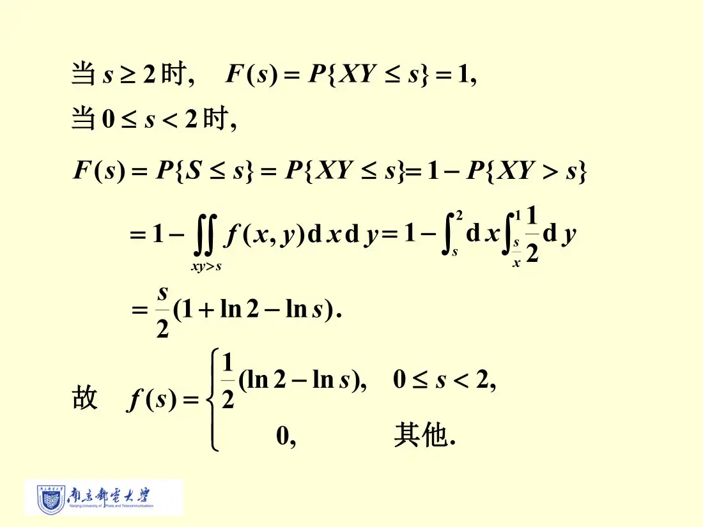

原文：

当 $s \geq 2$ 时， $F(s) = P\{XY \leq s\} = 1,$ 当 $0 \leq s < 2$ 时，

$$
\begin{array}{r l} & {F (s) = P \{S \leq s \} = P \{X Y \leq s \} = 1 - P \{X Y > s \}} \\ & {\qquad = 1 - \iint_ {x y > s} f (x, y)   \mathrm{d} x   \mathrm{d} y = 1 - \int_ {s} ^ {2}   \mathrm{d} x \int_ {\frac {s}{x}} ^ {1} \frac {1}{2}   \mathrm{d} y} \\ & {\qquad = \frac {s}{2} (1 + \ln 2 - \ln s).} \\ & {\text {故} \quad f (s) = \left\{ \begin{array}{l l} { \frac {1}{2} (\ln 2 - \ln s),} & {0 \leq s <   2,} \\ {0,} & {\text {其他}.} \end{array} \right.} \end{array}
$$

南京邮电大学
Nanjing University of Posts and Telecommunications
