# 《概率论与数理统计》第3章 多维随机变量及其分布（课件）

原件的每一页，下面附识别出的文字。

### 实例1 炮弹的弹着点的位置 $(X, Y)$ 就是一个二维随机变量。

原文：

实例1 炮弹的弹着点的位置 $(X, Y)$ 就是一个二维随机变量。

实例2 考查某一地区学前儿童的发育情况,则儿童的身高H和体重W就构成二维随机变量 $(H,W)$ 。

说明 二维随机变量 $(X,Y)$ 的性质不仅与X、Y有关,而且还依赖于这两个随机变量的相互关系。

因此逐个地研究 $X$ 或 $Y$ 的性质还不够，还要将 $(X,Y)$ 作为一个整体来研究。

如果将二维随机变量 $(X,Y)$ 看成是平面上随机点的坐标。则分布函数 $F(x,y)$ 在 $(x,y)$ 处的函数值就是随机点 $(X,Y)$ 落在如图所示，以点 $(x,y)$ 为顶点而位于该点左下方的无穷矩形域内的概率。

2. 二维随机变量的分布函数

(1)分布函数的定义

设 $(X,Y)$ 是二维随机变量,对于任意实数x,y,二元函数:

$F(x,y)=P\{(X\leq x)\bigcap(Y\leq y)\}=P\{X\leq x,Y\leq y\}$ 称为二维随机变量 $(X,Y)$ 的分布函数,或称为随机变量X和Y的联合分布函数。

南京航空航天大学
Nanjing University of Physics and Telecommunications

第一节 二维随机变量

一、二维随机变量及其分布函数

二、二维离散型随机变量

三、二维连续型随机变量

四、两个常用的分布

五、小结

一、二维随机变量及其分布函数

南京新電大學
Nanjing University of Physics and Telecommunications

1. 定义

$S = \{e\}$

$X = X(e)$

设 E 是一个随机试验, 它的样本空间是 $S = \{e\}$ , 设 $X = X(e)$ 和 $Y = Y(e)$ 是定义在 S 上的随机变量, 由它们构成的一个向量 $(X, Y)$ , 叫作二维随机向量或二维随机变量。

$Y = Y(e)$

图示

S
• e
• X(e)
• Y(e)

南京邮电大学
Nanjing University of Physics and Telecommunications

由分布函数，可计算事件 $P\{x_1 < X \leq x_2, y_1 < Y \leq y_2\}$ 的概率为：

$P\{x_{1} < X\leq x_{2},y_{1} < Y\leq y_{2}\}$

$= F(x_{2},y_{2}) - F(x_{1},y_{2}) - F(x_{2},y_{1}) + F(x_{1},y_{1})$

南京邮电大学
Nanjing University of Science and Telecommunications

### (2) 分布函数的性质

原文：

(2) 分布函数的性质

$1^{\circ}$ 单变量的单调性 $F(x,y)$ 是变量 $x$ 和 $y$ 的不减函数,即对于任意固定的 $y$ , 当 $x_{2} > x_{1}$ 时 $F(x_{2},y)\geq F(x_{1},y)$ , 对于任意固定的 $x$ , 当 $y_{2} > y_{1}$ 时 $F(x,y_2)\geq F(x,y_1)$ . $2^{\circ}0\leq F(x,y)\leq 1,$ 且有 对于任意固定的 $y,F(-\infty ,y) = \lim_{x\to -\infty}F(x,y) = 0,$ 对于任意固定的 $x,F(x, - \infty) = \lim_{y\to -\infty}F(x,y) = 0,$ $F(-\infty , - \infty) = \lim_{x\to -\infty}F(x,y) = 0,$ $F(+\infty , + \infty) = \lim_{\substack{x\to +\infty \\ y\to +\infty}}F(x,y) = 1.$

$$
F (x, y) = F (x + 0, y), F (x, y) = F (x, y + 0),
$$

$3^{\circ}$ 单变量的右连续性

即 $F(x,y)$ 关于 x 右连续, 关于 y 也右连续.

$4^{\circ}$ 对于任意 $(x_{1},y_{1}),(x_{2},y_{2}),x_{1}< x_{2},y_{1}< y_{2},$

有 $F(x_{2},y_{2}) - F(x_{2},y_{1}) + F(x_{1},y_{1}) - F(x_{1},y_{2})\geq 0.$

证明

$$
\because 0 \leq P \{x _ {1} <   X \leq x _ {2}, y _ {1} <   Y \leq y _ {2} \}
$$

$$
= F (x _ {2}, y _ {2}) - F (x _ {1}, y _ {2}) - F (x _ {2}, y _ {1}) + F (x _ {1}, y _ {1})
$$

$$
\therefore F (x _ {2}, y _ {2}) - F (x _ {2}, y _ {1}) + F (x _ {1}, y _ {1}) - F (x _ {1}, y _ {2}) \geq 0.
$$

南京邮电大学
Nanjing University of Physics and Telecommunications

二、二维离散型随机变量

若二维随机变量 $(X,Y)$ 所取的可能值是有限对或无限可列多对,则称 $(X,Y)$ 为二维离散型随机变量。

1. 定义

南京邮电大学
Nanjing University of Physics and Telecommunications

二维随机变量 $(X,Y)$ 的分布律也可表示为

<table><tr><td>Y\X</td><td> $x_{1}$ </td><td> $x_{2}$ </td><td> $\cdots$ </td><td> $x_{i}$ </td><td> $\cdots$ </td></tr><tr><td> $y_{1}$ </td><td> $p_{11}$ </td><td> $p_{21}$ </td><td> $\cdots$ </td><td> $p_{i1}$ </td><td> $\cdots$ </td></tr><tr><td> $-y_{2}$ </td><td> $-p_{12}$ </td><td> $-p_{22}$ </td><td> $\cdots$ </td><td> $p_{i2}$ </td><td> $\cdots$ </td></tr><tr><td> $\vdots$ </td><td> $\vdots$ </td><td> $\vdots$ </td><td></td><td></td><td></td></tr><tr><td> $-y_{j}$ </td><td> $-p_{1j}$ </td><td> $-p_{2j}$ </td><td> $\cdots$ </td><td> $p_{ij}$ </td><td> $\cdots$ </td></tr><tr><td> $\vdots$ </td><td> $\vdots$ </td><td> $\vdots$ </td><td></td><td> $\vdots$ </td><td></td></tr></table>

分布函数为

$$
F (x, y) = \sum_ {x _ {i} \leq x, y _ {j} \leq y} p _ {i j}
$$

南京新電大學
Nanjing University of Physics and Telecommunications

2. 二维离散型随机变量的分布律

设二维离散型随机变量 $(X,Y)$ 所有可能取的值为 $(x_{i},y_{j}),i,j=1,2,\cdots,$ 记

$$
P \{X = x _ {i}, Y = y _ {j} \} = p _ {i j}, \quad i, j = 1, 2, \dots ,
$$

称此为二维离散型随机变量 $(X,Y)$ 的分布律，或随机变量 $X$ 和 $Y$ 的联合分布律。

联合分布律的性质：

$$
1 ^ {\circ} p _ {i j} \geq 0, 2 ^ {\circ} \sum_ {i = 1} ^ {\infty} \sum_ {j = 1} ^ {\infty} p _ {i j} = 1 _ {\circ}
$$

南京邮电大学
Nanjing University of Press and Telecommunications

例1 设随机变量 $X$ 在1,2,3,4四个整数中等可能地取值，另一随机变量 $Y$ 在 $1 \sim X$ 中等可能地取一整数值. 试求 $(X, Y)$ 的分布律.

解： $X = i, i = 1,2,3,4,\quad Y = j,j\leq i.$

$$
P \{X = i, Y = j \} = P \{Y = j | X = i \} P \{X = i \} = \frac {1}{i} \frac {1}{4} (i = 1, 2, 3, 4,
$$

<table><tr><td>X\Y</td><td>1</td><td>2</td><td>3</td><td>4</td><td></td></tr><tr><td>1</td><td> $1/4$ </td><td>0</td><td>0</td><td>0</td><td> $1/4$ </td></tr><tr><td>2</td><td> $1/8$ </td><td> $1/8$ </td><td>0</td><td>0</td><td> $1/4$ </td></tr><tr><td>3</td><td> $1/12$ </td><td> $1/12$ </td><td> $1/12$ </td><td>0</td><td> $1/4$ </td></tr><tr><td>4</td><td> $1/16$ </td><td> $1/16$ </td><td> $1/16$ </td><td> $1/16$ </td><td> $1/4$ </td></tr><tr><td>光字</td><td> $25/48$ </td><td> $13/48$ </td><td> $7/48$ </td><td> $1/16$ </td><td>1</td></tr></table>

南京新電大學
Nanjing University of Private and Telecommunications

### $$

原文：

$$
P (X _ {1} = 0, X _ {2} = 1) = P (Y \leq 1, Y > 2) = P (\emptyset) = 0;
$$

三、二维连续型随机变量

1. 定义

对于二维随机变量 $(X,Y)$ 的分布函数 $F(x,y)$ , 如果存在非负的函数 $f(x,y)$ 使对于任意 $x,y$ 有

$$
F (x, y) = \int_ {- \infty} ^ {y} \int_ {- \infty} ^ {x} f (u, v) d u d v,
$$

则称 $(X,Y)$ 是连续型的二维随机变量，函数 $f(x,y)$ 称为二维随机变量 $(X,Y)$ 的概率密度，或称为随机变量 $X$ 和 $Y$ 的联合概率密度。

南京邮电大学
Nanjing University of Physics and Telecommunications

3.说明

几何上, $z=f(x,y)$ 表示空间的一个曲面。

$$
\int_ {- \infty} ^ {+ \infty} \int_ {- \infty} ^ {+ \infty} f (x, y) d x d y = 1,
$$

表示介于 $f(x,y)$ 和 $xoy$ 平面之间的空间区域的全部体积等于1。

$$
P \{(X, Y) \in G \} = \iint_ {G} f (x, y) d x d y,
$$

$P\{(X,Y)\in G\}$ 的值等于以G为底，以曲面 $z=f(x,y)$ 为顶面的柱体体积。

南京邮电大学
Nanjing University of Public and Telecommunications

2. 性质

(1) $f(x,y)\geq 0$

(2) $\int_{-\infty}^{+\infty}\int_{-\infty}^{+\infty}f(x,y)\mathrm{d}x\mathrm{d}y = F(\infty ,\infty) = 1.$

(3) 设 $G$ 是 $xoy$ 平面上的一个区域, 点 $(X, Y)$ 落在 $G$ 内的概率为

$$
P \{(X, Y) \in G \} = \iint_ {G} f (x, y) d x d y.
$$

(4) 若 $f(x,y)$ 在 $(x,y)$ 连续，则有 $\frac{\partial^{2}F(x,y)}{\partial x\partial y}=f(x,y)$ .

例3 设 $(X,Y)$ 的密度函数为

$$
f (x, y) = \left\{ \begin{array}{c c} {c e ^ {- (x + y)}} & {x \geq 0, y \geq 0} \\ {0} & {\text {其它}} \end{array} \right.
$$

(1) 求常数 $c$ ; (2) 求分布函数 $F(x, y)$ ;

(3)求 $P\{(X,Y)\in D\}$ ,

其中 $D=\{(x,y)\mid x\geq0,y\geq0,x+y\leq1\}$ 。

解 (1) 由性质2

$$
\begin{array}{r l} & {1 = \int_ {- \infty} ^ {+ \infty} \int_ {- \infty} ^ {+ \infty} f (x, y)   \mathrm{d} x   \mathrm{d} y = \int_ {0} ^ {+ \infty} \int_ {0} ^ {+ \infty} c e ^ {- (x + y)} d x d y} \\ & {\quad = c [ - e ^ {- x} | _ {0} ^ {+ \infty} ] [ - e ^ {- y} | _ {0} ^ {+ \infty} ] = c} \\ & {\quad \text {所以} \qquad c = 1 .} \end{array}
$$

南京邮电大学
Nanjing University of Private and Telecommunications

例2 设随机变量 $Y$ 服从参数为 $\theta = 1$ 的指数分布，

随机变量

$X_{1} = \left\{ \begin{array}{ll}0 & Y\leq 1\\ 1 & Y > 1 \end{array} \right.$ $X_{2} = \left\{ \begin{array}{ll}0 & Y\leq 2\\ 1 & Y > 2 \end{array} \right.$

试求 $X_{1}$ 和 $X_{2}$ 的联合分布律。

解 $Y$ 的分布函数为 $F(y) = \left\{ \begin{array}{ll}1 - e^{-y} & y > 0\\ 0 & y\leq 0 \end{array} \right.$

$F(y) = \left\{ \begin{array}{ll}1 - e^{-y} & y > 0\\ 0 & y\leq 0 \end{array} \right.$

$X_{1}$ 和 $X_{2}$

$X_{1}$ 和 $X_{2}$ 有4组可能值 $(0,0), (0,1), (1,0), (1,1)$

(0,0), (0,1), (1,0), (1,1)

$P(X_{1} = 0,X_{2} = 0) = P(Y\leq 1,Y\leq 2)$

$= P(Y\leq 1) = F(1) = 1 - e^{-1};$

$P(X_{1} = 1,X_{2} = 0) = P(Y > 1,Y\leq 2)$

$= P(1 < Y \leq 2) = F(2) - F(1) = e^{-1} - e^{-2};$

$P(X_{1} = 1,X_{2} = 1) = P(Y > 1,Y > 2)$

$= P(Y > 2) = 1 - F(2) = e^{-2}.$

$X_{1}$ 和 $X_{2}$ 的联合分布律为

南京邮电大学
Nanjing University of Physics and Telecommunications

$X_{1}$ 0 1 $X_{2}$ 0 $1-e^{-1}$ $e^{-1}-e^{-2}$ 1 0 $e^{-2}$

14

### $$

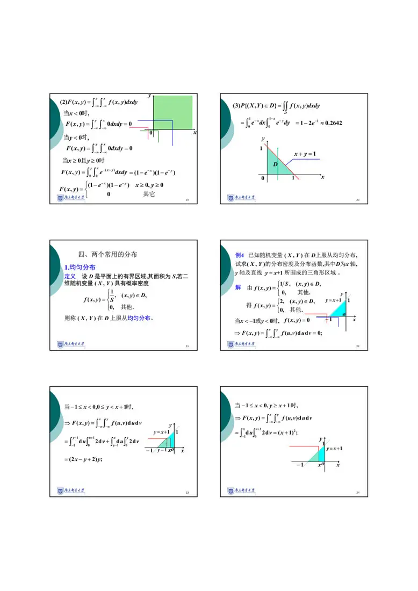

原文：

$$
F (x, y) = \left\{ \begin{array}{c c} (1 - e ^ {- x}) (1 - e ^ {- y}) & x \geq 0, y \geq 0 \\ 0 & \text {其它} \end{array} \right.
$$

四、两个常用的分布

1.均匀分布

定义 设 D 是平面上的有界区域, 其面积为 S, 若二维随机变量 $(X, Y)$ 具有概率密度

$$
f (x, y) = \left\{ \begin{array}{l l} { \frac {1}{S},} & {(x, y) \in D,} \\ {0,} & {\text {其他}.} \end{array} \right.
$$

则称 $(X,Y)$ 在 $D$ 上服从均匀分布。

南京邮电大学
Nanjing University of Physics and Telecommunications

当 $-1 \leq x < 0, 0 \leq y < x + 1$ 时，

$$
\begin{array}{l} \Rightarrow F (x, y) = \int_ {- \infty} ^ {x} \int_ {- \infty} ^ {y} f (u, v) \mathrm{d} u \mathrm{d} v \\ = \int_ {- 1} ^ {y - 1} \mathrm{d} u \int_ {0} ^ {u + 1} 2 \mathrm{d} v + \int_ {y - 1} ^ {x} \mathrm{d} u \int_ {0} ^ {y} 2 \mathrm{d} v \\ = (2 x - y + 2) y; \end{array}
$$

例4 已知随机变量 $(X, Y)$ 在 $D$ 上服从均匀分布，试求 $(X, Y)$ 的分布密度及分布函数，其中 $D$ 为 $x$ 轴， $y$ 轴及直线 $y = x + 1$ 所围成的三角形区域。

解 由 $f(x,y) = \begin{cases} 1 / S, & (x,y)\in D,\\ 0, & \text{其他}. \end{cases}$

得 $f(x,y)=\left\{\begin{aligned}&2,&(x,y)\in D,\\ &0,& 其他.\end{aligned}\right.$

当 $x < -1$ 或 $y < 0$ 时， $f(x, y) = 0$

$$
\Rightarrow F (x, y) = \int_ {- \infty} ^ {x} \int_ {- \infty} ^ {y} f (u, v) d u d v = 0;
$$

南京邮电大学
Nanjing University of Press and Telecommunications

当 $-1 \leq x < 0, y \geq x + 1$ 时，

$$
\Rightarrow F (x, y) = \int_ {- \infty} ^ {x} \int_ {- \infty} ^ {y} f (u, v) d u d v
$$

$$
= \int_ {- 1} ^ {x} \mathrm{d} u \int_ {0} ^ {u + 1} 2 \mathrm{d} v = (x + 1) ^ {2};
$$

(2) $F(x,y)=\int_{-\infty}^{y}\int_{-\infty}^{x}f(x,y)dxdy$

当 $x < 0$ 时，

$F(x,y) = \int_{-\infty}^{y}\int_{-\infty}^{x}0dxdy = 0$

当 $y < 0$ 时，

y
0
x

$F(x,y) = \int_{-\infty}^{y}\int_{-\infty}^{x}0dxdy = 0$

19

当 $x \geq 0$ 且 $y \geq 0$ 时

$F(x,y) = \int_0^y\int_0^x e^{-(x + y)}dxdy = (1 - e^{-x})(1 - e^{-y})$

20

(3) $P\{(X,Y)\in D\} = \iint_{D}f(x,y)dxdy$

$= \int_0^1 e^{-x}dx\int_0^{1 - x}e^{-y}dy = 1 - 2e^{-1}\approx 0.2642$

南京邮电大学
Nanjing University of Private and Telecommunications

y
1
x + y = 1
0
1

南京邮电大学
Nanjing University of Science and Telecommunications

### 当 $x \geq 0, 0 \leq y < 1$ 时，

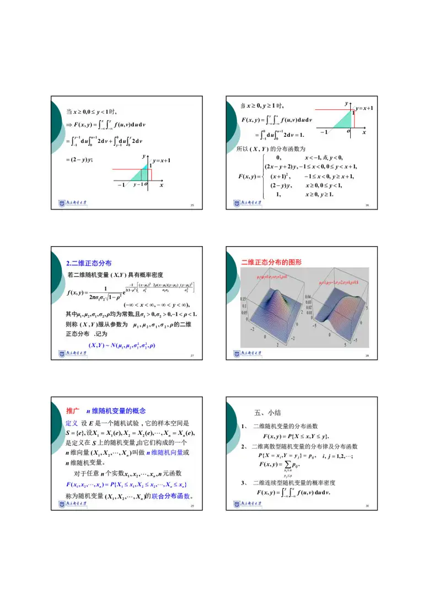

原文：

当 $x \geq 0, 0 \leq y < 1$ 时，

$$
\Rightarrow F (x, y) = \int_ {- \infty} ^ {x} \int_ {- \infty} ^ {y} f (u, v) d u d v
$$

$$
= \int_ {- 1} ^ {y - 1} \mathrm{d} u \int_ {0} ^ {u + 1} 2 \mathrm{d} v + \int_ {y - 1} ^ {0} \mathrm{d} u \int_ {0} ^ {y} 2 \mathrm{d} v
$$

$$
= (2 - y) y;
$$

南京新電大學
Nanjing University of Physics and Telecommunications

2.二维正态分布

若二维随机变量 $(X,Y)$ 具有概率密度

$$
f (x, y) = \frac {1}{2 \pi \sigma_ {1} \sigma_ {2} \sqrt {1 - \rho^ {2}}} \mathrm{e} ^ {\frac {- 1}{2 (1 - \rho^ {2})} \left[ \frac {(x - \mu_ {1}) ^ {2}}{\sigma_ {1} ^ {2}} - \frac {2 \rho (x - \mu_ {1}) (y - \mu_ {2})}{\sigma_ {1} \sigma_ {2}} + \frac {(y - \mu_ {2}) ^ {2}}{\sigma_ {2} ^ {2}} \right]}
$$

$$
(- \infty <   x <   \infty , - \infty <   y <   \infty),
$$

其中 $\mu_{1},\mu_{2},\sigma_{1},\sigma_{2},\rho$ 均为常数且 $\sigma_1 > 0,\sigma_2 > 0, - 1 <   \rho <  1.$ 则称 $(X,Y)$ 服从参数为 $\mu_{1},\mu_{2},\sigma_{1},\sigma_{2},\rho$ 的二维正态分布.记为

$$
(X, Y) \sim N (\mu_ {1}, \mu_ {2}, \sigma_ {1} ^ {2}, \sigma_ {2} ^ {2}, \rho)
$$

南京邮电大学
Nanjing University of Physics and Telecommunications

推广 $n$ 维随机变量的概念

定义 设 E 是一个随机试验，它的样本空间是 $S=\{e\}$ ，设 $X_{1}=X_{1}(e)$ ， $X_{2}=X_{2}(e)$ ， $\cdots$ ， $X_{n}=X_{n}(e)$ ，是定义在 S 上的随机变量，由它们构成的一个 n 维向量 $(X_{1},X_{2},\cdots,X_{n})$ 叫做 n 维随机向量或 n 维随机变量。

南京邮电大学
Nanjing University of Physics and Telecommunications

对于任意 n 个实数 $x_{1}, x_{2}, \cdots, x_{n}, n$ 元函数 $F(x_{1}, x_{2}, \cdots, x_{n}) = P\{X_{1} \leq x_{1}, X_{2} \leq x_{2}, \cdots, X_{n} \leq x_{n}\}$ 称为随机变量 $(X_{1}, X_{2}, \cdots, X_{n})$ 的联合分布函数。

当 $x \geq 0, y \geq 1$ 时，

$$
\begin{array}{r l} F (x, y) & = \int_ {- \infty} ^ {y} \int_ {- \infty} ^ {x} f (u, v) \mathrm{d} u \mathrm{d} v \\ & = \int_ {- 1} ^ {0} \mathrm{d} u \int_ {0} ^ {u + 1} 2 \mathrm{d} v = 1. \end{array}
$$

所以 $(X,Y)$ 的分布函数为

$$
F (x, y) = \left\{ \begin{array}{c c} {0,} & {x <   - 1, \text {或} y <   0,} \\ {(2 x - y + 2) y,} & {- 1 \leq x <   0,   0 \leq y <   x + 1,} \\ {(x + 1) ^ {2},} & {- 1 \leq x <   0,   y \geq x + 1,} \\ {(2 - y) y,} & {x \geq 0,   0 \leq y <   1,} \\ {1,} & {x \geq 0,   y \geq 1.} \end{array} \right.
$$

二维正态分布的图形

五、小结

1、二维随机变量的分布函数

$$
F (x, y) = P \{X \leq x, Y \leq y \}.
$$

2、二维离散型随机变量的分布律及分布函数 $P\{X = x_i, Y = y_j\} = p_{ij}, \quad i, j = 1, 2, \cdots;$ $F(x, y) = \sum_{\substack{x_i \leq x \\ y_i \leq y}} p_{ij}.$

3、二维连续型随机变量的概率密度

$$
F (x, y) = \int_ {- \infty} ^ {y} \int_ {- \infty} ^ {x} f (u, v) d u d v.
$$

南京邮电大学
Nanjing University of Science and Telecommunications

26

25

### 定义 设 $F(x,y)$ 为随机变量 $(X,Y)$ 的分布

原文：

定义 设 $F(x,y)$ 为随机变量 $(X,Y)$ 的分布

函数,则 $F(x,y)=P\{X\leq x,Y\leq y\}$ 。

令 $y\to \infty$

称 $P\{X \leq x\} = P\{X \leq x, Y < \infty\} = F(x, \infty)$

为随机变量 $(X,Y)$ 关于 $X$ 的边缘分布函数。

记为 $F_{X}(x) = F(x,\infty)$ 。

同理令 $x \to \infty$ ,

$$
F _ {Y} (y) = F (\infty , y) = P \{X <   \infty , Y \leq y \} = P \{Y \leq y \}
$$

为随机变量 $(X,Y)$ 关于 $Y$ 的边缘分布函数。

南京邮电大学
Nanjing University of Physics and Telecommunications

$$
P \{X = x _ {i} \} = \sum_ {j = 1} ^ {\infty} p _ {i j}, i = 1, 2, \dots ;
$$

$$
P \{Y = y _ {j} \} = \sum_ {i = 1} ^ {\infty} p _ {i j}, j = 1, 2,
$$

二、离散型随机变量的边缘分布律

定义 设二维离散型随机变量 $(X,Y)$ 的联合分布

律为 $P\{X=x_{i},Y=y_{j}\}=p_{ij},i,j=1,2,\cdots.$

记

$$
p _ {i \bullet} = \sum_ {j = 1} ^ {\infty} p _ {i j} = P \{X = x _ {i} \}, \quad i = 1, 2, \dots ,
$$

$$
p _ {\bullet j} = \sum_ {i = 1} ^ {\infty} p _ {i j} = P \{Y = y _ {j} \}, \quad j = 1, 2, \dots ,
$$

分别称 $p_{i\bullet}(i=1,2,\cdots)$ 和 $p_{\bullet j}(j=1,2,\cdots)$ 为 $(X,Y)$ 关于 X 和关于 Y 的边缘分布律。

$$
F _ {X} (x) = F (x, \infty) = \sum_ {x _ {i} \leq x} \sum_ {j = 1} ^ {\infty} p _ {i j},
$$

$$
F _ {Y} (y) = F (\infty , y) = \sum_ {y _ {j} \leq y} \sum_ {i = 1} ^ {\infty} p _ {i j}.
$$

32

南京邮电大学
Nanjing University of Physics and Telecommunications

31

南京航空航天大学
Nanjing University of Physics and Telecommunications

第二节 边缘分布

一、边缘分布函数

二、离散型随机变量的边缘分布律

三、连续型随机变量的边缘分布

四、小结

一、边缘分布函数

问题:已知 $(X,Y)$ 的分布,如何确定X,Y的分布?

$F(x,y) = P\{X\leq x,Y\leq y\} ,F(x) = P\{X\leq x\} ,$

$P\{X \leq x\} = P\{X \leq x, Y < \infty\} = F(x, \infty) = F_{\underline{X}}(x)$

$(X,Y)$ 关于X的边缘分布函数。

南京邮电大学
Nanjing University of Press and Telecommunications

因此得离散型随机变量关于 $X$ 和 $Y$ 的边缘分布函数分别为

南京邮电大学
Nanjing University of Science and Telecommunications

### 例2 袋中装有2只白球及3只黑球，现进行有

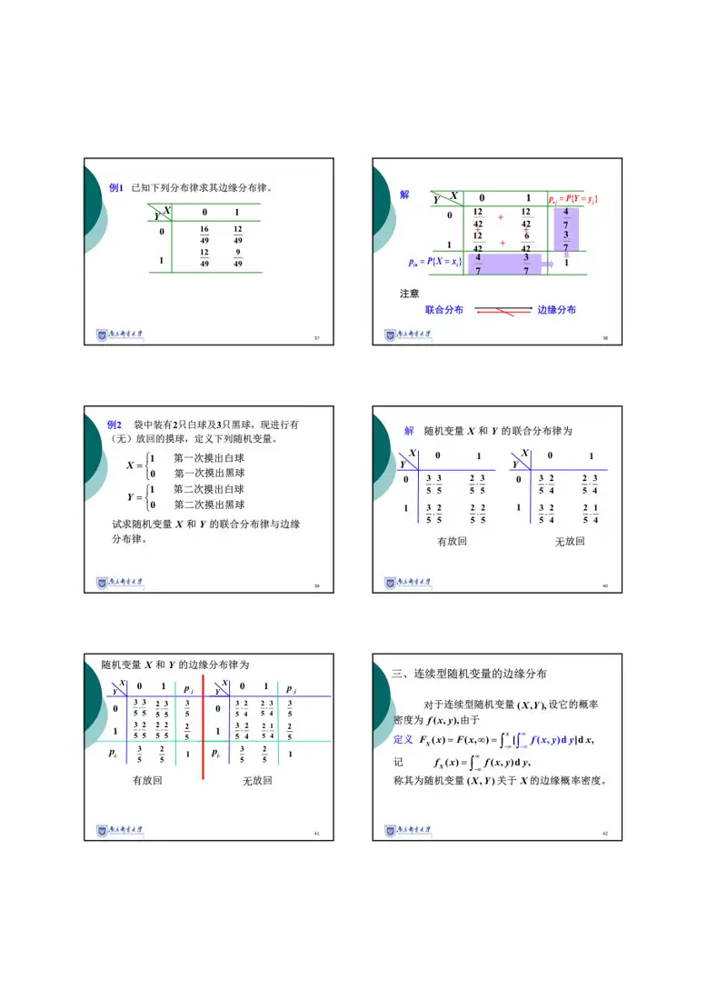

原文：

例2 袋中装有2只白球及3只黑球，现进行有

（无）放回的摸球，定义下列随机变量。

$$
X = \left\{ \begin{array}{l} 1 \\ 0 \end{array} \right.
$$

$$
Y = \left\{ \begin{array}{l} 1 \\ 0 \end{array} \right.
$$

试求随机变量 $X$ 和 $Y$ 的联合分布律与边缘分布律。

第一次摸出白球
第一次摸出黑球
第二次摸出白球
第二次摸出黑球

随机变量 $X$ 和 $Y$ 的边缘分布律为

有放回 无放回
<table><tr><td> $Y^{X}$ </td><td>0</td><td>1</td><td> $p_{.j}$ </td><td> $Y^{X}$ </td><td>0</td><td>1</td><td> $p_{.j}$ </td></tr><tr><td>0</td><td> $\frac{3}{5}.\frac{3}{5}$ </td><td> $\frac{2}{5}.\frac{3}{5}$ </td><td> $\frac{3}{5}$ </td><td>0</td><td> $\frac{3}{5}.\frac{2}{4}$ </td><td> $\frac{2}{5}.\frac{3}{4}$ </td><td> $\frac{3}{5}$ </td></tr><tr><td>1</td><td> $\frac{3}{5}.\frac{2}{5}$ </td><td> $\frac{2}{5}.\frac{2}{5}$ </td><td> $\frac{2}{5}$ </td><td>1</td><td> $\frac{3}{5}.\frac{2}{4}$ </td><td> $\frac{2}{5}.\frac{1}{4}$ </td><td> $\frac{2}{5}$ </td></tr><tr><td> $p_{i}$ .</td><td> $\frac{3}{5}$ </td><td> $\frac{2}{5}$ </td><td>1</td><td> $p_{i}$ .</td><td> $\frac{3}{5}$ </td><td> $\frac{2}{5}$ </td><td>1</td></tr></table>

解 随机变量 $X$ 和 $Y$ 的联合分布律为

38

例1 已知下列分布律求其边缘分布律。

X Y 0 1
0 $\frac{16}{49}$ $\frac{12}{49}$ 1 $\frac{12}{49}$ $\frac{9}{49}$

$\frac{9}{49}$

南京新電大學
Nanjing University of Physics and Telecommunications

37

解
Y X 0 1 $p_{\bullet j}=P\{Y=y_j\}$ 0 $\frac{12}{42}$ + $\frac{12}{42}$ $\frac{4}{7}$ 1 $\frac{12}{42}$ + $\frac{6}{42}$ $\frac{3}{7}$ $p_{i\bullet}=P\{X=x_i\}$ $\frac{4}{7}$ $\frac{3}{7}$ 1

$p_{i\bullet} = P\{X = x_i\}$

注意

南京邮电大学
Nanjing University of Physics and Telecommunications

$p_{\bullet j} = P\{Y = y_j\}$

$\frac{4}{73}$

南京邮电大学
Nanjing University of Press and Telecommunications

三、连续型随机变量的边缘分布

对于连续型随机变量 $(X,Y)$ , 设它的概率密度为 $f(x,y)$ , 由于

$F_{X}(x) = F(x,\infty) = \int_{-\infty}^{x}[\int_{-\infty}^{\infty}f(x,y)\mathrm{d}y]\mathrm{d}x,$

定义 $F_{X}(x) = F(x,\infty) = \int_{-\infty}^{x}[\int_{-\infty}^{\infty}f(x,y)\mathrm{d}y]\mathrm{d}x,$ 记 $f_{X}(x) = \int_{-\infty}^{\infty}f(x,y)\mathrm{d}y,$

称其为随机变量 $(X,Y)$ 关于 $X$ 的边缘概率密度。

南京新電大學
Nanjing University of Private and Telecommunications

### 南京邮电大学

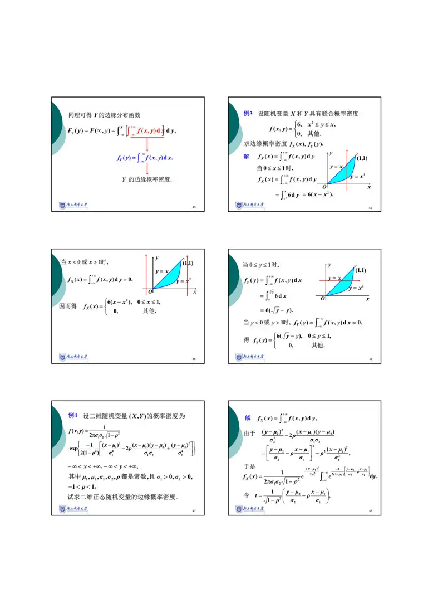

原文：

南京邮电大学
Nanjing University of Physics and Telecommunications

当 $x < 0$ 或 $x > 1$ 时，

$$
f _ {X} (x) = \int_ {- \infty} ^ {+ \infty} f (x, y) d y = 0.
$$

因而得 $f_{X}(x)=\left\{\begin{aligned}&6(x-x^{2}),&0\leq x\leq1,\\ &0,& 其他.\end{aligned}\right.$

南京邮电大学
Nanjing University of Physics and Telecommunications

例4 设二维随机变量 $(X,Y)$ 的概率密度为

$$
f (x, y) = \frac {1}{2 \pi \sigma_ {1} \sigma_ {2} \sqrt {1 - \rho^ {2}}}
$$

$$
\cdot \exp \left\{\frac {- 1}{2 \left(1 - \rho^ {2}\right)} \left[ \frac {\left(x - \mu_ {1}\right) ^ {2}}{\sigma_ {1} ^ {2}} - 2 \rho \frac {\left(x - \mu_ {1}\right) \left(y - \mu_ {2}\right)}{\sigma_ {1} \sigma_ {2}} + \frac {\left(y - \mu_ {2}\right) ^ {2}}{\sigma_ {2} ^ {2}} \right] \right\}
$$

$$
- \infty <   x <   + \infty , - \infty <   y <   + \infty ,
$$

其中 $\mu_{1},\mu_{2},\sigma_{1},\sigma_{2},\rho$ 都是常数,且 $\sigma_{1}>0,\sigma_{2}>0,-1<\rho<1$ 。

试求二维正态随机变量的边缘概率密度。

南京新電大學
Nanjing University of Physics and Telecommunications

当 $0 \leq y \leq 1$ 时，

$$
\begin{array}{r l} f _ {Y} (y) & = \int_ {- \infty} ^ {+ \infty} f (x, y) \mathrm{d} x \\ & = \int_ {y} ^ {\sqrt {y}} 6 \mathrm{d} x \\ & = 6 (\sqrt {y} - y). \end{array}
$$

当 $y < 0$ 或 $y > 1$ 时， $f_{Y}(y) = \int_{-\infty}^{+\infty} f(x, y) \mathrm{d}x = 0.$

得 $f_{Y}(y) = \left\{ \begin{array}{ll}6(\sqrt{y} -y), & 0\leq y\leq 1,\\ 0, & \text{其他}. \end{array} \right.$

$$
= \left[ \frac {y - \mu_ {2}}{\sigma_ {2}} - \rho \frac {x - \mu_ {1}}{\sigma_ {1}} \right] ^ {2} - \rho^ {2} \frac {(x - \mu_ {1}) ^ {2}}{\sigma_ {1} ^ {2}},
$$

同理可得 $Y$ 的边缘分布函数

$F_{Y}(y) = F(\infty ,y) = \int_{-\infty}^{y}\left[\int_{-\infty}^{+\infty}f(x,y)\mathrm{d}x\right]\mathrm{d}y,$

$f_{Y}(y) = \int_{-\infty}^{+\infty}f(x,y)\mathrm{d}x.$

Y 的边缘概率密度.

43

例3 设随机变量 $X$ 和 $Y$ 具有联合概率密度

$f(x,y) = \left\{ \begin{array}{ll}6, & x^{2}\leq y\leq x,\\ 0, & \text{其他}. \end{array} \right.$

求边缘概率密度 $f_{X}(x), f_{Y}(y)$ 。

$f_{X}(x), f_{Y}(y)$

解 $f_{X}(x) = \int_{-\infty}^{+\infty}f(x,y)\mathrm{d}y$

$f_{X}(x) = \int_{-\infty}^{+\infty}f(x,y)\mathrm{d}y$

$0 \leq x \leq 1$

当 $0 \leq x \leq 1$ 时，

$f_{X}(x) = \int_{-\infty}^{+\infty}f(x,y)\mathrm{d}y\frac{1}{O}$ $= \int_{x^2}^{x}6\mathrm{d}y = 6(x - x^2).$

y = x
(1,1)
y = x²
O
x

南京邮电大学
Nanjing University of Physics and Telecommunications

南京邮电大学
Nanjing University of Physics and Telecommunications

解 $f_{X}(x) = \int_{-\infty}^{+\infty}f(x,y)\mathrm{d}y,$

$f_{X}(x) = \int_{-\infty}^{+\infty}f(x,y)\mathrm{d}y,$

由于 $\frac{(y - \mu_2)^2}{\sigma_2^2} - 2\rho \frac{(x - \mu_1)(y - \mu_2)}{\sigma_1\sigma_2}$

于是 $f_{X}(x) = \frac{1}{2\pi\sigma_{1}\sigma_{2}\sqrt{1 - \rho^{2}}}\mathrm{e}^{-\frac{(x - \mu_{1})^{2}}{2\sigma_{1}^{2}}}\int_{-\infty}^{+\infty}\mathrm{e}^{\frac{-1}{2(1 - \rho_{0})}\left[\frac{y - \mu_{2}}{\sigma_{2}} -\rho \frac{x - \mu_{1}}{\sigma_{1}}\right]}\mathrm{d}y,$

令 $t = \frac{1}{\sqrt{1 - \rho^2}}\left(\frac{y - \mu_2}{\sigma_2} -\rho \frac{x - \mu_1}{\sigma_1}\right),$

南京邮电大学
Nanjing University of Science and Telecommunications

### 因此

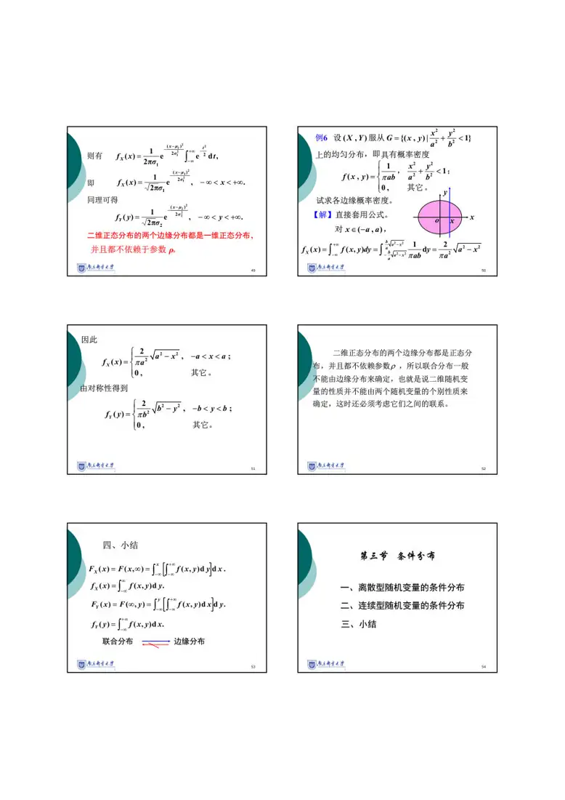

原文：

因此

$$
f _ {X} (x) = \left\{ \begin{array}{l l} \frac {2}{\pi a ^ {2}} \sqrt {a ^ {2} - x ^ {2}}, & - a <   x <   a; \\ 0, & \text {其它。} \end{array} \right.
$$

由对称性得到

$$
f _ {Y} (y) = \left\{ \begin{array}{l l} \frac {2}{\pi b ^ {2}} \sqrt {b ^ {2} - y ^ {2}}, & - b <   y <   b; \\ 0, & \text {其它。} \end{array} \right.
$$

南京邮电大学
Nanjing University of Physics and Telecommunications

四、小结

$$
F _ {X} (x) = F (x, \infty) = \int_ {- \infty} ^ {x} \left[ \int_ {- \infty} ^ {+ \infty} f (x, y) \mathrm{d} y \right] \mathrm{d} x.
$$

$$
f _ {X} (x) = \int_ {- \infty} ^ {\infty} f (x, y) d y.
$$

$$
F _ {Y} (x) = F (\infty , y) = \int_ {- \infty} ^ {y} \left[ \int_ {- \infty} ^ {+ \infty} f (x, y) d x \right] d y.
$$

$$
f _ {Y} (y) = \int_ {- \infty} ^ {+ \infty} f (x, y) d x.
$$

联合分布

边缘分布

二维正态分布的两个边缘分布都是正态分布，并且都不依赖参数 $\rho$ ，所以联合分布一般不能由边缘分布来确定，也就是说二维随机变量的性质并不能由两个随机变量的个别性质来确定，这时还必须考虑它们之间的联系。

第三节 条件分布

一、离散型随机变量的条件分布

二、连续型随机变量的条件分布

三、小结

52

50

南京新電大學
Nanjing University of Private and Telecommunications

则有 $f_{X}(x) = \frac{1}{2\pi\sigma_{1}}\mathrm{e}^{-\frac{(x - \mu_{1})^{2}}{2\sigma_{1}^{2}}}\int_{-\infty}^{+\infty}\mathrm{e}^{-\frac{t^{2}}{2}}\mathrm{d}t,$

$f_{X}(x) = \frac{1}{2\pi\sigma_{1}}\mathrm{e}^{-\frac{(x - \mu_{1})^{2}}{2\sigma_{1}^{2}}}\int_{-\infty}^{+\infty}\mathrm{e}^{-\frac{t^{2}}{2}}\mathrm{d}t,$

即

$f_{X}(x) = \frac{1}{\sqrt{2\pi}\sigma_{1}}\mathrm{e}^{\frac{(x - \mu_{1})^{2}}{2\sigma_{1}^{2}}}, -\infty < x < +\infty.$

同理可得

$f_{Y}(y) = \frac{1}{\sqrt{2\pi}\sigma_{2}}\mathrm{e}^{\frac{(x - \mu_{2})^{2}}{2\sigma_{2}^{2}}}, -\infty <  y <   + \infty .$

二维正态分布的两个边缘分布都是一维正态分布，并且都不依赖于参数 $\rho$ 。

ρ。

南京航空航天大学
Nanjing University of Physics and Telecommunications

49

例6 设 $(X, Y)$ 服从 $G = \{(x, y) \mid \frac{x^2}{a^2} + \frac{y^2}{b^2} < 1\}$

$G = \{(x,y)\mid \frac{x^2}{a^2} +\frac{y^2}{b^2} <  1\}$

上的均匀分布，即具有概率密度

$f(x,y)=\left\{\begin{aligned}&\frac{1}{\pi ab},&\frac{x^{2}}{a^{2}}+\frac{y^{2}}{b^{2}}<1;\\ &0,&& 其它。\end{aligned}\right.$

试求各边缘概率密度。【解】直接套用公式。

对 $x\in (-a,a)$

其它。

$f_{X}(x) = \int_{-\infty}^{+\infty}f(x,y)dy = \int_{-\frac{b}{a}\sqrt{a^{2} - x^{2}}}^{\frac{b}{a}\sqrt{a^{2} - x^{2}}}\frac{1}{\pi ab}\mathrm{d}y = \frac{2}{\pi a^{2}}\sqrt{a^{2} - x^{2}}$

南京邮电大学
Nanjing University of Physics and Telecommunications

南京邮电大学
Nanjing University of Press and Telecommunications

### 南京邮电大学

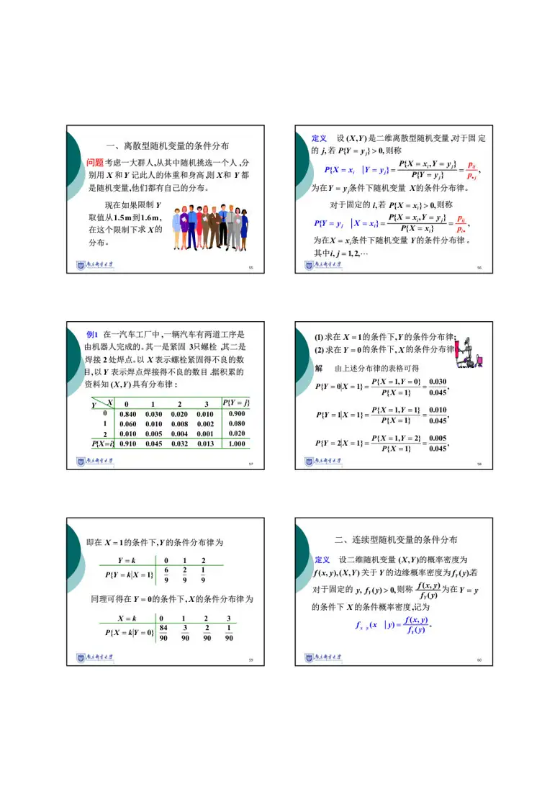

原文：

例1 在一汽车工厂中,一辆汽车有两道工序是由机器人完成的。其一是紧固 3 只螺栓 其二是焊接 2 处焊点。以 X 表示螺栓紧固得不良的数目,以 Y 表示焊点焊接得不良的数目.据积累的资料知 $(X,Y)$ 具有分布律:

南京邮电大学
Nanjing University of Press and Telecommunications
<table><tr><td>Y\X</td><td>0</td><td>1</td><td>2</td><td>3</td><td>P{Y=j}</td></tr><tr><td>0</td><td>0.840</td><td>0.030</td><td>0.020</td><td>0.010</td><td>0.900</td></tr><tr><td>1</td><td>0.060</td><td>0.010</td><td>0.008</td><td>0.002</td><td>0.080</td></tr><tr><td>2</td><td>0.010</td><td>0.005</td><td>0.004</td><td>0.001</td><td>0.020</td></tr><tr><td>P{X=i}</td><td>0.910</td><td>0.045</td><td>0.032</td><td>0.013</td><td>1.000</td></tr></table>

即在 $X = 1$ 的条件下， $Y$ 的条件分布律为

<table><tr><td>Y=k</td><td>0</td><td>1</td><td>2</td></tr><tr><td>P{Y=k|X=1}</td><td> $\frac{6}{9}$ </td><td> $\frac{2}{9}$ </td><td> $\frac{1}{9}$ </td></tr></table>

同理可得在 $Y = 0$ 的条件下， $X$ 的条件分布律为

$$
\begin{array}{c c c c c} X = k & 0 & 1 & 2 & 3 \\ \hline P \{X = k | Y = 0 \} & \frac {8 4}{9 0} & \frac {3}{9 0} & \frac {2}{9 0} & \frac {1}{9 0} \end{array}
$$

南京新電大學
Nanjing University of Physics and Telecommunications

(1) 求在 $X = 1$ 的条件下, $Y$ 的条件分布律;

(2) 求在 $Y = 0$ 的条件下, $X$ 的条件分布律

解 由上述分布律的表格可得

$$
P \{Y = 0 | X = 1 \} = \frac {P \{X = 1 , Y = 0 \}}{P \{X = 1 \}} = \frac {0 . 0 3 0}{0 . 0 4 5},
$$

$$
P \{Y = 1 | X = 1 \} = \frac {P \{X = 1 , Y = 1 \}}{P \{X = 1 \}} = \frac {0 . 0 1 0}{0 . 0 4 5},
$$

$$
P \{Y = 2 | X = 1 \} = \frac {P \{X = 1 , Y = 2 \}}{P \{X = 1 \}} = \frac {0 . 0 0 5}{0 . 0 4 5},
$$

二、连续型随机变量的条件分布

定义 设二维随机变量 $(X,Y)$ 的概率密度为 $f(x,y),(X,Y)$ 关于 $Y$ 的边缘概率密度为 $f_{Y}(y)$ 若对于固定的 $y,f_{Y}(y) > 0,$ 则称 $\frac{f(x,y)}{f_Y(y)}$ 为在 $Y = y$ 的条件下 $X$ 的条件概率密度，记为

$$
f _ {x \mid y} (x \quad | y) = \frac {f (x , y)}{f _ {Y} (y)} 。
$$

58

上海交通大学

60

南京邮电大学 Nanjing University of Press and Telecommunications

一、离散型随机变量的条件分布

问题考虑一大群人,从其中随机挑选一个人,分别用 X 和 Y 记此人的体重和身高则 X 和 Y 都是随机变量,他们都有自己的分布。

现在如果限制 Y 取值从 1.5m 到 1.6m，在这个限制下求 X 的分布。

南京邮电大学
Nanjing University of Press and Telecommunications

55

$P\{Y = y_j\} > 0,$

定义 设 $(X,Y)$ 是二维离散型随机变量, 对于固定的 $j$ , 若 $P\{Y = y_j\} > 0$ , 则称

$P\{X = x_{i}\mid Y = y_{j}\} = \frac{P\{X = x_{i},Y = y_{j}\}}{P\{Y = y_{j}\}} = \frac{p_{ij}}{p_{\bullet j}},$

$Y = y_{j}$

为在 $Y = y_{j}$ 条件下随机变量 $X$ 的条件分布律。

对于固定的 $i$ , 若 $P\{X = x_i\} > 0$ , 则称

$P\{X = x_{i}\} > 0,$

$P\{Y = y_j \mid X = x_i\} = \frac{P\{X = x_i, Y = y_j\}}{P\{X = x_i\}} = \frac{p_{ij}}{p_{i\bullet}},$

$X = x_{i}$

其中 $i,j = 1,2,\dots$

为在 $X=x_{i}$ 条件下随机变量Y的条件分布律。
其中 $i,j=1,2,\cdots$

56

### 南京邮电大学

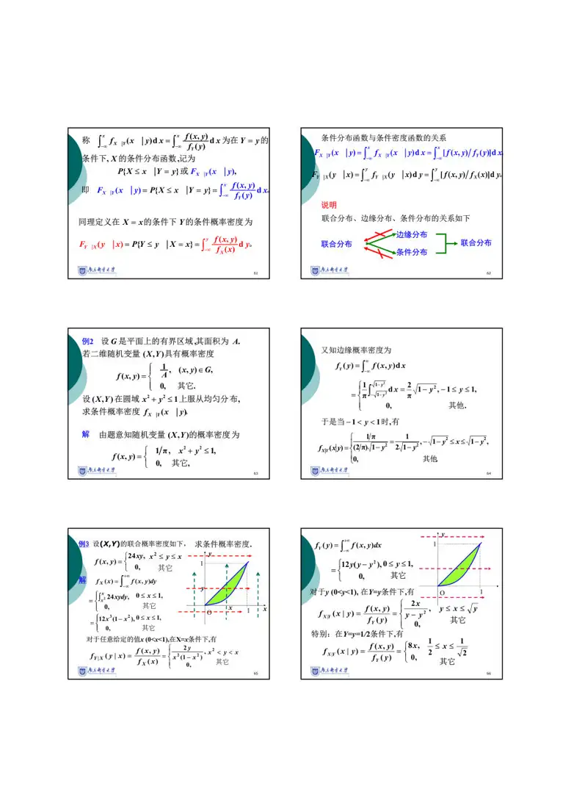

原文：

南京邮电大学
Nanjing University of Physics and Telecommunications

例2 设 G 是平面上的有界区域, 其面积为 A.

若二维随机变量 $(X,Y)$ 具有概率密度

$$
f (x, y) = \left\{ \begin{array}{l l} { \frac {1}{A},} & {(x, y) \in G,} \\ {0,} & {\text {其它}.} \end{array} \right.
$$

设 $(X,Y)$ 在圆域 $x^{2} + y^{2}\leq 1$ 上服从均匀分布，求条件概率密度 $f_{X\mid Y}(x\mid y)$

解 由题意知随机变量 $(X,Y)$ 的概率密度为

$$
f (x, y) = \left\{ \begin{array}{l l} {1 / \pi , \quad x ^ {2} + y ^ {2} \leq 1,} \\ {0, \quad \text {其它},} \end{array} \right.
$$

南京邮电大学
Nanjing University of Physics and Telecommunications

例3 设 $(X, Y)$ 的联合概率密度如下，求条件概率密度.

$$
f (x, y) = \left\{ \begin{array}{c c} {2 4 x y,} & {x ^ {2} \leq y \leq x} \\ {0,} & {\text {其它}} \end{array} \right.
$$

$$
f _ {X} (x) = \int_ {- \infty} ^ {+ \infty} f (x, y) d y
$$

$$
\begin{array}{r l} & {= \left\{ \begin{array}{l l} {\int_ {x ^ {2}} ^ {x} 2 4 x y d y,} & {0 \leq x \leq 1,} \\ {0,} & {\text {其它}} \end{array} \right.} \\ & {= \left\{ \begin{array}{l l} {1 2 x ^ {3} (1 - x ^ {2}),} & {0 \leq x \leq 1,} \\ {0,} & {\text {其它}} \end{array} \right.} \end{array}
$$

对于任意给定的值 $x(0 < x < 1)$ , 在 $\mathbf{X} = x$ 条件下, 有

$$
f _ {Y \mid X} (y \mid x) = \frac {f (x , y)}{f _ {X} (x)} = \left\{ \begin{array}{c c} \frac {2 y}{x ^ {2} \left(1 - x ^ {2}\right)}, & x ^ {2} <   y <   x \\ 0, & \text {其它} \end{array} \right.
$$

南京邮电大学
Nanjing University of Press and Telecommunications

又知边缘概率密度为

$$
\begin{array}{r l} & {f _ {Y} (y) = \int_ {- \infty} ^ {\infty} f (x, y) \mathbf {d}   x} \\ & {\qquad = \left\{ \begin{array}{c c} { \frac {1}{\pi} \int_ {- \sqrt {1 - y ^ {2}}} ^ {\sqrt {1 - y ^ {2}}} \mathbf {d}   x =  \frac {2}{\pi} \sqrt {1 - y ^ {2}}, - 1 \leq y \leq 1,} \\ {0,} & {\text {其他}.} \end{array} \right.} \end{array}
$$

于是当 $-1 < y < 1$ 时,有

$$
f _ {X \mid Y} (x \mid y) = \left\{ \begin{array}{l l} \frac {1 / \pi}{(2 / \pi) \sqrt {1 - y ^ {2}}} = \frac {1}{2 \sqrt {1 - y ^ {2}}}, - \sqrt {1 - y ^ {2}} \leq x \leq \sqrt {1 - y ^ {2}}, \\ 0, & \text {其他} \end{array} \right.
$$

南京邮电大学
Nanjing University of Physics and Telecommunications

$$
\begin{array}{r l} & {f _ {Y} (y) = \int_ {- \infty} ^ {+ \infty} f (x, y) d x} \\ & {\qquad = \left\{ \begin{array}{c c} {1 2 y (y - y ^ {2}), 0 \leq y \leq 1,} \\ {0, \qquad \text {其它}} \end{array} \right.} \end{array}
$$

对于 $y(0 < y < 1)$ , 在 $Y = y$ 条件下, 有

$$
f _ {X \mid Y} (x \mid y) = \frac {f (x , y)}{f _ {Y} (y)} = \left\{ \begin{array}{c} \frac {2 x}{y - y ^ {2}}, \\ 0, \end{array} \right.
$$

$$
y \leq x \leq \sqrt {y}
$$

特别：在 $Y = y = 1 / 2$ 条件下，有

$$
f _ {X \mid Y} (x \mid y) = \frac {f (x , y)}{f _ {Y} (y)} = \left\{ \begin{array}{l l} 8 x, & \frac {1}{2} \leq x \leq \frac {1}{\sqrt {2}} \\ 0, & \text {其它} \end{array} \right.
$$

南京邮电大学
Nanjing University of Science and Telecommunications

$\int_{-\infty}^{x}f_{X|Y}(x|y)\mathrm{d}x = \int_{-\infty}^{x}\frac{f(x,y)}{f_Y(y)}\mathrm{d}x$

称 $\int_{-\infty}^{x}f_{X|Y}(x\mid y)\mathbf{d}x = \int_{-\infty}^{x}\frac{f(x,y)}{f_Y(y)}\mathbf{d}x$ 为在 $Y = y$ 的

$Y = y$

条件下, $X$ 的条件分布函数,记为

$P\{X \leq x \mid Y = y\}$ 或 $F_{X \mid Y}(x \mid y)$ ,

$F_{X\mid Y}(x\quad |y) = P\{X\leq x\quad |Y = y\} = \int_{-\infty}^{x}\frac{f(x,y)}{f_Y(y)}\mathrm{d}x.$

同理定义在 $X = x$ 的条件下 $Y$ 的条件概率密度为

$X = x$

$F_{Y\mid X}(y\quad |x) = P\{Y\leq y\quad |X = x\} = \int_{-\infty}^{y}\frac{f(x,y)}{f_X(x)}\mathrm{d}y.$

61

条件分布函数与条件密度函数的关系

$F_{X\mid Y}(x\mid y) = \int_{-\infty}^{x}f_{X\mid Y}(x\mid y)\mathrm{d}x = \int_{-\infty}^{x}[f(x,y) / f_Y(y)]\mathrm{d}x$

$\left|_{X}(y \mid x) = \int_{-\infty}^{y} f_{Y \mid X}(y \mid x) \mathrm{d} y = \int_{-\infty}^{y} [f(x, y) / f_{X}(x)] \mathrm{d} y\right|$

说明

联合分布、边缘分布、条件分布的关系如下

联合分布

南京新電大學
Nanjing University of Private and Telecommunications

边缘分布
条件分布

62

联合分布

### 第四节 相互独立的随机变量

原文：

第四节 相互独立的随机变量

二、二维随机变量的推广

一、随机变量的相互独立性

三、小结

南京邮电大学
Nanjing University of Physics and Telecommunications

2.说明

(1) 若离散型随机变量 $(X, Y)$ 的联合分布律为

$$
P \{X = i, Y = j \} = p _ {i j}, \quad i, j = 1, 2, \dots 。
$$

$X$ 和 $Y$ 相互独立

$$
P \{X = x _ {i}, Y = y _ {j} \} = P \{X = x _ {i} \} P \{Y = y _ {j} \}
$$

即 $p_{ij} = p_{i\bullet}\cdot p_{\bullet j^{\circ}}$

一、随机变量的相互独立性

1. 定义

定义 设 $F(x,y)$ 及 $F_{X}(x), F_{Y}(y)$ 分别是二维随机变量 $(X,Y)$ 的分布函数及边缘分布函数。若对于所有 $x, y$

有 $P\{X \leq x, Y \leq y\} = P\{X \leq x\} P\{Y \leq y\},$ 即 $F(x, y) = F_{X}(x)F_{Y}(y),$

则称随机变量 $X$ 和 $Y$ 是相互独立的。

72

南京新電大學
Nanjing University of Physics and Telecommunications

三、小结

$p_{ij}(i,j = 1,2,\dots)$

$Y = y_{j}$

1. 设 $(X,Y)$ 是二维离散型随机变量, $p_{ij}(i,j=1,2,\cdots)$ 为其联合分布律, 在给定 $Y=y_{j}$ 条件下随机变量 X 的条件分布律为

$P\{X = x_i|Y = y_j\} = \frac{P\{X = x_i,Y = y_j\}}{P\{Y = y_j\}} = \frac{p_{ij}}{p_{\bullet j}},$

$X = x_{i}$

南京邮电大学
Nanjing University of Physics and Telecommunications

在给定 $X = x_{i}$ 条件下随机变量 $Y$ 的条件分布律为

$P\{Y=y_{j}|X=x_{i}\}=\frac{P\{X=x_{i},Y=y_{j}\}}{P\{X=x_{i}\}}=\frac{p_{ij}}{p_{i\bullet}},$ 其中 $i, j=1,2,\cdots$

67

$F_{Y|X}(y|x) = \int_{-\infty}^{y}f_{Y|X}(y|x)\mathrm{d}y$ $= \int_{-\infty}^{y}[f(x,y) / f_X(x)]\mathrm{d}y.$

68

南京航空航天大学
Nanjing University of Physics and Telecommunications

2. 设 $(X, Y)$ 是二维连续型随机变量, 则有

$F_{X|Y}(x|y) = \int_{-\infty}^{x}f_{X|Y}(x|y)\mathrm{d}x$ $= \int_{-\infty}^{x}[f(x,y) / f_Y(y)]\mathrm{d}x.$

南京邮电大学
Nanjing University of Press and Telecommunications

70

$f(x,y)$

(2) 设连续型随机变量 $(X, Y)$ 的联合概率密度为 $f(x, y)$ , 边缘概率密度分别为 $f_{X}(x), f_{Y}(y)$ , 则有 $X$ 和 $Y$ 相互独立 $\Leftrightarrow f(x, y) = f_{X}(x)f_{Y}(y)$ .

(3) $X$ 和 $Y$ 相互独立, 则

$f(X)$ 和 $g(Y)$ 也相互独立。

南京邮电大学
Nanjing University of Science and Telecommunications

### 关于 $X$ 的边缘概率密度

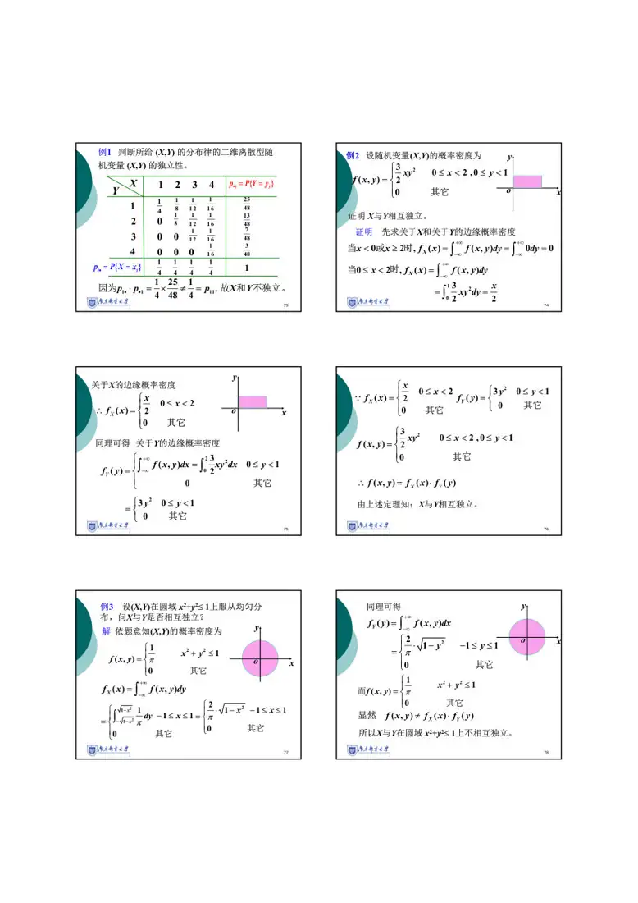

原文：

例1 判断所给 $(X,Y)$ 的分布律的二维离散型随机变量 $(X,Y)$ 的独立性。

<table><tr><td>Y\X</td><td>1</td><td>2</td><td>3</td><td>4</td><td> $p_{*j} = P\{Y = y_j\}$ </td></tr><tr><td>1</td><td> $\frac{1}{4}$ </td><td> $\frac{1}{8}$ </td><td> $\frac{1}{12}$ </td><td> $\frac{1}{16}$ </td><td> $\frac{25}{48}$ </td></tr><tr><td>2</td><td>0</td><td> $\frac{1}{8}$ </td><td> $\frac{1}{12}$ </td><td> $\frac{1}{16}$ </td><td> $\frac{13}{48}$ </td></tr><tr><td>3</td><td>0</td><td>0</td><td> $\frac{1}{12}$ </td><td> $\frac{1}{16}$ </td><td> $\frac{7}{48}$ </td></tr><tr><td>4</td><td>0</td><td>0</td><td>0</td><td> $\frac{1}{16}$ </td><td> $\frac{3}{48}$ </td></tr><tr><td> $p_{i*} = P\{X = x_i\}$ </td><td> $\frac{1}{4}$ </td><td> $\frac{1}{4}$ </td><td> $\frac{1}{4}$ </td><td> $\frac{1}{4}$ </td><td>1</td></tr></table>

因为 $p_{1\bullet}\cdot p_{\bullet 1}=\frac{1}{4}\times\frac{25}{48}\neq\frac{1}{4}=p_{11}$ ，故X和Y不独立。

关于 $X$ 的边缘概率密度

$$
\therefore f _ {X} (x) = \left\{ \begin{array}{l l} \frac {x}{2} & 0 \leq x <   2 \\ 0 & \text {其它} \end{array} \right.
$$

同理可得 关于 $Y$ 的边缘概率密度

$$
f _ {Y} (y) = \left\{ \begin{array}{c c} \int_ {- \infty} ^ {+ \infty} f (x, y) d x = \int_ {0} ^ {2} \frac {3}{2} x y ^ {2} d x & 0 \leq y <   1 \\ 0 & \text {其它} \end{array} \right.
$$

南京邮电大学
Nanjing University of Posts and Telecommunications

例3 设 $(X,Y)$ 在圆域 $x^{2} + y^{2}\leq 1$ 上服从均匀分

布，问 $X$ 与 $Y$ 是否相互独立？

解 依题意知 $(X,Y)$ 的概率密度为

$$
f (x, y) = \left\{ \begin{array}{l} \frac {1}{\pi} \\ 0 \end{array} \right.
$$

$$
x ^ {2} + y ^ {2} \leq 1
$$

其它

$$
f _ {X} (x) = \int_ {- \infty} ^ {+ \infty} f (x, y) d y
$$

$$
= \left\{ \begin{array}{l l} \int_ {- \sqrt {1 - x ^ {2}}} ^ {\sqrt {1 - x ^ {2}}} \frac {1}{\pi} d y & - 1 \leq x \leq 1 = \left\{ \begin{array}{l l} \frac {2}{\pi} \cdot \sqrt {1 - x ^ {2}} & - 1 \leq x \leq 1 \\ 0 & \text {其它} \end{array} \right. \\ 0 & \text {其它} \end{array} \right.
$$

南京新電大學
Nanjing University of Private and Telecommunications

例2 设随机变量 $(X,Y)$ 的概率密度为

$$
0 \leq x <   2, 0 \leq y <   1
$$

$$
f (x, y) = \left\{ \begin{array}{l} \frac {3}{2} x y ^ {2} \\ 0 \end{array} \right.
$$

其它

证明 $X$ 与 $Y$ 相互独立。

证明 先求关于 $X$ 和关于 $Y$ 的边缘概率密度

当 $x < 0$ 或 $x \geq 2$ 时， $f_{X}(x) = \int_{-\infty}^{+\infty} f(x, y) dy = \int_{-\infty}^{+\infty} 0 dy = 0$

当 $0 \leq x < 2$ 时, $f_{X}(x) = \int_{-\infty}^{+\infty} f(x, y) dy$

南京航空航天大学
Nanjing University of Physics and Telecommunications

$$
= \int_ {0} ^ {1} \frac {3}{2} x y ^ {2} d y = \frac {x}{2}
$$

$$
\because f _ {X} (x) = \left\{ \begin{array}{l} \frac {x}{2} \\ 0 \end{array} \right.
$$

$0 \leq x < 2$ 其它

$$
f _ {Y} (y) = \left\{ \begin{array}{c} 3 y ^ {2} \\ 0 \end{array} \right.
$$

$0 \leq y < 1$ 其它

$$
f (x, y) = \left\{ \begin{array}{l} \frac {3}{2} x y ^ {2} \\ 0 \end{array} \right.
$$

$$
0 \leq x <   2, 0 \leq y <   1
$$

其它

$$
\therefore f (x, y) = f _ {X} (x) \cdot f _ {Y} (y)
$$

由上述定理知： $X$ 与 $Y$ 相互独立。

$$
\begin{array}{c} {{x ^ {2} + y ^ {2} \leq 1}} \\ {{\text {其它}}} \end{array}
$$

73

南京邮电大学
Nanjing University of Press and Telecommunications

同理可得

$f_{Y}(y) = \int_{-\infty}^{+\infty}f(x,y)dx$ $= \left\{ \begin{array}{ll}\frac{2}{\pi}\cdot \sqrt{1 - y^2} & -1\leq y\leq 1\\ 0 & \text{其它} \end{array} \right.$

$f(x,y) = \left\{ \begin{array}{l} \frac{1}{\pi}\\ 0 \end{array} \right.$

显然 $f(x,y)\neq f_X(x)\cdot f_Y(y)$

所以 $X$ 与 $Y$ 在圆域 $x^{2} + y^{2}\leq 1$ 上不相互独立。

南京新電大學
Nanjing University of Private and Telecommunications

### 3. X 和 Y 相互独立, 则 $f(X)$ 和 $g(Y)$ 也相互独立.

原文：

3. X 和 Y 相互独立, 则 $f(X)$ 和 $g(Y)$ 也相互独立.
南立邮电大学
79

设 $(X,Y)$ 是二维随机变量， $g(x,y)$ 是二元函数，则 $Z = g(X,Y)$ 是一维随机变量。如果已知 $(X,Y)$ 的概率密度函数 $f(x,y)$ (或联合分布律)，我们如何求 $Z = g(X,Y)$ 的分布呢？下面，我们分离散型和连续型两种类型说明其解法。

二、离散型随机变量函数的分布

例设 $(\mathbf{X},\mathbf{Y})$ 的分布律由下表给出

<table><tr><td>X\Y</td><td>-1</td><td>1</td><td>2</td></tr><tr><td>-1</td><td>1/4</td><td>1/10</td><td>3/10</td></tr><tr><td>2</td><td>3/20</td><td>3/20</td><td>1/20</td></tr></table>

求 $Z = X + Y$ 的分布律

一、问题的引入

有一大群人, 令 X 和 Y 分别表示一个人的年龄和体重, Z 表示该人的血压, 并且已知 Z 与 X, Y 的函数关系 $Z = g(X, Y)$ , 如何通过 X, Y 的分布确定 Z 的分布。

为了解决类似的问题下面我们讨论随机变量函数的分布。

82

解：由上表可得 $(X,Y)$ 的所有取值，重新列表如下：
概率 1/4 1/10 3/10 3/20 3/20 1/20
(X,Y) (-1,-1) (-1,1) (-1,2) (2,-1) (2,1) (2,2)
X+Y -2 0 1 1 3 4
重新整理即得 $X + Y$ 的分布律
X+Y -2 0 1 3 4
概率 1/4 1/10 9/20 3/20 1/20
所以，离散型的随机变量的和的分布律的求法很简单，只要把取相同函数值的概率相加，再整理即得其分布律。

三、小结

1. 若离散型随机变量 $(X, Y)$ 的联合分布律为

$P\{X=i,Y=j\}=p_{ij},\quad i,j=1,2,\cdots.$

$X$ 和 $Y$ 相互独立 $\Leftrightarrow$

$P\{X = x_i, Y = y_j\} = P\{X = x_i\} P\{Y = y_j\}$ .

$f(x,y)$

2. 设连续型随机变量 $(X, Y)$ 的联合概率密度为 $f(x, y)$ , 边缘概率密度分别为 $f_{X}(x), f_{Y}(y)$ , 则有 $X$ 和 $Y$ 相互独立 $\Leftrightarrow f(x, y) = f_{X}(x)f_{Y}(y)$ .

$f_{X}(x), f_{Y}(y)$

$\Leftrightarrow f(x,y) = f_X(x)f_Y(y)$

g(Y

第五节 两个随机变量的函数的分布

一、问题的引入

二、离散型随机变量函数的分布

三、连续型随机变量函数的分布

四、小结

南京航空航天大学
Nanjing University of Physics and Telecommunications

南京邮电大学
Nanjing University of Press and Telecommunications

南京新電大學
Nanjing University of Physics and Telecommunications

### 故 $N = \min (X,Y)$ 的分布律为

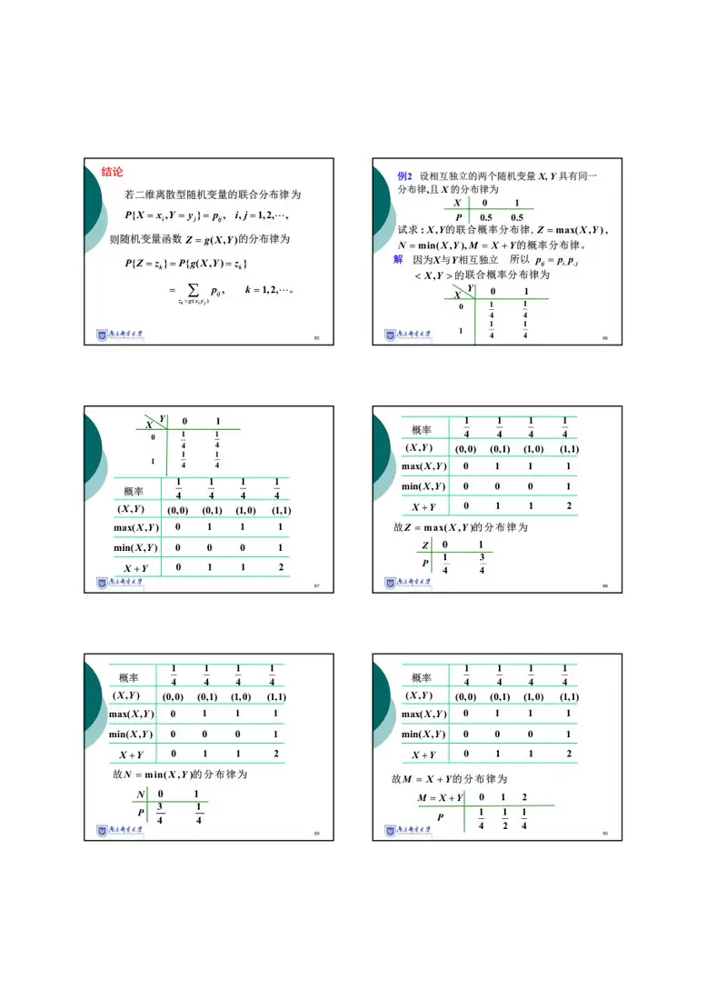

原文：

<table><tr><td>X\Y</td><td>0</td><td>1</td><td></td><td></td></tr><tr><td>0</td><td> $\frac{1}{4}$ </td><td> $\frac{1}{4}$ </td><td></td><td></td></tr><tr><td>1</td><td> $\frac{1}{4}$ </td><td> $\frac{1}{4}$ </td><td></td><td></td></tr><tr><td>概率</td><td> $\frac{1}{4}$ </td><td> $\frac{1}{4}$ </td><td> $\frac{1}{4}$ </td><td> $\frac{1}{4}$ </td></tr><tr><td>(X,Y)</td><td>(0,0)</td><td>(0,1)</td><td>(1,0)</td><td>(1,1)</td></tr><tr><td>max(X,Y)</td><td>0</td><td>1</td><td>1</td><td>1</td></tr><tr><td>min(X,Y)</td><td>0</td><td>0</td><td>0</td><td>1</td></tr><tr><td>X+Y</td><td>0</td><td>1</td><td>1</td><td>2</td></tr></table>

<table><tr><td>概率</td><td> $\frac{1}{4}$ </td><td> $\frac{1}{4}$ </td><td> $\frac{1}{4}$ </td><td> $\frac{1}{4}$ </td></tr><tr><td>(X,Y)</td><td>(0,0)</td><td>(0,1)</td><td>(1,0)</td><td>(1,1)</td></tr><tr><td>max(X,Y)</td><td>0</td><td>1</td><td>1</td><td>1</td></tr><tr><td>min(X,Y)</td><td>0</td><td>0</td><td>0</td><td>1</td></tr><tr><td>X+Y</td><td>0</td><td>1</td><td>1</td><td>2</td></tr></table>

故 $N = \min (X,Y)$ 的分布律为

<table><tr><td>N</td><td>0</td><td>1</td></tr><tr><td>P</td><td>3/4</td><td>1/4</td></tr></table>

<table><tr><td>X\Y</td><td>0</td><td>1</td></tr><tr><td>0</td><td> $\frac{1}{4}$ </td><td> $\frac{1}{4}$ </td></tr><tr><td>1</td><td> $\frac{1}{4}$ </td><td> $\frac{1}{4}$ </td></tr></table>

<table><tr><td>概率</td><td> $\frac{1}{4}$ </td><td> $\frac{1}{4}$ </td><td> $\frac{1}{4}$ </td><td> $\frac{1}{4}$ </td></tr><tr><td>(X,Y)</td><td>(0,0)</td><td>(0,1)</td><td>(1,0)</td><td>(1,1)</td></tr><tr><td>max(X,Y)</td><td>0</td><td>1</td><td>1</td><td>1</td></tr><tr><td>min(X,Y)</td><td>0</td><td>0</td><td>0</td><td>1</td></tr><tr><td>X+Y</td><td>0</td><td>1</td><td>1</td><td>2</td></tr></table>

故 $Z = \max (X,Y)$ 的分布律为

<table><tr><td>Z</td><td>0</td><td>1</td></tr><tr><td>P</td><td> $\frac{1}{4}$ </td><td> $\frac{3}{4}$ </td></tr></table>
南京邮电大学
Nanjing University of Press and Telecommunications

<table><tr><td>概率</td><td> $\frac{1}{4}$ </td><td> $\frac{1}{4}$ </td><td> $\frac{1}{4}$ </td><td> $\frac{1}{4}$ </td></tr><tr><td>(X,Y)</td><td>(0,0)</td><td>(0,1)</td><td>(1,0)</td><td>(1,1)</td></tr><tr><td>max(X,Y)</td><td>0</td><td>1</td><td>1</td><td>1</td></tr><tr><td>min(X,Y)</td><td>0</td><td>0</td><td>0</td><td>1</td></tr><tr><td>X+Y</td><td>0</td><td>1</td><td>1</td><td>2</td></tr></table>

故 $M = X + Y$ 的分布律为例3 设 $X, Y$ 相互独立, 且分别服从参数为 $\lambda_{1}$ , $\lambda_{2}$ 的泊松分布, 证明 $Z = X + Y$ 服从参数为 $\lambda_{1} + \lambda_{2}$ 的泊松分布。

<table><tr><td>M=X+Y</td><td>0</td><td>1</td><td>2</td></tr><tr><td>P</td><td> $\frac{1}{4}$ </td><td> $\frac{1}{2}$ </td><td> $\frac{1}{4}$ </td></tr></table>

结论

若二维离散型随机变量的联合分布律为

$P\{X = x_{i},Y = y_{j}\} = p_{ij},\quad i,j = 1,2,\dots ,$

则随机变量函数 $Z = g(X,Y)$ 的分布律为

$Z = g(X,Y)$

$P\{Z = z_k\} = P\{g(X,Y) = z_k\}$ $= \sum_{z_k = g(x_i,y_j)}p_{ij},\qquad k = 1,2,\dots .$

南京新電大學
Nanjing University of Physics and Telecommunications

85

例2 设相互独立的两个随机变量 $X, Y$ 具有同一分布律, 且 $X$ 的分布律为

X 0 1
P 0.5 0.5

试求: X, Y 的联合概率分布律, $Z = \max(X, Y)$ , $N = \min(X, Y)$ , $M = X + Y$ 的概率分布律。

$N = \min (X,Y),M = X + Y$

$Z = \max (X,Y)$

解 因为 $X$ 与 $Y$ 相互独立 所以 $p_{ij} = p_{i}.p_{.j}$

$p_{ij} = p_{i}.p_{.j}$

$<X,Y>$

$<X,Y>$ 的联合概率分布律为

南京邮电大学
Nanjing University of Physics and Telecommunications

### 证明

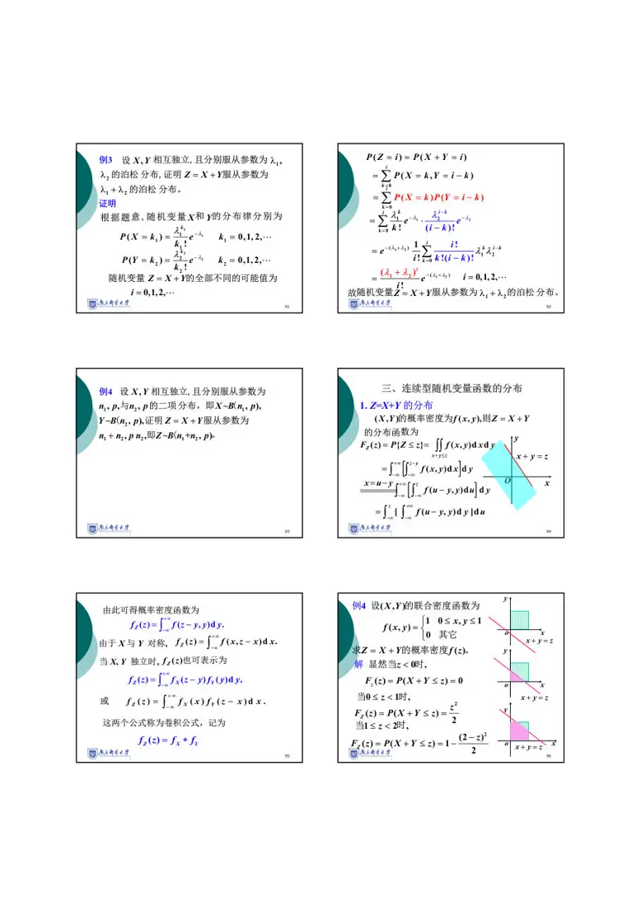

原文：

证明

根据题意,随机变量X和Y的分布律分别为

$$
\begin{array}{l l} P (X = k _ {1}) = \frac {\lambda_ {1} ^ {k _ {1}}}{k _ {1} !} e ^ {- \lambda_ {1}} & k _ {1} = 0, 1, 2, \dots \\ P (Y = k _ {2}) = \frac {\lambda_ {2} ^ {k _ {2}}}{k _ {2} !} e ^ {- \lambda_ {2}} & k _ {2} = 0, 1, 2, \dots \end{array}
$$

随机变量 $Z = X + Y$ 的全部不同的可能值为 $i=0,1,2,\cdots$

南京邮电大学
Nanjing University of Press and Telecommunication

例4 设 $X, Y$ 相互独立，且分别服从参数为 $n_1, p,$ 与 $n_2, p$ 的二项分布，即 $X \sim B(n_1, p), Y \sim B(n_2, p)$ ，证明 $Z = X + Y$ 服从参数为 $n_1 + n_2, p, n_2$ ，即 $Z \sim B(n_1 + n_2, p)$ 。

南京邮电大学
Nanjing University of Posts and Telecommunications

由此可得概率密度函数为

$$
f _ {z} (z) = \int_ {- \infty} ^ {+ \infty} f (z - y, y) \mathrm{d} y.
$$

由于 $X$ 与 $Y$ 对称， $f_Z(z) = \int_{-\infty}^{+\infty} f(x, z - x) \mathrm{d}x.$

当 $X, Y$ 独立时, $f_{Z}(z)$ 也可表示为

$$
f _ {Z} (z) = \int_ {- \infty} ^ {+ \infty} f _ {X} (z - y) f _ {Y} (y) d y,
$$

或 $f_{Z}(z) = \int_{-\infty}^{+\infty}f_{X}(x)f_{Y}(z - x)\mathrm{d}x.$

这两个公式称为卷积公式，记为

$$
f _ {Z} (z) = f _ {X} * f _ {Y}
$$

南京邮电大学
Nanjing University of Public and Telecommunications

$$
\begin{array}{l} P (Z = i) = P (X + Y = i) \\ \quad = \sum_ {k \neq 0} ^ {i} P (X = k, Y = i - k) \\ \quad = \sum_ {k = 0} ^ {i} P (X = k) P (Y = i - k) \\ \quad = \sum_ {k = 0} ^ {i} \frac {\lambda_ {1} ^ {k}}{k !} e ^ {- \lambda_ {1}} \cdot \frac {\lambda_ {2} ^ {i - k}}{(i - k) !} e ^ {- \lambda_ {2}} \\ \quad = e ^ {- (\lambda_ {1} + \lambda_ {2})} \frac {1}{i !} \sum_ {k = 0} ^ {i} \frac {i !}{k ! (i - k) !} \lambda_ {1} ^ {k} \lambda_ {2} ^ {i - k} \\ \quad = \frac {(\lambda_ {1} + \lambda_ {2}) ^ {i}}{i !} e ^ {- (\lambda_ {1} + \lambda_ {2})} \quad i = 0, 1, 2, \dots \end{array}
$$

故随机变量 $Z = X + Y$ 服从参数为 $\lambda_{1} + \lambda_{2}$ 的泊松分布。

三、连续型随机变量函数的分布

1. $Z = X + Y$ 的分布

$(X,Y)$ 的概率密度为 $f(x,y)$ , 则 $Z = X + Y$

的分布函数为

$$
\begin{array}{r l} F _ {Z} (z) & = P \{Z \leq z \} = \iint_ {x + y \leq z} f (x, y) \mathrm{d} x \mathrm{d} y \\ & = \int_ {- \infty} ^ {+ \infty} \left[ \int_ {- \infty} ^ {z - y} f (x, y) \mathrm{d} x \right] \mathrm{d} y \end{array}
$$

$$
\frac {x = u - y}{- \infty} \int_ {- \infty} ^ {+ \infty} \left[ \int_ {- \infty} ^ {z} f (u - y, y) d u \right] d y
$$

$$
= \int_ {- \infty} ^ {z} [ \int_ {- \infty} ^ {+ \infty} f (u - y, y) d y ] d u
$$

$$
f (x, y) = \left\{ \begin{array}{l l} 1 & 0 \leq x, y \leq 1 \\ 0 & \text {其它} \end{array} \right.
$$

91

南京邮电大学
Nanjing University of Press and Telecommunications

例4 设 $(X,Y)$ 的联合密度函数为

$Z = X + I$

求 $Z=X+Y$ 的概率密度 $f(z)$ 。
解 显然当z<0时，

$F_{z}(z) = P(X + Y\leq z) = 0$

当 $0 \leq z < 1$ 时，

$F_{z}(z)=P(X+Y\leq z)=\frac{z^{2}}{2}$ 当 $1 \leq z < 2$ 时，

$F_{Z}(z)=P(X+Y\leq z)=1-\frac{(2-z)^{2}}{2}$

### 所以， $X + Y$ 的分布函数为

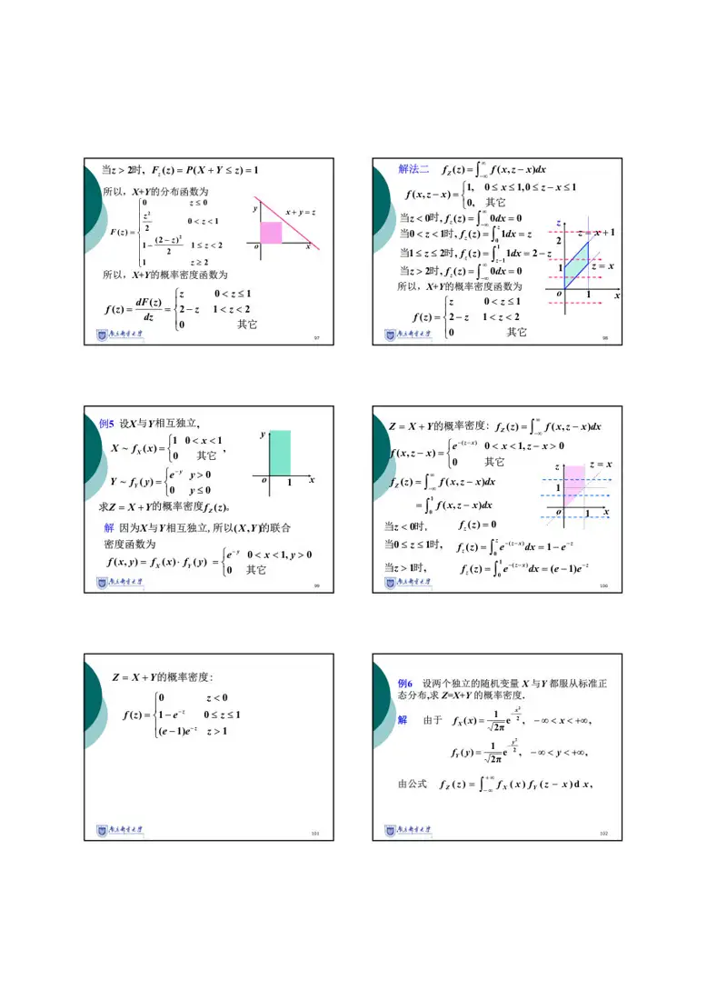

原文：

当 $z > 2$ 时， $F_{z}(z) = P(X + Y \leq z) = 1$

所以， $X + Y$ 的分布函数为

$$
F (z) = \left\{ \begin{array}{l l} 0 & z \leq 0 \\ \frac {z ^ {2}}{2} & 0 <   z <   1 \\ 1 - \frac {(2 - z) ^ {2}}{2} & 1 \leq z <   2 \\ 1 & z \geq 2 \end{array} \right.
$$

所以， $X + Y$ 的概率密度函数为

$$
f (z) = \frac {d F (z)}{d z} = \left\{ \begin{array}{l l} z & 0 <   z \leq 1 \\ 2 - z & 1 <   z <   2 \\ 0 & \text {其它} \end{array} \right.
$$

南京邮电大学
Nanjing University of Physics and Telecommunications

例5 设 $X$ 与 $Y$ 相互独立，

$$
X \sim f _ {X} (x) = \left\{ \begin{array}{l l} 1 & 0 <   x <   1 \\ 0 & \text {其它} \end{array} , \right.
$$

$$
Y \sim f _ {Y} (y) = \left\{ \begin{array}{l l} e ^ {- y} & y > 0 \\ 0 & y \leq 0 \end{array} \right.
$$

求 $Z = X + Y$ 的概率密度 $f_{Z}(z)$ 。

解 因为 $X$ 与 $Y$ 相互独立, 所以 $(X, Y)$ 的联合

密度函数为

$$
f (x, y) = f _ {X} (x) \cdot f _ {Y} (y) = \left\{ \begin{array}{l l} e ^ {- y} & 0 <   x <   1, y > 0 \\ 0 & \text {其它} \end{array} \right.
$$

$Z = X + Y$ 的概率密度：

$$
f (z) = \left\{ \begin{array}{l l} 0 & z <   0 \\ 1 - e ^ {- z} & 0 \leq z \leq 1 \\ (e - 1) e ^ {- z} & z > 1 \end{array} \right.
$$

解法二 $f_{z}(z) = \int_{-\infty}^{\infty}f(x,z - x)dx$

$$
f (x, z - x) = \left\{ \begin{array}{l l} 1, & 0 \leq x \leq 1, 0 \leq z - x \leq 1 \\ 0, & \text {其它} \end{array} \right.
$$

当 $z < 0$ 时， $f_{z}(z) = \int_{-\infty}^{\infty} 0 dx = 0$

当 $0 < z < 1$ 时， $f_z(z) = \int_0^z 1 dx = z$

当 $1 \leq z \leq 2$ 时， $f_{z}(z) = \int_{z - 1}^{1} 1 dx = 2 - z$

$$
\text {白} z > 2 \text {时,} f _ {z} (z) = \int_ {- \infty} ^ {\infty} 0 d x = 0
$$

所以， $X + Y$ 的概率密度函数为

$$
f (z) = \left\{ \begin{array}{l l} z & 0 <   z \leq 1 \\ 2 - z & 1 <   z <   2 \\ 0 & \text {其它} \end{array} \right.
$$

$Z = X + Y$ 的概率密度： $f_{Z}(z) = \int_{-\infty}^{\infty}f(x,z - x)dx$

$$
f (x, z - x) = \left\{ \begin{array}{l l} e ^ {- (z - x)} & 0 <   x <   1, z - x > 0 \\ 0 & \text {其它} \end{array} \right.
$$

$$
\begin{array}{c} f _ {Z} (z) = \int_ {- \infty} ^ {\infty} f (x, z - x) d x \\ = \int_ {0} ^ {1} f (x, z - x) d x \end{array}
$$

$$
z <   0 \text {时},
$$

$$
f _ {z} (z) = 0
$$

$$
\text {当} 0 \leq z \leq 1 \text {时},
$$

$$
f _ {z} (z) = \int_ {0} ^ {z} e ^ {- (z - x)} d x = 1 - e ^ {- z}
$$

当 $z > 1$ 时，

$$
\mathrm{南京邮电大学}
$$

$$
f _ {z} (z) = \int_ {0} ^ {1} e ^ {- (z - x)} d x = (e - 1) e ^ {- z}
$$

例6 设两个独立的随机变量 $X$ 与 $Y$ 都服从标准正态分布, 求 $Z = X + Y$ 的概率密度.

解 由于 $f_{X}(x) = \frac{1}{\sqrt{2\pi}}\mathrm{e}^{-\frac{x^{2}}{2}}, -\infty < x < +\infty,$

$$
f _ {Y} (y) = \frac {1}{\sqrt {2 \pi}} \mathrm{e} ^ {- \frac {y ^ {2}}{2}}, - \infty <   y <   + \infty ,
$$

由公式 $f_{Z}(z) = \int_{-\infty}^{+\infty}f_{X}(x)f_{Y}(z - x)\mathrm{d}x,$

南京邮电大学 Nanjing University of Physics and Telecommunications

97

### 南京邮电大学

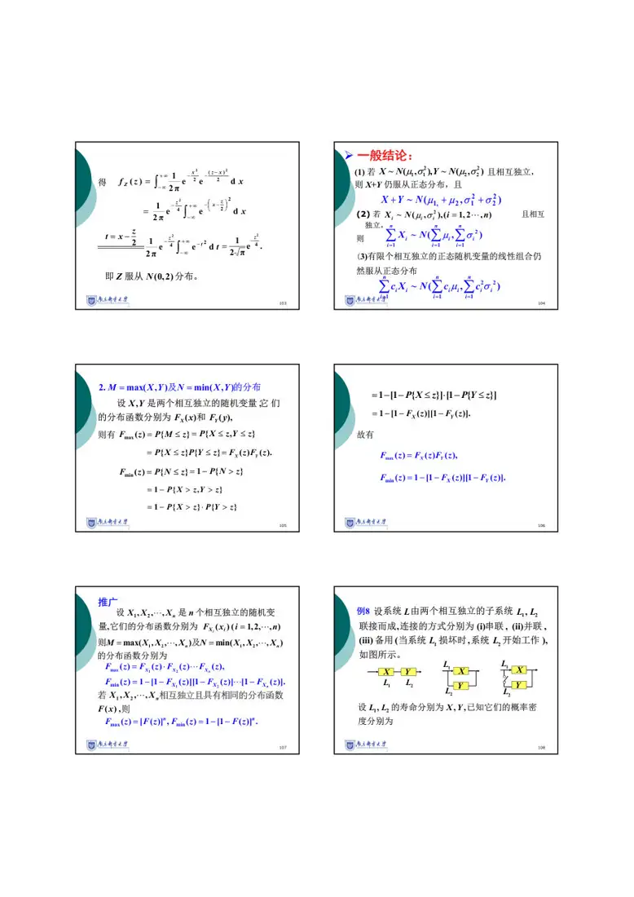

原文：

南京邮电大学
Nanjing University of Physics and Telecommunications

2. $M = \max (X,Y)$ 及 $N = \min (X,Y)$ 的分布

设 X, Y 是两个相互独立的随机变量, 它们的分布函数分别为 $F_{X}(x)$ 和 $F_{Y}(y)$ ,

则有 $F_{\max}(z)=P\{M\leq z\}=P\{X\leq z,Y\leq z\}$ $=P\{X\leq z\}P\{Y\leq z\}=F_{X}(z)F_{Y}(z).$

$$
\begin{array}{r l} F _ {\min} (z) & = P \{N \leq z \} = 1 - P \{N > z \} \\ & = 1 - P \{X > z, Y > z \} \\ & = 1 - P \{X > z \} \cdot P \{Y > z \} \end{array}
$$

南京邮电大学
Nanjing University of Press and Telecommunications

设 $X_{1}, X_{2}, \cdots, X_{n}$ 是 n 个相互独立的随机变量, 它们的分布函数分别为 $F_{X_{i}}(x_{i}) (i=1,2,\cdots,n)$ 则 $M = \max(X_{1}, X_{2}, \cdots, X_{n})$ 及 $N = \min(X_{1}, X_{2}, \cdots, X_{n})$ 的分布函数分别为

$$
F _ {\max} (z) = F _ {X _ {1}} (z) \cdot F _ {X _ {2}} (z) \dots F _ {X _ {n}} (z),
$$

推广

$F_{\min}(z)=1-[1-F_{X_{1}}(z)][1-F_{X_{2}}(z)]\cdots[1-F_{X_{n}}(z)].$ 若 $X_{1}, X_{2}, \cdots, X_{n}$ 相互独立且具有相同的分布函数 $F(x)$ ，则

$$
F _ {\max} (z) = [ F (z) ] ^ {n}, F _ {\min} (z) = 1 - [ 1 - F (z) ] ^ {n}.
$$

南京新電大學 Nanjing University of Physics and Telecommunications

$$
= 1 - [ 1 - P \{X \leq z \} ] \cdot [ 1 - P \{Y \leq z \} ]
$$

$$
= 1 - [ 1 - F _ {X} (z) ] [ 1 - F _ {Y} (z) ].
$$

$$
F _ {\max} (z) = F _ {X} (z) F _ {Y} (z),
$$

故有

$$
F _ {\min} (z) = 1 - [ 1 - F _ {X} (z) ] [ 1 - F _ {Y} (z) ].
$$

南京邮电大学
Nanjing University of Physics and Telecommunications
南京邮电大学 $^{i=1}$

$f_{z}(z) = \int_{-\infty}^{+\infty}\frac{1}{2\pi}\mathrm{e}^{-\frac{x^2}{2}}\mathrm{e}^{-\frac{(z - x)^2}{2}}\mathrm{d}x$

$= \frac{1}{2\pi}\mathrm{e}^{-\frac{z^2}{4}}\int_{-\infty}^{+\infty}\mathrm{e}^{-\left(x - \frac{z}{2}\right)^2}\mathrm{d}x$

$\frac{t = x - \frac{z}{2}}{2\pi}\frac{1}{2\pi}\mathrm{e}^{-\frac{z^2}{4}}\int_{-\infty}^{+\infty}\mathrm{e}^{-t^2}\mathrm{d}t = \frac{1}{2\sqrt{\pi}}\mathrm{e}^{-\frac{z^2}{4}}.$

即 $Z$ 服从 $N(0,2)$ 分布。

一般结论：

103

$X + Y$

$X\sim N(\mu_1,\sigma_1^2),Y\sim N(\mu_2,\sigma_2^2)$

(1) 若 $X \sim N(\mu_1, \sigma_1^2), Y \sim N(\mu_2, \sigma_2^2)$ 且相互独立，则 $X + Y$ 仍服从正态分布，且

$X + Y \sim N(\mu_{1}, + \mu_{2}, \sigma_{1}^{2} + \sigma_{2}^{2})$

(2) 若 $X_{i} \sim N(\mu_{i}, \sigma_{i}^{2}), (i = 1, 2 \cdots, n)$

$X_{i}\sim N(\mu_{i},\sigma_{i}^{2}),(i = 1,2\dots ,n)$

且相互

则 独立， $\sum_{i = 1}^{n}X_{i}\sim N(\sum_{i = 1}^{n}\mu_{i},\sum_{i = 1}^{n}\sigma_{i}^{2})$

(3)有限个相互独立的正态随机变量的线性组合仍然服从正态分布

$\sum_{i=1}^{n} c_i X_i \sim N (\sum_{i=1}^{n} c_i \mu_i, \sum_{i=1}^{n} c_i^2 \sigma_i^2)$

104

南京邮电大学
Nanjing University of Physics and Telecommunications

例8 设系统 L 由两个相互独立的子系统 $L_{1}, L_{2}$ 联接而成, 连接的方式分别为 (i) 串联, (ii) 并联, (iii) 备用 (当系统 $L_{1}$ 损坏时, 系统 $L_{2}$ 开始工作), 如图所示。

$L_{1}$ $X$ $Y$ $L_{2}$ $L_{1}$ $X$ $L_{2}$ $L_{1}$ $X$ $L_{2}$

$L_{1}, L_{2}$

设 $L_{1}, L_{2}$ 的寿命分别为 $X, Y$ , 已知它们的概率密度分别为

南京邮电大学
Nanjing University of Science and Telecommunications

108

### (ii)并联情况

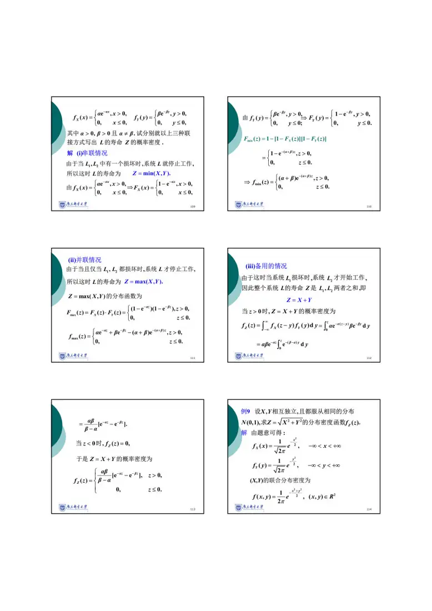

原文：

(ii)并联情况

由于当且仅当 $L_{1}, L_{2}$ 都损坏时, 系统 $L$ 才停止工作, 所以这时 $L$ 的寿命为 $Z = \max(X, Y)$ .

$Z = \max (X,Y)$ 的分布函数为

$$
F _ {\max} (z) = F _ {X} (z) \cdot F _ {Y} (z) = \left\{ \begin{array}{l l} (1 - \mathrm{e} ^ {- a z}) (1 - \mathrm{e} ^ {- \beta z}), & z > 0, \\ 0, & z \leq 0. \end{array} \right.
$$

$$
f _ {\max} (z) = \left\{ \begin{array}{l l} a \mathrm{e} ^ {- \alpha z} + \beta \mathrm{e} ^ {- \beta z} - (\alpha + \beta) \mathrm{e} ^ {- (\alpha + \beta) z}, & z > 0, \\ 0, & z \leq 0. \end{array} \right.
$$

南京邮电大学
Nanjing University of Physics and Telecommunications

$$
= \frac {\alpha \beta}{\beta - \alpha} [ e ^ {- \alpha z} - e ^ {- \beta z} ].
$$

当 $z < 0$ 时， $f_{Z}(z) = 0$

于是 $Z = X + Y$ 的概率密度为

$$
f _ {z} (z) = \left\{ \begin{array}{c c} \frac {\alpha \beta}{\beta - \alpha} [ e ^ {- \alpha z} - e ^ {- \beta z} ], & z > 0, \\ 0, & z \leq 0. \end{array} \right.
$$

(iii)备用的情况

由于这时当系统 $L_{1}$ 损坏时，系统 $L_{2}$ 才开始工作，因此整个系统 $L$ 的寿命 $Z$ 是 $L_{1}, L_{2}$ 两者之和，即

$$
Z = X + Y
$$

当 $z > 0$ 时， $Z = X + Y$ 的概率密度为

$$
f _ {Z} (z) = \int_ {- \infty} ^ {\infty} f _ {X} (z - y) f _ {Y} (y) d y = \int_ {0} ^ {z} \alpha e ^ {- \alpha (z - y)} \beta e ^ {- \beta y} d y
$$

$$
= \alpha \beta \mathrm{e} ^ {- \alpha z} \int_ {0} ^ {z} \mathrm{e} ^ {- (\beta - \alpha) y} \mathrm{d} y
$$

112

南京邮电大学
Nanjing University of Physics and Telecommunications

南京新電大學
Nanjing University of Physics and Telecommunications

109

110

$f_{X}(x) = \left\{ \begin{array}{ll}\alpha \mathrm{e}^{-\alpha x},x > 0,\\ 0,x\leq 0, \end{array} \right.\quad f_{Y}(y) = \left\{ \begin{array}{ll}\beta \mathrm{e}^{-\beta y},y > 0,\\ 0,y\leq 0, \end{array} \right.$

$\alpha > 0, \beta > 0$

其中 $\alpha > 0, \beta > 0$ 且 $\alpha \neq \beta$ . 试分别就以上三种联接方式写出 $L$ 的寿命 $Z$ 的概率密度.

$\alpha \neq \beta.$

解 (i)串联情况

$f_{X}(x) = \left\{ \begin{array}{ll}a\mathrm{e}^{-ax}, & x > 0,\\ 0, & x\leq 0, \end{array} \right.\Rightarrow F_{X}(x) = \left\{ \begin{array}{ll}1 - \mathrm{e}^{-ax}, & x > 0,\\ 0, & x\leq 0, \end{array} \right.$

$L_{1}, L_{2}$

由于当 $L_{1}, L_{2}$ 中有一个损坏时, 系统 L 就停止工作, 所以这时 L 的寿命为 $Z = \min(X, Y)$ .

$Z = \min (X,Y)$

南京航空航天大学
Nanjing University of Physics and Telecommunications

由 $f_{Y}(y) = \left\{ \begin{array}{ll}\beta \mathrm{e}^{-\beta y},y > 0,\\ 0,y\leq 0; \end{array} \right.\Rightarrow F_{Y}(y) = \left\{ \begin{array}{ll}1 - \mathrm{e}^{-\beta y},y > 0,\\ 0,y\leq 0. \end{array} \right.$

$F_{\min}(z) = 1 - [1 - F_X(z)][1 - F_Y(z)]$ $= \left\{ \begin{array}{ll}1 - \mathrm{e}^{-(\alpha +\beta)z}, & z > 0,\\ 0, & z\leq 0. \end{array} \right.$

$\Rightarrow f_{\min}(z) = \begin{cases} (\alpha + \beta)\mathrm{e}^{-(\alpha + \beta)z}, & z > 0, \\ 0, & z \leq 0. \end{cases}$

例9 设 $X, Y$ 相互独立, 且都服从相同的分布

N(0,1),

$N(0,1)$ , 求 $Z = \sqrt{X^2 + Y^2}$ 的分布密度函数 $f_Z(z)$ 。

解 由题意可得：

$f_{X}(x) = \frac{1}{\sqrt{2\pi}} e^{-\frac{x^{2}}{2}}, -\infty < x < +\infty$

$f_{Y}(y) = \frac{1}{\sqrt{2\pi}} e^{-\frac{y^{2}}{2}}, -\infty <  y <   + \infty$

$(X,Y)$ 的联合分布密度为

$f(x,y) = \frac{1}{2\pi} e^{-\frac{x^2 + y^2}{2}}, (x,y)\in R^2$

南京邮电大学
Nanjing University of Press and Telecommunications

### 南京邮电大学

原文：

南京邮电大学
Nanjing University of Physics and Telecommunications

四、小结

1. 离散型随机变量函数的分布律

若二维离散型随机变量的联合分布律为

$$
P \{X = x _ {i}, Y = y _ {j} \} = p _ {i j}, \quad i, j = 1, 2, \dots ,
$$

则随机变量函数 $Z = g(X,Y)$ 的分布律为

$$
\begin{array}{r l} P \{Z = z _ {k} \} & = P \{g (X, Y) = z _ {k} \} \\ & = \sum_ {z _ {k} = g (x _ {i} y _ {j})} p _ {i j}, \quad k = 1, 2, \dots . \end{array}
$$

南京邮电大学
Nanjing University of Physics and Telecommunications

3.重要结论

1、设 X, Y 相互独立, 且 $X \sim \pi(\lambda_{1}), Y \sim \pi(\lambda_{2})$ ,

则 $Z = X + Y \sim \pi(\lambda_1 + \lambda_2)$ 。

2、设 X, Y 相互独立, 且 $X \square B(n_{1}, p)$ ,

$Y \square B(n_{2}, p)$ , 则 $Z = X + Y \square B(n_{1} + n_{2}, p)$ 。

3、设 $X, Y$ 相互独立，且 $X \sim N(\mu_1, \sigma_1^2), Y \sim$

$N(\mu_{2},\sigma_{2}^{2})$ ，则 $Z = X + Y\sim N(\mu_1 + \mu_2,\sigma_1^2 +\sigma_2^2)$

4、设 X, Y 相互独立, 且 $X \sim \Gamma(\alpha_{1}, \beta)$ ,

$Y \sim \Gamma(\alpha_{2}, \beta)$ 则 $Z = X + Y \sim \Gamma(\alpha_{1} + \alpha_{2}, \beta)$ 。

2. 连续型随机变量函数的分布

(1) $Z = X + Y$ 的分布

(2) $M = \max (X,Y)$ 及 $N = \min (X,Y)$ 的分布

$$
F _ {\max} (z) = F _ {X} (z) F _ {Y} (z),
$$

$$
F _ {\min} (z) = 1 - [ 1 - F _ {X} (z) ] [ 1 - F _ {Y} (z) ].
$$

一、重点与难点

二、主要内容

三、典型例题

南京新電大學
Nanjing University of Physics and Telecommunications

由分布函数定义

$F_{z}(z) = P\{Z\leq z\}$

$= P\{\sqrt{X^2 + Y^2}\leq z\}$

y
o
z x

当 $z \leq 0$ 时, $F_{z}(z) = 0$

$F_{z}(z) = 0$

当 $z > 0$ 时， $F_{Z}(z) = \iint_{\sqrt{x^{2} + y^{2}} \leq z} \frac{1}{2\pi} e^{-\frac{x^{2} + y^{2}}{2}} dx dy$

$F_{z}(z) = \iint_{\sqrt{x^{2} + y^{2}}\leq z}\frac{1}{2\pi} e^{-\frac{x^{2} + y^{2}}{2}}dxdy$

令 $x = r\cos \theta ,y = r\sin \theta$

$F_{Z}(z) = \int_{0}^{2\pi}d\theta \int_{0}^{z}\frac{1}{2\pi} e^{-\frac{r^{2}}{2}}rdr = 1 - e^{-\frac{z^{2}}{2}}$

115

于是， $Z$ 的分布函数为

$$F\_{z}(z)=\left\{\begin{array}{ccc}1-e^{-\frac{z^{2}}{2}}&z>0\\ 0&z\leq0\end{array}\right.$$

求导即得 $Z$ 的概率密度函数

$f_{Z}(z) = F_{Z}^{\prime}(z) = \left\{ \begin{array}{cc}ze^{-\frac{z^{2}}{2}} & z > 0\\ 0 & z\leq 0 \end{array} \right.$

称Z服从瑞利(Ray Leigh)分布。

南京邮电大学
Nanjing University of Physics and Telecommunications

116

南京邮电大学
Nanjing University of Press and Telecommunications

第三章 多维随机变量及其分布

习题课

南京邮电大学
Nanjing University of Science and Telecommunications

### 二维随机变量

原文：

二维随机变量

设 $E$ 是一个随机试验, 它的样本空间是 $S = \{e\}$ , 设 $X = X(e)$ 和 $Y = Y(e)$ 是定义在 $S$ 上的随机变量, 由它们构成的一个向量 $(X, Y)$ , 叫作二维随机向量或二维随机变量。

(2) 性质

$1^{0} F(x, y)$ 是变量 $x$ 和 $y$ 的不减函数，即对于任意固定的 $y$ ，当 $x_{2} > x_{1}$ 时 $F(x_{2}, y) \geq F(x_{1}, y)$ ；对于任意固定的 $x$ ，当 $y_{2} > y_{1}$ 时 $F(x, y_{2}) \geq F(x, y_{1})$ 。 $2^{0} 0 \leq F(x, y) \leq 1$ ，且有

对于任意固定的 $y, F(-\infty, y) = \lim_{x \to -\infty} F(x, y) = 0;$ 对于任意固定的 $x, F(x, -\infty) = \lim_{y \to -\infty} F(x, y) = 0;$ $F(-\infty, -\infty) = \lim_{x \to -\infty} F(x, y) = 0;$

南京新電大學 Nanjing University of Physics and Telecommunications

二维随机变量的分布函数

(1) 定义

设 $(X,Y)$ 是二维随机变量，对于任意实数 $x, y$ ，二元函数： $F(x,y) = P\{(X \leq x) \cap (Y \leq y)\} = P\{X \leq x, Y \leq y\}$ 称为二维随机变量 $(X,Y)$ 的分布函数或称为随机变量 $X$ 和 $Y$ 的联合分布函数.

121

南京邮电大学
Nanjing University of Private and Telecommunications

122

一、重点与难点

1.重点

随机变量函数的分布

二维随机变量的分布

条件概率分布

有关概率的计算和随机变量的独立性  
2.难点

二、主要内容

南京邮电大学
Nanjing University of Physics and Telecommunications

$F(+\infty, + \infty) = \lim_{x\to +\infty}F(x,y) = 1.$

$3^{0} F(x,y) = F(x + 0,y),F(x,y) = F(x,y + 0),$

$F(x,y)$

即 $F(x,y)$ 关于 x 右连续, 关于 y 也右连续.

$4^{0}$ 对于任意 $(x_{1},y_{1}),(x_{2},y_{2}),x_{1}< x_{2},y_{1}< y_{2},$

有 $F(x_{2},y_{2}) - F(x_{2},y_{1}) + F(x_{1},y_{1}) - F(x_{1},y_{2})\geq 0.$

$F(x_{2},y_{2}) - F(x_{2},y_{1}) + F(x_{1},y_{1}) - F(x_{1},y_{2})\geq 0.$

南京邮电大学
Nanjing University of Science and Telecommunications

### 离散型随机变量 $(X,Y)$ 的分布函数为

原文：

<table><tr><td></td><td> $x_{1}$ </td><td> $x_{2}$ </td><td> $\cdots$ </td><td> $x_{i}$ </td><td> $\cdots$ </td></tr><tr><td> $y_{1}$ </td><td> $p_{11}$ </td><td> $p_{21}$ </td><td> $\cdots$ </td><td> $p_{i1}$ </td><td> $\cdots$ </td></tr><tr><td> $y_{2}$ </td><td> $p_{12}$ </td><td> $p_{22}$ </td><td> $\cdots$ </td><td> $p_{i2}$ </td><td> $\cdots$ </td></tr><tr><td> $\vdots$ </td><td> $\vdots$ </td><td> $\vdots$ </td><td></td><td> $\vdots$ </td><td></td></tr><tr><td> $y_{j}$ </td><td> $p_{1j}$ </td><td> $p_{2j}$ </td><td> $\cdots$ </td><td> $p_{ij}$ </td><td> $\cdots$ </td></tr><tr><td> $\vdots$ </td><td> $\vdots$ </td><td> $\vdots$ </td><td></td><td> $\vdots$ </td><td></td></tr></table>

离散型随机变量 $(X,Y)$ 的分布函数为

$$
F (x, y) = \sum_ {x _ {i} \leq x} \sum_ {y _ {j} \leq y} p _ {i j},
$$

其中和式是对一切满足 $x_{i} \leq x, y_{j} \leq y$ 的 $i, j$ 求和.

(2) 性质

$1^{0} f(x,y) \geq 0.$

$$
2 ^ {0} \int_ {- \infty} ^ {+ \infty} \int_ {- \infty} ^ {+ \infty} f (x, y) d x d y = F (\infty , \infty) = 1.
$$

$3^{0}$ 若 $f(x,y)$ 在 $(x,y)$ 连续, 则有 $\frac{\partial^2 F(x,y)}{\partial x \partial y} = f(x,y)$ . $4^{0}$ 设 $G$ 是 $xoy$ 平面上的一个区域, 点 $(X,Y)$ 落在 $G$ 内的概率是

$$
P \{(X, Y) \in G \} = \iint_ {G} f (x, y) d x d y.
$$

南京新電大學 Nanjing University of Physics and Telecommunications

二维连续型随机变量的概率密度

(1) 定义

对于二维随机变量 $(X,Y)$ 的分布函数 $F(x,y)$ , 如果存在非负的函数 $f(x,y)$ 使对于任意 $x,y$ 有

$$
F (x, y) = \int_ {- \infty} ^ {y} \int_ {- \infty} ^ {x} f (u, v) d u d v,
$$

则称 $(X,Y)$ 是连续型的二维随机变量，函数 $f(x,y)$ 称为二维随机变量 $(X,Y)$ 的概率密度，或称为随机变量 $X$ 和 $Y$ 的联合概率密度.

$$
\int_ {- \infty} ^ {\infty} \int_ {- \infty} ^ {\infty} f (x, y) d x d y = 1
$$

$$
P \{(X, Y) \in G \} = \iint_ {G} f (x, y) d x d y,
$$

(3) $n$ 维随机变量的概念

$X_{1} = X_{1}(e), X_{2} = X_{2}(e), \cdots, X_{n} = X_{n}(e)$

设 E 是一个随机试验, 它的样本空间是 $S = \{e\}$ , 设 $X_{1} = X_{1}(e)$ , $X_{2} = X_{2}(e)$ , $\cdots$ , $X_{n} = X_{n}(e)$ , 是定义在 S 上的随机变量, 由它们构成的一个 n 维向量 $(X_{1}, X_{2}, \cdots, X_{n})$ 叫做 n 维随机向量或 n 维随机变量.

$S = \{e\}$

127

$(X_{1}, X_{2}, \cdots, X_{n})$

n:

对于任意 n 个实数 $x_{1}, x_{2}, \cdots, x_{n}, n$ 元函数

$x_{1}, x_{2}, \cdots, x_{n}, n$

$F(x_{1},x_{2},\cdots,x_{n})=P\{X_{1}\leq x_{1},X_{2}\leq x_{2},\cdots,X_{n}\leq x_{n}\}$

称为随机变量 $(X_{1},X_{2},\cdots,X_{n})$ 的联合分布函数.

$(X_{1},X_{2},\cdots,X_{n}$

二维离散型随机变量的分布律

设二维离散型随机变量 $(X,Y)$ 所有可能取的值为 $(x_{i},y_{j}),i,j=1,2,\cdots,$ 记

$(x_{i},y_{j}),i,j=1,2,\cdots,$ 记

南京邮电大学
Nanjing University of Press and Telecommunications

$P\{X=x_{i},Y=y_{j}\}=p_{ij},\quad i,j=1,2,\cdots,$

称此为二维离散型随机变量 $(X,Y)$ 的分布律，或随机变量 $X$ 和 $Y$ 的联合分布律.

二维随机变量 $(X,Y)$ 的分布律也可表示为：

128

南京新電大學
Nanjing University of Physics and Telecommunications

(3) 说明

几何上, $z=f(x,y)$ 表示空间的一个曲面.

表示介于 $f(x, y)$ 和 $xoy$ 平面之间的空间区域的全部体积等于1.

$P\{(X,Y)\in G$

$P\{(X,Y)\in G\}$ 的值等于以G为底,以曲面 $z=f(x,y)$ 为顶面的柱体体积.

南京邮电大学
Nanjing University of Press and Telecommunications

130

### 边缘分布函数

原文：

边缘分布函数

设 $F(x,y)$ 为随机变量 $(X,Y)$ 的分布函数，则

$$
F (x, y) = P \{X \leq x, Y \leq y \},
$$

令 $y\to \infty$ ，称

$$
P \{X \leq x \} = P \{X \leq x, Y <   \infty \} = F (x, \infty)
$$

为随机变量 $(X,Y)$ 关于 $X$ 的边缘分布函数.

记为 $F_{X}(x) = F(x,\infty)$

同理令 $x \to \infty$ ,

$$
F _ {Y} (y) = F (\infty , y) = P \{X <   \infty , Y \leq y \} = P \{Y \leq y \}
$$

为随机变量 $(X,Y)$ 关于Y的边缘分布函数.

南京邮电大学
Nanjing University of Physics and Telecommunications

联合分布 ← 边缘分布

随机变量关于 $X$ 和 $Y$ 的边缘分布函数分别为

$$
F _ {x} (x) = F (x, \infty) = \sum_ {x _ {i} \leq x} \sum_ {j = 1} ^ {\infty} p _ {i j},
$$

$$
F _ {Y} (y) = F (\infty , y) = \sum_ {y _ {j} \leq y} \sum_ {i = 1} ^ {\infty} p _ {i j}.
$$

离散型随机变量的边缘分布

设二维离散随机变量 $(X,Y)$ 的联合分布律为

$$
P \{X = x _ {i}, Y = y _ {j} \} = p _ {i j}, i, j = 1, 2, \dots .
$$

记

$$
p _ {i \bullet} = \sum_ {j = 1} ^ {\infty} p _ {i j} = P \{X = x _ {i} \}, \quad i = 1, 2, \dots ,
$$

$$
p _ {\bullet j} = \sum_ {i = 1} ^ {\infty} p _ {i j} = P \{Y = y _ {j} \}, \quad j = 1, 2, \dots ,
$$

分别称 $p_{i\bullet}(i=1,2,\cdots)$ 和 $p_{\bullet j}(j=1,2,\cdots)$ 为 $(X,Y)$ 关于 X 和关于 Y 的边缘分布律.

连续型随机变量的边缘分布

$$
F _ {X} (x) = F (x, \infty) = \int_ {- \infty} ^ {x} \left[ \int_ {- \infty} ^ {+ \infty} f (x, y) d y \right] d x,
$$

$$
f _ {X} (x) = \int_ {- \infty} ^ {+ \infty} f (x, y) d y
$$

138

南京新電大學
Nanjing University of Physics and Telecommunications

133

南京邮电大学
Nanjing University of Private and Telecommunications

134

(4) 两个常用的分布

设 $D$ 是平面上的有界区域, 其面积为 $S$ , 若二维随机变量 $(X, Y)$ 具有概率密度

$f(x,y) = \left\{ \begin{array}{ll}\frac{1}{S}, & (x,y)\in D,\\ 0, & \text{其他}. \end{array} \right.$

则称 $(X,Y)$ 在 $D$ 上服从均匀分布.

若二维随机变量 $(X,Y)$ 具有概率密度

二维正态分布的两个边缘分布都是一维正态分布.

$f(x,y) = \frac{1}{2\pi\sigma_1\sigma_2\sqrt{1 - \rho^2}}$ $\mathrm{e}^{-\frac{1}{2(1 - \rho^2)}\left[\frac{(x - \mu_1)^2}{\sigma_1^2} -\frac{2\rho(x - \mu_1)(y - \mu_2)}{\sigma_1\sigma_2} +\frac{(y - \mu_2)^2}{\sigma_2^2}\right]}$

其中 $\mu_{1},\mu_{2},\sigma_{1},\sigma_{2},\rho$ 为常数, $\sigma_{1}>0,\sigma_{2}>0,-1<\rho<1$ ,则称 $(X,Y)$ 服从参数为 $\mu_{1},\mu_{2},\sigma_{1},\sigma_{2},\rho$ 的二维正态分布.记为 $(X,Y)\sim N(\mu_{1},\mu_{2},\sigma_{1}^{2},\sigma_{2}^{2},\rho)$ .

$(- \infty < x < + \infty, - \infty < y < + \infty)$

$(X,Y)\sim N(\mu_{1},\mu_{2},\sigma_{1}^{2},\sigma_{2}^{2},\rho).$

$(X,Y)$

$\mu_{1},\mu_{2},\sigma_{1},\sigma_{2},\rho$

$\sigma_{1} > 0, \sigma_{2} > 0, -1 < \rho < 1,$

$\mu_1,\mu_2,\sigma_1,\sigma_2,\rho$

南京邮电大学
Nanjing University of Press and Telecommunications

$f(x,y)$

对于连续型随机变量 $(X,Y)$ , 设它的概率密度为 $f(x,y)$ , 由于

记

称为随机变量 $(X,Y)$ 关于 $X$ 的的边缘概率密度.

同理得 $Y$ 的边缘概率密度 $f_{Y}(y) = \int_{-\infty}^{+\infty}f(x,y)\mathrm{d}x.$

### 二维随机变量的推广

原文：

二维随机变量的推广

(1) n 维随机变量 $(X_{1}, X_{2}, \cdots, X_{n})$ 的分布函数为 $F(x_{1},x_{2},\cdots,x_{n})=P\{X_{1}\leq x_{1},X_{2}\leq x_{2},\cdots,X_{n}\leq x_{n}\}$ 其中 $x_{1}, x_{2}, \cdots, x_{n}$ 为任意实数.

(2) n 维随机变量 $(X_{1}, X_{2}, \cdots, X_{n})$ 的概率密度函数 $F(x_{1},x_{2},\cdots,x_{n})=$

$$
\int_ {- \infty} ^ {x _ {n}} \int_ {- \infty} ^ {x _ {n - 1}} \dots \int_ {- \infty} ^ {x _ {1}} f (x _ {1}, x _ {2}, \dots , x _ {n}) d x _ {1} d x _ {2} \dots d x _ {n}.
$$

南京邮电大学
Nanjing University of Physics and Telecommunications

(4) n 维随机变量 $(X_{1}, X_{2}, \cdots, X_{n})$ 的边缘概率密度

若 $f(x_{1}, x_{2}, \cdots, x_{n})$ 是 $(X_{1}, X_{2}, \cdots, X_{n})$ 的概率密度，则 $(X_{1}, X_{2}, \cdots, X_{n})$ 关于 $X_{1}$ ，关于 $(X_{1}, X_{2})$ 的边缘概率密度分别为

$$
f _ {X _ {1}} \left(x _ {1}\right) = \int_ {- \infty} ^ {\infty} \int_ {- \infty} ^ {\infty} \dots \int_ {- \infty} ^ {\infty} f \left(x _ {1}, x _ {2}, \dots , x _ {n}\right) d x _ {2} d x _ {3} \dots d x _ {n},
$$

$$
f _ {X _ {1}, X _ {2}} \left(x _ {1}, x _ {2}\right) = \int_ {- \infty} ^ {\infty} \int_ {- \infty} ^ {\infty} \dots \int_ {- \infty} ^ {\infty} f \left(x _ {1}, x _ {2}, \dots , x _ {n}\right) d x _ {3} d x _ {4} \dots d x _ {n},
$$

同理可得 $(X_{1},X_{2},\cdots,X_{n})$ 的 $k(1\leq k<n)$ 维边缘概率密度.

南京新電大學
Nanjing University of Physics and Telecommunications

(3) $n$ 维随机变量 $(X_{1}, X_{2}, \dots, X_{n})$ 的边缘分布函数

$$
F _ {X _ {1}} (x _ {1}) = F (x _ {1}, \infty , \infty , \dots , \infty)
$$

称为 n 维随机变量 $(X_{1}, X_{2}, \cdots, X_{n})$ 关于 $X_{1}$ 的边缘分布函数.

$$
F _ {X _ {1}, X _ {2}} (x _ {1}) = F (x _ {1}, x _ {2}, \infty , \infty , \dots , \infty)
$$

称为n维随机变量 $(X_{1},X_{2},\cdots,X_{n})$ 关于 $(X_{1},X_{2})$ 的边缘分布函数.

其它依次类推.

南京邮电大学
Nanjing University of Press and Telecommunications

(5) 随机变量相互独立的定义的推广

若对于所有的 $x_{1}, x_{2}, \cdots, x_{n}$ 有

$$
F \left(x _ {1}, x _ {2}, \dots , x _ {n}\right) = F _ {X _ {1}} \left(x _ {1}\right) F _ {X _ {2}} \left(x _ {2}\right) \dots F _ {X _ {n}} \left(x _ {n}\right)
$$

则称 $X_{1}, X_{2}, \cdots, X_{n}$ 是相互独立的.

若对于所有的 $x_{1}, x_{2}, \cdots, x_{m}, y_{1}, y_{2}, \cdots, y_{n}$ 有

$$
\begin{array}{r l} F (x _ {1}, x _ {2}, \dots , x _ {m}, y _ {1}, y _ {2}, \dots , y _ {n}) \\ & = F _ {1} (x _ {1}, x _ {2}, \dots , x _ {m}) F _ {2} (y _ {1}, y _ {2}, \dots , y _ {n}) \end{array}
$$

南京邮电大学 Nanjing University of Physics and Telecommunications

随机变量的相互独立性

$F(x,y)$

$F_{X}(x), F_{Y}(y)$

设 $F(x,y)$ 及 $F_{X}(x),F_{Y}(y)$ 分别是二维随机变量 $(X,Y)$ 的分布函数及边缘分布函数若对于所有 $x,y$ 有

$P\{X \leq x, Y \leq y\} = P\{X \leq x\} P\{Y \leq y\},$

即 $F(x,y) = F_{X}(x)F_{Y}(y),$

$F(x,y) = F_{X}(x)F_{Y}(y),$

则称随机变量 X 和 Y 是相互独立的.

南京邮电大学
Nanjing University of Press and Telecommunications

139

说明

南京邮电大学
Nanjing University of Private and Telecommunications

(1) 若离散型随机变量 $(X, Y)$ 的联合分布律为

$P\{X = i,Y = j\} = p_{ij},\quad i,j = 1,2,\dots .$

$P\{X = x_{i},Y = y_{j}\} = P\{X = x_{i}\} P\{Y = y_{j}\}$

X 和 Y 相互独立 $\Leftrightarrow$ $P\{X=x_{i},Y=y_{j}\}=P\{X=x_{i}\}P\{Y=y_{j}\}$ 即 $p_{ij}=p_{i\bullet}\cdot p_{\bullet j}$ .
(2) 设连续型随机变量 $(X,Y)$ 的联合概率密度为 $f(x,y)$ , 边缘概率密度分别为 $f_{X}(x), f_{Y}(y)$ , 则有
X 和 Y 相互独立 $\Leftrightarrow f(x,y)=f_{X}(x)f_{Y}(y).$

$f(x,y)$

(3) $X$ 和 $Y$ 相互独立, 则 $f(X)$ 和 $g(Y)$ 也相互独立.

$p_{ij} = p_{i\bullet}\cdot p_{\bullet j}$

$\Leftrightarrow f(x,y) = f_X(x)f_Y(y)$

g(Y)

$f_{X}(x), f_{Y}(y)$

140

### (2)连续型随机变量函数的分布

原文：

(2)连续型随机变量函数的分布

$Z = X + Y$ 的分布

设 $(X,Y)$ 的概率密度为 $f(x,y)$ , 则 $Z = X + Y$ 的密度函数为

$$
f _ {Z} (z) = \int_ {- \infty} ^ {\infty} f (x, z - x) d x = \int_ {- \infty} ^ {\infty} f (z - y, y) d y.
$$

当 $X, Y$ 独立时， $f_Z(z)$ 也可表示为

$$
\begin{array}{r l} f _ {Z} (z) & = \int_ {- \infty} ^ {\infty} f _ {X} (x) f _ {Y} (z - x) \mathrm{d} x \\ & = \int_ {- \infty} ^ {\infty} f _ {X} (z - y) f _ {Y} (y) \mathrm{d} y. \end{array}
$$

南京邮电大学
Nanjing University of Physics and Telecommunications

推广

设 $X_{1}, X_{2}, \cdots, X_{n}$ ，是 n 个相互独立的随机变量，它们的分布函数分别为 $F_{X_{i}}(x_{i}), (i=1,2,\cdots,n)$ 则 $M = \max(X_{1}, X_{2}, \cdots, X_{n})$ 及 $N = \min(X_{1}, X_{2}, \cdots, X_{n})$ 的分布函数分别为

$$
F _ {\max} (z) = F _ {X _ {1}} (z) F _ {X _ {2}} (z) \dots F _ {X _ {n}} (z),
$$

$$
F _ {\min} (z) = 1 - \left[ 1 - F _ {X _ {1}} (z) \right] \left[ 1 - F _ {X _ {2}} (z) \right] \dots \left[ 1 - F _ {X _ {n}} (z) \right].
$$

若 $X_{1}, X_{2}, \cdots, X_{n}$ 相互独立且具有相同的分布函数 $F(x)$ ，则

$$
F _ {\max} (z) = [ F (z) ] ^ {n}, F _ {\min} (z) = 1 - [ 1 - F (z) ] ^ {n}.
$$

南京邮电大学
Nanjing University of Press and Telecommunications

$M = \max(X, Y)$ 及 $N = \min(X, Y)$ 的分布

设 X, Y 是两个相互独立的随机变量, 它们的分布函数分别为 $F_{X}(x)$ 和 $F_{Y}(y)$ ,

则有

$$
F _ {\max} (z) = F _ {X} (z) F _ {Y} (z),
$$

$$
F _ {\min} (z) = 1 - \left[ 1 - F _ {X} (z) \right] \left[ 1 - F _ {Y} (z) \right].
$$

南京邮电大学
Nanjing University of Press and Telecommunications

145

南京邮电大学
Nanjing University of Posts and Telecommunications

146

$(Y_{1},Y_{2},\cdots,Y_{n})$

$F_{1}, F_{2}, F$

其中 $F_{1}, F_{2}, F$ 依次为随机变量 $(X_{1}, X_{2}, \cdots, X_{m})$ $(Y_{1}, Y_{2}, \cdots, Y_{n})$ 和 $(X_{1}, X_{2}, \cdots, X_{m}, Y_{1}, Y_{2}, \cdots, Y_{n})$ 的分布函数，则称随机变量 $(X_{1}, X_{2}, \cdots, X_{m})$ 与 $(Y_{1}, Y_{2}, \cdots, Y_{n})$ 是相互独立的。

$(X_{1},X_{2},\dots ,X_{m},Y_{1},Y_{2},\dots ,Y_{n})$

$(X_{1},X_{2},\cdots,X_{m})$

$(Y_{1},Y_{2},\cdots,Y_{n})$

$(X_{1},X_{2},\cdots,X_{m})$

$g(Y_{1},Y_{2},\cdots,Y_{n})$

定理 设 $(X_{1},X_{2},\cdots,X_{m})$ 和 $(Y_{1},Y_{2},\cdots,Y_{n})$ 相互独立。则 $X_{i}(1,2,\cdots,m)$ 和 $Y_{j}(j=1,2,\cdots,n)$ 相互独立。又若h,g是连续函数，则 $h(X_{1},X_{2},\cdots,X_{m})$ 和 $g(Y_{1},Y_{2},\cdots,Y_{n})$ 相互独立。

$(X_{1},X_{2},\cdots,X_{n})$

h,g

$X_{i}(1,2,\dots,m)$

$Y_{1}, Y_{2}, \cdots, Y_{n}$

$Y_{j}(j = 1,2,\dots ,n$

$i(X_{1},X_{2},\cdots,X_{m})$

随机变量函数的分布

(1)离散型随机变量函数的分布

若二维离散型随机变量的联合分布律为 $P\{X=x_{i},Y=y_{j}\}=p_{ij},\quad i,j=1,2,\cdots$ 则随机变量函数 $Z = g(X, Y)$ 的分布律为

$k=1,2,\cdots.$

$P\{Z = z_k\} = P\{g(X,Y) = z_k\} = \sum_{z_k = g(x_i,y_j)}p_{ij},$

$Z = g(X,Y$

南京邮电大学
Nanjing University of Press and Telecommunications
