# 《概率论与数理统计》第3章 条件分布与相互独立的随机变量（课件）

原件的每一页，下面附识别出的文字。

### $$

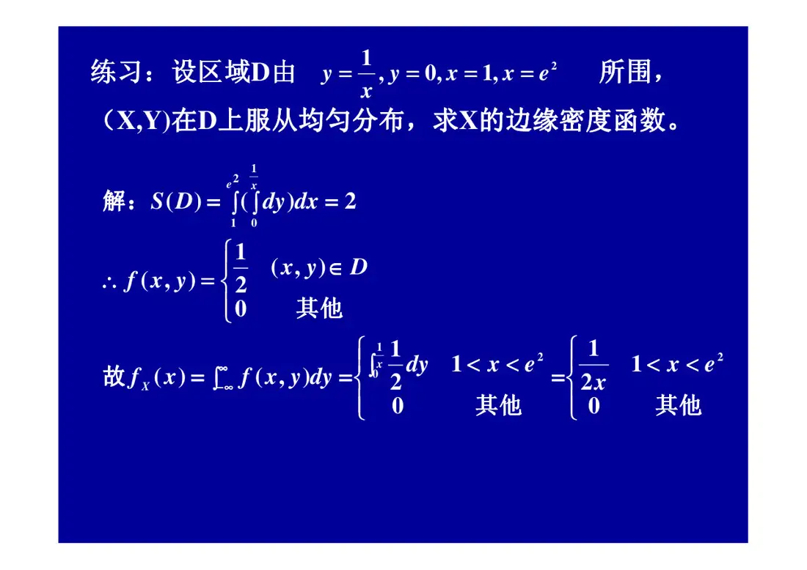

原文：

练习：设区域D由 $y=\frac{1}{x}, y=0, x=1, x=e^{2}$ 所围，(X,Y)在D上服从均匀分布，求X的边缘密度函数。

解： $S(D)=\int_{1}^{e^{2}}(\int_{0}^{\frac{1}{x}}dy)dx=2$

$$
\therefore f (x, y) = \left\{ \begin{array}{l l} \frac {1}{2} & (x, y) \in D \\ 0 & \text {其他} \end{array} \right.
$$

故 $f_{x}(x)=\int_{-\infty}^{\infty}f(x,y)dy=\left\{\begin{array}{ll}\int_{0}^{\frac{1}{x}}\frac{1}{2}dy&1<x<e^{2}\\0&\text{其他}\end{array}\right.=\left\{\begin{array}{ll}\frac{1}{2x}&1<x<e^{2}\\0&\text{其他}\end{array}\right.$

### 3.3 条件分布

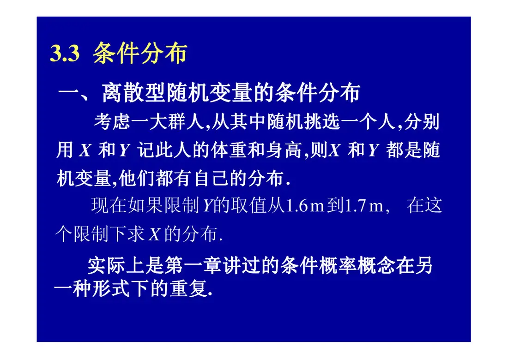

原文：

3.3 条件分布

一、离散型随机变量的条件分布

考虑一大群人,从其中随机挑选一个人,分别用 X 和 Y 记此人的体重和身高,则 X 和 Y 都是随机变量,他们都有自己的分布.

现在如果限制 Y 的取值从 1.6m 到 1.7m，在这个限制下求 X 的分布。

实际上是第一章讲过的条件概率概念在另一种形式下的重复.

### $$

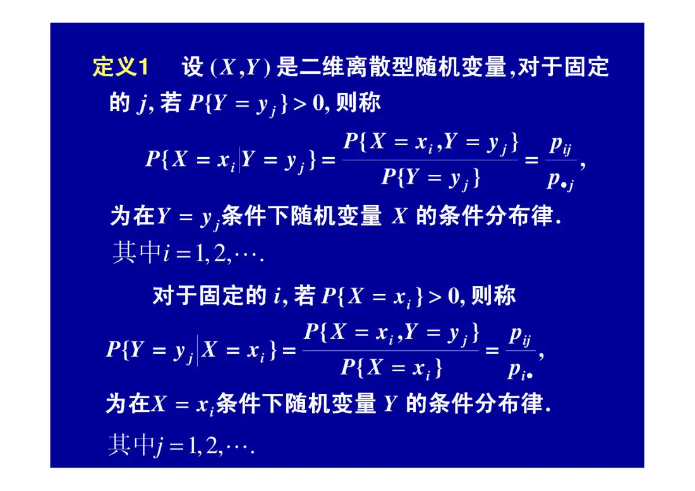

原文：

定义1 设 $(X,Y)$ 是二维离散型随机变量,对于固定的 j, 若 $P\{Y = y_{j}\} > 0$ , 则称

$$
P \{X = x _ {i} | Y = y _ {j} \} = \frac {P \{X = x _ {i} , Y = y _ {j} \}}{P \{Y = y _ {j} \}} = \frac {p _ {i j}}{p _ {\bullet j}},
$$

为在 $Y = y_{j}$ 条件下随机变量 $X$ 的条件分布律.其中 $i = 1,2,\dots .$

对于固定的 i, 若 $P\{X = x_{i}\} > 0$ , 则称 $P\{Y=y_{j}|X=x_{i}\}=\frac{P\{X=x_{i},Y=y_{j}\}}{P\{X=x_{i}\}}=\frac{p_{ij}}{p_{i}}$ ,
为在 $X=x_{i}$ 条件下随机变量Y的条件分布律.
其中 $j=1,2,\cdots$

### 二、连续型随机变量的条件分布

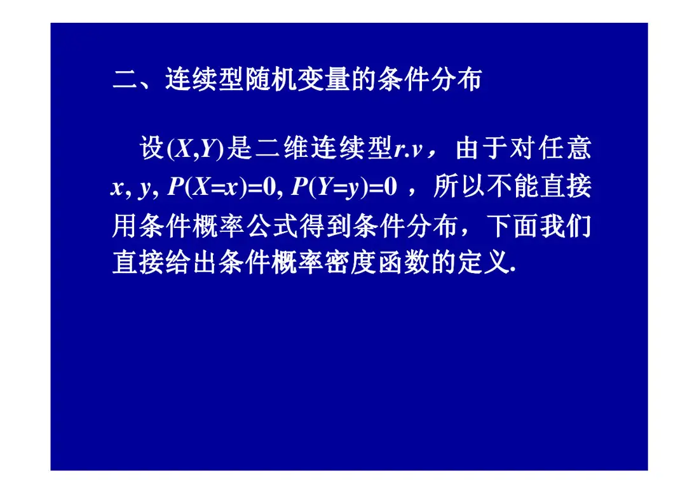

原文：

二、连续型随机变量的条件分布

设(X,Y)是二维连续型r.v，由于对任意x,y, $P(X=x)=0$ , $P(Y=y)=0$ ，所以不能直接用条件概率公式得到条件分布，下面我们直接给出条件概率密度函数的定义.

### 第 5 页

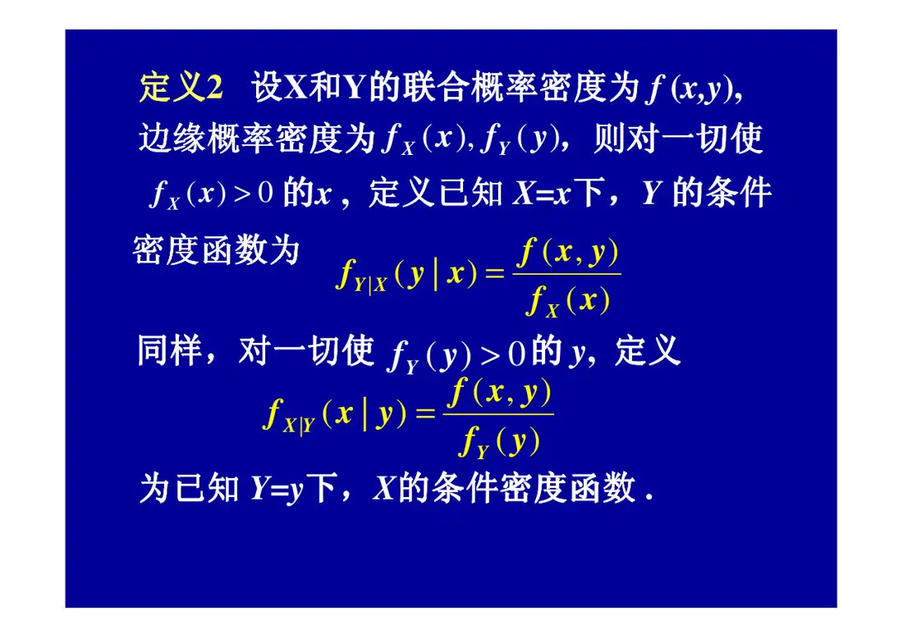

原文：

定义2 设X和Y的联合概率密度为 $f(x,y)$ ，边缘概率密度为 $f_{X}(x), f_{Y}(y)$ ，则对一切使 $f_{X}(x)>0$ 的 $x$ ，定义已知 $X=x$ 下， $Y$ 的条件密度函数为 $f_{Y|X}(y|x)=\frac{f(x,y)}{f_{X}(x)}$ 同样，对一切使 $f_{Y}(y)>0$ 的 $y$ ，定义 $f_{X|Y}(x|y)=\frac{f(x,y)}{f_{Y}(y)}$ 为已知 $Y=y$ 下， $X$ 的条件密度函数。

### 第 6 页

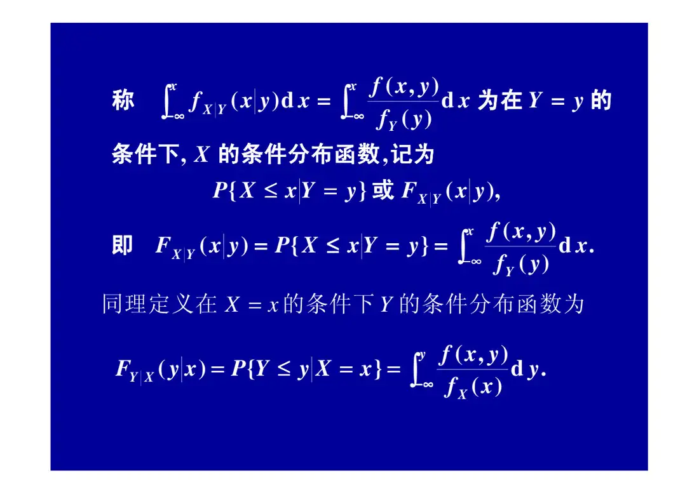

原文：

称 $\int_{-\infty}^{x}f_{X|Y}(x|y)\mathrm{d}x=\int_{-\infty}^{x}\frac{f(x,y)}{f_{Y}(y)}\mathrm{d}x$ 为在 Y=y 的条件下, X 的条件分布函数, 记为 $P\{X\leq x|Y=y\}$ 或 $F_{X|Y}(x|y)$ ,

即 $F_{X|Y}(x|y)=P\{X\leq x|Y=y\}=\int_{-\infty}^{x}\frac{f(x,y)}{f_{Y}(y)}\mathrm{d}x.$ 同理定义在 X=x 的条件下 Y 的条件分布函数为 $F_{Y|X}(y|x)=P\{Y\leq y|X=x\}=\int_{-\infty}^{y}\frac{f(x,y)}{f_{X}(x)}\mathrm{d}y.$

### 解 由题意知随机变量 $(X,Y)$ 的概率密度为

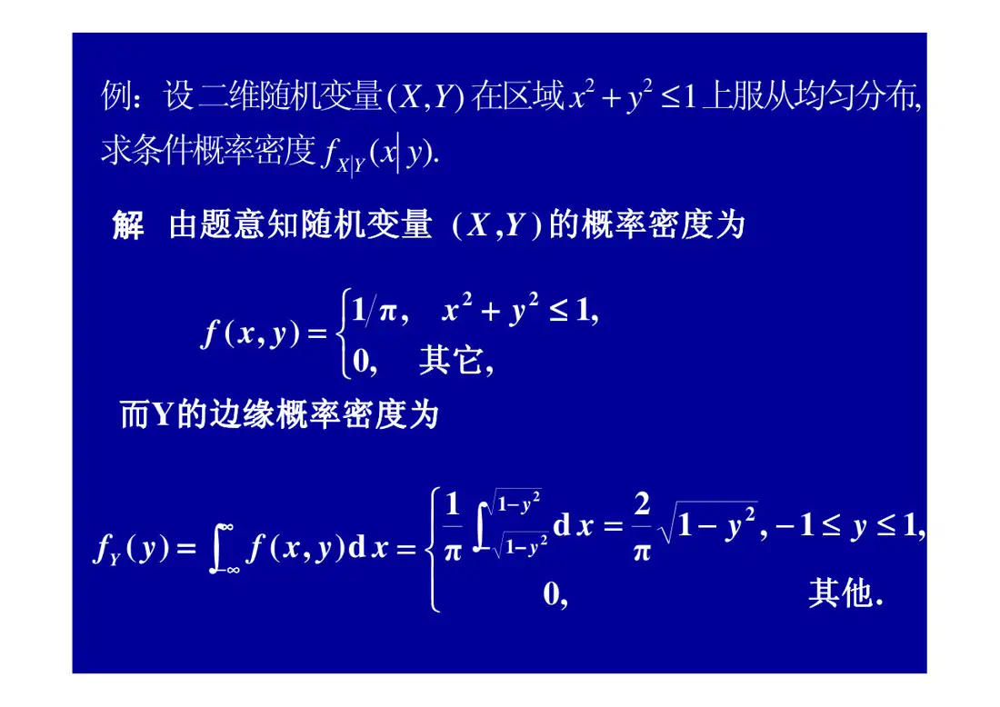

原文：

例: 设二维随机变量 $(X, Y)$ 在区域 $x^{2} + y^{2} \leq 1$ 上服从均匀分布, 求条件概率密度 $f_{X|Y}(x|y)$ .

解 由题意知随机变量 $(X,Y)$ 的概率密度为

$$
f (x, y) = \left\{ \begin{array}{l l} 1 / \pi , & x ^ {2} + y ^ {2} \leq 1, \\ 0, & \text {其它}, \end{array} \right.
$$

而Y的边缘概率密度为

$$
f _ {Y} (y) = \int_ {- \infty} ^ {\infty} f (x, y) \mathrm{d} x = \left\{ \begin{array}{c c} \frac {1}{\pi} \int_ {- \sqrt {1 - y ^ {2}}} ^ {\sqrt {1 - y ^ {2}}} \mathrm{d} x = \frac {2}{\pi} \sqrt {1 - y ^ {2}}, - 1 \leq y \leq 1, \\ 0, & \text {其他.} \end{array} \right.
$$

### 于是当 -1 < y < 1 时, 有

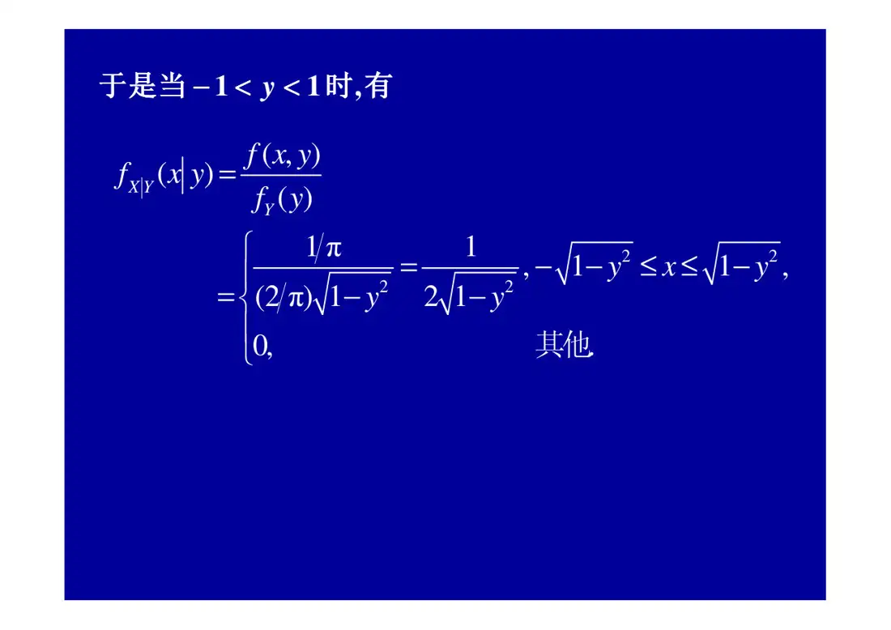

原文：

于是当 -1 < y < 1 时, 有

$$
\begin{array}{l} {f _ {X \mid Y} (x \mid y) = \frac {f (x , y)}{f _ {Y} (y)}} \\ {= \left\{ \begin{array}{l l} {\frac {1 / \pi}{(2 / \pi) \sqrt {1 - y ^ {2}}}} & {= \frac {1}{2 \sqrt {1 - y ^ {2}}}, - \sqrt {1 - y ^ {2}} \leq x \leq \sqrt {1 - y ^ {2}},} \\ {0,} & {\text {其他}} \end{array} \right.} \end{array}
$$

### 3.4 两个随机变量的相互独立性

原文：

3.4 两个随机变量的相互独立性

在第一章，我们引进了两个事件的独立性的概念，即若事件A与事件B满足P(AB)=P(A)P(B)，则称A与B是独立的。

现在，我们把这个概念引进到随机变量上来。

### $$

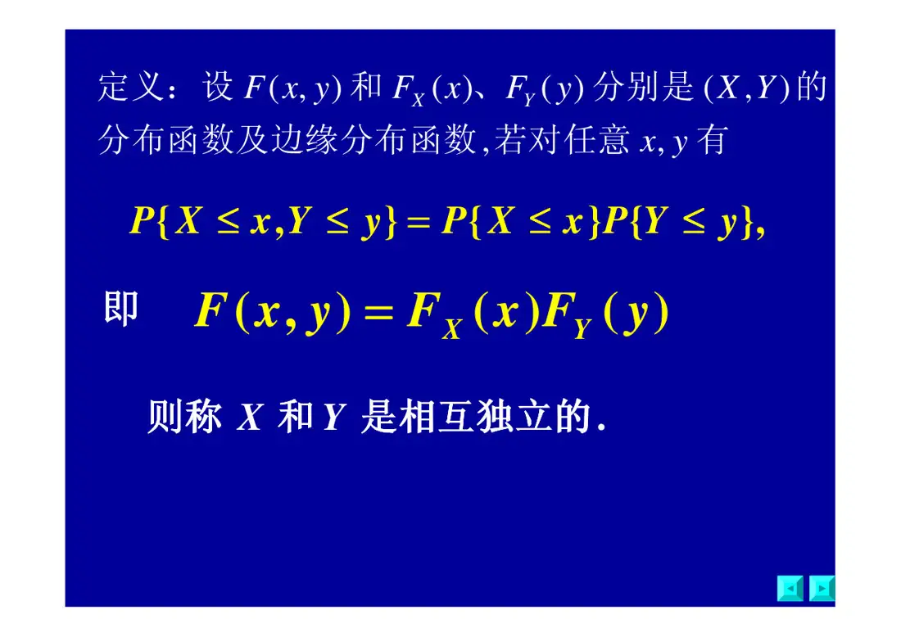

原文：

定义: 设 $F(x, y)$ 和 $F_{X}(x)$ 、 $F_{Y}(y)$ 分别是 $(X, Y)$ 的分布函数及边缘分布函数, 若对任意 $x, y$ 有

$$
P \{X \leq x, Y \leq y \} = P \{X \leq x \} P \{Y \leq y \},
$$

即 $F(x,y)=F_{X}(x)F_{Y}(y)$

则称 $X$ 和 $Y$ 是相互独立的.

### 3.4.2 离散型随机变量的情形

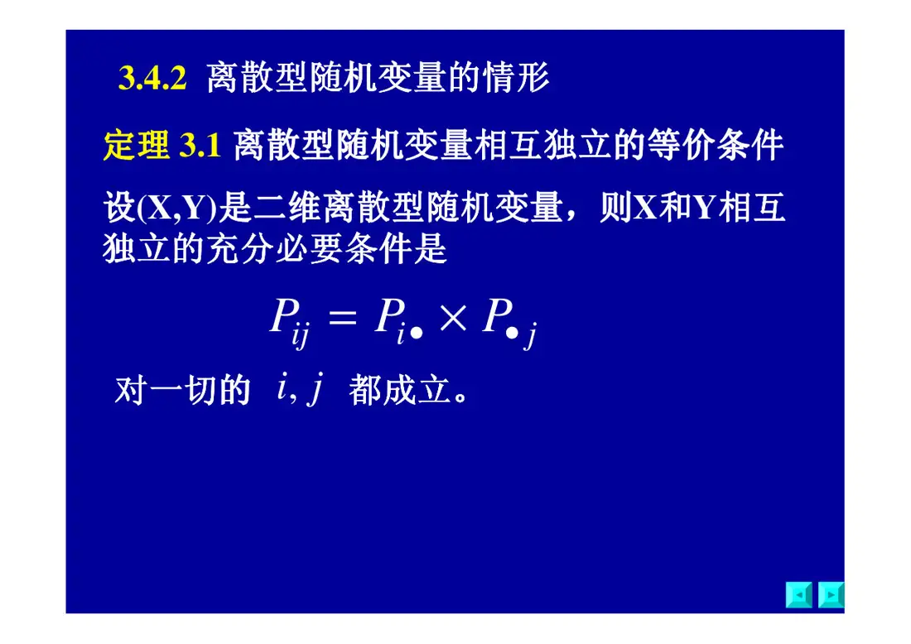

原文：

3.4.2 离散型随机变量的情形
定理 3.1 离散型随机变量相互独立的等价条件设(X,Y)是二维离散型随机变量，则X和Y相互独立的充分必要条件是

$$
P _ {i j} = P _ {i \bullet} \times P _ {\bullet j}
$$

对一切的 i, j 都成立。

### 第 12 页

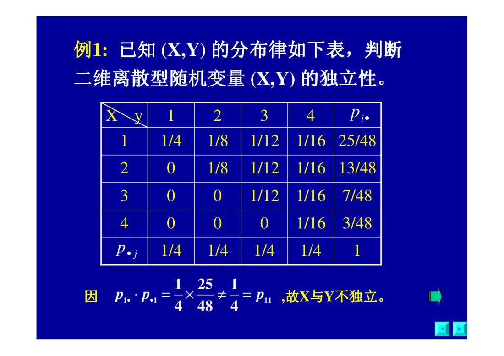

原文：

例1: 已知 (X,Y) 的分布律如下表, 判断二维离散型随机变量 (X,Y) 的独立性。

<table><tr><td>X y</td><td>1</td><td>2</td><td>3</td><td>4</td><td> $p_{i\bullet}$ </td></tr><tr><td>1</td><td>1/4</td><td>1/8</td><td>1/12</td><td>1/16</td><td>25/48</td></tr><tr><td>2</td><td>0</td><td>1/8</td><td>1/12</td><td>1/16</td><td>13/48</td></tr><tr><td>3</td><td>0</td><td>0</td><td>1/12</td><td>1/16</td><td>7/48</td></tr><tr><td>4</td><td>0</td><td>0</td><td>0</td><td>1/16</td><td>3/48</td></tr><tr><td> $p_{\cdot j}$ </td><td>1/4</td><td>1/4</td><td>1/4</td><td>1/4</td><td>1</td></tr></table>

因 $p_{1\bullet} \cdot p_{\bullet 1} = \frac{1}{4} \times \frac{25}{48} \neq \frac{1}{4} = p_{11}$ ，故X与Y不独立。

### 3.4.3. 连续型随机变量的情形

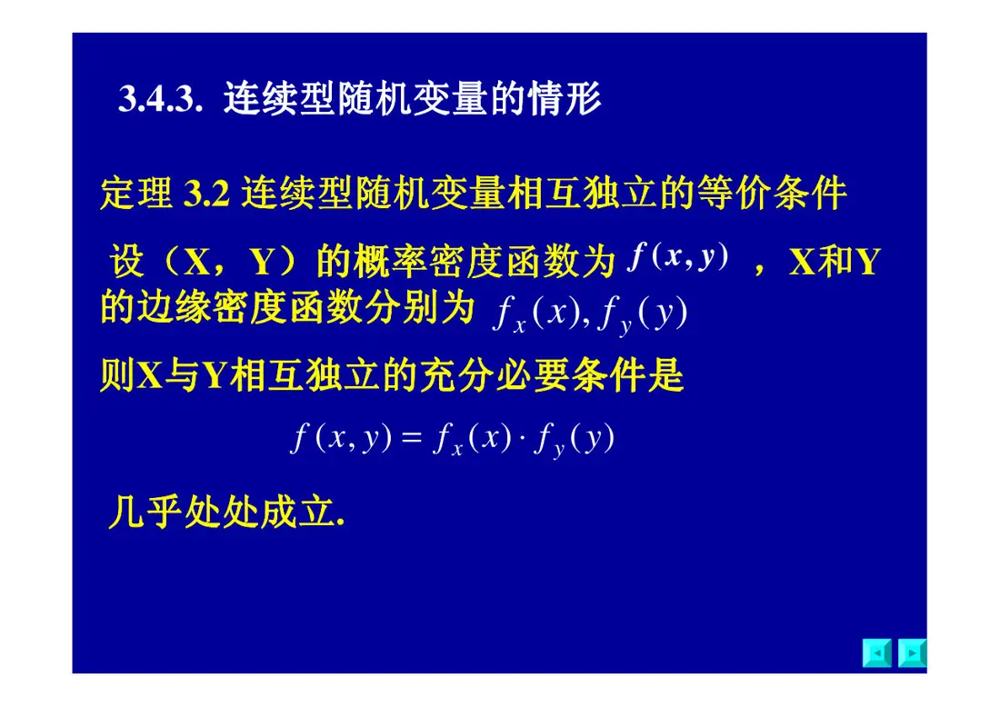

原文：

3.4.3. 连续型随机变量的情形

定理 3.2 连续型随机变量相互独立的等价条件

设（X，Y）的概率密度函数为 $f(x,y)$ ，X 和 Y 的边缘密度函数分别为 $f_{x}(x), f_{y}(y)$

则X与Y相互独立的充分必要条件是

$$
f (x, y) = f _ {x} (x) \cdot f _ {y} (y)
$$

几乎处处成立.

### 例2 设随机变量(X,Y)的概率密度为

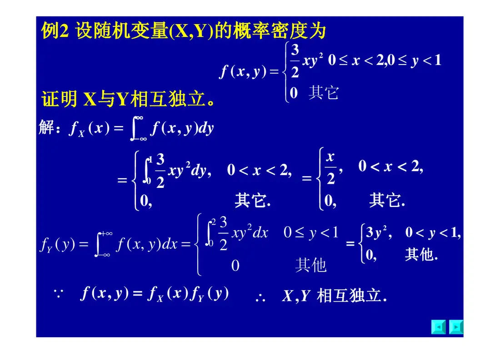

原文：

例2 设随机变量(X,Y)的概率密度为

证明 X与Y相互独立。

$$
f (x, y) = \left\{ \begin{array}{l l} \frac {3}{2} x y ^ {2} & 0 \leq x <   2, 0 \leq y <   1 \\ 0 & \text {其它} \end{array} \right.
$$

解： $f_{X}(x)=\int_{-\infty}^{\infty}f(x,y)dy$ $=\left\{\begin{aligned}\int_{0}^{1}\frac{3}{2}xy^{2}dy,&0<x<2,\\ 0,& 其它.\end{aligned}\right.=\left\{\begin{aligned}\frac{x}{2},&0<x<2,\\ 0,& 其它.\end{aligned}\right.$ $f_{Y}(y)=\int_{-\infty}^{+\infty}f(x,y)dx=\left\{\begin{aligned}\int_{0}^{2}\frac{3}{2}xy^{2}dx&0\leq y<1\\ 0& 其他.\end{aligned}\right.=\left\{\begin{aligned}3y^{2},&0<y<1,\\ 0,& 其他.\end{aligned}\right.$ $\because f(x,y)=f_{X}(x)f_{Y}(y)\quad\therefore X,Y 相互独立.$

### 解 依题意知(X,Y)的概率密度为

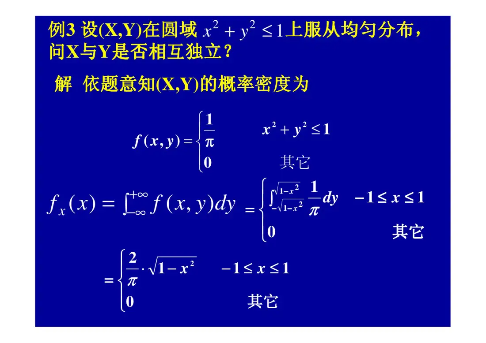

原文：

例3 设(X,Y)在圆域 $x^{2} + y^{2} \leq 1$ 上服从均匀分布，问X与Y是否相互独立？

解 依题意知(X,Y)的概率密度为

$$
\begin{array}{r l} & {f (x, y) = \left\{ \begin{array}{l l} { \frac {1}{\pi}} & {x ^ {2} + y ^ {2} \leq 1} \\ {0} & {\text {其它}} \end{array} \right.} \\ & {f _ {x} (x) = \int_ {- \infty} ^ {+ \infty} f (x, y) d y = \left\{ \begin{array}{l l} { \int_ {- \sqrt {1 - x ^ {2}}} ^ {\sqrt {1 - x ^ {2}}} \frac {1}{\pi} d y} & {- 1 \leq x \leq 1} \\ {0} & {\text {其它}} \end{array} \right.} \\ & {= \left\{ \begin{array}{l l} { \frac {2}{\pi} \cdot \sqrt {1 - x ^ {2}}} & {- 1 \leq x \leq 1} \\ {0} & {\text {其它}} \end{array} \right.} \end{array}
$$

### 同理可得

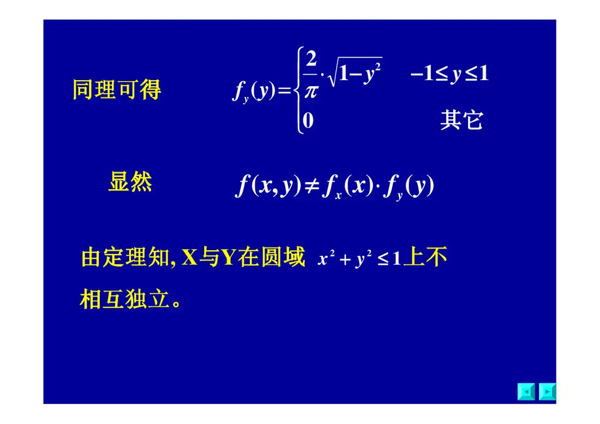

原文：

同理可得

$$
f _ {y} (y) = \left\{ \begin{array}{l} \frac {2}{\pi} \cdot \sqrt {1 - y ^ {2}} \\ 0 \end{array} \right.
$$

其它

显然

$$
f (x, y) \neq f _ {x} (x) \cdot f _ {y} (y)
$$

由定理知, X与Y在圆域 $x^{2} + y^{2} \leq 1$ 上不相互独立。

### 例4: 设 $(X,Y)$ 的概率密度为

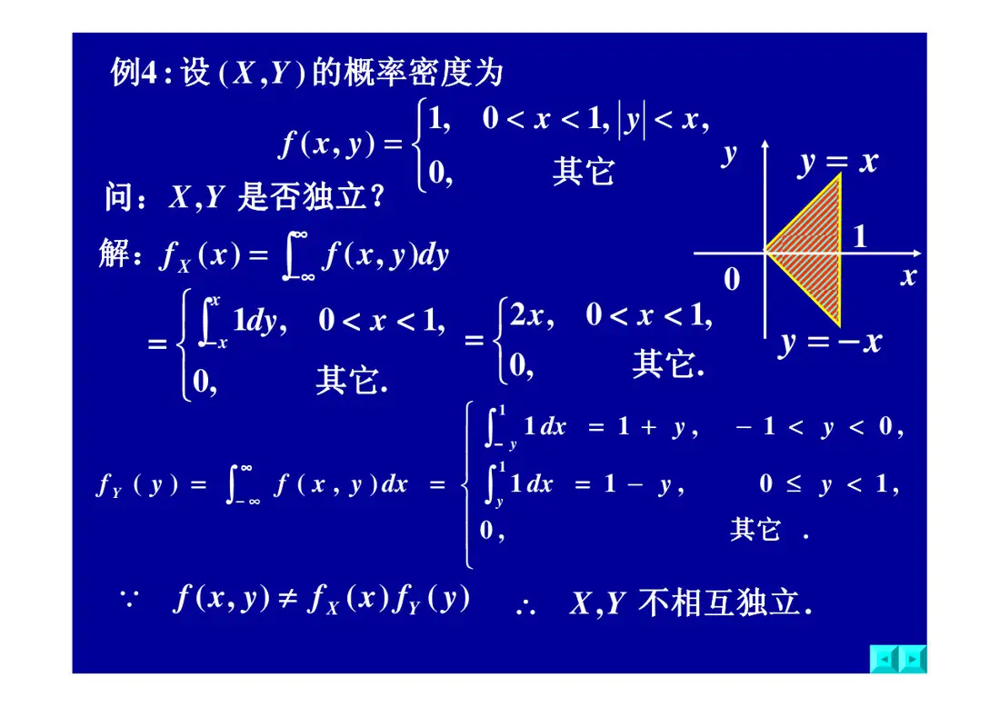

原文：

例4: 设 $(X,Y)$ 的概率密度为

问：X,Y 是否独立？

其它

$$
f _ {X} (x) = \int_ {- \infty} ^ {\infty} f (x, y) d y
$$

$f_{Y}(y) = \int_{-\infty}^{\infty} f(x, y) dx = \left\{ \begin{array}{ll}\int_{-y}^{1} 1 dx & = 1 + y, -1 < y < 0,\\ \int_{y}^{1} 1 dx & = 1 - y, 0 \leq y < 1,\\ 0, & \text{其它．} \end{array} \right.$

$\because f(x,y)\neq f_{X}(x)f_{Y}(y)\quad \therefore X,Y$ 不相互独立.

### 对二维正态分布

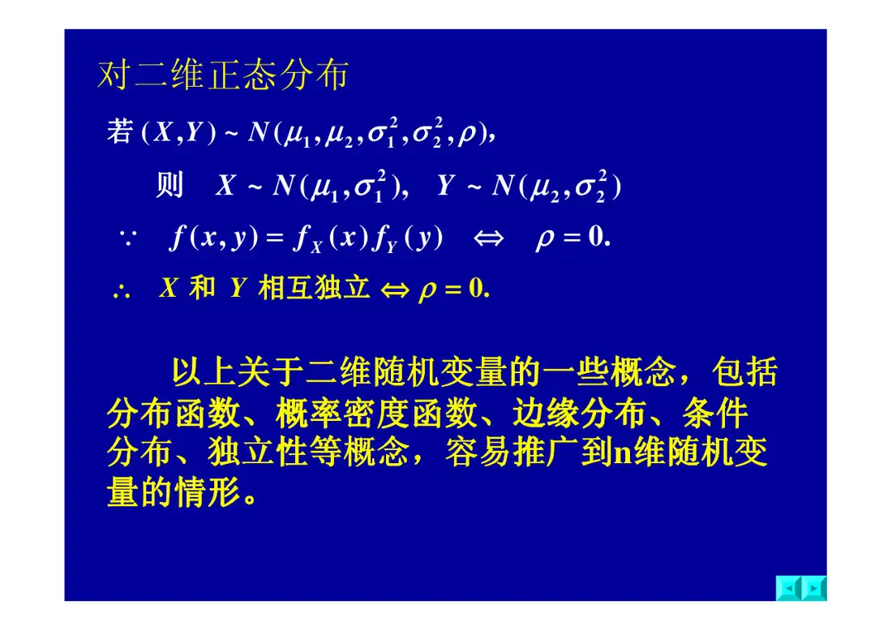

原文：

对二维正态分布

若 $(X,Y)\sim N(\mu_1,\mu_2,\sigma_1^2,\sigma_2^2,\rho),$ 则 $X\sim N(\mu_1,\sigma_1^2),\quad Y\sim N(\mu_2,\sigma_2^2)$ $\because f(x,y) = f_X(x)f_Y(y)\Leftrightarrow \rho = 0.$ $\therefore X$ 和 $Y$ 相互独立 $\Leftrightarrow \rho = 0.$

以上关于二维随机变量的一些概念，包括分布函数、概率密度函数、边缘分布、条件分布、独立性等概念，容易推广到n维随机变量的情形。
