# 《概率论与数理统计》第4章 多维随机变量及其分布：协方差及相关系数（课件）

原件的每一页，下面附识别出的文字。

### 4.3 协方差及相关系数

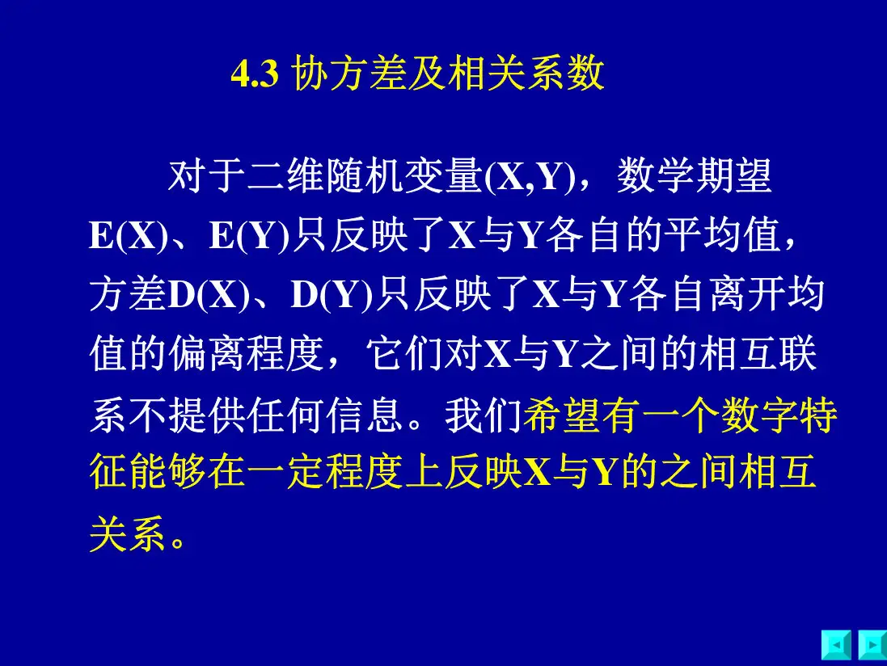

原文：

4.3 协方差及相关系数

对于二维随机变量(X,Y)，数学期望E(X)、E(Y)只反映了X与Y各自的平均值，方差D(X)、D(Y)只反映了X与Y各自离开均值的偏离程度，它们对X与Y之间的相互联系不提供任何信息。我们希望有一个数字特征能够在一定程度上反映X与Y的之间相互关系。

### 由方差的性质

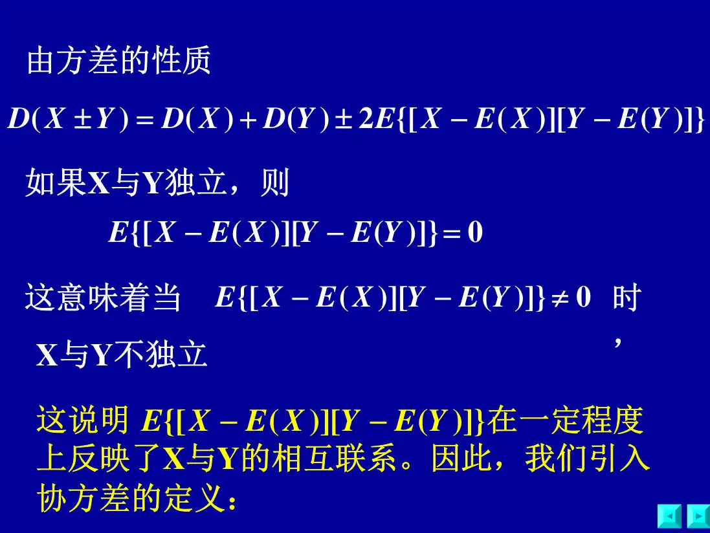

原文：

由方差的性质

如果X与Y独立，则

$$
E \{[ X - E (X) ] [ Y - E (Y) ] \} = 0
$$

这意味着当 $E\{[X - E(X)][Y - E(Y)]\} \neq 0$ 时

这说明 $E\{[X - E(X)][Y - E(Y)]\}$ 在一定程度上反映了X与Y的相互联系。因此，我们引入协方差的定义：

### 一. 协方差

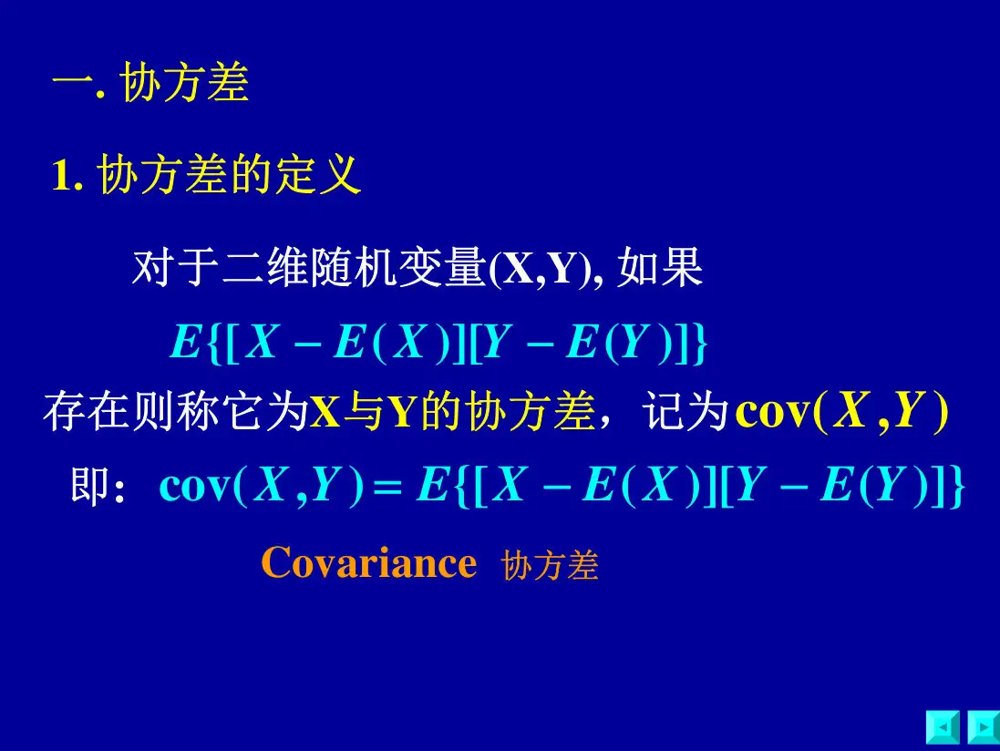

原文：

一. 协方差

1. 协方差的定义

对于二维随机变量(X,Y), 如果 $E\{[X - E(X)][Y - E(Y)]\}$ 存在则称它为X与Y的协方差，记为 $\text{cov}(X, Y)$ 即： $\text{cov}(X, Y) = E\{[X - E(X)][Y - E(Y)]\}$ Covariance 协方差

### 注：由协方差定义

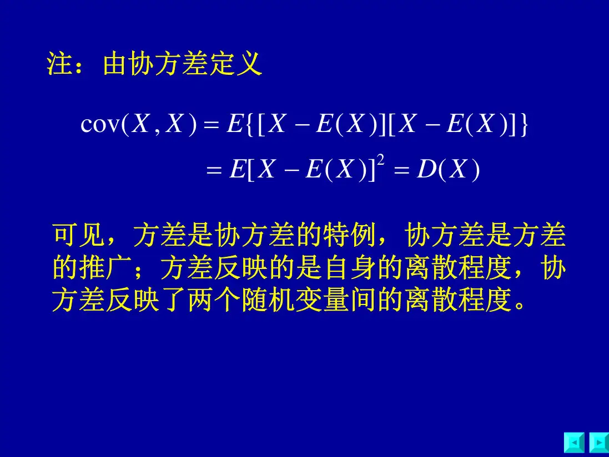

原文：

注：由协方差定义

$$
\begin{array}{r l} \operatorname{cov} (X, X) & = E \{[ X - E (X) ] [ X - E (X) ] \} \\ & = E [ X - E (X) ] ^ {2} = D (X) \end{array}
$$

可见，方差是协方差的特例，协方差是方差的推广；方差反映的是自身的离散程度，协方差反映了两个随机变量间的离散程度。

### 2. 协方差的常用计算公式:

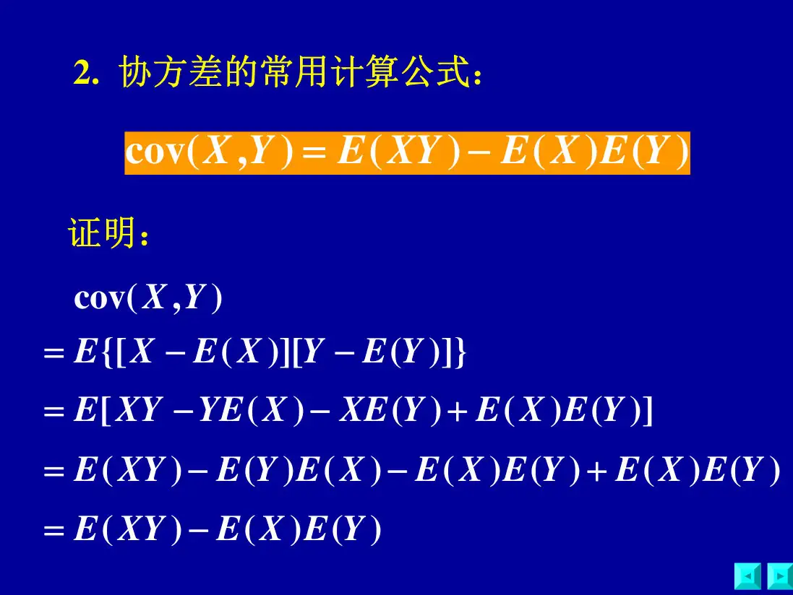

原文：

2. 协方差的常用计算公式:

$$
\operatorname{cov} (X, Y) = E (X Y) - E (X) E (Y)
$$

证明：

$\begin{array}{l}\operatorname {cov}(X,Y)\\ = E\{[X - E(X)][Y - E(Y)]\} \\ = E[XY - YE(X) - XE(Y) + E(X)E(Y)]\\ = E(XY) - E(Y)E(X) - E(X)E(Y) + E(X)E(Y)\\ = E(XY) - E(X)E(Y) \end{array}$

### 3. 协方差的基本性质:

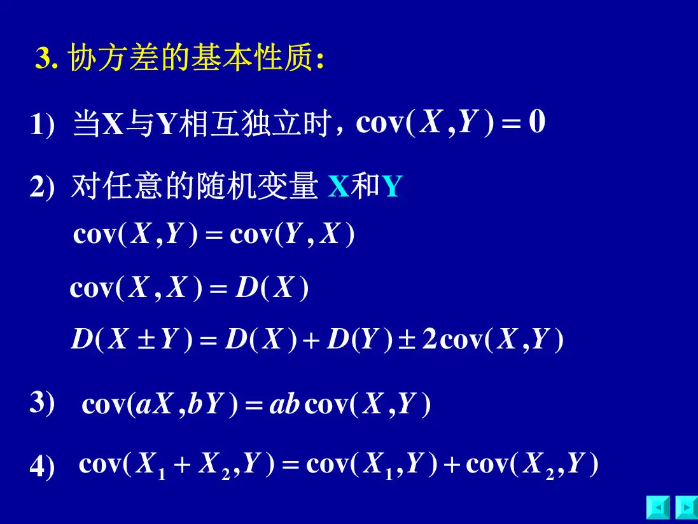

原文：

3. 协方差的基本性质:

1) 当X与Y相互独立时, $\operatorname{cov}(X,Y)=0$

2) 对任意的随机变量 X 和 Y $\operatorname{cov}(X,Y)=\operatorname{cov}(Y,X)$ $\operatorname{cov}(X,X)=D(X)$ $D(X \pm Y)=D(X)+D(Y)\pm 2\operatorname{cov}(X,Y)$

3) $\operatorname{cov}(aX,bY)=ab\operatorname{cov}(X,Y)$

4) $\operatorname{cov}(X_1 + X_2, Y) = \operatorname{cov}(X_1, Y) + \operatorname{cov}(X_2, Y)$

### 第 7 页

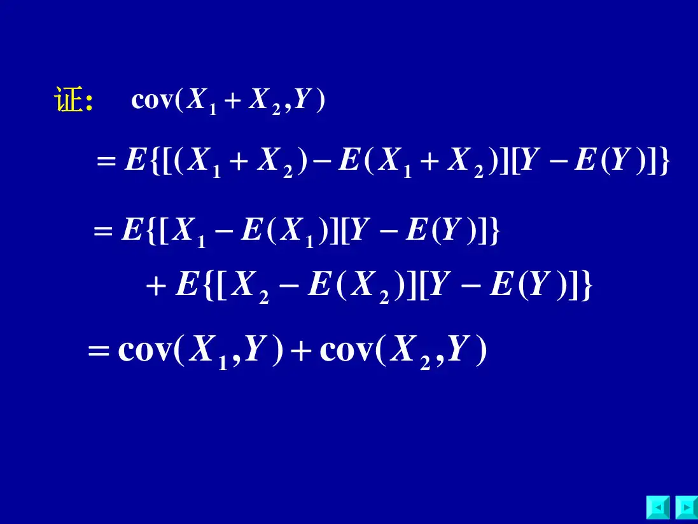

原文：

证： $\operatorname {cov}(X_1 + X_2,Y)$ $= E\{[(X_1 + X_2) - E(X_1 + X_2)][Y - E(Y)]\}$ $= E\{[X_1 - E(X_1)][Y - E(Y)]\} +E\{[X_2 - E(X_2)][Y - E(Y)]\}$ $= \operatorname {cov}(X_1,Y) + \operatorname {cov}(X_2,Y)$

### 二、相关系数

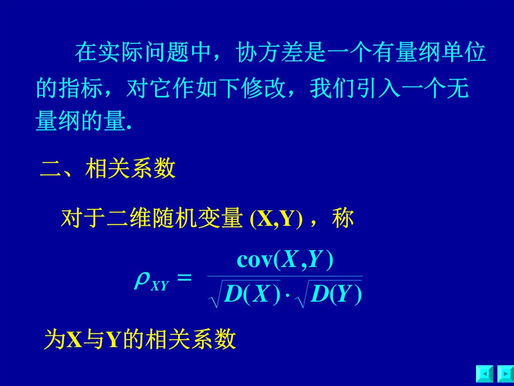

原文：

在实际问题中，协方差是一个有量纲单位的指标，对它作如下修改，我们引入一个无量纲的量.

二、相关系数

对于二维随机变量 (X,Y)，称

$$
\rho_ {X Y} = \frac {\operatorname{cov} (X , Y)}{\sqrt {D (X)} \cdot \sqrt {D (Y)}}
$$

为X与Y的相关系数

### 注：

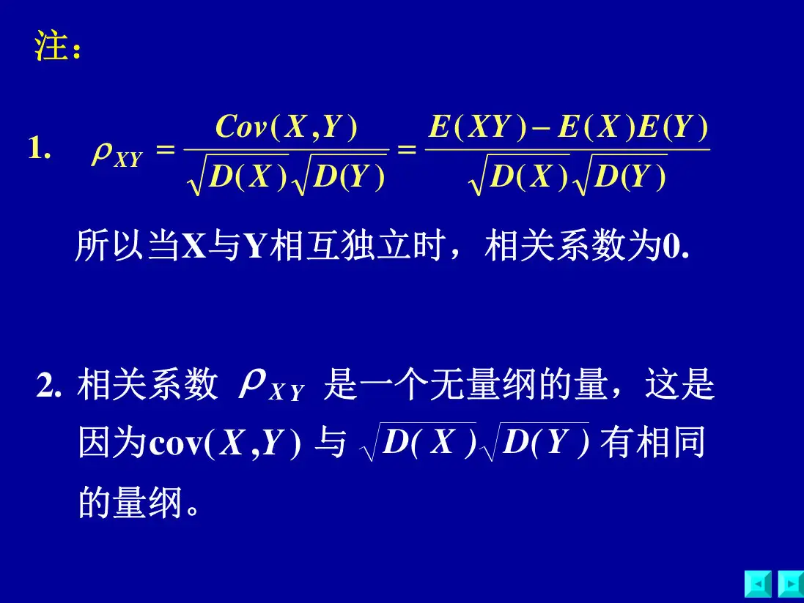

原文：

1. $\rho_{XY} = \frac{Cov(X,Y)}{\sqrt{D(X)}\sqrt{D(Y)}} = \frac{E(XY) - E(X)E(Y)}{\sqrt{D(X)}\sqrt{D(Y)}}$ 所以当X与Y相互独立时，相关系数为0.

2. 相关系数 $\rho_{XY}$ 是一个无量纲的量, 这是因为 $\operatorname{cov}(X,Y)$ 与 $\sqrt{D(X)}\sqrt{D(Y)}$ 有相同的量纲。

注：

### 3. 相关系数 $\rho_{XY}$ 满足

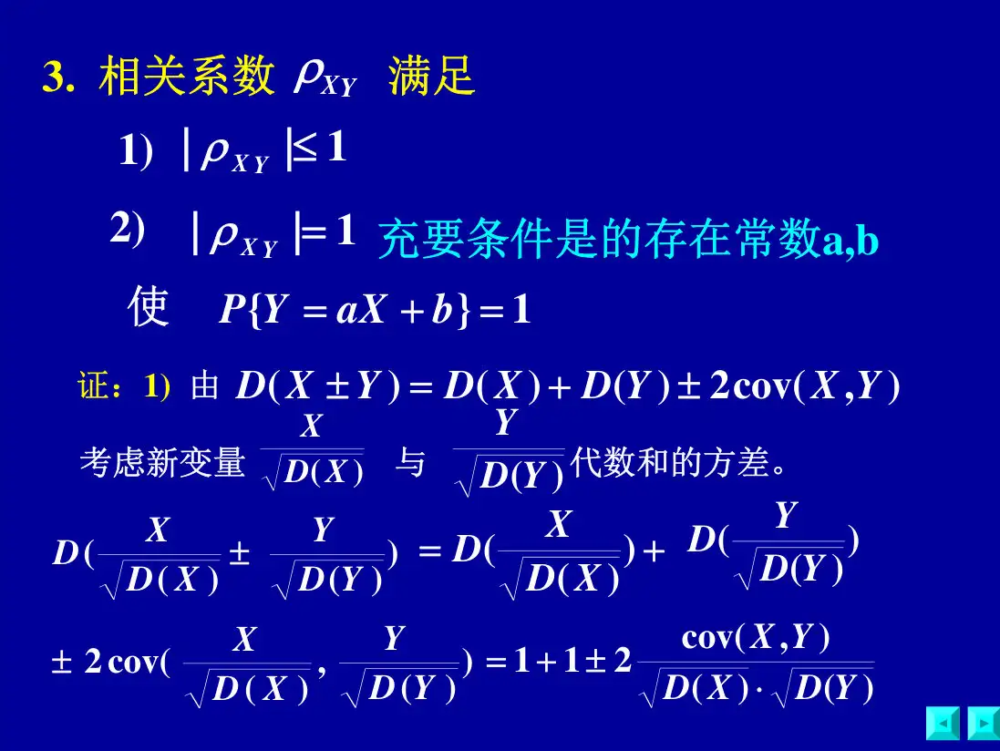

原文：

3. 相关系数 $\rho_{XY}$ 满足
1) $|\rho_{XY}| \leq 1$ 2) $|\rho_{XY}| = 1$ 充要条件是的存在常数a,b
使 $P\{Y = aX + b\} = 1$ 证：1) 由 $D(X \pm Y) = D(X) + D(Y) \pm 2\text{cov}(X,Y)$ 考虑新变量 $\frac{X}{\sqrt{D(X)}}$ 与 $\frac{Y}{\sqrt{D(Y)}}$ 代数和的方差。 $D(\frac{X}{\sqrt{D(X)}} \pm \frac{Y}{\sqrt{D(Y)}}) = D(\frac{X}{\sqrt{D(X)}}) + D(\frac{Y}{\sqrt{D(Y)}})$ $\pm 2\text{cov}(\frac{X}{\sqrt{D(X)}}, \frac{Y}{\sqrt{D(Y)}}) = 1 + 1 \pm 2\frac{\text{cov}(X,Y)}{\sqrt{D(X)} \cdot \sqrt{D(Y)}}$

### $$

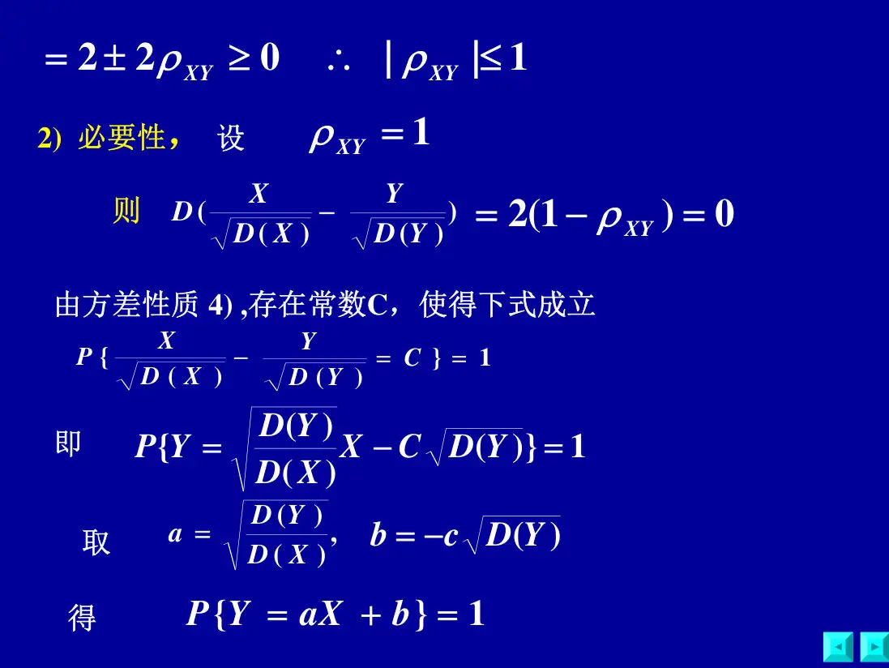

原文：

$$
= 2 \pm 2 \rho_ {X Y} \geq 0 \quad \therefore | \rho_ {X Y} | \leq 1
$$

2) 必要性，设 $\rho_{XY} = 1$

则 $D(\frac{X}{\sqrt{D(X)}} - \frac{Y}{\sqrt{D(Y)}}) = 2(1 - \rho_{XY}) = 0$

由方差性质 4), 存在常数 C, 使得下式成立

$$
P \left\{\frac {X}{\sqrt {D (X)}} - \frac {Y}{\sqrt {D (Y)}} = C \right\} = 1
$$

即 $P\{Y = \sqrt{\frac{D(Y)}{D(X)}} X - C\sqrt{D(Y)}\} = 1$

取 $a = \sqrt{\frac{D(Y)}{D(X)}}$ , $b = -c\sqrt{D(Y)}$

得 $P\{Y = aX + b\} = 1$

### 如果 $\rho_{XY} = -1$ 可考虑

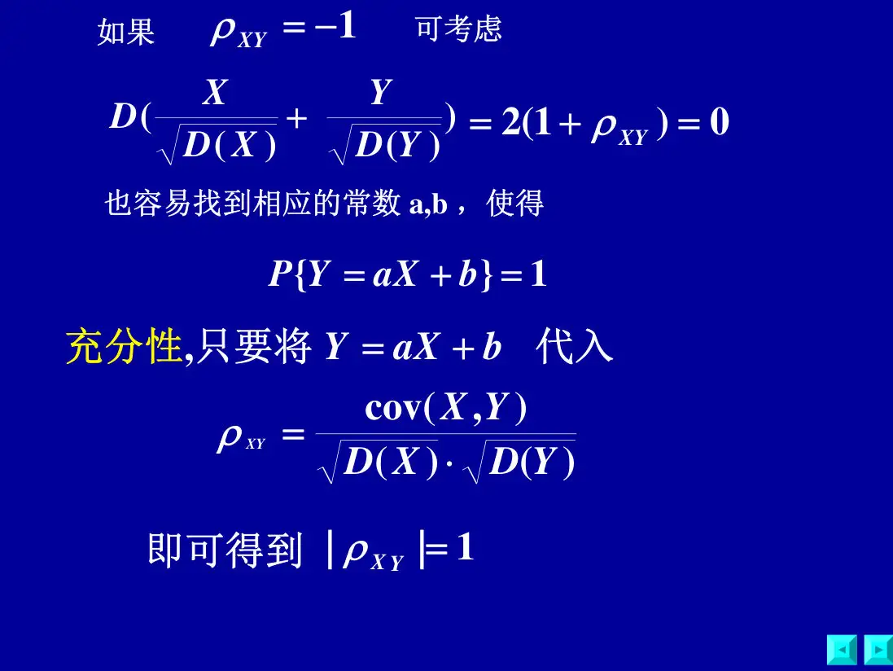

原文：

如果 $\rho_{XY} = -1$ 可考虑

$$
D (\frac {X}{\sqrt {D (X)}} + \frac {Y}{\sqrt {D (Y)}}) = 2 (1 + \rho_ {X Y}) = 0
$$

也容易找到相应的常数 a,b，使得

$$
P \{Y = a X + b \} = 1
$$

充分性,只要将 $Y = aX + b$ 代入

$$
\rho_ {X Y} = \frac {\operatorname{cov} (X , Y)}{\sqrt {D (X)} \cdot \sqrt {D (Y)}}
$$

即可得到 $\left|\rho_{XY}\right|=1$

### 第 13 页

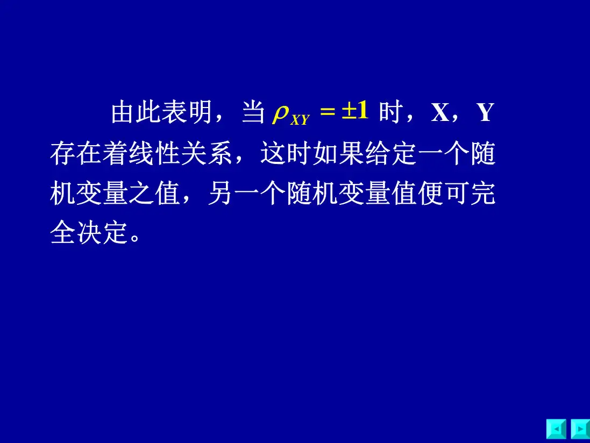

原文：

由此表明，当 $\rho_{XY} = \pm1$ 时，X，Y存在着线性关系，这时如果给定一个随机变量之值，另一个随机变量值便可完全决定。

### 第 14 页

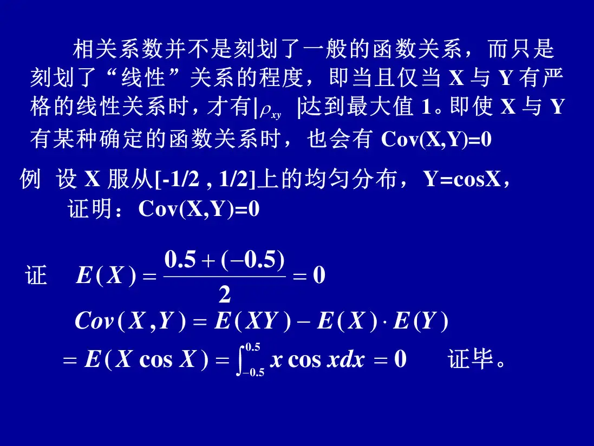

原文：

相关系数并不是刻划了一般的函数关系，而只是刻划了“线性”关系的程度，即当且仅当X与Y有严格的线性关系时，才有 $|\rho_{xy}|$ 达到最大值1。即使X与Y有某种确定的函数关系时，也会有 $\mathrm{Cov}(X,Y)=0$ 例 设 X 服从 $[-1/2, 1/2]$ 上的均匀分布， $Y=\cos X$ ，
证明： $\mathrm{Cov}(X,Y)=0$ 证 $E(X)=\frac{0.5+(-0.5)}{2}=0$ $Cov(X,Y)=E(XY)-E(X)\cdot E(Y)$ $=E(X\cos X)=\int_{-0.5}^{0.5}x\cos xdx=0$ 证毕。

### 4. 若X与Y的相关系数 $\rho_{XY}=0$ 则称X与Y不相关。

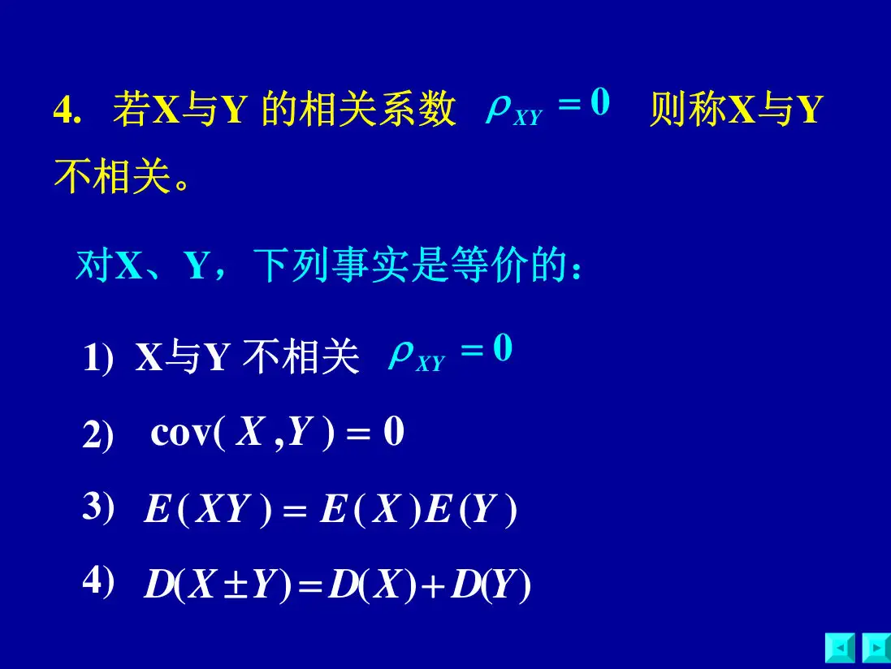

原文：

4. 若X与Y的相关系数 $\rho_{XY}=0$ 则称X与Y不相关。

对X、Y，下列事实是等价的：

1) X与Y不相关 $\rho_{XY}=0$

2) $\operatorname{cov}(X,Y)=0$

3) $E(XY) = E(X)E(Y)$

4) $D(X \pm Y) = D(X) + D(Y)$

### 若X与Y独立 $\Rightarrow$ X与Y不相关，

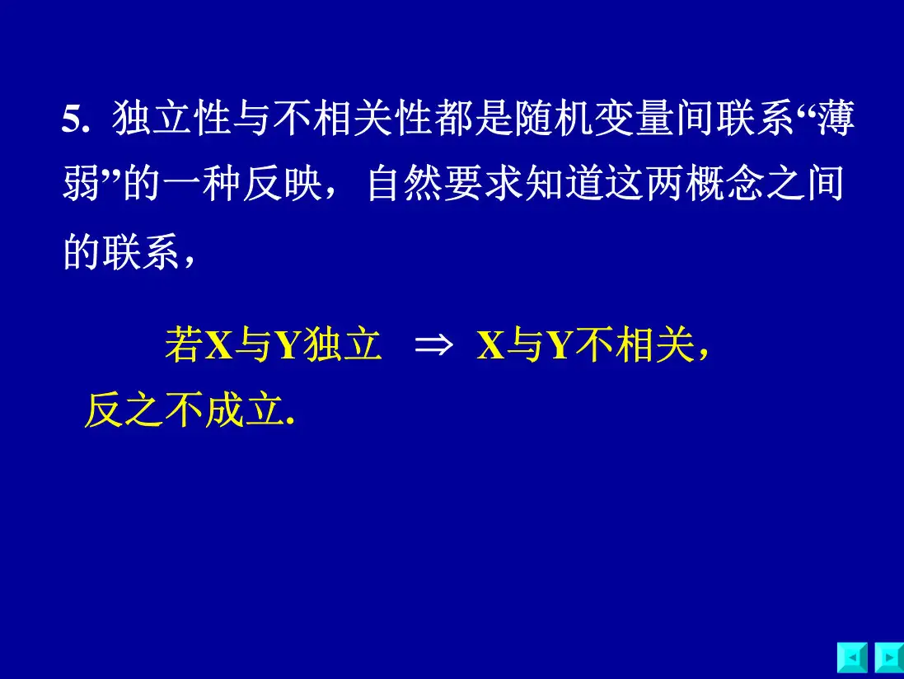

原文：

5. 独立性与不相关性都是随机变量间联系“薄弱”的一种反映，自然要求知道这两概念之间的联系，

若X与Y独立 $\Rightarrow$ X与Y不相关，
反之不成立.

### 解: 由 $\theta$ 所服从的分布知其密度函数为:

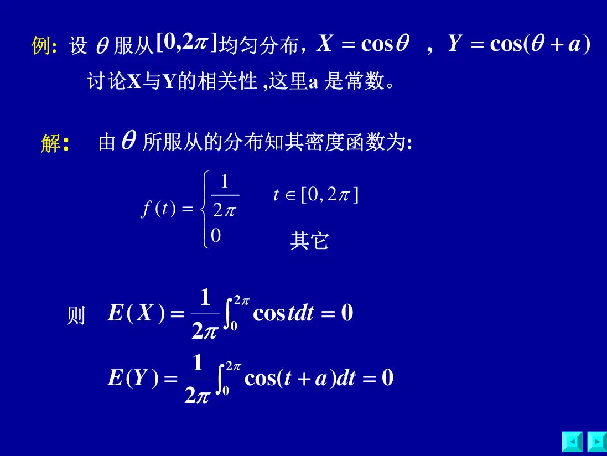

原文：

例：设 $\theta$ 服从 $[0,2\pi]$ 均匀分布， $X = \cos \theta$ ， $Y = \cos (\theta + a)$ 讨论X与Y的相关性，这里a是常数。

解: 由 $\theta$ 所服从的分布知其密度函数为:

$$
f (t) = \left\{ \begin{array}{l l} \frac {1}{2 \pi} & t \in [ 0, 2 \pi ] \\ 0 & \text {其它} \end{array} \right.
$$

则 $E(X) = \frac{1}{2\pi}\int_{0}^{2\pi}\cos tdt = 0$

$$
E (Y) = \frac {1}{2 \pi} \int_ {0} ^ {2 \pi} \cos (t + a) d t = 0
$$

### $$

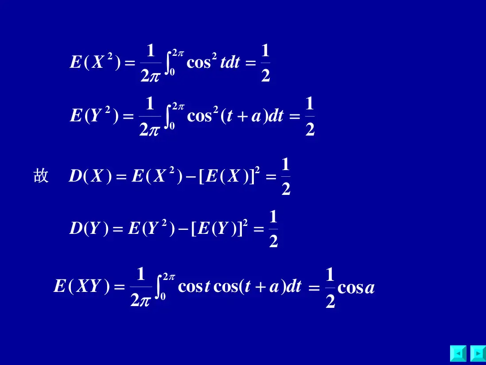

原文：

$$
E \left(X ^ {2}\right) = \frac {1}{2 \pi} \int_ {0} ^ {2 \pi} \cos^ {2} t d t = \frac {1}{2}
$$

$$
E \left(Y ^ {2}\right) = \frac {1}{2 \pi} \int_ {0} ^ {2 \pi} \cos^ {2} (t + a) d t = \frac {1}{2}
$$

$$
\text {故} \quad D (X) = E (X ^ {2}) - [ E (X) ] ^ {2} = \frac {1}{2}
$$

$$
D (Y) = E \left(Y ^ {2}\right) - [ E (Y) ] ^ {2} = \frac {1}{2}
$$

$$
E (X Y) = \frac {1}{2 \pi} \int_ {0} ^ {2 \pi} \cos t \cos (t + a) d t = \frac {1}{2} \cos a
$$

### $$

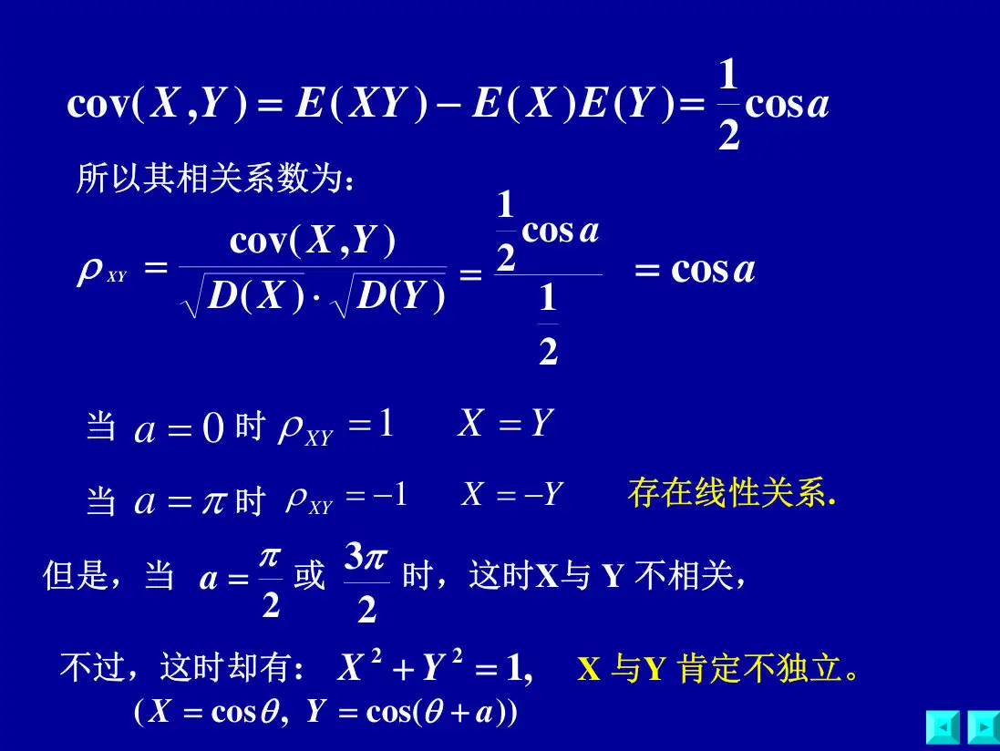

原文：

$$
\operatorname{cov} (X, Y) = E (X Y) - E (X) E (Y) = \frac {1}{2} \cos a
$$

所以其相关系数为:

$$
\rho_ {X Y} = \frac {\operatorname{cov} (X , Y)}{\sqrt {D (X)} \cdot \sqrt {D (Y)}} = \frac {\frac {1}{2} \cos a}{\frac {1}{2}} = \cos a
$$

当 $a = 0$ 时 $\rho_{XY} = 1$ $X = Y$

当 $a = \pi$ 时 $\rho_{XY} = -1$ $X = -Y$ 存在线性关系.

但是，当 $a=\frac{\pi}{2}$ 或 $\frac{3\pi}{2}$ 时，这时 X 与 Y 不相关，

不过，这时却有： $X^{2} + Y^{2} = 1$ ，X与Y肯定不独立。

$$
(X = \cos \theta , Y = \cos (\theta + a))
$$

### 总结:

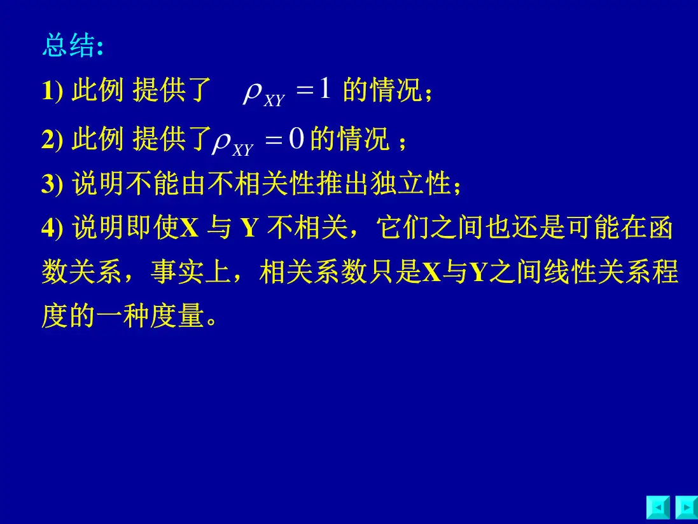

原文：

总结:

1) 此例 提供了 $\rho_{XY}=1$ 的情况;

2) 此例 提供了 $\rho_{XY} = 0$ 的情况；

3) 说明不能由不相关性推出独立性;

4) 说明即使X与Y不相关，它们之间也还是可能在函数关系，事实上，相关系数只是X与Y之间线性关系程度的一种度量。

### 从而可知，二维正态分布的密度函数中的参数ρ，就是X与Y的相关系数。

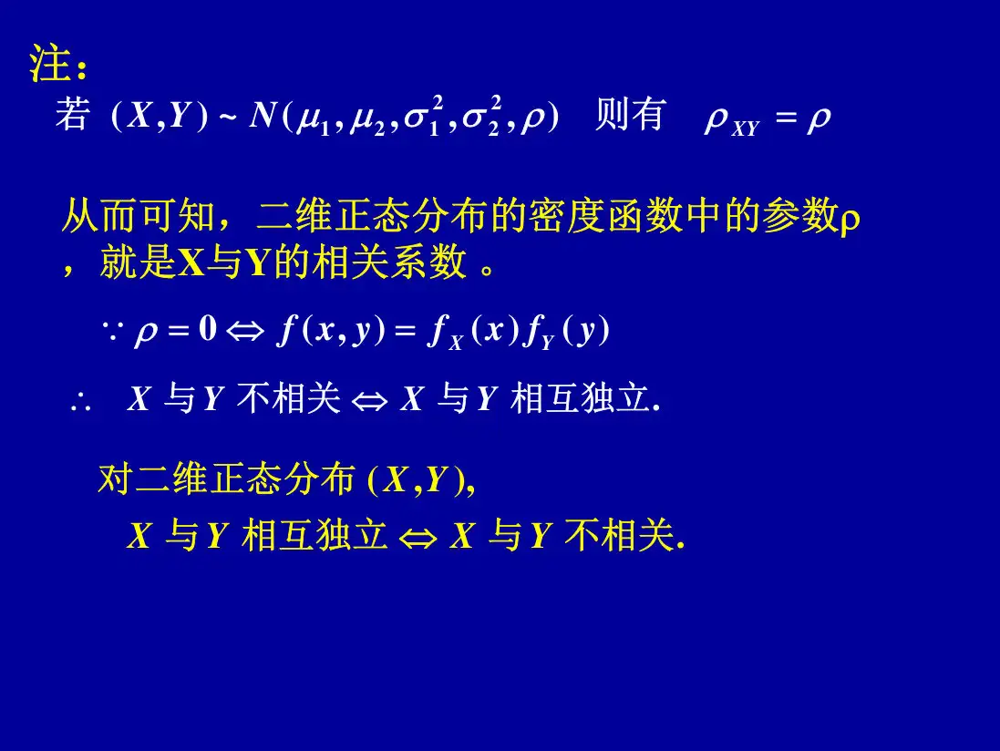

原文：

若 $(X,Y)\sim N(\mu_1,\mu_2,\sigma_1^2,\sigma_2^2,\rho)$ 则有 $\rho_{XY} = \rho$

从而可知，二维正态分布的密度函数中的参数ρ，就是X与Y的相关系数。

$\because \rho = 0 \Leftrightarrow f(x, y) = f_{X}(x)f_{Y}(y)$

∴ X 与 Y 不相关 $\Leftrightarrow$ X 与 Y 相互独立.

对二维正态分布 $(X,Y)$ ,

X 与 Y 相互独立 $\Leftrightarrow X$ 与 Y 不相关.

### 4.4 矩、协方差矩阵

原文：

4.4 矩、协方差矩阵

数学期望、方差、协方差是随机变量最常用的数字特征，它们都是某种矩，矩是最广泛的一种数字特征，在概率论和数理统计中占重要地位。

### 一、矩的概念

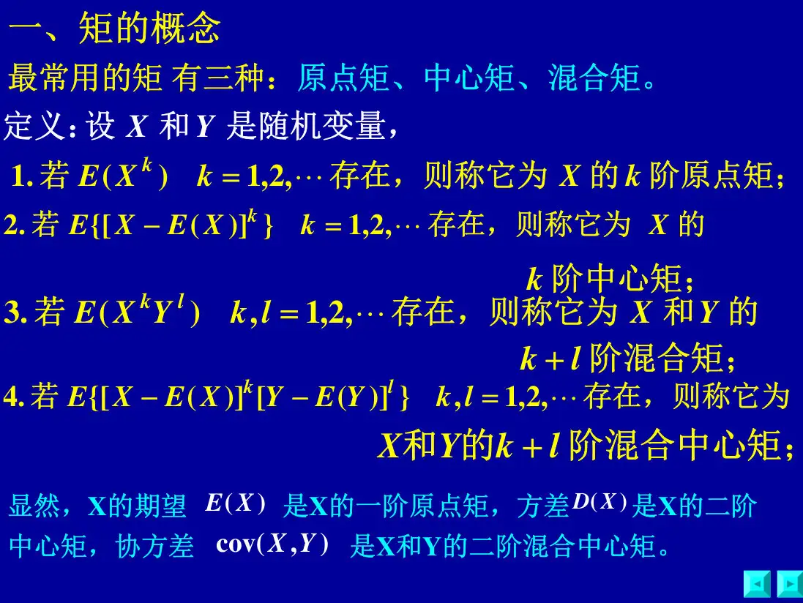

原文：

一、矩的概念

最常用的矩有三种：原点矩、中心矩、混合矩。

定义: 设 X 和 Y 是随机变量,

1. 若 $E(X^{k})$ $k=1,2,\cdots$ 存在，则称它为 X 的 k 阶原点矩；

2. 若 $E\{[X - E(X)]^{k}\}$ $k = 1, 2, \cdots$ 存在，则称它为 X 的

3. 若 $E(X^{k}Y^{l})$ $k, l=1,2,\cdots$ 存在，则称它为 X 和 Y 的

$k+l$ 阶混合矩;

4. 若 $E\{[X - E(X)]^{k}[Y - E(Y)]^{l}\}$ $k, l = 1, 2, \cdots$ 存在，则称它为 X 和 Y 的 $k + l$ 阶混合中心矩；

显然，X的期望 $E(X)$ 是X的一阶原点矩，方差 $D(X)$ 是X的二阶中心矩，协方差 $\operatorname{cov}(X,Y)$ 是X和Y的二阶混合中心矩。

### 二、随机变量的协方差矩阵

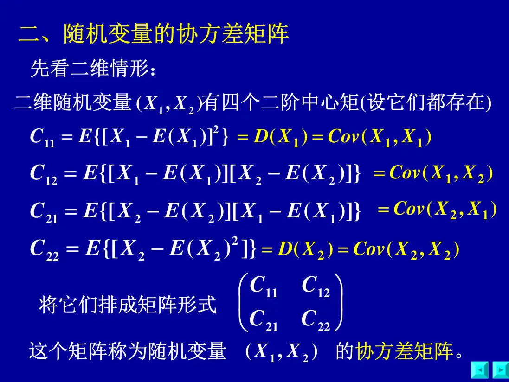

原文：

二、随机变量的协方差矩阵

二维随机变量 $(X_{1}, X_{2})$ 有四个二阶中心矩（设它们都存在） $C_{11} = E\{[X_{1} - E(X_{1})]^{2}\} = D(X_{1}) = Cov(X_{1}, X_{1})$ $C_{12} = E\{[X_{1} - E(X_{1})][X_{2} - E(X_{2})]\} = Cov(X_{1}, X_{2})$ $C_{21} = E\{[X_{2} - E(X_{2})][X_{1} - E(X_{1})]\} = Cov(X_{2}, X_{1})$ $C_{22} = E\{[X_{2} - E(X_{2})^{2}]\} = D(X_{2}) = Cov(X_{2}, X_{2})$ 将它们排成矩阵形式 $\left( \begin{array}{cc}C_{11} & C_{12}\\ C_{21} & C_{22} \end{array} \right)$ 这个矩阵称为随机变量 $(X_{1}, X_{2})$ 的协方差矩阵。

### 则称矩阵

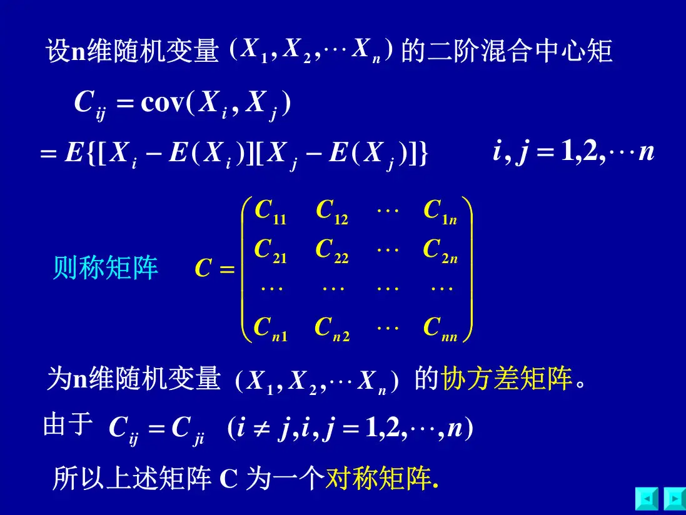

原文：

设n维随机变量 $(X_{1},X_{2},\cdots X_{n})$ 的二阶混合中心矩

$C_{ij} = \operatorname{cov}(X_i, X_j) = E\{[X_i - E(X_i)][X_j - E(X_j)]\} \qquad i, j = 1,2,\dots n$

则称矩阵

$$
C = \left( \begin{array}{c c c c} C _ {1 1} & C _ {1 2} & \dots & C _ {1 n} \\ C _ {2 1} & C _ {2 2} & \dots & C _ {2 n} \\ \dots & \dots & \dots & \dots \\ C _ {n 1} & C _ {n 2} & \dots & C _ {n n} \end{array} \right)
$$

为n维随机变量 $(X_{1},X_{2},\cdots X_{n})$ 的协方差矩阵。

由于 $C_{ij}=C_{ji}\quad(i\neq j,i,j=1,2,\cdots,n)$

所以上述矩阵 C 为一个对称矩阵.

### 三、n维正态随机变量的概率密度

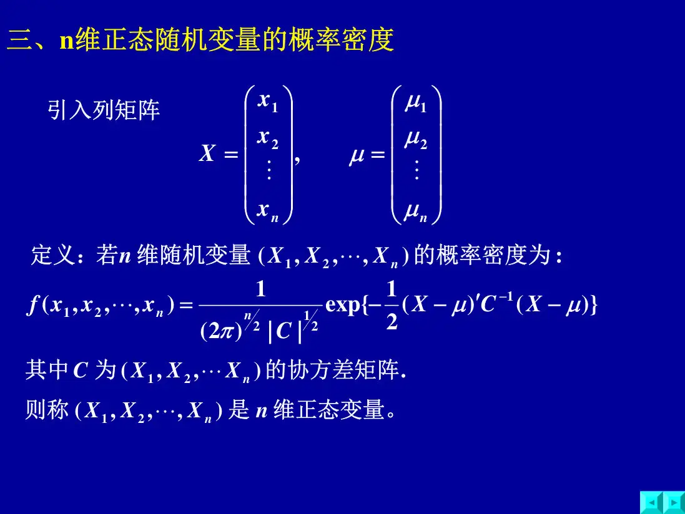

原文：

三、n维正态随机变量的概率密度

引入列矩阵

$$
X = \left( \begin{array}{c} x _ {1} \\ x _ {2} \\ \vdots \\ x _ {n} \end{array} \right), \qquad \mu = \left( \begin{array}{c} \mu_ {1} \\ \mu_ {2} \\ \vdots \\ \mu_ {n} \end{array} \right)
$$

定义: 若 $n$ 维随机变量 $(X_{1}, X_{2}, \cdots, X_{n})$ 的概率密度为:

$$
f (x _ {1}, x _ {2}, \dots , x _ {n}) = \frac {1}{(2 \pi) ^ {\frac {n}{2}} | C | ^ {\frac {1}{2}}} \exp \left\{- \frac {1}{2} (X - \mu) ^ {\prime} C ^ {- 1} (X - \mu) \right\}
$$

其中 C 为 $(X_{1}, X_{2}, \cdots, X_{n})$ 的协方差矩阵.

则称 $(X_{1},X_{2},\cdots,X_{n})$ 是n维正态变量。

### 四、n维正态变量的重要性质：

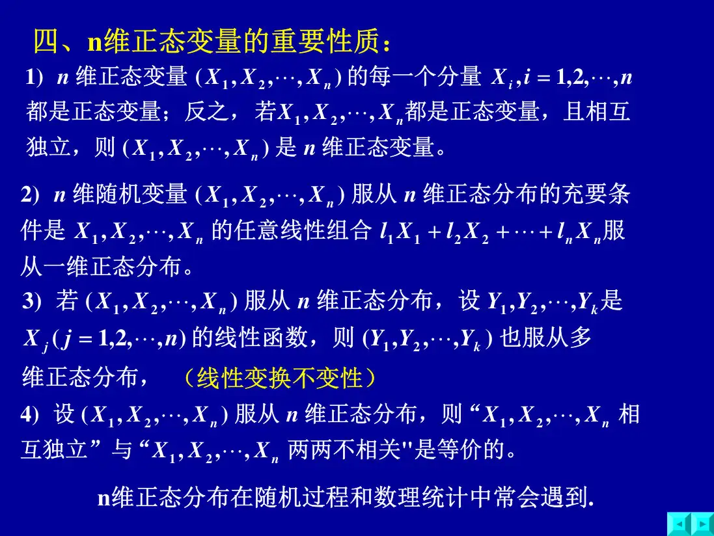

原文：

四、n维正态变量的重要性质：

1) $n$ 维正态变量 $(X_{1}, X_{2}, \cdots, X_{n})$ 的每一个分量 $X_{i}, i = 1, 2, \cdots, n$ 都是正态变量；反之，若 $X_{1}, X_{2}, \cdots, X_{n}$ 都是正态变量，且相互独立，则 $(X_{1}, X_{2}, \cdots, X_{n})$ 是 $n$ 维正态变量。

2) n 维随机变量 $(X_{1}, X_{2}, \cdots, X_{n})$ 服从 n 维正态分布的充要条件是 $X_{1}, X_{2}, \cdots, X_{n}$ 的任意线性组合 $l_{1}X_{1} + l_{2}X_{2} + \cdots + l_{n}X_{n}$ 服从一维正态分布。

3) 若 $(X_{1}, X_{2}, \cdots, X_{n})$ 服从 n 维正态分布，设 $Y_{1}, Y_{2}, \cdots, Y_{k}$ 是 $X_{j} (j = 1, 2, \cdots, n)$ 的线性函数，则 $(Y_{1}, Y_{2}, \cdots, Y_{k})$ 也服从多维正态分布，（线性变换不变性）

4) 设 $(X_{1}, X_{2}, \cdots, X_{n})$ 服从 n 维正态分布，则 “ $X_{1}, X_{2}, \cdots, X_{n}$ 相互独立” 与 “ $X_{1}, X_{2}, \cdots, X_{n}$ 两两不相关” 是等价的。

n维正态分布在随机过程和数理统计中常会遇到.

### Z = 2X - Y + 3 的概率密度函数.

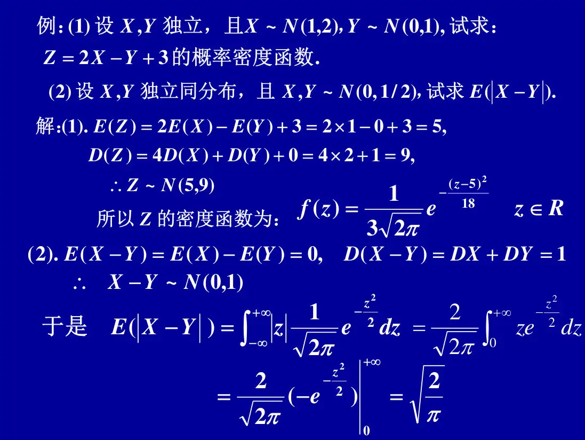

原文：

例:(1)设 X,Y 独立, 且 $X \sim N(1,2)$ , $Y \sim N(0,1)$ , 试求:
Z = 2X - Y + 3 的概率密度函数.
(2) 设 X, Y 独立同分布, 且 $X, Y \sim N(0,1/2)$ , 试求 $E(|X - Y|)$ .
解:(1). $E(Z)=2E(X)-E(Y)+3=2\times1-0+3=5,$ $D(Z)=4D(X)+D(Y)+0=4\times2+1=9,$ $\therefore Z \sim N(5,9)$ 所以 Z 的密度函数为: $f(z)=\frac{1}{3\sqrt{2\pi}}e^{-\frac{(z-5)^{2}}{18}} \quad z \in R$ (2). $E(X-Y)=E(X)-E(Y)=0,\quad D(X-Y)=DX+DY=1$ $\therefore X-Y \sim N(0,1)$ 于是 $E(|X-Y|)=\int_{-\infty}^{+\infty}|z|\frac{1}{\sqrt{2\pi}}e^{-\frac{z^{2}}{2}}dz=\frac{2}{\sqrt{2\pi}}\int_{0}^{+\infty}ze^{-\frac{z^{2}}{2}}dz=$ $=\frac{2}{\sqrt{2\pi}}(-e^{-\frac{z^{2}}{2}})\bigg|_{0}^{+\infty}=\sqrt{\frac{2}{\pi}}$
