# 《概率论与数理统计》第4章 方差（课件）

原件的每一页，下面附识别出的文字。

### 4.2 方差

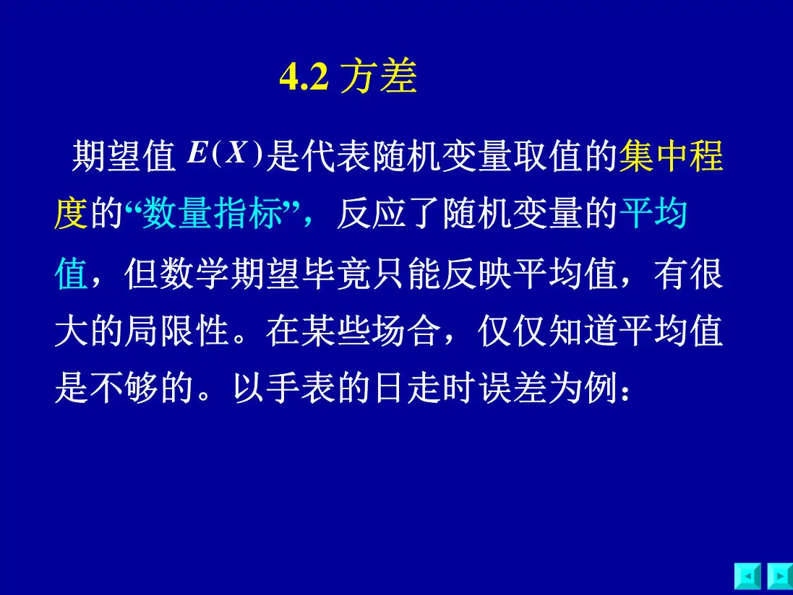

原文：

4.2 方差

期望值 $E(X)$ 是代表随机变量取值的集中程度的“数量指标”，反应了随机变量的平均值，但数学期望毕竟只能反映平均值，有很大的局限性。在某些场合，仅仅知道平均值是不够的。以手表的日走时误差为例：

### $$

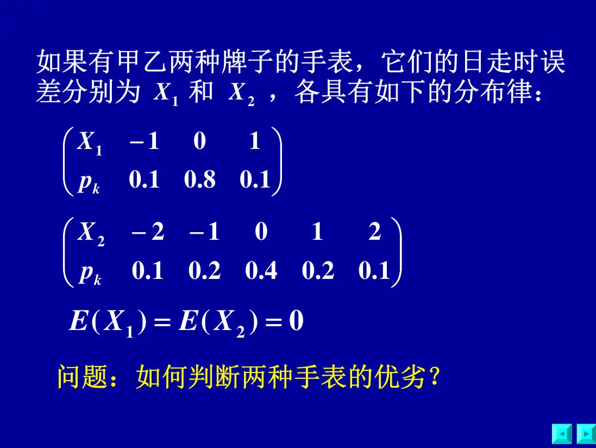

原文：

如果有甲乙两种牌子的手表，它们的日走时误差分别为 $X_{1}$ 和 $X_{2}$ ，各具有如下的分布律：

$$
\left( \begin{array}{c c c c} X _ {1} & - 1 & 0 & 1 \\ p _ {k} & 0. 1 & 0. 8 & 0. 1 \end{array} \right)
$$

$$
\left( \begin{array}{c c c c c c} X _ {2} & - 2 & - 1 & 0 & 1 & 2 \\ p _ {k} & 0. 1 & 0. 2 & 0. 4 & 0. 2 & 0. 1 \end{array} \right)
$$

$$
E (X _ {1}) = E (X _ {2}) = 0
$$

问题：如何判断两种手表的优劣？

### 是否可以用一个指标来衡量一个随机变量离开它的期望值E(X)的偏离程度？

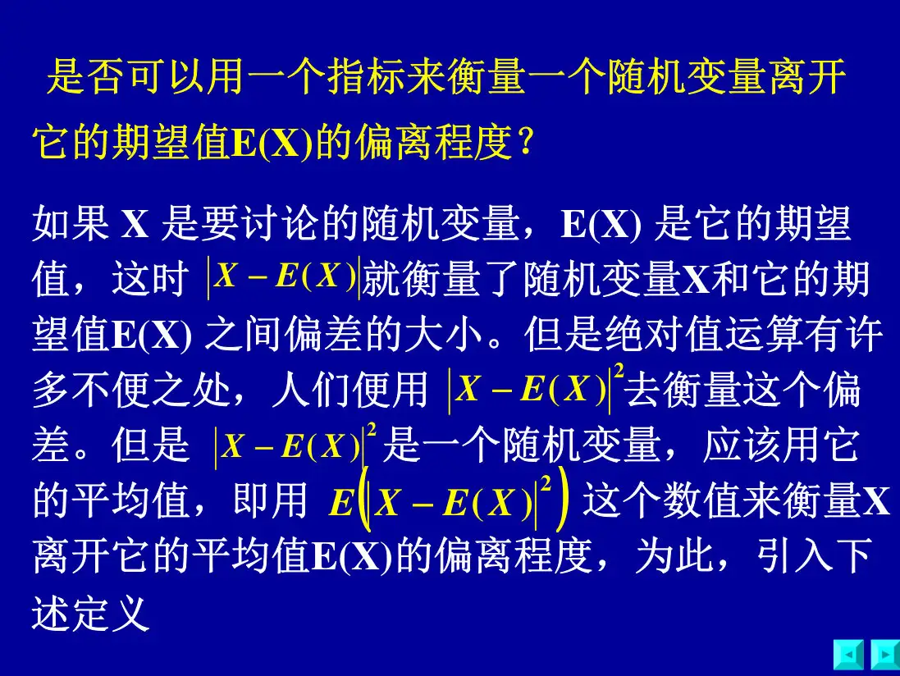

原文：

是否可以用一个指标来衡量一个随机变量离开它的期望值E(X)的偏离程度？

如果 X 是要讨论的随机变量，E(X) 是它的期望值，这时 $\left|X - E(X)\right|$ 就衡量了随机变量 X 和它的期望值 E(X) 之间偏差的大小。但是绝对值运算有许多不便之处，人们便用 $\left|X - E(X)\right|^{2}$ 去衡量这个偏差。但是 $\left|X - E(X)\right|^{2}$ 是一个随机变量，应该用它的平均值，即用 $E\left(\left|X - E(X)\right|^{2}\right)$ 这个数值来衡量 X 离开它的平均值 E(X) 的偏离程度，为此，引入下述定义

### 一、方差的定义

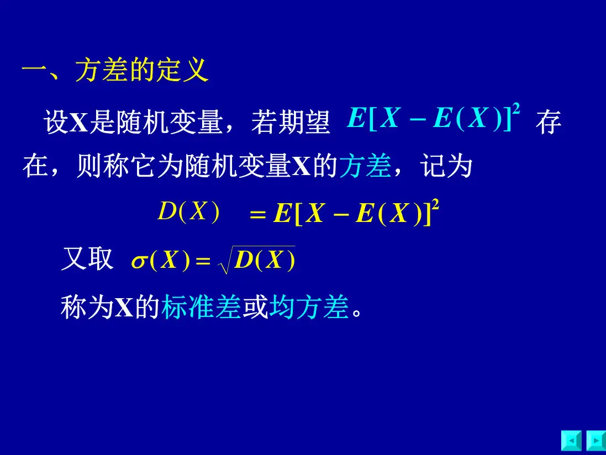

原文：

一、方差的定义

设X是随机变量，若期望 $E[X - E(X)]^{2}$ 存在，则称它为随机变量X的方差，记为

$$
D (X) = E [ X - E (X) ] ^ {2}
$$

又取 $\sigma(X)=\sqrt{D(X)}$

称为X的标准差或均方差。

### 关于方差的定义和计算作如下的说明:

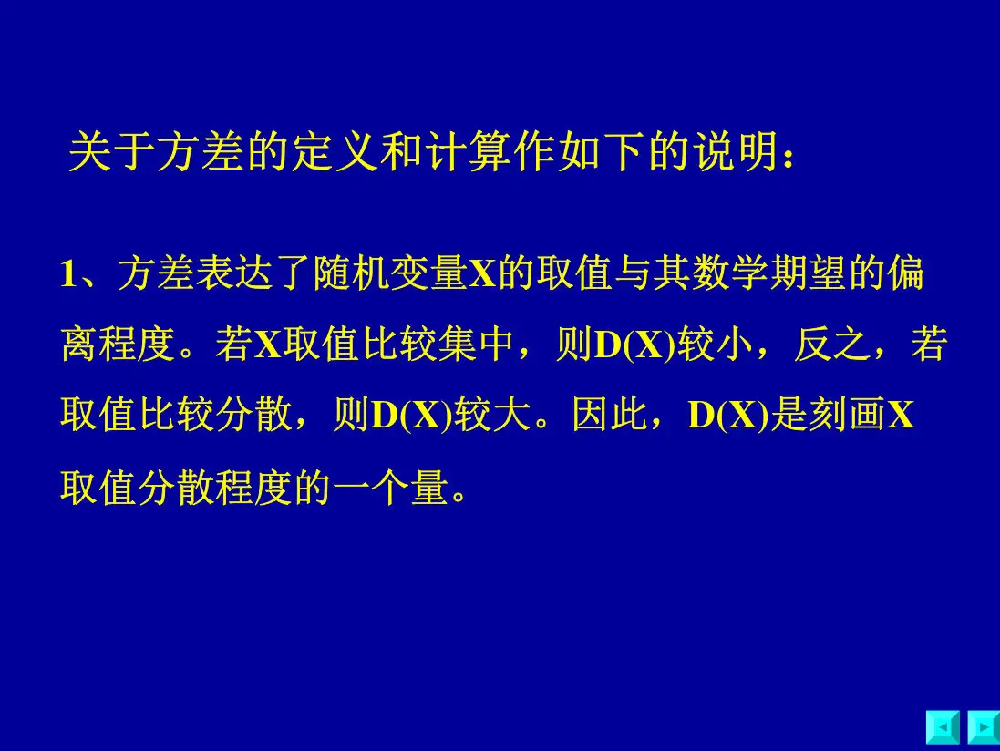

原文：

关于方差的定义和计算作如下的说明:

1、方差表达了随机变量X的取值与其数学期望的偏离程度。若X取值比较集中，则D(X)较小，反之，若取值比较分散，则D(X)较大。因此，D(X)是刻画X取值分散程度的一个量。

### $$

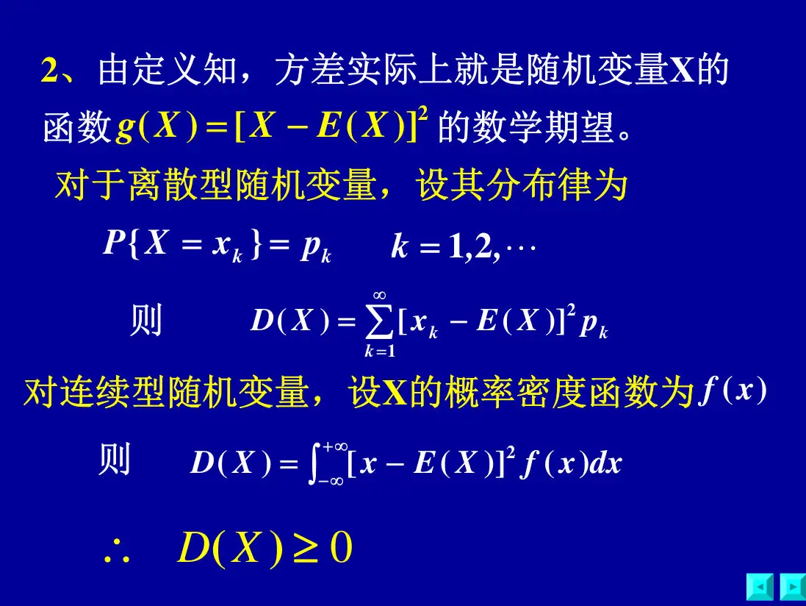

原文：

2、由定义知，方差实际上就是随机变量X的函数 $g(X)=[X-E(X)]^{2}$ 的数学期望。对于离散型随机变量，设其分布律为

$$
P \{X = x _ {k} \} = p _ {k} \quad k = 1, 2, \dots
$$

则

$$
D (X) = \sum_ {k = 1} ^ {\infty} [ x _ {k} - E (X) ] ^ {2} p _ {k}
$$

对连续型随机变量，设X的概率密度函数为 $f(x)$

则 $D(X) = \int_{-\infty}^{+\infty}[x - E(X)]^2 f(x)dx$

∴ $D(X) \geq 0$

### 3、常用的计算方差之公式

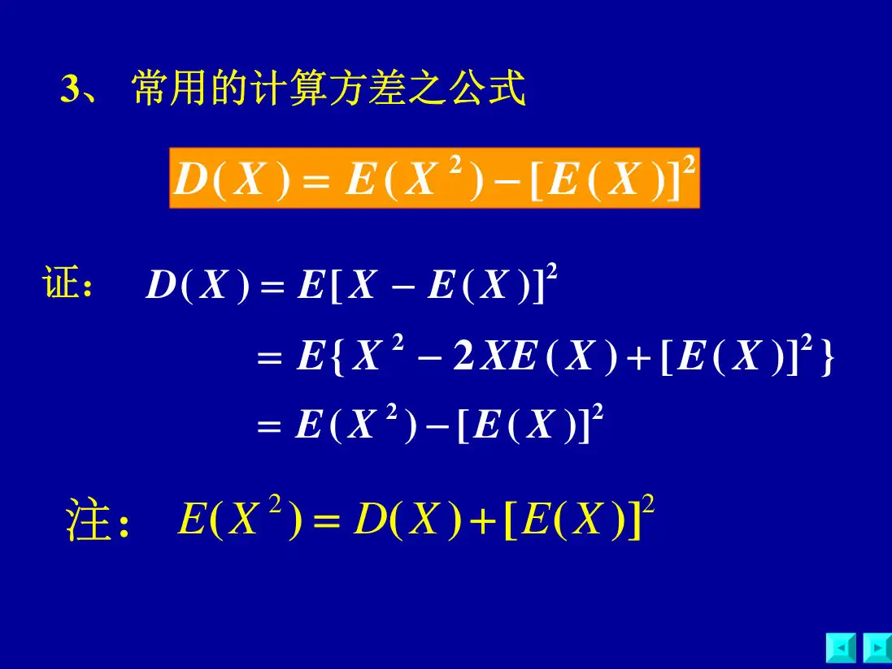

原文：

3、常用的计算方差之公式

$$
D (X) = E \left(X ^ {2}\right) - [ E (X) ] ^ {2}
$$

证： $D(X) = E[X - E(X)]^2$ $= E\{X^2 - 2XE(X) + [E(X)]^2\}$ $= E(X^2) - [E(X)]^2$

注： $E(X^{2})=D(X)+[E(X)]^{2}$

### 二、方差的性质

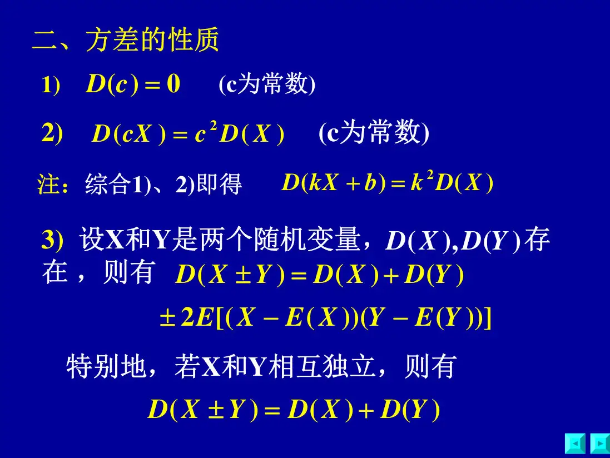

原文：

二、方差的性质

1) $D(c)=0$ (c为常数)

2) $D(cX) = c^{2}D(X)$ (c为常数)

注：综合1)、2)即得 $D(kX + b) = k^{2}D(X)$

3) 设X和Y是两个随机变量， $D(X),D(Y)$ 存在，则有 $D(X \pm Y) = D(X) + D(Y)$ $\pm 2E[(X - E(X))(Y - E(Y))]$ 特别地，若X和Y相互独立，则有 $D(X \pm Y) = D(X) + D(Y)$

### 证：

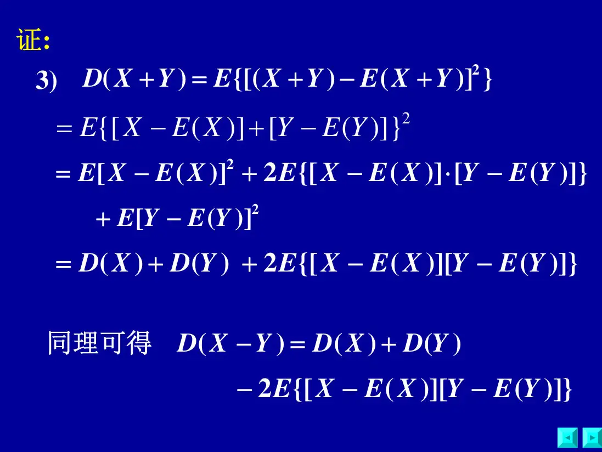

原文：

证：

$$
\begin{array}{r l} & {3) \quad D (X + Y) = E \{[ (X + Y) - E (X + Y) ] ^ {2} \}} \\ & {\qquad = E \{[ X - E (X) ] + [ Y - E (Y) ] \} ^ {2}} \\ & {\qquad = E [ X - E (X) ] ^ {2} + 2 E \{[ X - E (X) ] \cdot [ Y - E (Y) ] \}} \\ & {\qquad + E [ Y - E (Y) ] ^ {2}} \\ & {\qquad = D (X) + D (Y) + 2 E \{[ X - E (X) ] [ Y - E (Y) ] \}} \end{array}
$$

同理可得 $D(X - Y) = D(X) + D(Y)$ $-2E\{[X - E(X)][Y - E(Y)]\}$ 若X与Y独立，由数学期望性质可得

### $$

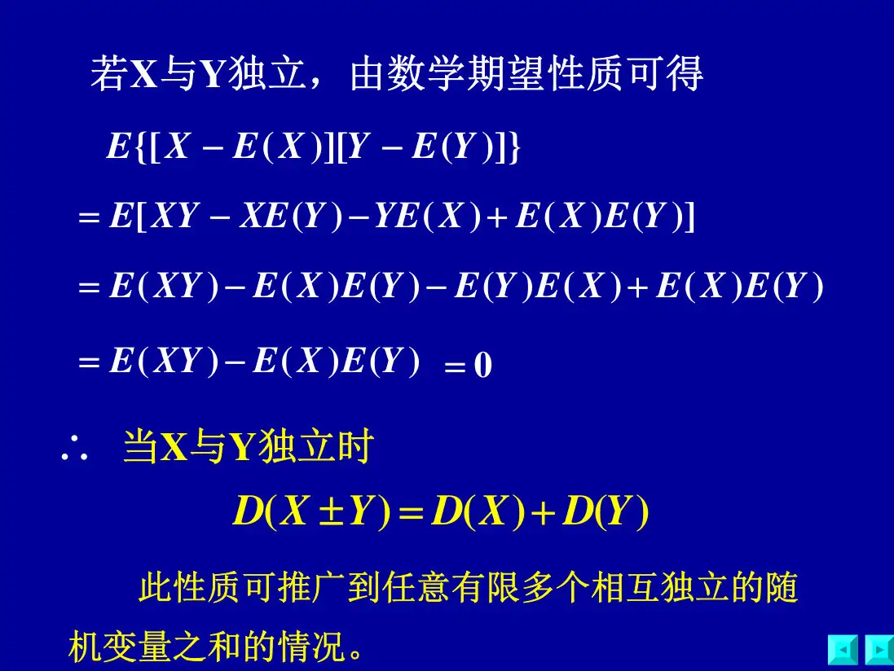

原文：

$$
E \{[ X - E (X) ] [ Y - E (Y) ] \}
$$

$$
= E [ X Y - X E (Y) - Y E (X) + E (X) E (Y) ]
$$

$$
= E (X Y) - E (X) E (Y) - E (Y) E (X) + E (X) E (Y)
$$

$$
= E (X Y) - E (X) E (Y) = 0
$$

∴ 当X与Y独立时

$$
D (X \pm Y) = D (X) + D (Y)
$$

此性质可推广到任意有限多个相互独立的随机变量之和的情况。

### 注：更一般的，当X与Y相互独立时，有

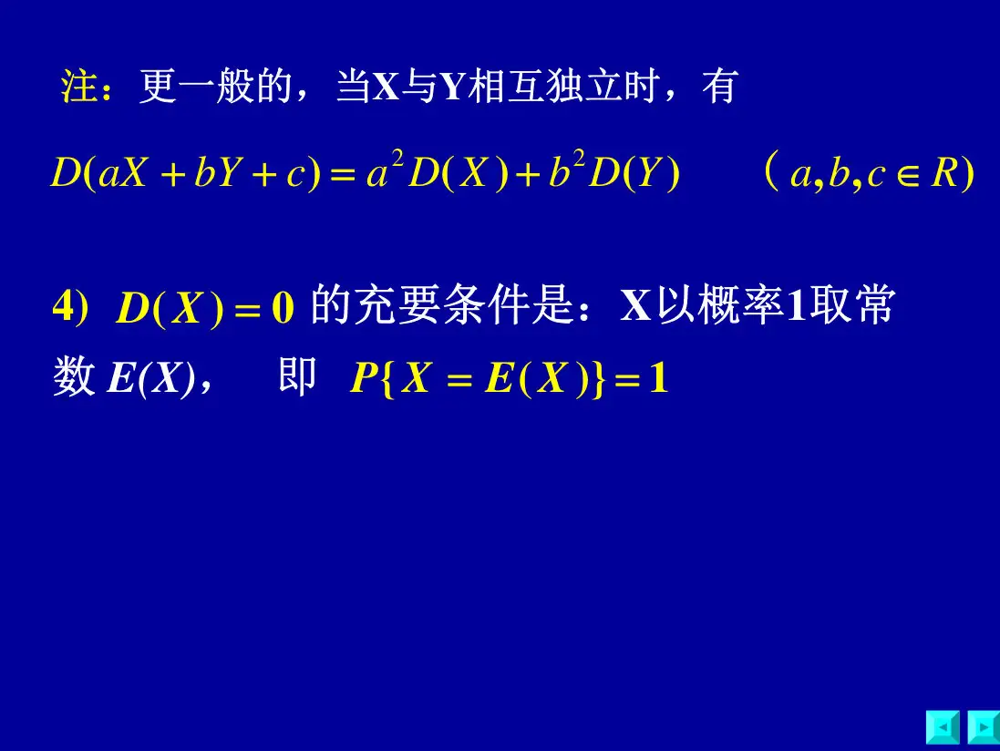

原文：

注：更一般的，当X与Y相互独立时，有

$$
D (a X + b Y + c) = a ^ {2} D (X) + b ^ {2} D (Y)
$$

$$
(a, b, c \in R)
$$

4) $D(X)=0$ 的充要条件是: X以概率1取常数 $E(X)$ ，即 $P\{X=E(X)\}=1$

### 第 12 页

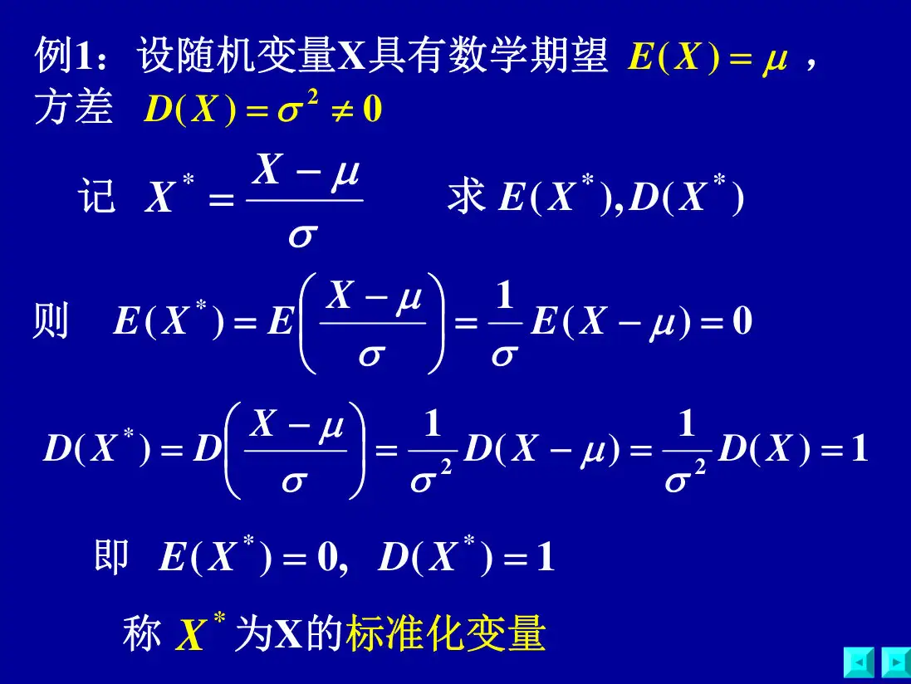

原文：

例1: 设随机变量X具有数学期望 $E(X) = \mu$ , 方差 $D(X) = \sigma^2 \neq 0$ 记 $X^* = \frac{X - \mu}{\sigma}$ 求 $E(X^*), D(X^*)$ 则 $E(X^*) = E\left(\frac{X - \mu}{\sigma}\right) = \frac{1}{\sigma} E(X - \mu) = 0$ $D(X^*) = D\left(\frac{X - \mu}{\sigma}\right) = \frac{1}{\sigma^2} D(X - \mu) = \frac{1}{\sigma^2} D(X) = 1$ 即 $E(X^*) = 0, D(X^*) = 1$ 称 $X^*$ 为X的标准化变量

### 三、常见分布的期望方差

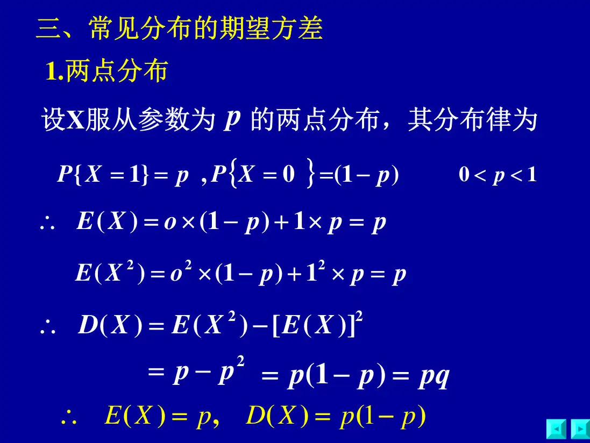

原文：

三、常见分布的期望方差

1.两点分布

设X服从参数为 $p$ 的两点分布，其分布律为

$P\{X = 1\} = p, P\{X = 0\} = (1 - p)$ $0 <   p <   1$

∴ $E(X)=o \times (1-p)+1 \times p=p$

$$
E (X ^ {2}) = o ^ {2} \times (1 - p) + 1 ^ {2} \times p = p
$$

$\therefore D(X) = E(X^2) - [E(X)]^2$ $= p - p^2 = p(1 - p) = pq$

$$
\therefore E (X) = p, \quad D (X) = p (1 - p)
$$

### 2. 二项分布

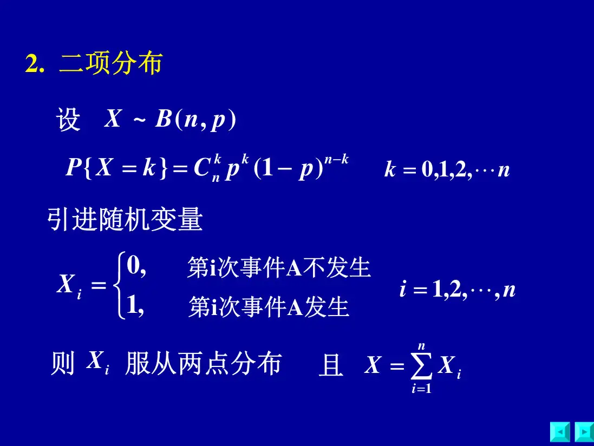

原文：

2. 二项分布

设 $X \sim B(n, p)$

$$
P \{X = k \} = C _ {n} ^ {k} p ^ {k} (1 - p) ^ {n - k}
$$

$$
k = 0, 1, 2, \dots n
$$

引进随机变量

$X_{i}=\left\{\begin{aligned}&0,& 第i次事件A不发生\\ &1,& 第i次事件A发生\end{aligned}\right.\quad i=1,2,\cdots,n$

则 $X_{i}$ 服从两点分布 且 $X = \sum_{i=1}^{n} X_{i}$

### $$

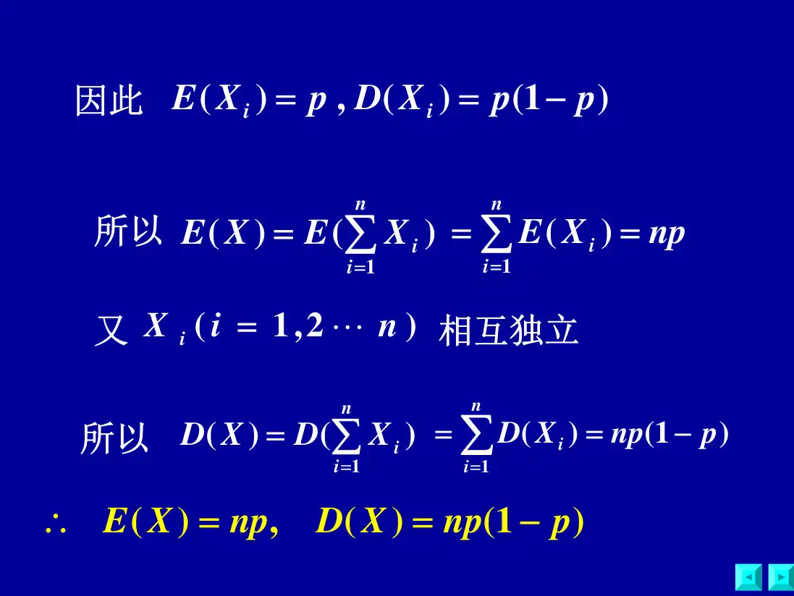

原文：

$$
\text {因此} E \left(X _ {i}\right) = p, D \left(X _ {i}\right) = p (1 - p)
$$

$$
\text {所以} E (X) = E \left(\sum_ {i = 1} ^ {n} X _ {i}\right) = \sum_ {i = 1} ^ {n} E \left(X _ {i}\right) = n p
$$

又 $X_{i}(i=1,2\cdots n)$ 相互独立

$$
\text {所以} \quad D (X) = D (\sum_ {i = 1} ^ {n} X _ {i}) = \sum_ {i = 1} ^ {n} D (X _ {i}) = n p (1 - p)
$$

$$
\therefore E (X) = n p, \quad D (X) = n p (1 - p)
$$

### 3、泊松分布

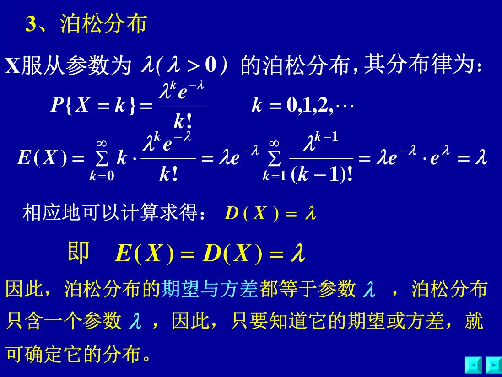

原文：

3、泊松分布

X服从参数为 $\lambda(\lambda>0)$ 的泊松分布, 其分布律为: $P\{X=k\}=\frac{\lambda^{k}e^{-\lambda}}{k!}\quad k=0,1,2,\cdots$ $E(X)=\sum_{k=0}^{\infty}k\cdot\frac{\lambda^{k}e^{-\lambda}}{k!}=\lambda e^{-\lambda}\sum_{k=1}^{\infty}\frac{\lambda^{k-1}}{(k-1)!}=\lambda e^{-\lambda}\cdot e^{\lambda}=\lambda$ 相应地可以计算求得: $D(X)=\lambda$ 即 $E(X)=D(X)=\lambda$ 因此, 泊松分布的期望与方差都等于参数 $\lambda$ , 泊松分布只含一个参数 $\lambda$ , 因此, 只要知道它的期望或方差, 就可确定它的分布。

### 4、均匀分布

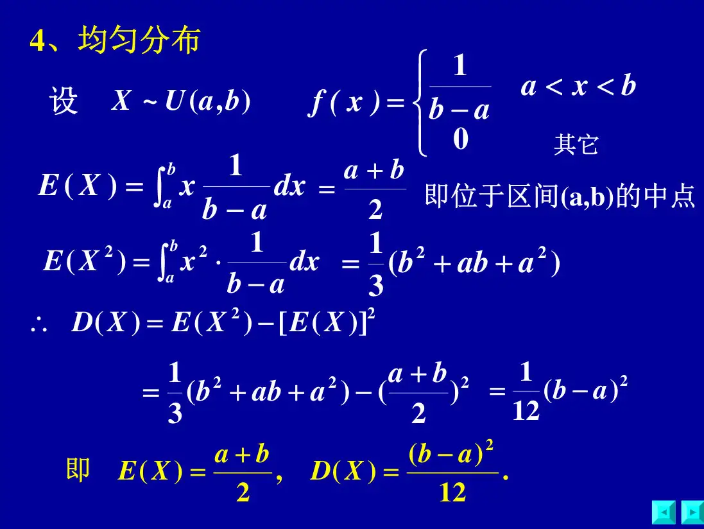

原文：

4、均匀分布

设 $X \sim U(a, b) \quad f(x) = \begin{cases} \frac{1}{b - a} & a < x < b \\ 0 & \text{其它} \end{cases}$

$E(X)=\int_{a}^{b}x\frac{1}{b-a}dx=\frac{a+b}{2}$ 即位于区间(a,b)的中点

$$
E \left(X ^ {2}\right) = \int_ {a} ^ {b} x ^ {2} \cdot \frac {1}{b - a} d x = \frac {1}{3} \left(b ^ {2} + a b + a ^ {2}\right)
$$

$$
= \frac {1}{3} (b ^ {2} + a b + a ^ {2}) - (\frac {a + b}{2}) ^ {2} = \frac {1}{1 2} (b - a) ^ {2}
$$

$$
E (X) = \frac {a + b}{2}, \quad D (X) = \frac {(b - a) ^ {2}}{1 2}.
$$

### 5. 指数分布

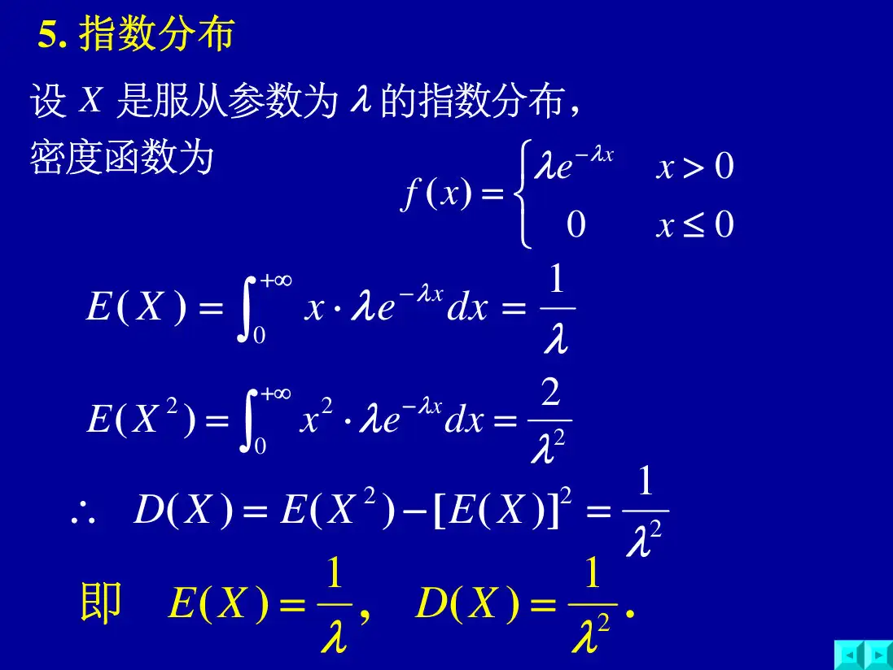

原文：

5. 指数分布

设 $X$ 是服从参数为 $\lambda$ 的指数分布，

密度函数为

$$
f (x) = \left\{ \begin{array}{c c} \lambda e ^ {- \lambda x} & x > 0 \\ 0 & x \leq 0 \end{array} \right.
$$

$$
E (X) = \int_ {0} ^ {+ \infty} x \cdot \lambda e ^ {- \lambda x} d x = \frac {1}{\lambda}
$$

$$
E (X ^ {2}) = \int_ {0} ^ {+ \infty} x ^ {2} \cdot \lambda e ^ {- \lambda x} d x = \frac {2}{\lambda^ {2}}
$$

$$
\therefore D (X) = E \left(X ^ {2}\right) - [ E (X) ] ^ {2} = \frac {1}{\lambda^ {2}}
$$

$$
\text {即} \quad E (X) = \frac {1}{\lambda}, \quad D (X) = \frac {1}{\lambda^ {2}}.
$$

### 6. 设 $X \sim N(\mu, \sigma^2)$

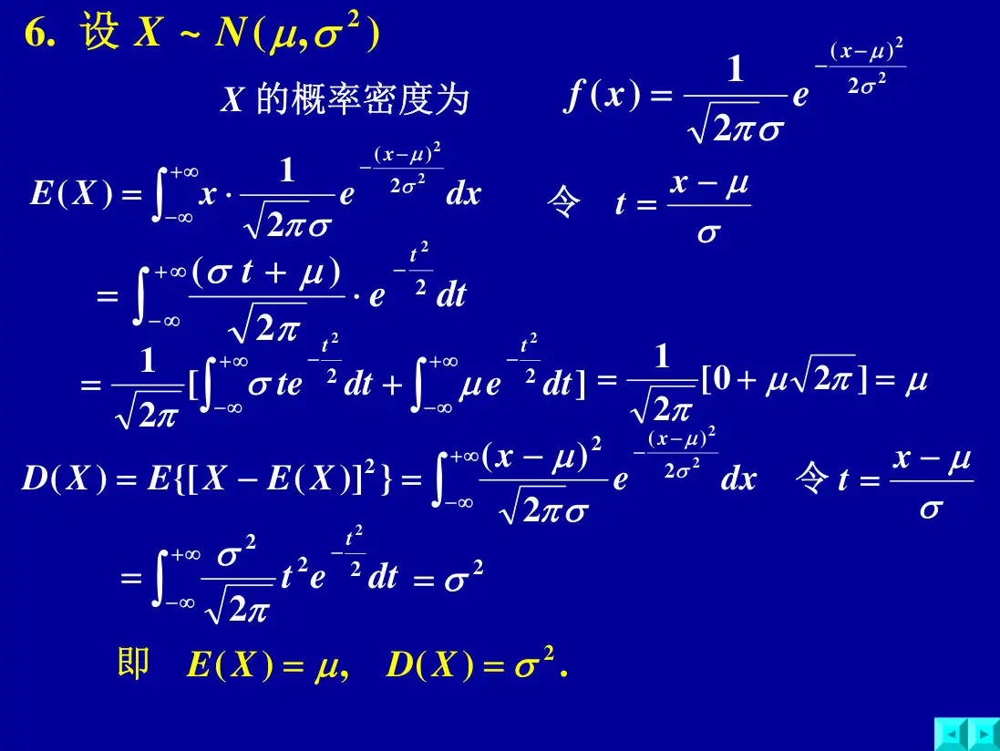

原文：

6. 设 $X \sim N(\mu, \sigma^2)$

X 的概率密度为

$$
E (X) = \int_ {- \infty} ^ {+ \infty} x \cdot \frac {1}{\sqrt {2 \pi} \sigma} e ^ {- \frac {(x - \mu) ^ {2}}{2 \sigma^ {2}}} d x
$$

$$
f (x) = \frac {1}{\sqrt {2 \pi} \sigma} e ^ {- \frac {(x - \mu) ^ {2}}{2 \sigma^ {2}}}
$$

$$
= \frac {1}{\sqrt {2 \pi}} [ \int_ {- \infty} ^ {+ \infty} \sigma t e ^ {- \frac {t ^ {2}}{2}} d t + \int_ {- \infty} ^ {+ \infty} \mu e ^ {- \frac {t ^ {2}}{2}} d t ] = \frac {1}{\sqrt {2 \pi}} [ 0 + \mu \sqrt {2 \pi} ] = \mu
$$

$$
= \int_ {- \infty} ^ {+ \infty} \frac {\sigma^ {2}}{\sqrt {2 \pi}} t ^ {2} e ^ {- \frac {t ^ {2}}{2}} d t = \sigma^ {2}
$$

$$
t = \frac {x - \mu}{\sigma}
$$

$$
\text { 即 } \quad E (X) = \mu , \quad D (X) = \sigma^ {2}.
$$

### $$

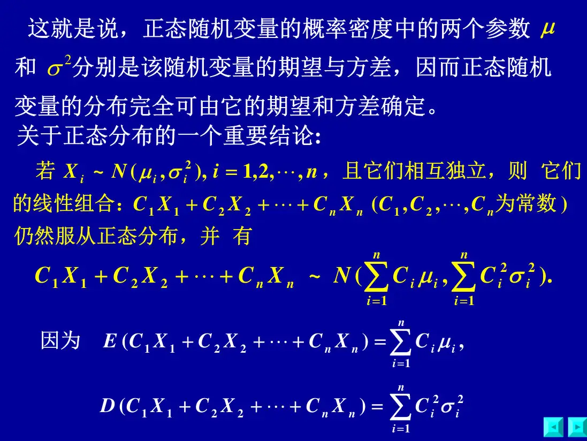

原文：

这就是说，正态随机变量的概率密度中的两个参数 $\mu$ 和 $\sigma^2$ 分别是该随机变量的期望与方差，因而正态随机变量的分布完全可由它的期望和方差确定。关于正态分布的一个重要结论：

若 $X_{i} \sim N(\mu_{i}, \sigma_{i}^{2}), i = 1, 2, \cdots, n$ ，且它们相互独立，则它们的线性组合： $C_{1}X_{1} + C_{2}X_{2} + \cdots + C_{n}X_{n} (C_{1}, C_{2}, \cdots, C_{n}$ 为常数）仍然服从正态分布，并有

$$
C _ {1} X _ {1} + C _ {2} X _ {2} + \dots + C _ {n} X _ {n} \sim N (\sum_ {i = 1} ^ {n} C _ {i} \mu_ {i}, \sum_ {i = 1} ^ {n} C _ {i} ^ {2} \sigma_ {i} ^ {2}).
$$

因为 $E\left(C_{1}X_{1}+C_{2}X_{2}+\cdots+C_{n}X_{n}\right)=\sum_{i=1}^{n}C_{i}\mu_{i},$

$$
D (C _ {1} X _ {1} + C _ {2} X _ {2} + \dots + C _ {n} X _ {n}) = \sum_ {i = 1} ^ {n} C _ {i} ^ {2} \sigma_ {i} ^ {2}
$$

### $$

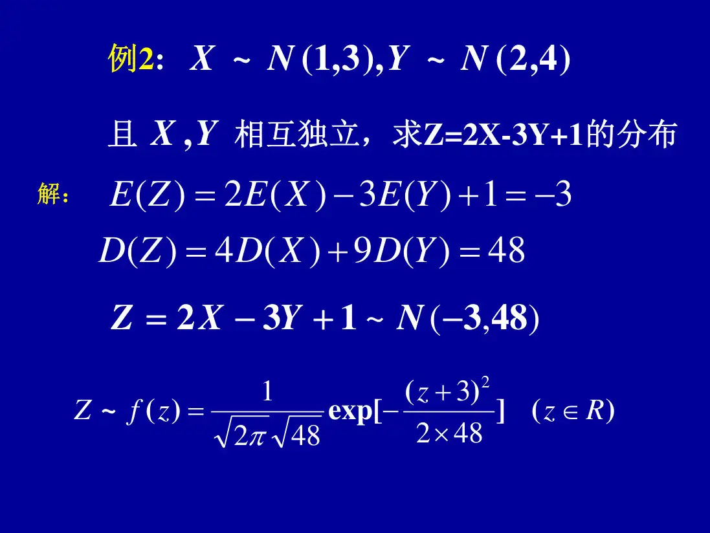

原文：

$$
\text {例2:} X \sim N (1, 3), Y \sim N (2, 4)
$$

且 $X, Y$ 相互独立，求 $\mathrm{Z} = 2 \mathrm{~X} - 3 \mathrm{~Y} + 1$ 的分布

$$
\text {解:} \quad E (Z) = 2 E (X) - 3 E (Y) + 1 = - 3
$$

$$
D (Z) = 4 D (X) + 9 D (Y) = 4 8
$$

$$
Z = 2 X - 3 Y + 1 \sim N (- 3, 4 8)
$$

$$
Z \sim f (z) = \frac {1}{\sqrt {2 \pi} \sqrt {4 8}} \exp [ - \frac {(z + 3) ^ {2}}{2 \times 4 8} ] \quad (z \in R)
$$

### 第 22 页

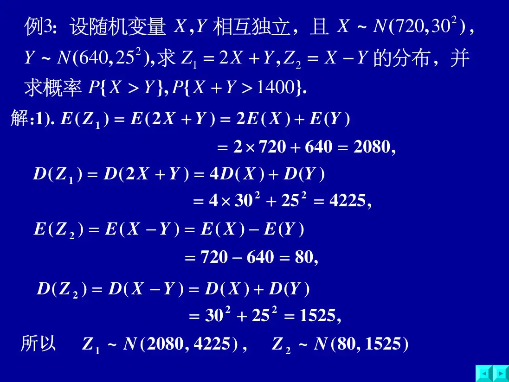

原文：

例3: 设随机变量 X, Y 相互独立，且 $X \sim N(720, 30^{2})$ ， $Y \sim N(640, 25^{2})$ ，求 $Z_{1} = 2X + Y, Z_{2} = X - Y$ 的分布，并求概率 $P\{X > Y\}, P\{X + Y > 1400\}$ .
解:1). $E(Z_{1})=E(2X+Y)=2E(X)+E(Y)$ $=2\times720+640=2080,$ $D(Z_{1})=D(2X+Y)=4D(X)+D(Y)$ $=4\times30^{2}+25^{2}=4225,$ $E(Z_{2})=E(X-Y)=E(X)-E(Y)$ $=720-640=80,$ $D(Z_{2})=D(X-Y)=D(X)+D(Y)$ $=30^{2}+25^{2}=1525,$ 所以 $Z_{1} \sim N(2080, 4225), \quad Z_{2} \sim N(80, 1525)$

### 第 23 页

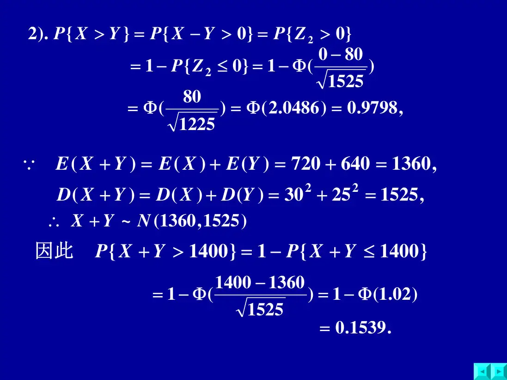

原文：

2). $P\{X > Y\} = P\{X - Y > 0\} = P\{Z_{2} > 0\}$ $= 1 - P\{Z_{2} \leq 0\} = 1 - \Phi(\frac{0 - 80}{\sqrt{1525}})$ $= \Phi(\frac{80}{\sqrt{1225}}) = \Phi(2.0486) = 0.9798,$

$\because E(X + Y) = E(X) + E(Y) = 720 + 640 = 1360,$ $D(X + Y) = D(X) + D(Y) = 30^{2} + 25^{2} = 1525,$ $\therefore X + Y\sim N(1360,1525)$ 因此 $P\{X + Y > 1400\} = 1 - P\{X + Y\leq 1400\}$ $= 1 - \Phi (\frac{1400 - 1360}{\sqrt{1525}}) = 1 - \Phi (1.02)$ $= 0.1539.$

### 几种重要分布的期望和方差:

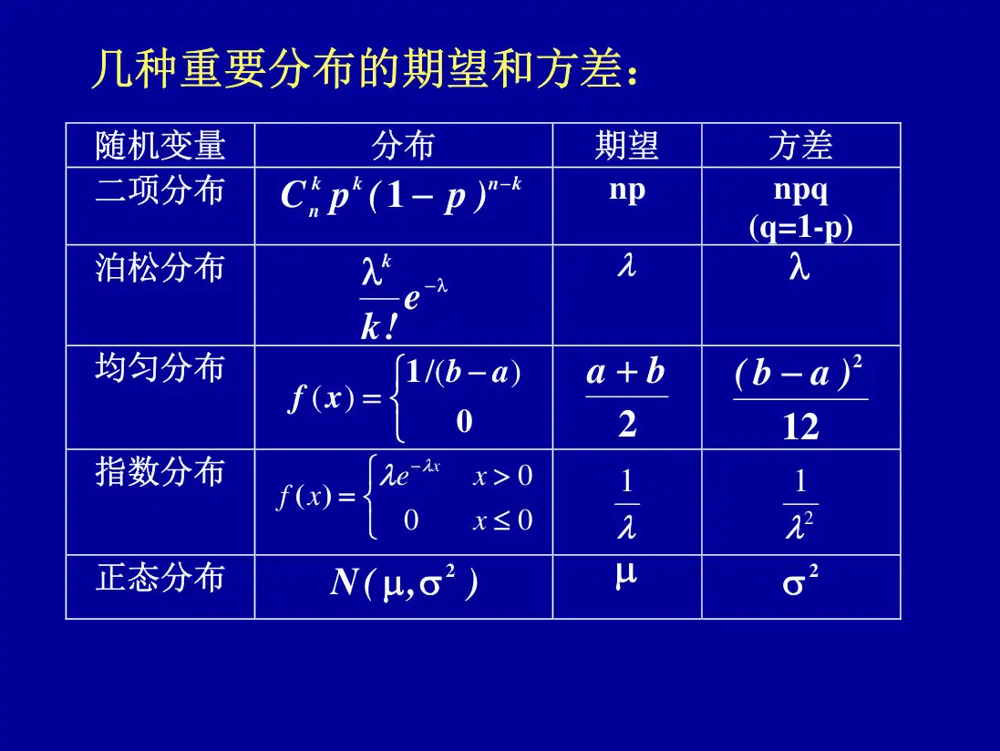

原文：

几种重要分布的期望和方差:

<table><tr><td>随机变量</td><td>分布</td><td>期望</td><td>方差</td></tr><tr><td>二项分布</td><td> $C_n^k p^k (1-p)^{n-k}$ </td><td>np</td><td>npq(q=1-p)</td></tr><tr><td>泊松分布</td><td> $\frac{\lambda^k}{k!} e^{-\lambda}$ </td><td> $\lambda$ </td><td> $\lambda$ </td></tr><tr><td>均匀分布</td><td> $f(x)=\begin{cases}1/(b-a) & \\0 & \end{cases}$ </td><td> $\frac{a+b}{2}$ </td><td> $\frac{(b-a)^2}{12}$ </td></tr><tr><td>指数分布</td><td> $f(x)=\begin{cases}\lambda e^{-\lambda x} & x>0 \\0 & x\leq 0\end{cases}$ </td><td> $\frac{1}{\lambda}$ </td><td> $\frac{1}{\lambda^2}$ </td></tr><tr><td>正态分布</td><td> $N(\mu,\sigma^2)$ </td><td> $\mu$ </td><td> $\sigma^2$ </td></tr></table>
