# 《概率论与数理统计》第4章 随机变量的数字特征（课件）

原件的每一页，下面附识别出的文字。

### 第4章 随机变量的数字特征

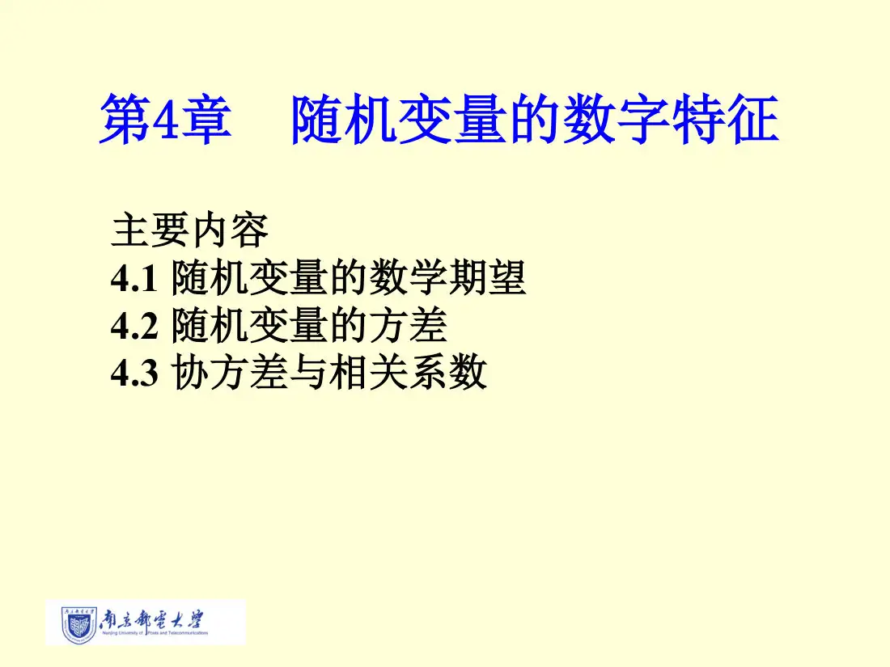

原文：

第4章 随机变量的数字特征

主要内容

4.1 随机变量的数学期望

4.2 随机变量的方差

4.3 协方差与相关系数

南京邮电大学
Nanjing University of Posts and Telecommunications

### 4.1 随机变量的数学期望

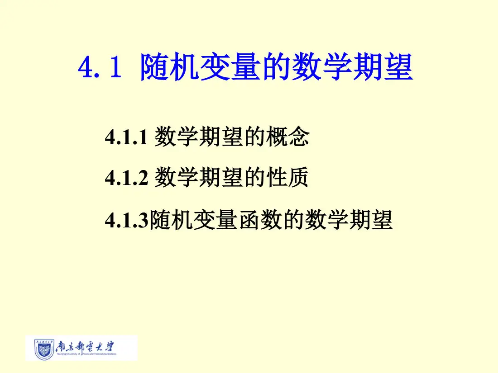

原文：

4.1 随机变量的数学期望

4.1.1 数学期望的概念

4.1.2 数学期望的性质

4.1.3随机变量函数的数学期望

南京邮电大学
Nanjing University of Posts and Telecommunications

### 例4.1 谁的技术比较好?

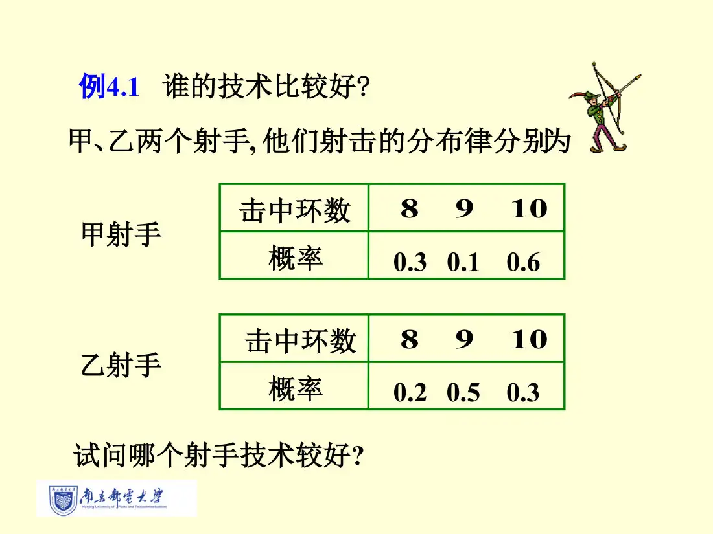

原文：

例4.1 谁的技术比较好?

甲、乙两个射手,他们射击的分布律分别为

甲射手

<table><tr><td>击中环数</td><td>8 9 10</td></tr><tr><td>概率</td><td>0.3 0.1 0.6</td></tr></table>

乙射手

<table><tr><td>击中环数</td><td>8 9 10</td></tr><tr><td>概率</td><td>0.2 0.5 0.3</td></tr></table>

试问哪个射手技术较好?

南京邮电大学
Nanjing University of Posts and Telecommunications

### 解 设甲、乙射手击中的环数分别为 $X_{1}, X_{2}$ ．

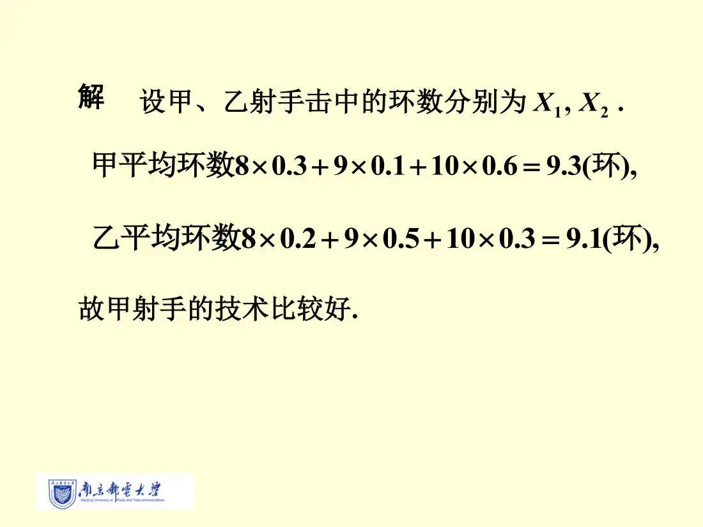

原文：

解 设甲、乙射手击中的环数分别为 $X_{1}, X_{2}$ ．
甲平均环数 $8 \times 0.3 + 9 \times 0.1 + 10 \times 0.6 = 9.3$ （环），
乙平均环数 $8 \times 0.2 + 9 \times 0.5 + 10 \times 0.3 = 9.1$ （环），故甲射手的技术比较好。

南京邮电大学
Nanjing University of Posts and Telecommunications

### 4.1.1数学期望的概念

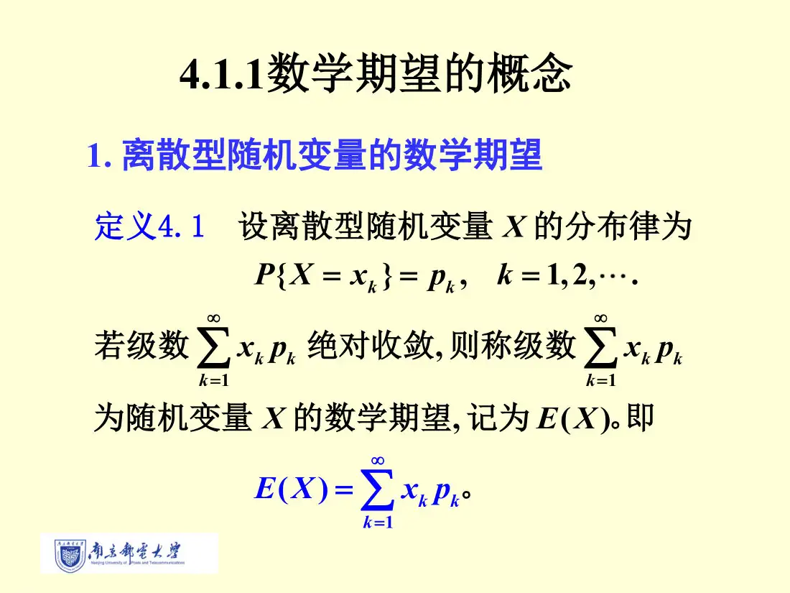

原文：

4.1.1数学期望的概念

1. 离散型随机变量的数学期望

定义4.1 设离散型随机变量 $X$ 的分布律为

$$
P \{X = x _ {k} \} = p _ {k}, \quad k = 1, 2, \dots .
$$

若级数 $\sum_{k=1}^{\infty} x_k p_k$ 绝对收敛, 则称级数 $\sum_{k=1}^{\infty} x_k p_k$ 为随机变量 $X$ 的数学期望, 记为 $E(X)$ 。即

$$
E (X) = \sum_ {k = 1} ^ {\infty} x _ {k} p _ {k} \circ
$$

南京邮电大学
Nanjing University of Posts and Telecommunications

### 关于定义的几点说明

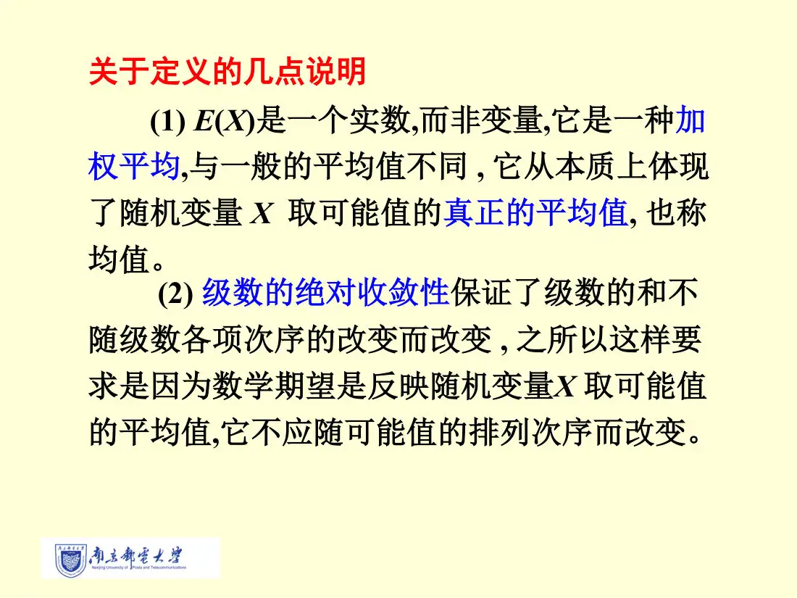

原文：

关于定义的几点说明

(1) $E(X)$ 是一个实数,而非变量,它是一种加权平均,与一般的平均值不同,它从本质上体现了随机变量 X 取可能值的真正的平均值,也称均值。

(2) 级数的绝对收敛性保证了级数的和不随级数各项次序的改变而改变,之所以这样要求是因为数学期望是反映随机变量X取可能值的平均值,它不应随可能值的排列次序而改变。

南京邮电大学
Nanjing University of Posts and Telecommunications

### $$

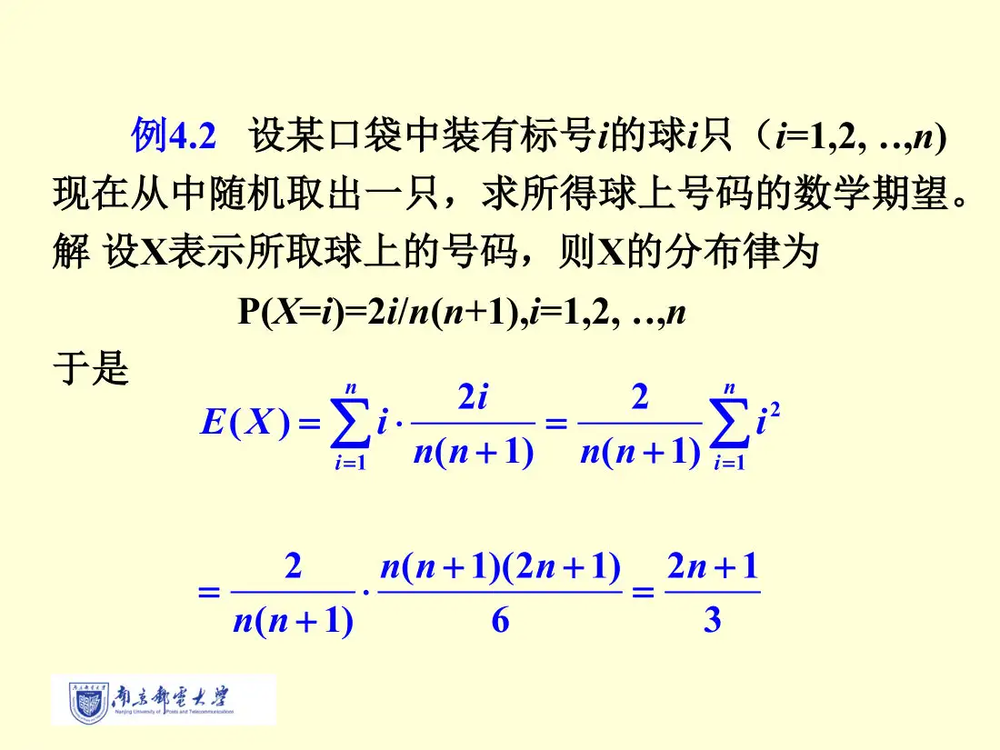

原文：

例4.2 设某口袋中装有标号i的球i只（i=1,2,..,n）现在从中随机取出一只，求所得球上号码的数学期望。解设X表示所取球上的号码，则X的分布律为

$$
\mathrm{P} (X = i) = 2 i / n (n + 1), i = 1, 2, \dots , n
$$

于是

$$
E (X) = \sum_ {i = 1} ^ {n} i \cdot \frac {2 i}{n (n + 1)} = \frac {2}{n (n + 1)} \sum_ {i = 1} ^ {n} i ^ {2}
$$

$$
= \frac {2}{n (n + 1)} \cdot \frac {n (n + 1) (2 n + 1)}{6} = \frac {2 n + 1}{3}
$$

南京邮电大学
Nanjing University of Posts and Telecommunications

### 到站时刻7:107:307:508:108:308:50概率1/52/52/5

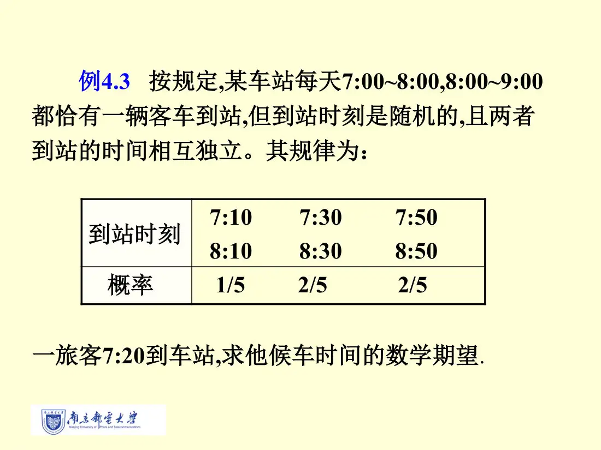

原文：

例4.3 按规定,某车站每天7:00\~8:00,8:00\~9:00都恰有一辆客车到站,但到站时刻是随机的,且两者到站的时间相互独立。其规律为:

<table><tr><td rowspan="2">到站时刻</td><td>7:10</td><td>7:30</td><td>7:50</td></tr><tr><td>8:10</td><td>8:30</td><td>8:50</td></tr><tr><td>概率</td><td>1/5</td><td>2/5</td><td>2/5</td></tr></table>

一旅客7:20到车站,求他候车时间的数学期望.

南京邮电大学
Nanjing University of Posts and Telecommunications

### 解：设旅客的候车时间为X(以分计),其分布率为

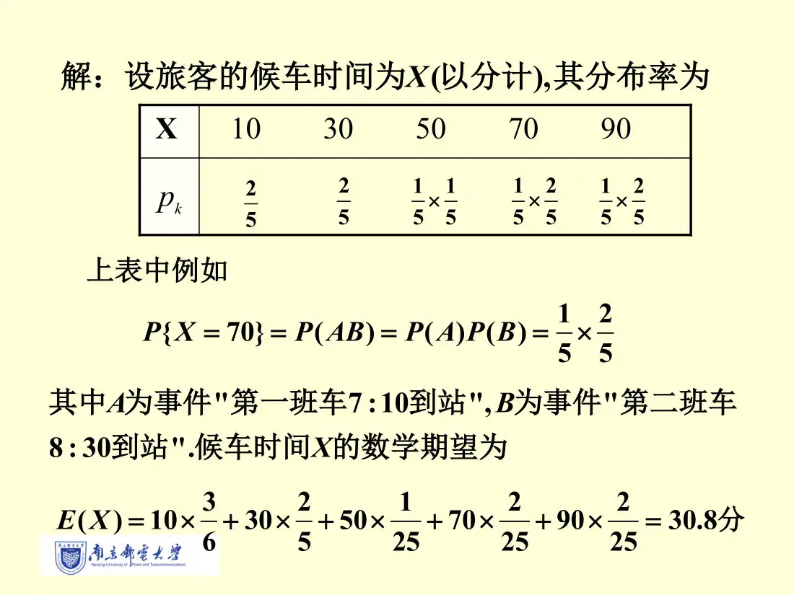

原文：

解：设旅客的候车时间为X(以分计),其分布率为

<table><tr><td>X</td><td>10</td><td>30</td><td>50</td><td>70</td><td>90</td></tr><tr><td> $p_k$ </td><td> $\frac{2}{5}$ </td><td> $\frac{2}{5}$ </td><td> $\frac{1}{5} \times \frac{1}{5}$ </td><td> $\frac{1}{5} \times \frac{2}{5}$ </td><td> $\frac{1}{5} \times \frac{2}{5}$ </td></tr></table>

上表中例如

$$
P \{X = 7 0 \} = P (A B) = P (A) P (B) = \frac {1}{5} \times \frac {2}{5}
$$

其中A为事件"第一班车7:10到站", B为事件"第二班车8:30到站".候车时间X的数学期望为

$$
E (X) = 1 0 \times \frac {3}{6} + 3 0 \times \frac {2}{5} + 5 0 \times \frac {1}{2 5} + 7 0 \times \frac {2}{2 5} + 9 0 \times \frac {2}{2 5} = 3 0. 8 \text {分}
$$

### 4.1.2 连续型随机变量的数学期望

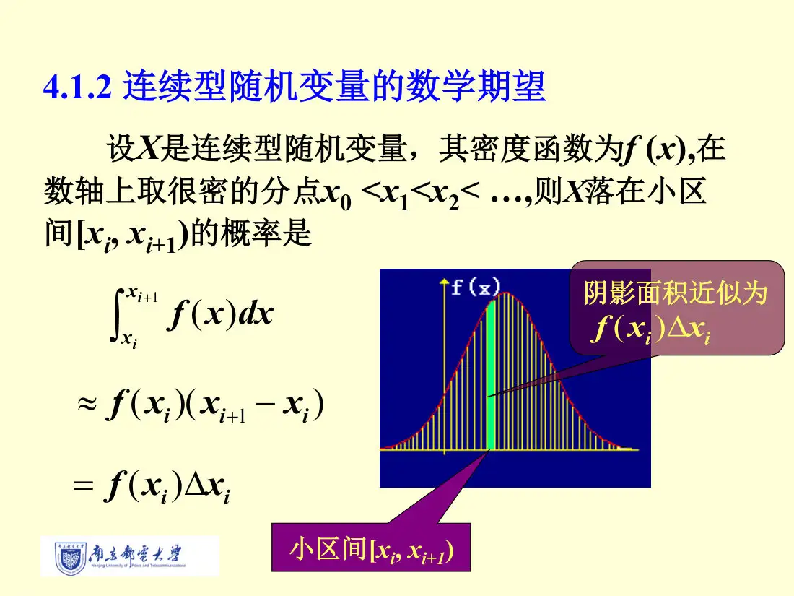

原文：

4.1.2 连续型随机变量的数学期望

设X是连续型随机变量，其密度函数为 $f(x)$ ，在数轴上取很密的分点 $x_{0}<x_{1}<x_{2}<\ldots$ ，则X落在小区间 $[x_{i},x_{i+1})$ 的概率是

$$
\begin{array}{c} \int_ {x _ {i}} ^ {x _ {i + 1}} f (x) d x \\ \approx f (x _ {i}) (x _ {i + 1} - x _ {i}) \\ = f (x _ {i}) \Delta x _ {i} \end{array}
$$

$$
[ x _ {i}, x _ {i + 1})
$$

南京邮电大学
Nanjing University of Posts and Telecommunications

### (r.v) 的数学期望是

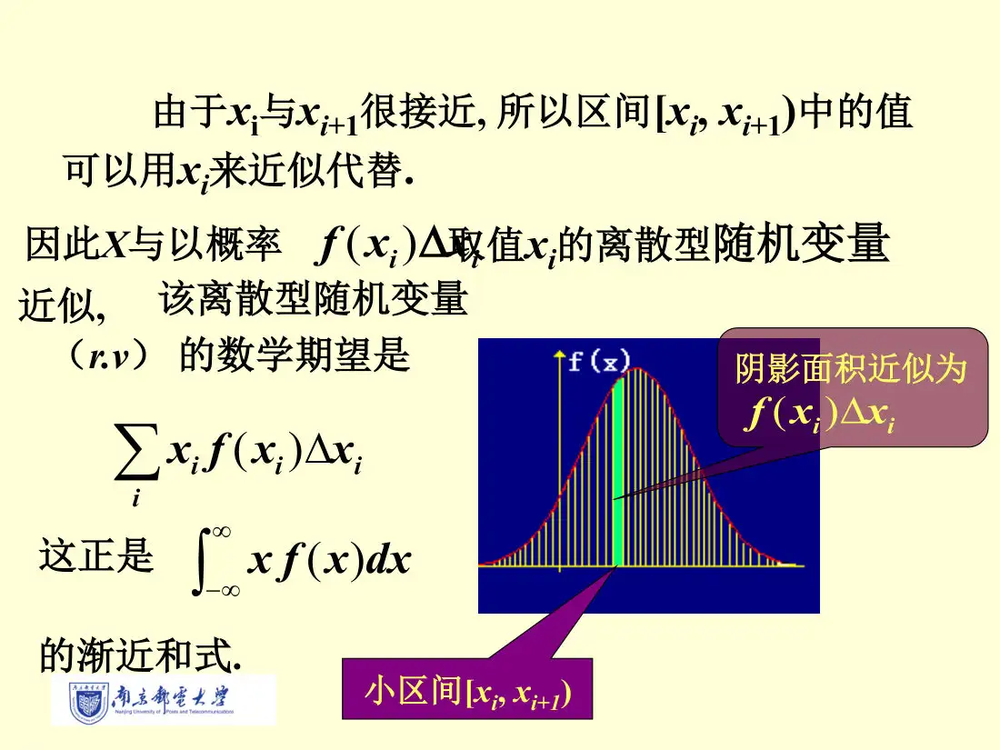

原文：

由于 $x_{i}$ 与 $x_{i+1}$ 很接近, 所以区间 $[x_{i}, x_{i+1})$ 中的值可以用 $x_{i}$ 来近似代替.

因此X与以概率 $f(x_{i})\Delta$ 取值 $x_{i}$ 的离散型随机变量近似，该离散型随机变量

(r.v) 的数学期望是

$$
\sum_ {i} x _ {i} f (x _ {i}) \Delta x _ {i}
$$

这正是 $\int_{-\infty}^{\infty} x f(x) dx$

的渐近和式.

阴影面积近似为 $f(x_{i})\Delta x_{i}$

小区间 $[x_{i}, x_{i+1})$

南京邮电大学
Nanjing University of Posts and Telecommunications

### 由此启发我们引进如下定义.

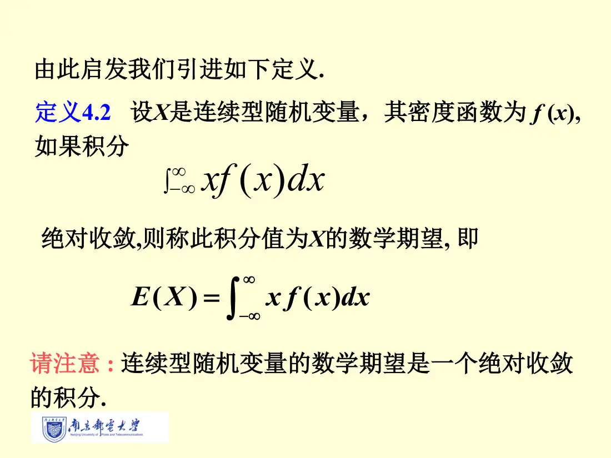

原文：

由此启发我们引进如下定义.

定义4.2 设 $X$ 是连续型随机变量，其密度函数为 $f(x)$ ，如果积分

$$
\int_ {- \infty} ^ {\infty} x f (x) d x
$$

绝对收敛,则称此积分值为X的数学期望,即

$$
E (X) = \int_ {- \infty} ^ {\infty} x f (x) d x
$$

请注意：连续型随机变量的数学期望是一个绝对收敛的积分.

南京邮电大学
Nanjing University of Posts and Telecommunications

### $$

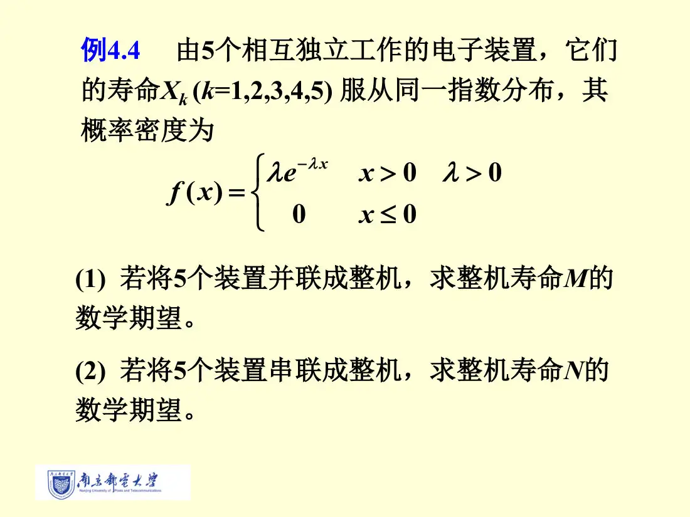

原文：

例4.4 由5个相互独立工作的电子装置，它们的寿命 $X_{k}(k=1,2,3,4,5)$ 服从同一指数分布，其概率密度为

$$
f (x) = \left\{ \begin{array}{c c c} \lambda e ^ {- \lambda x} & x > 0 & \lambda > 0 \\ 0 & x \leq 0 \end{array} \right.
$$

(1) 若将5个装置并联成整机，求整机寿命M的数学期望。

(2) 若将5个装置串联成整机，求整机寿命N的数学期望。

南京邮电大学
Nanjing University of Posts and Telecommunications

### (1) 若将5个装置并联成整机

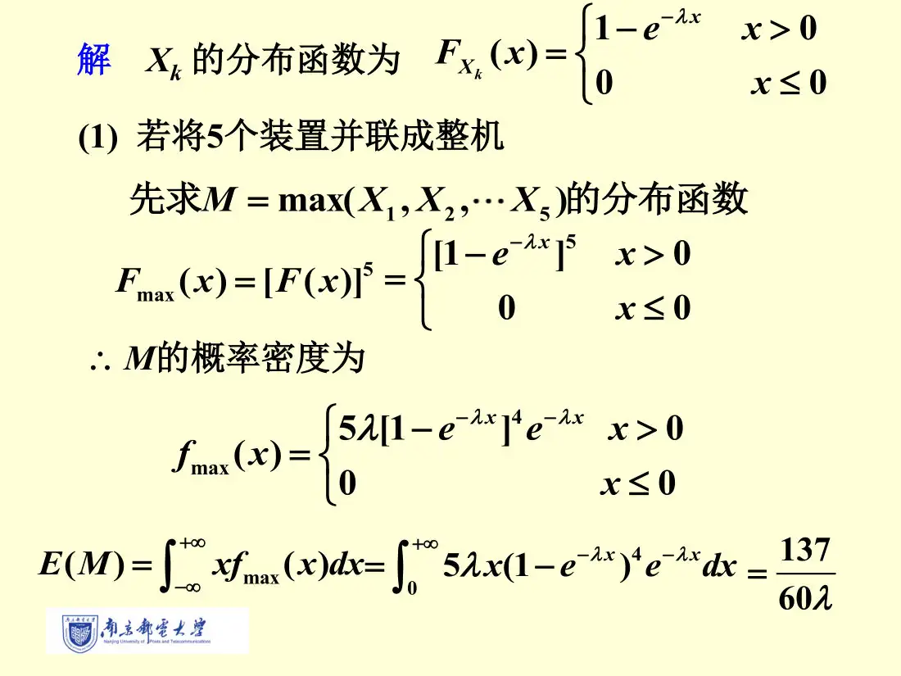

原文：

解 $X_{k}$ 的分布函数为 $F_{X_k}(x) = \left\{ \begin{array}{ll}1 - e^{-\lambda x} & x > 0\\ 0 & x\leq 0 \end{array} \right.$

(1) 若将5个装置并联成整机

先求 $M=\max(X_{1},X_{2},\cdots X_{5})$ 的分布函数

$$
F _ {\mathrm{max}} (x) = [ F (x) ] ^ {5} = \left\{ \begin{array}{c c} {[ 1 - e ^ {- \lambda x} ] ^ {5}} & x > 0 \\ 0 & x \leq 0 \end{array} \right.
$$

∴ M的概率密度为

$$
f _ {\max} (x) = \left\{ \begin{array}{l l} 5 \lambda [ 1 - e ^ {- \lambda x} ] ^ {4} e ^ {- \lambda x} & x > 0 \\ 0 & x \leq 0 \end{array} \right.
$$

$$
E (M) = \int_ {- \infty} ^ {+ \infty} x f _ {\max} (x) d x = \int_ {0} ^ {+ \infty} 5 \lambda x (1 - e ^ {- \lambda x}) ^ {4} e ^ {- \lambda x} d x = \frac {1 3 7}{6 0 \lambda}
$$

南京邮电大学
Nanjing University of Posts and Telecommunications

### (2) 若将5个装置串联成整机

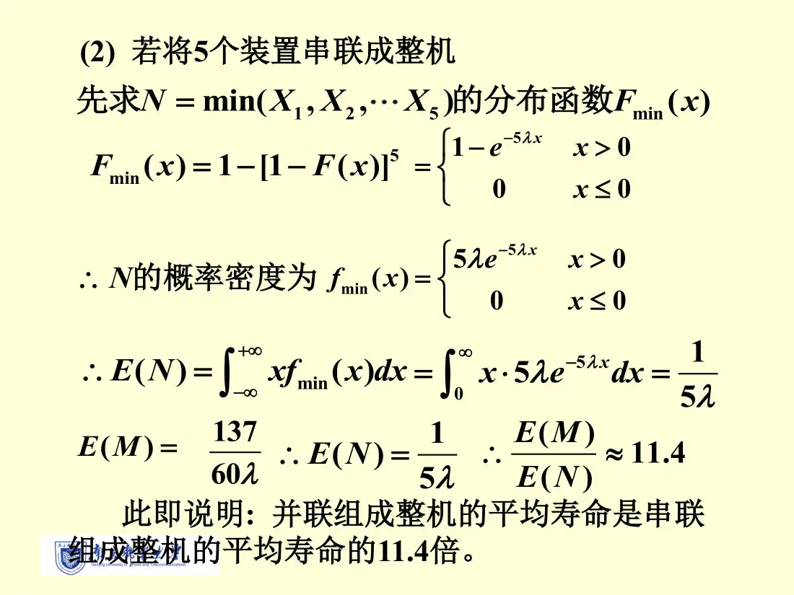

原文：

(2) 若将5个装置串联成整机

先求 $N=\min(X_{1},X_{2},\cdots X_{5})$ 的分布函数 $F_{\min}(x)$

$$
F _ {\mathrm{min}} (x) = 1 - [ 1 - F (x) ] ^ {5} = \left\{ \begin{array}{c c} 1 - e ^ {- 5 \lambda x} & x > 0 \\ 0 & x \leq 0 \end{array} \right.
$$

$\therefore N$ 的概率密度为 $f_{\min}(x) = \left\{ \begin{array}{ll}5\lambda e^{-5\lambda x} & x > 0\\ 0 & x\leq 0 \end{array} \right.$

$$
\therefore E (N) = \int_ {- \infty} ^ {+ \infty} x f _ {\min} (x) d x = \int_ {0} ^ {\infty} x \cdot 5 \lambda e ^ {- 5 \lambda x} d x = \frac {1}{5 \lambda}
$$

$$
E (M) = \frac {1 3 7}{6 0 \lambda} \therefore E (N) = \frac {1}{5 \lambda} \therefore \frac {E (M)}{E (N)} \approx 1 1. 4
$$

此即说明：并联组成整机的平均寿命是串联组成整机的平均寿命的11.4倍。

### 例 4.5 连续型随机变量 X 的功率密度函数

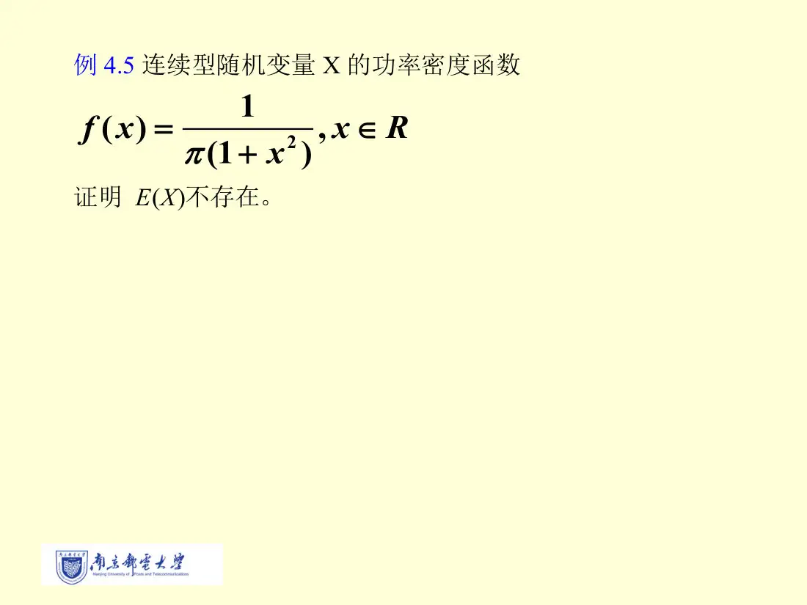

原文：

例 4.5 连续型随机变量 X 的功率密度函数

$$
f (x) = \frac {1}{\pi (1 + x ^ {2})}, x \in R
$$

证明 $E(X)$ 不存在。

南京邮电大学
Nanjing University of Posts and Telecommunications

### 4.1.3 随机变量函数的数学期望

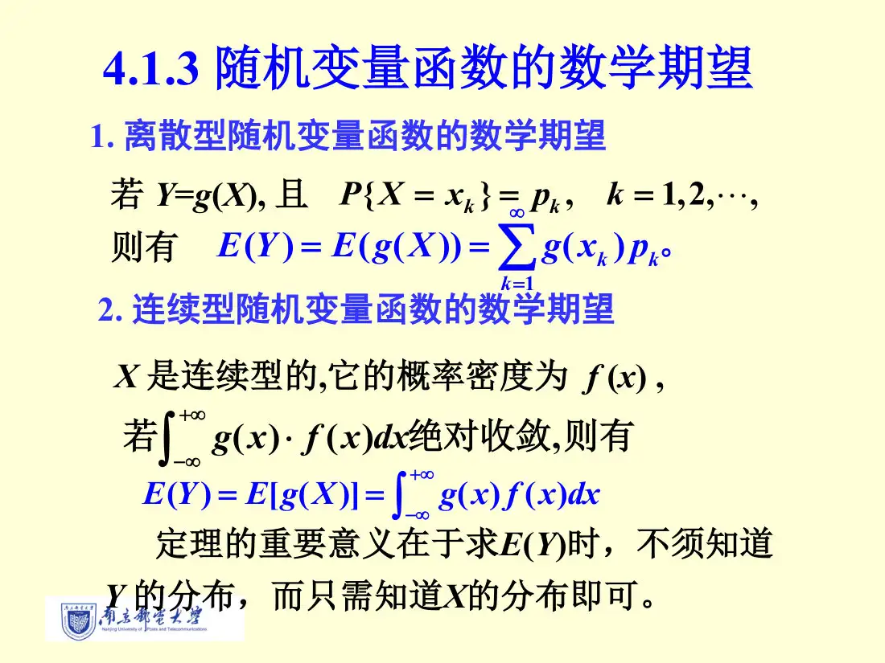

原文：

4.1.3 随机变量函数的数学期望

1. 离散型随机变量函数的数学期望

若 $Y=g(X)$ ，且 $P\{X=x_{k}\}=p_{k},\quad k=1,2,\cdots,$ 则有 $E(Y)=E(g(X))=\sum_{k=1}^{\infty}g(x_{k})p_{k}$

2. 连续型随机变量函数的数学期望

X 是连续型的,它的概率密度为 $f(x)$

若 $\int_{-\infty}^{+\infty} g(x) \cdot f(x) dx$ 绝对收敛, 则有

$$
E (Y) = E [ g (X) ] = \int_ {- \infty} ^ {+ \infty} g (x) f (x) d x
$$

定理的重要意义在于求 $E(Y)$ 时，不须知道Y的分布，而只需知道X的分布即可。

南京邮电大学
Nanjing University of Posts and Telecommunications

### 3. 二维随机变量函数的数学期望

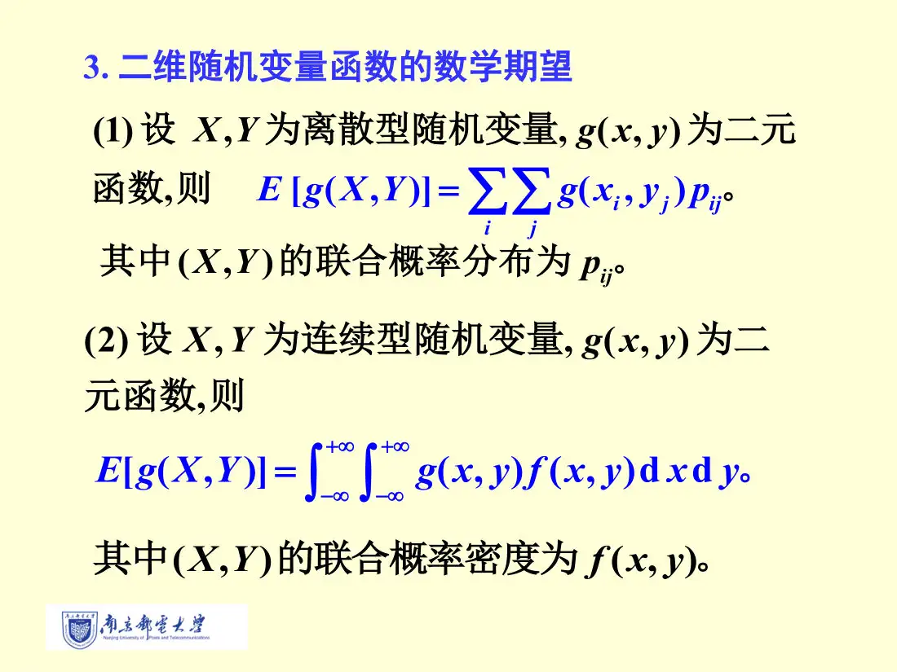

原文：

3. 二维随机变量函数的数学期望

(1) 设 X, Y 为离散型随机变量, $g(x, y)$ 为二元函数, 则 $E[g(X, Y)] = \sum_{i} \sum_{j} g(x_i, y_j) p_{ij}$ 。其中 $(X, Y)$ 的联合概率分布为 $p_{ij}$ 。

(2) 设 X, Y 为连续型随机变量, $g(x, y)$ 为二元函数, 则

$$
E [ g (X, Y) ] = \int_ {- \infty} ^ {+ \infty} \int_ {- \infty} ^ {+ \infty} g (x, y) f (x, y) d x d y _ {\circ}
$$

其中 $(X,Y)$ 的联合概率密度为 $f(x,y)$ 。

南京邮电大学
Nanjing University of Posts and Telecommunications

### 补充例4.2 设随机变量X的分布律为

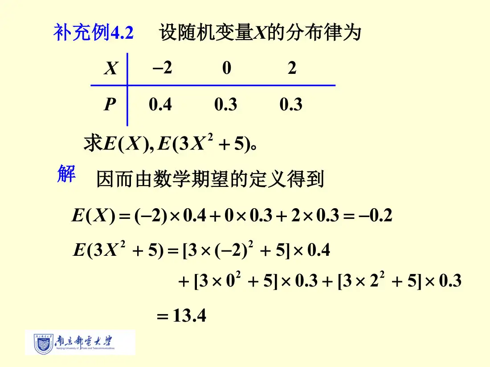

原文：

补充例4.2 设随机变量X的分布律为

<table><tr><td>X</td><td>-2</td><td>0</td><td>2</td></tr><tr><td>P</td><td>0.4</td><td>0.3</td><td>0.3</td></tr></table>

求 $E(X), E(3X^{2}+5)$ 。

解 因而由数学期望的定义得到

$$
E (X) = (- 2) \times 0. 4 + 0 \times 0. 3 + 2 \times 0. 3 = - 0. 2
$$

$$
\begin{array}{r l} & E (3 X ^ {2} + 5) = [ 3 \times (- 2) ^ {2} + 5 ] \times 0. 4 \\ & \qquad + [ 3 \times 0 ^ {2} + 5 ] \times 0. 3 + [ 3 \times 2 ^ {2} + 5 ] \times 0. 3 \\ & \qquad = 1 3. 4 \end{array}
$$

南京邮电大学
Nanjing University of Posts and Telecommunications

### 例4.8 已知随机变量 $X$ 的联合密度为

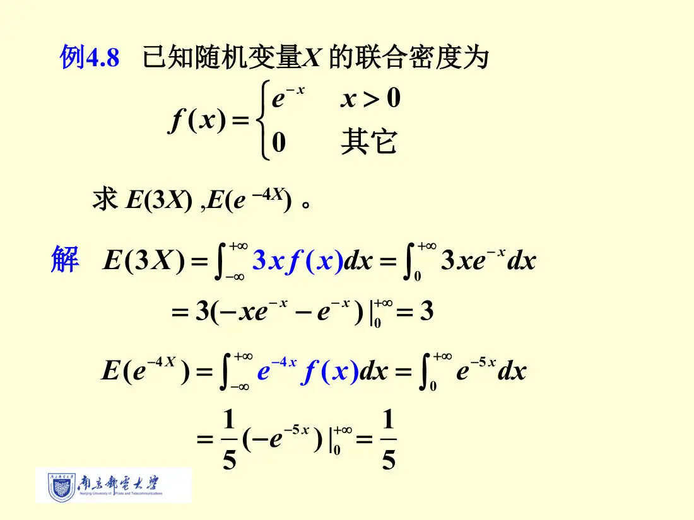

原文：

例4.8 已知随机变量 $X$ 的联合密度为

$$
f (x) = \left\{ \begin{array}{l l} e ^ {- x} & x > 0 \\ 0 & \text {其它} \end{array} \right.
$$

求 $E(3X)$ , $E(e^{-4X})$ 。

解

$$
\begin{array}{r l} E (3 X) & = \int_ {- \infty} ^ {+ \infty} 3 x f (x) d x = \int_ {0} ^ {+ \infty} 3 x e ^ {- x} d x \\ & = 3 (- x e ^ {- x} - e ^ {- x}) | _ {0} ^ {+ \infty} = 3 \end{array}
$$

$$
\begin{array}{r l} E (e ^ {- 4 X}) & = \int_ {- \infty} ^ {+ \infty} e ^ {- 4 x} f (x) d x = \int_ {0} ^ {+ \infty} e ^ {- 5 x} d x \\ & = \frac {1}{5} (- e ^ {- 5 x}) | _ {0} ^ {+ \infty} = \frac {1}{5} \end{array}
$$

南京邮电大学
Nanjing University of Posts and Telecommunications

### 例4.9 已知 $(X,Y)$ 的联合密度为

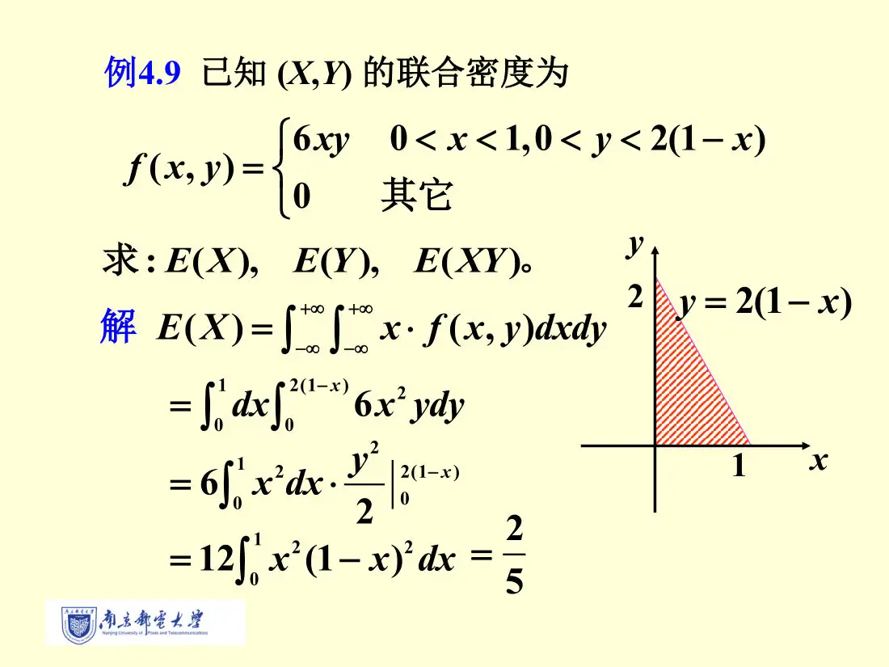

原文：

例4.9 已知 $(X,Y)$ 的联合密度为

$$
f (x, y) = \left\{ \begin{array}{l l} 6 x y & 0 <   x <   1, 0 <   y <   2 (1 - x) \\ 0 & \text {其它} \end{array} \right.
$$

求: $E(X)$ , $E(Y)$ , $E(XY)$ 。

解

$$
\begin{array}{l} E (X) = \int_ {- \infty} ^ {+ \infty} \int_ {- \infty} ^ {+ \infty} x \cdot f (x, y) d x d y \\ = \int_ {0} ^ {1} d x \int_ {0} ^ {2 (1 - x)} 6 x ^ {2} y d y \\ = 6 \int_ {0} ^ {1} x ^ {2} d x \cdot \frac {y ^ {2}}{2} \Big | _ {0} ^ {2 (1 - x)} \\ = 1 2 \int_ {0} ^ {1} x ^ {2} (1 - x) ^ {2} d x = \frac {2}{5} \end{array}
$$

南京邮电大学
Nanjing University of Posts and Telecommunications

### $$

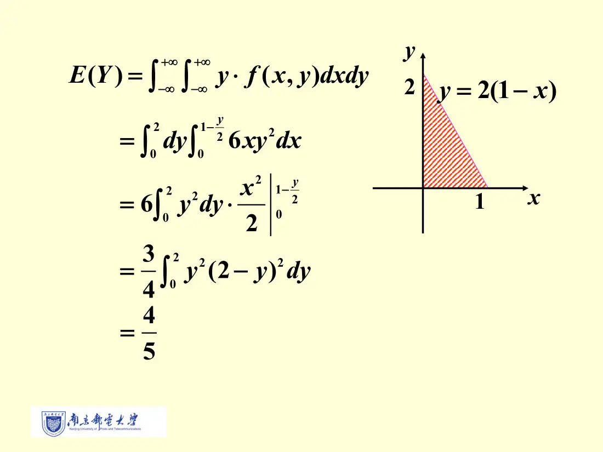

原文：

$$
\begin{array}{r l} E (Y) & = \int_ {- \infty} ^ {+ \infty} \int_ {- \infty} ^ {+ \infty} y \cdot f (x, y) d x d y \\ & = \int_ {0} ^ {2} d y \int_ {0} ^ {1 - \frac {y}{2}} 6 x y ^ {2} d x \\ & = 6 \int_ {0} ^ {2} y ^ {2} d y \cdot \left. \frac {x ^ {2}}{2} \right| _ {0} ^ {1 - \frac {y}{2}} \\ & = \frac {3}{4} \int_ {0} ^ {2} y ^ {2} (2 - y) ^ {2} d y \\ & = \frac {4}{5} \end{array}
$$

南京邮电大学
Nanjing University of Posts and Telecommunications

### $$

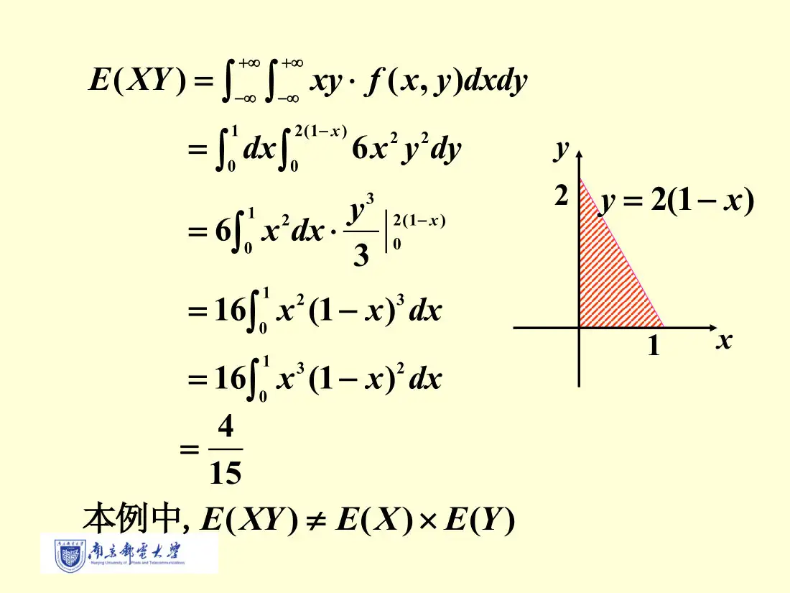

原文：

$$
\begin{array}{r l} E (X Y) & = \int_ {- \infty} ^ {+ \infty} \int_ {- \infty} ^ {+ \infty} x y \cdot f (x, y) d x d y \\ & = \int_ {0} ^ {1} d x \int_ {0} ^ {2 (1 - x)} 6 x ^ {2} y ^ {2} d y \\ & = 6 \int_ {0} ^ {1} x ^ {2} d x \cdot \frac {y ^ {3}}{3} \Big | _ {0} ^ {2 (1 - x)} \\ & = 1 6 \int_ {0} ^ {1} x ^ {2} (1 - x) ^ {3} d x \\ & = 1 6 \int_ {0} ^ {1} x ^ {3} (1 - x) ^ {2} d x \\ & = \frac {4}{1 5} \end{array}
$$

本例中, $E(XY) \neq E(X) \times E(Y)$

南京邮电大学
Nanjing University of Posts and Telecommunications

### 4.1.4 数学期望的性质

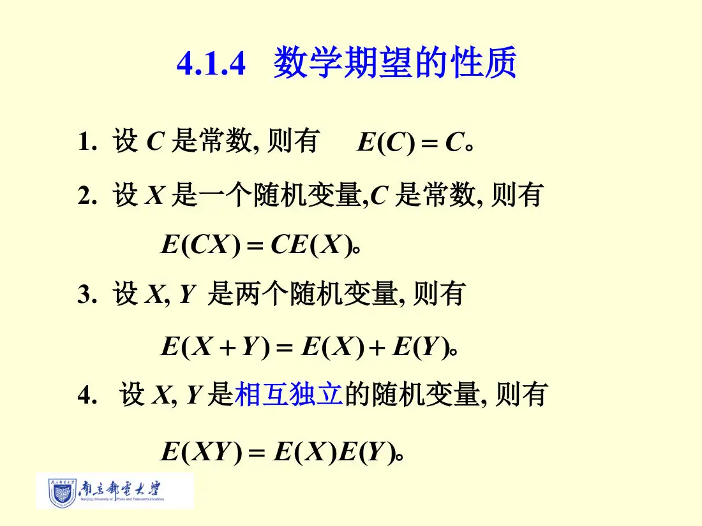

原文：

4.1.4 数学期望的性质

1. 设 C 是常数, 则有 $E(C) = C$ 。

2. 设 X 是一个随机变量, C 是常数, 则有

$$
E (C X) = C E (X) _ {\circ}
$$

3. 设 X, Y 是两个随机变量, 则有

$$
E (X + Y) = E (X) + E (Y) 。
$$

4. 设 X, Y 是相互独立的随机变量, 则有

$$
E (X Y) = E (X) E (Y) 。
$$

南京邮电大学
Nanjing University of Posts and Telecommunications

### $$

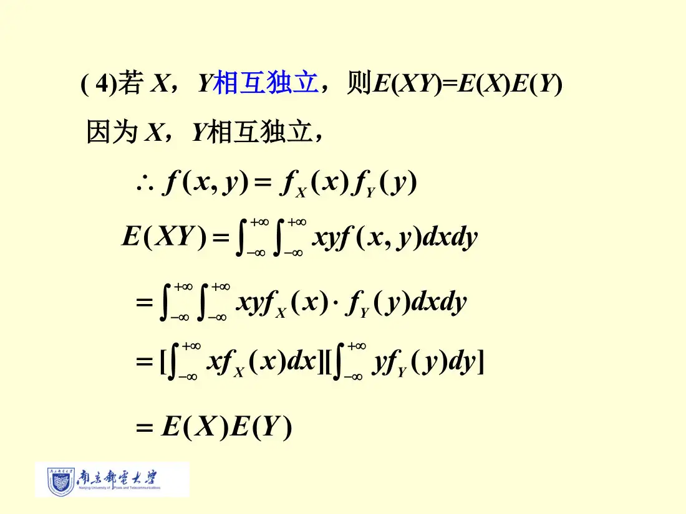

原文：

(4)若 X, Y 相互独立，则 $E(XY)=E(X)E(Y)$ 因为 X, Y 相互独立,

$$
\begin{array}{r l} & {\therefore f (x, y) = f _ {X} (x) f _ {Y} (y)} \\ & {E (X Y) = \int_ {- \infty} ^ {+ \infty} \int_ {- \infty} ^ {+ \infty} x y f (x, y) d x d y} \\ & {\quad = \int_ {- \infty} ^ {+ \infty} \int_ {- \infty} ^ {+ \infty} x y f _ {X} (x) \cdot f _ {Y} (y) d x d y} \\ & {\quad = [ \int_ {- \infty} ^ {+ \infty} x f _ {X} (x) d x ] [ \int_ {- \infty} ^ {+ \infty} y f _ {Y} (y) d y ]} \\ & {\quad = E (X) E (Y)} \end{array}
$$

南京邮电大学
Nanjing University of Posts and Telecommunications

### $$

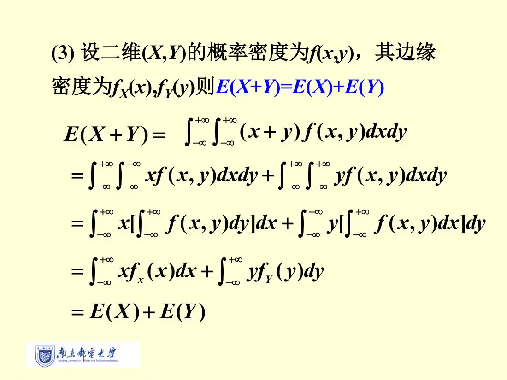

原文：

(3) 设二维 $(X, Y)$ 的概率密度为 $f(x, y)$ ，其边缘密度为 $f_{X}(x), f_{Y}(y)$ 则 $E(X + Y) = E(X) + E(Y)$

$$
\begin{array}{r l} & E (X + Y) = \int_ {- \infty} ^ {+ \infty} \int_ {- \infty} ^ {+ \infty} (x + y) f (x, y) d x d y \\ & = \int_ {- \infty} ^ {+ \infty} \int_ {- \infty} ^ {+ \infty} x f (x, y) d x d y + \int_ {- \infty} ^ {+ \infty} \int_ {- \infty} ^ {+ \infty} y f (x, y) d x d y \\ & = \int_ {- \infty} ^ {+ \infty} x [ \int_ {- \infty} ^ {+ \infty} f (x, y) d y ] d x + \int_ {- \infty} ^ {+ \infty} y [ \int_ {- \infty} ^ {+ \infty} f (x, y) d x ] d y \\ & = \int_ {- \infty} ^ {+ \infty} x f _ {x} (x) d x + \int_ {- \infty} ^ {+ \infty} y f _ {Y} (y) d y \\ & = E (X) + E (Y) \end{array}
$$

南京邮电大学
Nanjing University of Posts and Telecommunications

### 例4.11

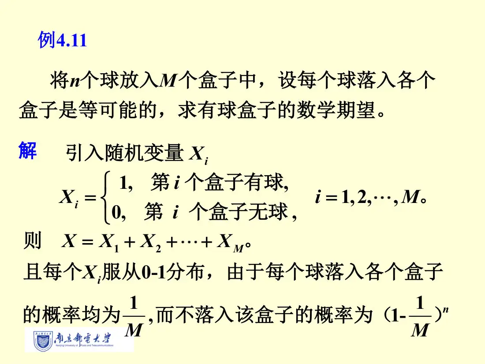

原文：

例4.11

将 $n$ 个球放入 $M$ 个盒子中，设每个球落入各个盒子是等可能的，求有球盒子的数学期望。

解 引入随机变量 $X_{i}$

$X_{i}=\left\{\begin{aligned}&1, & 第 i 个盒子有球,\\ &0, & 第 i 个盒子无球,\end{aligned}\right.$ $i=1,2,\cdots,M。$

则 $X = X_{1} + X_{2} + \cdots + X_{M}$

且每个 $X_{i}$ 服从0-1分布，由于每个球落入各个盒子的概率均为 $\frac{1}{M}$ ，而不落入该盒子的概率为 $(1 - \frac{1}{M})^{n}$

### $$

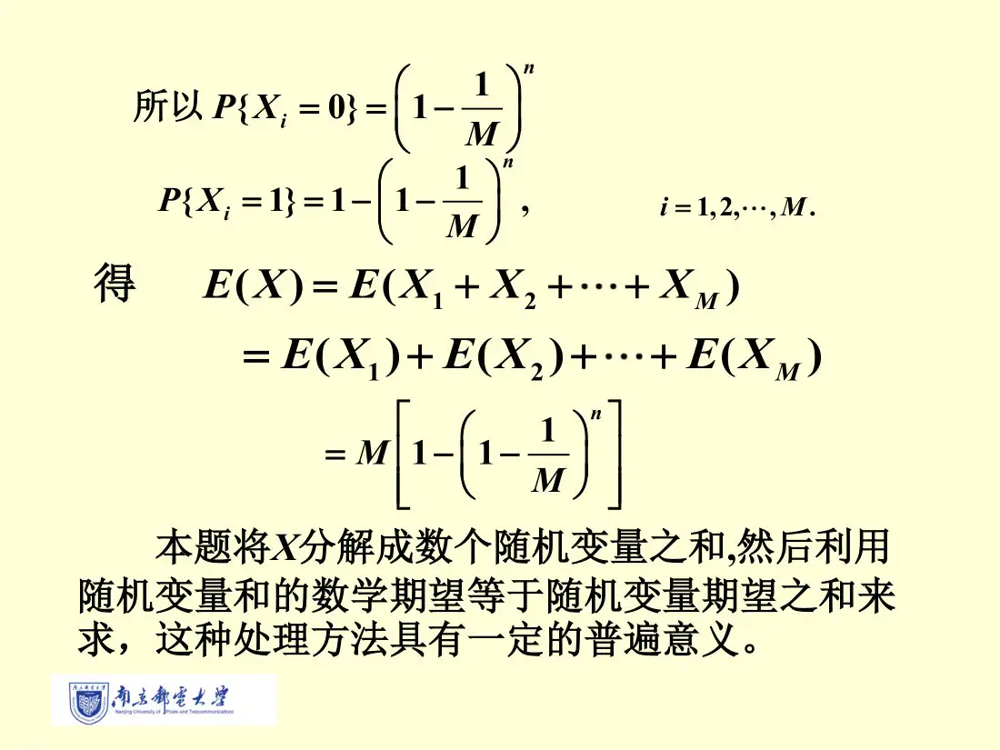

原文：

所以 $P\{X_i = 0\} = \left(1 - \frac{1}{M}\right)^n$

$$
P \{X _ {i} = 1 \} = 1 - \left(1 - \frac {1}{M}\right) ^ {n}, \quad i = 1, 2, \dots , M.
$$

得

$$
\begin{array}{r l} & E (X) = E (X _ {1} + X _ {2} + \dots + X _ {M}) \\ & \qquad = E (X _ {1}) + E (X _ {2}) + \dots + E (X _ {M}) \\ & \qquad = M \left[ 1 - \left(1 - \frac {1}{M}\right) ^ {n} \right] \end{array}
$$

本题将X分解成数个随机变量之和,然后利用随机变量和的数学期望等于随机变量期望之和来求，这种处理方法具有一定的普遍意义。

南京邮电大学
Nanjing University of Posts and Telecommunications

### 常见分布的期望

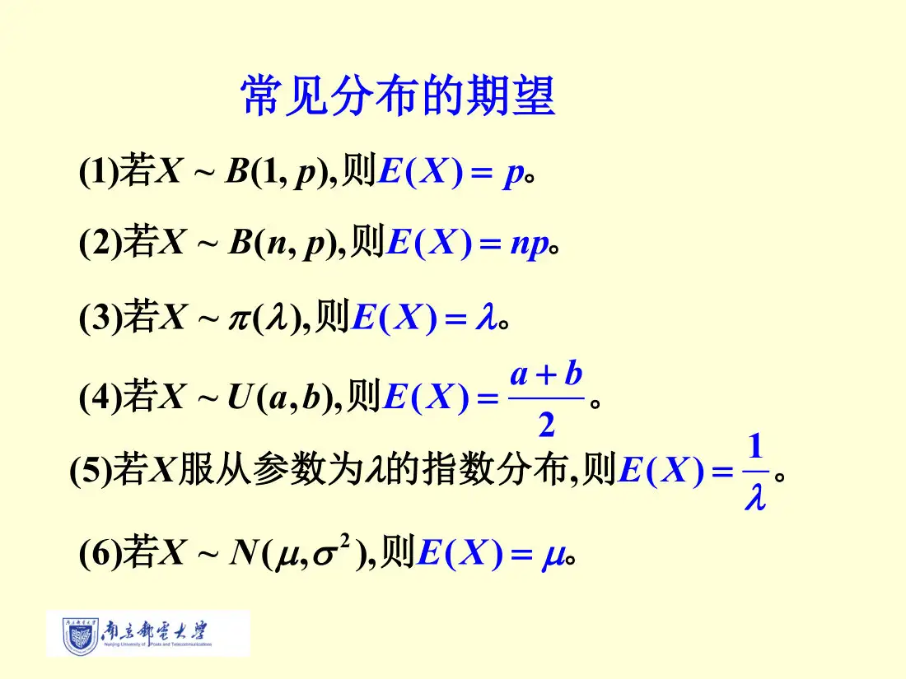

原文：

常见分布的期望

(1)若 $X \sim B(1, p)$ ，则 $E(X) = p$ 。

(2)若 $X \sim B(n, p)$ ，则 $E(X) = np$ 。

(3)若 $X \sim \pi(\lambda)$ ，则 $E(X) = \lambda$ 。

(4)若 $X \sim U(a, b)$ ，则 $E(X) = \frac{a + b}{2}$ 。

(5)若X服从参数为 $\lambda$ 的指数分布,则 $E(X)=\frac{1}{\lambda}$ 。

(6)若 $X \sim N(\mu, \sigma^{2})$ ，则 $E(X) = \mu_{\circ}$

南京邮电大学
Nanjing University of Posts and Telecommunications

### 4.2.1 随机变量方差的概念与计算

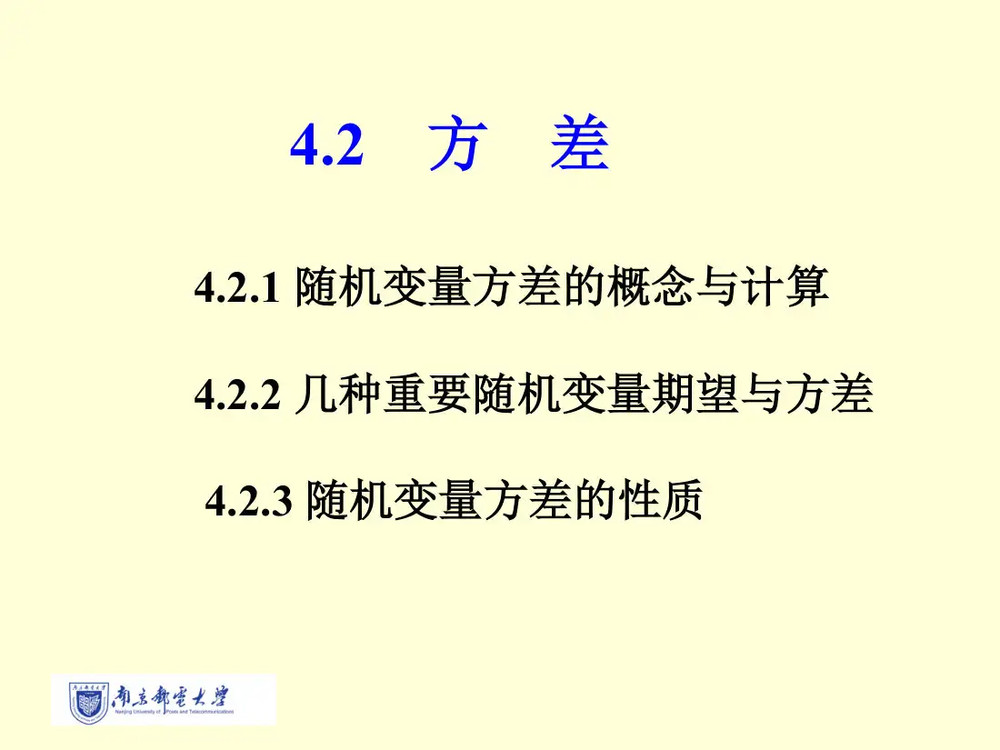

原文：

4.2.1 随机变量方差的概念与计算
4.2.2 几种重要随机变量期望与方差
4.2.3 随机变量方差的性质

4.2 方差

南京邮电大学
Nanjing University of Posts and Telecommunications

### 4.2.1 随机变量方差的概念

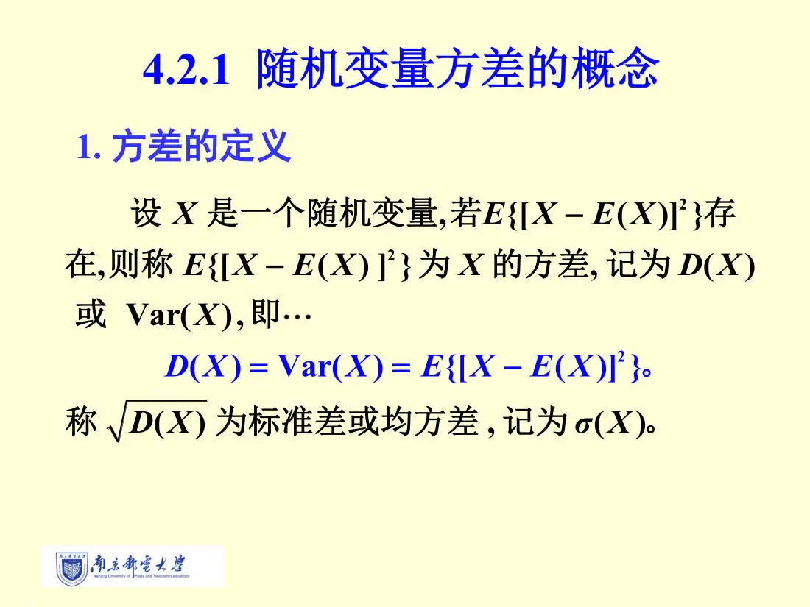

原文：

4.2.1 随机变量方差的概念

1. 方差的定义

设 X 是一个随机变量, 若 $E\{[X - E(X)]^{2}\}$ 存在, 则称 $E\{[X - E(X)]^{2}\}$ 为 X 的方差, 记为 $D(X)$ 或 $\operatorname{Var}(X)$ , 即…

$D(X)=\operatorname{Var}(X)=E\{[X-E(X)]^{2}\}$ 称 $\sqrt{D(X)}$ 为标准差或均方差，记为 $\sigma(X)$ 。

南京邮电大学
Nanjing University of Posts and Telecommunications

### 方差的意义

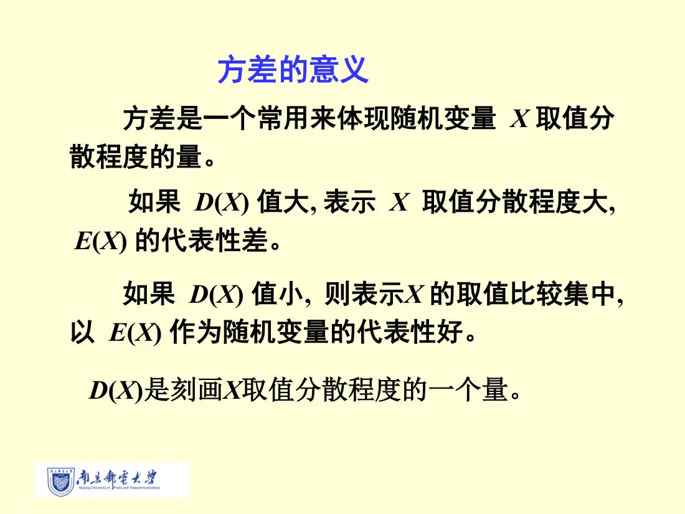

原文：

方差的意义

方差是一个常用来体现随机变量 X 取值分散程度的量。

如果 $D(X)$ 值大, 表示 X 取值分散程度大, $E(X)$ 的代表性差。

如果 $D(X)$ 值小，则表示 $X$ 的取值比较集中，以 $E(X)$ 作为随机变量的代表性好。

$D(X)$ 是刻画X取值分散程度的一个量。

南京邮电大学
Nanjing University of Posts and Telecommunications

### 2. 随机变量方差的计算

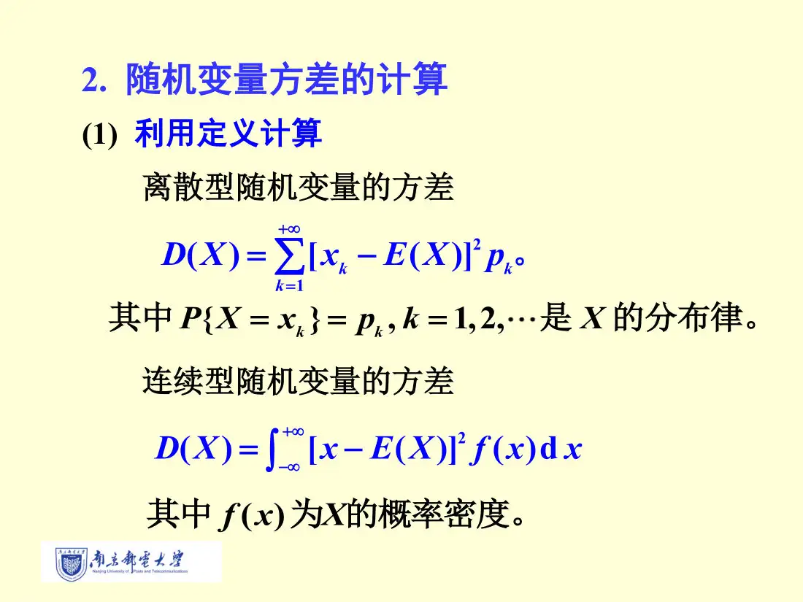

原文：

2. 随机变量方差的计算

(1) 利用定义计算

离散型随机变量的方差

$$
D (X) = \sum_ {k = 1} ^ {+ \infty} [ x _ {k} - E (X) ] ^ {2} p _ {k} \circ
$$

其中 $P\{X=x_{k}\}=p_{k}, k=1,2,\cdots$ 是 X 的分布律。

连续型随机变量的方差

$$
D (X) = \int_ {- \infty} ^ {+ \infty} [ x - E (X) ] ^ {2} f (x) d x
$$

其中 $f(x)$ 为 X 的概率密度。

南京邮电大学
Nanjing University of Posts and Telecommunications

### (2) 利用公式计算

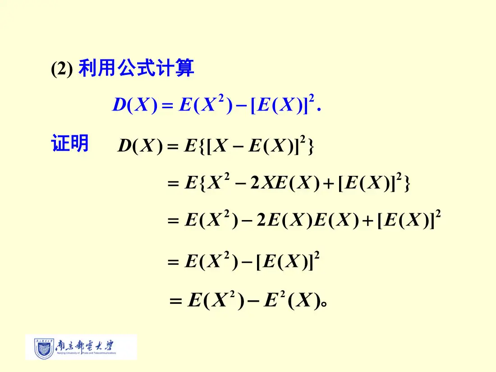

原文：

(2) 利用公式计算

$$
D (X) = E \left(X ^ {2}\right) - [ E (X) ] ^ {2}.
$$

证明

$$
\begin{array}{r l} & D (X) = E \{[ X - E (X) ] ^ {2} \} \\ & \qquad = E \{X ^ {2} - 2 X E (X) + [ E (X) ] ^ {2} \} \\ & \qquad = E (X ^ {2}) - 2 E (X) E (X) + [ E (X) ] ^ {2} \\ & \qquad = E (X ^ {2}) - [ E (X) ] ^ {2} \\ & \qquad = E (X ^ {2}) - E ^ {2} (X) _ {\circ} \end{array}
$$

南京邮电大学
Nanjing University of Posts and Telecommunications

### 补充例4.5 设随机变量X的分布律为

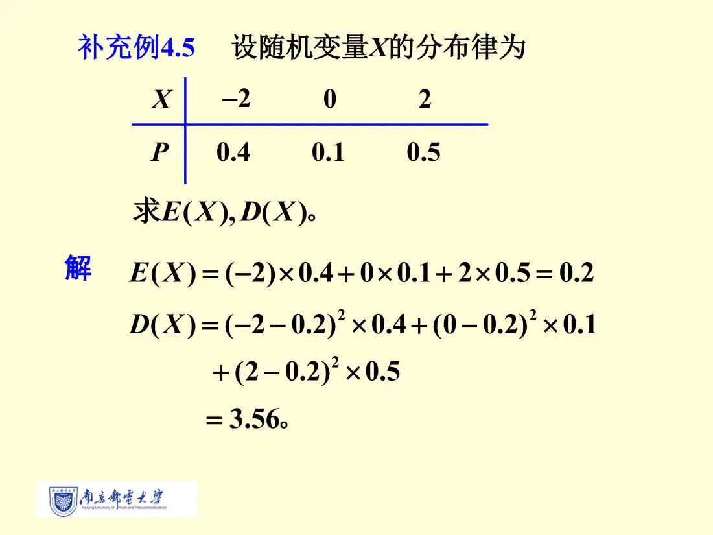

原文：

补充例4.5 设随机变量X的分布律为

<table><tr><td>X</td><td>-2</td><td>0</td><td>2</td></tr><tr><td>P</td><td>0.4</td><td>0.1</td><td>0.5</td></tr></table>

求 $E(X), D(X)$ 。

解 $E(X) = (-2)\times 0.4 + 0\times 0.1 + 2\times 0.5 = 0.2$

$$
\begin{array}{r l} D (X) & = (- 2 - 0. 2) ^ {2} \times 0. 4 + (0 - 0. 2) ^ {2} \times 0. 1 \\ & + (2 - 0. 2) ^ {2} \times 0. 5 \\ & = 3. 5 6 _ {\circ} \end{array}
$$

南京邮电大学
Nanjing University of Posts and Telecommunications

### 例4.13 设随机变量 $X$ 具有概率密度

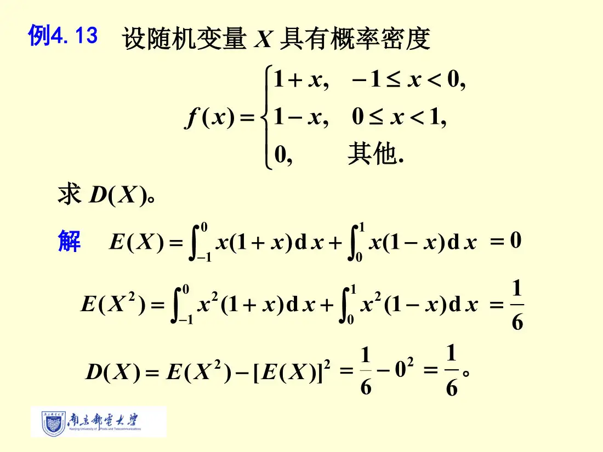

原文：

例4.13 设随机变量 $X$ 具有概率密度

$$
f (x) = \left\{ \begin{array}{l l} 1 + x, & - 1 \leq x <   0, \\ 1 - x, & 0 \leq x <   1, \\ 0, & \text {其他.} \end{array} \right.
$$

求 $D(X)$ 。

解 $E(X) = \int_{-1}^{0}x(1 + x)\mathrm{d}x + \int_0^1 x(1 - x)\mathrm{d}x = 0$

$$
E (X ^ {2}) = \int_ {- 1} ^ {0} x ^ {2} (1 + x) d x + \int_ {0} ^ {1} x ^ {2} (1 - x) d x = \frac {1}{6}
$$

$$
D (X) = E \left(X ^ {2}\right) - [ E (X) ] ^ {2} = \frac {1}{6} - 0 ^ {2} = \frac {1}{6} 。
$$

南京邮电大学
Nanjing University of Posts and Telecommunications

### 4.2.2 重要分布的期望与方差

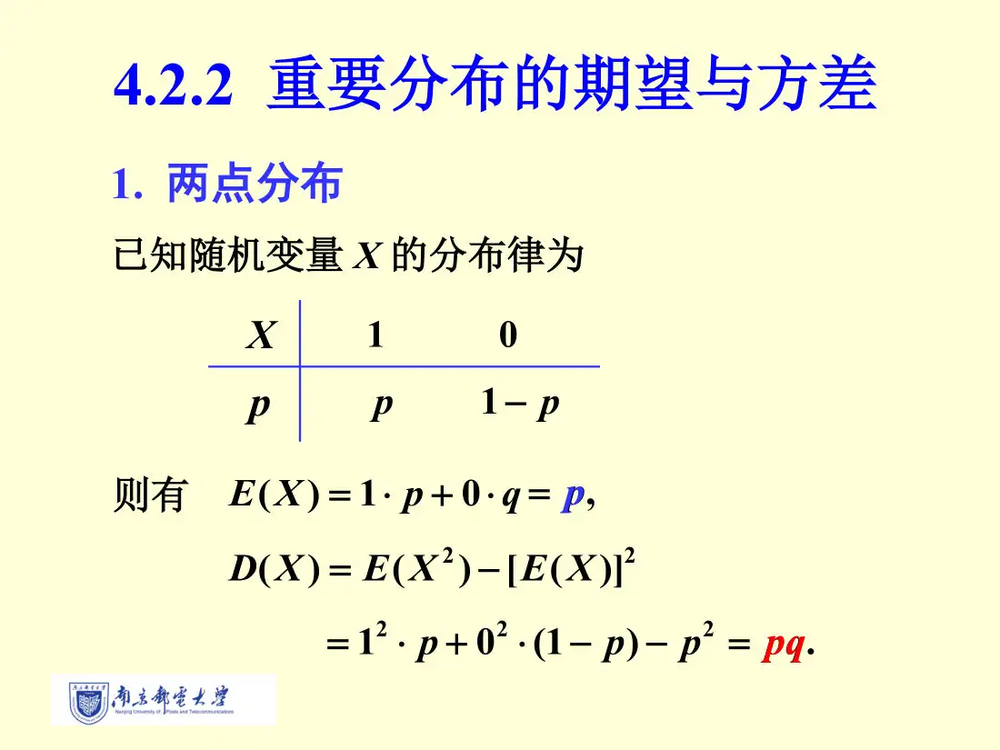

原文：

4.2.2 重要分布的期望与方差

1. 两点分布

已知随机变量 X 的分布律为

$$
\begin{array}{c c c} X & 1 & 0 \\ \hline p & p & 1 - p \end{array}
$$

则有 $E(X)=1\cdot p+0\cdot q=p,$

$$
\begin{array}{r l} D (X) & = E (X ^ {2}) - [ E (X) ] ^ {2} \\ & = 1 ^ {2} \cdot p + 0 ^ {2} \cdot (1 - p) - p ^ {2} = p q. \end{array}
$$

南京邮电大学
Nanjing University of Posts and Telecommunications

### 2. 二项分布

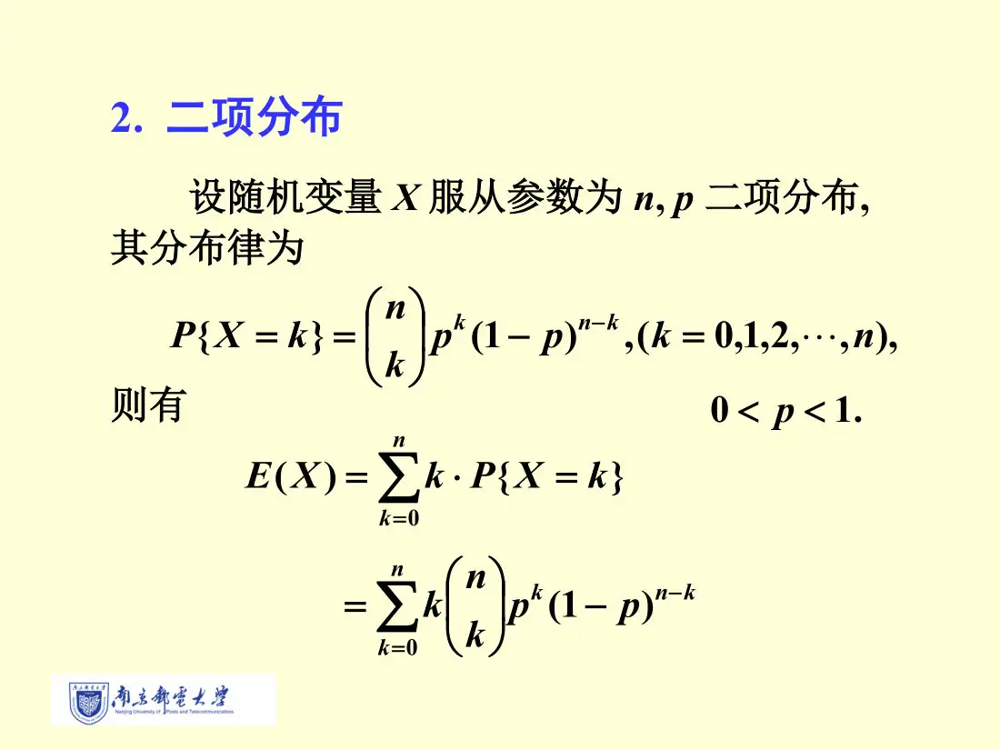

原文：

2. 二项分布

设随机变量 X 服从参数为 n, p 二项分布, 其分布律为

$$
P \{X = k \} = \binom {n} {k} p ^ {k} (1 - p) ^ {n - k}, (k = 0, 1, 2, \dots , n),
$$

则有

$$
0 <   p <   1.
$$

$$
\begin{array}{r l} E (X) & = \sum_ {k = 0} ^ {n} k \cdot P \{X = k \} \\ & = \sum_ {k = 0} ^ {n} k {\binom {n} {k}} p ^ {k} (1 - p) ^ {n - k} \end{array}
$$

南京邮电大学
Nanjing University of Posts and Telecommunications

### $$

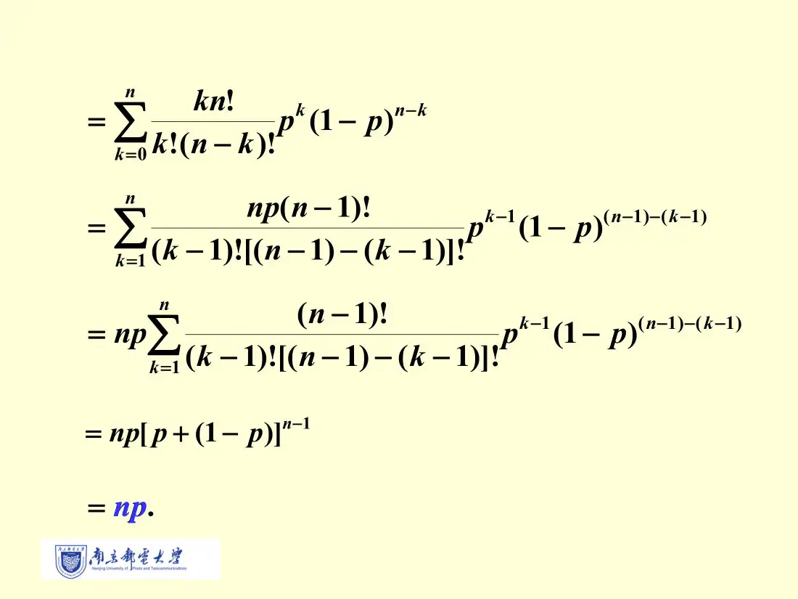

原文：

$$
\begin{array}{l} = \sum_ {k = 0} ^ {n} \frac {k n !}{k ! (n - k) !} p ^ {k} (1 - p) ^ {n - k} \\ = \sum_ {k = 1} ^ {n} \frac {n p (n - 1) !}{(k - 1) ! [ (n - 1) - (k - 1) ] !} p ^ {k - 1} (1 - p) ^ {(n - 1) - (k - 1)} \\ = n p \sum_ {k = 1} ^ {n} \frac {(n - 1) !}{(k - 1) ! [ (n - 1) - (k - 1) ] !} p ^ {k - 1} (1 - p) ^ {(n - 1) - (k - 1)} \\ = n p [ p + (1 - p) ] ^ {n - 1} \\ = n p. \end{array}
$$

南京邮电大学
Nanjing University of Posts and Telecommunications

### $$

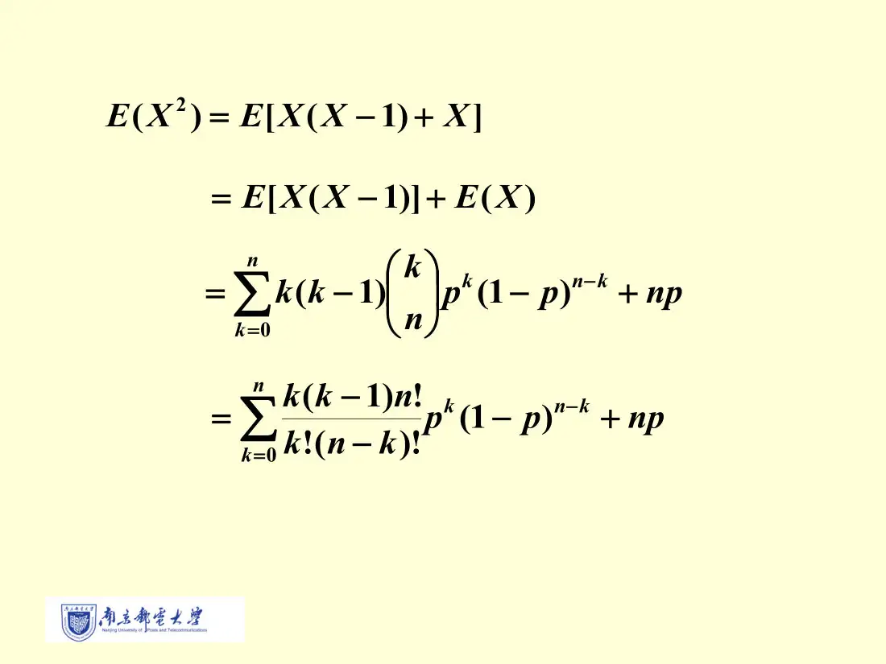

原文：

$$
\begin{array}{r l} & E (X ^ {2}) = E [ X (X - 1) + X ] \\ & \qquad = E [ X (X - 1) ] + E (X) \\ & \qquad = \sum_ {k = 0} ^ {n} k (k - 1) \binom {k} {n} p ^ {k} (1 - p) ^ {n - k} + n p \\ & \qquad = \sum_ {k = 0} ^ {n} \frac {k (k - 1) n !}{k ! (n - k) !} p ^ {k} (1 - p) ^ {n - k} + n p \end{array}
$$

南京邮电大学
Nanjing University of Posts and Telecommunications

### $$

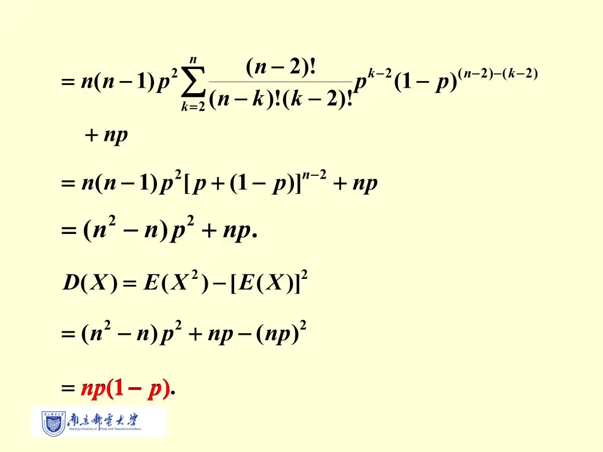

原文：

$$
\begin{array}{r l} & {= n (n - 1) p ^ {2} \sum_ {k = 2} ^ {n} \frac {(n - 2) !}{(n - k) ! (k - 2) !} p ^ {k - 2} (1 - p) ^ {(n - 2) - (k - 2)}} \\ & {\quad + n p} \\ & {= n (n - 1) p ^ {2} [ p + (1 - p) ] ^ {n - 2} + n p} \\ & {= (n ^ {2} - n) p ^ {2} + n p.} \\ & {D (X) = E (X ^ {2}) - [ E (X) ] ^ {2}} \\ & {= (n ^ {2} - n) p ^ {2} + n p - (n p) ^ {2}} \\ & {= n p (1 - p).} \end{array}
$$

南京邮电大学
Nanjing University of Posts and Telecommunications

### 3. 泊松分布

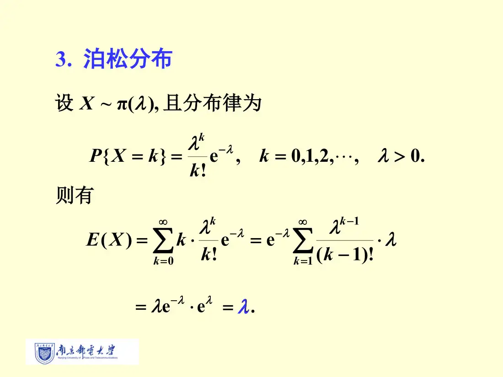

原文：

3. 泊松分布

设 $X \sim \pi(\lambda)$ , 且分布律为

$$
P \{X = k \} = \frac {\lambda^ {k}}{k !} \mathrm{e} ^ {- \lambda}, \quad k = 0, 1, 2, \dots , \quad \lambda > 0.
$$

则有

$$
\begin{array}{r l} E (X) & = \sum_ {k = 0} ^ {\infty} k \cdot \frac {\lambda^ {k}}{k !} \mathrm{e} ^ {- \lambda} = \mathrm{e} ^ {- \lambda} \sum_ {k = 1} ^ {\infty} \frac {\lambda^ {k - 1}}{(k - 1) !} \cdot \lambda \\ & = \lambda \mathrm{e} ^ {- \lambda} \cdot \mathrm{e} ^ {\lambda} = \lambda . \end{array}
$$

南京邮电大学
Nanjing University of Posts and Telecommunications

### $$

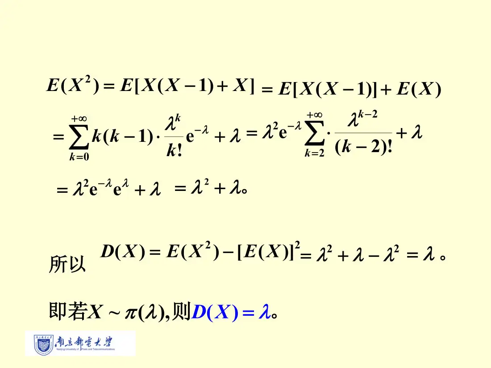

原文：

$$
\begin{array}{l} E (X ^ {2}) = E [ X (X - 1) + X ] = E [ X (X - 1) ] + E (X) \\ = \sum_ {k = 0} ^ {+ \infty} k (k - 1) \cdot \frac {\lambda^ {k}}{k !} \mathrm{e} ^ {- \lambda} + \lambda = \lambda^ {2} \mathrm{e} ^ {- \lambda} \sum_ {k = 2} ^ {+ \infty} \cdot \frac {\lambda^ {k - 2}}{(k - 2) !} + \lambda \\ = \lambda^ {2} \mathrm{e} ^ {- \lambda} \mathrm{e} ^ {\lambda} + \lambda = \lambda^ {2} + \lambda 。 \end{array}
$$

所以

$$
D (X) = E (X ^ {2}) - [ E (X) ] ^ {2} = \lambda^ {2} + \lambda - \lambda^ {2} = \lambda 。
$$

即若 $X \sim \pi(\lambda)$ ，则 $D(X) = \lambda$ 。

南京邮电大学
Nanjing University of Posts and Telecommunications

### 4. 均匀分布

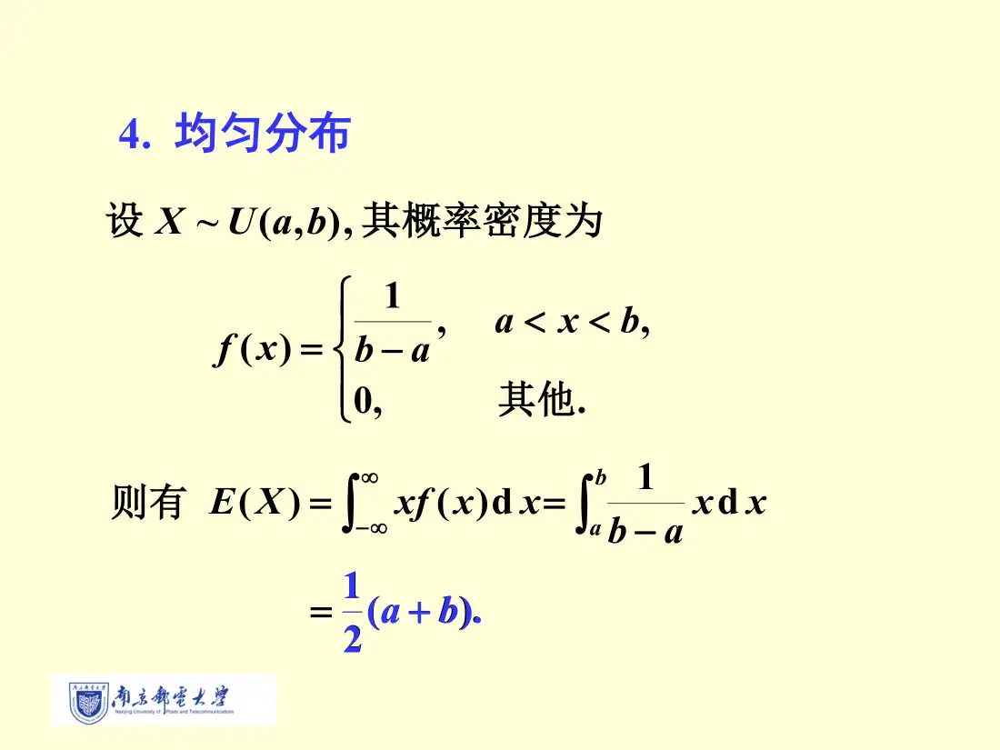

原文：

4. 均匀分布

设 $X \sim U(a, b)$ ，其概率密度为

$$
f (x) = \left\{ \begin{array}{l l} \frac {1}{b - a}, & a <   x <   b, \\ 0, & \text {其他.} \end{array} \right.
$$

则有 $E(X)=\int_{-\infty}^{\infty}xf(x)\mathrm{d}x=\int_{a}^{b}\frac{1}{b-a}x\mathrm{d}x$ $=\frac{1}{2}(a+b)$ .

南京邮电大学
Nanjing University of Posts and Telecommunications

### $$

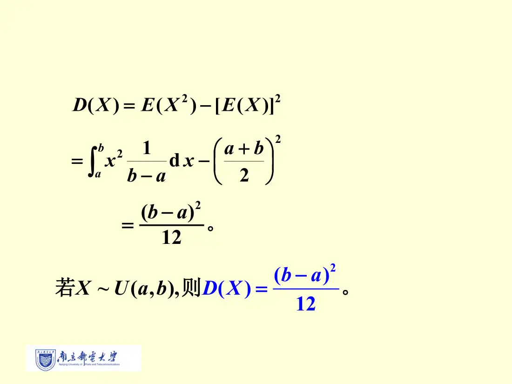

原文：

$$
\begin{array}{r l} D (X) & = E (X ^ {2}) - [ E (X) ] ^ {2} \\ & = \int_ {a} ^ {b} x ^ {2} \frac {1}{b - a} \mathrm{d} x - \left(\frac {a + b}{2}\right) ^ {2} \\ & = \frac {(b - a) ^ {2}}{1 2} 。 \end{array}
$$

若 $X \sim U(a, b)$ ，则 $D(X) = \frac{(b - a)^2}{12}$ 。

南京邮电大学
Nanjing University of Posts and Telecommunications

### 5. 指数分布

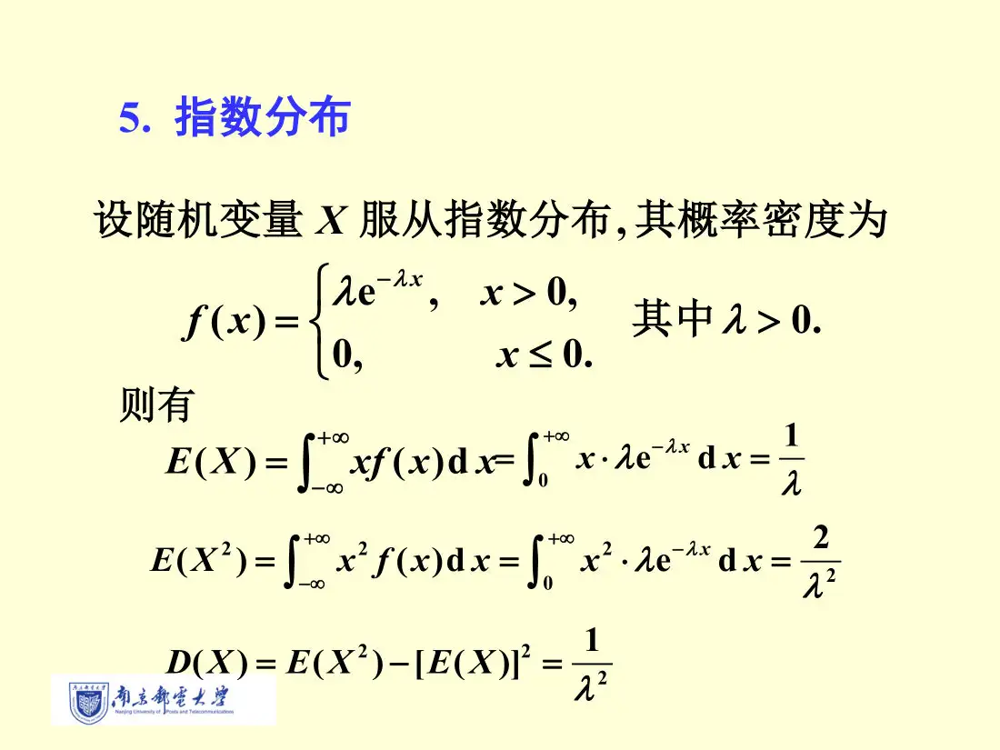

原文：

5. 指数分布

设随机变量 X 服从指数分布, 其概率密度为

$f(x) = \left\{ \begin{array}{ll}\lambda \mathrm{e}^{-\lambda x}, & x > 0,\\ 0, & x\leq 0. \end{array} \right.$ 其中 $\lambda >0$

则有

$$
E (X) = \int_ {- \infty} ^ {+ \infty} x f (x) d x = \int_ {0} ^ {+ \infty} x \cdot \lambda e ^ {- \lambda x} d x = \frac {1}{\lambda}
$$

$$
E (X ^ {2}) = \int_ {- \infty} ^ {+ \infty} x ^ {2} f (x) d x = \int_ {0} ^ {+ \infty} x ^ {2} \cdot \lambda e ^ {- \lambda x} d x = \frac {2}{\lambda^ {2}}
$$

$$
D (X) = E (X ^ {2}) - [ E (X) ] ^ {2} = \frac {1}{\lambda^ {2}}
$$

南京邮电大学
Nanjing University of Posts and Telecommunications

### 6. 正态分布

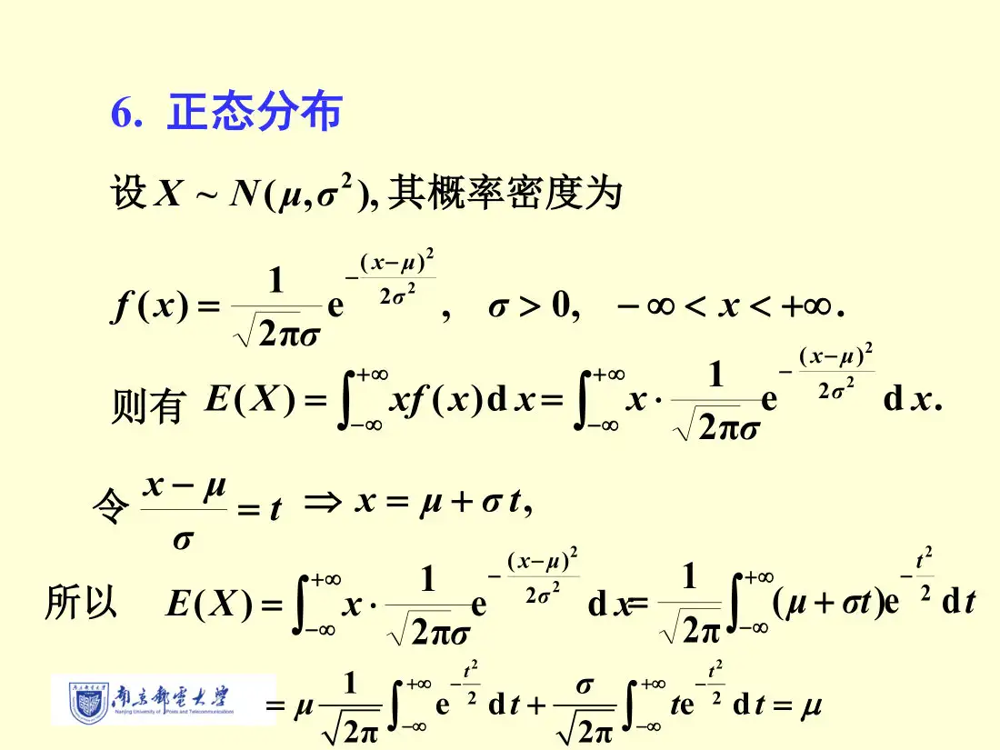

原文：

6. 正态分布

设 $X \sim N(\mu, \sigma^{2})$ ，其概率密度为

$f(x)=\frac{1}{\sqrt{2\pi}\sigma}e^{-\frac{(x-\mu)^{2}}{2\sigma^{2}}}$ ， $\sigma>0, -\infty<x<+\infty.$ 则有 $E(X)=\int_{-\infty}^{+\infty}xf(x)\mathrm{d}x=\int_{-\infty}^{+\infty}x\cdot\frac{1}{\sqrt{2\pi}\sigma}e^{-\frac{(x-\mu)^{2}}{2\sigma^{2}}}\mathrm{d}x.$ 令 $\frac{x-\mu}{\sigma}=t \Rightarrow x = \mu + \sigma t,$ 所以 $E(X)=\int_{-\infty}^{+\infty}x\cdot\frac{1}{\sqrt{2\pi}\sigma}e^{-\frac{(x-\mu)^{2}}{2\sigma^{2}}}\mathrm{d}x=\frac{1}{\sqrt{2\pi}}\int_{-\infty}^{+\infty}(\mu+\sigma t)e^{-\frac{t^{2}}{2}}dt=$ 南京邮零大学
Nanjing University of Posts and Telecommunications
= $\mu \frac{1}{\sqrt{2\pi}} \int_{-\infty}^{+\infty} e^{-\frac{t^{2}}{2}} dt + \frac{\sigma}{\sqrt{2\pi}} \int_{-\infty}^{+\infty} te^{-\frac{t^{2}}{2}} dt = \mu$

### $$

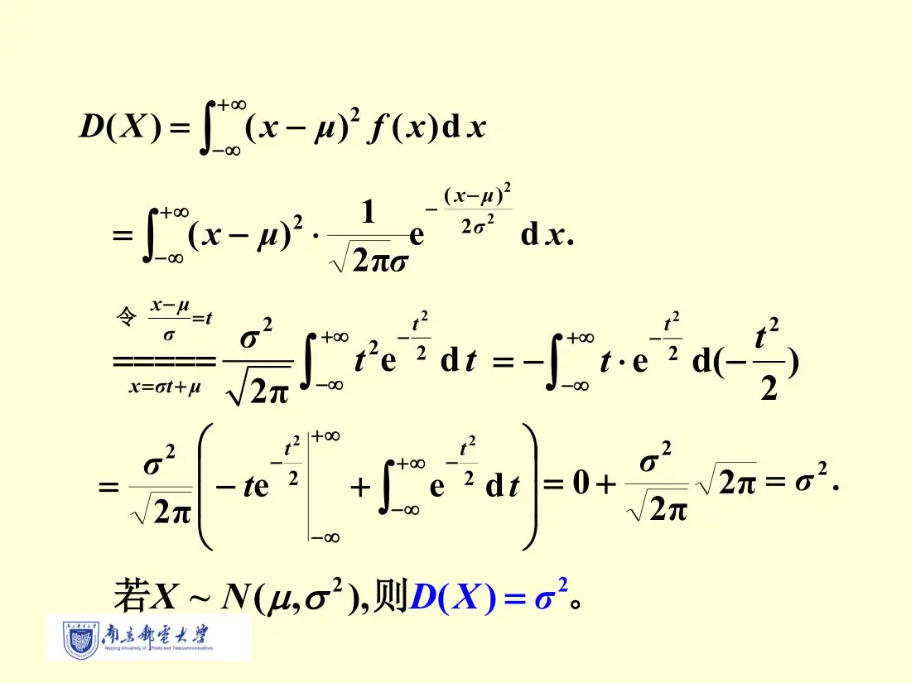

原文：

$$
\begin{array}{r l} & {D (X) = \int_ {- \infty} ^ {+ \infty} (x - \mu) ^ {2} f (x) \mathbf {d} x} \\ & {\qquad = \int_ {- \infty} ^ {+ \infty} (x - \mu) ^ {2} \cdot \frac {1}{\sqrt {2 \pi} \sigma} \mathrm{e} ^ {- \frac {(x - \mu) ^ {2}}{2 \sigma^ {2}}} \mathbf {d} x.} \\ & {\qquad \underset {x = \sigma t + \mu} {\overset {\text {令} \frac {x - \mu}{\sigma} = t} {=}} \frac {\sigma^ {2}}{\sqrt {2 \pi}} \int_ {- \infty} ^ {+ \infty} t ^ {2} \mathrm{e} ^ {- \frac {t ^ {2}}{2}} \mathbf {d} t = - \int_ {- \infty} ^ {+ \infty} t \cdot \mathrm{e} ^ {- \frac {t ^ {2}}{2}} \mathbf {d} (- \frac {t ^ {2}}{2})} \\ & {\qquad = \frac {\sigma^ {2}}{\sqrt {2 \pi}} \left(- t \mathrm{e} ^ {- \frac {t ^ {2}}{2}} \right| _ {- \infty} ^ {+ \infty} + \int_ {- \infty} ^ {+ \infty} \mathrm{e} ^ {- \frac {t ^ {2}}{2}} \mathbf {d} t = 0 + \frac {\sigma^ {2}}{\sqrt {2 \pi}} \sqrt {2 \pi} = \sigma^ {2}.} \end{array}
$$

若 $X \sim N(\mu, \sigma^{2})$ ，则 $D(X) = \sigma^{2}$ 。

南京邮电大学
Nanjing University of Posts and Telecommunications

### 常见分布的期望与方差

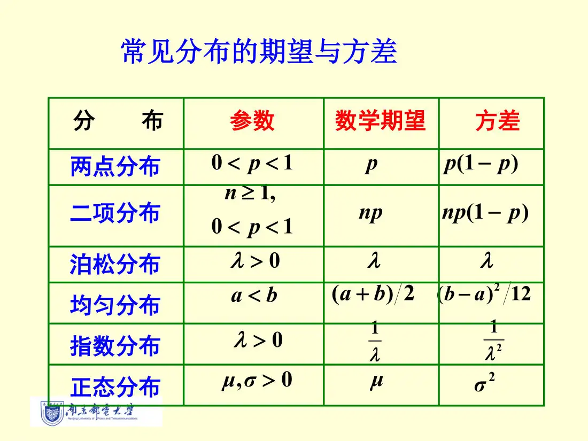

原文：

常见分布的期望与方差

<table><tr><td>分布</td><td>参数</td><td>数学期望</td><td>方差</td></tr><tr><td>两点分布</td><td>0 &lt; p &lt; 1</td><td>p</td><td>p(1 - p)</td></tr><tr><td>二项分布</td><td>n ≥ 1,0 &lt; p &lt; 1</td><td>np</td><td>np(1 - p)</td></tr><tr><td>泊松分布</td><td>λ &gt; 0</td><td>λ</td><td>λ</td></tr><tr><td>均匀分布</td><td>a &lt; b</td><td>(a + b)/2</td><td>(b - a)2/12</td></tr><tr><td>指数分布</td><td>λ &gt; 0</td><td> $\frac{1}{\lambda}$ </td><td> $\frac{1}{\lambda^2}$ </td></tr><tr><td>正态分布</td><td>μ,σ &gt; 0</td><td>μ</td><td>σ2</td></tr></table>

南京邮电大学
Nanjing University of Posts and Telecommunications

### 4.2.3 方差的性质

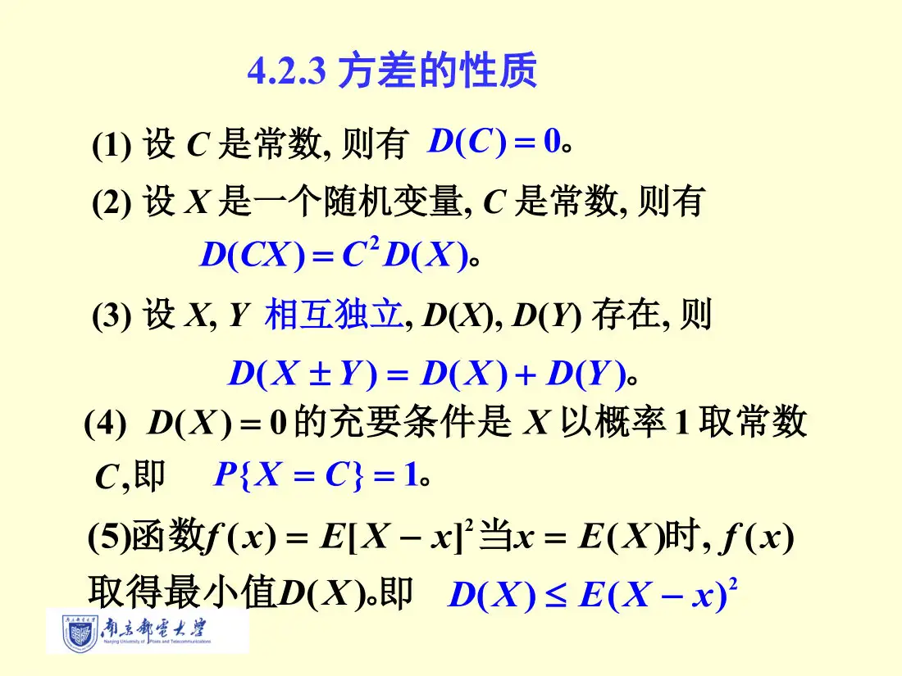

原文：

4.2.3 方差的性质

(1) 设 C 是常数, 则有 $D(C)=0$ 。

(2) 设 X 是一个随机变量, C 是常数, 则有 $D(CX) = C^{2}D(X)$ 。

(3) 设 X, Y 相互独立, $D(X)$ , $D(Y)$ 存在, 则 $D(X \pm Y) = D(X) + D(Y)$ 。

(4) $D(X)=0$ 的充要条件是 X 以概率 1 取常数
C, 即 $P\{X = C\} = 1$ 。

(5)函数 $f(x)=E[X-x]^{2}$ 当 $x=E(X)$ 时, $f(x)$ 取得最小值 $D(X)$ 。即 $D(X)\leq E(X-x)^{2}$

南京邮电大学
Nanjing University of Posts and Telecommunications

### 证明

原文：

证明

$$
\begin{array}{r l} (3) D (X \pm Y) & = E \{[ (X \pm Y) - E (X \pm Y) ] ^ {2} \} \\ & = E \{[ X - E (X) ] \pm [ Y - E (Y) ] \} ^ {2} \\ & = E [ X - E (X) ] ^ {2} + E [ Y - E (Y) ] ^ {2} \\ & \pm 2 E \{[ X - E (X) ] [ Y - E (Y) ] \} \end{array}
$$

若 X,Y 相互独立,则 $[X - E(X)]$ 与 $[Y - E(Y)]$ 也相互独立

$$
\begin{array}{l} E \{[ X - E (X) ] [ Y - E (Y) ] \} \\ = E [ X - E (X) ] \times E [ Y - E (Y) ] = 0 \times 0 = 0 \end{array}
$$

$$
\therefore D (X \pm Y) = D (X) + D (Y) 。
$$

南京邮电大学
Nanjing University of Posts and Telecommunications

### $$

原文：

推广 若 $X_{1}, X_{2}, \cdots, X_{n}$ 相互独立, 则有

$$
D (X _ {1} \pm X _ {2} \pm \dots \pm X _ {n}) = D (X _ {1}) + D (X _ {2}) + \dots + D (X _ {n}) 。
$$

$$
\begin{array}{r l} (5) D (X) & = D (X - x) = E (X - x) ^ {2} - [ E (X - x) ] ^ {2} \\ & \leq E (X - x) ^ {2} \\ & \text {当} x = E (X) \text {时,等号成立。} \end{array}
$$

此性质说明 随机变量X与数学期望的偏离程度比其它任何值的偏离程度都小。

南京邮电大学
Nanjing University of Posts and Telecommunications

### 两个重要结论

原文：

两个重要结论

1、设X与Y相互独立,服从正态分布, $X\sim N(\mu_{1},\sigma_{1}^{2})$ $Y \sim N(\mu_{2}, \sigma_{2}^{2})$ 则 X 与 Y 的任一线性组合 Z = aX + bY
+c仍服从正态分布 $Z \sim N(a\mu_{1} + b\mu_{2} + c, a^{2}\sigma_{1}^{2} + b^{2}\sigma_{2}^{2})$ 。

证明：由期望和方差的性质可知

$$
\begin{array}{r l} {E (Z) = E (a X + b Y + c)} & {= a E (X) + b E (Y) + c} \\ & {= a \mu_ {1} + b \mu_ {2} + c} \end{array}
$$

由于X和Y相互独立，故

$$
\begin{array}{r l} {D (Z) = D (a X + b Y + c)} & {= a ^ {2} D (X) + b ^ {2} D (Y)} \\ {\equiv a ^ {2} \sigma_ {1} ^ {2} + b ^ {2} \sigma_ {2} ^ {2}} \end{array}
$$

### 南京邮电大学

原文：

2、设随机变量X具有数学期望 $E(X)=\mu,$ $D(X)=\sigma^{2}$ , 记 $Y=\frac{X-\mu}{\sigma}$ , 证明: $E(Y)=0,$ $D(Y)=1$ 证明 $E(Y)=E\left(\frac{X-\mu}{\sigma}\right)=\frac{1}{\sigma}E(X-\mu)=0$ $D(Y)=D\left(\frac{X-\mu}{\sigma}\right)=\frac{1}{\sigma^{2}}D(X-\mu)=\frac{1}{\sigma^{2}}D(X)=1$ 称Y为X的标准化变量。

南京邮电大学
Nanjing University of Posts and Telecommunications

### 任取一只活塞,任取一只气缸,求活塞能装入气缸的概率。

原文：

补充例4.6 设活塞的直径 (以cm计) $X \sim N(22.40, 0.03^{2})$ ,
气缸的直径 $Y \sim N(22.50, 0.04^{2})$ , X, Y 相互独立.
任取一只活塞,任取一只气缸,求活塞能装入气缸的概率。

解 因为 $X \sim N(22.40, 0.03^{2})$ , $Y \sim N(22.50, 0.04^{2})$

所以 $X - Y \sim N(-0.10, 0.05^{2})$ ,

故有 $P\{X < Y\} = P\{X - Y < 0\}$

$$
= P \left\{\frac {(X - Y) - (- 0 . 1 0)}{\sqrt {0 . 0 0 2 5}} <   \frac {0 - (- 0 . 1 0)}{\sqrt {0 . 0 0 2 5}} \right\} = \Phi (2) = 0. 9 7 7 2 。
$$

南京邮电大学
Nanjing University of Posts and Telecommunications

### 解 引入随机变量 $X_{i}$

原文：

例4.18 设某台机器由3个元件组成，在设备运转中各个元件需要调整的概率分别是0.1, 0.2, 0.3.假设各个元件是否需要调整相互独立，以X表示同时需要调整的元件数，试求X的数学期望与方差。

解 引入随机变量 $X_{i}$

$$
X _ {i} = \left\{ \begin{array}{l l} 1, & \text {元件} i \text {需要调整}, \\ 0, & \text {元件} i \text {不需要调整}, \end{array} \quad i = 1, 2, 3. \right.
$$

则 $X = X_{1} + X_{2} + X_{3}$ . 且 $X_{1}, X_{2}, X_{3}$ 相互独立，分别服从参数为0.1, 0.2, 0.3的0-1分布，

南京邮电大学
Nanjing University of Posts and Telecommunications

### 由数学期望与方差的性质及0-1分布的性质得到

原文：

由数学期望与方差的性质及0-1分布的性质得到

$$
E X = E X _ {1} + E X _ {2} + E X _ {3} = 0. 1 + 0. 2 + 0. 3 = 0. 6
$$

$$
D X = D X _ {1} + D X _ {2} + D X _ {3} =
$$

$$
0. 1 \times 0. 9 + 0. 2 \times 0. 8 + 0. 3 \times 0. 7 = 0. 4 6
$$

南京邮电大学
Nanjing University of Posts and Telecommunications

### $$

原文：

解法2: 设A,B,C分别表示元件1, 2, 3需要调整, 则A,B,C两两相互独立。X可以取值为0, 1, 2, 3.

$$
\mathbf {P} (\mathbf {X} = \mathbf {0}) = P (\overline {{A}} \overline {{B}} \overline {{C}}) = P (\overline {{A}}) P (\overline {{B}}) P (\overline {{C}}) = 0. 9 \times 0. 8 \times 0. 7 = 0. 5 0 4
$$

$$
\begin{array}{r l} & P (\mathbf {X} = \mathbf {1}) = P (\overline {{A}} \overline {{B}} C + A \overline {{B}} \overline {{C}} + \overline {{A}} B \overline {{C}}) \\ & \qquad = 0. 9 \times 0. 8 \times 0. 3 + 0. 1 \times 0. 8 \times 0. 7 + 0. 9 \times 0. 2 \times 0. 7 = 0. 3 9 8 \end{array}
$$

$$
\begin{array}{r l} & P (X = 2) = P (\overline {{A}} B C + A \overline {{B}} C + A B \overline {{C}}) \\ & \qquad = 0. 9 \times 0. 2 \times 0. 3 + 0. 1 \times 0. 8 \times 0. 3 + 0. 1 \times 0. 2 \times 0. 7 = 0. 0 9 2 \end{array}
$$

$$
P (X = 3) = P (A B C) = 0. 1 \times 0. 2 \times 0. 3 = 0. 0 0 6
$$

南京邮电大学
Nanjing University of Posts and Telecommunications

### 所以X的分布律为

原文：

所以X的分布律为

<table><tr><td>X</td><td>0</td><td>1</td><td>2</td><td>3</td></tr><tr><td> $p_k$ </td><td>0.504</td><td>0.398</td><td>0.092</td><td>0.006</td></tr></table>

$EX=1\times0.398+2\times0.092+3\times0.006=0.6$ $EX^{2}=1\times0.398+2^{2}\times0.092+3^{2}\times0.006=0.82$ 所以DX= $EX^{2}-(EX)^{2}=0.82-0.36=0.46$

南京邮电大学
Nanjing University of Posts and Telecommunications

### 4.3 协方差及相关系数

原文：

4.3 协方差及相关系数
4.3.1 协方差与相关系数的概念及性质
4.3.2 相关系数的意义

南京邮电大学
Nanjing University of Posts and Telecommunications

### 4.3.1 协方差

原文：

4.3.1 协方差

1. 问题的提出

对于二维随机变量(X,Y)，数学期望 $E(X)$ 、 $E(Y)$ 只反映了X与Y各自的平均值，方差 $D(X)$ 、 $D(Y)$ 只反映了X与Y各自离开均值的偏离程度，它们对X与Y之间的相互联系不提供任何信息。

我们希望有一个数字特征能够在一定程度上反映X与Y的之间相互关系。

南京邮电大学
Nanjing University of Posts and Telecommunications

### 协方差的定义

原文：

协方差的定义

量 $E\{[X - E(X)][Y - E(Y)]\}$ 称为随机变量 $X$ 与 $Y$ 的协方差。记为 $\operatorname{Cov}(X,Y)$ ，即

$$
C o v (X, Y) = E \{[ X - E (X) ] [ Y - E (Y) ] \} 。
$$

从而有

$$
D (X \pm Y) = D (X) + D (Y) \pm 2 \operatorname{Cov} (X, Y)
$$

南京邮电大学
Nanjing University of Posts and Telecommunications

### 协方差的计算公式

原文：

协方差的计算公式

$$
C o v (X, Y) = E (X Y) - E (X) E (Y);
$$

$$
{ \begin{array}{r l} & {{\text {证明}: C o v (X, Y) = E \{[ X - E (X) ] [ Y - E (Y) ] \}}} \\ & {\qquad = E [ X Y - X E (Y) - Y E (X) + E (X) E (Y) ]} \\ & {\qquad = E [ X Y ] - E (X) E (Y) - E (Y) E (X) + E (X) E (Y)} \\ & {\qquad = E (X Y) - E (X) E (Y)} \end{array} }
$$

南京邮电大学
Nanjing University of Posts and Telecommunications

### 相关结论

原文：

相关结论

(1) 若随机变量 X 和 Y 相互独立 $Cov(X,Y)=0$

(2) 若随机变量 X 和 Y 相互独立

$$
D (X + Y) = D (X) + D (Y)
$$

(3) $Cov(X,X)=E[X-E(X)]^{2}=D(X)$

可见，方差是协方差的特例，协方差是方差的推广；方差反映的是自身的离散程度，协方差放映了两个随机变量间的离散程度。

南京邮电大学
Nanjing University of Posts and Telecommunications

### 协方差的性质

原文：

协方差的性质

(1) $Cov(X, a) = 0$ , $Cov(X, X) = D(X)$

(2) $Cov(X,Y)=Cov(Y,X);$

(3) $Cov(aX,bY) = abCov(X,Y)$ ， $a,b$ 为常数；

(4) $\operatorname{Cov}(X + Y, Z) = \operatorname{Cov}(X, Y) + \operatorname{Cov}(X, Z);$

(5) $D(X \pm Y) = D(X) + D(Y) \pm 2 \text{Cov}(X, Y).$

南京邮电大学
Nanjing University of Posts and Telecommunications

### 2012年22题. 设 $(X, Y)$ 的概率分布为

原文：

2012年22题. 设 $(X, Y)$ 的概率分布为

(1) 求 $P(X=2Y)$ ;

(2) 求 $Cov(X - Y, Y)$ .

<table><tr><td>X\Y</td><td>0</td><td>1</td><td>2</td></tr><tr><td>0</td><td>1/4</td><td>0</td><td>1/4</td></tr><tr><td>1</td><td>0</td><td>1/3</td><td>0</td></tr><tr><td>2</td><td>1/12</td><td>0</td><td>1/12</td></tr></table>

南京邮电大学
Nanjing University of Posts and Telecommunications

### $$

原文：

$$
\begin{array}{r l} & {\text {解: (1)} P (X = 2 Y)} \\ & {\qquad = P (X = 0, Y = 0) + P (X = 2, Y = 1) = 1 / 4 + 0 = 1 / 4} \end{array}
$$

(2) X, Y 的概率分布分别为

<table><tr><td>X</td><td>0</td><td>1</td><td>2</td><td>Y</td><td>0</td><td>1</td><td>2</td></tr><tr><td>P</td><td>1/2</td><td>1/3</td><td>1/6</td><td>P</td><td>1/3</td><td>1/3</td><td>1/3</td></tr></table>

$\Rightarrow E(X) = 1 / 3 + 2 / 6 = 2 / 3, \quad E(Y) = 1 / 3 + 2 / 3 = 1,$ $E(Y^2) = 1 / 3 + 4 / 3 = 5 / 3$ $D(Y) = E(Y^2) - E^2(Y) = 5 / 3 - 1 = 2 / 3$ $E(XY) = 1 / 3 + 4 / 12 = 2 / 3$ $\Rightarrow Cov(X,Y) = E(XY) - EX \cdot EY = 2 / 3 - 2 / 3 = 0$ $\Rightarrow Cov(X-Y,Y) = Cov(X,Y) - DY = 0 - 2 / 3 = -2 / 3$

### 4.3.2 相关系数

原文：

4.3.2 相关系数

在实际问题中，协方差是一个有量纲单位的指标，对它作如下修改，我们引入一个无量纲的量。

对于二维随机变量 $(X,Y)$ ，称

$$
\rho_ {X Y} = \frac {\operatorname{Cov} (X , Y)}{\sqrt {D (X)} \cdot \sqrt {D (Y)}}
$$

为随机变量 X 与 Y 的相关系数。

南京邮电大学
Nanjing University of Posts and Telecommunications

### 例4.23 设 $X \square N(0,1), Y = X^2$

原文：

例4.23 设 $X \square N(0,1), Y = X^2$

证明X，Y不相关,也不相互独立

解 $E(X) = 0, E(X^3) = \int_{-\infty}^{+\infty} x^3 \frac{1}{\sqrt{2\pi}} e^{-\frac{x^2}{2}} dx = 0$

$$
C o v (X, Y) = E (X Y) - E X \cdot E Y = E (X ^ {3}) - E X \cdot E Y = 0
$$

于是 $\rho_{XY} = \frac{Cov(X,Y)}{\sqrt{D(X)}\sqrt{D(Y)}} = 1$

$$
P (X \leq 1, Y \leq 1) = P (X ^ {2} \leq 1) \neq P (X \leq 1) \cdot P (Y \leq 1)
$$

南京邮电大学
Nanjing University of Posts and Telecommunications

### $$

原文：

例4.24 设 $(X,Y)\sim N(\mu_{1},\mu_{2},\sigma_{1}^{2},\sigma_{2}^{2},\rho)$ ，试求 X 与 Y 的相关系数。

解 由 $f(x,y) = \frac{1}{2\pi\sigma_1\sigma_2\sqrt{1 - \rho^2}}$

$$
\begin{array}{l} \exp \left\{\frac {- 1}{2 (1 - \rho^ {2})} \left[ \frac {(x - \mu_ {1}) ^ {2}}{\sigma_ {1} ^ {2}} - 2 \rho \frac {(x - \mu_ {1}) (y - \mu_ {2})}{\sigma_ {1} \sigma_ {2}} + \frac {(y - \mu_ {2}) ^ {2}}{\sigma_ {2} ^ {2}} \right] \right\} \\ \Rightarrow f _ {X} (x) = \frac {1}{\sqrt {2 \pi} \sigma_ {1}} e ^ {- \frac {(x - \mu_ {1}) ^ {2}}{2 \sigma_ {1} ^ {2}}}, - \infty <   x <   + \infty , \end{array}
$$

$$
f _ {Y} (y) = \frac {1}{\sqrt {2 \pi} \sigma_ {2}} \mathrm{e} ^ {- \frac {\left(y - \mu_ {2}\right) ^ {2}}{2 \sigma_ {2} ^ {2}}}, - \infty <   y <   + \infty 。
$$

南京邮电大学
Nanjing University of Posts and Telecommunications

### $$

原文：

$$
\Rightarrow E (X) = \mu_ {1}, E (Y) = \mu_ {2}, D (X) = \sigma_ {1} ^ {2}, D (Y) = \sigma_ {2} ^ {2} 。
$$

而

$$
\begin{array}{l} \operatorname{Cov} (X, Y) = \int_ {- \infty} ^ {+ \infty} \int_ {- \infty} ^ {+ \infty} (x - \mu_ {1}) (y - \mu_ {2}) f (x, y) d x d y \\ = \frac {1}{2 \pi \sigma_ {1} \sigma_ {2} \sqrt {1 - \rho^ {2}}} \int_ {- \infty} ^ {+ \infty} \int_ {- \infty} ^ {+ \infty} (x - \mu_ {1}) (y - \mu_ {2}) \\ \cdot e ^ {- \frac {(x - \mu_ {1}) ^ {2}}{2 \sigma_ {1} ^ {2}}} e ^ {- \frac {1}{2 (1 - \rho^ {2})} \left[ \frac {y - \mu_ {2}}{\sigma_ {2}} - \rho \frac {x - \mu_ {1}}{\sigma_ {1}} \right] ^ {2}} d y d x _ {\circ} \end{array}
$$

$$
\text {令} t = \frac {1}{\sqrt {1 - \rho^ {2}}} \left(\frac {y - \mu_ {2}}{\sigma_ {2}} - \rho \frac {x - \mu_ {1}}{\sigma_ {1}}\right), u = \frac {x - \mu_ {1}}{\sigma_ {1}},
$$

南京邮电大学
Nanjing University of Posts and Telecommunications

### $$

原文：

$$
\begin{array}{l} \text {Cov} (X, Y) \\ = \frac {1}{2 \pi} \int_ {- \infty} ^ {+ \infty} \int_ {- \infty} ^ {+ \infty} (\sigma_ {1} \sigma_ {2} \sqrt {1 - \rho^ {2}} t u + \rho \sigma_ {1} \sigma_ {2} u ^ {2}) e ^ {- \frac {u ^ {2}}{2} - \frac {t ^ {2}}{2}} d t d u \\ = \frac {\rho \sigma_ {1} \sigma_ {2}}{2 \pi} \left(\int_ {- \infty} ^ {+ \infty} u ^ {2} e ^ {- \frac {u ^ {2}}{2}} d u\right) \left(\int_ {- \infty} ^ {+ \infty} e ^ {- \frac {t ^ {2}}{2}} d t\right) \\ + \frac {\sigma_ {1} \sigma_ {2} \sqrt {1 - \rho^ {2}}}{2 \pi} \left(\int_ {- \infty} ^ {+ \infty} u e ^ {- \frac {u ^ {2}}{2}} d u\right) \left(\int_ {- \infty} ^ {+ \infty} t e ^ {- \frac {t ^ {2}}{2}} d t\right) \\ = \frac {\rho \sigma_ {1} \sigma_ {2}}{2 \pi} \sqrt {2 \pi} \cdot \sqrt {2 \pi} \\ \text {故有} C o v (X, Y) = \rho \sigma_ {1} \sigma_ {2}. \end{array}
$$

南京邮电大学
Nanjing University of Posts and Telecommunications

### 于是

原文：

于是

$$
\rho_ {X Y} = \frac {\operatorname{Cov} (X , Y)}{\sqrt {D (X)} \sqrt {D (Y)}} = \rho_ {\circ}
$$

结论

(1) 二维正态分布密度函数中, 参数 $\rho$ 代表了 $X$ 与 $Y$ 的相关系数;

(2) 二维正态随机变量 X 与 Y 相关系数为零等价于 X 与 Y 相互独立。

南京邮电大学
Nanjing University of Posts and Telecommunications

### 例4.24 已知随机变量X,Y分别服从 $N(1,3^{2})$ ,

原文：

例4.24 已知随机变量X,Y分别服从 $N(1,3^{2})$ ,

$N(0,4^{2}),\rho_{XY}=-\frac{1}{2}$ ，设 $Z=\frac{X}{3}+\frac{Y}{2}$ 。

(1) 求 $Z$ 的数学期望和方差。

(2) 求 X 与 Z 的相关系数。

(3) 问 $X$ 与 $Z$ 是否相互独立?为什么?

解 (1)由 $E(X)=1$ , $D(X)=9$ , $E(Y)=0$ , $D(Y)=16$ .

得 $E(Z) = E(\frac{X}{3} +\frac{Y}{2}) = \frac{1}{3} E(X) + \frac{1}{2} E(Y) = \frac{1}{3}$ 。

南京邮电大学
Nanjing University of Posts and Telecommunications

### $$

原文：

$$
\begin{array}{r l} & D (Z) = D (\frac {X}{3}) + D (\frac {Y}{2}) + 2 C o v (\frac {X}{3}, \frac {Y}{2}) \\ & \qquad = \frac {1}{9} D (X) + \frac {1}{4} D (Y) + 2 \times \frac {1}{3} \times \frac {1}{2} C o v (X, Y) \\ & \qquad = \frac {1}{9} D (X) + \frac {1}{4} D (Y) + \frac {1}{3} \rho_ {X Y} \sqrt {D (X)} \sqrt {D (Y)} \\ & \qquad = 1 + 4 - 2 = 3 _ {\circ} \end{array}
$$

南京邮电大学
Nanjing University of Posts and Telecommunications

### $$

原文：

$$
\begin{array}{r l} & {(2) \operatorname{Cov} (X, Z) = \operatorname{Cov} (X, \frac {X}{3} + \frac {Y}{2})} \\ & {= \frac {1}{3} \operatorname{Cov} (X, X) + \frac {1}{2} \operatorname{Cov} (X, Y)} \\ & {= \frac {1}{3} D (X) + \frac {1}{2} \rho_ {X Y} \sqrt {D (X)} \sqrt {D (Y)} = 3 - 3 = 0 _ {\circ}} \\ & {\text {故} \quad \rho_ {X Y} = \operatorname{Cov} (X, Z) / (\sqrt {D (X)} \sqrt {D (Z)}) = 0 _ {\circ}} \end{array}
$$

(3)由二维正态随机变量相关系数为零和相互独立两者是等价的结论, 可知: X与Z是相互独立的。

南京邮电大学
Nanjing University of Posts and Telecommunications

### $$

原文：

例4.25 设 $\theta$ 服从 $[0,2\pi]$ 的均匀分布, $\xi = \cos\theta, \eta = \cos(\theta + a)$ , 这里 a 是常数, 求 $\xi$ 和 $\eta$ 的相关系数?

解 $E(\xi) = \frac{1}{2\pi}\int_{0}^{2\pi}\cos \theta \mathrm{d}\theta = 0,$

$$
E (\eta) = \frac {1}{2 \pi} \int_ {0} ^ {2 \pi} \cos (\theta + a) d \theta = 0,
$$

$$
E (\xi^ {2}) = \frac {1}{2 \pi} \int_ {0} ^ {2 \pi} \cos^ {2} \theta d \theta = \frac {1}{2},
$$

$$
E (\eta^ {2}) = \frac {1}{2 \pi} \int_ {0} ^ {2 \pi} \cos^ {2} (\theta + a) d \theta = \frac {1}{2},
$$

$$
E (\xi \eta) = \frac {1}{2 \pi} \int_ {0} ^ {2 \pi} \cos \theta \cdot \cos (\theta + a) d \theta = \frac {1}{2} \cos a,
$$

南京邮电大学
Nanjing University of Posts and Telecommunications

### $$

原文：

$$
D (\xi) = E (\xi^ {2}) - E ^ {2} (\xi) = \frac {1}{2}
$$

$$
D (\eta) = E \left(\eta^ {2}\right) - E ^ {2} (\eta) = \frac {1}{2}
$$

$$
C o v (\xi , \eta) = E (\xi \eta) - E (\xi) E (\eta) = \frac {1}{2} \cos a
$$

$$
\rho_ {\xi \eta} = \frac {C o v (\xi , \eta)}{\sqrt {D (\xi)} \sqrt {D (\eta)}} = \frac {\frac {1}{2} \cos a}{\sqrt {\frac {1}{2}} \cdot \sqrt {\frac {1}{2}}} = \cos a
$$

南京邮电大学
Nanjing University of Posts and Telecommunications

### $$

原文：

$$
\rho_ {X Y} = \cos a \qquad \xi = \cos \theta , \eta = \cos (\theta + a)
$$

当 $a = 0$ 时， $\rho = 1, \xi = \eta,$ 当 $a = \pi$ 时， $\rho = -1, \xi = -\eta,$ 存在线性关系。  
当 $a = \frac{\pi}{2}$ 或 $a = \frac{3\pi}{2}$ 时， $\rho = 0,\quad \xi$ 与 $\eta$ 不相关。  
但 $\xi^2 +\eta^2 = 1,$ 因此 $\xi$ 与 $\eta$ 不独立。

南京邮电大学
Nanjing University of Posts and Telecommunications

### 3. 注意

原文：

3. 注意

(1) 不相关与相互独立的关系

独立性与不相关性都是随机变量间联系“薄弱”的一种反映，自然要求知道这两概念之间的联系，

相互独立 不相关

南京邮电大学
Nanjing University of Posts and Telecommunications

### (2) 不相关的充要条件

原文：

(2) 不相关的充要条件

当 $\rho_{XY}=0$ 时, 称 X 和 Y 不相关。

对X、Y，下列事实是等价的：

$1^{0}$ X, Y 不相关 $\Leftrightarrow \rho_{XY} = 0;$

$2^{0}$ X, Y 不相关 $\Leftrightarrow$ Cov(X, Y) = 0;

$3^{0}$ X, Y 不相关 $\Leftrightarrow E(XY)=E(X)E(Y)$ 。

$4^{0}$ X, Y 不相关 $\Leftrightarrow D(X \pm Y) = D(X) + D(Y)$

南京邮电大学
Nanjing University of Posts and Telecommunications

### 相关系数的性质

原文：

相关系数的性质

(1) $\left|\rho_{XY}\right| \leq 1$ 。

(2) $\left|\rho_{XY}\right|=1$ 的充要条件是:存在常数a,b使 $P\{Y=a+bX\}=1$ 。

南京邮电大学
Nanjing University of Posts and Telecommunications

### 4.4 矩与协方差矩阵

原文：

4.4 矩与协方差矩阵

4.4.1 基本概念

4.4.2 n 维正态变量的性质

南京邮电大学
Nanjing University of Posts and Telecommunications

### 4.4.1 矩

原文：

4.4.1 矩

1. 定义设 X 和 Y 是随机变量, 若 $E(X^{k})$ , k = 1, 2, …存在, 称它为 X 的 k 阶原点矩, 简称 k 阶矩。

若 $E\{[X-E(X)]^{k}\}, k=2,3,\cdots$ 存在,称它为 X 的 k 阶中心矩。

若 $E(X^{k}Y^{l}),\quad k,l=1,2,\cdots$

存在,称它为 X 和 Y 的 $k + l$ 阶混合矩。

若 $E\{[X-E(X)]^{k}[Y-E(Y)]^{l}\}$ ， $k,l=1,2,\cdots$ 存在,称它为 X 和 Y 的 $k+l$ 阶混合中心矩。

南京邮电大学
Nanjing University of Posts and Telecommunications

### 例4.26 柯西-许瓦兹(Cauchy-Schwarz)不等式

原文：

例4.26 柯西-许瓦兹(Cauchy-Schwarz)不等式

设X与Y是两个随机变量，若 $E(X^{2}),E(Y^{2})$ 存在，则 $[E(XY)]^{2}\leq E(X^{2})\cdot E(Y^{2})$

证明 考虑实变量 t 的二次函数

$$
\begin{array}{r l} & g (t) = E [ (X + t Y) ^ {2} ] \\ & \qquad = E (X ^ {2}) + 2 t E (X Y) + t ^ {2} E (Y ^ {2}) \geq 0 \end{array}
$$

$$
\Delta = 4 [ E (X Y) ] ^ {2} - 4 E (X ^ {2}) \cdot E (Y ^ {2}) \leq 0
$$

$$
\therefore \quad [ E (X Y) ] ^ {2} \leq E (X ^ {2}) \cdot E (Y ^ {2})
$$

南京邮电大学
Nanjing University of Posts and Telecommunications

### 3. 协方差矩阵

原文：

3. 协方差矩阵

二维随机变量 $(X,Y)$ 有四个二阶中心矩

$$
C _ {1 1} = E \{[ X - E (X) ] ^ {2} \} = D (X)
$$

$$
C _ {1 2} = E \{[ X - E (X) ] [ Y - E (Y) ] \} = C o v (X, Y)
$$

$$
C _ {2 1} = E \{[ Y - E (Y) ] [ X - E (X) ] \} = C o v (Y, X)
$$

$$
C _ {2 2} = E \{[ Y - E (Y) ^ {2} ] \} = D (Y)
$$

将它们排成矩阵形式 $\begin{pmatrix}C_{11}&C_{12}\\C_{21}&C_{22}\end{pmatrix}$

这个矩阵称为随机变量 $(X,Y)$ 的协方差矩阵。

南京邮电大学
Nanjing University of Posts and Telecommunications

### 例4.27 设二维连续型随机变量 $(X,Y)$ 的联合密度函数为

原文：

例4.27 设二维连续型随机变量 $(X,Y)$ 的联合密度函数为

$$
f (x, y) = \left\{ \begin{array}{l l} \frac {6}{7} \left(x ^ {2} + \frac {1}{2} x y\right), & 0 <   x <   1, 0 <   y <   2, \\ 0, & \text {其他} \end{array} \right.
$$

求 $(X,Y)$ 的协方差矩阵及相关系数。

$$
\begin{array}{r l} \text {解} & E (X) = \int_ {- \infty} ^ {+ \infty} \int_ {- \infty} ^ {+ \infty} x f (x, y) \mathrm{d} x \mathrm{d} y \\ & = \int_ {0} ^ {1} \int_ {0} ^ {2} \frac {6}{7} x (x ^ {2} + \frac {1}{2} x y) \mathrm{d} y \mathrm{d} x = \int_ {0} ^ {1} \left(\frac {1 2}{7} x ^ {3} + \frac {6}{7} x ^ {2}\right) \mathrm{d} x \\ & = \frac {5}{7}. \end{array}
$$

### $$

原文：

$$
E \left(X ^ {2}\right) = \int_ {0} ^ {1} \int_ {0} ^ {2} \frac {6}{7} x ^ {2} \left(x ^ {2} + \frac {1}{2} x y\right) d x d y = \frac {3 9}{7 0},
$$

故 $D(X)=\frac{39}{70}-\left(\frac{5}{7}\right)^{2}=\frac{23}{490}$ ,

因为 $E(Y)=\int_{0}^{1}\int_{0}^{2}\frac{6}{7}y(x^{2}+\frac{1}{2}xy)\mathrm{d}y\mathrm{d}x=\frac{8}{7},$

$$
E \left(Y ^ {2}\right) = \int_ {0} ^ {1} \int_ {0} ^ {2} \frac {6}{7} y ^ {2} \left(x ^ {2} + \frac {1}{2} x y\right) d y d x = \frac {3 4}{2 1},
$$

故 $D(Y) = \frac{34}{21} -\left(\frac{8}{7}\right)^2 = \frac{46}{147}$ 。

南京邮电大学
Nanjing University of Posts and Telecommunications

### 南京邮电大学

原文：

$E(XY)=\int_{0}^{1}\int_{0}^{2}\frac{6}{7}xy(x^{2}+\frac{1}{2}xy)\mathrm{d}y\mathrm{d}x=\frac{17}{21},$ 故 $Cov(X,Y)=E(XY)-E(X)E(Y)$ $=\frac{17}{21}-\frac{5}{7}\times\frac{8}{7}=-\frac{1}{147},$ 于是 $(X,Y)$ 的协方差矩阵为 $\begin{pmatrix}\frac{23}{490}&-\frac{1}{147}\\-\frac{1}{147}&\frac{46}{147}\end{pmatrix}$ 。

X 与 Y 的相关系数 $\rho_{XY}=\frac{Cov(X,Y)}{\sqrt{D(X)}\sqrt{D(Y)}}=-\frac{\sqrt{15}}{69}$

南京邮电大学
Nanjing University of Posts and Telecommunications

### $$

原文：

设 n 维随机变量 $(X_{1}, X_{2}, \cdots, X_{n})$ 的二阶混合中心矩

$$
c _ {i j} = C o v (X _ {i}, X _ {j}) = E \{[ X _ {i} - E (X _ {i}) ] [ X _ {j} - E (X _ {j}) ]
$$

$$
i, j = 1, 2, \dots , n
$$

都存在，

则称矩阵

$$
C = \left( \begin{array}{c c c c} c _ {1 1} & c _ {1 2} & \dots & c _ {1 n} \\ c _ {2 1} & c _ {2 2} & \dots & c _ {2 n} \\ \vdots & \vdots & & \vdots \\ c _ {n 1} & c _ {n 2} & \dots & c _ {n n} \end{array} \right)
$$

为n维随机变量的协方差矩阵。

南京邮电大学
Nanjing University of Posts and Telecommunications

### 协方差矩阵的应用

原文：

由于 $c_{ij}=c_{ji}(i,j=1,2,\cdots,n)$ ，所以协方差矩阵为对称的非负定矩阵。

协方差矩阵的应用

协方差矩阵可用来表示多维随机变量的概率密度，从而可通过协方差矩阵达到对多维随机变量的研究

南京邮电大学
Nanjing University of Posts and Telecommunications

### 以二维随机变量 $(X_{1},X_{2})$ 为例.

原文：

以二维随机变量 $(X_{1},X_{2})$ 为例.

由于

$f(x_{1},x_{2}) = \frac{1}{2\pi\sigma_{1}\sigma_{2}\sqrt{1 - \rho^{2}}}$ $\exp \left\{\frac{-1}{2(1 - \rho^2)}\left[\frac{(x_1 - \mu_1)^2}{\sigma_1^2} - 2\rho \frac{(x_1 - \mu_1)(x_2 - \mu_2)}{\sigma_1\sigma_2} + \frac{(x_2 - \mu_2)^2}{\sigma_2^2}\right]\right\} .$ 引入矩阵 $X = \binom{x_1}{x_2},\quad \mu = \binom{\mu_1}{\mu_2}.$ 及 $(X_{1},X_{2})$ 的协方差矩阵 $C = \left( \begin{array}{ll}c_{11} & c_{12}\\ c_{21} & c_{22} \end{array} \right),$

南京邮电大学
Nanjing University of Posts and Telecommunications

### $$

原文：

$$
C = \left( \begin{array}{c c} c _ {1 1} & c _ {1 2} \\ c _ {2 1} & c _ {2 2} \end{array} \right) = \left( \begin{array}{c c} \sigma_ {1} ^ {2} & \rho \sigma_ {1} \sigma_ {2} \\ \rho \sigma_ {1} \sigma_ {2} & \sigma_ {2} ^ {2} \end{array} \right),
$$

由此可得

$$
C ^ {- 1} = \frac {1}{\det C} \left( \begin{array}{c c} \sigma_ {2} ^ {2} & - \rho \sigma_ {1} \sigma_ {2} \\ - \rho \sigma_ {1} \sigma_ {2} & \sigma_ {1} ^ {2} \end{array} \right)
$$

$$
= \frac {1}{\sigma_ {1} ^ {2} \sigma_ {2} ^ {2} (1 - \rho^ {2})} \left( \begin{array}{c c} \sigma_ {2} ^ {2} & - \rho \sigma_ {1} \sigma_ {2} \\ - \rho \sigma_ {1} \sigma_ {2} & \sigma_ {1} ^ {2} \end{array} \right).
$$

南京邮电大学
Nanjing University of Posts and Telecommunications

### 由于

原文：

由于

$$
\begin{array}{l} (X - \mu) ^ {\mathrm{T}} C ^ {- 1} (X - \mu) \\ = \frac {1}{\det C} (x _ {1} - \mu_ {1}, x _ {2} - \mu_ {2}) \left( \begin{array}{c c} \sigma_ {2} ^ {2} & - \rho \sigma_ {1} \sigma_ {2} \\ - \rho \sigma_ {1} \sigma_ {2} & \sigma_ {1} ^ {2} \end{array} \right) \binom{x _ {1} - \mu_ {1}}{x _ {2} - \mu_ {2}} \end{array}
$$

$$
= \frac {1}{1 - \rho^ {2}} \left[ \frac {\left(x _ {1} - \mu_ {1}\right) ^ {2}}{\sigma_ {1} ^ {2}} - 2 \rho \frac {\left(x _ {1} - \mu_ {1}\right) \left(x _ {2} - \mu_ {2}\right)}{\sigma_ {1} \sigma_ {2}} + \frac {\left(x _ {2} - \mu_ {2}\right) ^ {2}}{\sigma_ {2} ^ {2}} \right].
$$

南京邮电大学
Nanjing University of Posts and Telecommunications

### 于是 $(X_{1},X_{2})$ 的概率密度可写成

原文：

于是 $(X_{1},X_{2})$ 的概率密度可写成

$$
\begin{array}{l} f \left(x _ {1}, x _ {2}\right) \\ = \frac {1}{(2 \pi) ^ {2 / 2} (\det C) ^ {1 / 2}} \exp \left\{- \frac {1}{2} (X - \mu) ^ {T} C ^ {- 1} (X - \mu) \right\}. \end{array}
$$

南京邮电大学
Nanjing University of Posts and Telecommunications

### 小结

原文：

小结

1. 矩是随机变量的数字特征。

随机变量 $X$ 的

数学期望 $E(X)$ 是 $X$ 的一阶原点矩；  
方差 $D(X)$ 是 $X$ 的二阶中心矩；  
协方差 $\operatorname{Cov}(X,Y)$ 是 $X$ 与 $Y$ 的二阶混合中心矩。

2. 正态变量是最重要的随机变量，其性质一定要熟练掌握。

南京邮电大学
Nanjing University of Posts and Telecommunications

### 第4章 随机变量的数字特征

原文：

第4章 随机变量的数字特征
习题课
一、重点与难点
二、主要内容
三、典型例题

南京邮电大学
Nanjing University of Posts and Telecommunications

### 一、重点与难点

原文：

一、重点与难点

1.重点

数学期望的性质和计算

方差的性质和计算

相关系数的性质和计算

2.难点

数字特征的计算

南京邮电大学
Nanjing University of Posts and Telecommunications

### 二、主要

原文：

二、主要

差

数学期望

性质

连续型

离散型

二维随机变量的数学期望协方差与相关系数

定义

定义

随机变量函数的
数学期望

协方差的性质计算

性质

相关系数

定理

南京邮电大学
Nanjing University of Posts and Telecommunications

### 离散型随机变量的数学期望

原文：

离散型随机变量的数学期望

设离散型随机变量 X 的分布律为

$P\{X=x_{k}\}=p_{k},\quad k=1,2,\cdots$ 若级数 $\sum_{k=1}^{\infty}x_{k}p_{k}$ 绝对收敛，
则称级数 $\sum_{k=1}^{\infty}x_{k}p_{k}$ 为随机变量 X 的数学期望，
记为 $E(X)$ ，即 $E(X)=\sum_{k=1}^{\infty}x_{k}p_{k}$ 。

南京邮电大学
Nanjing University of Posts and Telecommunications

### 连续型随机变量的数学期望

原文：

连续型随机变量的数学期望

X 是连续型随机变量, 它的概率密度为 $f(x)$ ,

若积分 $\int_{-\infty}^{+\infty}xf(x)\mathrm{d}x$ 绝对收敛，

则称此积分值为连续型随机变量 X 的数学期望, 记为 $E(X)$ ,

即 $E(X) = \int_{-\infty}^{+\infty}xf(x)\mathrm{d}x$ 。

南京邮电大学
Nanjing University of Posts and Telecommunications

### 随机变量函数的数学期望

原文：

随机变量函数的数学期望

离散型随机变量函数的数学期望为

若 $Y = g(X)$ ，且 $P\{X = x_k\} = p_k, (k = 1, 2, \cdots)$ 则有 $E(g(X))=\sum_{k=1}^{\infty}g(x_{k})p_{k}$ 。

则有 若 X 是连续型的, 它的分布密度为 $f(x)$ ,

$$
E (g (X)) = \int_ {- \infty} ^ {+ \infty} g (x) f (x) d x 。
$$

南京邮电大学
Nanjing University of Posts and Telecommunications

### 数学期望的性质

原文：

数学期望的性质

1. 设 $C$ 是常数，则有 $E(C) = C$ .

2. 设X是一个随机变量, C是常数, 则有 $E(CX)=CE(X)$ .

3. 设 $X, Y$ 是两个随机变量，则有

$$
E (X + Y) = E (X) + E (Y).
$$

4. 设 $X, Y$ 是相互独立的随机变量，则有

$$
E (X Y) = E (X) E (Y).
$$

南京邮电大学
Nanjing University of Posts and Telecommunications

### 二维随机变量的数学期望

原文：

二维随机变量的数学期望

设 $(X,Y)$ 为二维随机变量, 若 $E(X), E(Y)$ 都存在, 则其期望值定义为

$$
E (X) = \left\{ \begin{array}{l l} \sum_ {i} \sum_ {j} x _ {i} p _ {i j}, & (X, Y) \text {的概率分布为} p _ {i j}; \\ \int_ {- \infty} ^ {+ \infty} \int_ {- \infty} ^ {+ \infty} x f (x, y) \mathrm{d} x \mathrm{d} y & (X, Y) \text {的密度为} f (x, y) 。 \end{array} \right.
$$

同理可得

$$
E (Y) = \left\{ \begin{array}{l l} \sum_ {i} \sum_ {j} y _ {i} p _ {i j}, & (X, Y) \text {的概率分布为} p _ {i j}; \\ \int_ {- \infty} ^ {+ \infty} \int_ {- \infty} ^ {+ \infty} y f (x, y) \mathrm{d} x \mathrm{d} y, (X, Y) \text {的密度为} f (x, y) 。 \end{array} \right.
$$

南京邮电大学
Nanjing University of Posts and Telecommunications

### 1. 若 X, Y 为离散型随机变量, $g(x, y)$ 是二元函数,

原文：

1. 若 X, Y 为离散型随机变量, $g(x, y)$ 是二元函数,
则 $E[g(X,Y)]=\sum_{i}\sum_{j}g(x_{i},y_{j})p_{ij}$ ,
当 $(X,Y)$ 的联合概率分布为 $p_{ij}$ 。

2. 若 X, Y 为连续型随机变量, $g(x, y)$ 是二元函数,
则 $E[g(X,Y)]=\int_{-\infty}^{+\infty}\int_{-\infty}^{+\infty}g(x,y)f(x,y)\mathrm{d}x\mathrm{d}y$ 当 $(X,Y)$ 的联合分布密度为 $f(x,y)$ 。

南京邮电大学
Nanjing University of Posts and Telecommunications

### 方差的定义

原文：

方差的定义

设 X 是一个随机变量, 若 $E\{[X - E(X)]^{2}\}$ 存在,
则称 $E\{[X - E(X)]^{2}\}$ 是 X 的方差, 记作 $D(X)$ 或 $\operatorname{Var}(X)$ ,
即 $D(X)=\operatorname{Var}(X)=E\{[X-E(X)]^{2}\}$ ,
称 $\sqrt{D(X)}$ 为标准差或均方差，记为 $\sigma(X)$ .

南京邮电大学
Nanjing University of Posts and Telecommunications

### 方差的计算

原文：

方差的计算

$$
D (X) = E \left(X ^ {2}\right) - [ E (X) ] ^ {2} 。
$$

离散型随机变量的方差

$$
D (X) = \sum_ {k = 1} ^ {\infty} [ x _ {k} - E (X) ] ^ {2} p _ {k},
$$

其中 $P\{X=x_{k}\}=p_{k},\quad k=1,2,\cdots$ 是 X 的分布律。

连续型随机变量的方差

$$
D (X) = \int_ {- \infty} ^ {+ \infty} [ x - E (X) ] ^ {2} f (x) d x
$$

其中 $f(x)$ 为概率密度。

南京邮电大学
Nanjing University of Posts and Telecommunications

### 方差的性质

原文：

方差的性质

1. 设 C 是常数，则有 $D(C)=0$ 。

2. 设 X 是一个随机变量, C 是常数, 则有 $D(CX) = C^{2}D(X)$ 。

3. 设 X, Y 相互独立, $D(X)$ , $D(Y)$ 存在, 则 $D(X \pm Y) = D(X) + D(Y)$ 。

4. $D(X)=0$ 的充要条件是 X 以概率 1 取常数 C, 即 $P\{X=C\}=1$ 。

南京邮电大学
Nanjing University of Posts and Telecommunications

### 协方差与相关系数的定义

原文：

协方差与相关系数的定义

$E\{[X - E(X)][Y - E(Y)]\}$ 称为随机变量 $X$ 与 $Y$ 的协方差，记为 $\mathit{Cov}(X,Y)$ ，

$$
C o v (X, Y) = E \{[ X - E (X) ] [ Y - E (Y) ] \} 。
$$

称 $\rho_{XY}=\frac{Cov(X,Y)}{\sqrt{D(X)}\cdot\sqrt{D(Y)}}$ 为随机变量 X 与 Y 的相关系数。

南京邮电大学
Nanjing University of Posts and Telecommunications

### 协方差的性质

原文：

协方差的性质

1. $Cov(X,Y)=Cov(Y,X)$ 。

2. $Cov(aX,bY)=abCov(X,Y)$ (a,b 为常数)

3. $Cov(X_{1} + X_{2}, Y) = Cov(X_{1}, Y) + Cov(X_{2}, Y)$ 。

南京邮电大学
Nanjing University of Posts and Telecommunications

### 相关系数定理

原文：

相关系数定理

(1) $\left|\rho_{XY}\right| \leq 1$ 。

(2) $\left|\rho_{XY}\right|=1$ 的充要条件是:存在常数a,b使 $P\{Y=a+bX\}=1$ 。

南京邮电大学
Nanjing University of Posts and Telecommunications

### 三、典型例题

原文：

三、典型例题

例1 设 X 服从几何分布, 它的分布律为

$$
P \{X = k \} = (1 - p) ^ {k - 1} p, \quad k = 1, 2, \dots ,
$$

求 $E(X)$ 和 $D(X)$ 。

解 $E(X) = \sum_{k=1}^{\infty} k \cdot q^{k-1} p$ (其中 $q = 1 - p$ )

$$
= p \sum_ {k = 1} ^ {\infty} k \cdot q ^ {k - 1} = \frac {p}{(1 - q) ^ {2}} = \frac {1}{p},
$$

南京邮电大学
Nanjing University of Posts and Telecommunications

### $$

原文：

$$
\begin{array}{r l} E (X ^ {2}) & = \sum_ {k = 1} ^ {\infty} k ^ {2} \cdot q ^ {k - 1} p = p \sum_ {k = 1} ^ {\infty} k ^ {2} \cdot q ^ {k - 1} \\ & = \frac {p (1 + q)}{(1 - q) ^ {3}} = \frac {1 + q}{p ^ {2}}, \end{array}
$$

$$
\begin{array}{r l} D (X) & = E \left(X ^ {2}\right) - [ E (X) ] ^ {2} \\ & = \frac {1 + q}{p ^ {2}} - \frac {1}{p ^ {2}} = \frac {q}{p ^ {2}}. \end{array}
$$

南京邮电大学
Nanjing University of Posts and Telecommunications

### 解 因为任何一个户头获奖都是等可能的，先计算一个户头的得奖金数 $X$ 的期望。

原文：

例2 某银行开展定期定额有奖储蓄, 定期一年, 定额60元, 按规定10000个户头中, 头等奖一个, 奖金500元; 二等奖10个, 各奖100元; 三等奖100个, 各奖10元; 四等奖1000个, 各奖2元。某人买了五个户头, 他期望得奖多少元?

解 因为任何一个户头获奖都是等可能的，先计算一个户头的得奖金数 $X$ 的期望。

分布列为

<table><tr><td>X</td><td>500</td><td>100</td><td>10</td><td>2</td><td>0</td></tr><tr><td>p</td><td> $\frac{1}{10^4}$ </td><td> $\frac{1}{10^3}$ </td><td> $\frac{1}{10^2}$ </td><td> $\frac{1}{10}$ </td><td> $\frac{8889}{10^4}$ </td></tr></table>

南京邮电大学
Nanjing University of Posts and Telecommunications

### X 的数学期望为

原文：

X 的数学期望为

$$
\begin{array}{r l} E (X) & = \frac {1}{1 0 ^ {4}} \times 5 0 0 + \frac {1}{1 0 ^ {3}} \times 1 0 0 + \frac {1}{1 0 ^ {2}} \times 1 0 + \frac {1}{1 0} \times 2 \\ & = 0. 4 5 (\text {元}), \end{array}
$$

买五个户头的期望得奖金额为

$$
E (5 X) = 5 E (X) = 5 \times 0. 4 5 = 2. 2 5 (\text {元}) 。
$$

南京邮电大学
Nanjing University of Posts and Telecommunications

### 例3 设随机变量 X 的密度函数为

原文：

例3 设随机变量 X 的密度函数为

$$
f (x) = \left\{ \begin{array}{c c} c \left(1 - x ^ {2}\right) ^ {\alpha}, & - 1 <   \alpha <   1, \\ 0, & \text {其他.} \end{array} \quad (x <   0) \right.
$$

求 $E(X)$ 和 $D(X)$ 。

解 因为 $f(x)$ 是偶函数,

所以 $E(X)=\int_{-\infty}^{+\infty}xf(x)\mathrm{d}x=\int_{-1}^{1}cx(1-x^{2})^{\alpha}\mathrm{d}x=0,$

$$
D (X) = E \left(X ^ {2}\right) - [ E (X) ] ^ {2} = E \left(X ^ {2}\right)
$$

南京邮电大学
Nanjing University of Posts and Telecommunications

### $$

原文：

$$
\begin{array}{r l} & {= \int_ {- 1} ^ {1} c x ^ {2} (1 - x ^ {2}) ^ {\alpha} \mathrm{d} x} \\ & {= - \frac {c}{2 (\alpha + 1)} x (1 - x ^ {2}) ^ {\alpha + 1} \Big | _ {- 1} ^ {1} + \frac {c}{2 (\alpha + 1)} \int_ {- 1} ^ {1} (1 - x ^ {2}) ^ {\alpha + 1} \mathrm{d} x} \\ & {= \frac {1}{2 (\alpha + 1)} \int_ {- 1} ^ {1} c (1 - x ^ {2}) ^ {\alpha} \mathrm{d} x - \frac {1}{2 (\alpha + 1)} \int_ {- 1} ^ {1} c x ^ {2} (1 - x ^ {2}) ^ {\alpha} \mathrm{d} x} \\ & {\qquad = \int_ {- \infty} ^ {+ \infty} x f (x) \mathrm{d} x = 1 = \int_ {- \infty} ^ {+ \infty} x ^ {2} f (x) \mathrm{d} x = D (X)} \\ & {\text {于是} D (X) = \frac {1}{2 (\alpha + 1)} - \frac {1}{2 (\alpha + 1)} D (X),} \\ & {\text {故} D (X) = \frac {1}{2 \alpha + 3}.} \end{array}
$$

南京邮电大学
Nanjing University of Posts and Telecommunications

### 例4 设二维连续型随机变量 $(X, Y)$ 的联合密度函数为

原文：

例4 设二维连续型随机变量 $(X, Y)$ 的联合密度函数为

$$
f (x, y) = \left\{ \begin{array}{l l} \frac {1}{2} \sin (x + y), 0 \leq x \leq \frac {\pi}{2}, 0 \leq y \leq \frac {\pi}{2}, \\ 0, & \text {其他} \end{array} \right.
$$

且 $Z = \cos(X + Y)$ ，求 $E(Z)$ 和 $D(Z)$ 。

$$
\begin{array}{r l} \text {解} & E (Z) = \int_ {- \infty} ^ {+ \infty} \int_ {- \infty} ^ {+ \infty} \cos (x + y) f (x, y) \mathrm{d} x \mathrm{d} y \\ & = \int_ {0} ^ {\frac {\pi}{2}} \int_ {0} ^ {\frac {\pi}{2}} \frac {1}{2} \cos (x + y) \sin (x + y) \mathrm{d} x \mathrm{d} y \\ & = \int_ {0} ^ {\frac {\pi}{2}} \frac {1}{2} [ \cos 2 x - \cos (\pi + 2 x) ] \mathrm{d} x = 0, \end{array}
$$

南京邮电大学
Nanjing University of Posts and Telecommunications

### $$

原文：

$$
\begin{array}{r l} D (Z) & = E (Z ^ {2}) \\ & = \int_ {0} ^ {\frac {\pi}{2}} \int_ {0} ^ {\frac {\pi}{2}} \frac {1}{2} \cos^ {2} (x + y) \sin (x + y) d x d y \\ & = \frac {1}{6} \int_ {0} ^ {\frac {\pi}{2}} \left[ \cos^ {3} x - \cos^ {3} \left(x + \frac {\pi}{2}\right) \right] d x \\ & = \frac {2}{9}. \end{array}
$$

南京邮电大学
Nanjing University of Posts and Telecommunications
