# 《概率论与数理统计》第5章 大数定律与中心极限定理（课件）

原件的每一页，下面附识别出的文字。

### 5.1 大数定律

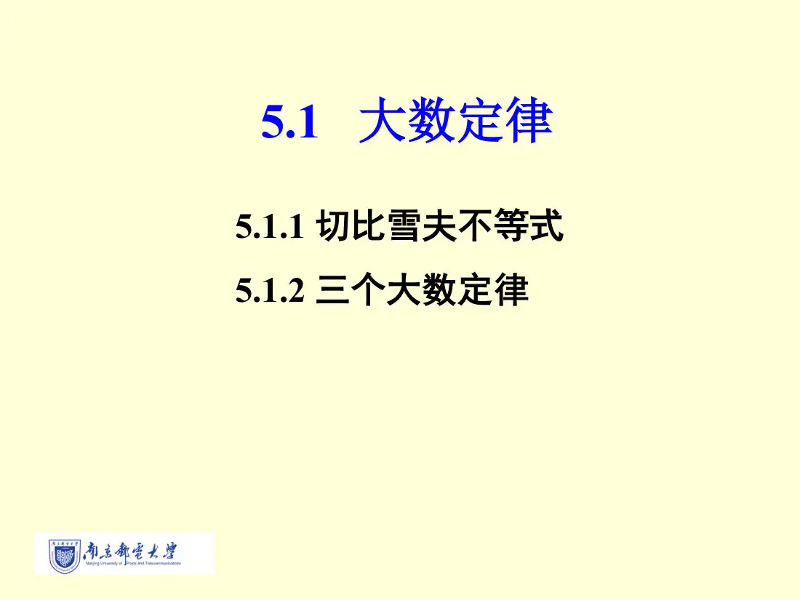

原文：

5.1 大数定律
5.1.1 切比雪夫不等式
5.1.2 三个大数定律

南京邮电大学
Nanjing University of Posts and Telecommunications

### 5.1.1 切比雪夫不等式

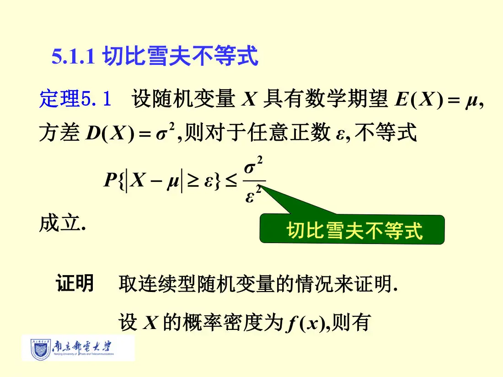

原文：

5.1.1 切比雪夫不等式

定理5.1 设随机变量 X 具有数学期望 $E(X)=\mu$ ,
方差 $D(X)=\sigma^{2}$ ，则对于任意正数 $\varepsilon$ ，不等式

切比雪夫不等式

证明 取连续型随机变量的情况来证明.

设 X 的概率密度为 $f(x)$ ，则有

南京邮电大学
Nanjing University of Posts and Telecommunications

### $$

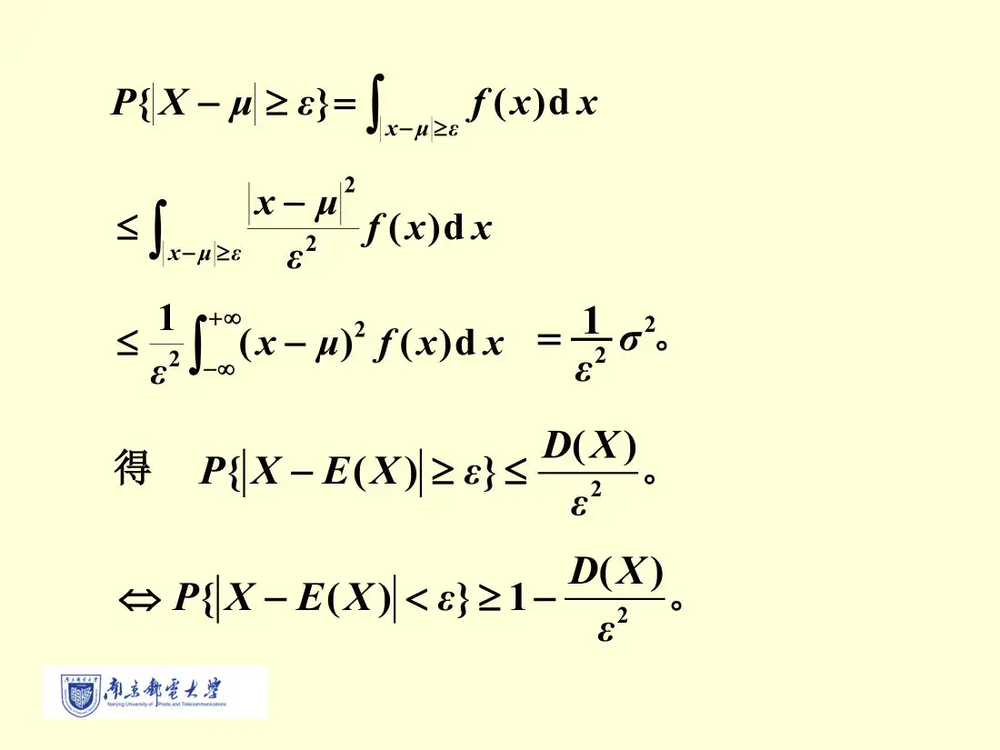

原文：

$$
P \{| X - \mu | \geq \varepsilon \} = \int_ {| x - \mu | \geq \varepsilon} f (x) \mathrm{d} x
$$

$$
\leq \int_ {| x - \mu | \geq \varepsilon} \frac {\left| x - \mu \right| ^ {2}}{\varepsilon^ {2}} f (x) d x
$$

$$
\leq \frac {1}{\varepsilon^ {2}} \int_ {- \infty} ^ {+ \infty} (x - \mu) ^ {2} f (x) d x = \frac {1}{\varepsilon^ {2}} \sigma^ {2} 。
$$

得

$$
P \{\left| X - E (X) \right| \geq \varepsilon \} \leq \frac {D (X)}{\varepsilon^ {2}} 。
$$

$$
\Leftrightarrow P \{\left| X - E (X) \right| <   \varepsilon \} \geq 1 - \frac {D (X)}{\varepsilon^ {2}} 。
$$

南京邮电大学
Nanjing University of Posts and Telecommunications

### 南京邮电大学

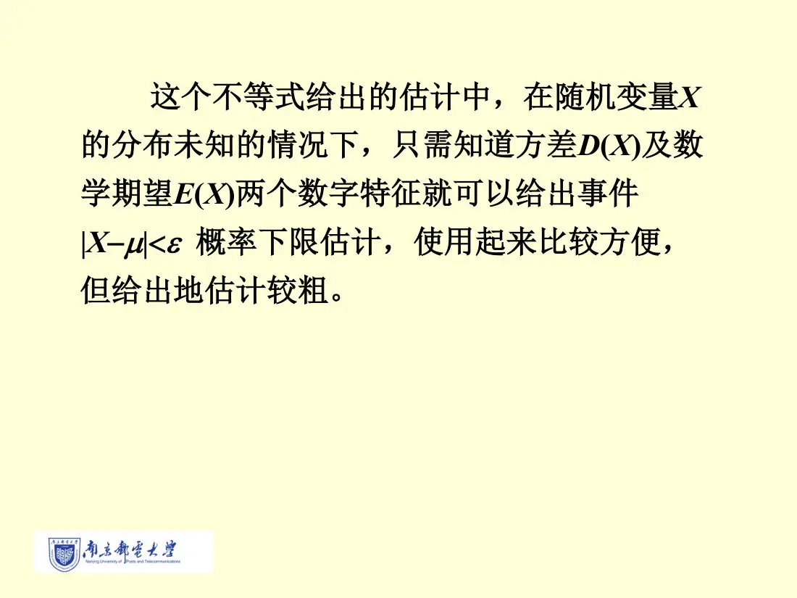

原文：

这个不等式给出的估计中，在随机变量X的分布未知的情况下，只需知道方差D(X)及数学期望E(X)两个数字特征就可以给出事件 $|X-\mu|<\varepsilon$ 概率下限估计，使用起来比较方便，但给出地估计较粗。

南京邮电大学
Nanjing University of Posts and Telecommunications

### $$

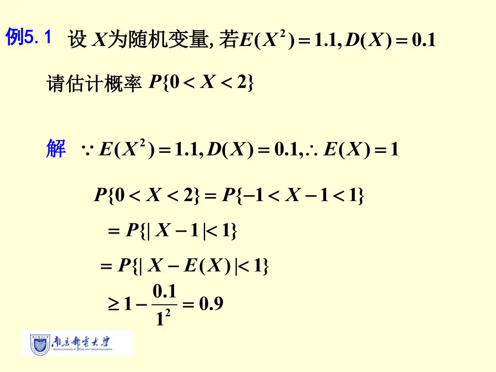

原文：

例5.1 设 X 为随机变量, 若 $E(X^{2})=1.1, D(X)=0.1$ 请估计概率 $P\{0 < X < 2\}$

解 $\because E(X^2) = 1.1, D(X) = 0.1, \therefore E(X) = 1$

$$
\begin{array}{r l} & P \{0 <   X <   2 \} = P \{- 1 <   X - 1 <   1 \} \\ & \qquad = P \{| X - 1 | <   1 \} \\ & \qquad = P \{| X - E (X) | <   1 \} \\ & \qquad \geq 1 - \frac {0 . 1}{1 ^ {2}} = 0. 9 \end{array}
$$

南京邮电大学
Nanjing University of Posts and Telecommunications

### 例5.2 设随机变量 $X$ 的密度函数为

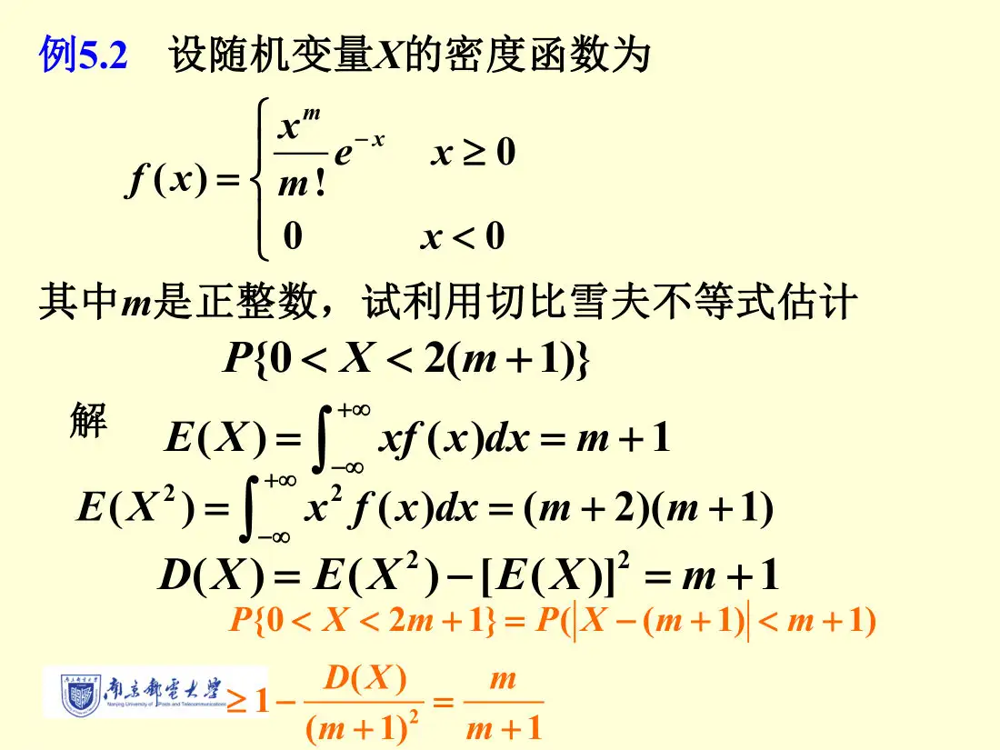

原文：

例5.2 设随机变量 $X$ 的密度函数为

$$
f (x) = \left\{ \begin{array}{l l} \frac {x ^ {m}}{m !} e ^ {- x} & x \geq 0 \\ 0 & x <   0 \end{array} \right.
$$

其中 $m$ 是正整数，试利用切比雪夫不等式估计

$$
P \{0 <   X <   2 (m + 1) \}
$$

解

$$
E (X) = \int_ {- \infty} ^ {+ \infty} x f (x) d x = m + 1
$$

$$
E (X ^ {2}) = \int_ {- \infty} ^ {+ \infty} x ^ {2} f (x) d x = (m + 2) (m + 1)
$$

$$
D (X) = E (X ^ {2}) - [ E (X) ] ^ {2} = m + 1
$$

南京邮电大学
Nanjing University of Posts and Telecommunications

$$
\geq 1 - \frac {D (X)}{(m + 1) ^ {2}} = \frac {m}{m + 1}
$$

### $$

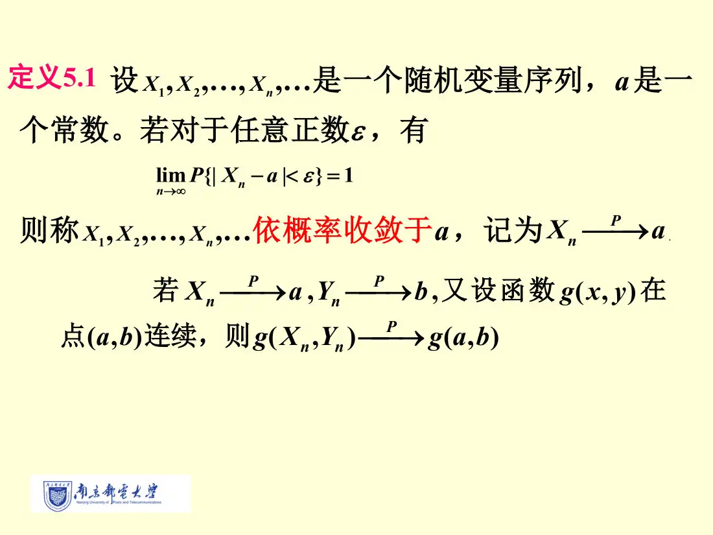

原文：

定义5.1 设 $X_{1}, X_{2}, \ldots, X_{n}, \ldots$ 是一个随机变量序列， $a$ 是一个常数。若对于任意正数 $\varepsilon$ ，有

$$
\lim _ {n \rightarrow \infty} P \{| X _ {n} - a | <   \varepsilon \} = 1
$$

则称 $X_{1}, X_{2}, \ldots, X_{n}, \ldots$ 依概率收敛于 $a$ ，记为 $X_{n} \xrightarrow{P} a$

若 $X_{n}\xrightarrow{P}a,Y_{n}\xrightarrow{P}b$ ，又设函数 $g(x,y)$ 在点 $(a,b)$ 连续，则 $g(X_{n},Y_{n})\xrightarrow{P}g(a,b)$

南京邮电大学
Nanjing University of Posts and Telecommunications

### 南京邮电大学

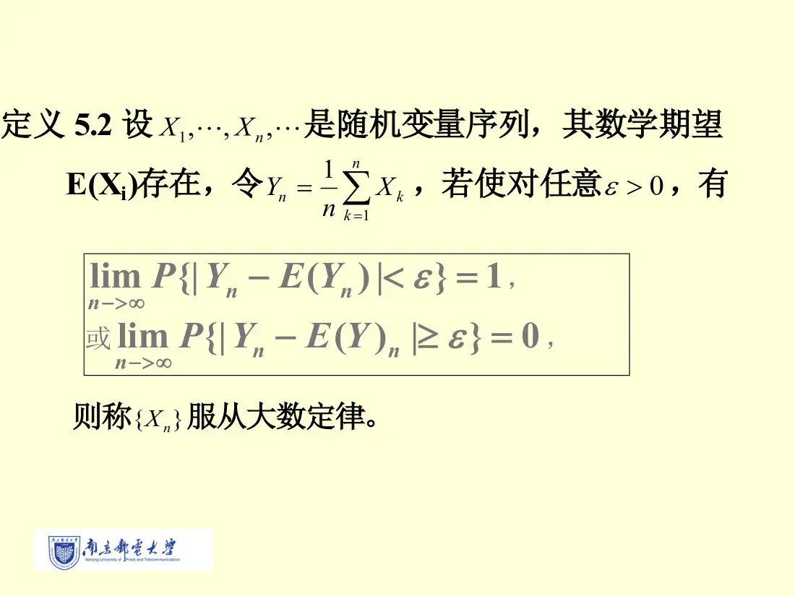

原文：

定义 5.2 设 $X_{1}, \cdots, X_{n}, \cdots$ 是随机变量序列，其数学期望 $\mathbf{E}(\mathbf{X}_{\mathbf{i}})$ 存在，令 $Y_{n} = \frac{1}{n} \sum_{k=1}^{n} X_{k}$ ，若使对任意 $\varepsilon > 0$ ，有 $\lim _{n \to \infty} P \{|Y_{n} - E(Y_{n})| < \varepsilon\} = 1,$ 或 $\lim _{n \to \infty} P \{|Y_{n} - E(Y)_{n}| \geq \varepsilon\} = 0,$ 则称 $\{X_{n}\}$ 服从大数定律。

南京邮电大学
Nanjing University of Posts and Telecommunications

### 5.1.2 三个大数定理

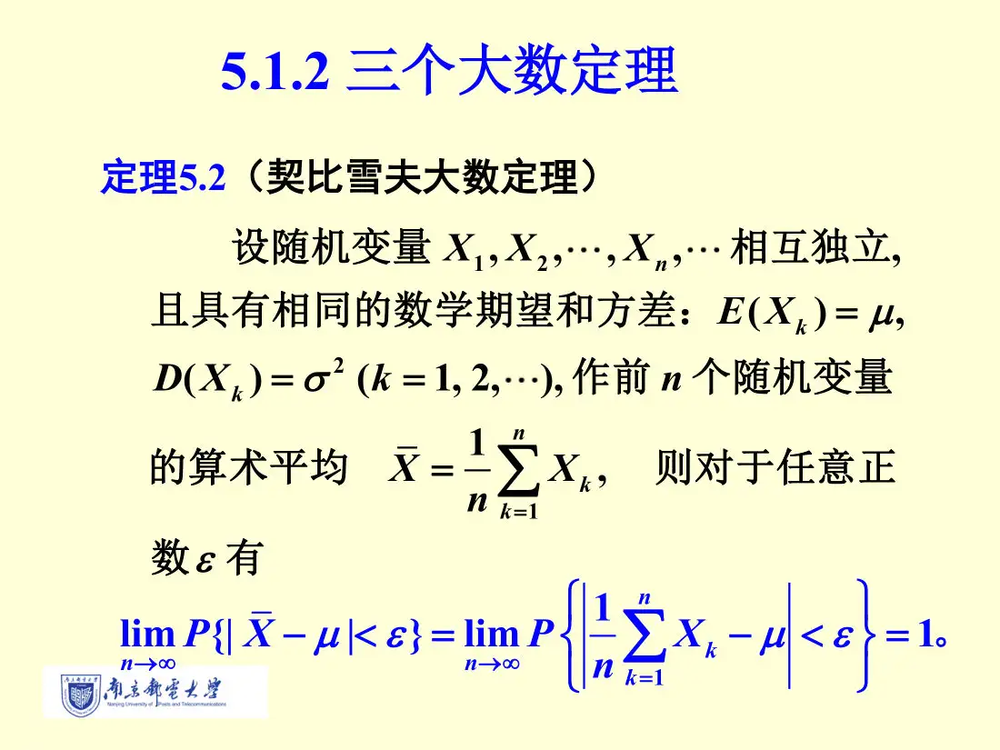

原文：

5.1.2 三个大数定理

定理5.2（契比雪夫大数定理）

设随机变量 $X_{1}, X_{2}, \cdots, X_{n}, \cdots$ 相互独立，且具有相同的数学期望和方差： $E(X_{k}) = \mu, D(X_{k}) = \sigma^{2} (k = 1, 2, \cdots)$ ，作前 n 个随机变量的算术平均 $\bar{X} = \frac{1}{n} \sum_{k=1}^{n} X_{k}$ ，则对于任意正数 $\varepsilon$ 有

$$
\lim _ {n \rightarrow \infty} P \{| \bar {X} - \mu | <   \varepsilon \} = \lim _ {n \rightarrow \infty} P \left\{\left| \frac {1}{n} \sum_ {k = 1} ^ {n} X _ {k} - \mu \right| <   \varepsilon \right\} = 1 。
$$

南京邮电大学
Nanjing University of Posts and Telecommunications

### $$

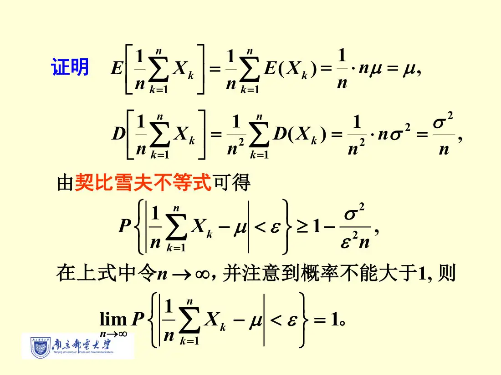

原文：

证明 $E\left[\frac{1}{n}\sum_{k = 1}^{n}X_{k}\right] = \frac{1}{n}\sum_{k = 1}^{n}E(X_{k}) = \frac{1}{n}\cdot n\mu = \mu ,$

$$
D \left[ \frac {1}{n} \sum_ {k = 1} ^ {n} X _ {k} \right] = \frac {1}{n ^ {2}} \sum_ {k = 1} ^ {n} D \left(X _ {k}\right) = \frac {1}{n ^ {2}} \cdot n \sigma^ {2} = \frac {\sigma^ {2}}{n},
$$

由契比雪夫不等式可得

$$
P \left\{\left| \frac {1}{n} \sum_ {k = 1} ^ {n} X _ {k} - \mu \right| <   \varepsilon \right\} \geq 1 - \frac {\sigma^ {2}}{\varepsilon^ {2} n},
$$

在上式中令 $n\to\infty$ ，并注意到概率不能大于1，则

$$
\lim _ {n \rightarrow \infty} P \left\{\left| \frac {1}{n} \sum_ {k = 1} ^ {n} X _ {k} - \mu \right| <   \varepsilon \right\} = 1 。
$$

南京邮电大学
Nanjing University of Posts and Telecommunications

### 关于定理5.2的说明:

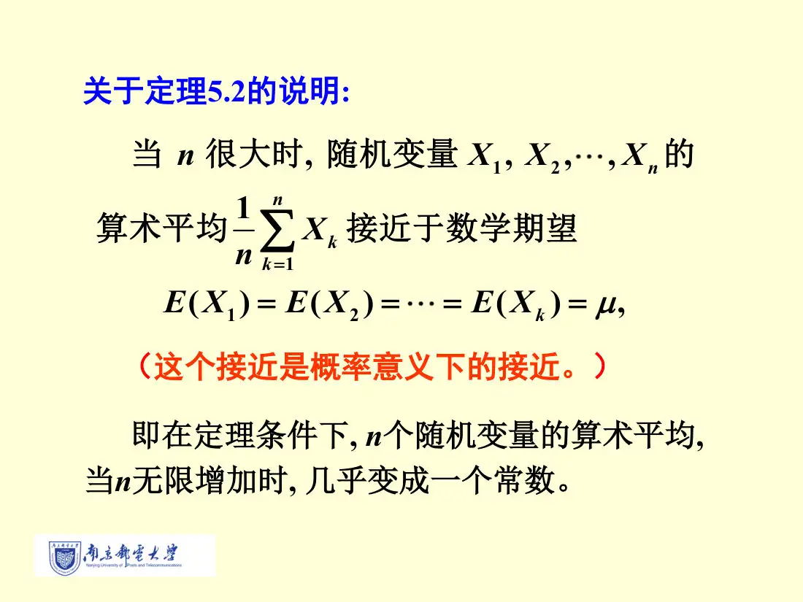

原文：

关于定理5.2的说明:

当 n 很大时, 随机变量 $X_{1}, X_{2}, \cdots, X_{n}$ 的算术平均 $\frac{1}{n} \sum_{k=1}^{n} X_{k}$ 接近于数学期望

$$
E (X _ {1}) = E (X _ {2}) = \dots = E (X _ {k}) = \mu ,
$$

(这个接近是概率意义下的接近。)

即在定理条件下, n 个随机变量的算术平均, 当 n 无限增加时, 几乎变成一个常数。

南京邮电大学
Nanjing University of Posts and Telecommunications

### 定理5.3（伯努利大数定理）

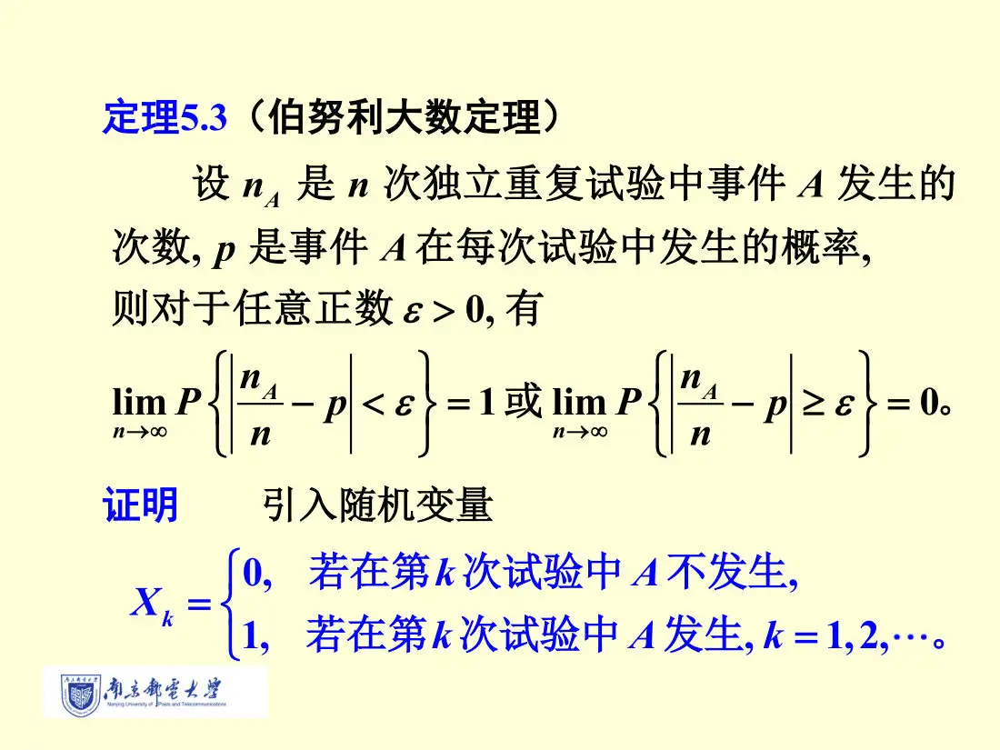

原文：

定理5.3（伯努利大数定理）

设 $n_{A}$ 是 n 次独立重复试验中事件 A 发生的次数, p 是事件 A 在每次试验中发生的概率, 则对于任意正数 $\varepsilon > 0$ , 有

$\lim_{n\to \infty}P\left\{\left|\frac{n_A}{n} -p\right| <   \varepsilon \right\} = 1$ 或 $\lim_{n\to \infty}P\left\{\left|\frac{n_A}{n} -p\right|\geq \varepsilon \right\} = 0.$

证明 引入随机变量

$X_{k}=\left\{\begin{aligned}&0,& 若在第k次试验中A不发生,\\ &1,& 若在第k次试验中A发生,k=1,2,\cdots。\end{aligned}\right.$

南京邮电大学
Nanjing University of Posts and Telecommunications

### 显然 $n_{A}=X_{1}+X_{2}+\cdots+X_{n},$

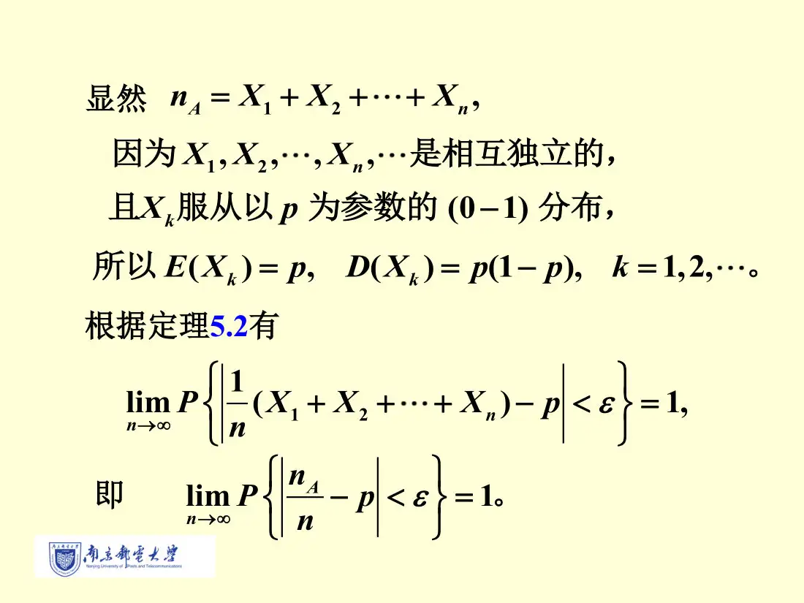

原文：

显然 $n_{A}=X_{1}+X_{2}+\cdots+X_{n},$

因为 $X_{1},X_{2},\cdots,X_{n},\cdots$ 是相互独立的，

且 $X_{k}$ 服从以p为参数的(0-1)分布，

所以 $E(X_{k})=p,\quad D(X_{k})=p(1-p),\quad k=1,2,\cdots$

根据定理5.2有

$$
\lim _ {n \rightarrow \infty} P \left\{\left| \frac {1}{n} (X _ {1} + X _ {2} + \dots + X _ {n}) - p \right| <   \varepsilon \right\} = 1,
$$

即 $\lim_{n\to \infty}P\left\{\left|\frac{n_A}{n} -p\right| <   \varepsilon \right\} = 1$

南京邮电大学
Nanjing University of Posts and Telecommunications

### 关于伯努利定理的说明：

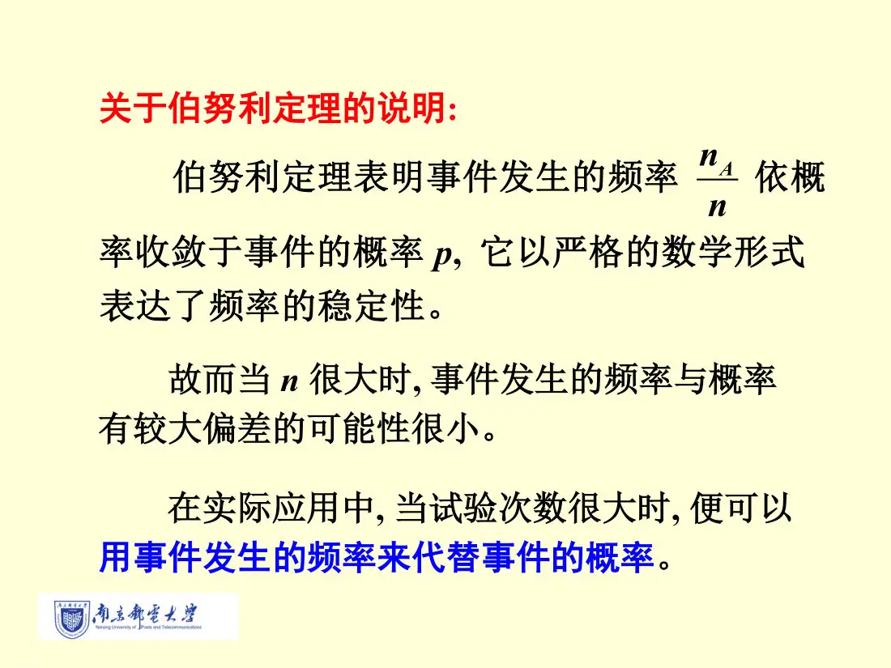

原文：

关于伯努利定理的说明：

伯努利定理表明事件发生的频率 $\frac{n_{A}}{n}$ 依概率收敛于事件的概率 p，它以严格的数学形式表达了频率的稳定性。

故而当 n 很大时, 事件发生的频率与概率有较大偏差的可能性很小。

在实际应用中, 当试验次数很大时, 便可以用事件发生的频率来代替事件的概率。

南京邮电大学
Nanjing University of Posts and Telecommunications

### 定理5.4（辛钦大数定理）

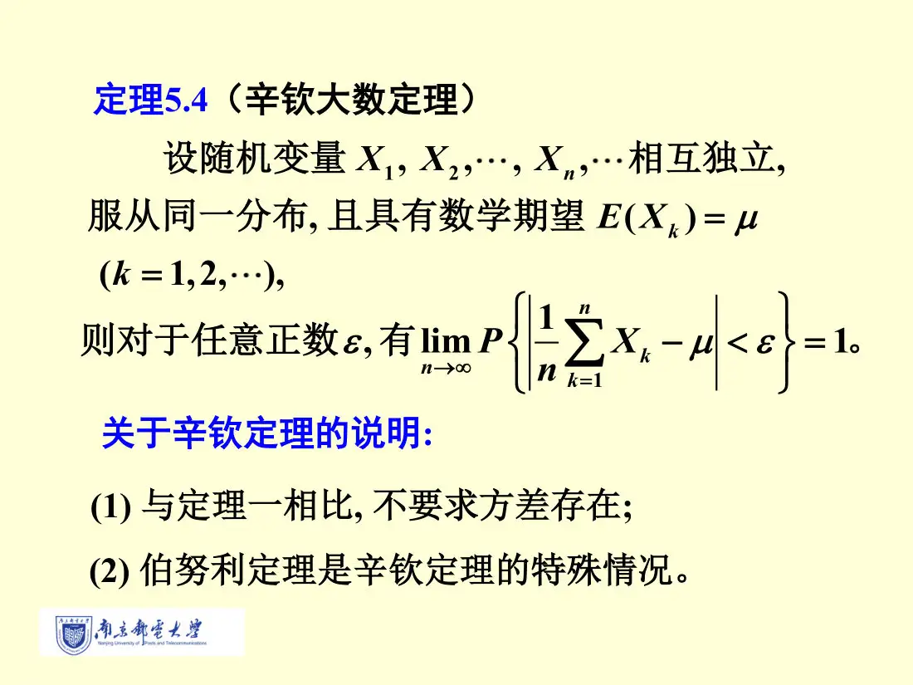

原文：

定理5.4（辛钦大数定理）

设随机变量 $X_{1}, X_{2}, \cdots, X_{n}, \cdots$ 相互独立，
服从同一分布, 且具有数学期望 $E(X_{k}) = \mu$ $(k=1,2,\cdots)$ ,
则对于任意正数 $\varepsilon$ ，有 $\lim_{n\to\infty}P\left\{\left|\frac{1}{n}\sum_{k=1}^{n}X_{k}-\mu\right|<\varepsilon\right\}=1$ 。

关于辛钦定理的说明:

(1) 与定理一相比, 不要求方差存在;

(2) 伯努利定理是辛钦定理的特殊情况。

南京邮电大学
Nanjing University of Posts and Telecommunications

### 第 16 页

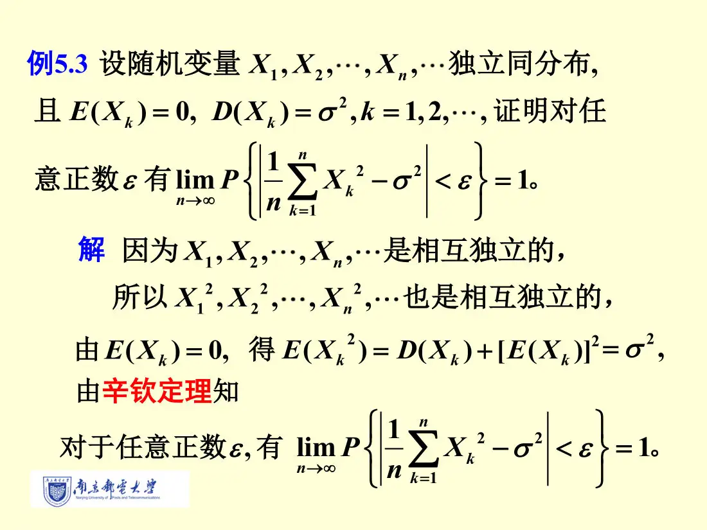

原文：

例5.3 设随机变量 $X_{1}, X_{2}, \cdots, X_{n}, \cdots$ 独立同分布，且 $E(X_{k}) = 0, D(X_{k}) = \sigma^{2}, k = 1, 2, \cdots$ ，证明对任意正数 $\varepsilon$ 有 $\lim_{n \to \infty} P\left\{\left|\frac{1}{n} \sum_{k=1}^{n} X_{k}^{2} - \sigma^{2}\right| < \varepsilon\right\} = 1$ 。
解 因为 $X_{1}, X_{2}, \cdots, X_{n}, \cdots$ 是相互独立的，
所以 $X_{1}^{2}, X_{2}^{2}, \cdots, X_{n}^{2}, \cdots$ 也是相互独立的，
由 $E(X_{k}) = 0$ ，得 $E(X_{k}^{2}) = D(X_{k}) + [E(X_{k})]^{2} = \sigma^{2}$ 由辛钦定理知
对于任意正数 $\varepsilon$ ，有 $\lim_{n\to\infty}P\left\{\left|\frac{1}{n}\sum_{k=1}^{n}X_{k}^{2}-\sigma^{2}\right|<\varepsilon\right\}=1$ 。

### 5.2 中心极限定理

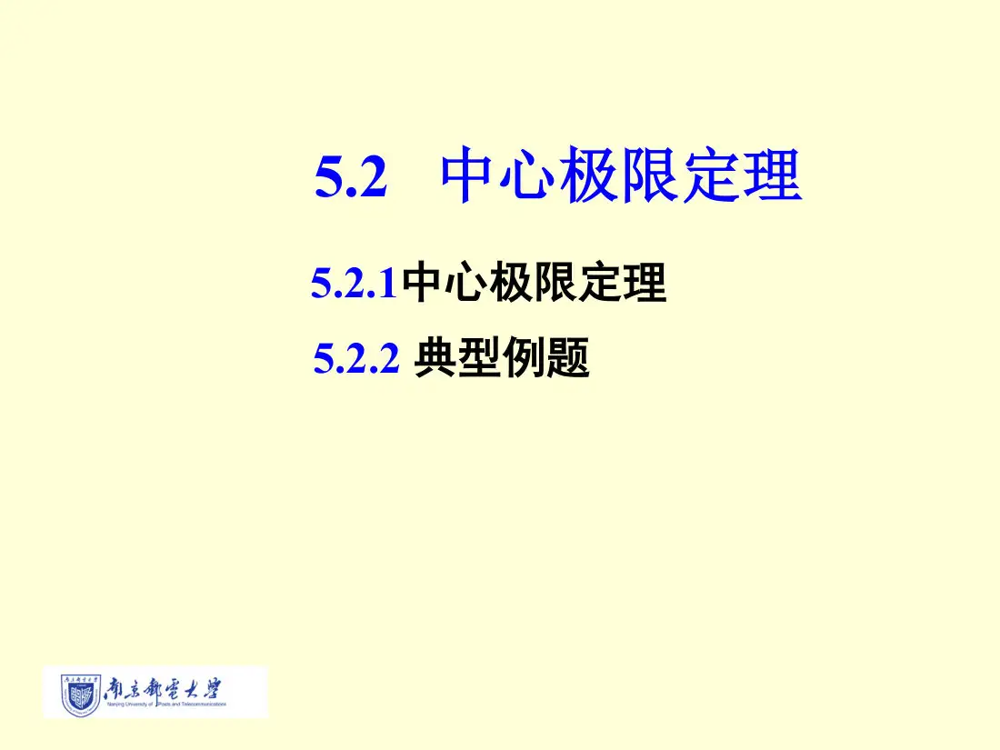

原文：

5.2 中心极限定理
5.2.1 中心极限定理
5.2.2 典型例题

南京邮电大学
Nanjing University of Posts and Telecommunications

### 5.2.1 中心极限定理

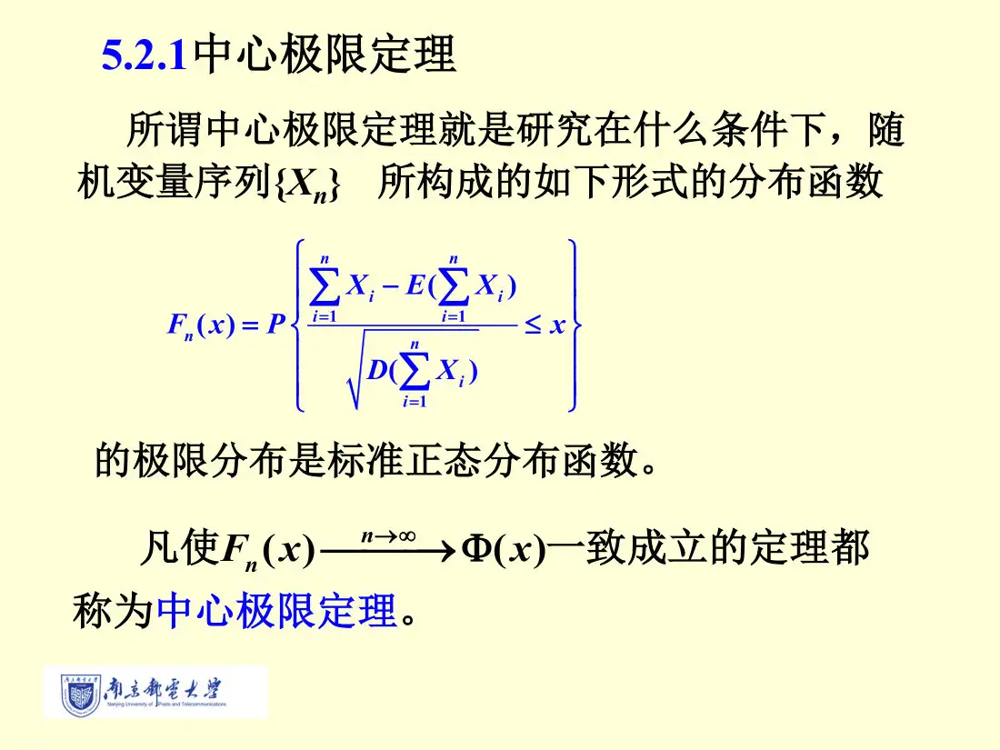

原文：

5.2.1 中心极限定理

所谓中心极限定理就是研究在什么条件下，随机变量序列 $\{X_{n}\}$ 所构成的如下形式的分布函数

$$
F _ {n} (x) = P \left\{\frac {\sum_ {i = 1} ^ {n} X _ {i} - E (\sum_ {i = 1} ^ {n} X _ {i})}{\sqrt {D (\sum_ {i = 1} ^ {n} X _ {i})}} \leq x \right\}
$$

的极限分布是标准正态分布函数。

凡使 $F_{n}(x)\xrightarrow{n\to\infty}\Phi(x)$ 一致成立的定理都称为中心极限定理。

南京邮电大学
Nanjing University of Posts and Telecommunications

### 定理5.5（独立同分布的中心极限定理）列维—林德伯格定理

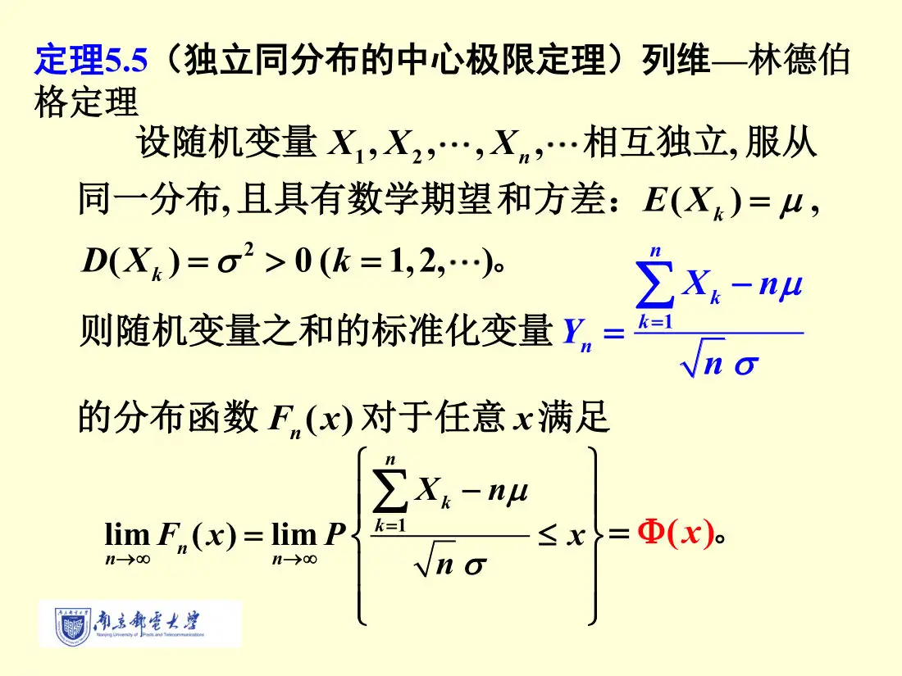

原文：

定理5.5（独立同分布的中心极限定理）列维—林德伯格定理

设随机变量 $X_{1}, X_{2}, \cdots, X_{n}, \cdots$ 相互独立, 服从同一分布, 且具有数学期望和方差: $E(X_{k}) = \mu$ , $D(X_{k}) = \sigma^{2} > 0 (k = 1, 2, \cdots)$ .

则随机变量之和的标准化变量 $Y_{n} = \frac{\sum\limits_{k=1}^{n} X_{k} - n\mu}{\sqrt{n}\sigma}$ 的分布函数 $F_{n}(x)$ 对于任意 x 满足

$$
\lim _ {n \rightarrow \infty} F _ {n} (x) = \lim _ {n \rightarrow \infty} P \left\{\frac {\sum_ {k = 1} ^ {n} X _ {k} - n \mu}{\sqrt {n} \sigma} \leq x \right\} = \Phi (x) 。
$$

南京邮电大学
Nanjing University of Posts and Telecommunications

### $$

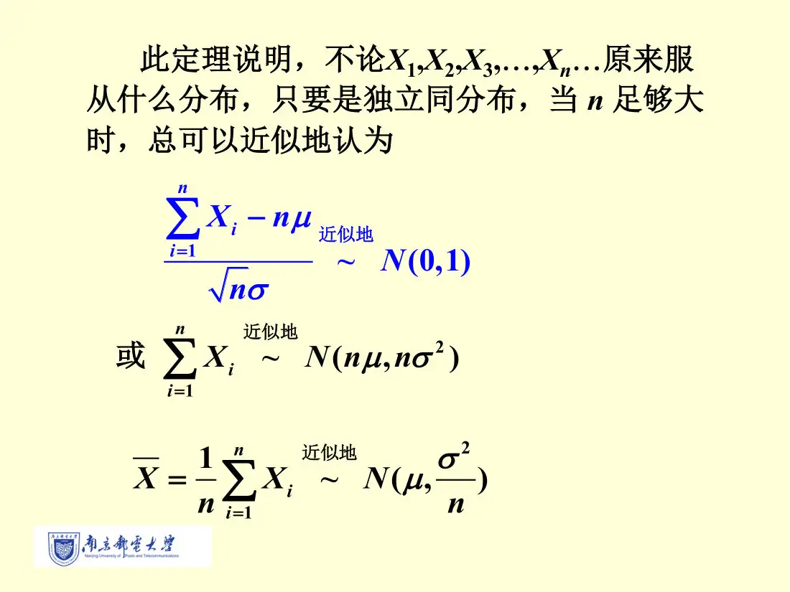

原文：

此定理说明，不论 $X_{1}, X_{2}, X_{3}, \ldots, X_{n} \ldots$ 原来服从什么分布，只要是独立同分布，当 $n$ 足够大时，总可以近似地认为

$$
\frac {\sum_ {i = 1} ^ {n} X _ {i} - n \mu_ {\text {近似地}}}{\sqrt {n} \sigma} \sim N (0, 1)
$$

或 $\sum_{i=1}^{n} X_i \sim N(n\mu, n\sigma^2)$ 近似地

$$
\overline {{{X}}} = \frac {1}{n} \sum_ {i = 1} ^ {n} X _ {i} \sim N (\mu , \frac {\sigma^ {2}}{n})
$$

南京邮电大学
Nanjing University of Posts and Telecommunications

### 解 记 $Y_{i} = X_{i}^{2}(i\geq 1)$

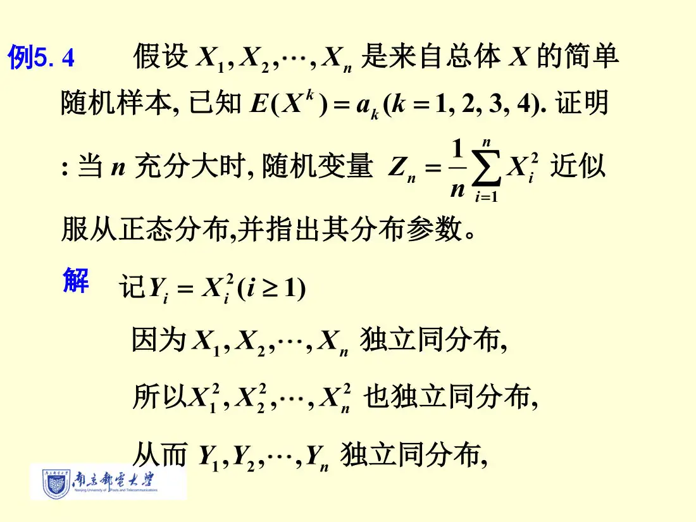

原文：

例5.4 假设 $X_{1}, X_{2}, \cdots, X_{n}$ 是来自总体 X 的简单随机样本, 已知 $E(X^{k}) = a_{k} (k = 1, 2, 3, 4)$ . 证明: 当 n 充分大时, 随机变量 $Z_{n} = \frac{1}{n} \sum_{i=1}^{n} X_{i}^{2}$ 近似服从正态分布, 并指出其分布参数。

解 记 $Y_{i} = X_{i}^{2}(i\geq 1)$

因为 $X_{1},X_{2},\cdots,X_{n}$ 独立同分布,

所以 $X_{1}^{2},X_{2}^{2},\cdots,X_{n}^{2}$ 也独立同分布,

从而 $Y_{1}, Y_{2}, \cdots, Y_{n}$ 独立同分布,且 $E(Y_{i})=E(X_{i}^{2})=a_{2},\quad E(Y_{i}^{2})=E(X_{i}^{4})=a_{4},$ $D(Y_{i})=D(X_{i}^{2})=E(X_{i}^{4})-(EX_{i}^{2})^{2}=a_{4}-a_{2}^{2}\quad i\geq1$ 则序列 $Z_{n}=\frac{1}{n}\sum_{i=1}^{n}X_{i}^{2}=\frac{1}{n}\sum_{i=1}^{n}Y_{i}=\overline{Y}$ 根据独立同分布的中心极限定理知

即 $\frac{\sum_{i=1}^{n}Y_{i}-n\mu}{\sqrt{n}\sigma}$ 的极限分布是标准正态分布。

即 $\frac{\overline{Y}-\mu}{\sigma/n}$ 近似服从标准正态分布 $N(0,1)$ 。

从而 $\overline{Y}$ 近似服从正态分布 $N(\mu,\frac{\sigma^{2}}{n})$

南京邮电大学
Nanjing University of Posts and Telecommunications

### 第 22 页

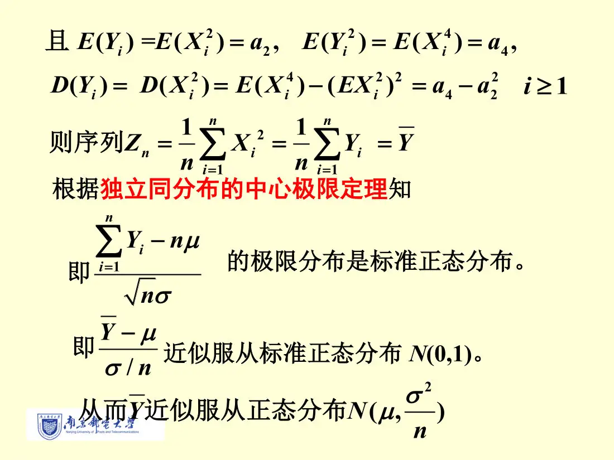

### 第 23 页

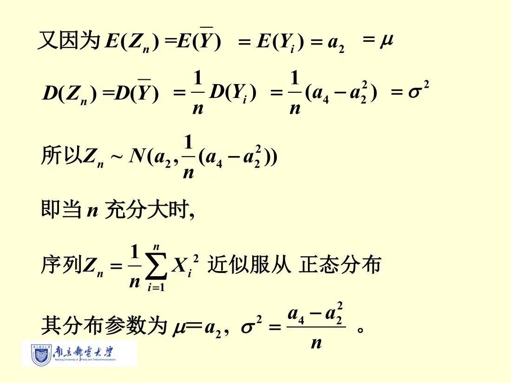

原文：

又因为 $E(Z_{n})=E(\bar{Y})=E(Y_{i})=a_{2}=\mu$ $D(Z_{n})=D(\bar{Y})=\frac{1}{n}D(Y_{i})=\frac{1}{n}(a_{4}-a_{2}^{2})=\sigma^{2}$ 所以 $Z_{n}\sim N(a_{2},\frac{1}{n}(a_{4}-a_{2}^{2}))$ 即当 n 充分大时，
序列 $Z_{n}=\frac{1}{n}\sum_{i=1}^{n}X_{i}^{2}$ 近似服从正态分布
其分布参数为 $\mu=a_{2},\sigma^{2}=\frac{a_{4}-a_{2}^{2}}{n}$ 。

### 求 $P\{V>105\}$ 的近似值。

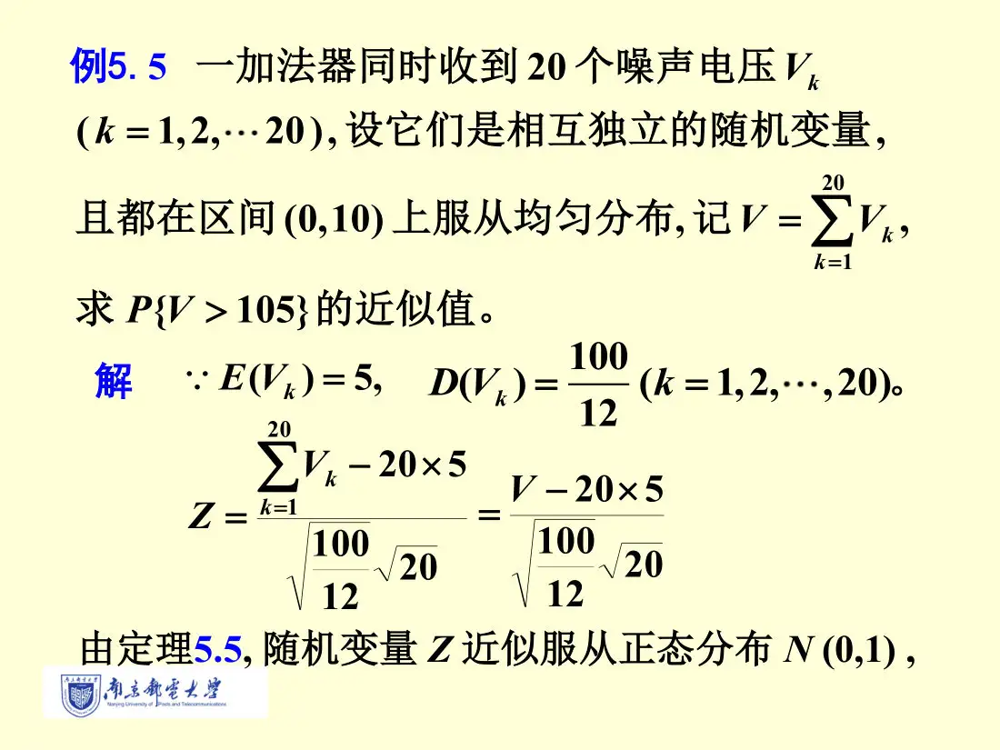

原文：

例5.5 一加法器同时收到20个噪声电压 $V_{k}$ $(k=1,2,\cdots20)$ ，设它们是相互独立的随机变量，
且都在区间(0,10)上服从均匀分布，记 $V=\sum_{k=1}^{20}V_{k}$ ，
求 $P\{V>105\}$ 的近似值。
解 $\because E(V_{k})=5,\quad D(V_{k})=\frac{100}{12}(k=1,2,\cdots,20)$ 。 $Z=\frac{\sum_{k=1}^{20}V_{k}-20\times5}{\sqrt{\frac{100}{12}\sqrt{20}}}=\frac{V-20\times5}{\sqrt{\frac{100}{12}\sqrt{20}}}$ 由定理5.5, 随机变量 Z 近似服从正态分布 N(0,1),

### $$

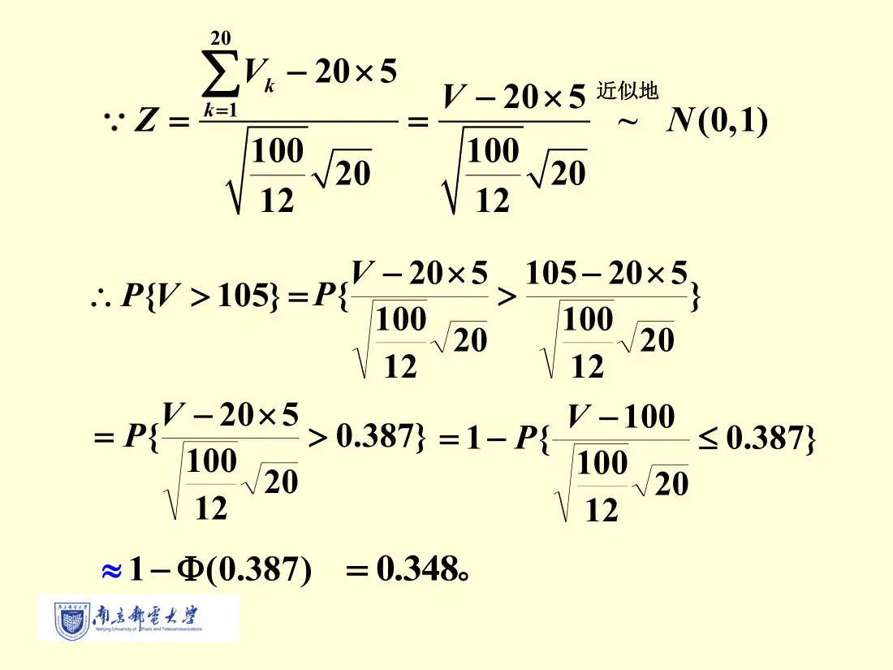

原文：

$$
\because Z = \frac {\sum_ {k = 1} ^ {2 0} V _ {k} - 2 0 \times 5}{\sqrt {\frac {1 0 0}{1 2}} \sqrt {2 0}} = \frac {V - 2 0 \times 5}{\sqrt {\frac {1 0 0}{1 2}} \sqrt {2 0}} \sim N (0, 1)
$$

$$
\begin{array}{l} \therefore P \{V > 1 0 5 \} = P \{\frac {V - 2 0 \times 5}{\sqrt {\frac {1 0 0}{1 2}} \sqrt {2 0}} > \frac {1 0 5 - 2 0 \times 5}{\sqrt {\frac {1 0 0}{1 2}} \sqrt {2 0}} \} \\ = P \{\frac {V - 2 0 \times 5}{\sqrt {\frac {1 0 0}{1 2}} \sqrt {2 0}} > 0. 3 8 7 \} = 1 - P \{\frac {V - 1 0 0}{\sqrt {\frac {1 0 0}{1 2}} \sqrt {2 0}} \leq 0. 3 8 7 \} \\ \approx 1 - \Phi (0. 3 8 7) = 0. 3 4 8 _ {\circ} \end{array}
$$

南京邮电大学
Nanjing University of Posts and Telecommunications

### 定理5.6(德莫佛－拉普拉斯定理)

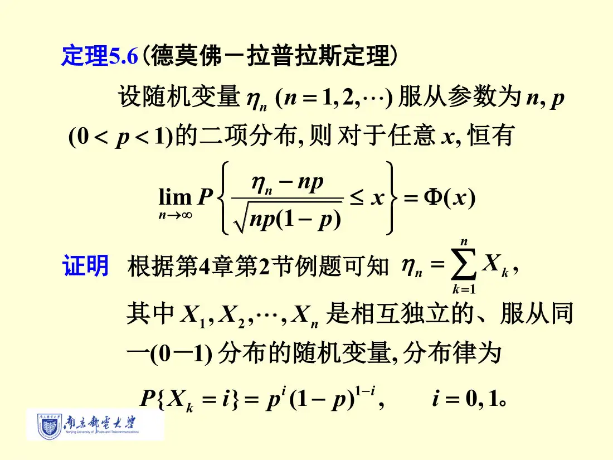

原文：

定理5.6(德莫佛－拉普拉斯定理)

设随机变量 $\eta_{n}(n=1,2,\cdots)$ 服从参数为 n, p

(0 < p < 1) 的二项分布, 则对于任意 x, 恒有

$$
\lim _ {n \rightarrow \infty} P \left\{\frac {\eta_ {n} - n p}{\sqrt {n p (1 - p)}} \leq x \right\} = \Phi (x)
$$

证明 根据第4章第2节例题可知 $\eta_{n}=\sum_{k=1}^{n}X_{k}$ ,

其中 $X_{1}, X_{2}, \cdots, X_{n}$ 是相互独立的、服从同

一(0-1)分布的随机变量,分布律为

$$
P \{X _ {k} = i \} = p ^ {i} (1 - p) ^ {1 - i}, \qquad i = 0, 1 。
$$

南京邮电大学
Nanjing University of Posts and Telecommunications

### $$

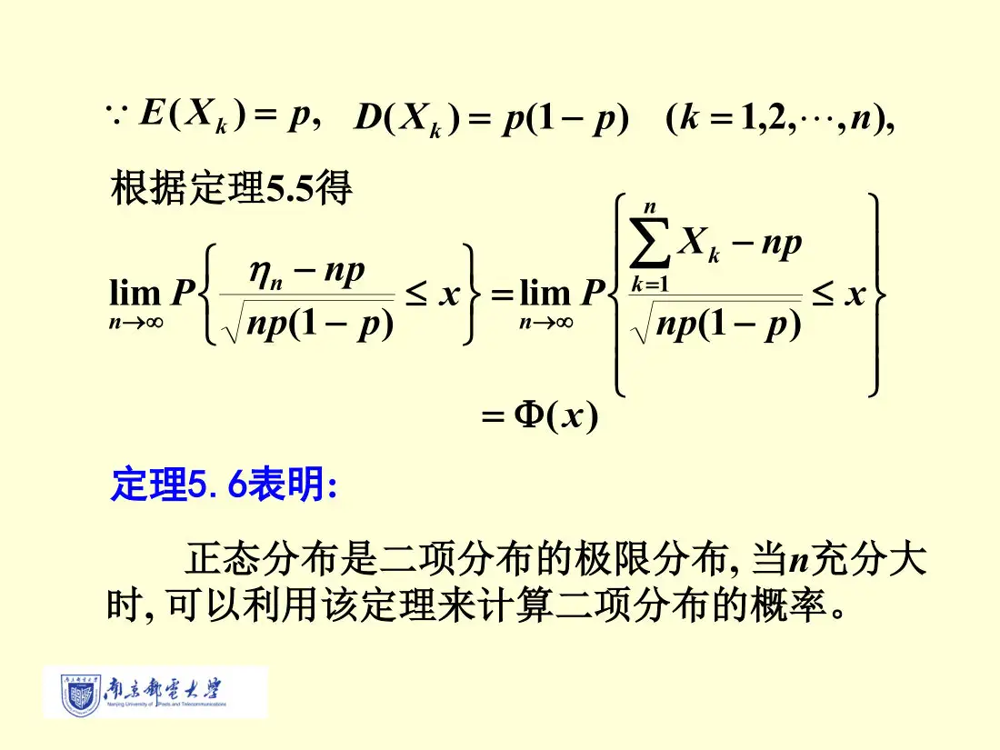

原文：

$$
\because E (X _ {k}) = p, \quad D (X _ {k}) = p (1 - p) \quad (k = 1, 2, \dots , n),
$$

根据定理5.5得

$$
\lim _ {n \rightarrow \infty} P \left\{\frac {\eta_ {n} - n p}{\sqrt {n p (1 - p)}} \leq x \right\} = \lim _ {n \rightarrow \infty} P \left\{\frac {\sum_ {k = 1} ^ {n} X _ {k} - n p}{\sqrt {n p (1 - p)}} \leq x \right\} = \Phi (x)
$$

定理5.6表明:

正态分布是二项分布的极限分布, 当n充分大时, 可以利用该定理来计算二项分布的概率。

南京邮电大学
Nanjing University of Posts and Telecommunications

### 或者 $P\{a < N_A \leq b\}$

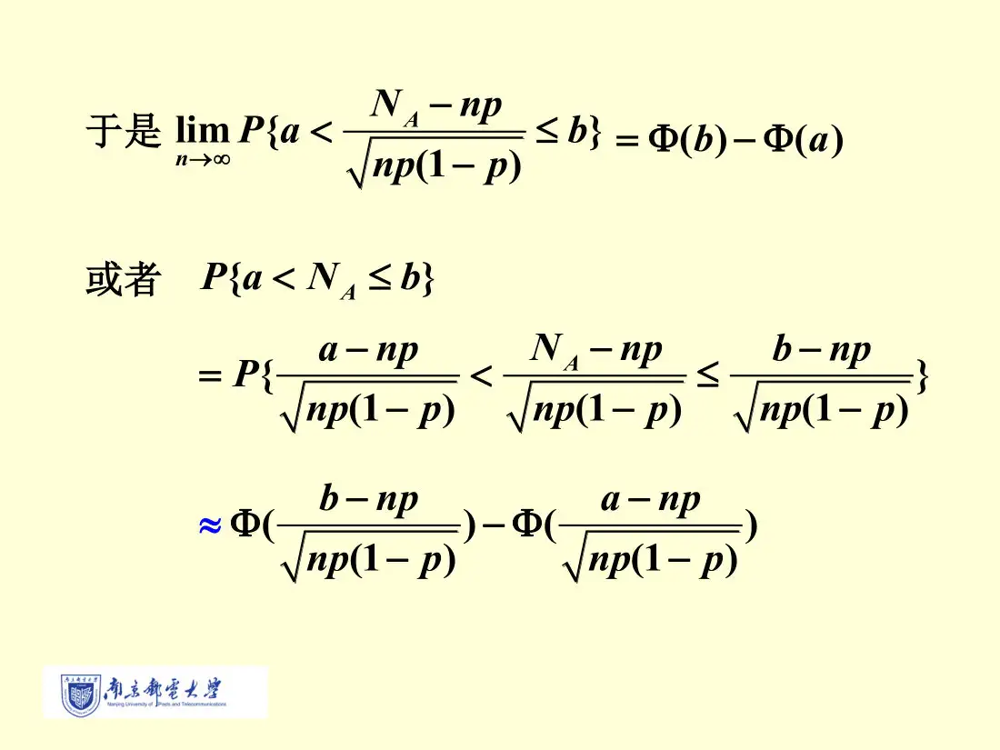

原文：

于是 $\lim_{n\to \infty}P\{a <   \frac{N_A - np}{\sqrt{np(1 - p)}}\leq b\} = \Phi (b) - \Phi (a)$

或者 $P\{a < N_A \leq b\}$

$$
\begin{array}{r l} & P \{a <   N _ {A} \leq b \} \\ & = P \{\frac {a - n p}{\sqrt {n p (1 - p)}} <   \frac {N _ {A} - n p}{\sqrt {n p (1 - p)}} \leq \frac {b - n p}{\sqrt {n p (1 - p)}} \} \\ & \approx \Phi (\frac {b - n p}{\sqrt {n p (1 - p)}}) - \Phi (\frac {a - n p}{\sqrt {n p (1 - p)}}) \end{array}
$$

南京邮电大学
Nanjing University of Posts and Telecommunications

### 即 $X \sim B(200, \frac{5}{100})$

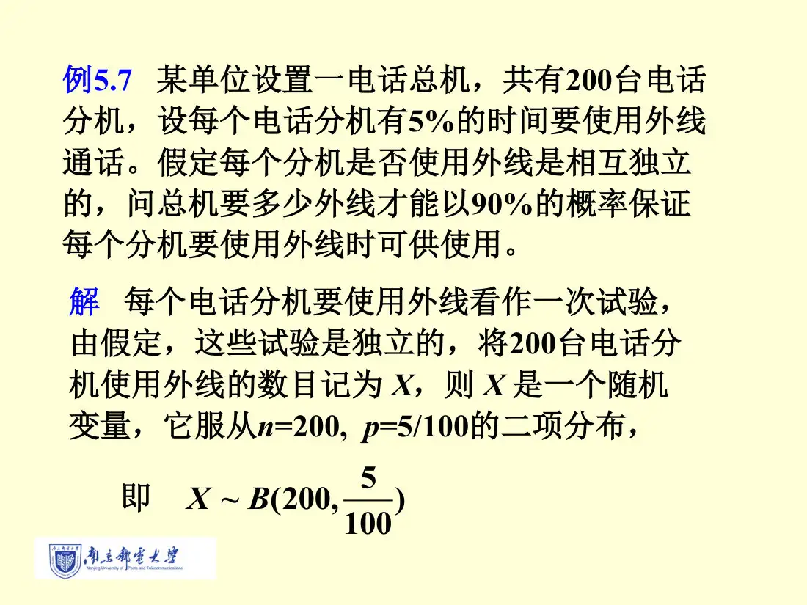

原文：

例5.7 某单位设置一电话总机，共有200台电话分机，设每个电话分机有 $5 \%$ 的时间要使用外线通话。假定每个分机是否使用外线是相互独立的，问总机要多少外线才能以 $90 \%$ 的概率保证每个分机要使用外线时可供使用。

解 每个电话分机要使用外线看作一次试验，由假定，这些试验是独立的，将200台电话分机使用外线的数目记为 X，则 X 是一个随机变量，它服从 n=200, p=5/100 的二项分布，

即 $X \sim B(200, \frac{5}{100})$

南京邮电大学
Nanjing University of Posts and Telecommunications

### 南京邮电大学

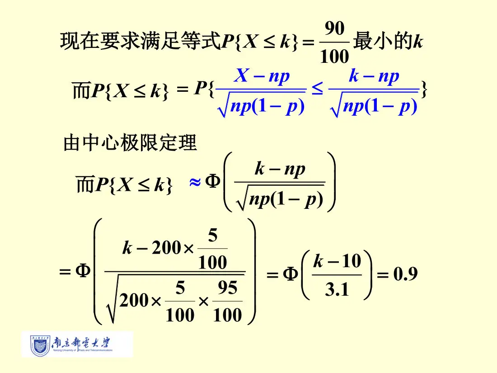

原文：

现在要求满足等式 $P\{X \leq k\} = \frac{90}{100}$ 最小的 $k$ 而 $P\{X \leq k\} = P\{\frac{X - np}{\sqrt{np(1 - p)}} \leq \frac{k - np}{\sqrt{np(1 - p)}}\}$ 由中心极限定理而 $P\{X \leq k\} \approx \Phi \left(\frac{k - np}{\sqrt{np(1 - p)}}\right)$ $= \Phi \left(\frac{k - 200 \times \frac{5}{100}}{\sqrt{200 \times \frac{5}{100} \times \frac{95}{100}}}\right) = \Phi \left(\frac{k - 10}{3.1}\right) = 0.9$ 而 $P\{X \leq k\} \approx \Phi\left(\frac{k-10}{3.1}\right) = 0.9$ 所以 $\frac{k-10}{3.1}=1.28,\quad k\approx14$

南京邮电大学
Nanjing University of Posts and Telecommunications

### 故总机至少要14条外线，才能以90%的概率保证每个分面使用外线。

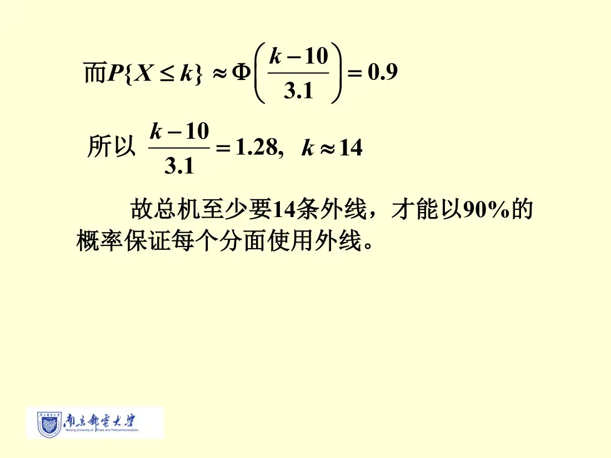

原文：

故总机至少要14条外线，才能以90%的概率保证每个分面使用外线。

南京邮电大学
Nanjing University of Posts and Telecommunications

### 南京邮电大学

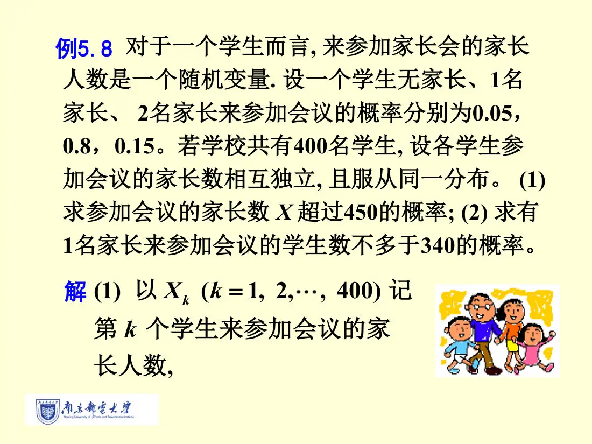

原文：

例5.8 对于一个学生而言, 来参加家长会的家长人数是一个随机变量. 设一个学生无家长、1名家长、2名家长来参加会议的概率分别为0.05, 0.8, 0.15。若学校共有400名学生, 设各学生参加会议的家长数相互独立, 且服从同一分布。(1) 求参加会议的家长数 X 超过450的概率; (2) 求有1名家长来参加会议的学生数不多于340的概率。

解 (1) 以 $X_{k}$ ( $k=1,2,\cdots,400$ ) 记第 $k$ 个学生来参加会议的家长人数，

南京邮电大学
Nanjing University of Posts and Telecommunications

### 南京邮电大学

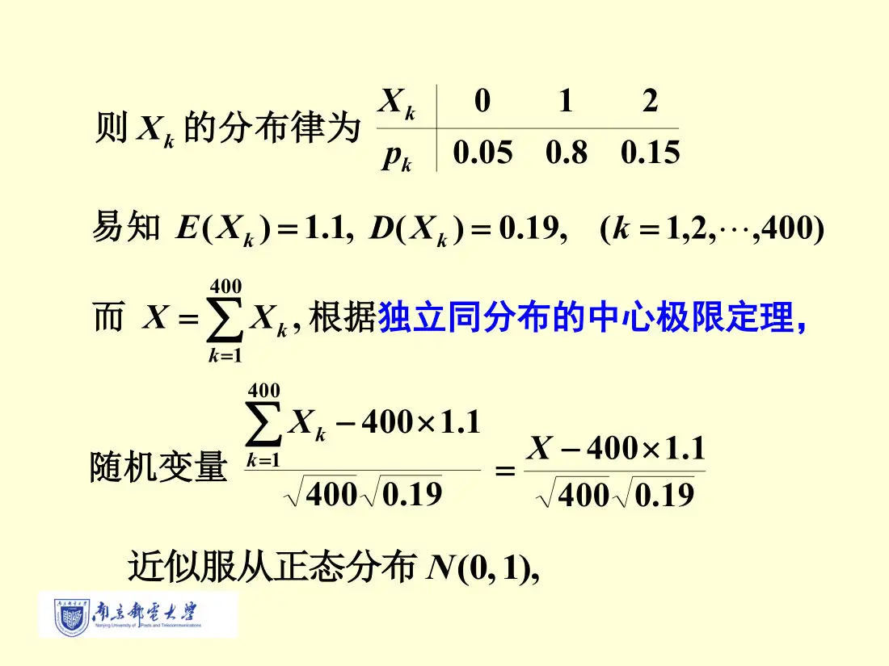

原文：

则 $X_{k}$ 的分布律为 $\frac{X_{k}}{p_{k}}$ 0 1 2
易知 $E(X_{k})=1.1, D(X_{k})=0.19, (k=1,2,\cdots,400)$ 而 $X=\sum_{k=1}^{400}X_{k}$ ，根据独立同分布的中心极限定理，
随机变量 $\frac{\sum_{k=1}^{400}X_{k}-400\times1.1}{\sqrt{400}\sqrt{0.19}}=\frac{X-400\times1.1}{\sqrt{400}\sqrt{0.19}}$ 近似服从正态分布 $N(0,1)$ ,

南京邮电大学
Nanjing University of Posts and Telecommunications

### 于是 $P\{X > 450\}$

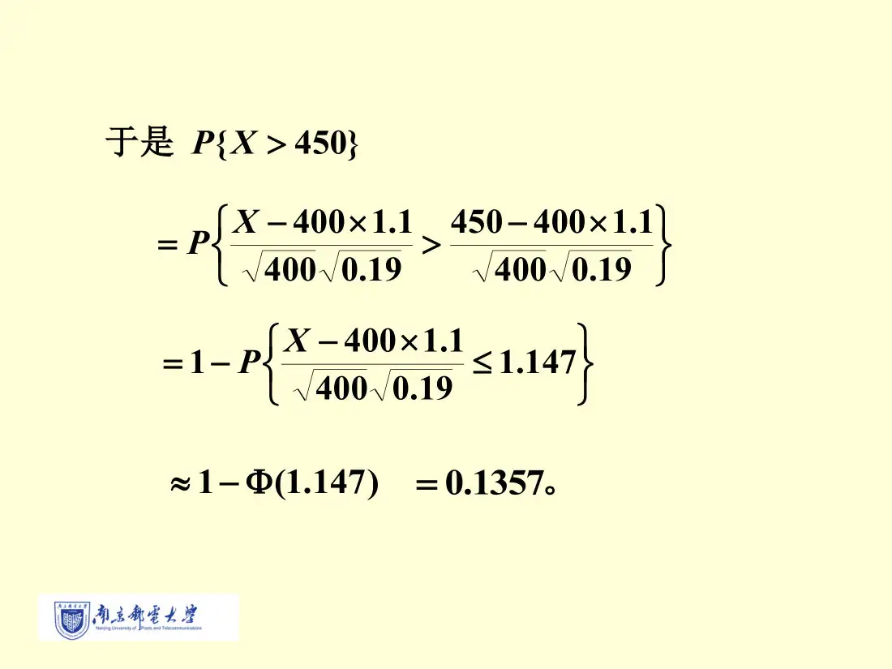

原文：

于是 $P\{X > 450\}$

$$
\begin{array}{r l} & = P \left\{\frac {X - 4 0 0 \times 1 . 1}{\sqrt {4 0 0} \sqrt {0 . 1 9}} > \frac {4 5 0 - 4 0 0 \times 1 . 1}{\sqrt {4 0 0} \sqrt {0 . 1 9}} \right\} \\ & = 1 - P \left\{\frac {X - 4 0 0 \times 1 . 1}{\sqrt {4 0 0} \sqrt {0 . 1 9}} \leq 1. 1 4 7 \right\} \end{array}
$$

$\approx 1 - \Phi (1.147) = 0.1357$ 。

南京邮电大学
Nanjing University of Posts and Telecommunications

### (2) 以 Y 记有一名家长来参加会议的学生数,

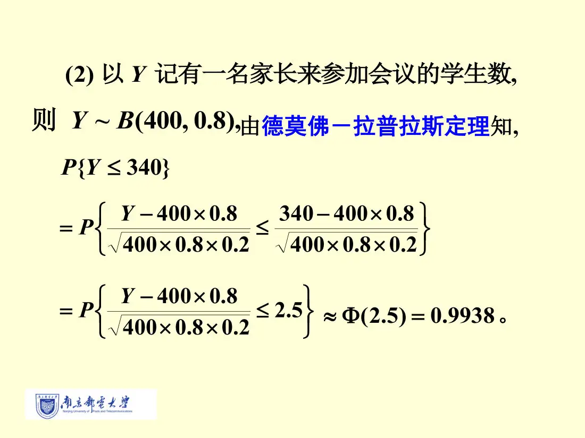

原文：

(2) 以 Y 记有一名家长来参加会议的学生数,
则 $Y \sim B(400, 0.8)$ , 由德莫佛—拉普拉斯定理知, $P\{Y \leq 340\}$ $=P\left\{\frac{Y-400\times0.8}{\sqrt{400\times0.8\times0.2}} \leq \frac{340-400\times0.8}{\sqrt{400\times0.8\times0.2}}\right\}$ $=P\left\{\frac{Y-400\times0.8}{\sqrt{400\times0.8\times0.2}} \leq 2.5\right\} \approx \Phi(2.5) = 0.9938$ 。

南京邮电大学
Nanjing University of Posts and Telecommunications

### $$

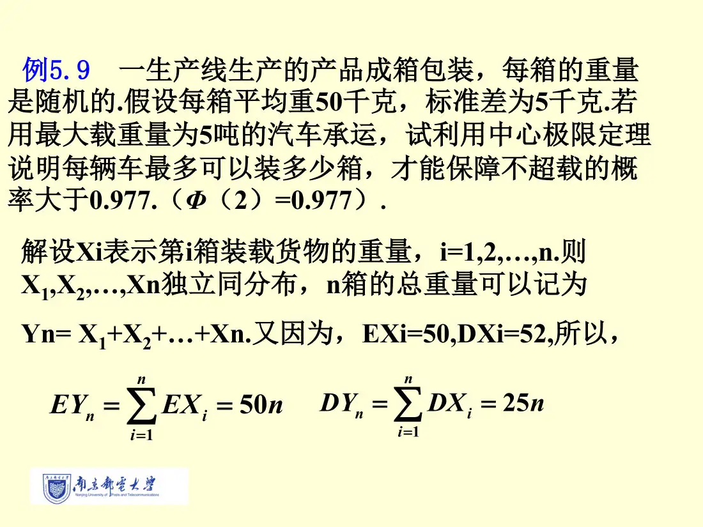

原文：

例5.9 一生产线生产的产品成箱包装，每箱的重量是随机的。假设每箱平均重50千克，标准差为5千克。若用最大载重量为5吨的汽车承运，试利用中心极限定理说明每辆车最多可以装多少箱，才能保障不超载的概率大于0.977。（Φ（2）=0.977）。

解设Xi表示第i箱装载货物的重量，i=1,2,...,n.则X₁,X₂,...,Xn独立同分布，n箱的总重量可以记为

$\mathrm{Yn} = \mathrm{X}_1 + \mathrm{X}_2 + \dots +\mathrm{Xn}$ .又因为，EXi=50,DXi=52,所以，

$$
E Y _ {n} = \sum_ {i = 1} ^ {n} E X _ {i} = 5 0 n \quad D Y _ {n} = \sum_ {i = 1} ^ {n} D X _ {i} = 2 5 n
$$

南京邮电大学
Nanjing University of Posts and Telecommunications

### 根据列维—林德伯格极限定理 $Y_{n}$ 近似服从于

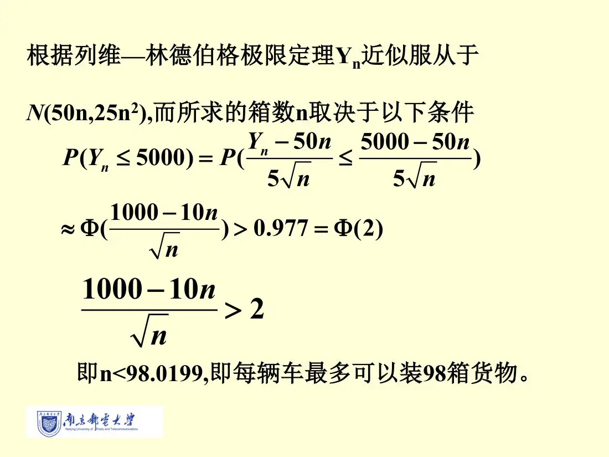

原文：

根据列维—林德伯格极限定理 $Y_{n}$ 近似服从于

$N(50n,25n^{2})$ ,而所求的箱数n取决于以下条件

$$
P (Y _ {n} \leq 5 0 0 0) = P (\frac {Y _ {n} - 5 0 n}{5 \sqrt {n}} \leq \frac {5 0 0 0 - 5 0 n}{5 \sqrt {n}})
$$

$$
\approx \Phi (\frac {1 0 0 0 - 1 0 n}{\sqrt {n}}) > 0. 9 7 7 = \Phi (2)
$$

$$
\frac {1 0 0 0 - 1 0 n}{\sqrt {n}} > 2
$$

即n<98.0199,即每辆车最多可以装98箱货物。

南京邮电大学
Nanjing University of Posts and Telecommunications

### 小结

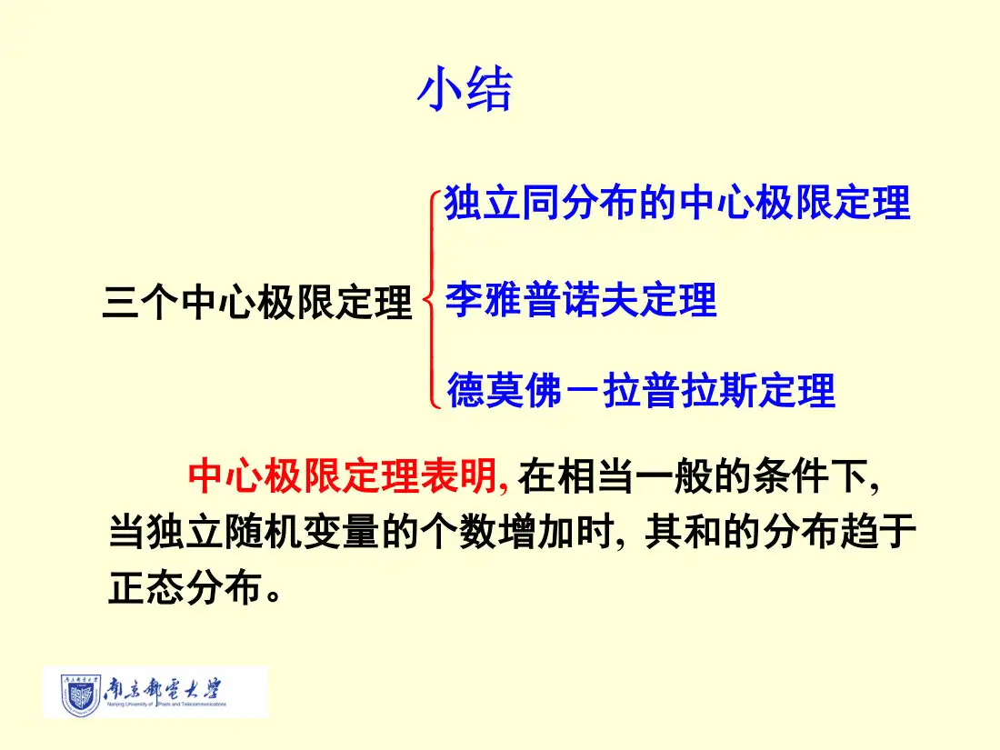

原文：

小结

独立同分布的中心极限定理

三个中心极限定理

李雅普诺夫定理

德莫佛—拉普拉斯定理

中心极限定理表明, 在相当一般的条件下, 当独立随机变量的个数增加时, 其和的分布趋于正态分布。

南京邮电大学
Nanjing University of Posts and Telecommunications

### 第5章 大数定律及中心极限定理

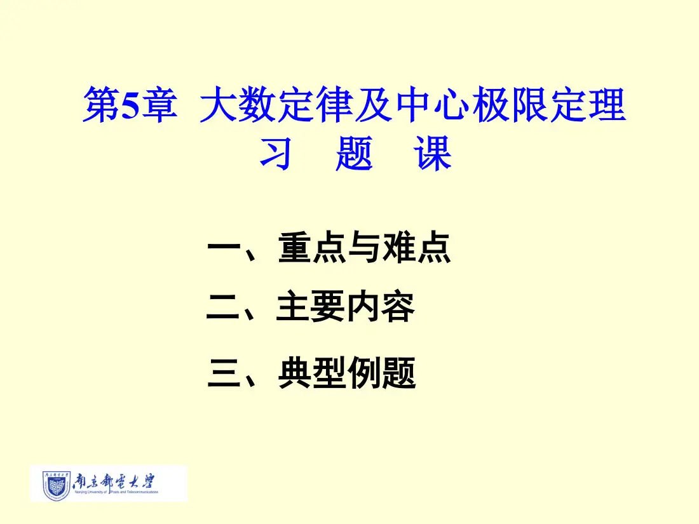

原文：

第5章 大数定律及中心极限定理
习题课
一、重点与难点
二、主要内容
三、典型例题

南京邮电大学
Nanjing University of Posts and Telecommunications

### 一、重点与难点

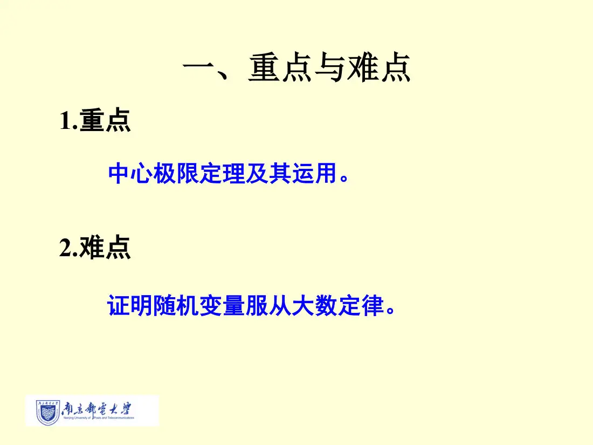

原文：

一、重点与难点

1.重点

中心极限定理及其运用。

2.难点

证明随机变量服从大数定律。

南京邮电大学
Nanjing University of Posts and Telecommunications

### 比雪夫不等式 二、主要内容

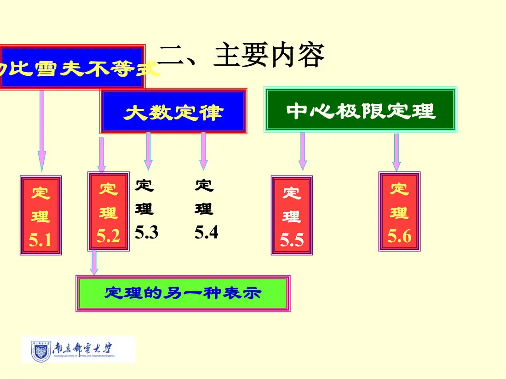

原文：

比雪夫不等式 二、主要内容

大数定律

中心极限定理

定理5.1定理5.2

定

理

5.3

定

理

5.4

定理
5.5定理5.6

定理的另一种表示

南京邮电大学
Nanjing University of Posts and Telecommunications

### 契比雪夫定理的特殊情况

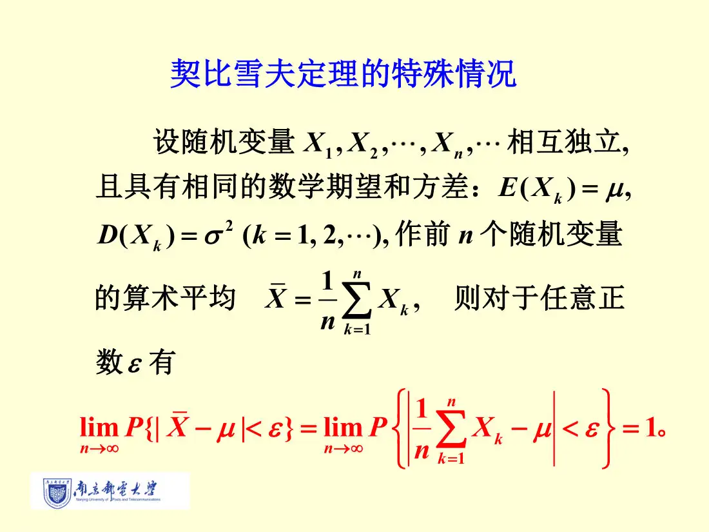

原文：

契比雪夫定理的特殊情况

设随机变量 $X_{1}, X_{2}, \cdots, X_{n}, \cdots$ 相互独立，且具有相同的数学期望和方差： $E(X_{k}) = \mu, D(X_{k}) = \sigma^{2} (k = 1, 2, \cdots)$ ，作前 n 个随机变量的算术平均 $\bar{X} = \frac{1}{n} \sum_{k=1}^{n} X_{k}$ ，则对于任意正数 $\varepsilon$ 有

$$
\lim _ {n \rightarrow \infty} P \{| \bar {X} - \mu | <   \varepsilon \} = \lim _ {n \rightarrow \infty} P \left\{\left| \frac {1}{n} \sum_ {k = 1} ^ {n} X _ {k} - \mu \right| <   \varepsilon \right\} = 1 。
$$

南京邮电大学
Nanjing University of Posts and Telecommunications

### 定理5.2的另一种表示

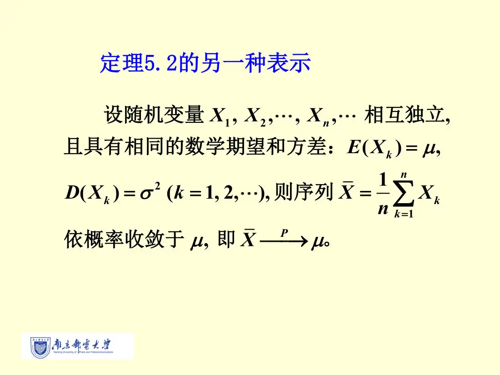

原文：

定理5.2的另一种表示

设随机变量 $X_{1}, X_{2}, \cdots, X_{n}, \cdots$ 相互独立，且具有相同的数学期望和方差： $E(X_{k}) = \mu, D(X_{k}) = \sigma^{2} (k = 1, 2, \cdots)$ ，则序列 $\bar{X} = \frac{1}{n} \sum_{k=1}^{n} X_{k}$ 依概率收敛于 $\mu$ ，即 $\bar{X} \xrightarrow{P} \mu$ 。

南京邮电大学
Nanjing University of Posts and Telecommunications

### 伯努利大数定理

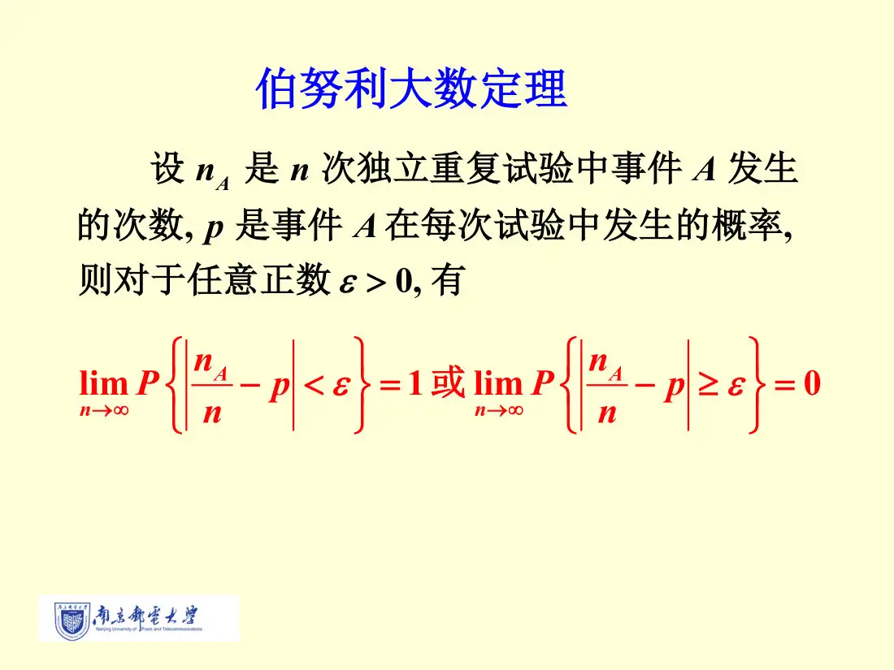

原文：

伯努利大数定理

设 $n_{A}$ 是 n 次独立重复试验中事件 A 发生的次数, p 是事件 A 在每次试验中发生的概率, 则对于任意正数 $\varepsilon > 0$ , 有

$$
\lim _ {n \rightarrow \infty} P \left\{\left| \frac {n _ {A}}{n} - p \right| <   \varepsilon \right\} = 1 \text {或} \lim _ {n \rightarrow \infty} P \left\{\left| \frac {n _ {A}}{n} - p \right| \geq \varepsilon \right\} = 0
$$

南京邮电大学
Nanjing University of Posts and Telecommunications

### 辛钦大数定理

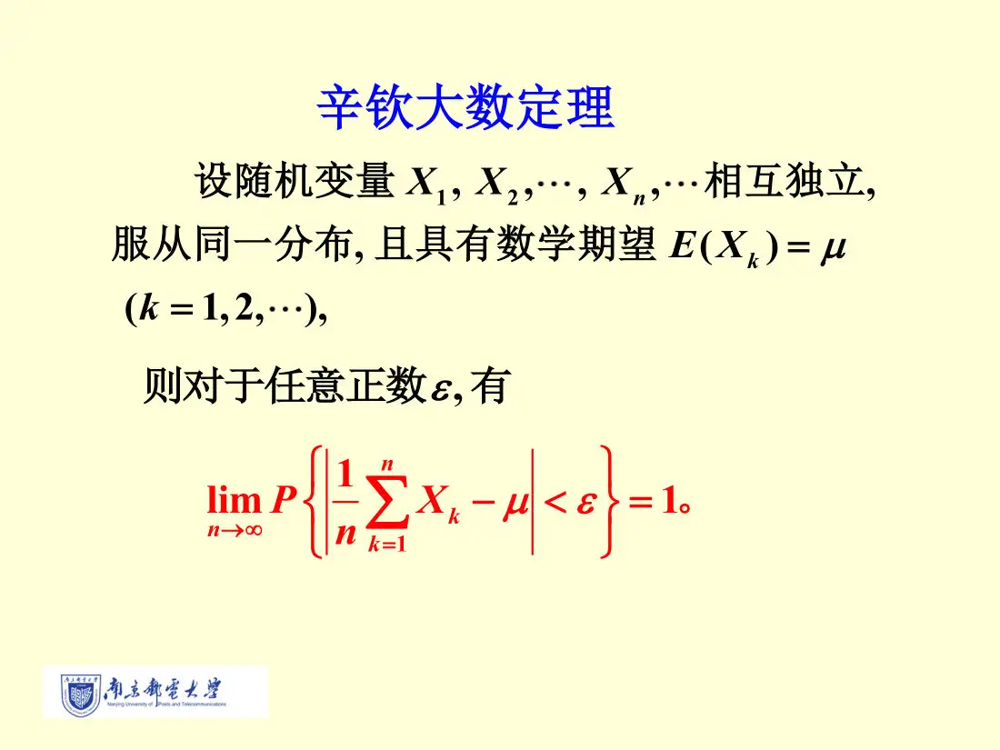

原文：

辛钦大数定理

设随机变量 $X_{1}, X_{2}, \cdots, X_{n}, \cdots$ 相互独立，
服从同一分布，且具有数学期望 $E(X_{k}) = \mu$ $(k=1,2,\cdots)$ ,

则对于任意正数 $\varepsilon$ ,有

$$
\lim _ {n \rightarrow \infty} P \left\{\left| \frac {1}{n} \sum_ {k = 1} ^ {n} X _ {k} - \mu \right| <   \varepsilon \right\} = 1 。
$$

南京邮电大学
Nanjing University of Posts and Telecommunications

### 独立同分布的中心极限定理

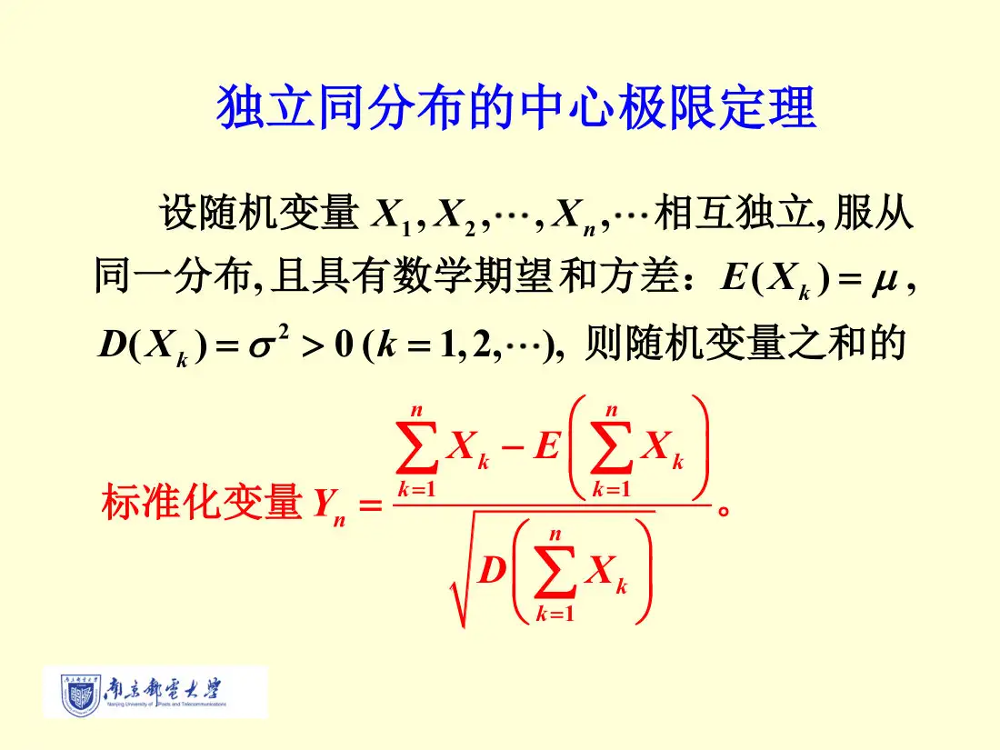

原文：

独立同分布的中心极限定理

设随机变量 $X_{1}, X_{2}, \cdots, X_{n}, \cdots$ 相互独立, 服从同一分布, 且具有数学期望和方差: $E(X_{k}) = \mu$ , $D(X_{k}) = \sigma^{2} > 0 (k = 1, 2, \cdots)$ , 则随机变量之和的

标准化变量 $Y_{n}=\frac{\sum_{k=1}^{n}X_{k}-E\left(\sum_{k=1}^{n}X_{k}\right)}{\sqrt{D\left(\sum_{k=1}^{n}X_{k}\right)}}$ 。

南京邮电大学
Nanjing University of Posts and Telecommunications

### 的分布函数 $F_{n}(x)$ 对于任意 $x$ 满足

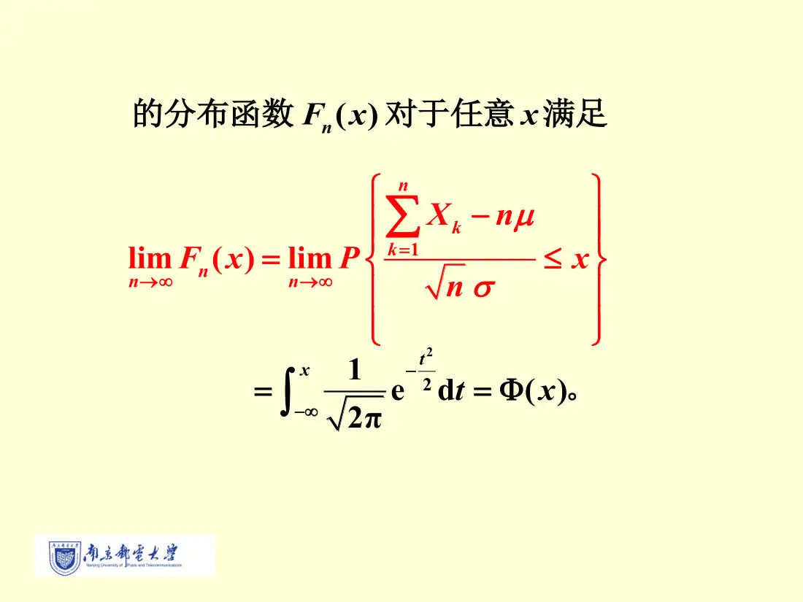

原文：

的分布函数 $F_{n}(x)$ 对于任意 $x$ 满足

$$
\begin{array}{l}\lim _ {n \rightarrow \infty} F _ {n} (x) = \lim _ {n \rightarrow \infty} P \left\{\frac {\sum_ {k = 1} ^ {n} X _ {k} - n \mu}{\sqrt {n} \sigma} \leq x \right\}\\= \int_ {- \infty} ^ {x} \frac {1}{\sqrt {2 \pi}} e ^ {- \frac {t ^ {2}}{2}} d t = \Phi (x) 。\end{array}
$$

南京邮电大学
Nanjing University of Posts and Telecommunications

### 德莫佛—拉普拉斯定理

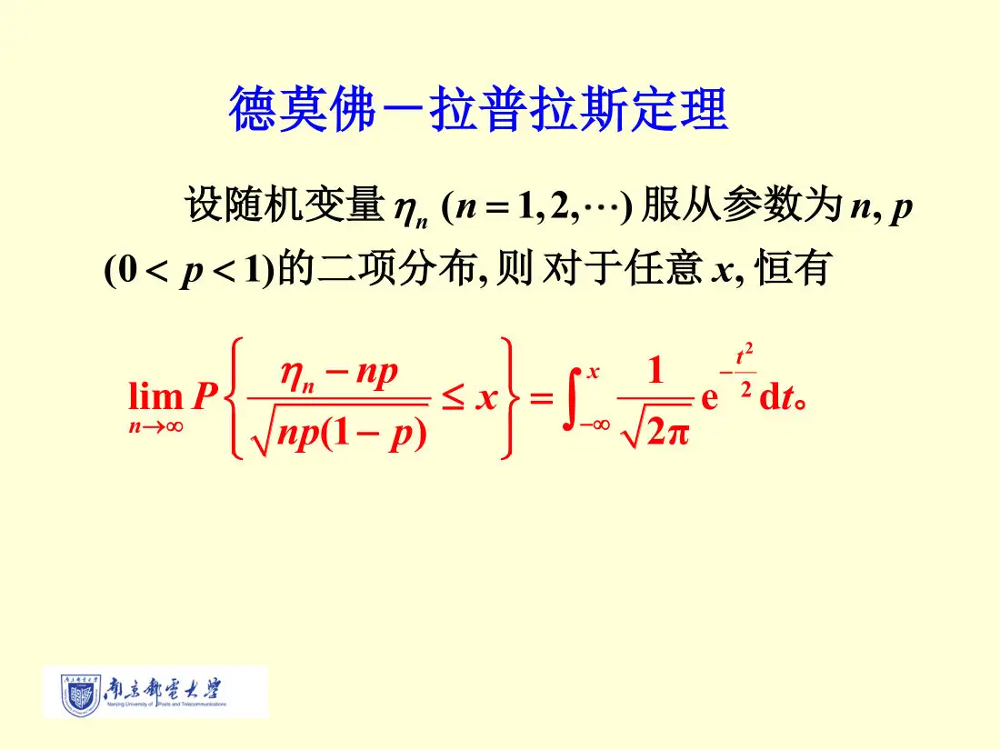

原文：

德莫佛—拉普拉斯定理

设随机变量 $\eta_{n}(n=1,2,\cdots)$ 服从参数为 n,p
(0 < p < 1) 的二项分布, 则对于任意 x, 恒有

$$
\lim _ {n \rightarrow \infty} P \left\{\frac {\eta_ {n} - n p}{\sqrt {n p (1 - p)}} \leq x \right\} = \int_ {- \infty} ^ {x} \frac {1}{\sqrt {2 \pi}} \mathrm{e} ^ {- \frac {t ^ {2}}{2}} \mathrm{d} t 。
$$

南京邮电大学
Nanjing University of Posts and Telecommunications

### 第 49 页

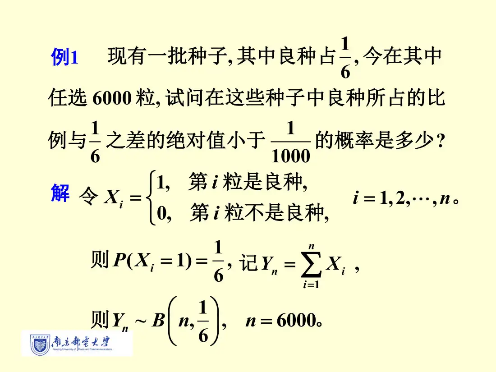

原文：

例1 现有一批种子,其中良种占 $\frac{1}{6}$ ,今在其中任选6000粒,试问在这些种子中良种所占的比例与 $\frac{1}{6}$ 之差的绝对值小于 $\frac{1}{1000}$ 的概率是多少?

解 令 $X_{i}=\left\{\begin{aligned}&1,& 第 i 粒是良种,\\ &0,& 第 i 粒不是良种,\end{aligned}\right.$ $i=1,2,\cdots,n$ 。

则 $P(X_{i}=1)=\frac{1}{6}$ ，记 $Y_{n}=\sum_{i=1}^{n}X_{i}$ ，

则 $Y_{n}\sim B\left(n,\frac{1}{6}\right)$ ，n=6000。

### 根据题意，所求概率为

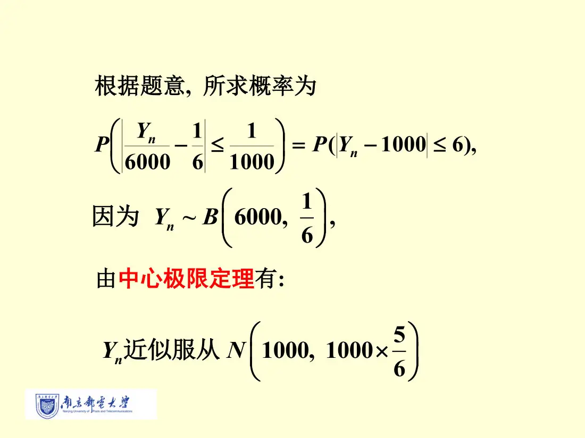

原文：

根据题意，所求概率为

$P\left(\left|\frac{Y_{n}}{6000}-\frac{1}{6}\right|\leq\frac{1}{1000}\right)=P(\left|Y_{n}-1000\right|\leq6),$ 因为 $Y_{n} \sim B\left(6000, \frac{1}{6}\right)$ ,

由中心极限定理有:

$Y_{n}$ 近似服从 $N\left(1000, 1000 \times \frac{5}{6}\right)$

南京邮电大学
Nanjing University of Posts and Telecommunications

### 南京邮电大学

原文：

所以 $P\left(\left|\frac{Y_{n}}{6000}-\frac{1}{6}\right|\leq\frac{1}{1000}\right)$ $=P\left(\left|\frac{Y_{n}-1000}{\sqrt{1000\times5/6}}\right|\leq\frac{6}{\sqrt{1000\times5/6}}\right)$ $=2\Phi\left(\frac{6\sqrt{6}}{\sqrt{5000}}\right)-1=2\Phi(0.208)-1$ $=2\times0.5832-1=0.1664$

南京邮电大学
Nanjing University of Posts and Telecommunications

### 解 设 p 为每次测量误差的绝对值大于 19.6 的概率,

原文：

例2 假设测量的随机误差 $X \sim N(0, 10^{2})$ ，试求在 100 次独立重复测量中，至少有 3 次测量误差的绝对值大于 19.6 的概率 $\alpha$ ，并利用泊松分布求出 $\alpha$ 的近似值（要求小数点后取两位有效数字， $\Phi(1.96) = 0.975$ ）。

解 设 p 为每次测量误差的绝对值大于 19.6 的概率,

$$
p = P \{| X | > 1 9. 6 \} = P \left\{\frac {| X |}{1 0} > \frac {1 9 . 6}{1 0} \right\}
$$

南京邮电大学
Nanjing University of Posts and Telecommunications

### $$

原文：

$$
\begin{array}{r l} & = P \left\{\frac {| X |}{1 0} > 1. 9 6 \right\} = 2 \cdot P \left\{\frac {X}{1 0} > 1. 9 6 \right\} \\ & = 2 - 2 \Phi (1. 9 6) = 0. 0 5, \end{array}
$$

设 k 为 100 次独立测量中事件 $\{|X| > 19.6\}$ 出现的次数，

则 k 服从参数为 n=100, p=0.05 的二项分布,

故 $\alpha = P\{k\geq 3\} = 1 - P\{k <   3\}$

$$
\begin{array}{r l} & = 1 - 0. 9 5 ^ {1 0 0} - 1 0 0 \times 0. 9 5 ^ {9 9} \times 0. 0 5 \\ & - \frac {1 0 0 \times 9 9}{2} \times 0. 9 5 ^ {9 8} \times 0. 0 5 ^ {2} \end{array}
$$

南京邮电大学
Nanjing University of Posts and Telecommunications

### 由泊松定理知，

原文：

由泊松定理知，

k 近似服从参数 $\lambda = np = 100 \times 0.05$ 的泊松分布,
故 $\alpha = P\{k \geq 3\} = 1 - P\{k < 3\}$

$$
\approx 1 - \frac {5 ^ {0} e ^ {- 5}}{0 !} - \frac {5 e ^ {- 5}}{1 !} - \frac {5 ^ {2} e ^ {- 5}}{2 !}
$$

$$
= 1 - \mathrm{e} ^ {- 5} \left(1 + 5 + \frac {2 5}{2}\right) \approx 0. 8 7 。
$$

南京邮电大学
Nanjing University of Posts and Telecommunications

### (1) 写出X的概率分布;

原文：

例3 某保险公司多年的统计资料表明，在索赔户中被盗索赔户占 $2\%$ ，以X表示在随机抽查的100个索赔户中因被盗向保险公司索赔的户数。

(1) 写出X的概率分布;

(2) 求被盗索赔户不少于14户且不多于30户的概率。

解 (1) $X$ 服从参数为100和0.2的二项分布 $X \sim B(100, 0.2)$ , 其分布律为

$$
P (X = k) = C _ {1 0 0} ^ {k} \cdot 0. 2 ^ {k} \cdot 0. 8 ^ {1 0 0 - k}, k = 0, 1, 2, \dots , 1 0 0
$$

(2) $E(X)=100\times0.2=20$

$$
D (X) = 1 0 0 \times 0. 2 \times 0. 8 = 1 6
$$

南京邮电大学
Nanjing University of Posts and Telecommunications

### $$

原文：

由DeMoivre - Laplace 中心极限定理知，可以近似地认为X\~N(20,16)，于是所求概率为

$$
P (1 4 \leq X \leq 3 0) \approx F _ {X} (3 0) - F _ {X} (1 4)
$$

$$
\begin{array}{l} \approx \Phi \left(\frac {3 0 - 2 0}{4}\right) - \Phi \left(\frac {1 4 - 2 0}{4}\right) \\ = \Phi (2. 5) - \Phi (- 1. 5) \\ = \Phi (2. 5) - 1 + \Phi (1. 5) \\ = 0. 9 9 4 - 1 + 0. 9 3 3 = 0. 9 2 7 \end{array}
$$

南京邮电大学
Nanjing University of Posts and Telecommunications

### (1) 保险公司一年的利润不少于6万元的概率;

原文：

例4 在一家保险公司里有一万人参加保险，每人每年付12元保险费。在一年内这些人死亡的概率为0.006,死亡后家属可向保险公司领取1000元。试求:

(1) 保险公司一年的利润不少于6万元的概率;

(2) 保险公司亏本的概率。

解 令 $X_{i} = \left\{ \begin{array}{ll}1, & \text{第} i\text{个人在一年内死亡}\\ 0, & \text{第} i\text{个人在一年内未死亡} \end{array} \right.$

$$
i = 1, 2, \dots , 1 0 0 0 0
$$

则 $X_{i}$ 相互独立，且都服从参数p=0.006的(0-1)分布。

南京邮电大学
Nanjing University of Posts and Telecommunications

### 因此 $E(X_{i})=p=0.006,$

原文：

因此 $E(X_{i})=p=0.006,$

$$
D (X _ {i}) = p (1 - p) = 0. 0 0 5 6 6 4
$$

设参加保险的一万人中一年内死亡的人数为X，则 $X = \sum_{i=1}^{10000} X_i$ 由中心极限定理知，X近似服从

$N(10000E(X_{1}),10000D(X_{1}))$ 。
即 $N(60,7.72^{2})$ 。

南京邮电大学
Nanjing University of Posts and Telecommunications

### 由题设，公司一年收保险费12万元，付给死亡家属1000X元，于是公司一年的利润为

原文：

由题设，公司一年收保险费12万元，付给死亡家属1000X元，于是公司一年的利润为

$$
1 2 0 0 0 0 - 1 0 0 0 X = 1 0 0 0 (1 2 0 - X)
$$

(1) 保险公司一年的利润不少于6万元的概率为 $P\{1000(120 - X) \geq 60000\} = P\{0 \leq X \leq 60\}$ $\approx \Phi \left( \frac{60 - 60}{7.72} \right) - \Phi \left( \frac{0 - 60}{7.72} \right)$ $\approx \Phi (0) - \Phi (-7.77) \approx 0.5 - 0 = 0.5$ 。

南京邮电大学
Nanjing University of Posts and Telecommunications

### (2) 保险公司亏本的概率为

原文：

(2) 保险公司亏本的概率为

$$
\begin{array}{r l} & P \{1 0 0 0 (1 2 0 - X) <   0 \} = P \{X > 1 2 0 \} \\ & = 1 - P \{X \leq 1 2 0 \} \\ & \approx 1 - \Phi \left(\frac {1 2 0 - 6 0}{7 . 7 2}\right) = 1 - \Phi (7. 7 7) \\ & \approx 1 - 1 = 0 _ {\circ} \end{array}
$$

南京邮电大学
Nanjing University of Posts and Telecommunications
