# 《概率论与数理统计》第6章 样本及抽样分布（课件）

原件的每一页，下面附识别出的文字。

### 第6章 样本及抽样分布

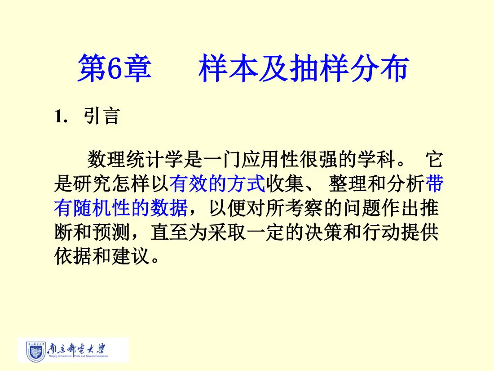

原文：

第6章 样本及抽样分布

1. 引言

数理统计学是一门应用性很强的学科。它是研究怎样以有效的方式收集、整理和分析带有随机性的数据，以便对所考察的问题作出推断和预测，直至为采取一定的决策和行动提供依据和建议。

南京邮电大学
Nanjing University of Posts and Telecommunications

### 6.1 总体与样本

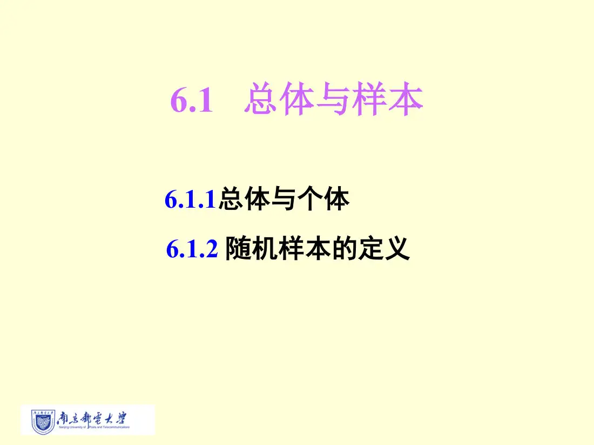

原文：

6.1 总体与样本
6.1.1总体与个体
6.1.2 随机样本的定义

南京邮电大学
Nanjing University of Posts and Telecommunications

### 6.1.1 总体与个体

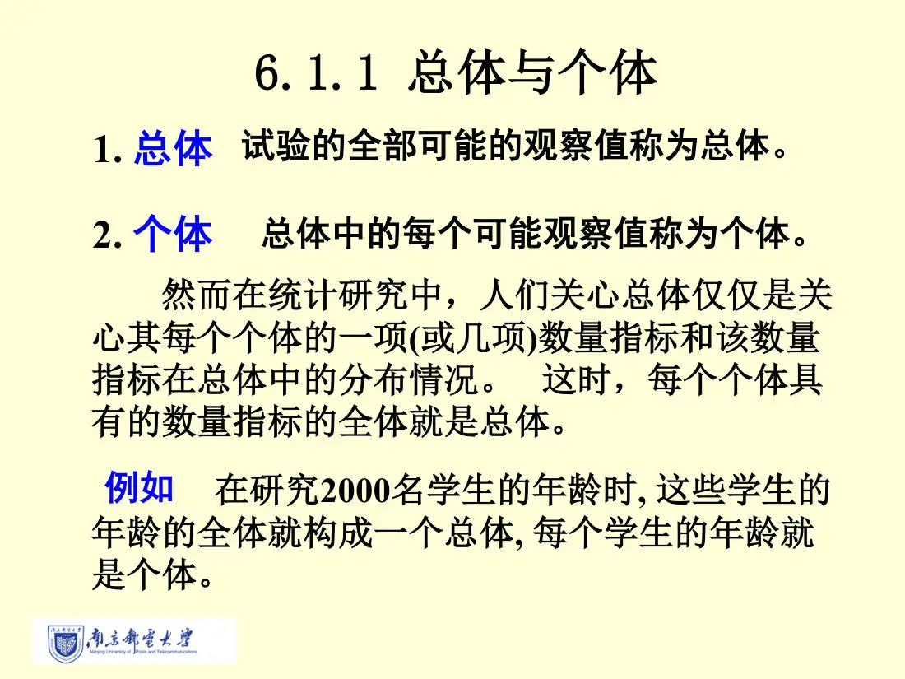

原文：

6.1.1 总体与个体

1. 总体 试验的全部可能的观察值称为总体。

2. 个体 总体中的每个可能观察值称为个体。

然而在统计研究中，人们关心总体仅仅是关心其每个个体的一项(或几项)数量指标和该数量指标在总体中的分布情况。这时，每个个体具有的数量指标的全体就是总体。

例如 在研究2000名学生的年龄时, 这些学生的年龄的全体就构成一个总体, 每个学生的年龄就是个体。

南京邮电大学
Nanjing University of Posts and Telecommunications

### 3. 有限总体和无限总体

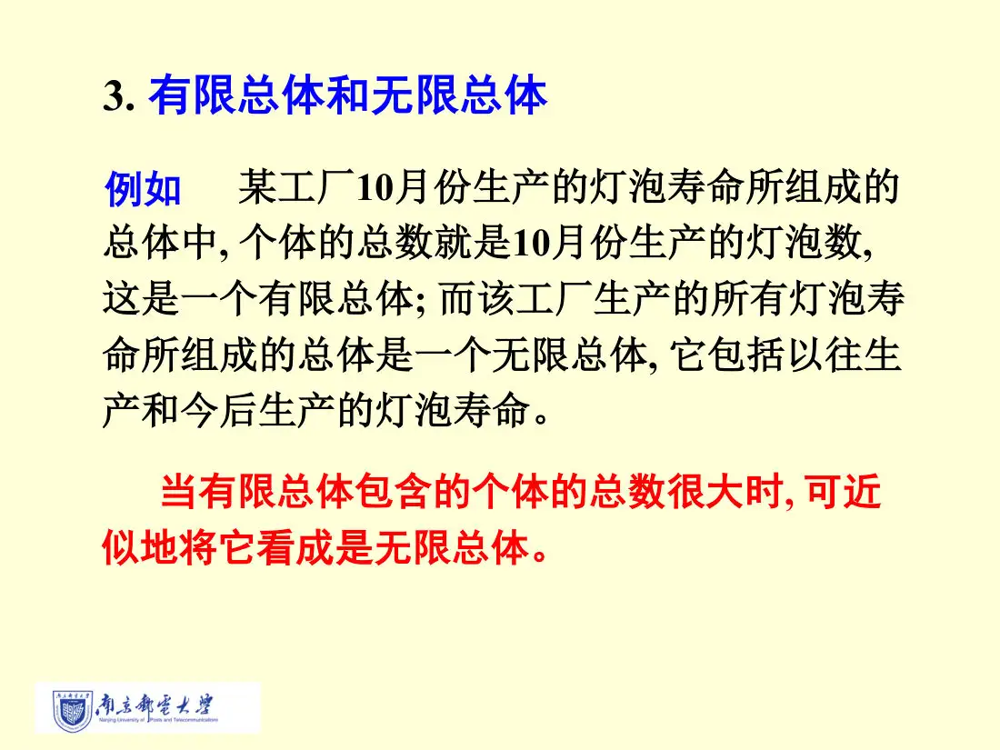

原文：

3. 有限总体和无限总体

例如 某工厂10月份生产的灯泡寿命所组成的总体中, 个体的总数就是10月份生产的灯泡数, 这是一个有限总体; 而该工厂生产的所有灯泡寿命所组成的总体是一个无限总体, 它包括以往生产和今后生产的灯泡寿命。

当有限总体包含的个体的总数很大时, 可近似地将它看成是无限总体。

南京邮电大学
Nanjing University of Posts and Telecommunications

### 4. 总体分布

原文：

4. 总体分布

由于每个个体的出现是随机的，所以相应的数量指标的出现也带有随机性。从而可以把这种数量指标看作一个随机变量。

这样，总体就可以用一个随机变量 $X$ 及其分布来描述。

例如 研究某批灯泡的寿命时，关心的数量指标就是寿命，那么，此总体就可以用随机变量 $X$ 表示，或用其分布函数 $F(x)$ 表示。

南京邮电大学
Nanjing University of Posts and Telecommunications

### 6.1.2 随机样本的定义

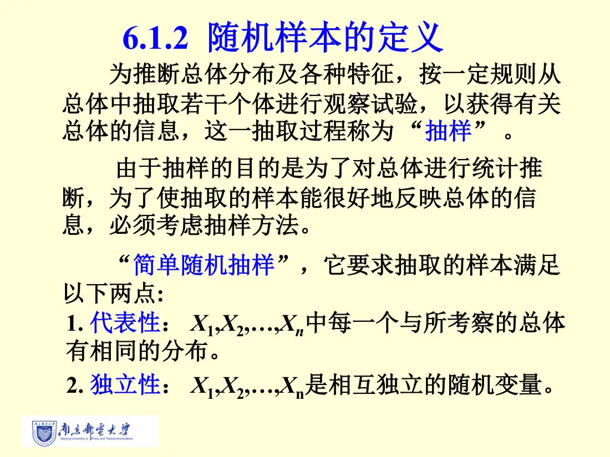

原文：

6.1.2 随机样本的定义

为推断总体分布及各种特征，按一定规则从总体中抽取若干个体进行观察试验，以获得有关总体的信息，这一抽取过程称为“抽样”。

由于抽样的目的是为了对总体进行统计推断，为了使抽取的样本能很好地反映总体的信息，必须考虑抽样方法。

“简单随机抽样”，它要求抽取的样本满足以下两点：

1. 代表性: $X_{1}, X_{2}, \ldots, X_{n}$ 中每一个与所考察的总体有相同的分布。

2. 独立性: $X_{1}, X_{2}, \ldots, X_{n}$ 是相互独立的随机变量。

南京邮电大学
Nanjing University of Posts and Telecommunications

### 1. 样本的定义

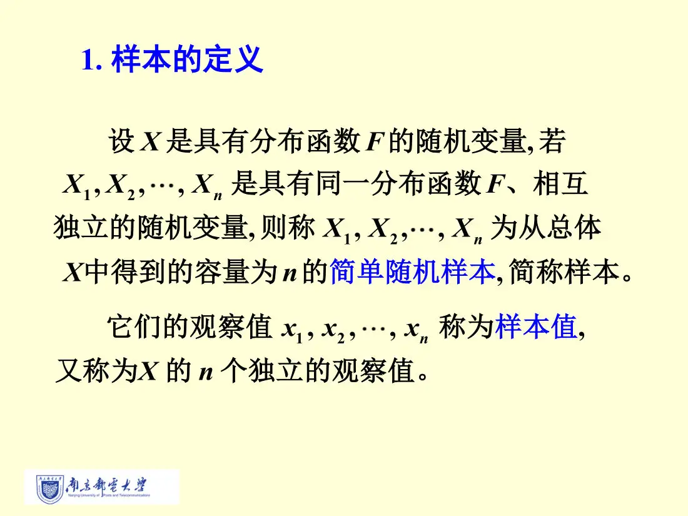

原文：

1. 样本的定义

设 X 是具有分布函数 F 的随机变量, 若 $X_{1}, X_{2}, \cdots, X_{n}$ 是具有同一分布函数 F、相互独立的随机变量, 则称 $X_{1}, X_{2}, \cdots, X_{n}$ 为从总体 X 中得到的容量为 n 的简单随机样本, 简称样本。

它们的观察值 $x_{1}, x_{2}, \cdots, x_{n}$ 称为样本值，又称为 X 的 n 个独立的观察值。

南京邮电大学
Nanjing University of Posts and Telecommunications

### 根据定义得:

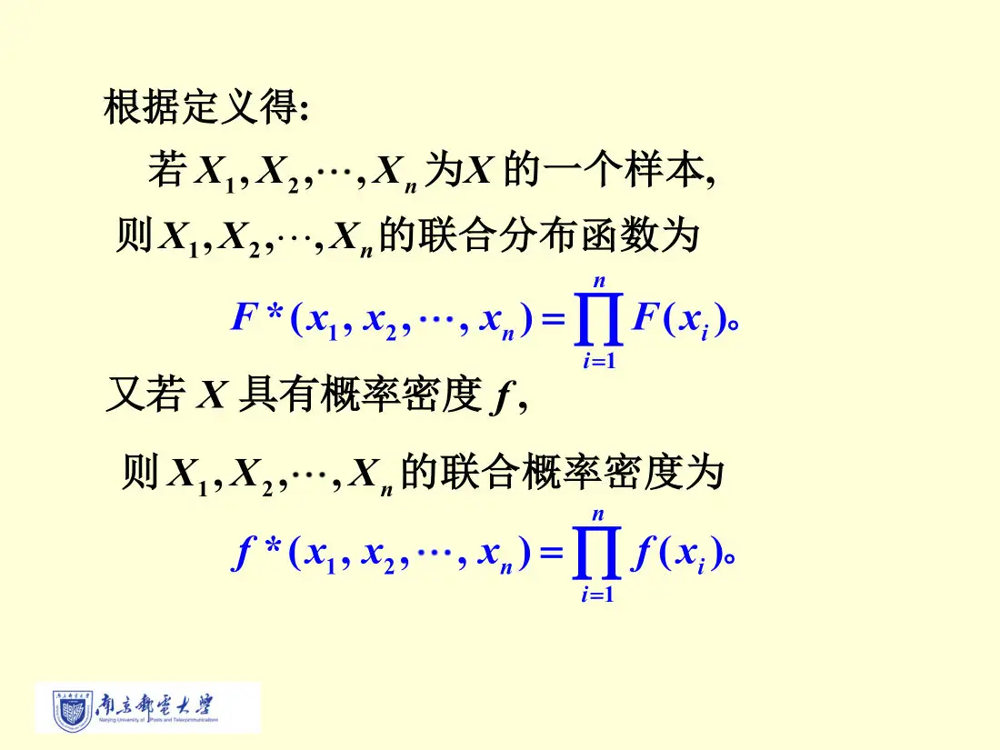

原文：

根据定义得:

若 $X_{1},X_{2},\cdots,X_{n}$ 为X的一个样本,则 $X_{1},X_{2},\cdots,X_{n}$ 的联合分布函数为

$$
F ^ {*} (x _ {1}, x _ {2}, \dots , x _ {n}) = \prod_ {i = 1} ^ {n} F (x _ {i}) 。
$$

又若 X 具有概率密度 f,

则 $X_{1},X_{2},\cdots,X_{n}$ 的联合概率密度为

$$
f ^ {*} (x _ {1}, x _ {2}, \dots , x _ {n}) = \prod_ {i = 1} ^ {n} f (x _ {i}) _ {\circ}
$$

南京邮电大学
Nanjing University of Posts and Telecommunications

### 南京邮电大学

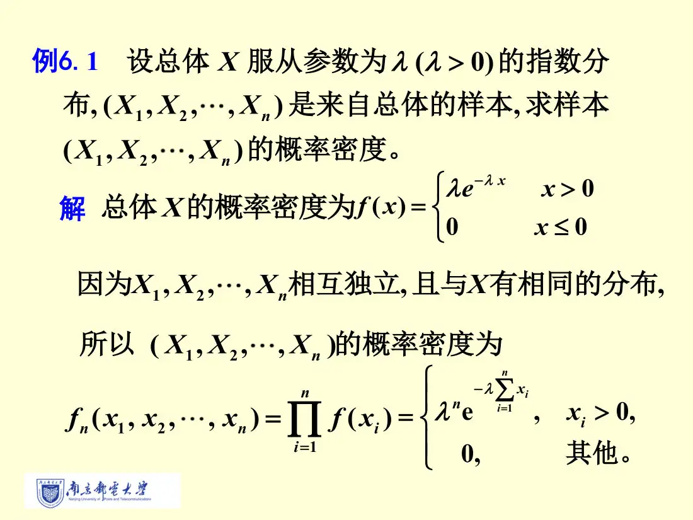

原文：

例6.1 设总体 X 服从参数为 $\lambda(\lambda>0)$ 的指数分布, $(X_{1},X_{2},\cdots,X_{n})$ 是来自总体的样本, 求样本 $(X_{1},X_{2},\cdots,X_{n})$ 的概率密度。

解 总体 X 的概率密度为 $f(x)=\left\{\begin{aligned}\lambda e^{-\lambda x}&x>0\\0&x\leq0\end{aligned}\right.$ 因为 $X_{1},X_{2},\cdots,X_{n}$ 相互独立, 且与 X 有相同的分布

所以 $(X_{1},X_{2},\cdots,X_{n})$ 的概率密度为 $f_{n}(x_{1},x_{2},\cdots,x_{n})=\prod_{i=1}^{n}f(x_{i})=\left\{\begin{aligned}\lambda^{n}\mathrm{e}^{-\lambda\sum_{i=1}^{n}x_{i}},&x_{i}>0,\\0,& 其他。\end{aligned}\right.$

南京邮电大学
Nanjing University of Posts and Telecommunications

### 解 总体 $X$ 的分布律为

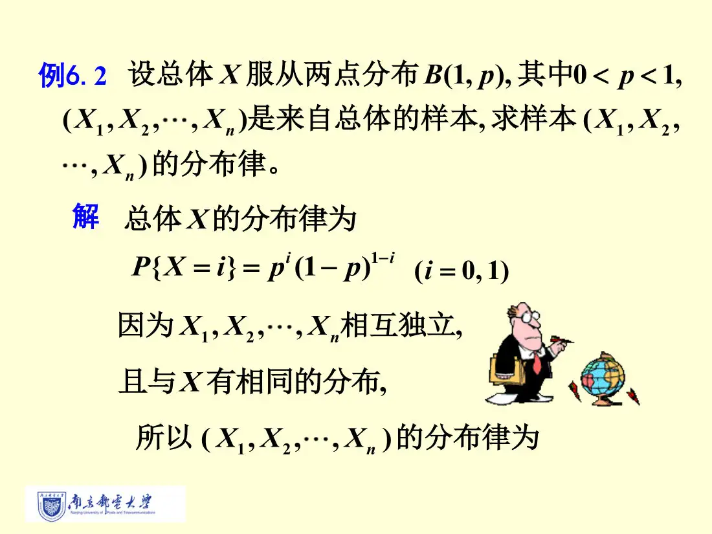

原文：

例6.2 设总体 X 服从两点分布 $B(1, p)$ ，其中 0 < p < 1， $(X_{1}, X_{2}, \cdots, X_{n})$ 是来自总体的样本，求样本 $(X_{1}, X_{2}, \cdots, X_{n})$ 的分布律。

解 总体 $X$ 的分布律为

$$
P \{X = i \} = p ^ {i} (1 - p) ^ {1 - i} (i = 0, 1)
$$

因为 $X_{1},X_{2},\cdots,X_{n}$ 相互独立,
且与X有相同的分布,

所以 $(X_{1},X_{2},\cdots,X_{n})$ 的分布律为

南京邮电大学
Nanjing University of Posts and Telecommunications

### $$

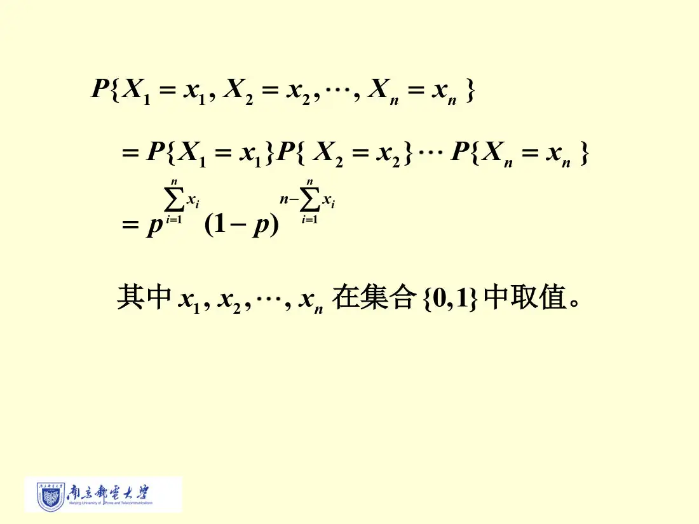

原文：

$$
\begin{array}{r l} & P \{X _ {1} = x _ {1}, X _ {2} = x _ {2}, \dots , X _ {n} = x _ {n} \} \\ & \qquad = P \{X _ {1} = x _ {1} \} P \{X _ {2} = x _ {2} \} \dots P \{X _ {n} = x _ {n} \} \\ & \qquad = p ^ {\sum_ {i = 1} ^ {n} x _ {i}} (1 - p) ^ {n - \sum_ {i = 1} ^ {n} x _ {i}} \end{array}
$$

其中 $x_{1}, x_{2}, \cdots, x_{n}$ 在集合 $\{0,1\}$ 中取值。

南京邮电大学
Nanjing University of Posts and Telecommunications

### 2. 总体、样本、样本值的关系

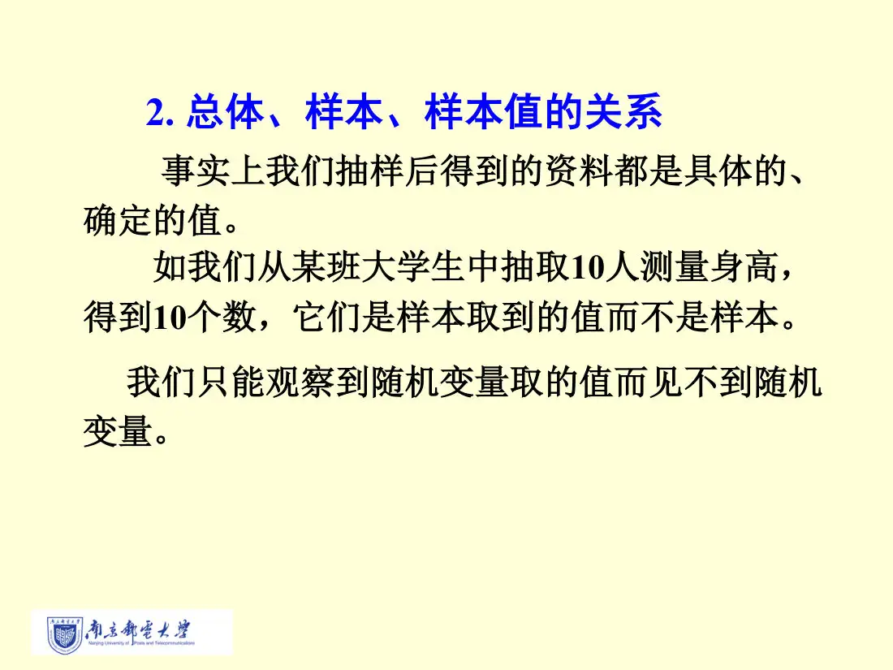

原文：

2. 总体、样本、样本值的关系

事实上我们抽样后得到的资料都是具体的、确定的值。

如我们从某班大学生中抽取10人测量身高，得到10个数，它们是样本取到的值而不是样本。

我们只能观察到随机变量取的值而见不到随机变量。

南京邮电大学
Nanjing University of Posts and Telecommunications

### 总体（理论分布）

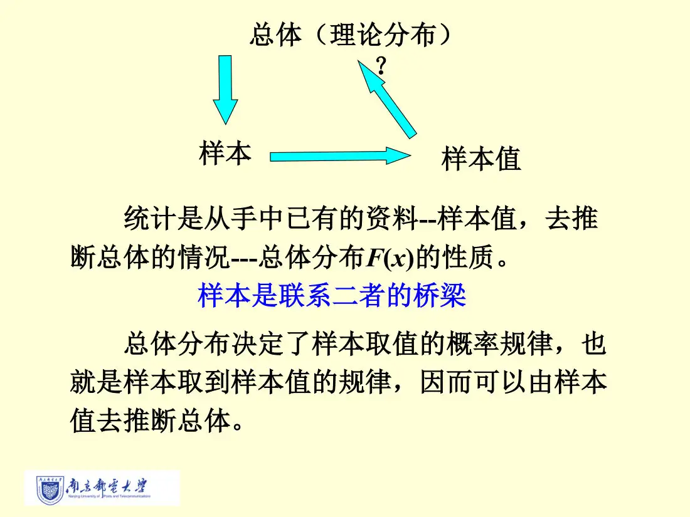

原文：

总体（理论分布）

统计是从手中已有的资料--样本值，去推断总体的情况---总体分布 $F(x)$ 的性质。

样本是联系二者的桥梁

总体分布决定了样本取值的概率规律，也就是样本取到样本值的规律，因而可以由样本值去推断总体。

南京邮电大学
Nanjing University of Posts and Telecommunications

### 6.2 抽样分布

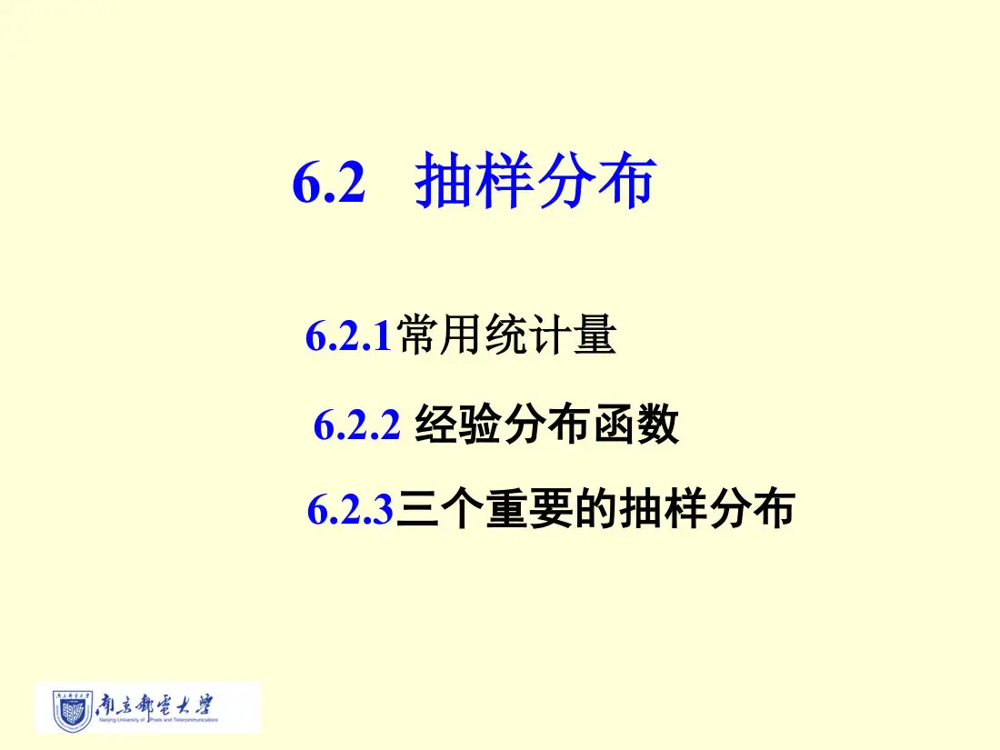

原文：

6.2 抽样分布

6.2.1 常用统计量

6.2.2 经验分布函数

6.2.3 三个重要的抽样分布

南京邮电大学
Nanjing University of Posts and Telecommunications

### 6.2.1 常用统计量

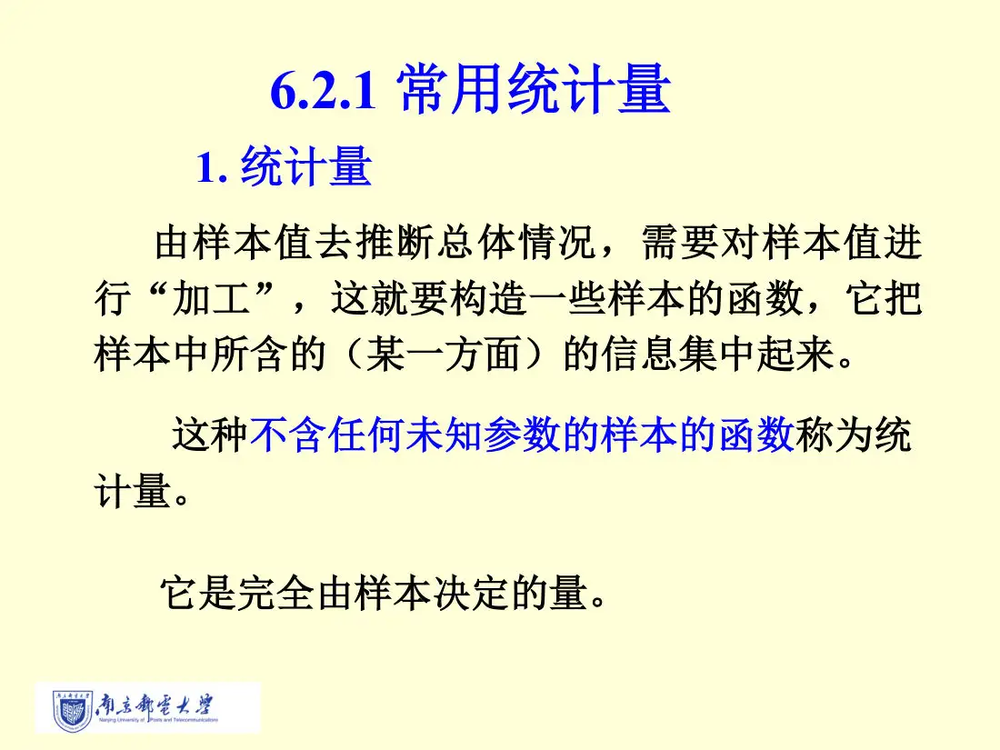

原文：

6.2.1 常用统计量

1. 统计量

由样本值去推断总体情况，需要对样本值进行“加工”，这就要构造一些样本的函数，它把样本中所含的（某一方面）的信息集中起来。

这种不含任何未知参数的样本的函数称为统计量。

它是完全由样本决定的量。

南京邮电大学
Nanjing University of Posts and Telecommunications

### 南京邮电大学

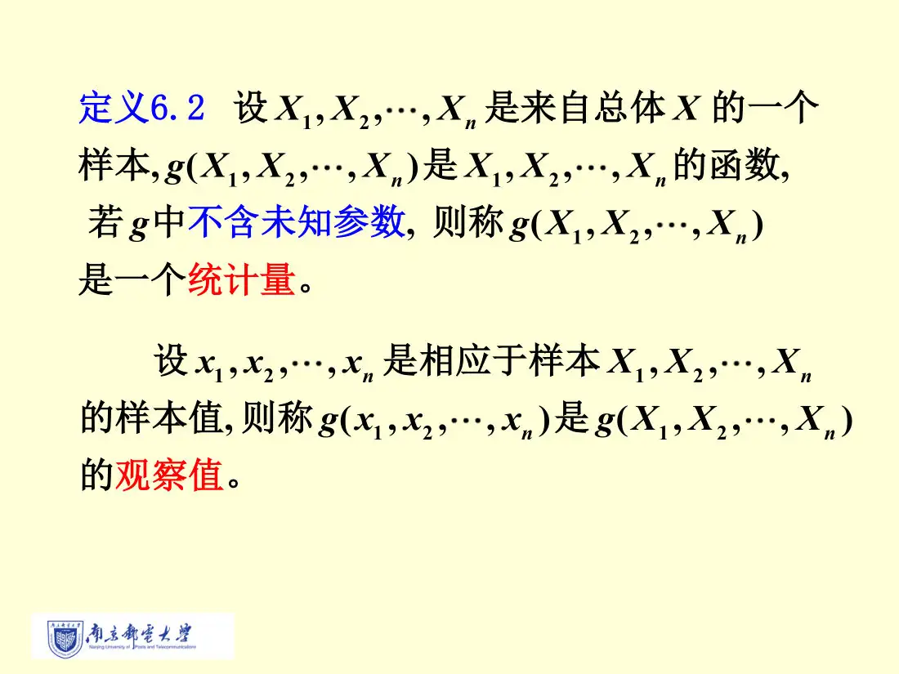

原文：

定义6.2 设 $X_{1}, X_{2}, \cdots, X_{n}$ 是来自总体 X 的一个样本, $g(X_{1}, X_{2}, \cdots, X_{n})$ 是 $X_{1}, X_{2}, \cdots, X_{n}$ 的函数, 若 g 中不含未知参数, 则称 $g(X_{1}, X_{2}, \cdots, X_{n})$ 是一个统计量。

设 $x_{1}, x_{2}, \cdots, x_{n}$ 是相应于样本 $X_{1}, X_{2}, \cdots, X_{n}$ 的样本值, 则称 $g(x_{1}, x_{2}, \cdots, x_{n})$ 是 $g(X_{1}, X_{2}, \cdots, X_{n})$ 的观察值。

南京邮电大学
Nanjing University of Posts and Telecommunications

### $$

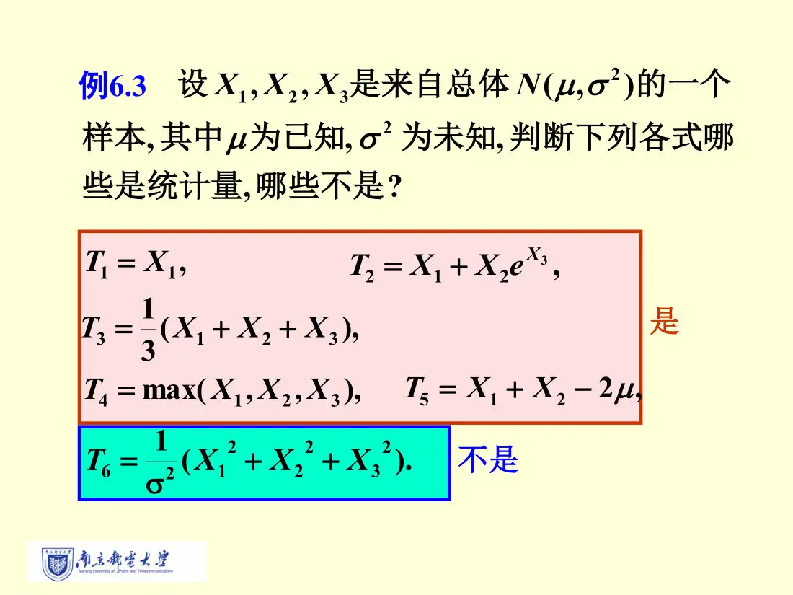

原文：

例6.3 设 $X_{1}, X_{2}, X_{3}$ 是来自总体 $N(\mu, \sigma^{2})$ 的一个样本, 其中 $\mu$ 为已知, $\sigma^{2}$ 为未知, 判断下列各式哪些是统计量, 哪些不是?

$$
\begin{array}{l} \boxed {T _ {1} = X _ {1}, \quad T _ {2} = X _ {1} + X _ {2} e ^ {X _ {3}},} \\ T _ {3} = \frac {1}{3} (X _ {1} + X _ {2} + X _ {3}), \\ T _ {4} = \max (X _ {1}, X _ {2}, X _ {3}), \quad T _ {5} = X _ {1} + X _ {2} - 2 \mu , \\ \boxed {T _ {6} = \frac {1}{\sigma^ {2}} (X _ {1} ^ {2} + X _ {2} ^ {2} + X _ {3} ^ {2}).} \quad \text {不是} \end{array}
$$

南京邮电大学
Nanjing University of Posts and Telecommunications

### 几个常用统计量的定义

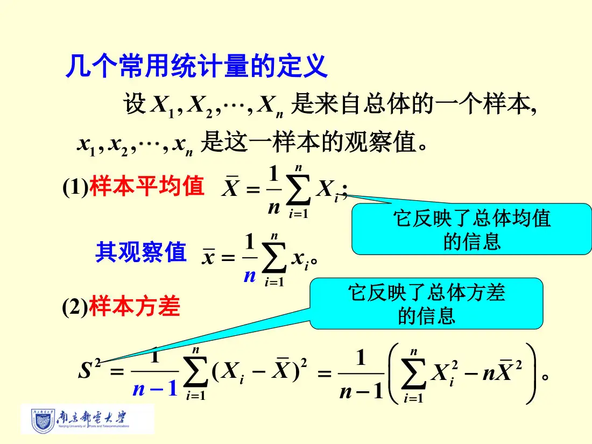

原文：

几个常用统计量的定义

设 $X_{1},X_{2},\cdots,X_{n}$ 是来自总体的一个样本， $x_{1},x_{2},\cdots,x_{n}$ 是这一样本的观察值。

(1)样本平均值 $\bar{X}=\frac{1}{n}\sum_{i=1}^{n}X_{i};$

其观察值 $\bar{x}=\frac{1}{n}\sum_{i=1}^{n}x_{i}$ 它反映了总体均值的信息

(2)样本方差它反映了总体方差的信息

$$
S ^ {2} = \frac {1}{n - 1} \sum_ {i = 1} ^ {n} (X _ {i} - \bar {X}) ^ {2} = \frac {1}{n - 1} \left(\sum_ {i = 1} ^ {n} X _ {i} ^ {2} - n \bar {X} ^ {2}\right)
$$

南京邮电大学
Nanjing University of Posts and Telecommunications

### 其观察值

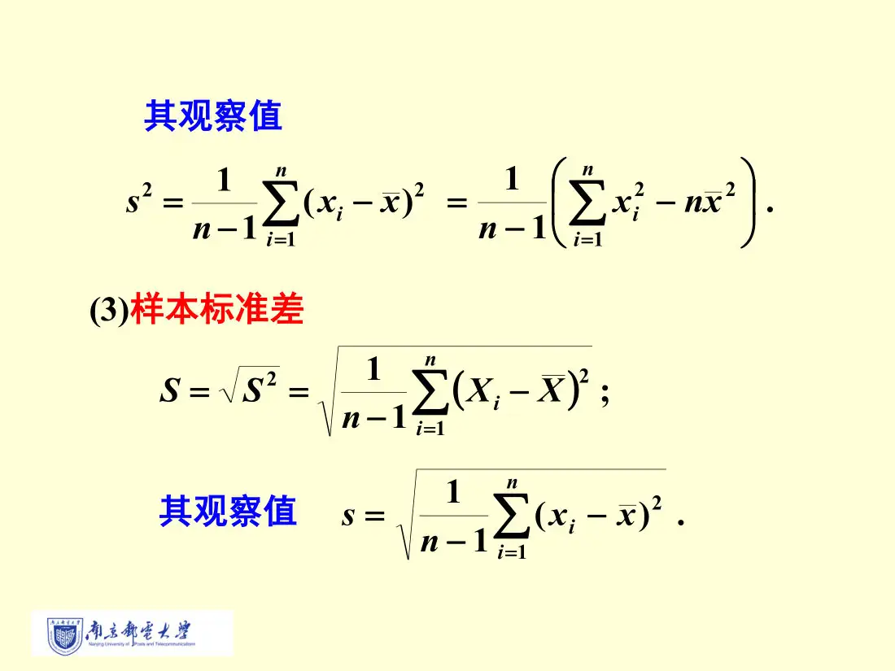

原文：

其观察值

$$
s ^ {2} = \frac {1}{n - 1} \sum_ {i = 1} ^ {n} (x _ {i} - \bar {x}) ^ {2} = \frac {1}{n - 1} \left(\sum_ {i = 1} ^ {n} x _ {i} ^ {2} - n \bar {x} ^ {2}\right).
$$

(3)样本标准差

$$
S = \sqrt {S ^ {2}} = \sqrt {\frac {1}{n - 1} \sum_ {i = 1} ^ {n} (X _ {i} - \bar {X}) ^ {2}};
$$

其观察值 $s=\sqrt{\frac{1}{n-1}\sum_{i=1}^{n}(x_{i}-\bar{x})^{2}}$ (4) 样本 k 阶(原点)矩 $A_{k} = \frac{1}{n} \sum_{i=1}^{n} X_{i}^{k}, k = 1, 2, \cdots;$ 其观察值 $\alpha_{k} = \frac{1}{n} \sum_{i=1}^{n} x_{i}^{k}, \cdots, 1, 2, \cdots.$ 它反映了总体k阶矩的信息
(5)样本 k 阶中心矩

南京邮电大学
Nanjing University of Posts and Telecommunications

### $$

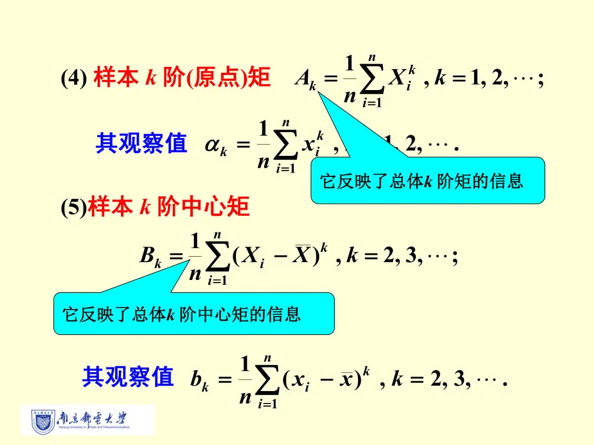

原文：

$$
B _ {k} = \frac {1}{n} \sum_ {i = 1} ^ {n} (X _ {i} - \bar {X}) ^ {k}, k = 2, 3, \dots ;
$$

它反映了总体 $k$ 阶中心矩的信息

其观察值 $b_{k}=\frac{1}{n}\sum_{i=1}^{n}(x_{i}-\bar{x})^{k}, k=2,3,\cdots.$

南京邮电大学
Nanjing University of Posts and Telecommunications

### 南京邮电大学

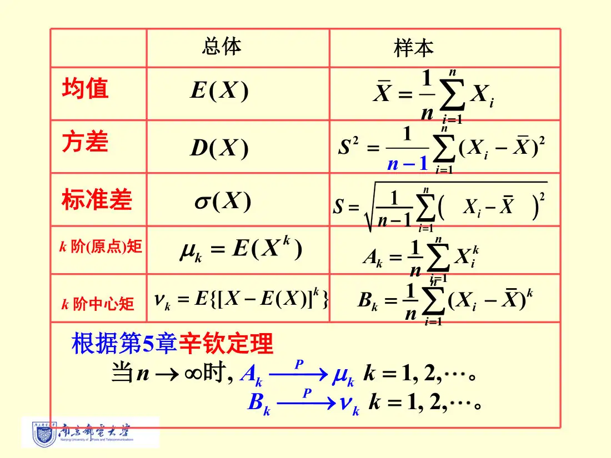

原文：

<table><tr><td></td><td>总体</td><td>样本</td></tr><tr><td>均值</td><td> $E(X)$ </td><td> $\bar{X} = \frac{1}{n} \sum_{i=1}^{n} X_i$ </td></tr><tr><td>方差</td><td> $D(X)$ </td><td> $S^2 = \frac{1}{n-1} \sum_{i=1}^{n} (X_i - \bar{X})^2$ </td></tr><tr><td>标准差</td><td> $\sigma(X)$ </td><td> $S = \sqrt{\frac{1}{n-1} \sum_{i=1}^{n} (X_i - \bar{X})^2}$ </td></tr><tr><td>k阶(原点)矩</td><td> $\mu_k = E(X^k)$ </td><td> $A_k = \frac{1}{n} \sum_{i=1}^{n} X_i^k$ </td></tr><tr><td>k阶中心矩</td><td> $\nu_k = E\{[X - E(X)]^k\}$ </td><td> $B_k = \frac{1}{n} \sum_{i=1}^{i=1} (X_i - \bar{X})^k$ </td></tr><tr><td colspan="3">根据第5章辛钦定理当 $n \to \infty$ 时, $A_k \xrightarrow{P} \mu_k k = 1, 2, \cdots$  $B_k \xrightarrow{P} \nu_k k = 1, 2, \cdots$ 。</td></tr></table>

南京邮电大学
Nanjing University of Posts and Telecommunications

### 由以上定义得下述结论:

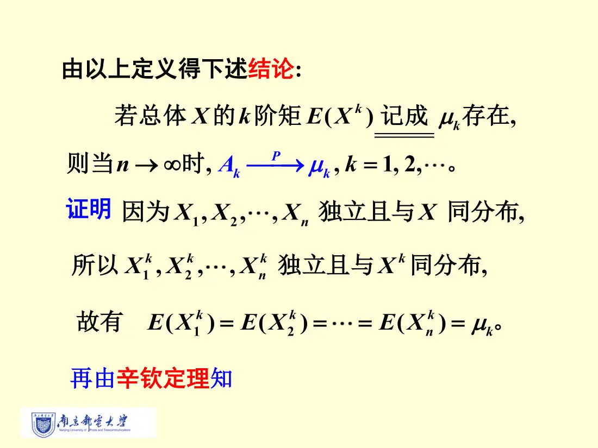

原文：

由以上定义得下述结论:

若总体 X 的 k 阶矩 $E(X^{k})$ 记成 $\mu_{k}$ 存在，
则当 $n \to \infty$ 时， $A_{k} \xrightarrow{P} \mu_{k}, k = 1, 2, \cdots$ 。
证明 因为 $X_{1}, X_{2}, \cdots, X_{n}$ 独立且与 X 同分布，
所以 $X_{1}^{k}, X_{2}^{k}, \cdots, X_{n}^{k}$ 独立且与 $X^{k}$ 同分布，
故有 $E(X_{1}^{k}) = E(X_{2}^{k}) = \cdots = E(X_{n}^{k}) = \mu_{k}$ 。
再由辛钦定理知

南京邮电大学
Nanjing University of Posts and Telecommunications

### 3、抽样分布

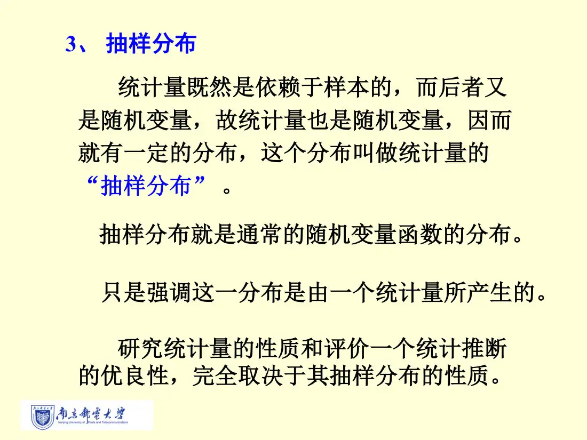

原文：

3、抽样分布

统计量既然是依赖于样本的，而后者又是随机变量，故统计量也是随机变量，因而就有一定的分布，这个分布叫做统计量的“抽样分布”。

抽样分布就是通常的随机变量函数的分布。

只是强调这一分布是由一个统计量所产生的。

研究统计量的性质和评价一个统计推断的优良性，完全取决于其抽样分布的性质。

南京邮电大学
Nanjing University of Posts and Telecommunications

### 6.2.2 经验分布函数

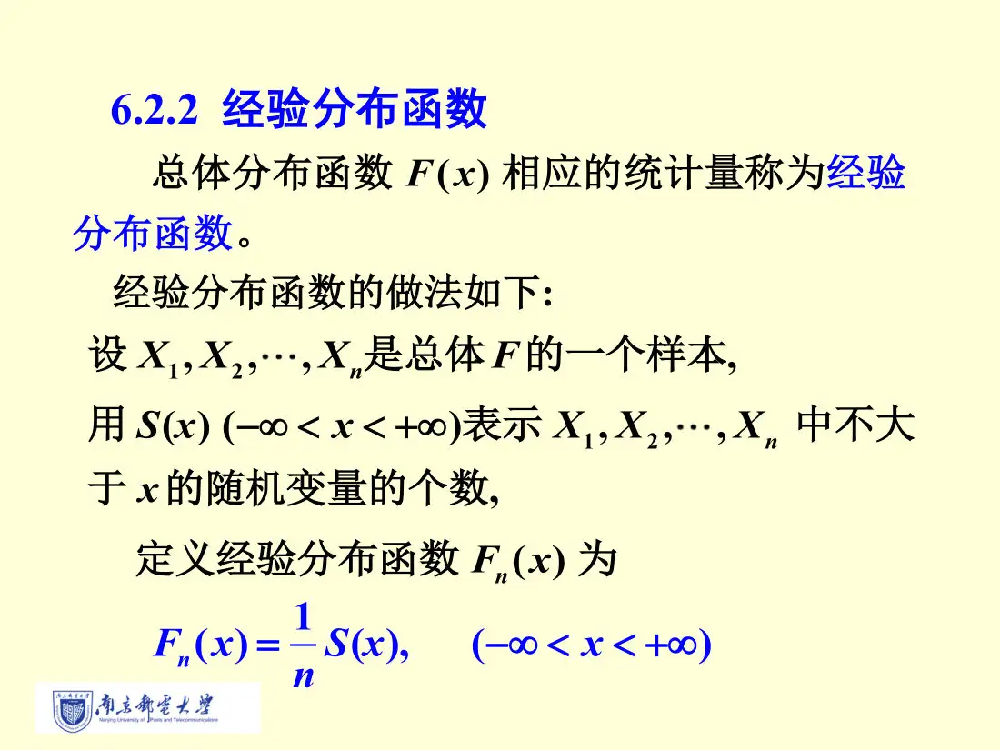

原文：

6.2.2 经验分布函数

总体分布函数 $F(x)$ 相应的统计量称为经验分布函数。

经验分布函数的做法如下:

设 $X_{1}, X_{2}, \cdots, X_{n}$ 是总体 F 的一个样本,

用 $S(x)(-\infty < x < +\infty)$ 表示 $X_{1}, X_{2}, \cdots, X_{n}$ 中不大于 x 的随机变量的个数，

定义经验分布函数 $F_{n}(x)$ 为

$$
F _ {n} (x) = \frac {1}{n} S (x), \quad (- \infty <   x <   + \infty)
$$

南京邮电大学
Nanjing University of Posts and Telecommunications

### 对于一个样本值, $F_{n}(x)$ 的观察值容易求得。

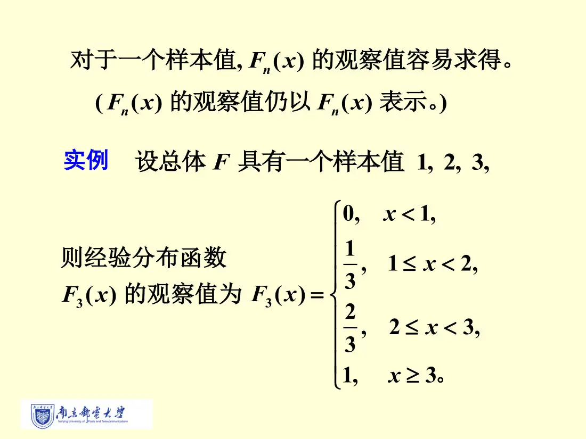

原文：

对于一个样本值, $F_{n}(x)$ 的观察值容易求得。

$(F_{n}(x)$ 的观察值仍以 $F_{n}(x)$ 表示。)

实例 设总体 $F$ 具有一个样本值 1, 2, 3,

则经验分布函数 $F_{3}(x)$ 的观察值为 $F_{3}(x) = \left\{ \begin{array}{ll}0, & x < 1,\\ \frac{1}{3}, & 1\leq x < 2,\\ \frac{2}{3}, & 2\leq x < 3,\\ 1, & x\geq 3. \end{array} \right.$

南京邮电大学
Nanjing University of Posts and Telecommunications

### 一般地，

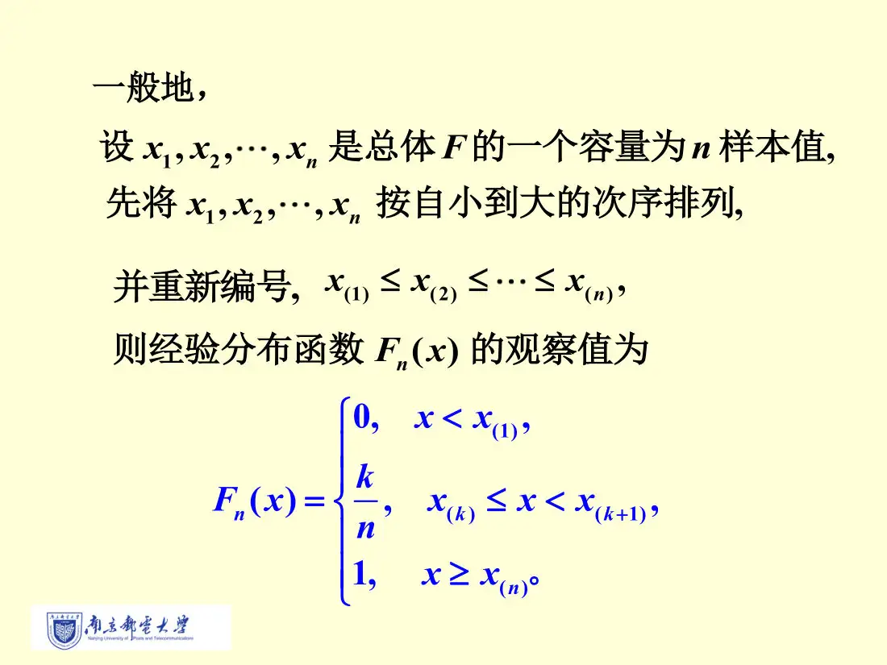

原文：

一般地，

设 $x_{1}, x_{2}, \cdots, x_{n}$ 是总体 F 的一个容量为 n 样本值，
先将 $x_{1}, x_{2}, \cdots, x_{n}$ 按自小到大的次序排列，

并重新编号， $x_{(1)} \leq x_{(2)} \leq \cdots \leq x_{(n)}$

则经验分布函数 $F_{n}(x)$ 的观察值为

$$
F _ {n} (x) = \left\{ \begin{array}{l l} 0, & x <   x _ {(1)}, \\ \frac {k}{n}, & x _ {(k)} \leq x <   x _ {(k + 1)}, \\ 1, & x \geq x _ {(n)} \circ \end{array} \right.
$$

南京邮电大学
Nanjing University of Posts and Telecommunications

### 格里汶科定理

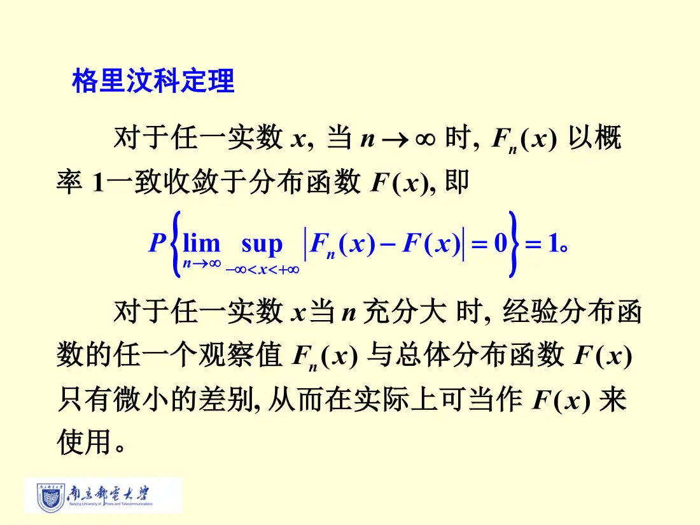

原文：

格里汶科定理

对于任一实数 $x$ ，当 $n\to \infty$ 时， $F_{n}(x)$ 以概率1一致收敛于分布函数 $F(x)$ ，即

$$
P \left\{\lim _ {n \rightarrow \infty} \sup _ {- \infty <   x <   + \infty} | F _ {n} (x) - F (x) | = 0 \right\} = 1 。
$$

对于任一实数 x 当 n 充分大时, 经验分布函数的任一个观察值 $F_{n}(x)$ 与总体分布函数 $F(x)$ 只有微小的差别, 从而在实际上可当作 $F(x)$ 来使用。

南京邮电大学
Nanjing University of Posts and Telecommunications

### 定理6.1 若总体 $X$ 的期望和方差存在，且已知为

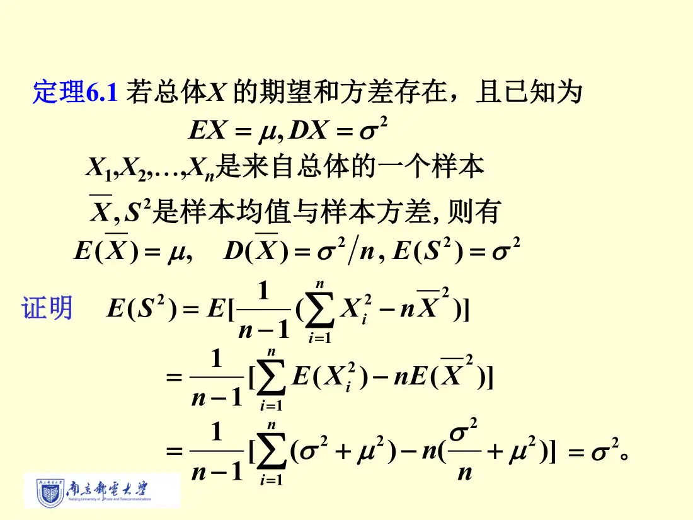

原文：

定理6.1 若总体 $X$ 的期望和方差存在，且已知为

$$
E X = \mu , D X = \sigma^ {2}
$$

$X_{1}, X_{2}, \ldots, X_{n}$ 是来自总体的一个样本

$\overline{X}, S^{2}$ 是样本均值与样本方差, 则有

$$
E (\overline {{X}}) = \mu , \quad D (\overline {{X}}) = \sigma^ {2} / n, E (S ^ {2}) = \sigma^ {2}
$$

证明

$$
\begin{array}{r l} E (S ^ {2}) & = E \left[ \frac {1}{n - 1} \left(\sum_ {i = 1} ^ {n} X _ {i} ^ {2} - n \overline {{{X}}} ^ {2}\right) \right] \\ & = \frac {1}{n - 1} \left[ \sum_ {i = 1} ^ {n} E \left(X _ {i} ^ {2}\right) - n E \left(\overline {{{X}}} ^ {2}\right) \right] \\ & = \frac {1}{n - 1} \left[ \sum_ {i = 1} ^ {n} \left(\sigma^ {2} + \mu^ {2}\right) - n \left(\frac {\sigma^ {2}}{n} + \mu^ {2}\right) \right] = \sigma^ {2} 。 \end{array}
$$

南京邮电大学
Nanjing University of Posts and Telecommunications

### 6.2.3 常见分布

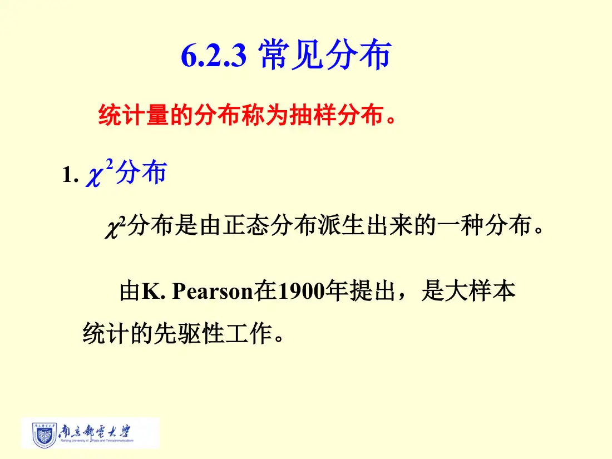

原文：

6.2.3 常见分布

统计量的分布称为抽样分布。

1. $\chi^2$ 分布

$\chi^2$ 分布是由正态分布派生出来的一种分布。

由K. Pearson在1900年提出，是大样本统计的先驱性工作。

南京邮电大学
Nanjing University of Posts and Telecommunications

### 自由度:

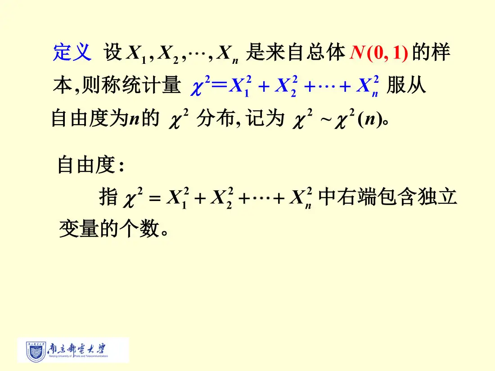

原文：

定义 设 $X_{1}, X_{2}, \cdots, X_{n}$ 是来自总体 $N(0, 1)$ 的样本, 则称统计量 $\chi^{2} = X_{1}^{2} + X_{2}^{2} + \cdots + X_{n}^{2}$ 服从自由度为 n 的 $\chi^{2}$ 分布, 记为 $\chi^{2} \sim \chi^{2}(n)$ 。

自由度:

指 $\chi^{2}=X_{1}^{2}+X_{2}^{2}+\cdots+X_{n}^{2}$ 中右端包含独立变量的个数。

南京邮电大学
Nanjing University of Posts and Telecommunications

### $\chi^2 (n)$ 分布的概率密度为

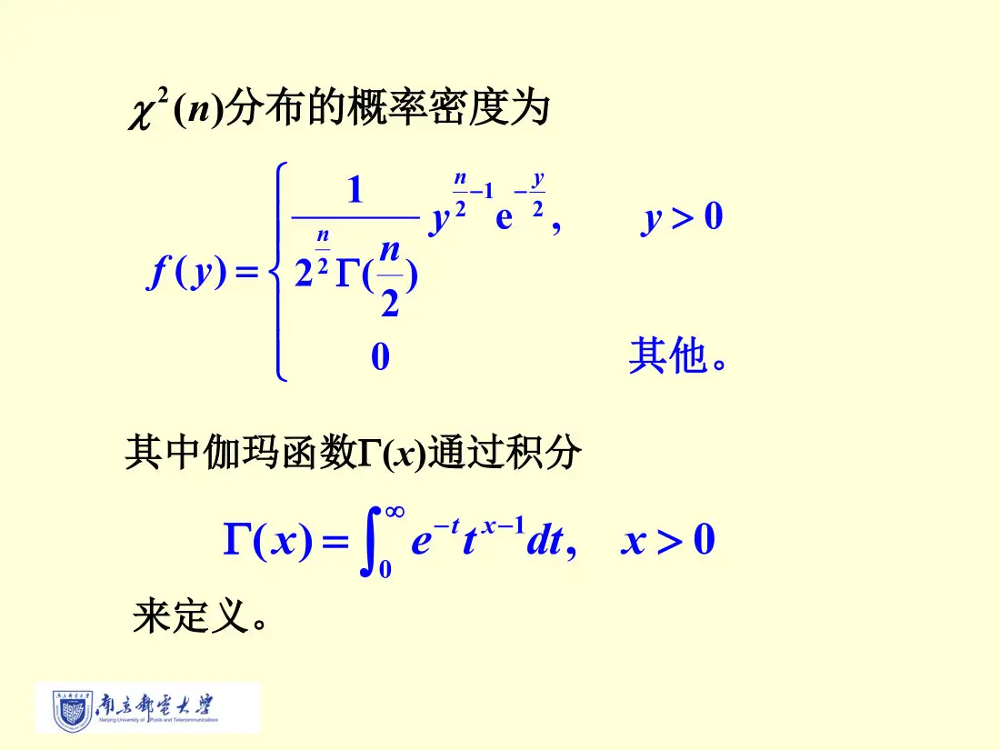

原文：

$\chi^2 (n)$ 分布的概率密度为

$$
f (y) = \left\{ \begin{array}{c c} \frac {1}{2 ^ {\frac {n}{2}} \Gamma (\frac {n}{2})} y ^ {\frac {n}{2} - 1} \mathrm{e} ^ {- \frac {y}{2}}, & y > 0 \\ 0 & \text {其他。} \end{array} \right.
$$

其中伽玛函数 $\Gamma (x)$ 通过积分

$$
\begin{array}{l} {\Gamma (x) = \int_ {0} ^ {\infty} e ^ {- t} t ^ {x - 1} d t, \quad x > 0} \\ {\text {来定义。}} \end{array}
$$

南京邮电大学
Nanjing University of Posts and Telecommunications

### 南京邮电大学

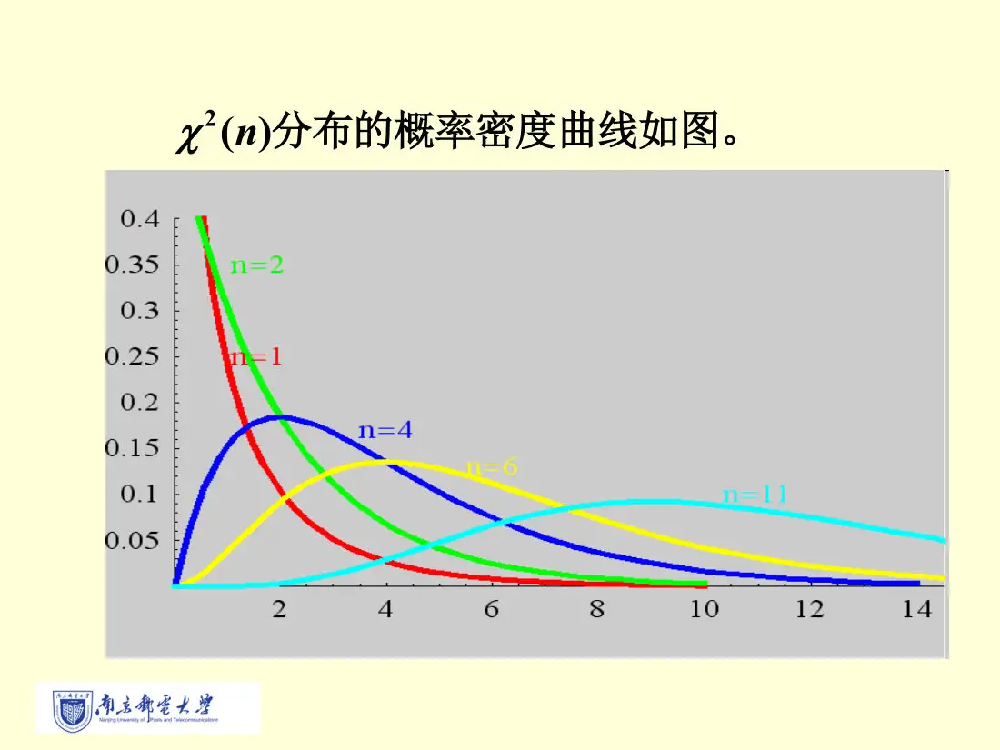

原文：

南京邮电大学
Nanjing University of Posts and Telecommunications

### $\chi^2$ 分布的性质

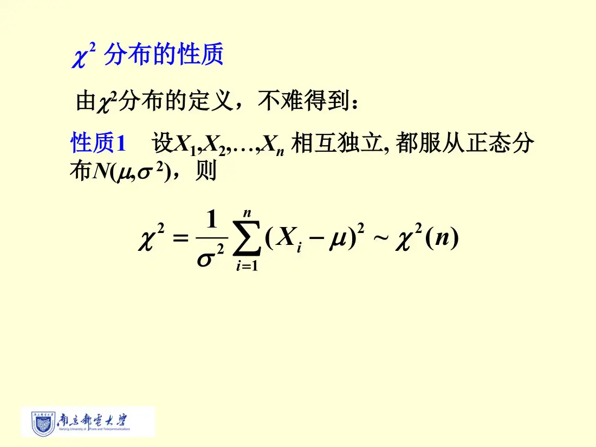

原文：

$\chi^2$ 分布的性质

由 $\chi^{2}$ 分布的定义，不难得到：

性质1 设 $X_{1},X_{2},\ldots,X_{n}$ 相互独立,都服从正态分布 $N(\mu,\sigma^{2})$ ，则

$$
\chi^ {2} = \frac {1}{\sigma^ {2}} \sum_ {i = 1} ^ {n} (X _ {i} - \mu) ^ {2} \sim \chi^ {2} (n)
$$

南京邮电大学
Nanjing University of Posts and Telecommunications

### 性质2 ( $\chi^{2}$ 分布的可加性)

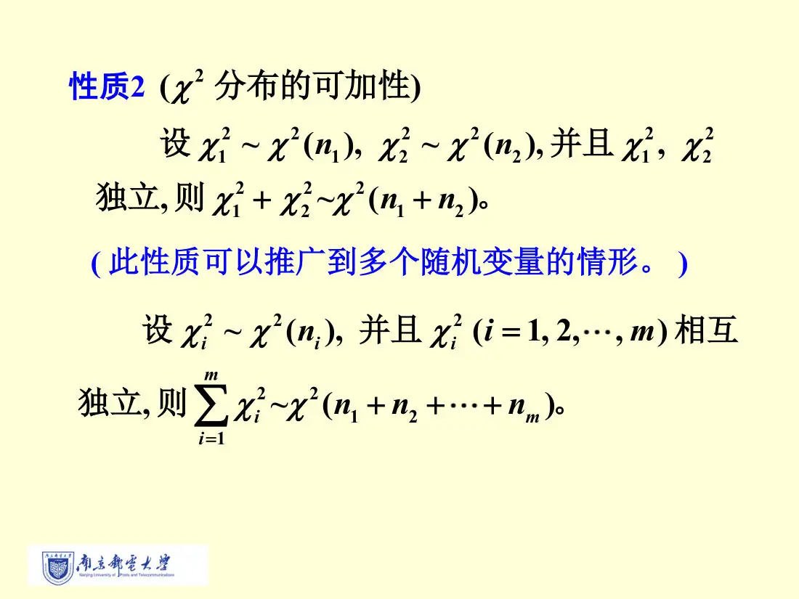

原文：

性质2 ( $\chi^{2}$ 分布的可加性)

设 $\chi_{1}^{2}\sim\chi^{2}(n_{1}),\chi_{2}^{2}\sim\chi^{2}(n_{2})$ ，并且 $\chi_{1}^{2},\chi_{2}^{2}$ 独立,则 $\chi_{1}^{2}+\chi_{2}^{2}\sim\chi^{2}(n_{1}+n_{2})$ 。
(此性质可以推广到多个随机变量的情形。)

设 $\chi_{i}^{2}\sim\chi^{2}(n_{i})$ ，并且 $\chi_{i}^{2}(i=1,2,\cdots,m)$ 相互
独立,则 $\sum_{i=1}^{m}\chi_{i}^{2}\sim\chi^{2}(n_{1}+n_{2}+\cdots+n_{m})$ 。

南京邮电大学
Nanjing University of Posts and Telecommunications

### 性质3 ( $\chi^{2}$ 分布的数学期望和方差)

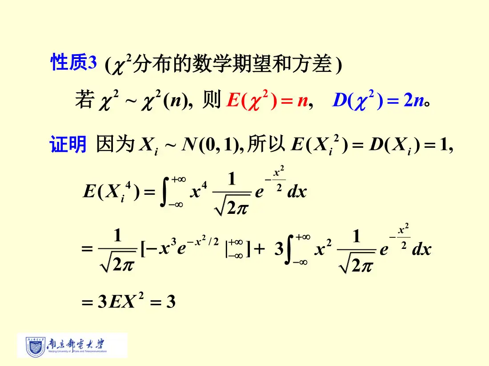

原文：

性质3 ( $\chi^{2}$ 分布的数学期望和方差)

若 $\chi^2\sim \chi^2 (n)$ ，则 $E(\chi^2) = n,\quad D(\chi^2) = 2n$

证明 因为 $X_{i} \sim N(0,1)$ ，所以 $E(X_{i}^{2}) = D(X_{i}) = 1$ ，

$$
\begin{array}{l} E (X _ {i} ^ {4}) = \int_ {- \infty} ^ {+ \infty} x ^ {4} \frac {1}{\sqrt {2 \pi}} e ^ {- \frac {x ^ {2}}{2}} d x \\ = \frac {1}{\sqrt {2 \pi}} [ - x ^ {3} e ^ {- x ^ {2} / 2} | _ {- \infty} ^ {+ \infty} ] + 3 \int_ {- \infty} ^ {+ \infty} x ^ {2} \frac {1}{\sqrt {2 \pi}} e ^ {- \frac {x ^ {2}}{2}} d x \\ = 3 E X ^ {2} = 3 \end{array}
$$

南京邮电大学
Nanjing University of Posts and Telecommunications

### $$

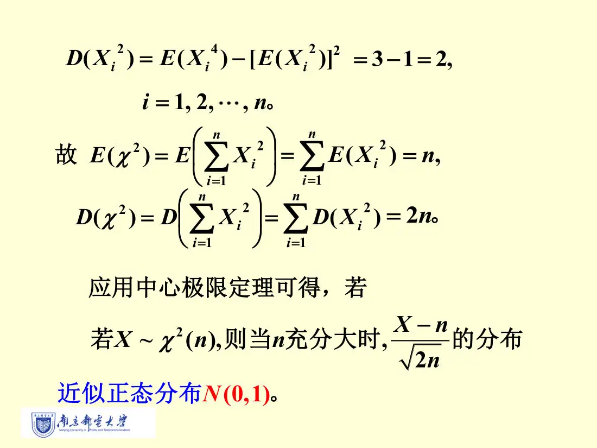

原文：

$$
D (X _ {i} ^ {2}) = E (X _ {i} ^ {4}) - [ E (X _ {i} ^ {2}) ] ^ {2} = 3 - 1 = 2,
$$

$$
i = 1, 2, \dots , n _ {\circ}
$$

故 $E(\chi^2) = E\left(\sum_{i=1}^{n} X_i^2\right) = \sum_{i=1}^{n} E(X_i^2) = n,$

$$
D (\chi^ {2}) = D \Bigg (\sum_ {i = 1} ^ {n} X _ {i} ^ {2} \Bigg) = \sum_ {i = 1} ^ {n} D (X _ {i} ^ {2}) = 2 n _ {\circ}
$$

应用中心极限定理可得，若

若 $X \sim \chi^{2}(n)$ ，则当n充分大时， $\frac{X - n}{\sqrt{2n}}$ 的分布近似正态分布 $N(0,1)$ 。

南京邮电大学
Nanjing University of Posts and Telecommunications

### $\chi^2$ 分布的分位点

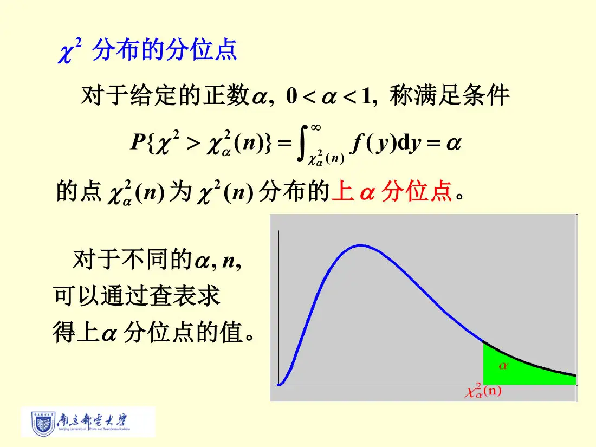

原文：

$\chi^2$ 分布的分位点

对于给定的正数 $\alpha, 0 < \alpha < 1$ ，称满足条件

$$
P \{\chi^ {2} > \chi_ {\alpha} ^ {2} (n) \} = \int_ {\chi_ {\alpha} ^ {2} (n)} ^ {\infty} f (y) \mathrm{d} y = \alpha
$$

的点 $\chi_{\alpha}^{2}(n)$ 为 $\chi^{2}(n)$ 分布的上 $\alpha$ 分位点。

对于不同的 $\alpha,n,$ 可以通过查表求
得上 $\alpha$ 分位点的值。

南京邮电大学
Nanjing University of Posts and Telecommunications

### $\chi^2$ 分布的分位点

原文：

$\chi^2$ 分布的分位点

对于给定的正数 $\alpha, 0 < \alpha < 1$ ，称满足条件

$$
P \{\chi^ {2} > \chi_ {\alpha} ^ {2} (n) \} = \int_ {\chi_ {\alpha} ^ {2} (n)} ^ {\infty} f (y) \mathrm{d} y = \alpha
$$

的点 $\chi_{\alpha}^{2}(n)$ 为 $\chi^{2}(n)$ 分布的上 $\alpha$ 分位点。

对于不同的 $\alpha,n,$ 可以通过查表求
得上 $\alpha$ 分位点的值。

南京邮电大学
Nanjing University of Posts and Telecommunications

### $$

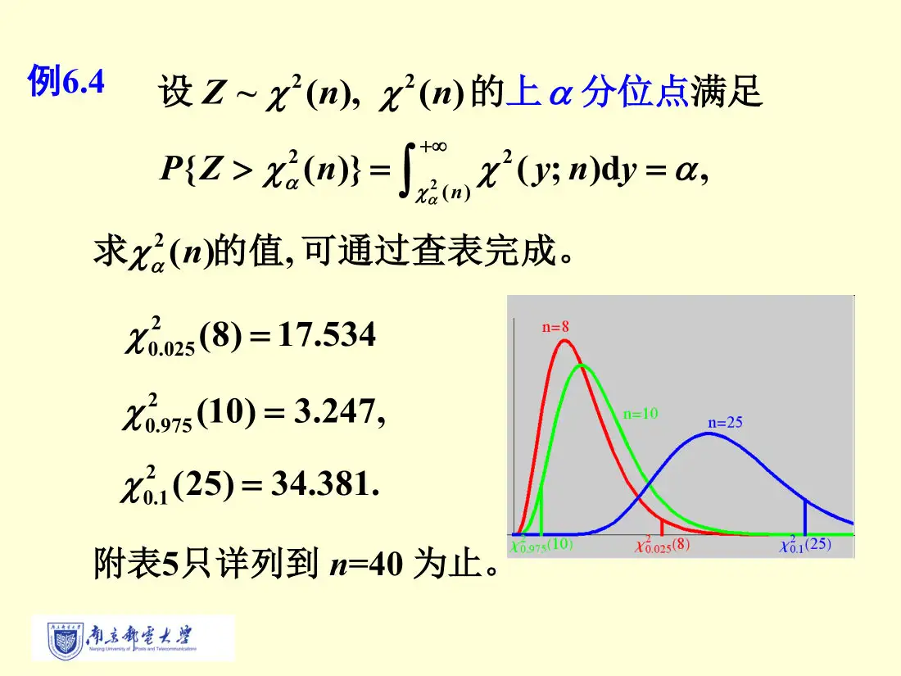

原文：

例6.4 设 $Z \sim \chi^2(n)$ , $\chi^2(n)$ 的上 $\alpha$ 分位点满足

$$
P \{Z > \chi_ {\alpha} ^ {2} (n) \} = \int_ {\chi_ {\alpha} ^ {2} (n)} ^ {+ \infty} \chi^ {2} (y; n) \mathrm{d} y = \alpha ,
$$

求 $\chi_{\alpha}^{2}(n)$ 的值,可通过查表完成。

$$
\begin{array}{l} \chi_ {0. 0 2 5} ^ {2} (8) = 1 7. 5 3 4 \\ \chi_ {0. 9 7 5} ^ {2} (1 0) = 3. 2 4 7, \\ \chi_ {0. 1} ^ {2} (2 5) = 3 4. 3 8 1. \end{array}
$$

附表5只详列到 n=40 为止。

南京邮电大学
Nanjing University of Posts and Telecommunications

### $$

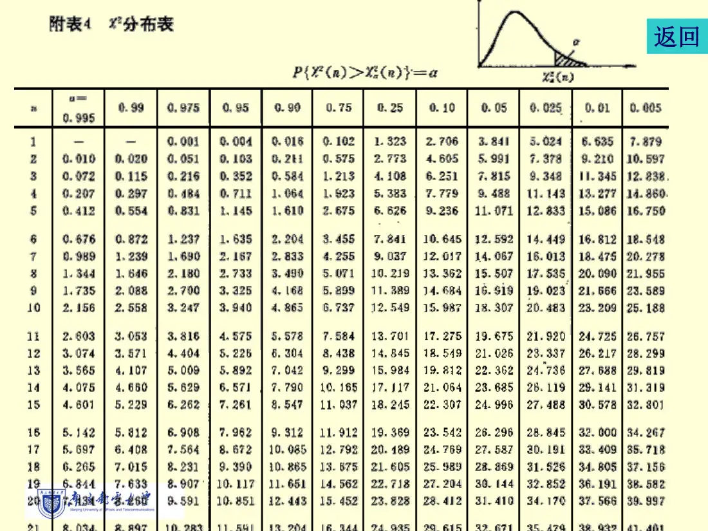

原文：

$$
P \{\chi^ {2} (n) > \chi_ {\alpha} ^ {2} (n) \} = a
$$

<table><tr><td>n</td><td>a=0.995</td><td>0.99</td><td>0.975</td><td>0.95</td><td>0.90</td><td>0.75</td><td>0.25</td><td>0.10</td><td>0.05</td><td>0.025</td><td>0.01</td><td>0.005</td></tr><tr><td>1</td><td>-</td><td>-</td><td>0.001</td><td>0.004</td><td>0.016</td><td>0.102</td><td>1.323</td><td>2.706</td><td>3.841</td><td>5.024</td><td>6.635</td><td>7.879</td></tr><tr><td>2</td><td>0.010</td><td>0.020</td><td>0.051</td><td>0.103</td><td>0.211</td><td>0.575</td><td>2.773</td><td>4.605</td><td>5.991</td><td>7.378</td><td>9.210</td><td>10.597</td></tr><tr><td>3</td><td>0.072</td><td>0.115</td><td>0.216</td><td>0.352</td><td>0.584</td><td>1.213</td><td>4.108</td><td>6.251</td><td>7.815</td><td>9.348</td><td>11.345</td><td>12.838</td></tr><tr><td>4</td><td>0.207</td><td>0.297</td><td>0.484</td><td>0.711</td><td>1.064</td><td>1.923</td><td>5.383</td><td>7.779</td><td>9.488</td><td>11.143</td><td>13.277</td><td>14.860</td></tr><tr><td>5</td><td>0.412</td><td>0.554</td><td>0.831</td><td>1.145</td><td>1.610</td><td>2.675</td><td>6.626</td><td>9.236</td><td>11.071</td><td>12.833</td><td>15.086</td><td>16.750</td></tr><tr><td>6</td><td>0.676</td><td>0.872</td><td>1.237</td><td>1.635</td><td>2.204</td><td>3.455</td><td>7.841</td><td>10.645</td><td>12.592</td><td>14.449</td><td>16.812</td><td>18.548</td></tr><tr><td>7</td><td>0.989</td><td>1.239</td><td>1.690</td><td>2.167</td><td>2.833</td><td>4.255</td><td>9.037</td><td>12.017</td><td>14.067</td><td>16.013</td><td>18.475</td><td>20.278</td></tr><tr><td>8</td><td>1.344</td><td>1.646</td><td>2.180</td><td>2.733</td><td>3.490</td><td>5.071</td><td>10.219</td><td>13.362</td><td>15.507</td><td>17.535</td><td>20.090</td><td>21.955</td></tr><tr><td>9</td><td>1.735</td><td>2.088</td><td>2.700</td><td>3.325</td><td>4.168</td><td>5.899</td><td>11.389</td><td>14.684</td><td>16.919</td><td>19.023</td><td>21.566</td><td>23.589</td></tr><tr><td>10</td><td>2.156</td><td>2.558</td><td>3.247</td><td>3.940</td><td>4.865</td><td>6.737</td><td>12.549</td><td>15.987</td><td>18.307</td><td>20.483</td><td>23.209</td><td>25.188</td></tr><tr><td>11</td><td>2.603</td><td>3.053</td><td>3.816</td><td>4.575</td><td>5.578</td><td>7.584</td><td>13.701</td><td>17.275</td><td>19.675</td><td>21.920</td><td>24.725</td><td>26.757</td></tr><tr><td>12</td><td>3.074</td><td>3.571</td><td>4.404</td><td>5.226</td><td>6.304</td><td>8.438</td><td>14.845</td><td>18.549</td><td>21.026</td><td>23.337</td><td>26.217</td><td>28.299</td></tr><tr><td>13</td><td>3.565</td><td>4.107</td><td>5.009</td><td>5.892</td><td>7.042</td><td>9.299</td><td>15.984</td><td>19.812</td><td>22.362</td><td>24.736</td><td>27.688</td><td>29.819</td></tr><tr><td>14</td><td>4.075</td><td>4.660</td><td>5.629</td><td>6.571</td><td>7.790</td><td>10.165</td><td>17.117</td><td>21.064</td><td>23.685</td><td>26.119</td><td>29.141</td><td>31.319</td></tr><tr><td>15</td><td>4.601</td><td>5.229</td><td>6.262</td><td>7.261</td><td>8.547</td><td>11.037</td><td>18.245</td><td>22.307</td><td>24.996</td><td>27.488</td><td>30.578</td><td>32.801</td></tr><tr><td>16</td><td>5.142</td><td>5.812</td><td>6.908</td><td>7.962</td><td>9.312</td><td>11.912</td><td>19.369</td><td>23.542</td><td>26.296</td><td>28.845</td><td>32.000</td><td>34.267</td></tr><tr><td>17</td><td>5.697</td><td>6.408</td><td>7.564</td><td>8.672</td><td>10.085</td><td>12.792</td><td>20.189</td><td>24.769</td><td>27.587</td><td>30.191</td><td>33.409</td><td>35.718</td></tr><tr><td>18</td><td>6.265</td><td>7.015</td><td>8.231</td><td>9.390</td><td>10.865</td><td>13.675</td><td>21.605</td><td>25.989</td><td>28.869</td><td>31.526</td><td>34.805</td><td>37.156</td></tr><tr><td>19</td><td>6.844</td><td>7.633</td><td>8.907</td><td>10.117</td><td>11.651</td><td>14.562</td><td>22.718</td><td>27.204</td><td>30.144</td><td>32.852</td><td>36.191</td><td>38.582</td></tr><tr><td>20</td><td>7.336</td><td>8.260</td><td>9.591</td><td>10.851</td><td>12.443</td><td>15.452</td><td>23.828</td><td>28.412</td><td>31.410</td><td>34.170</td><td>37.566</td><td>39.997</td></tr></table>

### 标准正态分布的上 $\alpha$ 分位点

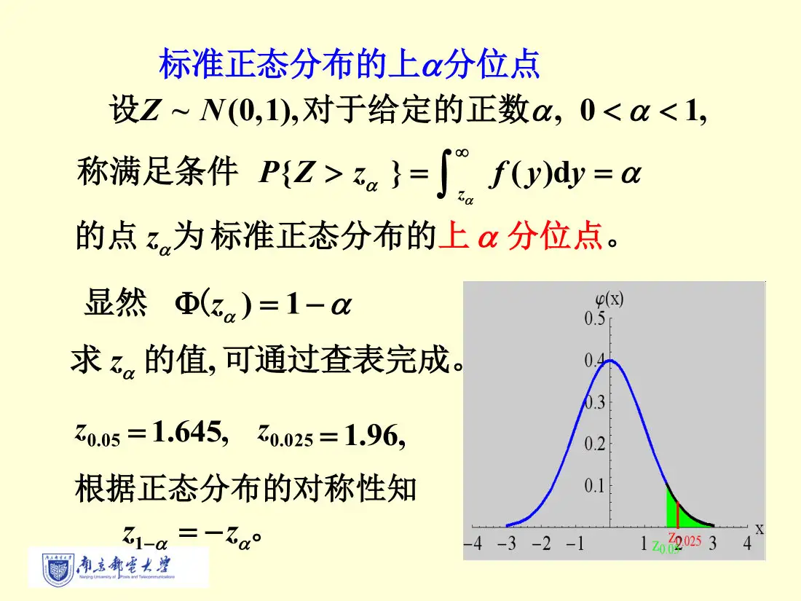

原文：

标准正态分布的上 $\alpha$ 分位点

设 $Z \sim N(0,1)$ , 对于给定的正数 $\alpha, 0 < \alpha < 1$ , 称满足条件 $P\{Z > z_{\alpha}\} = \int_{z_{\alpha}}^{\infty} f(y) \mathrm{d}y = \alpha$ 的点 $z_{\alpha}$ 为标准正态分布的上 $\alpha$ 分位点。

显然 $\Phi (z_{\alpha}) = 1 - \alpha$ 求 $z_{\alpha}$ 的值, 可通过查表完成。

$$
z _ {0. 0 5} = 1. 6 4 5, \quad z _ {0. 0 2 5} = 1. 9 6,
$$

根据正态分布的对称性知

$$
z _ {1 - \alpha} = - z _ {\alpha^ {\circ}}
$$

南京邮电大学
Nanjing University of Posts and Telecommunications

### 附表2-P276

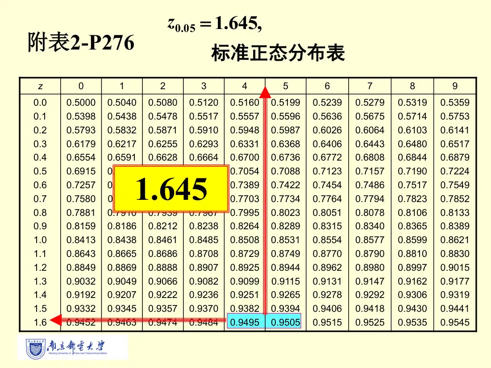

原文：

附表2-P276

$$
z _ {0. 0 5} = 1. 6 4 5,
$$

标准正态分布表

<table><tr><td>z</td><td>0</td><td>1</td><td>2</td><td>3</td><td>4</td><td>5</td><td>6</td><td>7</td><td>8</td><td>9</td></tr><tr><td>0.0</td><td>0.5000</td><td>0.5040</td><td>0.5080</td><td>0.5120</td><td>0.5160</td><td>0.5199</td><td>0.5239</td><td>0.5279</td><td>0.5319</td><td>0.5359</td></tr><tr><td>0.1</td><td>0.5398</td><td>0.5438</td><td>0.5478</td><td>0.5517</td><td>0.5557</td><td>0.5596</td><td>0.5636</td><td>0.5675</td><td>0.5714</td><td>0.5753</td></tr><tr><td>0.2</td><td>0.5793</td><td>0.5832</td><td>0.5871</td><td>0.5910</td><td>0.5948</td><td>0.5987</td><td>0.6026</td><td>0.6064</td><td>0.6103</td><td>0.6141</td></tr><tr><td>0.3</td><td>0.6179</td><td>0.6217</td><td>0.6255</td><td>0.6293</td><td>0.6331</td><td>0.6368</td><td>0.6406</td><td>0.6443</td><td>0.6480</td><td>0.6517</td></tr><tr><td>0.4</td><td>0.6554</td><td>0.6591</td><td>0.6628</td><td>0.6664</td><td>0.6700</td><td>0.6736</td><td>0.6772</td><td>0.6808</td><td>0.6844</td><td>0.6879</td></tr><tr><td>0.5</td><td>0.6915</td><td>0</td><td rowspan="3" colspan="2">1.645</td><td>0.7054</td><td>0.7088</td><td>0.7123</td><td>0.7157</td><td>0.7190</td><td>0.7224</td></tr><tr><td>0.6</td><td>0.7257</td><td>0</td><td>0.7389</td><td>0.7422</td><td>0.7454</td><td>0.7486</td><td>0.7517</td><td>0.7549</td></tr><tr><td>0.7</td><td>0.7580</td><td>0</td><td>0.7703</td><td>0.7734</td><td>0.7764</td><td>0.7794</td><td>0.7823</td><td>0.7852</td></tr><tr><td>0.8</td><td>0.7881</td><td>0.7910</td><td>0.7939</td><td>0.7967</td><td>0.7995</td><td>0.8023</td><td>0.8051</td><td>0.8078</td><td>0.8106</td><td>0.8133</td></tr><tr><td>0.9</td><td>0.8159</td><td>0.8186</td><td>0.8212</td><td>0.8238</td><td>0.8264</td><td>0.8289</td><td>0.8315</td><td>0.8340</td><td>0.8365</td><td>0.8389</td></tr><tr><td>1.0</td><td>0.8413</td><td>0.8438</td><td>0.8461</td><td>0.8485</td><td>0.8508</td><td>0.8531</td><td>0.8554</td><td>0.8577</td><td>0.8599</td><td>0.8621</td></tr><tr><td>1.1</td><td>0.8643</td><td>0.8665</td><td>0.8686</td><td>0.8708</td><td>0.8729</td><td>0.8749</td><td>0.8770</td><td>0.8790</td><td>0.8810</td><td>0.8830</td></tr><tr><td>1.2</td><td>0.8849</td><td>0.8869</td><td>0.8888</td><td>0.8907</td><td>0.8925</td><td>0.8944</td><td>0.8962</td><td>0.8980</td><td>0.8997</td><td>0.9015</td></tr><tr><td>1.3</td><td>0.9032</td><td>0.9049</td><td>0.9066</td><td>0.9082</td><td>0.9099</td><td>0.9115</td><td>0.9131</td><td>0.9147</td><td>0.9162</td><td>0.9177</td></tr><tr><td>1.4</td><td>0.9192</td><td>0.9207</td><td>0.9222</td><td>0.9236</td><td>0.9251</td><td>0.9265</td><td>0.9278</td><td>0.9292</td><td>0.9306</td><td>0.9319</td></tr><tr><td>1.5</td><td>0.9332</td><td>0.9345</td><td>0.9357</td><td>0.9370</td><td>0.9382</td><td>0.9394</td><td>0.9406</td><td>0.9418</td><td>0.9430</td><td>0.9441</td></tr><tr><td>1.6</td><td>0.9452</td><td>0.9463</td><td>0.9474</td><td>0.9484</td><td>0.9495</td><td>0.9505</td><td>0.9515</td><td>0.9525</td><td>0.9535</td><td>0.9545</td></tr></table>

南京邮电大学
Nanjing University of Posts and Telecommunications

### $$

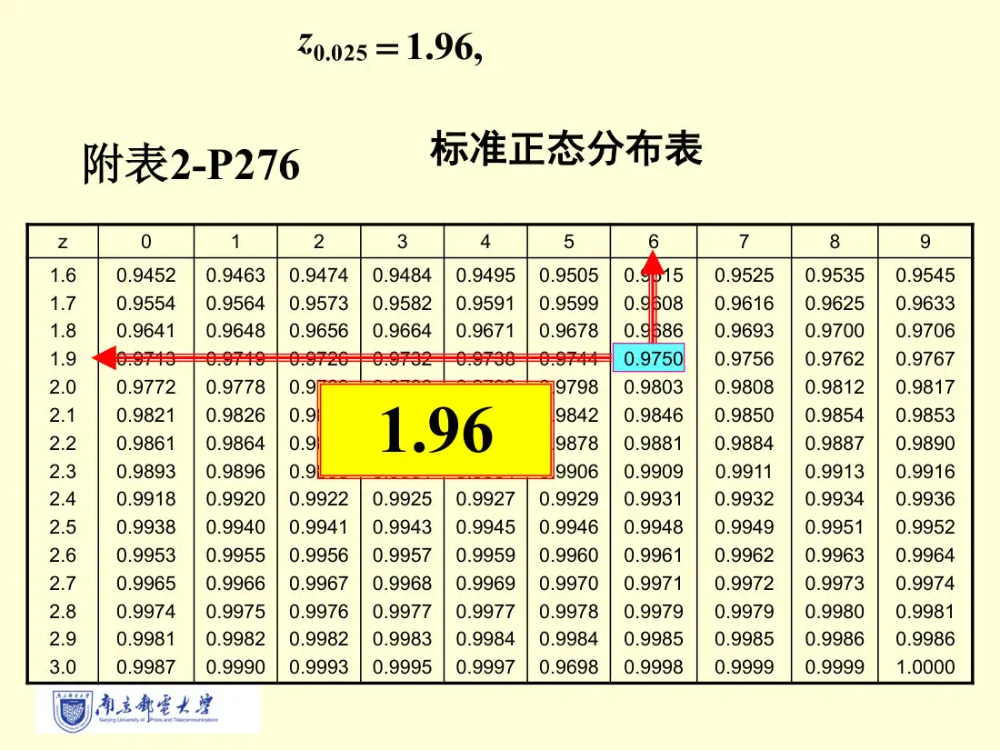

原文：

$$
z _ {0. 0 2 5} = 1. 9 6,
$$

附表2-P276

标准正态分布表
<table><tr><td>z</td><td>0</td><td>1</td><td>2</td><td>3</td><td>4</td><td>5</td><td>6</td><td>7</td><td>8</td><td>9</td></tr><tr><td>1.6</td><td>0.9452</td><td>0.9463</td><td>0.9474</td><td>0.9484</td><td>0.9495</td><td>0.9505</td><td>0.9515</td><td>0.9525</td><td>0.9535</td><td>0.9545</td></tr><tr><td>1.7</td><td>0.9554</td><td>0.9564</td><td>0.9573</td><td>0.9582</td><td>0.9591</td><td>0.9599</td><td>0.9608</td><td>0.9616</td><td>0.9625</td><td>0.9633</td></tr><tr><td>1.8</td><td>0.9641</td><td>0.9648</td><td>0.9656</td><td>0.9664</td><td>0.9671</td><td>0.9678</td><td>0.9686</td><td>0.9693</td><td>0.9700</td><td>0.9706</td></tr><tr><td>1.9</td><td>0.9713</td><td>0.9719</td><td>0.9726</td><td>0.9732</td><td>0.9738</td><td>0.9744</td><td>0.9750</td><td>0.9756</td><td>0.9762</td><td>0.9767</td></tr><tr><td>2.0</td><td>0.9772</td><td>0.9778</td><td>0.9783</td><td>0.9788</td><td>0.9793</td><td>0.9798</td><td>0.9803</td><td>0.9808</td><td>0.9812</td><td>0.9817</td></tr><tr><td>2.1</td><td>0.9821</td><td>0.9826</td><td>0.9833</td><td>0.9838</td><td>0.9843</td><td>0.9846</td><td>0.9850</td><td>0.9854</td><td>0.9853</td><td></td></tr><tr><td>2.2</td><td>0.9861</td><td>0.9864</td><td>0.9871</td><td>0.9876</td><td>0.9881</td><td>0.9884</td><td>0.9887</td><td>0.9890</td><td></td><td></td></tr><tr><td>2.3</td><td>0.9893</td><td>0.9896</td><td>0.9897</td><td>0.9898</td><td>0.9900</td><td>0.9903</td><td>0.9911</td><td>0.9913</td><td>0.9916</td><td></td></tr><tr><td>2.4</td><td>0.9918</td><td>0.9920</td><td>0.9922</td><td>0.9925</td><td>0.9927</td><td>0.9929</td><td>0.9931</td><td>0.9932</td><td>0.9934</td><td>0.9936</td></tr><tr><td>2.5</td><td>0.9938</td><td>0.9940</td><td>0.9941</td><td>0.9943</td><td>0.9945</td><td>0.9946</td><td>0.9948</td><td>0.9949</td><td>0.9951</td><td>0.9952</td></tr><tr><td>2.6</td><td>0.9953</td><td>0.9955</td><td>0.9956</td><td>0.9957</td><td>0.9959</td><td>0.9960</td><td>0.9961</td><td>0.9962</td><td>0.9963</td><td>0.9964</td></tr><tr><td>2.7</td><td>0.9965</td><td>0.9966</td><td>0.9967</td><td>0.9968</td><td>0.9969</td><td>0.9970</td><td>0.9971</td><td>0.9972</td><td>0.9973</td><td>0.9974</td></tr><tr><td>2.8</td><td>0.9974</td><td>0.9975</td><td>0.9976</td><td>0.9977</td><td>0.9978</td><td>0.9979</td><td>0.9979</td><td>0.9980</td><td>0.9981</td><td></td></tr><tr><td>2.9</td><td>0.9981</td><td>0.9982</td><td>0.9982</td><td>0.9983</td><td>0.9984</td><td>0.9984</td><td>0.9985</td><td>0.9985</td><td>0.9986</td><td>0.9986</td></tr><tr><td>3.0</td><td>0.9987</td><td>0.9990</td><td>0.9993</td><td>0.9995</td><td>0.9997</td><td>0.9698</td><td>0.9998</td><td>0.9999</td><td>0.9999</td><td>1.0000</td></tr></table>

南京邮电大学
Nanjing University of Posts and Telecommunications

### 费舍尔(R.A.Fisher)证明:

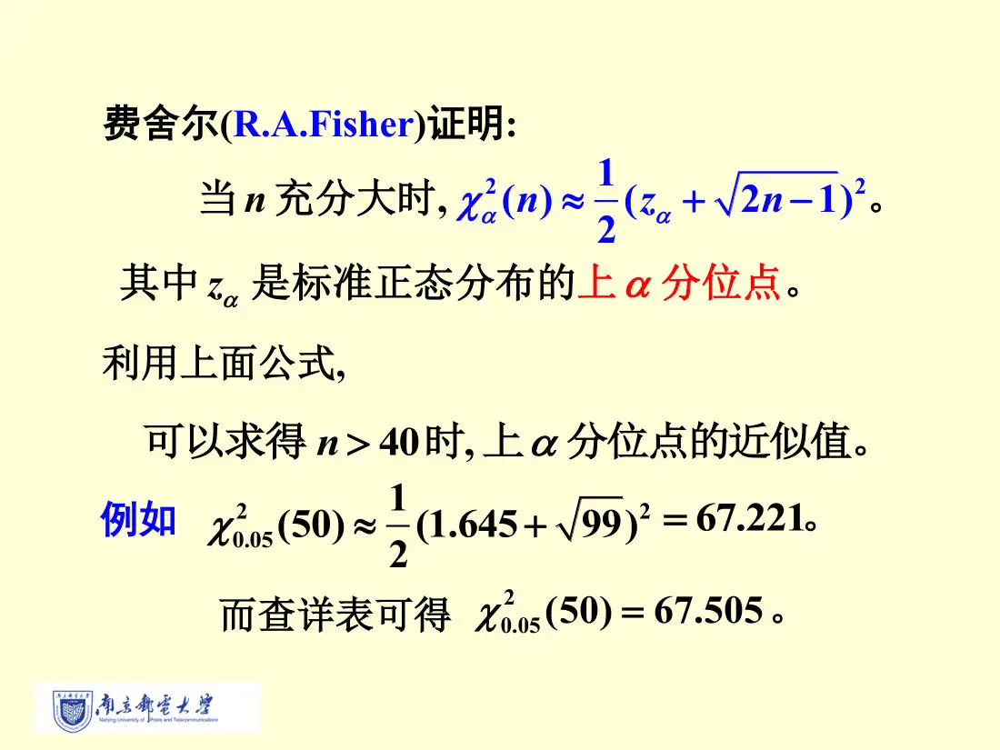

原文：

费舍尔(R.A.Fisher)证明:

当 n 充分大时, $\chi_{\alpha}^{2}(n) \approx \frac{1}{2}(z_{\alpha} + \sqrt{2n-1})^{2}$ 。
其中 $z_{\alpha}$ 是标准正态分布的上 $\alpha$ 分位点。
利用上面公式，

可以求得 n > 40 时, 上 $\alpha$ 分位点的近似值。
例如 $\chi_{0.05}^{2}(50)\approx\frac{1}{2}(1.645+\sqrt{99})^{2}=67.221$ 。
而查详表可得 $\chi_{0.05}^{2}(50)=67.505$ 。

南京邮电大学
Nanjing University of Posts and Telecommunications

### 南京邮电大学

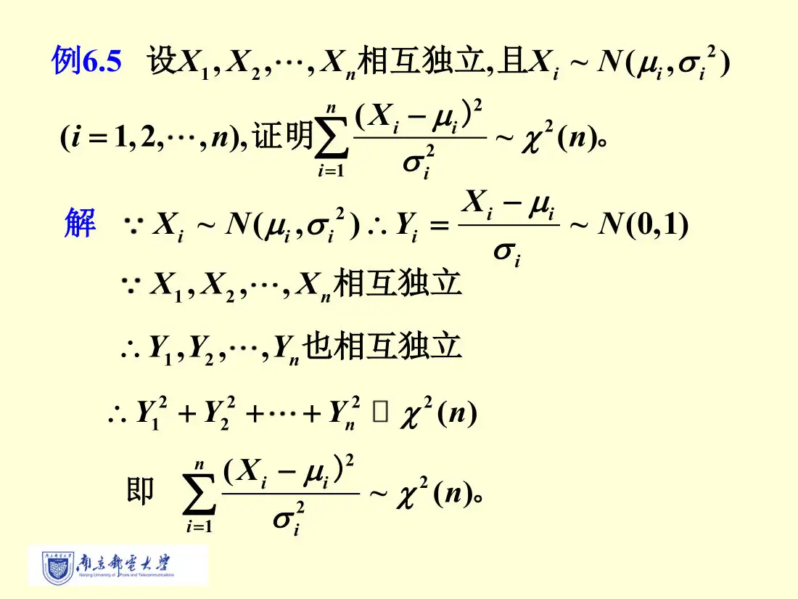

原文：

例6.5 设 $X_{1}, X_{2}, \cdots, X_{n}$ 相互独立，且 $X_{i} \sim N(\mu_{i}, \sigma_{i}^{2})$ $(i = 1, 2, \cdots, n)$ ，证明 $\sum_{i=1}^{n} \frac{(X_{i} - \mu_{i})^{2}}{\sigma_{i}^{2}} \sim \chi^{2}(n)$ 。解 $\because X_{i} \sim N(\mu_{i}, \sigma_{i}^{2}) \therefore Y_{i} = \frac{X_{i} - \mu_{i}}{\sigma_{i}} \sim N(0, 1)$ $\because X_{1}, X_{2}, \cdots, X_{n}$ 相互独立 $\therefore Y_{1}, Y_{2}, \cdots, Y_{n}$ 也相互独立 $\therefore Y_{1}^{2} + Y_{2}^{2} + \cdots + Y_{n}^{2} \square \chi^{2}(n)$ 即 $\sum_{i=1}^{n} \frac{(X_{i} - \mu_{i})^{2}}{\sigma_{i}^{2}} \sim \chi^{2}(n)$ 。

南京邮电大学
Nanjing University of Posts and Telecommunications

### 解 由题意可知

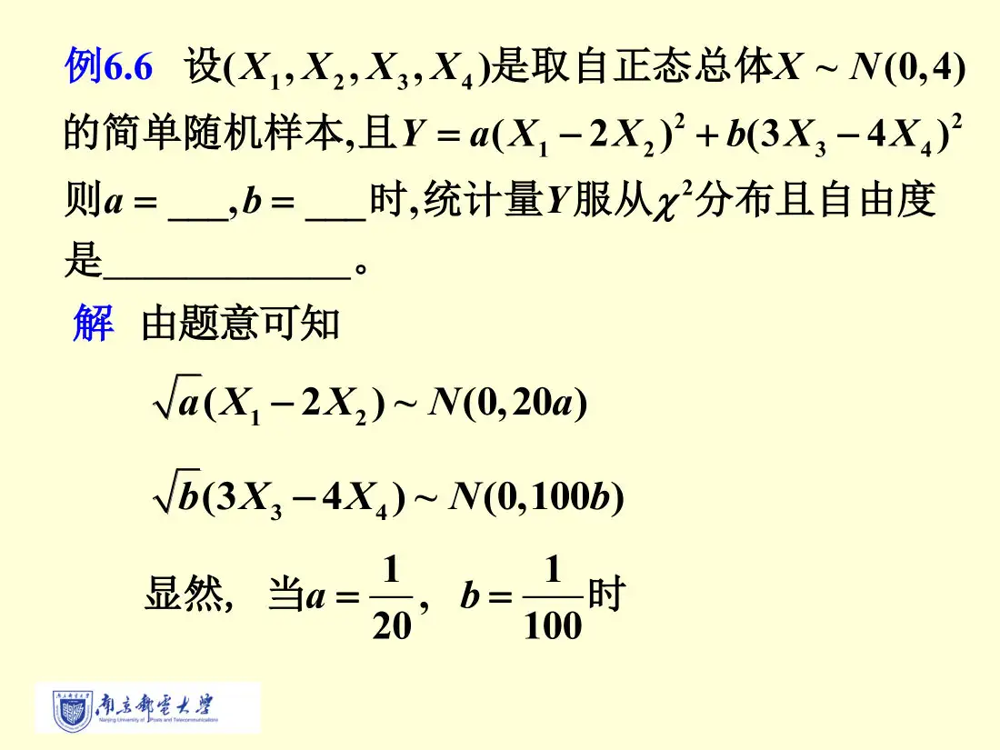

原文：

例6.6 设 $(X_{1}, X_{2}, X_{3}, X_{4})$ 是取自正态总体 $X \sim N(0, 4)$ 的简单随机样本, 且 $Y = a(X_{1} - 2X_{2})^{2} + b(3X_{3} - 4X_{4})^{2}$ 则 $a = \_, b = \_)$ 时, 统计量Y服从 $\chi^{2}$ 分布且自由度是\_\_\_\_。

解 由题意可知

$$
\sqrt {a} (X _ {1} - 2 X _ {2}) \sim N (0, 2 0 a)
$$

$$
\sqrt {b} (3 X _ {3} - 4 X _ {4}) \sim N (0, 1 0 0 b)
$$

显然，当 $a=\frac{1}{20}$ ， $b=\frac{1}{100}$ 时

南京邮电大学
Nanjing University of Posts and Telecommunications

### $$

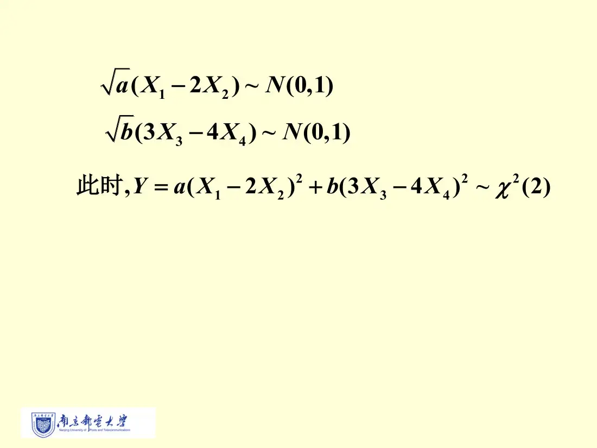

原文：

$$
\begin{array}{r l} & {\sqrt {a} (X _ {1} - 2 X _ {2}) \sim N (\mathbf {0}, \mathbf {1})} \\ & {\sqrt {b} (3 X _ {3} - 4 X _ {4}) \sim N (\mathbf {0}, \mathbf {1})} \\ & {\text {此时,} Y = a (X _ {1} - 2 X _ {2}) ^ {2} + b (3 X _ {3} - 4 X _ {4}) ^ {2} \sim \chi^ {2} (\mathbf {2})} \end{array}
$$

南京邮电大学
Nanjing University of Posts and Telecommunications

### 2. t分布

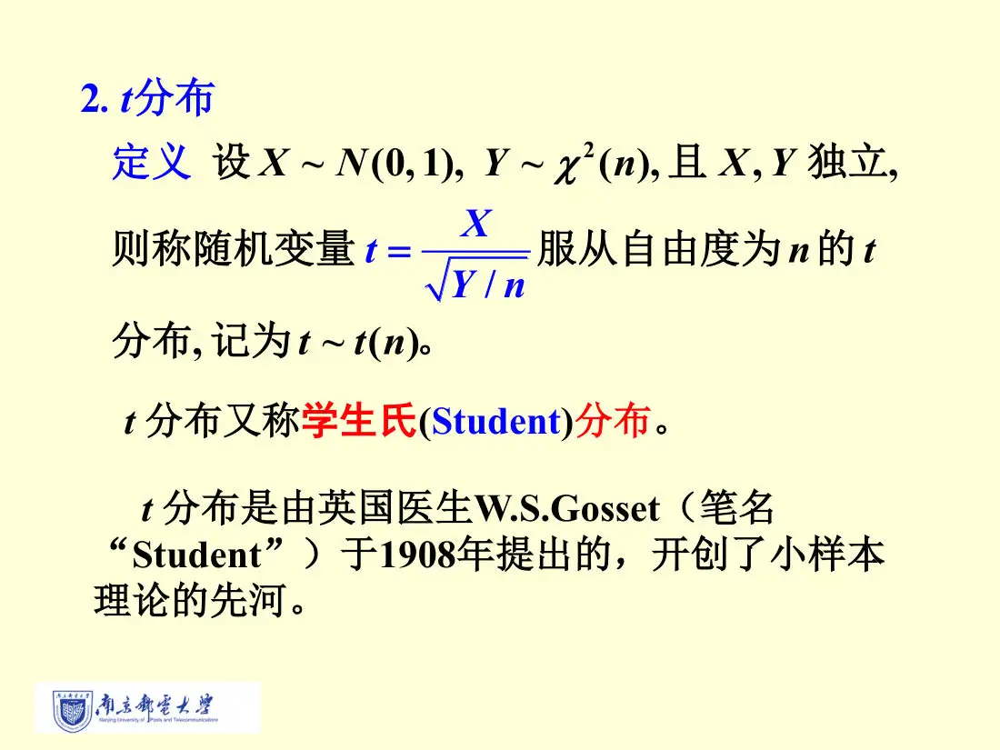

原文：

2. t分布

定义 设 $X \sim N(0,1)$ , $Y \sim \chi^{2}(n)$ , 且 X, Y 独立,
则称随机变量 $t=\frac{X}{\sqrt{Y/n}}$ 服从自由度为 n 的 t 分布, 记为 $t \sim t(n)$ 。

t 分布又称学生氏(Student)分布。

t 分布是由英国医生W.S.Gosset（笔名“Student”）于1908年提出的，开创了小样本理论的先河。

南京邮电大学
Nanjing University of Posts and Telecommunications

### $t(n)$ 分布的概率密度函数为

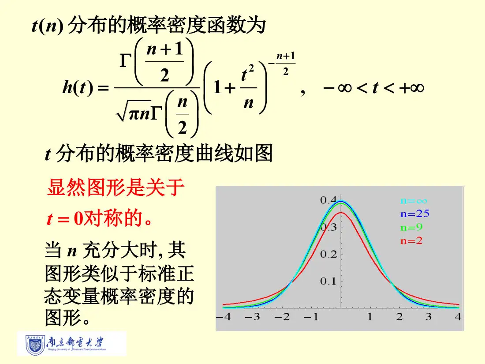

原文：

$t(n)$ 分布的概率密度函数为

$$
h (t) = \frac {\Gamma \left(\frac {n + 1}{2}\right)}{\sqrt {\pi n} \Gamma \left(\frac {n}{2}\right)} \left(1 + \frac {t ^ {2}}{n}\right) ^ {- \frac {n + 1}{2}}, - \infty <   t <   + \infty
$$

t 分布的概率密度曲线如图

显然图形是关于 $t = 0$ 对称的。

当 n 充分大时, 其图形类似于标准正态变量概率密度的图形。

南京邮电大学
Nanjing University of Posts and Telecommunications

### $t$ 分布的分位点

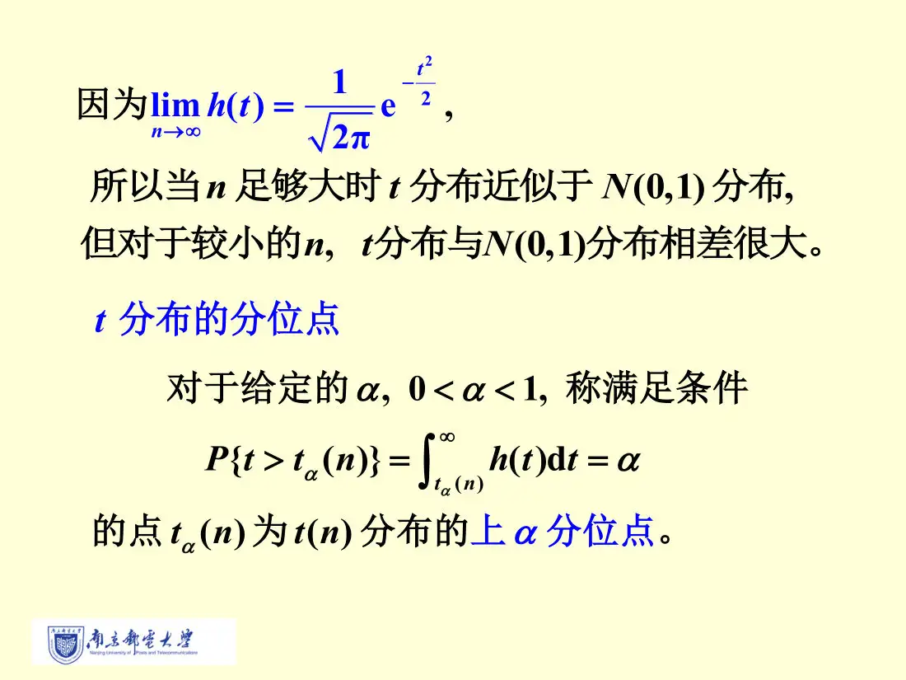

原文：

因为 $\lim_{n\to \infty}h(t) = \frac{1}{\sqrt{2\pi}}\mathrm{e}^{-\frac{t^2}{2}},$

所以当 $n$ 足够大时 $t$ 分布近似于 $N(0,1)$ 分布，但对于较小的 $n$ ， $t$ 分布与 $N(0,1)$ 分布相差很大。

$t$ 分布的分位点

对于给定的 $\alpha, 0 < \alpha < 1$ ，称满足条件

$$
P \{t > t _ {\alpha} (n) \} = \int_ {t _ {\alpha} (n)} ^ {\infty} h (t) \mathrm{d} t = \alpha
$$

的点 $t_{\alpha}(n)$ 为 $t(n)$ 分布的上 $\alpha$ 分位点。

南京邮电大学
Nanjing University of Posts and Telecommunications

### $$

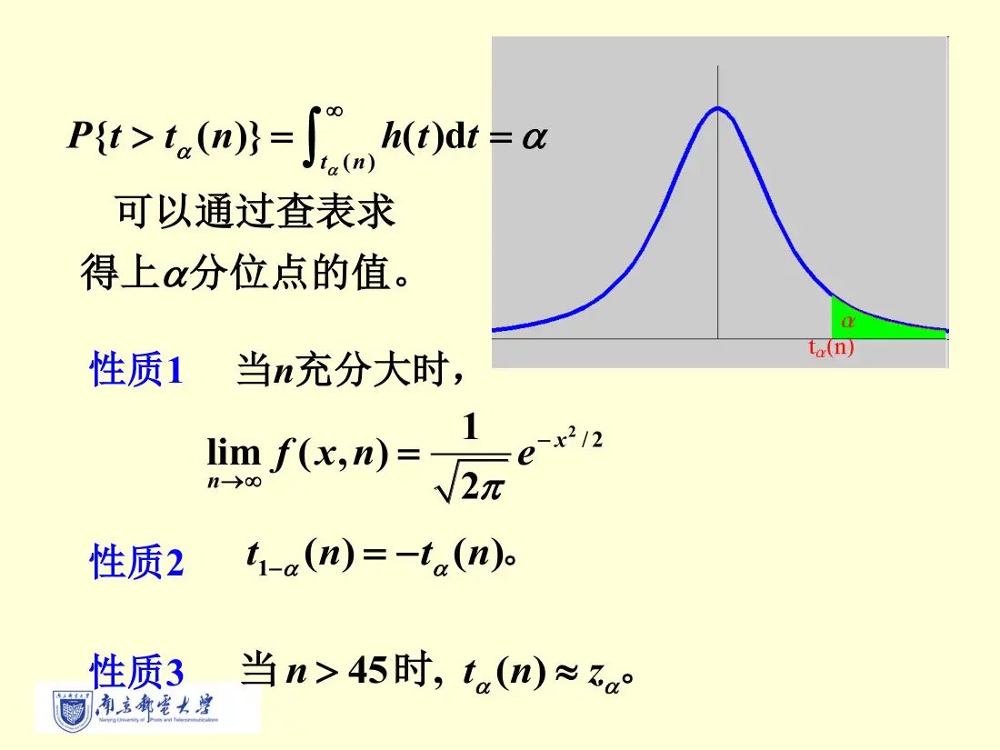

原文：

$$
P \{t > t _ {\alpha} (n) \} = \int_ {t _ {\alpha} (n)} ^ {\infty} h (t) \mathrm{d} t = \alpha
$$

可以通过查表求得上 $\alpha$ 分位点的值。

性质1 当 $n$ 充分大时，

$$
\lim _ {n \rightarrow \infty} f (x, n) = \frac {1}{\sqrt {2 \pi}} e ^ {- x ^ {2} / 2}
$$

性质2 $t_{1-\alpha}(n)=-t_{\alpha}(n)$ 。

性质3 当 $n > 45$ 时, $t_{\alpha}(n) \approx z_{\alpha}$ 。

南京邮电大学
Nanjing University of Posts and Telecommunications

### $$

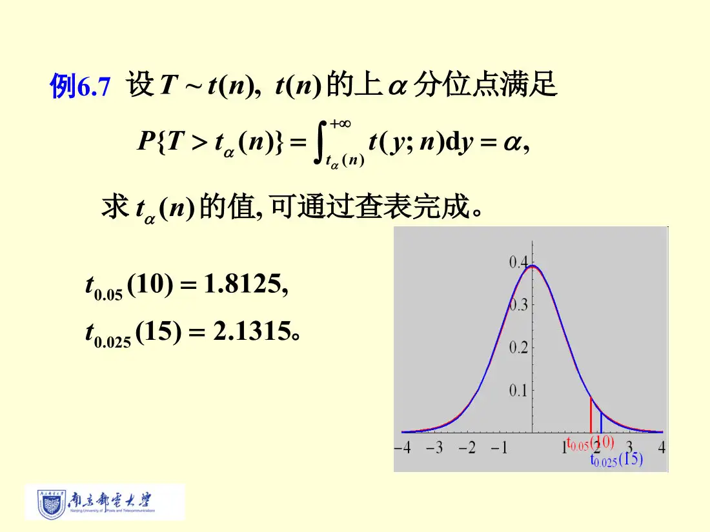

原文：

例6.7 设 $T \sim t(n)$ , $t(n)$ 的上 $\alpha$ 分位点满足

$$
P \{T > t _ {\alpha} (n) \} = \int_ {t _ {\alpha} (n)} ^ {+ \infty} t (y; n) \mathrm{d} y = \alpha ,
$$

求 $t_{\alpha}(n)$ 的值, 可通过查表完成。

$$
t _ {0. 0 5} (1 0) = 1. 8 1 2 5,
$$

$$
t _ {0. 0 2 5} (1 5) = 2. 1 3 1 5 。
$$

南京邮电大学
Nanjing University of Posts and Telecommunications

### 附表3 t分布表

原文：

附表3 t分布表

<table><tr><td>a</td><td>a=0.25</td><td>0.10</td><td>0.05</td><td>0.025</td><td>0.01</td><td>0.005</td></tr><tr><td>1</td><td>1.0000</td><td>3.0777</td><td>6.3138</td><td>12.7062</td><td>31.8207</td><td>63.6574</td></tr><tr><td>2</td><td>0.8165</td><td>1.8856</td><td>2.9200</td><td>4.3027</td><td>6.9646</td><td>9.9248</td></tr><tr><td>3</td><td>0.7649</td><td>1.6377</td><td>2.3534</td><td>3.1824</td><td>1.5407</td><td>6.8409</td></tr><tr><td>4</td><td>0.7407</td><td>1.5332</td><td>2.1318</td><td>2.7764</td><td>3.7469</td><td>4.6041</td></tr><tr><td>5</td><td>0.7267</td><td>1.4759</td><td>2.0150</td><td>2.5706</td><td>3.3649</td><td>4.0322</td></tr><tr><td>6</td><td>0.7176</td><td>1.4398</td><td>1.9432</td><td>2.4469</td><td>3.1427</td><td>3.7074</td></tr><tr><td>7</td><td>0.7111</td><td>1.4149</td><td>1.8946</td><td>2.3646</td><td>2.9980</td><td>3.4995</td></tr><tr><td>8</td><td>0.7064</td><td>1.3968</td><td>1.8595</td><td>2.3060</td><td>2.8965</td><td>3.3554</td></tr><tr><td>9</td><td>0.7027</td><td>1.3830</td><td>1.8331</td><td>2.2622</td><td>2.8214</td><td>3.2498</td></tr><tr><td>10</td><td>0.6998</td><td>1.3722</td><td>1.8125</td><td>2.2281</td><td>2.7638</td><td>3.1693</td></tr><tr><td>11</td><td>0.6974</td><td>1.3634</td><td>1.7959</td><td>2.2040</td><td>2.7181</td><td>3.1058</td></tr><tr><td>12</td><td>0.6955</td><td>1.3562</td><td>1.7823</td><td>2.1788</td><td>2.6810</td><td>3.0545</td></tr><tr><td>13</td><td>0.6988</td><td>1.3502</td><td>1.7709</td><td>2.1604</td><td>2.6503</td><td>3.0123</td></tr><tr><td>14</td><td>0.6924</td><td>1.3450</td><td>1.7613</td><td>2.1448</td><td>2.6245</td><td>2.9768</td></tr><tr><td>15</td><td>0.6812</td><td>1.3406</td><td>1.7531</td><td>2.1315</td><td>2.6025</td><td>2.9467</td></tr><tr><td>16</td><td>0.6901</td><td>1.3368</td><td>1.7459</td><td>2.1199</td><td>2.5835</td><td>2.9208</td></tr><tr><td>17</td><td>0.6892</td><td>1.3334</td><td>1.7396</td><td>2.1098</td><td>2.5669</td><td>2.8982</td></tr><tr><td>18</td><td>0.6884</td><td>1.3304</td><td>1.7341</td><td>2.1009</td><td>2.5524</td><td>2.8784</td></tr><tr><td>19</td><td>0.6876</td><td>1.3277</td><td>1.7291</td><td>2.0930</td><td>2.5395</td><td>2.8609</td></tr><tr><td colspan="2">南京邮电大学 6870 Nanjing University of Post and Telecommunication</td><td>1.3253</td><td>1.7247</td><td>2.0860</td><td>2.5280</td><td>2.8453</td></tr><tr><td>21</td><td>0.6864</td><td>1.3232</td><td>1.7207</td><td>2.0796</td><td>2.5177</td><td>2.8314</td></tr></table>

### 南京邮电大学

原文：

例6.8 设随机变量X与Y相互独立且都服从标准正态分布总体 $N(0,3^{3})$ ，而 $X_{1},X_{2},\cdots,X_{9}$ 和 $Y_{1},Y_{2},\cdots,Y_{9}$ 分别来自总体X与Y的简单随机样本，证明统计量 $U=\frac{X_{1}+X_{2}+\cdots+X_{9}}{\sqrt{Y_{1}^{2}+Y_{2}^{2}+\cdots+Y_{9}^{2}}}$ 服从t分布，且自由量为n=9。
证明 $\because \overline{X}=\frac{1}{9}\sum_{i=1}^{9}X_{i}\sim N(0,\frac{3^{2}}{9})=N(0,1)$ 而 $\frac{Y_{i}-0}{3}\sim N(0,1),\therefore(\frac{Y_{i}-0}{3})^{2}\sim\chi^{2}(1)$

南京邮电大学
Nanjing University of Posts and Telecommunications

### $$

原文：

$$
(\frac {Y _ {i} - 0}{3}) ^ {2} \sim \chi^ {2} (1) \quad \therefore \sum_ {i = 1} ^ {9} (\frac {Y _ {i} - 0}{3}) ^ {2} \sim \chi^ {2} (9)
$$

又因为X与 $\sum_{i=1}^{9}\left(\frac{Y_{i}-0}{3}\right)^{2}$ 相互独立,

$$
\begin{array}{l} \therefore U = \frac {X _ {1} + X _ {2} + \cdots + X _ {9}}{\sqrt {Y _ {1} ^ {2} + Y _ {2} ^ {2} + \cdots + Y _ {9} ^ {2}}} = \frac {\frac {1}{9} \sum_ {i = 1} ^ {9} X _ {i}}{\sqrt {\frac {1}{9 ^ {2}} \sum_ {i = 1} ^ {9} Y _ {i} ^ {2}}} \\ = \frac {\frac {1}{9} \sum_ {i = 1} ^ {9} X _ {i}}{\sqrt {\frac {1}{9} \sum_ {i = 1} ^ {9} (\frac {Y _ {i} - 0}{3}) ^ {2}}} \frac {\overline {{X}}}{\sqrt {\frac {\chi^ {2} (9)}{9}}} \sim t (9) \end{array}
$$

南京邮电大学
Nanjing University of Posts and Telecommunications

### 3、F分布

原文：

3、F分布

定义 设 $U \sim \chi^{2}(n_{1})$ , $V \sim \chi^{2}(n_{2})$ , 且 $U, V$ 独立, 则称随机变量 $F = \frac{U / n_{1}}{V / n_{2}}$ 服从自由度为 $(n_{1}, n_{2})$ 的 $F$ 分布, 记为 $F \sim F(n_{1}, n_{2})$ 。

南京邮电大学
Nanjing University of Posts and Telecommunications

### $F(n_{1},n_{2})$ 分布的概率密度为

原文：

$F(n_{1},n_{2})$ 分布的概率密度为

$$
\psi (y) = \left\{ \begin{array}{l l} \frac {\Gamma \left(\frac {n _ {1} + n _ {2}}{2}\right) \left(\frac {n _ {1}}{n _ {2}}\right) ^ {\frac {n _ {1}}{2}} y ^ {\frac {n _ {1}}{2} - 1}}{\Gamma \left(\frac {n _ {1}}{2}\right) \Gamma \left(\frac {n _ {2}}{2}\right) \left[ 1 + \left(\frac {n _ {1} y}{n _ {2}}\right) \right] ^ {\frac {n _ {1} + n _ {2}}{2}}}, & y > 0, \\ 0, & \text {其他。} \end{array} \right.
$$

南京邮电大学
Nanjing University of Posts and Telecommunications

### F分布的概率密度曲线如图

原文：

F分布的概率密度曲线如图

根据定义可知，
若 $F \sim F(n_{1}, n_{2})$ ,
则 $\frac{1}{F} \sim F(n_{2}, n_{1})$ 。
F 分布的分位点

对于给定的 $\alpha, 0 < \alpha < 1$ ，称满足条件

$$
P \{F > F _ {\alpha} (n _ {1}, n _ {2}) \} = \int_ {F _ {\alpha} (n _ {1}, n _ {2})} ^ {+ \infty} \psi (y) \mathrm{d} y = \alpha
$$

的点 $F_{\alpha}(n_1,n_2)$ 为 $F(n_{1},n_{2})$ 分布的上 $\alpha$ 分位点。

南京邮电大学
Nanjing University of Posts and Telecommunications

### $$

原文：

例6.9设 $F(n_{1}, n_{2})$ 分布的上 $\alpha$ 分位点满足

$$
P \{F > F _ {\alpha} (n _ {1}, n _ {2}) \} = \int_ {F _ {\alpha} (n _ {1}, n _ {2})} ^ {+ \infty} \psi (y) \mathrm{d} y = \alpha ,
$$

求 $F_{\alpha}(n_1,n_2)$ 的值，可通过查表完成。

$$
F _ {0. 0 2 5} (8, 7) = 4. 9 0,
$$

$$
F _ {0. 0 5} (3 0, 1 4) = 2. 3 1 。
$$

南京邮电大学
Nanjing University of Posts and Telecommunications

### 附表5 F 分布表

原文：

附表5 F 分布表

$$
P \left\{F (n _ {1}, n _ {2}) > F _ {\alpha} (n _ {1}, n _ {2}) \right\} = \alpha
$$

<table><tr><td>n1/n2</td><td>1</td><td>2</td><td>3</td><td>4</td><td>5</td><td>6</td><td>7</td><td>8</td><td>9</td><td>10</td><td>12</td><td>15</td><td>20</td><td>24</td><td>30</td><td>40</td><td>60</td><td>120</td><td>∞</td></tr><tr><td>1</td><td>39.86</td><td>49.50</td><td>53.59</td><td>55.83</td><td>57.24</td><td>58.20</td><td>58.91</td><td>59.44</td><td>59.86</td><td>60.19</td><td>60.71</td><td>61.22</td><td>61.74</td><td>62.00</td><td>62.26</td><td>62.53</td><td>62.79</td><td>63.00</td><td>63.33</td></tr><tr><td>2</td><td>8.53</td><td>9.00</td><td>9.16</td><td>9.24</td><td>9.29</td><td>9.33</td><td>9.35</td><td>9.37</td><td>9.38</td><td>9.39</td><td>9.41</td><td>9.42</td><td>9.44</td><td>9.45</td><td>9.46</td><td>9.47</td><td>9.47</td><td>9.48</td><td>9.49</td></tr><tr><td>3</td><td>5.54</td><td>5.46</td><td>5.39</td><td>5.34</td><td>5.31</td><td>5.28</td><td>5.27</td><td>5.25</td><td>5.24</td><td>5.23</td><td>5.22</td><td>5.20</td><td>5.18</td><td>5.18</td><td>5.17</td><td>5.16</td><td>5.15</td><td>5.14</td><td>5.13</td></tr><tr><td>4</td><td>4.54</td><td>4.32</td><td>4.19</td><td>4.11</td><td>4.05</td><td>4.01</td><td>3.98</td><td>3.95</td><td>3.94</td><td>3.92</td><td>3.90</td><td>3.87</td><td>3.84</td><td>3.83</td><td>3.82</td><td>3.80</td><td>3.79</td><td>3.78</td><td>3.76</td></tr><tr><td>5</td><td>4.06</td><td>3.78</td><td>3.62</td><td>3.52</td><td>3.45</td><td>3.40</td><td>3.37</td><td>3.34</td><td>3.32</td><td>3.30</td><td>3.37</td><td>3.24</td><td>3.21</td><td>3.19</td><td>3.17</td><td>3.16</td><td>3.14</td><td>3.12</td><td>3.40</td></tr><tr><td>6</td><td>3.78</td><td>3.46</td><td>3.29</td><td>3.18</td><td>3.11</td><td>3.05</td><td>3.01</td><td>2.98</td><td>2.96</td><td>2.94</td><td>2.90</td><td>2.87</td><td>2.84</td><td>2.82</td><td>2.80</td><td>2.78</td><td>2.76</td><td>2.74</td><td>2.72</td></tr><tr><td>7</td><td>3.59</td><td>3.26</td><td>3.07</td><td>2.96</td><td>2.88</td><td>2.83</td><td>2.78</td><td>2.75</td><td>2.72</td><td>2.70</td><td>2.67</td><td>2.63</td><td>2.59</td><td>2.58</td><td>2.56</td><td>2.54</td><td>2.51</td><td>2.49</td><td>2.47</td></tr><tr><td>8</td><td>3.46</td><td>3.11</td><td>2.92</td><td>2.81</td><td>2.73</td><td>2.67</td><td>2.62</td><td>2.59</td><td>2.56</td><td>2.54</td><td>2.50</td><td>2.46</td><td>2.42</td><td>2.40</td><td>2.38</td><td>2.36</td><td>2.34</td><td>2.32</td><td>2.29</td></tr><tr><td>9</td><td>3.36</td><td>3.01</td><td>2.81</td><td>2.69</td><td>2.61</td><td>2.55</td><td>2.51</td><td>2.47</td><td>2.44</td><td>2.42</td><td>2.38</td><td>2.34</td><td>2.30</td><td>2.28</td><td>2.25</td><td>2.23</td><td>2.21</td><td>2.18</td><td>2.16</td></tr><tr><td>10</td><td>3.29</td><td>2.92</td><td>2.73</td><td>2.61</td><td>2.52</td><td>2.46</td><td>2.41</td><td>2.38</td><td>2.35</td><td>2.32</td><td>2.28</td><td>2.24</td><td>2.20</td><td>2.18</td><td>2.16</td><td>2.13</td><td>2.11</td><td>2.08</td><td>2.06</td></tr><tr><td>11</td><td>3.23</td><td>2.80</td><td>2.66</td><td>2.54</td><td>2.45</td><td>2.39</td><td>2.34</td><td>2.30</td><td>2.27</td><td>2.25</td><td>2.21</td><td>2.17</td><td>2.12</td><td>2.10</td><td>2.08</td><td>2.05</td><td>2.03</td><td>2.00</td><td>1.97</td></tr><tr><td>12</td><td>3.18</td><td>2.81</td><td>2.61</td><td>2.48</td><td>2.39</td><td>2.33</td><td>2.28</td><td>2.24</td><td>2.21</td><td>2.19</td><td>2.15</td><td>2.10</td><td>2.06</td><td>2.04</td><td>2.01</td><td>1.99</td><td>1.96</td><td>1.93</td><td>1.90</td></tr><tr><td>13</td><td>3.14</td><td>2.70</td><td>2.56</td><td>2.43</td><td>2.35</td><td>2.28</td><td>2.23</td><td>2.20</td><td>2.16</td><td>2.14</td><td>2.10</td><td>2.05</td><td>2.01</td><td>1.98</td><td>1.96</td><td>1.93</td><td>1.90</td><td>1.88</td><td>1.85</td></tr><tr><td>14</td><td>3.10</td><td>2.73</td><td>2.52</td><td>2.39</td><td>2.31</td><td>2.24</td><td>2.19</td><td>2.15</td><td>2.12</td><td>2.10</td><td>2.05</td><td>2.01</td><td>1.96</td><td>1.94</td><td>1.91</td><td>1.89</td><td>1.86</td><td>1.83</td><td>1.80</td></tr><tr><td>15</td><td>3.07</td><td>2.70</td><td>2.49</td><td>2.36</td><td>2.27</td><td>2.21</td><td>2.16</td><td>2.12</td><td>2.09</td><td>2.06</td><td>2.02</td><td>1.97</td><td>1.92</td><td>1.90</td><td>1.87</td><td>1.85</td><td>1.82</td><td>1.79</td><td>1.76</td></tr><tr><td>16</td><td>3.05</td><td>2.67</td><td>2.46</td><td>2.33</td><td>2.24</td><td>2.18</td><td>2.13</td><td>2.09</td><td>2.06</td><td>2.03</td><td>1.99</td><td>1.94</td><td>1.89</td><td>1.87</td><td>1.84</td><td>1.81</td><td>1.78</td><td>1.75</td><td>1.72</td></tr><tr><td>17</td><td>3.03</td><td>2.64</td><td>2.44</td><td>2.31</td><td>2.22</td><td>2.15</td><td>2.10</td><td>2.06</td><td>2.03</td><td>2.00</td><td>1.96</td><td>1.91</td><td>1.86</td><td>1.84</td><td>1.81</td><td>1.78</td><td>1.75</td><td>1.72</td><td>1.69</td></tr><tr><td>18</td><td>3.01</td><td>2.62</td><td>2.42</td><td>2.29</td><td>2.20</td><td>2.13</td><td>2.08</td><td>2.04</td><td>2.00</td><td>1.98</td><td>1.93</td><td>1.89</td><td>1.84</td><td>1.81</td><td>1.78</td><td>1.75</td><td>1.72</td><td>1.69</td><td>1.66</td></tr><tr><td>19</td><td>2.99</td><td>2.61</td><td>2.40</td><td>2.27</td><td>2.18</td><td>2.11</td><td>2.06</td><td>2.02</td><td>1.98</td><td>1.90</td><td>1.91</td><td>1.86</td><td>1.81</td><td>1.79</td><td>1.76</td><td>1.73</td><td>1.70</td><td>1.67</td><td>1.63</td></tr><tr><td>20</td><td>2.97</td><td>2.59</td><td>2.38</td><td>2.25</td><td>2.16</td><td>2.09</td><td>2.04</td><td>2.00</td><td>1.96</td><td>1.94</td><td>1.89</td><td>1.84</td><td>1.79</td><td>1.77</td><td>1.74</td><td>1.71</td><td>1.68</td><td>1.64</td><td>1.61</td></tr><tr><td>21</td><td>2.96</td><td>2.57</td><td>2.36</td><td>2.23</td><td>2.14</td><td>2.08</td><td>2.02</td><td>1.98</td><td>1.95</td><td>1.92</td><td>1.87</td><td>1.83</td><td>1.78</td><td>1.75</td><td>1.72</td><td>1.69</td><td>1.66</td><td>1.62</td><td>1.59</td></tr><tr><td>22</td><td>2.95</td><td>2.56</td><td>2.35</td><td>2.22</td><td>2.13</td><td>2.06</td><td>2.01</td><td>1.97</td><td>1.93</td><td>1.90</td><td>1.86</td><td>1.81</td><td>1.76</td><td>1.73</td><td>1.70</td><td>1.67</td><td>1.64</td><td>1.60</td><td>1.57</td></tr><tr><td>23</td><td>2.94</td><td>2.55</td><td>2.34</td><td>2.21</td><td>2.11</td><td>2.05</td><td>1.99</td><td>1.95</td><td>1.92</td><td>1.89</td><td>1.84</td><td>1.80</td><td>1.74</td><td>1.72</td><td>1.69</td><td>1.66</td><td>1.62</td><td>1.59</td><td>1.55</td></tr><tr><td>21</td><td>2.96</td><td>2.57</td><td>2.36</td><td>2.23</td><td>2.14</td><td>2.08</td><td>2.02</td><td>1.98</td><td>1.95</td><td>1.92</td><td>1.87</td><td>1.83</td><td>1.78</td><td>1.75</td><td>1.72</td><td>1.69</td><td>1.66</td><td>1.62</td><td>1.59</td></tr><tr><td>22</td><td>2.95</td><td>2.56</td><td>2.35</td><td>2.22</td><td>2.13</td><td>2.06</td><td>2.01</td><td>1.97</td><td>1.93</td><td>1.90</td><td>1.86</td><td>1.81</td><td>1.76</td><td>1.73</td><td>1.70</td><td>1.67</td><td>1.64</td><td>1.60</td><td>1.57</td></tr><tr><td>23</td><td>2.94</td><td>2.55</td><td>2.34</td><td>2.21</td><td>2.11</td><td>2.05</td><td>1.99</td><td>1.95</td><td>1.92</td><td>1.89</td><td>1.84</td><td>1.80</td><td>1.74</td><td>1.72</td><td>1.69</td><td>1.66</td><td>1.62</td><td>1.59</td><td>1.55</td></tr><tr><td>24</td><td>2.93</td><td>2.54</td><td>2.33</td><td>2.19</td><td>2.10</td><td>2.04</td><td>1.98</td><td>1.94</td><td>1.91</td><td>1.88</td><td>1.83</td><td>1.78</td><td>1.73</td><td>1.70</td><td>1.67</td><td>1.64</td><td>1.61</td><td>1.57</td><td>1.53</td></tr><tr><td>25</td><td>2.92</td><td>2.53</td><td>2.32</td><td>2.18</td><td>2.09</td><td>2.02</td><td>1.97</td><td>1.93</td><td>1.89</td><td>1.87</td><td>1.82</td><td>1.77</td><td>1.72</td><td>1.69</td><td>1.66</td><td>1.63</td><td>1.59</td><td>1.56</td><td>1.52</td></tr><tr><td>26</td><td>2.91</td><td>2.52</td><td>2.31</td><td>2.17</td><td>2.08</td><td>2.01</td><td>1.96</td><td>1.92</td><td>1.88</td><td>1.86</td><td>1.81</td><td>1.76</td><td>1.71</td><td>1.68</td><td>1.65</td><td>1.61</td><td>1.58</td><td>1.54</td><td>1.50</td></tr><tr><td>27</td><td>2.90</td><td>2.51</td><td>2.30</td><td>2.17</td><td>2.07</td><td>2.00</td><td>1.95</td><td>1.91</td><td>1.87</td><td>1.85</td><td>1.80</td><td>1.75</td><td>1.70</td><td>1.67</td><td>1.64</td><td>1.60</td><td>1.57</td><td>1.53</td><td>1.49</td></tr><tr><td>28</td><td>2.89</td><td>2.50</td><td>2.29</td><td>2.16</td><td>2.06</td><td>2.00</td><td>1.94</td><td>1.90</td><td>1.87</td><td>1.84</td><td>1.79</td><td>1.74</td><td>1.69</td><td>1.66</td><td>1.63</td><td>1.59</td><td>1.56</td><td>1.52</td><td>1.48</td></tr><tr><td>29</td><td>2.89</td><td>2.50</td><td>2.28</td><td>2.15</td><td>2.06</td><td>1.99</td><td>1.93</td><td>1.89</td><td>1.86</td><td>1.83</td><td>1.78</td><td>1.73</td><td>1.68</td><td>1.65</td><td>1.62</td><td>1.58</td><td>1.55</td><td>1.51</td><td>1.47</td></tr><tr><td>30</td><td>2.88</td><td>2.49</td><td>2.28</td><td>2.14</td><td>2.05</td><td>1.98</td><td>1.93</td><td>1.88</td><td>1.85</td><td>1.82</td><td>1.77</td><td>1.72</td><td>1.67</td><td>1.64</td><td>1.61</td><td>1.57</td><td>1.54</td><td>1.50</td><td>1.46</td></tr><tr><td>40</td><td>2.84</td><td>2.44</td><td>2.23</td><td>2.09</td><td>2.00</td><td>1.93</td><td>1.87</td><td>1.83</td><td>1.79</td><td>1.76</td><td>1.71</td><td>1.66</td><td>1.61</td><td>1.57</td><td>1.54</td><td>1.51</td><td>1.47</td><td>1.42</td><td>1.38</td></tr><tr><td>60</td><td>2.79</td><td>2.39</td><td>2.18</td><td>2.04</td><td>1.95</td><td>1.87</td><td>1.82</td><td>1.77</td><td>1.74</td><td>1.71</td><td>1.66</td><td>1.60</td><td>1.54</td><td>1.51</td><td>1.48</td><td>1.44</td><td>1.40</td><td>1.35</td><td>1.29</td></tr><tr><td>120</td><td>2.75</td><td>2.35</td><td>2.13</td><td>1.99</td><td>1.90</td><td>1.82</td><td>1.77</td><td>1.72</td><td>1.68</td><td>1.65</td><td>1.60</td><td>1.55</td><td>1.48</td><td>1.45</td><td>1.41</td><td>1.37</td><td>1.32</td><td>1.26</td><td>1.19</td></tr><tr><td>∞</td><td>2.71</td><td>2.30</td><td>2.08</td><td>1.94</td><td>1.85</td><td>1.77</td><td>1.72</td><td>1.67</td><td>1.63</td><td>1.60</td><td>1.55</td><td>1.49</td><td>1.42</td><td>1.38</td><td>1.34</td><td>1.30</td><td>1.24</td><td>1.17</td><td>1.00</td></tr></table>

### a=0.05

原文：

a=0.05

<table><tr><td>1</td><td>161.4</td><td>199.5</td><td>215.7</td><td>224.6</td><td>230.2</td><td>234.0</td><td>236.8</td><td>238.9</td><td>240.5</td><td>241.9</td><td>243.9</td><td>245.9</td><td>248.0</td><td>249.1</td><td>250.1</td><td>251.1</td><td>252.2</td><td>253.3</td><td>254.3</td></tr><tr><td>2</td><td>18.51</td><td>19.00</td><td>19.16</td><td>19.25</td><td>19.30</td><td>19.33</td><td>19.35</td><td>19.37</td><td>19.38</td><td>19.40</td><td>19.41</td><td>19.43</td><td>19.45</td><td>19.45</td><td>19.46</td><td>19.47</td><td>19.48</td><td>19.49</td><td>19.50</td></tr><tr><td>3</td><td>10.13</td><td>9.55</td><td>9.28</td><td>9.12</td><td>9.01</td><td>8.94</td><td>8.89</td><td>8.85</td><td>8.81</td><td>8.79</td><td>8.74</td><td>8.70</td><td>8.66</td><td>8.64</td><td>8.62</td><td>8.59</td><td>8.57</td><td>8.55</td><td>8.53</td></tr><tr><td>4</td><td>7.71</td><td>6.94</td><td>6.59</td><td>6.39</td><td>6.26</td><td>6.16</td><td>6.09</td><td>6.04</td><td>6.00</td><td>5.96</td><td>5.91</td><td>5.86</td><td>5.80</td><td>5.77</td><td>5.75</td><td>5.72</td><td>5.69</td><td>5.66</td><td>5.63</td></tr><tr><td>5</td><td>6.61</td><td>5.79</td><td>5.41</td><td>5.19</td><td>5.05</td><td>4.95</td><td>4.88</td><td>4.82</td><td>4.77</td><td>4.74</td><td>4.68</td><td>4.62</td><td>4.56</td><td>4.53</td><td>4.50</td><td>4.46</td><td>4.43</td><td>4.40</td><td>4.36</td></tr><tr><td>6</td><td>5.99</td><td>5.14</td><td>4.76</td><td>4.53</td><td>4.39</td><td>4.28</td><td>4.21</td><td>4.15</td><td>4.10</td><td>4.06</td><td>4.00</td><td>3.94</td><td>3.87</td><td>3.84</td><td>3.81</td><td>3.77</td><td>3.74</td><td>3.70</td><td>3.67</td></tr><tr><td>7</td><td>5.59</td><td>4.74</td><td>4.35</td><td>4.12</td><td>3.97</td><td>3.87</td><td>3.79</td><td>3.73</td><td>3.68</td><td>3.64</td><td>3.57</td><td>3.51</td><td>3.44</td><td>3.41</td><td>3.38</td><td>3.34</td><td>3.30</td><td>3.27</td><td>3.23</td></tr><tr><td>8</td><td>5.32</td><td>4.46</td><td>4.07</td><td>3.84</td><td>3.69</td><td>3.58</td><td>3.50</td><td>3.44</td><td>3.39</td><td>3.35</td><td>3.28</td><td>3.22</td><td>3.15</td><td>3.12</td><td>3.08</td><td>3.04</td><td>3.01</td><td>2.97</td><td>2.93</td></tr><tr><td>9</td><td>5.12</td><td>4.26</td><td>3.86</td><td>3.63</td><td>3.48</td><td>3.37</td><td>3.29</td><td>3.23</td><td>3.18</td><td>3.14</td><td>3.07</td><td>3.01</td><td>2.94</td><td>2.90</td><td>2.86</td><td>2.83</td><td>2.79</td><td>2.75</td><td>2.71</td></tr><tr><td>10</td><td>4.96</td><td>4.10</td><td>3.71</td><td>3.48</td><td>3.33</td><td>3.22</td><td>3.14</td><td>3.07</td><td>3.02</td><td>2.98</td><td>2.91</td><td>2.85</td><td>2.77</td><td>2.74</td><td>2.70</td><td>2.66</td><td>2.62</td><td>2.58</td><td>2.54</td></tr><tr><td>11</td><td>4.84</td><td>3.98</td><td>3.59</td><td>3.36</td><td>3.20</td><td>3.09</td><td>3.01</td><td>2.95</td><td>2.90</td><td>2.85</td><td>2.79</td><td>2.72</td><td>2.65</td><td>2.61</td><td>2.57</td><td>2.53</td><td>2.</td><td>40</td><td></td></tr><tr><td>12</td><td>4.75</td><td>3.89</td><td>3.49</td><td>3.26</td><td>3.11</td><td>3.00</td><td>2.91</td><td>2.85</td><td>2.80</td><td>2.75</td><td>2.69</td><td>2.62</td><td>2.54</td><td>2.51</td><td>2.47</td><td>2.43</td><td>2.</td><td>30</td><td></td></tr><tr><td>13</td><td>4.67</td><td>3.81</td><td>3.41</td><td>3.18</td><td>3.03</td><td>2.92</td><td>2.83</td><td>2.77</td><td>2.71</td><td>2.67</td><td>2.60</td><td>2.53</td><td>2.46</td><td>2.42</td><td>2.38</td><td>2.34</td><td>2.30</td><td>2.25</td><td>2.21</td></tr><tr><td>28</td><td>4.20</td><td>3.34</td><td>2.95</td><td>2.71</td><td>2.56</td><td>2.45</td><td>2.36</td><td>2.29</td><td>2.24</td><td>2.19</td><td>2.12</td><td>2.04</td><td>1.96</td><td>1.91</td><td>1.87</td><td>1.82</td><td>1.77</td><td>1.71</td><td>1.65</td></tr><tr><td>29</td><td>4.18</td><td>3.33</td><td>2.93</td><td>2.70</td><td>2.55</td><td>2.43</td><td>2.35</td><td>2.28</td><td>2.22</td><td>2.18</td><td>2.10</td><td>2.03</td><td>1.94</td><td>1.90</td><td>1.85</td><td>1.81</td><td>1.75</td><td>1.70</td><td>1.64</td></tr><tr><td>30</td><td>4.17</td><td>3.32</td><td>2.92</td><td>2.69</td><td>2.53</td><td>2.42</td><td>2.33</td><td>2.27</td><td>2.21</td><td>2.16</td><td>2.09</td><td>2.01</td><td>1.93</td><td>1.89</td><td>1.84</td><td>1.79</td><td>1.74</td><td>1.68</td><td>1.62</td></tr><tr><td>40</td><td>4.08</td><td>3.23</td><td>2.84</td><td>2.61</td><td>2.45</td><td>2.34</td><td>2.25</td><td>2.18</td><td>2.12</td><td>2.08</td><td>2.00</td><td>1.92</td><td>1.84</td><td>1.79</td><td>1.74</td><td>1.69</td><td>1.64</td><td>1.58</td><td>1.51</td></tr><tr><td>60</td><td>4.00</td><td>3.15</td><td>2.76</td><td>2.53</td><td>2.37</td><td>2.25</td><td>2.17</td><td>2.10</td><td>2.04</td><td>1.99</td><td>1.92</td><td>1.84</td><td>1.75</td><td>1.70</td><td>1.65</td><td>1.59</td><td>1.53</td><td>1.47</td><td>1.39</td></tr><tr><td>120</td><td>3.92</td><td>3.07</td><td>2.68</td><td>2.45</td><td>2.29</td><td>2.17</td><td>2.09</td><td>2.02</td><td>1.96</td><td>1.91</td><td>1.83</td><td>1.75</td><td>1.66</td><td>1.61</td><td>1.55</td><td>1.50</td><td>1.43</td><td>1.35</td><td>1.25</td></tr><tr><td>∞</td><td>3.84</td><td>3.00</td><td>2.60</td><td>2.37</td><td>2.21</td><td>2.10</td><td>2.01</td><td>1.94</td><td>1.88</td><td>1.83</td><td>1.75</td><td>1.67</td><td>1.57</td><td>1.52</td><td>1.46</td><td>1.39</td><td>1.32</td><td>1.22</td><td>1.00</td></tr><tr><td colspan="20">α=0.025</td></tr><tr><td>1</td><td>647.8</td><td>99.5</td><td>364.2</td><td>399.6</td><td>321.8</td><td>337.1</td><td>348.2</td><td>156.7</td><td>363.3</td><td>368.6</td><td>376.7</td><td>184.9</td><td>193.1</td><td>997.2</td><td>1001</td><td>1006</td><td>1010</td><td>1014</td><td>1018</td></tr><tr><td>2</td><td>38.51</td><td>39.00</td><td>39.17</td><td>39.25</td><td>39.30</td><td>39.33</td><td>39.36</td><td>39.37</td><td>39.39</td><td>39.40</td><td>39.41</td><td>19.43</td><td>19.45</td><td>39.46</td><td>39.46</td><td>39.47</td><td>19.48</td><td>39.49</td><td>39.50</td></tr><tr><td>3</td><td>17.44</td><td>16.04</td><td>15.44</td><td>15.10</td><td>14.88</td><td>14.73</td><td>14.62</td><td>4.54</td><td>14.47</td><td>14.42</td><td>14.34</td><td>14.25</td><td>4.17</td><td>14.12</td><td>14.08</td><td>14.04</td><td>3.99</td><td>13.95</td><td>13.90</td></tr><tr><td>4</td><td>12.22</td><td>10.65</td><td>9.98</td><td>9.60</td><td>9.36</td><td>9.20</td><td>9.07</td><td>8.98</td><td>8.90</td><td>8.84</td><td>8.75</td><td>8.66</td><td>8.56</td><td>8.51</td><td>8.46</td><td>8.41</td><td>8.36</td><td>8.31</td><td>8.28</td></tr><tr><td>5</td><td>10.01</td><td>8.43</td><td>7.76</td><td>7.39</td><td>7.15</td><td>6.98</td><td>6.85</td><td>6.76</td><td>6.68</td><td>6.62</td><td>6.52</td><td>6.43</td><td>6.33</td><td>6.28</td><td>6.23</td><td>6.18</td><td>6.12</td><td>6.07</td><td>6.02</td></tr><tr><td>6</td><td>8.81</td><td>7.26</td><td>6.60</td><td>6.23</td><td>5.99</td><td>5.82</td><td>5.70</td><td>5.60</td><td>5.52</td><td>5.46</td><td>5.37</td><td>5.27</td><td>5.17</td><td>5.12</td><td>5.07</td><td>5.01</td><td>4.96</td><td>4.90</td><td>4.85</td></tr><tr><td>7</td><td>8.07</td><td>6.54</td><td>5.89</td><td>5.52</td><td>5.29</td><td>5.12</td><td>4.99</td><td>4.90</td><td>4.82</td><td>4.76</td><td>4.67</td><td>4.57</td><td>4.47</td><td>4.42</td><td>4.36</td><td>4.31</td><td>4.25</td><td>4.20</td><td>4.14</td></tr><tr><td>8</td><td>7.57</td><td>6.06</td><td>5.42</td><td>5.05</td><td>4.82</td><td>4.65</td><td>4.53</td><td>4.43</td><td>4.36</td><td>4.30</td><td>4.20</td><td>4.10</td><td>4.00</td><td>3.95</td><td>3.89</td><td>3.84</td><td>3.78</td><td>3.73</td><td>3.67</td></tr><tr><td>9</td><td>7.21</td><td>5.71</td><td>5.08</td><td>4.72</td><td>4.48</td><td>4.32</td><td>4.20</td><td>4.10</td><td>4.03</td><td>3.96</td><td>3.87</td><td>3.77</td><td>3.67</td><td>3.61</td><td>3.56</td><td>3.51</td><td>3.45</td><td>3.39</td><td>3.33</td></tr><tr><td>10</td><td>6.94</td><td>5.46</td><td>4.83</td><td>4.47</td><td>4.24</td><td>4.07</td><td>3.95</td><td>3.85</td><td>3.78</td><td>3.72</td><td>3.62</td><td>3.52</td><td>3.42</td><td>3.37</td><td>3.31</td><td>3.26</td><td>3.20</td><td>3.14</td><td>3.08</td></tr><tr><td>11</td><td>6.72</td><td>5.26</td><td>4.63</td><td>4.28</td><td>4.04</td><td>3.88</td><td>3.76</td><td>3.66</td><td>3.59</td><td>3.53</td><td>3.43</td><td>3.33</td><td>3.23</td><td>3.17</td><td>3.12</td><td>3.06</td><td>3.00</td><td>2.94</td><td>2.88</td></tr><tr><td>12</td><td>6.55</td><td>5.10</td><td>4.47</td><td>4.12</td><td>3.89</td><td>3.73</td><td>3.61</td><td>3.51</td><td>3.44</td><td>3.37</td><td>3.28</td><td>3.18</td><td>3.07</td><td>3.02</td><td>2.96</td><td>2.91</td><td>2.85</td><td>2.79</td><td>2.72</td></tr><tr><td>13</td><td>6.41</td><td>4.97</td><td>4.35</td><td>4.00</td><td>3.77</td><td>3.60</td><td>3.48</td><td>3.39</td><td>3.31</td><td>3.25</td><td>3.15</td><td>3.05</td><td>2.95</td><td>2.89</td><td>2.84</td><td>2.78</td><td>2.72</td><td>2.66</td><td>2.60</td></tr><tr><td>14</td><td>6.30</td><td>4.86</td><td>4.24</td><td>3.89</td><td>3.66</td><td>3.50</td><td>3.38</td><td>3.29</td><td>3.21</td><td>3.15</td><td>3.05</td><td>2.95</td><td>2.84</td><td>2.79</td><td>2.73</td><td>2.67</td><td>2.61</td><td>2.55</td><td>2.49</td></tr><tr><td>15</td><td>6.20</td><td>4.77</td><td>4.15</td><td>3.80</td><td>3.58</td><td>3.41</td><td>3.29</td><td>3.20</td><td>3.12</td><td>3.06</td><td>2.96</td><td>2.86</td><td>2.76</td><td>2.70</td><td>2.64</td><td>2.59</td><td>2.52</td><td>2.46</td><td>2.40</td></tr><tr><td>16</td><td>6.12</td><td>4.69</td><td>4.08</td><td>3.73</td><td>3.50</td><td>3.34</td><td>3.22</td><td>3.12</td><td>3.05</td><td>2.99</td><td>2.89</td><td>2.79</td><td>2.68</td><td>2.63</td><td>2.57</td><td>2.51</td><td>2.45</td><td>2.38</td><td>2.32</td></tr><tr><td>17</td><td>6.04</td><td>4.62</td><td>4.01</td><td>3.66</td><td>3.44</td><td>3.28</td><td>3.16</td><td>3.06</td><td>2.98</td><td>2.92</td><td>2.82</td><td>2.72</td><td>2.62</td><td>2.56</td><td>2.50</td><td>2.44</td><td>2.38</td><td>2.32</td><td>2.25</td></tr><tr><td>18</td><td>5.98</td><td>4.56</td><td>3.95</td><td>3.61</td><td>3.38</td><td>3.22</td><td>3.10</td><td>3.01</td><td>2.93</td><td>2.87</td><td>2.77</td><td>2.67</td><td>2.56</td><td>2.50</td><td>2.44</td><td>2.38</td><td>2.32</td><td>2.26</td><td>2.19</td></tr><tr><td>19</td><td>5.92</td><td>4.51</td><td>3.90</td><td>3.58</td><td>3.33</td><td>3.17</td><td>3.05</td><td>2.96</td><td>2.88</td><td>2.82</td><td>2.72</td><td>2.62</td><td>2.51</td><td>2.45</td><td>2.39</td><td>2.33</td><td>2.27</td><td>2.20</td><td>2.13</td></tr><tr><td>20</td><td>5.87</td><td>4.46</td><td>3.86</td><td>3.51</td><td>3.29</td><td>3.13</td><td>3.01</td><td>2.91</td><td>2.84</td><td>2.77</td><td>2.68</td><td>2.57</td><td>2.46</td><td>2.41</td><td>2.35</td><td>2.29</td><td>2.22</td><td>2.16</td><td>2.09</td></tr></table>

### 第 62 页

### 南京邮电大学

原文：

性质1 若 $F \sim F(n_1, n_2)$ ，则 $\frac{1}{F} \sim F(n_2, n_1)$ 。
性质2 $F_{1-\alpha}(n_1, n_2) = \frac{1}{F_\alpha(n_2, n_1)}$ 证明 因为 $F \sim F(n_1, n_2)$ ,
所以 $1 - \alpha = P\{F > F_{1-\alpha}(n_1, n_2)\}$ $=P\left\{\frac{1}{F}<\frac{1}{F_{1-\alpha}(n_1, n_2)}\right\}=1-P\left\{\frac{1}{F}\geq\frac{1}{F_{1-\alpha}(n_1, n_2)}\right\}$ $=1-P\left\{\frac{1}{F}>\frac{1}{F_{1-\alpha}(n_1, n_2)}\right\},$ 故 $P\left\{\frac{1}{F} >\frac{1}{F_{1 - \alpha}(n_1,n_2)}\right\} = \alpha ,$ 因为 $\frac{1}{F}\sim F(n_2,n_1)$ ，所以 $P\left\{\frac{1}{F} >F_{\alpha}(n_{2},n_{1})\right\} = \alpha ,$ 比较后得 $\frac{1}{F_{1 - \alpha}(n_1,n_2)} = F_\alpha (n_2,n_1),$ 即 $F_{1 - \alpha}(n_1,n_2) = \frac{1}{F_\alpha(n_2,n_1)}$ 。用来求分布表中未列出的一些上 $\alpha$ 分位点。例 $F_{0.95}(12,9) = \frac{1}{F_{0.05}(9,12)} = \frac{1}{2.8} = 0.357$ 。

南京邮电大学
Nanjing University of Posts and Telecommunications

### 第 64 页

### 所以 $X^2 = \frac{Y^2 / 1}{Z / n}$ ,

原文：

例6.10 已知 $X \sim t(n)$ , 证明 $X^2 \sim F(1, n)$ 。

证明 设 $X = \frac{Y}{\sqrt{Z / n}} \sim t(n)$ ,

其中 $Y \sim N(0, 1)$ , $Z \sim \chi^2(n)$ , 且 $Y, Z$ 独立

所以 $X^2 = \frac{Y^2 / 1}{Z / n}$ ,

又 $\because Y \sim N(0, 1) \therefore Y^2 \sim \chi^2(1)$ 且 $Z \sim \chi^2(n)$ 根据定义知: $X^2 = \frac{Y^2 / 1}{Z / n} \sim F(1, n)$ 。

南京邮电大学
Nanjing University of Posts and Telecommunications

### 6.3 正态总体的样本均值与样本方差的分布

原文：

6.3 正态总体的样本均值与样本方差的分布

6.3.1 样本均值的分布

定理6.2 设 $X_{1}, X_{2}, \cdots, X_{n}$ 是来自正态总体 $N(\mu, \sigma^{2})$ 的样本, $\bar{X}$ 是样本均值, 则有

$$
\bar {X} \sim N (\mu , \frac {\sigma^ {2}}{n}), \quad \frac {\bar {X} - \mu}{\sigma / \sqrt {n}} \sim N (0, 1) _ {\circ}
$$

南京邮电大学
Nanjing University of Posts and Telecommunications

### 解 由 $X \sim N(1,0.2^{2})$

原文：

例6.10 设总体X服从正态分布 $N(1.0.2^{2})$ ,样本 $X_{1}$ , $X_{2},\cdots,X_{n}$ 是取自总体X,要使用样本均值 $\overline{X}$ 满足概率不等式 $P\{0.9\leq\overline{X}\leq1.1\}\geq0.95$ ,求样本容量n最少应取多少?

解 由 $X \sim N(1,0.2^{2})$

可知 $\overline{X} = \frac{1}{n}\sum_{i=1}^{n}X_i\sim N(1,\frac{0.2^2}{n})$ $\frac{\overline{X} - 1}{\frac{0.2}{\sqrt{n}}}\sim N(0,1)$

南京邮电大学
Nanjing University of Posts and Telecommunications

### 因此 $P\{0.9 \leq \overline{X} \leq 1.1\}$

原文：

因此 $P\{0.9 \leq \overline{X} \leq 1.1\}$

即 $\Phi (\frac{\sqrt{n}}{2})\geq 0.975$

查表得 $\frac{\sqrt{n}}{2} \geq 1.96$ $n \geq 15.3664$ 。即 n = 16。

南京邮电大学
Nanjing University of Posts and Telecommunications

### 6.3.2 样本方差的分布

原文：

6.3.2 样本方差的分布

定理6.3 设 $X_{1}, X_{2}, \cdots, X_{n}$ 是总体 $N(\mu, \sigma^{2})$ 的样本, $\bar{X}, S^{2}$ 分别是样本均值和样本方差, 则有

(1) $\frac{(n - 1)S^2}{\sigma^2}\sim \chi^2 (n - 1);$

(2) $\bar{X}$ 与 $S^2$ 独立。

南京邮电大学
Nanjing University of Posts and Telecommunications

### 第 70 页

原文：

例6.11 设总体 $\bar{X} \sim N(\mu, \sigma^{2})$ ，从此总体中取一个容量为 n = 16 的样本 $(X_{1}, X_{2}, \cdots, X_{16})$ ，求概率

(1) $P\left\{\frac{\sigma^{2}}{2} \leq \frac{1}{n} \sum_{i=1}^{n} (X_{i} - \mu)^{2} \leq 2\sigma^{2}\right\}$ ;

(2) $P\left\{\frac{\sigma^{2}}{2} \leq \frac{1}{n} \sum_{i=1}^{n} (X_{i} - \bar{X})^{2} \leq 2\sigma^{2}\right\}$ 。

解 (1) 因为 $X_{1}, X_{2}, \cdots, X_{16}$ 是来自正态总体的样本，

所以 $\frac{1}{\sigma^{2}} \sum_{i=1}^{n} (X_{i} - \mu)^{2} \sim \chi^{2}(n)$ ,

### $$

原文：

$$
\begin{array}{r l} & {\text {于是} P \Bigg \{\frac {\sigma^ {2}}{2} \leq \frac {1}{n} \sum_ {i = 1} ^ {n} (X _ {i} - \mu) ^ {2} \leq 2 \sigma^ {2} \Bigg \}} \\ & {\qquad = P \Bigg \{8 \leq \frac {1}{\sigma^ {2}} \sum_ {i = 1} ^ {1 6} (X _ {i} - \mu) ^ {2} \leq 3 2 \Bigg \}} \\ & {\qquad = P \{8 \leq \chi^ {2} (1 6) \leq 3 2 \}} \\ & {\qquad = P \{\chi^ {2} (1 6) \leq 3 2 \} - P \{\chi^ {2} (1 6) \leq 8 \}} \\ & {\qquad = [ 1 - P \{\chi^ {2} (1 6) \geq 3 2 \} ] - [ 1 - P \{\chi^ {2} (1 6) \geq 8 \} ]} \\ & {\qquad = 0. 9 4;} \end{array}
$$

南京邮电大学
Nanjing University of Posts and Telecommunications

### 南京邮电大学

原文：

(2)因为 $\frac{1}{\sigma^2}\sum_{i = 1}^{n}(X_i - \bar{X})^2\sim \chi^2 (n - 1),$ 于是 $P\left\{\frac{\sigma^2}{2}\leq \frac{1}{n}\sum_{i = 1}^{n}(X_i - \bar{X})^2\leq 2\sigma^2\right\}$ $= P\left\{8\leq \frac{1}{\sigma^2}\sum_{i = 1}^{16}(X_i - \bar{X})^2\leq 32\right\}$ $= P\{8\leq \chi^2 (15)\leq 32\}$ $= P\{\chi^2 (15)\geq 8\} -P\{\chi^2 (15)\geq 32\} = 0.98$ 定理6.4 设 $X_{1}, X_{2}, \cdots, X_{n}$ 是总体 $N(\mu, \sigma^{2})$ 的样本, $\bar{X}, S^{2}$ 分别是样本均值和样本方差, 则有

南京邮电大学
Nanjing University of Posts and Telecommunications

### $$

原文：

$$
\frac {\bar {X} - \mu}{S / \sqrt {n}} \sim t (n - 1) _ {\circ}
$$

证明 因为 $\frac{\bar{X} - \mu}{\sigma / \sqrt{n}} \sim N(0,1), \frac{(n - 1)S^2}{\sigma^2} \sim \chi^2 (n - 1)$ ,

且两者独立, 由 t 分布的定义知

$$
\left. \frac {\bar {X} - \mu}{\sigma / \sqrt {n}} \right/ \sqrt {\frac {(n - 1) S ^ {2}}{\sigma^ {2} (n - 1)}} \sim t (n - 1) _ {\circ}
$$

南京邮电大学
Nanjing University of Posts and Telecommunications

### 两总体样本方差比与均值差的分布

原文：

两总体样本方差比与均值差的分布

定理6.5 设 $X_{1}, X_{2}, \cdots, X_{n_{1}}$ 与 $Y_{1}, Y_{2}, \cdots, Y_{n_{2}}$ 分别是具有相同方差的两正态总体 $N(\mu_{1}, \sigma^{2}), N(\mu_{2}, \sigma^{2})$ 的样本，且这两个样本互相独立。设 $\bar{X}, \bar{Y}$ 分别是这两个样本的均值， $S_{1}^{2}, S_{2}^{2}$ 分别是这两个样本的方差，则有

$$
\frac {(\bar {X} - \bar {Y}) - (\mu_ {1} - \mu_ {2})}{S _ {w} \sqrt {\frac {1}{n _ {1}} + \frac {1}{n _ {2}}}} \sim t (n _ {1} + n _ {2} - 2),
$$

其中 $S_{w}^{2} = \frac{(n_{1} - 1)S_{1}^{2} + (n_{2} - 1)S_{2}^{2}}{n_{1} + n_{2} - 2},\quad S_{w} = \sqrt{S_{w}^{2}}$

### 南京邮电大学

原文：

证明：因为 $\bar{X}-\bar{Y}\sim N\left(\mu_{1}-\mu_{2},\frac{\sigma^{2}}{n_{1}}+\frac{\sigma^{2}}{n_{2}}\right)$ 所以 $U=\frac{(\bar{X}-\bar{Y})-(\mu_{1}-\mu_{2})}{\sigma\sqrt{\frac{1}{n_{1}}+\frac{1}{n_{2}}}}\sim N(0,1)$ ,
由 $\frac{(n_{1}-1)S_{1}^{2}}{\sigma^{2}}\sim\chi^{2}(n_{1}-1),\frac{(n_{2}-1)S_{2}^{2}}{\sigma^{2}}\sim\chi^{2}(n_{2}-1)$ 且它们相互独立,故由 $\chi^{2}$ 分布的可加性知。

南京邮电大学
Nanjing University of Posts and Telecommunications

### $$

原文：

$$
V = \frac {(n _ {1} - 1) S _ {1} ^ {2}}{\sigma^ {2}} + \frac {(n _ {2} - 1) S _ {2} ^ {2}}{\sigma^ {2}} \sim \chi^ {2} (n _ {1} + n _ {2} - 2),
$$

由于 U 与 V 相互独立, 按 t 分布的定义。

$$
\begin{array}{r l} & {\frac {U}{\sqrt {V / (n _ {1} + n _ {2} - 2)}}} \\ & {\quad = \frac {(\bar {X} - \bar {Y}) - (\mu_ {1} - \mu_ {2})}{S _ {w} \sqrt {\frac {1}{n _ {1}} + \frac {1}{n _ {2}}}} \sim t (n _ {1} + n _ {2} - 2) 。} \end{array}
$$

南京邮电大学
Nanjing University of Posts and Telecommunications

### 南京邮电大学

原文：

定理6.6 设 $X_{1}, X_{2}, \cdots, X_{n_{1}}$ 是来自正态总体 $N(\mu_{1}, \sigma_{1}^{2})$ $Y_{1}, Y_{2}, \cdots, Y_{n_{2}}$ 是来自正态总体 $N(\mu_{1}, \sigma_{2}^{2})$ 的样本，且这两个样本互相独立。 $S_{1}^{2}, S_{2}^{2}$ 分别是这两个样本的方差，则有 $\frac{S_{1}^{2} / S_{2}^{2}}{\sigma_{1}^{2} / \sigma_{2}^{2}} \sim F(n_{1} - 1, n_{2} - 1)$ 。

南京邮电大学
Nanjing University of Posts and Telecommunications

### 证明 由定理6.3

原文：

证明 由定理6.3

$$
\frac {(n _ {1} - 1) S _ {1} ^ {2}}{\sigma_ {1} ^ {2}} \sim \chi^ {2} (n _ {1} - 1), \frac {(n _ {2} - 1) S _ {2} ^ {2}}{\sigma_ {2} ^ {2}} \sim \chi^ {2} (n _ {2} - 1),
$$

由假设 $S_{1}^{2}, S_{2}^{2}$ 独立，则由 $F$ 分布的定义知

$$
\frac {(n _ {1} - 1) S _ {1} ^ {2}}{(n _ {1} - 1) \sigma_ {1} ^ {2}} \bigg / \frac {(n _ {2} - 1) S _ {2} ^ {2}}{(n _ {2} - 1) \sigma_ {2} ^ {2}} \sim F (n _ {1} - 1, n _ {2} - 1),
$$

即

$$
\frac {S _ {1} ^ {2} / S _ {2} ^ {2}}{\sigma_ {1} ^ {2} / \sigma_ {2} ^ {2}} \sim F (n _ {1} - 1, n _ {2} - 1) 。
$$

南京邮电大学
Nanjing University of Posts and Telecommunications

### 南京邮电大学

原文：

例6.12 设 $X_{1},X_{2},\cdots,X_{8}$ 和 $Y_{1},Y_{2},\cdots,Y_{10}$ 分别来自总体 $X\sim N(-1,2^{2})$ 与 $Y\sim N(2,5)$ 的简单随机样本，且X与Y相互独立， $S_{1}^{2}$ 与 $S_{2}^{2}$ 分别是这两个样本的样本方差，则有 $\frac{5S_{1}^{2}}{4S_{2}^{2}}\sim F(7,9)$ 。
证明 $\because\sigma_{1}^{2}=2^{2},\sigma_{2}^{2}=5$ $X=\frac{(8-1)S_{1}^{2}}{4}=\frac{(n_{1}-1)S_{1}^{2}}{\sigma_{1}^{2}}\sim\chi^{2}(8-1)=\chi^{2}(7),$ $Y=\frac{(10-1)S_{1}^{2}}{5}=\frac{(n_{2}-1)S_{2}^{2}}{\sigma_{2}^{2}}\sim\chi^{2}(10-1)=\chi^{2}(9),$

南京邮电大学
Nanjing University of Posts and Telecommunications

### $$

原文：

由假设 $S_{1}^{2}, S_{2}^{2}$ 独立，则由 $F$ 分布的定义知

$$
\frac {(n _ {1} - 1) S _ {1} ^ {2}}{(n _ {1} - 1) \sigma_ {1} ^ {2}} \bigg / \frac {(n _ {2} - 1) S _ {2} ^ {2}}{(n _ {2} - 1) \sigma_ {2} ^ {2}} \sim F (n _ {1} - 1, n _ {2} - 1),
$$

$$
\frac {X / 7}{Y / 9} = \frac {\frac {7 S _ {1} ^ {2}}{4} / 7}{\frac {9 S _ {1} ^ {2}}{5} / 9} = \frac {5 S _ {1} ^ {2}}{4 S _ {2} ^ {2}} \sim F (7, 9)
$$

即 $\frac{5S_{1}^{2}}{4S_{2}^{2}}\sim F(7,9)$ 。

南京邮电大学
Nanjing University of Posts and Telecommunications

### 第6章 样本及抽样分布

原文：

第6章 样本及抽样分布
习题课
一、重点与难点
二、主要内容
三、典型例题

南京邮电大学
Nanjing University of Posts and Telecommunications

### 一、重点与难点

原文：

一、重点与难点

1.重点

(1) 正态总体某些常用统计量的分布。

(2) 分位点的查表计算。

2.难点

(1) 几个常用统计量的构造。

(2) 标准正态分布和 $F$ 分布临界值的查表计算。

南京邮电大学
Nanjing University of Posts and Telecommunications

### 二、主要内容

原文：

二、主要内容

性质

关于样本和方差的定理

总体

个体

常用统计量的分布

统计量

样本

常用统计量

t 分布

F 分布

概率密度函数

分位点

南京邮电大学
Nanjing University of Posts and Telecommunications

### 总体

原文：

总体

试验的全部可能的观察值称为总体。

个体

总体中的每个可能观察值称为个体。

南京邮电大学
Nanjing University of Posts and Telecommunications

### 样本

原文：

样本

设 X 是具有分布函数 F 的随机变量, 若 $X_{1}, X_{2}, \cdots, X_{n}$ 是具有同一分布函数 F、相互独立的随机变量, 则称 $X_{1}, X_{2}, \cdots, X_{n}$ 为从分布函数 F (或总体 F、或总体 X) 得到的容量为 n 的简单随机样本, 简称样本。

南京邮电大学
Nanjing University of Posts and Telecommunications

### 统计量

原文：

统计量

设 $X_{1}, X_{2}, \cdots, X_{n}$ 是来自总体 X 的一个样本， $g(X_{1}, X_{2}, \cdots, X_{n})$ 是 $X_{1}, X_{2}, \cdots, X_{n}$ 的函数，若 g 中不含未知参数，则称 $g(X_{1}, X_{2}, \cdots, X_{n})$ 是一个统计量。

南京邮电大学
Nanjing University of Posts and Telecommunications

### 常用统计量

原文：

常用统计量

(1)样本平均值: $\bar{X} = \frac{1}{n}\sum_{i=1}^{n} X_i$ 。

(2)样本方差:

$$
S ^ {2} = \frac {1}{n - 1} \sum_ {i = 1} ^ {n} \left(X _ {i} - \bar {X}\right) ^ {2} = \frac {1}{n - 1} \left(\sum_ {i = 1} ^ {n} X _ {i} ^ {2} - n \bar {X} ^ {2}\right) 。
$$

(3)样本标准差:

$$
S = \sqrt {S ^ {2}} = \sqrt {\frac {1}{n - 1} \sum_ {i = 1} ^ {n} \left(X _ {i} - \bar {X}\right) ^ {2}}
$$

南京邮电大学
Nanjing University of Posts and Telecommunications

### 常用统计量

原文：

常用统计量

(4)样本 k 阶(原点)矩:

$$
A _ {k} = \frac {1}{n} \sum_ {i = 1} ^ {n} X _ {i} ^ {k}, k = 1, 2, \dots 。
$$

(5)样本 k 阶中心矩:

$$
B _ {k} = \frac {1}{n} \sum_ {i = 1} ^ {n} (X _ {i} - \bar {X}) ^ {k}, k = 2, 3, \dots 。
$$

南京邮电大学
Nanjing University of Posts and Telecommunications

### 常用统计量的分布(一)

原文：

常用统计量的分布(一)

$\chi^{2}$ 分布

设 $X_{1}, X_{2}, \cdots, X_{n}$ 是来自总体 $N(0, 1)$ 的样本, 则称统计量 $\chi^{2} = X_{1}^{2} + X_{2}^{2} + \cdots + X_{n}^{2}$ 服从自由度为 n 的 $\chi^{2}$ 分布, 记为 $\chi^{2} \sim \chi^{2}(n)$ 。

南京邮电大学
Nanjing University of Posts and Telecommunications

### $\chi^2$ 分布的性质

原文：

$\chi^2$ 分布的性质

性质1 ( $\chi^{2}$ 分布的可加性)

设 $\chi_1^2\sim \chi^2 (n_1),\chi_2^2\sim \chi^2 (n_2)$ ，并且 $\chi_1^2,\chi_2^2$ 独立，则 $\chi_1^2 +\chi_2^2\sim \chi^2 (n_1 + n_2)$

性质2 ( $\chi^{2}$ 分布的数学期望和方差)

若 $\chi^2\sim \chi^2 (n)$ ，则 $E(\chi^2) = n,\quad D(\chi^2) = 2n.$

南京邮电大学
Nanjing University of Posts and Telecommunications

### 常用统计量的分布(二)

原文：

常用统计量的分布(二)

t 分布

设 $X \sim N(0,1)$ , $Y \sim \chi^2(n)$ , 且 $X, Y$ 独立, 则称随机变量 $t = \frac{X}{\sqrt{Y / n}}$ 服从自由度为 $n$ 的 $t$ 分布, 记为 $t \sim t(n)$ 。

t 分布又称学生氏(Student)分布。

南京邮电大学
Nanjing University of Posts and Telecommunications

### 常用统计量的分布(三)

原文：

常用统计量的分布(三)

F分布

设 $U \sim \chi^{2}(n_{1})$ ， $V \sim \chi^{2}(n_{2})$ ，且U，V独立，
则称随机变量 $F = \frac{U / n_{1}}{V / n_{2}}$ 服从自由度为 $(n_{1}, n_{2})$ 的 F 分布, 记为 $F \sim F(n_{1}, n_{2})$ 。

南京邮电大学
Nanjing University of Posts and Telecommunications

### 常用统计量的概率密度函数

原文：

常用统计量的概率密度函数

$\chi^{2}(n)$ 分布的概率密度为

$$
f (y) = \left\{ \begin{array}{c c} \frac {1}{2 ^ {\frac {n}{2}} \Gamma \left(\frac {n}{2}\right)} y ^ {\frac {n}{2} - 1} \mathrm{e} ^ {- \frac {y}{2}}, & y > 0, \\ 0 & \text {其他。} \end{array} \right.
$$

南京邮电大学
Nanjing University of Posts and Telecommunications

### 常用统计量的概率密度函数

原文：

常用统计量的概率密度函数

$t(n)$ 分布的概率密度函数为

$$
h (t) = \frac {\Gamma \left(\frac {n + 1}{2}\right)}{\sqrt {\pi n} \Gamma \left(\frac {n}{2}\right)} \left(1 + \frac {t ^ {2}}{n}\right) ^ {- \frac {n + 1}{2}}, - \infty <   t <   + \infty 。
$$

南京邮电大学
Nanjing University of Posts and Telecommunications

### 常用统计量的概率密度函数

原文：

常用统计量的概率密度函数

$F(n_{1},n_{2})$ 分布的概率密度为

$$
\psi (y) = \left\{ \begin{array}{c c} \frac {\Gamma \left(\frac {n _ {1} + n _ {2}}{2}\right) \left(\frac {n _ {1}}{n _ {2}}\right) ^ {\frac {n _ {1}}{2}} y ^ {\frac {n _ {1}}{2} - 1}}{\Gamma \left(\frac {n _ {1}}{2}\right) \Gamma \left(\frac {n _ {2}}{2}\right) \left[ 1 + \left(\frac {n _ {1}}{n _ {2}} y\right) \right] ^ {\left(\frac {n _ {1} + n _ {2}}{2}\right)}}, & y > 0, \\ 0, & \text {其他。} \end{array} \right.
$$

南京邮电大学
Nanjing University of Posts and Telecommunications

### 常用统计量的分布的分位点

原文：

常用统计量的分布的分位点

$\chi^2$ 分布的分位点

对于给定的正数 $\alpha, 0 < \alpha < 1$ ，称满足条件

$$
P \{\chi^ {2} > \chi_ {\alpha} ^ {2} (n) \} = \int_ {\chi_ {\alpha} ^ {2} (n)} ^ {+ \infty} f (y) \mathrm{d} y = \alpha
$$

的点 $\chi_{\alpha}^{2}(n)$ 为 $\chi^2 (n)$ 分布的上 $\alpha$ 分位点。

南京邮电大学
Nanjing University of Posts and Telecommunications

### 常用统计量的分布的分位点

原文：

常用统计量的分布的分位点

t 分布的分位点

对于给定的 $\alpha, 0 < \alpha < 1$ ，称满足条件

$$
P \{t > t _ {\alpha} (n) \} = \int_ {t _ {\alpha} (n)} ^ {+ \infty} h (t) \mathrm{d} t = \alpha
$$

的点 $t_{\alpha}(n)$ 为 $t(n)$ 分布的上 $\alpha$ 分位点。

南京邮电大学
Nanjing University of Posts and Telecommunications

### 常用统计量的分布的分位点

原文：

常用统计量的分布的分位点

F 分布的分位点

对于给定的 $\alpha, 0 < \alpha < 1$ ，称满足条件

$P\{F>F_{\alpha}(n_{1},n_{2})\}=\int_{F_{\alpha}(n_{1},n_{2})}^{+\infty}\psi(y)\mathrm{d}y=\alpha$ 的点 $F_{\alpha}(n_{1},n_{2})$ 为 $F(n_{1},n_{2})$ 分布的上 $\alpha$ 分位点。

F分布的上 $\alpha$ 分位点具有如下性质:

$$
F _ {1 - \alpha} (n _ {1}, n _ {2}) = \frac {1}{F _ {\alpha} (n _ {2} , n _ {1})} 。
$$

南京邮电大学
Nanjing University of Posts and Telecommunications

### 关于正态总体的样本和方差的定理

原文：

关于正态总体的样本和方差的定理

定理6.1 若总体 $X$ 的期望和方差存在，且已知为

$$
E X = \mu , D X = \sigma^ {2}
$$

$X_{1}, X_{2}, \ldots, X_{n}$ 是来自总体的一个样本

$\overline{X}, S^{2}$ 是样本均值与样本方差, 则有

$$
\begin{array}{c} E (\overline {{X}}) = \mu , \\ D (\overline {{X}}) = \sigma^ {2} / n \\ E (S ^ {2}) = \sigma^ {2} \end{array}
$$

南京邮电大学
Nanjing University of Posts and Telecommunications

### 定理6.2

原文：

定理6.2

设 $X_{1}, X_{2}, \cdots, X_{n}$ 是来自正态总体 $N(\mu, \sigma^{2})$ 的样本, $\bar{X}$ 是样本均值,则有 $\bar{X} \sim N(\mu, \sigma^{2}/n)$ 。定理6.3

设 $X_{1}, X_{2}, \cdots, X_{n}$ 是总体 $N(\mu, \sigma^{2})$ 的样本， $\bar{X}, S^{2}$ 分别是样本均值和样本方差，则有

(1) $\frac{(n - 1)S^2}{\sigma^2}\sim \chi^2 (n - 1)$ ; (2) $\bar{X}$ 与 $S^2$ 独立。

南京邮电大学
Nanjing University of Posts and Telecommunications

### 关于正态总体的样本和方差的定理

原文：

关于正态总体的样本和方差的定理

定理6.4 设 $X_{1}, X_{2}, \cdots, X_{n}$ 是总体 $N(\mu, \sigma^{2})$ 的样本, $\bar{X}, S^{2}$ 分别是样本均值和样本方差, 则有

$$
\frac {\bar {X} - \mu}{S / \sqrt {n}} \sim t (n - 1) _ {\circ}
$$

南京邮电大学
Nanjing University of Posts and Telecommunications

### 南京邮电大学

原文：

定理6.5-6.6 设 $X_{1}, X_{2}, \cdots, X_{n_{1}}$ 与 $Y_{1}, Y_{2}, \cdots, Y_{n_{2}}$ 分别是具有相同方差的两正态总体 $N(\mu_{1}, \sigma^{2}), N(\mu_{2}, \sigma^{2})$ 的样本, 且这两个样本互相独立设 $\bar{X} = \frac{1}{n_{1}} \sum_{i=1}^{n_{1}} X_{i}$ , $\bar{Y} = \frac{1}{n_{2}} \sum_{i=1}^{n_{2}} Y_{i}$ 分别是这两个样本的均值, $S_{1}^{2} = \frac{1}{n_{1} - 1} \sum_{i=1}^{n_{1}} (X_{i} - \bar{X})^{2}$ , $S_{2}^{2} = \frac{1}{n_{2} - 1} \sum_{i=1}^{n_{2}} (Y_{i} - \bar{Y})^{2}$ 分别是这两个样本的方差, 则有

南京邮电大学
Nanjing University of Posts and Telecommunications

### $$

原文：

(1) $\frac{S_1^2 / S_2^2}{\sigma_1^2 / \sigma_2^2} \sim F(n_1 - 1, n_2 - 1)$ ;

(2) 当 $\sigma_{1}^{2} = \sigma_{2}^{2} = \sigma^{2}$ 时,

$$
\frac {(\bar {X} - \bar {Y}) - (\mu_ {1} - \mu_ {2})}{S _ {w} \sqrt {\frac {1}{n _ {1}} + \frac {1}{n _ {2}}}} \sim t (n _ {1} + n _ {2} - 2),
$$

其中 $S_{w}^{2} = \frac{(n_{1} - 1)S_{1}^{2} + (n_{2} - 1)S_{2}^{2}}{n_{1} + n_{2} - 2},\quad S_{w} = \sqrt{S_{w}^{2}}$ 。

南京邮电大学
Nanjing University of Posts and Telecommunications

### 三、典型例题

原文：

三、典型例题

例1 设 X 服从 $N(0,1)$ , $(X_{1},X_{2},\cdots,X_{6})$ 为来自总体 X 的简单随机样本,

$Y=(X_{1}+X_{2}+X_{3})^{2}+(X_{4}+X_{5}+X_{6})^{2}$ 试决定常数 C, 使得 CY 服从 $\chi^{2}$ 分布。

解 根据正态分布的性质,

$$
X _ {1} + X _ {2} + X _ {3} \sim N (0, 3),
$$

$$
X _ {4} + X _ {5} + X _ {6} \sim N (0, 3),
$$

南京邮电大学
Nanjing University of Posts and Telecommunications

### $$

原文：

则 $\frac{X_1 + X_2 + X_3}{\sqrt{3}} \sim N(0,1)$ ,

$$
\frac {X _ {4} + X _ {5} + X _ {6}}{\sqrt {3}} \sim N (0, 1),
$$

故 $\left(\frac{X_{1}+X_{2}+X_{3}}{\sqrt{3}}\right)^{2}\sim\chi^{2}(1),$

$$
\left(\frac {X _ {4} + X _ {5} + X _ {6}}{\sqrt {3}}\right) ^ {2} \sim \chi^ {2} (1),
$$

南京邮电大学
Nanjing University of Posts and Telecommunications

### 南京邮电大学

原文：

因为 $X_{1}, X_{2}, \cdots, X_{6}$ 相互独立及 $\chi^{2}$ 分布的可加性， $\left(\frac{X_{1} + X_{2} + X_{3}}{\sqrt{3}}\right)^{2} + \left(\frac{X_{4} + X_{5} + X_{6}}{\sqrt{3}}\right)^{2}$ $= \frac{1}{3}[(X_{1} + X_{2} + X_{3})^{2} + (X_{4} + X_{5} + X_{6})^{2}] \sim \chi^{2}(2)$ ，所以 $C = \frac{1}{3}$ ， $CY$ 服从 $\chi^{2}$ 分布。

南京邮电大学
Nanjing University of Posts and Telecommunications

### $$

原文：

例2 设 $\bar{X}_{1}$ 和 $\bar{X}_{2}$ 是来自正态总体 $N(\mu,\sigma^{2})$ 的容量为 n 的两样本 $(X_{11},X_{12},\cdots,X_{1n})$ 和 $(X_{21},X_{22},\cdots,X_{2n})$ 的样本均值, 试确定 n, 使得这两个样本均值之差超过 $\sigma$ 的概率大约为 0.01。

解

$$
\overline {{X}} _ {1} \sim N \left(\mu , \frac {\sigma^ {2}}{n}\right), \quad \overline {{X}} _ {2} \sim N \left(\mu , \frac {\sigma^ {2}}{n}\right),
$$

则 $\overline{X}_{1}-\overline{X}_{2}\sim N\left(0,\frac{2\sigma^{2}}{n}\right)$ ,

$$
P \left\{\left| \bar {X} _ {1} - \bar {X} _ {2} \right| > \sigma \right\} = P \left\{\left| \frac {\bar {X} _ {1} - \bar {X} _ {2}}{\sqrt {2 / n} \sigma} \right| > \sqrt {\frac {n}{2}} \right\}
$$

南京邮电大学
Nanjing University of Posts and Telecommunications

### 南京邮电大学

原文：

$= 1 - P\left\{\left|\frac{\overline{X}_1 - \overline{X}_2}{\sqrt{2 / n}\sigma}\right| \leq \sqrt{\frac{n}{2}}\right\}$ $\approx 1 - \left[\Phi \left(\sqrt{\frac{n}{2}}\right) - \Phi \left(-\sqrt{\frac{n}{2}}\right)\right] = 2 - 2\Phi \left(\sqrt{\frac{n}{2}}\right) = 0.01,$ 有 $\Phi \left(\sqrt{\frac{n}{2}}\right) \approx 0.995$ ，查标准正态分布表知 $\sqrt{\frac{n}{2}} = 2.58$ ，于是 $n = 14$ 。

南京邮电大学
Nanjing University of Posts and Telecommunications

### 则a, b, k各为多少?

原文：

例3设总体X～N $\left(\mu,\sigma^{2}\right)$ ， $\mu,\sigma^{2}$ 已知。 $\left(X_{1},X_{2},\cdots,X_{n}\right)$ 是取自总体X的样本

求(1)统计量 $\chi^{2}=\frac{1}{\sigma^{2}}\sum_{i=1}^{n}(X_{i}-\mu)^{2}$ 的分布；

(2) 设 $n = 5$ , 若 $a(X_1 - X_2)^2 + b(2X_3 - X_4 - X_5)^2 \sim \chi^2(k)$ ,

则a, b, k各为多少?

解: (1)作变换 $Y_{i}=\frac{X_{i}-\mu}{\sigma}\quad i=1,2,\cdots,n$

显然 $Y_{1},Y_{2},\cdots,Y_{n}$ 相互独立，且 $Y_{i}\sim N(0,1)\quad i=1,2,\cdots,n$

于是 $\chi^2 = \sum_{i=1}^{n} \left( \frac{X_i - \mu}{\sigma} \right)^2 = \sum_{i=1}^{n} Y_i^2 \sim \chi^2(n)$ $a = \frac{1}{2\sigma^2}$ ,

(2) $X_{1} - X_{2}\sim N(0,2\sigma^{2}),\frac{(X_{1} - X_{2})^{2}}{2\sigma^{2}}\sim \chi^{2}(1)$

$$
b = \frac {1}{6 \sigma^ {2}},
$$

$$
2 X _ {3} - X _ {4} - X _ {5} \sim N (0, 6 \sigma^ {2}), \frac {(2 X _ {3} - X _ {4} - X _ {5}) ^ {2}}{6 \sigma^ {2}} \sim \chi^ {2} (1)
$$

$$
k = 2.
$$

$X_{1} - X_{2}$ 与 $2X_{3} - X_{4} - X_{5}$ 相互独立，

$$
\frac {\left(X _ {1} - X _ {2}\right) ^ {2}}{2 \sigma^ {2}} + \frac {\left(2 X _ {3} - X _ {4} - X _ {5}\right) ^ {2}}{6 \sigma^ {2}} \sim \chi^ {2} (2)
$$

南京邮电大学
Nanjing University of Posts and Telecommunications

### 思考:

原文：

思考:

1. 设 $X \sim N(0,1)$ ，则 $X^2 \sim ?$

2. 设 $X \sim \chi^{2}(10)$ ，求 $P(X > 3.247)$ , $P(X \leq 3.247)$

3.设 $(X_{1},\cdots X_{10})\sim N(0,4)$ ，求 $P(\sum_{i=1}^{10}X_{i}^{2}\leq4\times3.247)$

南京邮电大学
Nanjing University of Posts and Telecommunications

### $$

原文：

例 4: 设 X\~N (0, 1), $X_{1}, X_{2}, \ldots, X_{6}$ 为其样本，并设

$$
\mathbf {y} = (X _ {1} + X _ {2} + X _ {3}) ^ {2} + (X _ {4} + X _ {5} + X _ {6}) ^ {2}
$$

若使随机变量 Cy 服从 $x^{2}$ 分布，则常数 C= \_\_\_\_.

$$
\frac {1}{3}
$$

例 5: 若 $X_{1}, X_{2}, \ldots, X_{n}$ 是来自总体 $X \sim N(\mu, \sigma)$ 的样本， $\bar{X}$ ， $S^{2}$ 为其样本均值与样本方差，设 $X_{n+1}$ 是对 $X$ 的又一次独立观测值，则统计量 $\frac{X_{n+1} - X}{S} \sqrt{\frac{n}{n+1}} \sim$ \_\_\_\_。
答案 t(n-1).

南京邮电大学
Nanjing University of Posts and Telecommunications

### 答案

原文：

例 6: 设总体 X\~N（60，15 $^{2}$ ），现从总体 X 中抽取一个容量为 100 的样本，求样本均值与总体均值之差的绝对值大于 3 的概率.

答案

$$
\begin{array}{l} \mathsf {P} \left\{\left| \bar {X} - 6 0 \right| > 3 \right\} = \mathsf {P} \left\{\frac {\left| \bar {X} - 6 0 \right|}{1 . 5} > \frac {1 . 5}{3} \right\} \\ = 1 - \mathsf {P} \left\{\frac {\left| \bar {X} - 6 0 \right|}{1 . 5} \leq 2 \right\} \\ = 2 (1 - \Phi (2)) \end{array}
$$

=0.0456

南京邮电大学
Nanjing University of Posts and Telecommunications

### 南京邮电大学

原文：

例 7: 设总体 X\~N ( $\mu$ , 0.5), 假设要以 99.7% 的概率保证样本均值 $\bar{X}$ 与 $\mu$ 的偏差小于 0.1, 问样本容量 n 应取多大?

解 由 $\bar{X} \sim \mathrm{N}$ ( $\mu, \frac{0.5}{n}$ ), 得 $\frac{\bar{X} - \mu}{\sqrt{0.5 / n}} \sim \mathrm{N}(0,1)$ ,

于是有 $P\{| \bar{X} - \mu| < 0.1\} = P\{-0.1 < \bar{X} - \mu < 0.1\}$ $= P\{-\frac{0.1}{\sqrt{0.5 / n}} < \frac{\bar{X} - \mu}{\sqrt{0.5 / n}} < \frac{0.1}{\sqrt{0.5 / n}}\} = 2\Phi(0.14\sqrt{n}) - 1$ 查表得 $n = 449.44$ 取 450 即可满足需求.

南京邮电大学
Nanjing University of Posts and Telecommunications

### $$

原文：

例 8: 设总体 X\~N（0,4）从此总体中取一个容量为 9 的样本 $X_{1}, X_{2}, \ldots, X_{9}$ ，并设

$$
Y = a \left(X _ {1} + X _ {2}\right) ^ {2} + b \left(X _ {3} + X _ {4} + X _ {5}\right) ^ {2} + c \left(X _ {6} + X _ {7}, X _ {8}, X _ {9}\right) ^ {2}
$$

试求常数 a, b, c，使随机变量 Y 服从 $x^{2}$ 分布.

解 由 $X_{1} + X_{2}\sim N(0,8)$ ，得 $\frac{X_1 + X_2}{\sqrt{8}}\sim N(0,1)$ ，有

$$
(\frac {X _ {1} + X _ {2}}{\sqrt {8}}) ^ {2} \sim N (0, 1),
$$

同理得

$$
(\frac {X _ {3} + X _ {4} + X _ {5}}{\sqrt {1 2}}) ^ {2} \sim N (0, 1)
$$

南京邮电大学
Nanjing University of Posts and Telecommunications

### $$

原文：

$$
(\frac {X _ {6} + X _ {7} + X _ {8} + X _ {9}}{\sqrt {1 6}}) ^ {2} \sim N (\mathbf {0}, \mathbf {1})
$$

即

$$
Y = \frac {1}{8} \left(X _ {1} + X _ {2}\right) ^ {2} + \frac {1}{1 2} \left(X _ {3} + X _ {4} + X _ {5}\right) ^ {2} + \frac {1}{1 6} \left(X _ {6} + X _ {7} + X _ {8} + X _ {9}\right) ^ {2} \sim x ^ {2} (3)
$$

得到当 $a=\frac{1}{8},b=\frac{1}{12},c=\frac{1}{16}$ 时，Y服从 $\chi^{2}$ 分布.

南京邮电大学
Nanjing University of Posts and Telecommunications
