# 《概率论与数理统计》第7章 区间估计（2）（课件）

原件的每一页，下面附识别出的文字。

### 求置信区间的一般步骤:

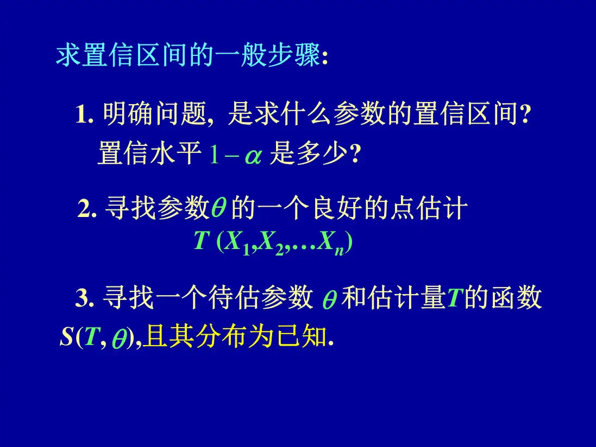

原文：

求置信区间的一般步骤:

1. 明确 问题 是求什么参数的置信区间?置信水平 是多少1 −α ?

2. 寻找参数 的一个 良好的点估计θT (X1,X2, …Xn)

3. 寻找一个待估参数 和估计量T的函数θS(T )θ 且其分布为 已知.

### $$

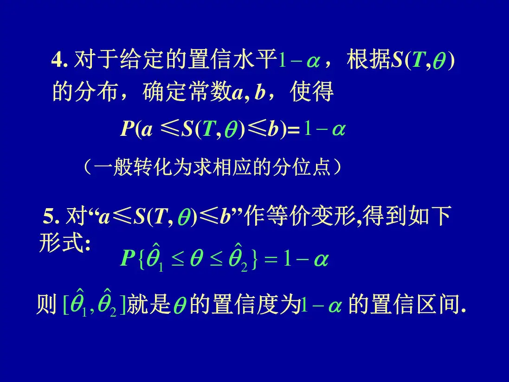

原文：

4. 对于给定 的置信水平 ， 根据S(T, )1 − α θ的分布， 确定常数 $\textcircled { \prime } \textcircled { \prime }$ ， 使得

$$
P (a \leqslant S (T, \theta) \leqslant b) = 1 - \alpha
$$

（一般转化为求相应的分位点）

5. 对 $( 1 ) ( 1 1 - 1 ) ( 1 1 + 1 1 ) ( 2 )$ 作等价变形 得到如下形式:$1 2 ( 2 ) - ( 6 ) = ( 2 ) - ( 2 ) = ( 2 )$

则 $\textcircled { 1 0 } \textcircled { 1 }$ 就是 的置信度为 的置信区 间] .θ 1 −α

### .5§ 正态总体均值与方差的 区间估计

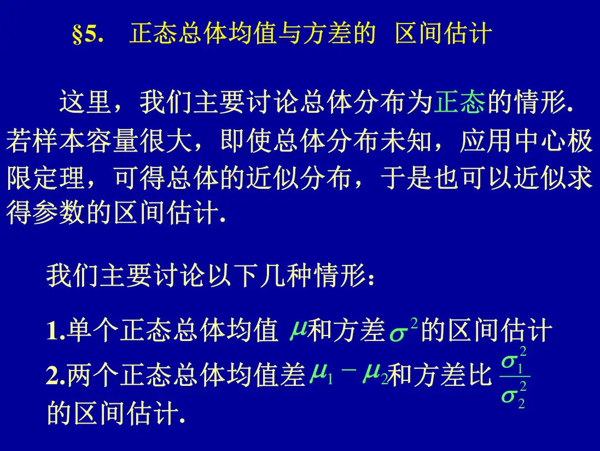

原文：

.5§ 正态总体均值与方差的 区间估计

这里， 我们主要讨论总体分布为正态的情形.若样本容量很大， 即使总体分布未知， 应用 中心极限定理， 可得总体的近似分布， 于是也可以近似求得参数的区间估计.

我们主要讨论以下几种情形：

1.单个正态总体均值 和方差μ $\circledcirc$ 的区 间估计2.两个正态总体均值差 和方差比μ − μ 21 $\frac { 9 } { 9 }$ 的区 间估计.

### 一、 单个正态总体均值 和方差 的区间估计μ 2 σ先看一个例子：

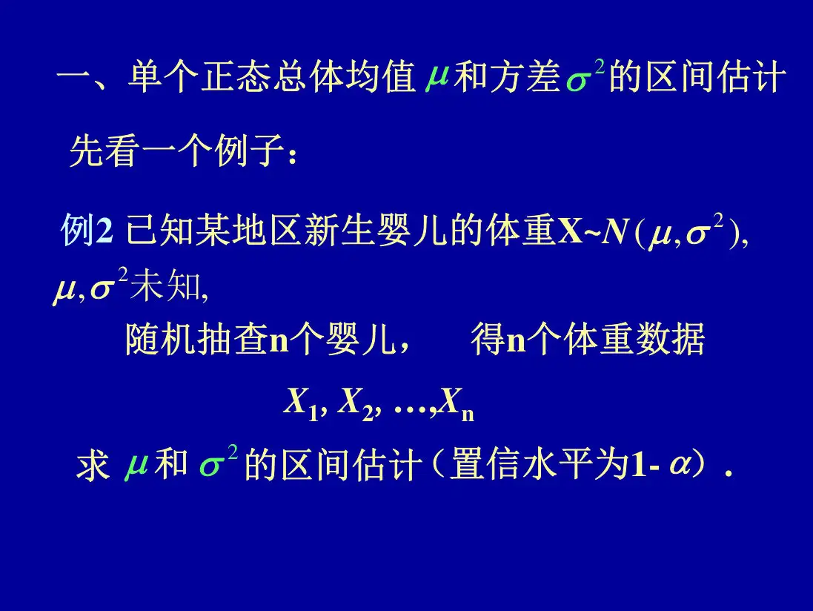

原文：

一、 单个正态总体均值 和方差 的区间估计μ 2 σ先看一个例子：

例2 已知某地区新生婴儿的体重X $\sim \Delta C ( m , n )$ $1 9 5 \div 2$ ,未知

随机抽查n个婴儿， 得n个体重数据

$$
X _ {1}, X _ {2}, \dots , X _ {\mathrm{n}}
$$

μ 求 和 $\odot$ 的区 间估计 （置信水平为1- α） .解： 这是单个总体均值和方差的估计已知X $\angle A ^ { \prime } ( 1 , 1 0 ) = \angle A ^ { \prime } ( 1 , 1 0 )$ 未知先求均值 的区间估计μ .α 2/ α 2/选取 的 良好点估计μ X)1(2/ nt −)1(− nt −因方差未知， 取 $\frac { 1 } { 3 } \times \frac { 1 } { 5 } = \frac { 1 } { 5 } ( c m ^ { 2 } - 1 )$ 对给定的置信度1 −α 确定分位数 $y _ { 1 } = \sqrt { y _ { 2 } }$ 使即 $1 2 ( 1 1 2 - 1 0 0 ) \times ( 1 2 - 1 0 ) \times 2 = 1 0 0$ $1 2 - 1 = 1 2$

### 第 5 页

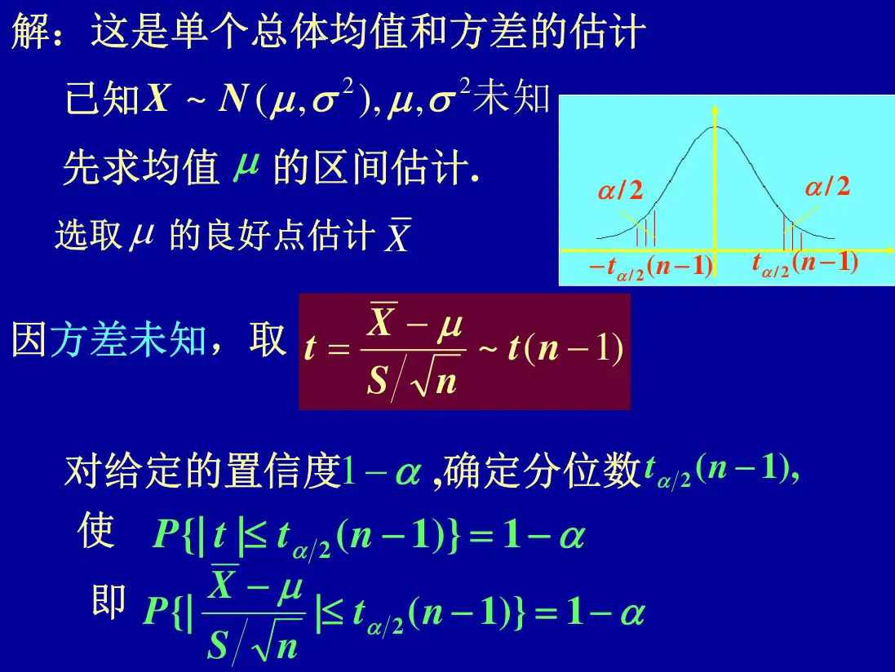

### 从中解得

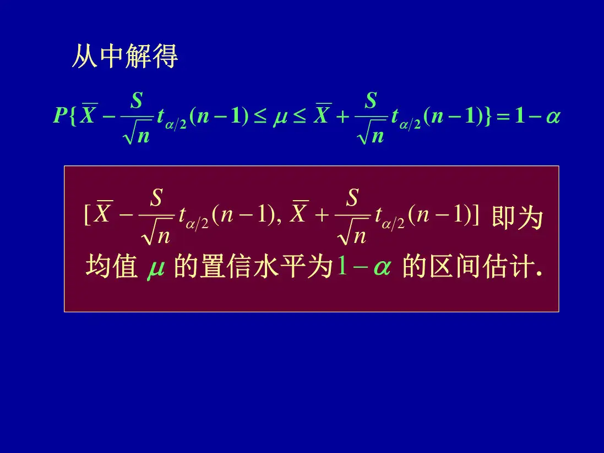

原文：

从中解得

$$
P \{\overline {{X}} - \frac {S}{\sqrt {n}} t _ {\alpha / 2} (n - 1) \leq \mu \leq \overline {{X}} + \frac {S}{\sqrt {n}} t _ {\alpha / 2} (n - 1) \} = 1 - \alpha
$$

$\frac { 1 } { 1 0 } \times \frac { 1 } { 1 0 } = \frac { 1 } { 1 0 } \times \frac { 1 } { 1 0 } = \frac { 1 } { 1 0 } ( c m ^ { 2 } )$ 即为均值 的置信水平为 的区间估计.μ 1 −α再求方差 $\circledcirc$ 的置信水平为 的区 间估计1 −α .

### 取 $\circledcirc$ 取 2 的 点估计 ，S

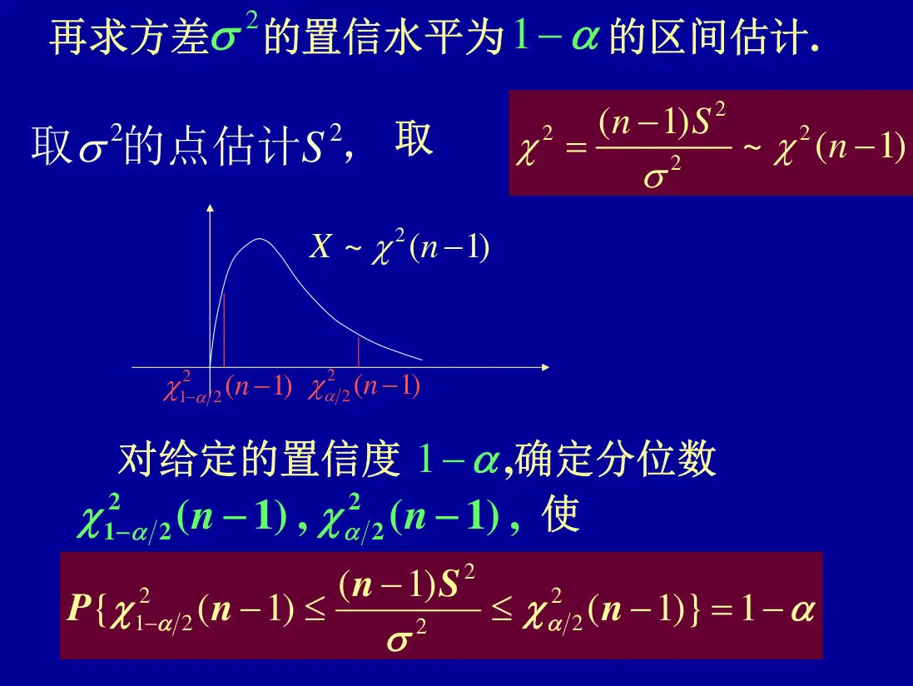

原文：

取 $\circledcirc$ 取 2 的 点估计 ，S

$$
\chi^ {2} = \frac {(n - 1) S ^ {2}}{\sigma^ {2}} \sim \chi^ {2} (n - 1)
$$

对给定的置信度 1 −α 确定分位数 $\angle B = \angle C D C = \angle A E D = \angle C D C = \angle D$ 使 − )1( 2 Sn χ α− ≤− )1({ 2 21 nP σ 2 χ αα −=−≤ 1) }1( 2 2 n

### 从中解得

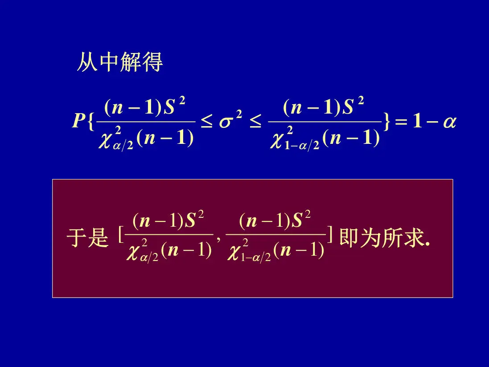

原文：

从中解得

$$
P \{\frac {(n - 1) S ^ {2}}{\chi_ {\alpha / 2} ^ {2} (n - 1)} \leq \sigma^ {2} \leq \frac {(n - 1) S ^ {2}}{\chi_ {1 - \alpha / 2} ^ {2} (n - 1)} \} = 1 - \alpha
$$

于是 $\frac { 4 } { 1 0 } \times \frac { 4 } { 1 0 } = \frac { 1 0 } { 1 0 } ( c m ^ { 2 } )$ 即为所求.

### 第 9 页

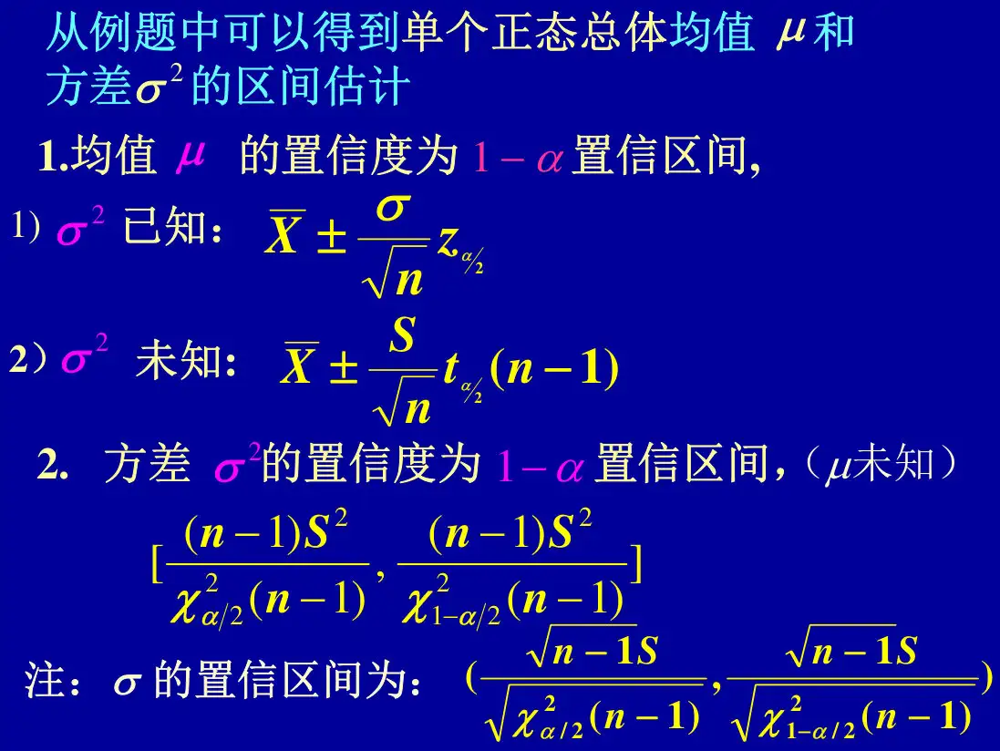

原文：

从例题中可以得到单个正态总体均值 和μ方差 $\textcircled { \bullet }$ 的区 间估计1.均值 的置信度为 置信区 间μ 1 − α$\bigcirc$ 已知 ： $\frac { 1 } { 2 } \times \frac { 1 } { 3 } = \frac { 1 } { 2 }$ 2 ） $\bigcirc$ 未知: $\frac { 1 } { 4 } \times \frac { 1 } { 5 } = \frac { 1 } { 5 } ( m - 1 )$ 2. 方差 的置信度为 置信区 间 ，1 −α2σ （ 未知 ）μ$\frac { 1 1 } { 1 0 } \times \frac { 1 1 } { 1 0 } \times \frac { 1 1 } { 1 0 } = \frac { 1 1 } { 1 0 } \times \frac { 1 1 } { 1 0 }$ 1− Sn 1− Sn注： σ 的置信区 间为：$( 1 8 + 1 0 ) \times ( 1 0 - 1 1 ) \times ( 1 0 - 1 1 ) = ( 1 0 - 1 1 )$

### 第 10 页

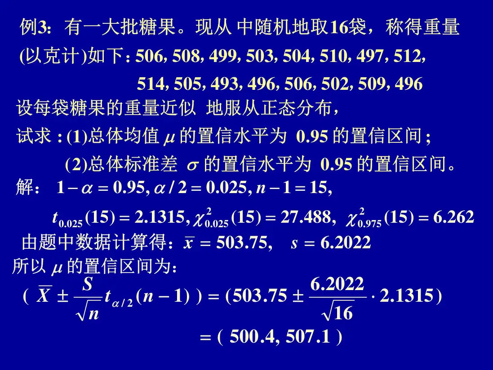

原文：

3 16例 ： 有一大批糖果。 现从 中随机地取 袋， 称得重量)(以克计 如下： $\mathrm { 5 I U _ { 2 } S o _ { 4 } ( l e r m ) _ { 2 } S o _ { 4 } ( l e r m ) _ { 2 } S o _ { 4 } ( l e r m ) _ { 2 } S o _ { 4 } ( l e r m ) _ { 2 } S o _ { 4 } ( l e r m ) _ { 2 } ( l e r m ) _ { 2 } ( l e r m ) _ { 2 } }$ $\mathrm { S U S } = \mathrm { P a } ( \mathrm { R e } ( \mathrm { R e } ( \mathrm { R e } ( \mathrm { R e } ( \mathrm { R e } ( \mathrm { R e } ) ) ) ) ) \mathrm { R e } ( \mathrm { R e } ( \mathrm { R e } ( \mathrm { R e } ( \mathrm { R e } ) ) ) ) \mathrm { R e } ( \mathrm { R e } ( \mathrm { R e } ( \mathrm { R e } ( \mathrm { R e } ( \mathrm { R e } ) ) ) ) )$ 设每袋糖果的重量近似 地服从正态分布，试求 总体均值 的置信水平为 的置信区 间)1(: 95.0 ;μ总体标准差 的置信水平为 的置信区 间 。)2( 95.0σ解 ： $\because ( 2 ) \because ( 1 1 0 - 2 0 ) \times ( 2 1 0 - 2 0 ) \times ( 2 1 0 - 2 0 ) \times ( 2 1 0 - 2 0 ) \times ( 2 1 0 - 2 0 ) \times ( 2 1 0 - 2 0 ) \times ( 2 1 0 - 2 0 ) \times ( 2 1 0 - 2 0 ) \times ( 2 1 0 - 2 0 ) \times ( 2 1 0 - 2 0 ) \times ( 2 1 0 - 2 0 ) \times ( 2 1 0 - 2 0 ) \times ( 2 1 0 - 2 0 ) \times ( 2 1 0 - 2 0 )$ $( \mathrm { a v e r ~ } 0 . 0 5 ) = ( \mathrm { a v e r ~ } 0 . 0 5 ) ( \mathrm { a v e r ~ } 0 . 0 5 ) = ( \mathrm { a v e r ~ } 0 . 0 5 ) ( \mathrm { a v e r ~ } 0 . 0 5 ) = ( \mathrm { a v e r ~ } 0 . 0 5 ) ( \mathrm { a v e r ~ } 0 . 0 5 )$ 由题中数据计算得： $\scriptstyle { \overline { { B } } } = { \overline { { A } } } \left( 1 , 3 , \ldots \right)$ s = 2022.6所以 μ 的置信区 间为：$( 1 ) \frac { 1 } { 2 } \times ( 1 0 - 2 ) \times ( 1 0 - 2 ) \times ( 1 0 - 2 ) \times ( 1 0 - 2 ) \times ( 1 0 - 2 ) \times ( 1 0 - 2 ) \times ( 1 0 - 2 ) \times ( 1 0 - 2 ) \times ( 1 0 - 2 ) \times ( 1 0 - 2 ) \times ( 1 0 - 2 ) \times ( 1 0 - 2 ) \times ( 1 0 - 2 ) \times ( 1 0 - 2 ) \times ( 1 0 - 2 ) \times ( 1 0 - 2 ) \times ( 1 0 - 2 ) \times ( 1 0 - 2 ) \times ( 1 0 - 2 ) \times ( 1 0 - 2 ) \times ( 1 0 - 2 ) \times ( 1 0 - 2 ) \times ( 1 0 - 2 )$

### $$

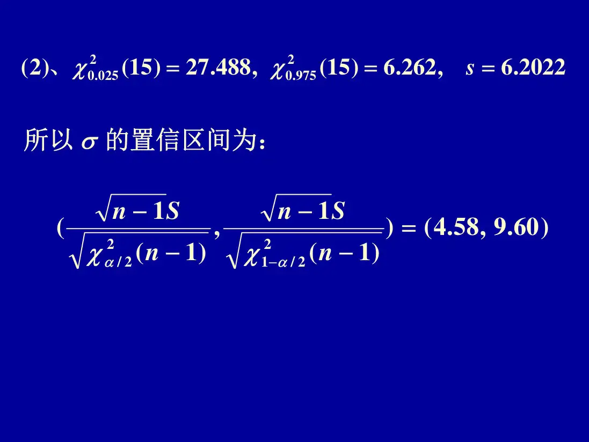

原文：

$$
(2) \text {、} \chi_ {0. 0 2 5} ^ {2} (1 5) = 2 7. 4 8 8, \chi_ {0. 9 7 5} ^ {2} (1 5) = 6. 2 6 2, s = 6. 2 0 2 2
$$

所以 σ 的置信区 间为：

$$
(\frac {\sqrt {n - 1} S}{\sqrt {\chi_ {\alpha / 2} ^ {2} (n - 1)}}, \frac {\sqrt {n - 1} S}{\sqrt {\chi_ {1 - \alpha / 2} ^ {2} (n - 1)}}) = (4. 5 8, 9. 6 0)
$$

### 第 12 页

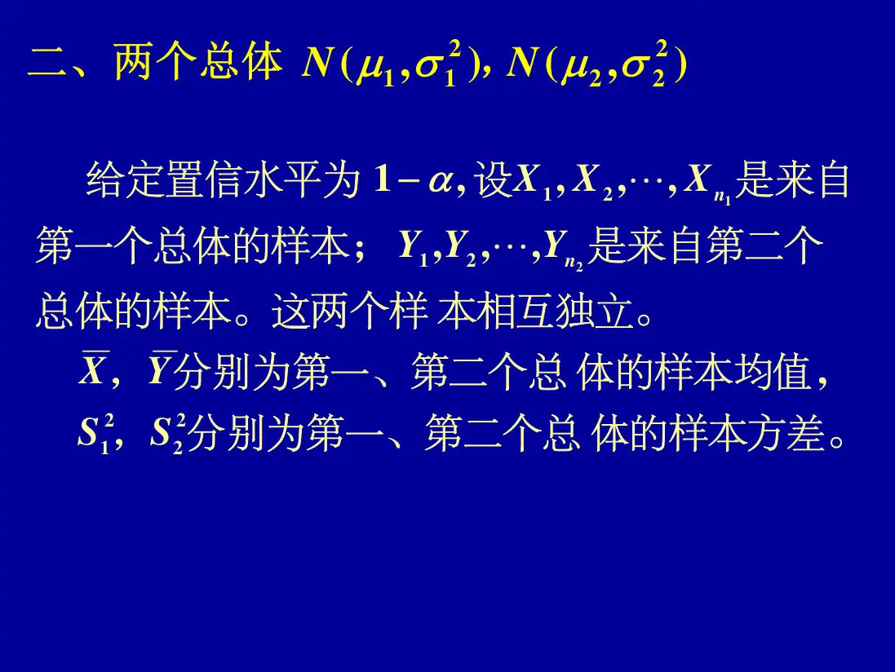

原文：

二、 两个总体 N $( 1 ) ( 1 0 0 - 1 0 0 ) \times ( 1 0 0 - 2 0 0 )$

给定置信水平为 $1 1 - 1 0 3$ 设 $: \frac { 1 } { 2 } : \frac { 1 } { 2 } : \frac { 1 } { 2 } : \frac { 1 } { 2 } : \frac { 1 } { 2 } : \frac { 1 } { 2 } : \frac { 1 } { 2 } : \frac { 1 } { 2 } : \frac { 1 } { 2 } : \frac { 1 } { 2 } : \frac { 1 } { 2 } : \frac { 1 } { 2 }$ 是来自第一个总体的样本； $1 4 0 \% = 1 4 0 \%$ 是来自第二个总体的样本。 这两个样 本相互独立。， 分别为第一、 第二个总 体的样本均值,YX$\textcircled { \bullet }$ $\textcircled { \bullet }$ 分别为第一、 第二个总 体的样本方差。一） 两个总体均值差 $1 9 5 - 1 9 5 = 1 9 5 2$ 的置信区 间

### $$

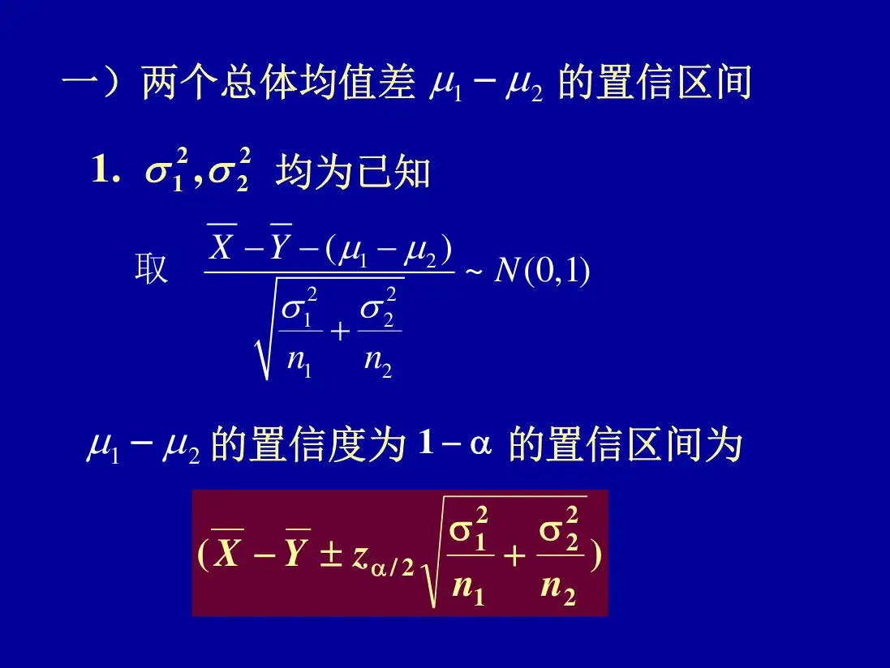

原文：

.1 $\textcircled { \bullet } \frac { \cdot } { \cdot } \textcircled { \bullet } \frac { \cdot } { \cdot }$ 均为已知

取

$$
\frac {\overline {{X}} - \overline {{Y}} - (\mu_ {1} - \mu_ {2})}{\sqrt {\frac {\sigma_ {1} ^ {2}}{n _ {1}} + \frac {\sigma_ {2} ^ {2}}{n _ {2}}}} \sim N (0, 1)
$$

μ −1 $\textcircled { 1 } \textcircled { 2 }$ 的置信度为 的置信区 间为1 − α

$$
(\overline {{X}} - \overline {{Y}} \pm z _ {\alpha / 2} \sqrt {\frac {\sigma_ {1} ^ {2}}{n _ {1}} + \frac {\sigma_ {2} ^ {2}}{n _ {2}}})
$$

### $$

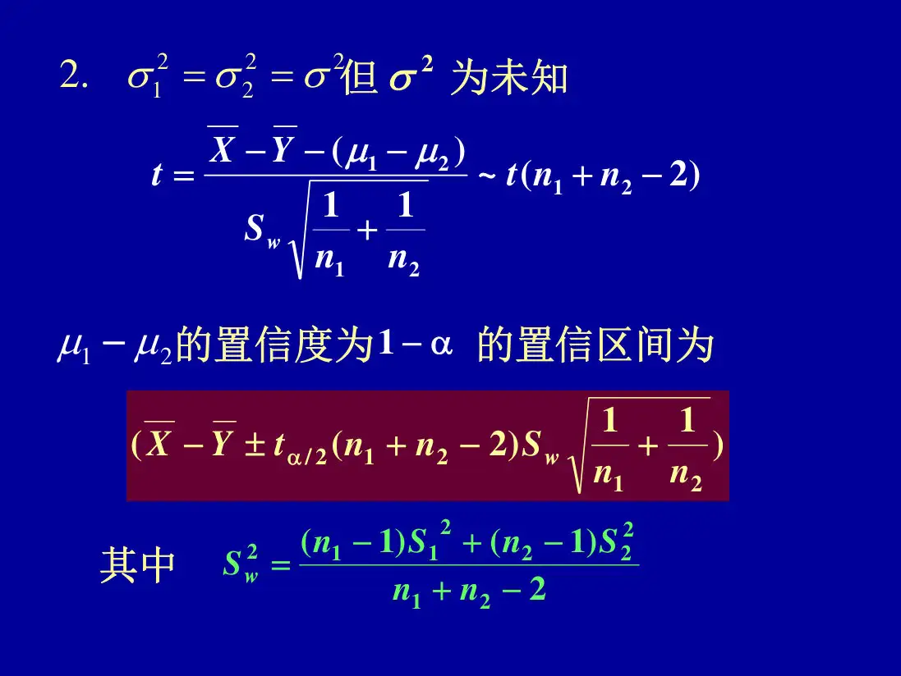

原文：

2 . $\frac { 2 } { 3 } x = \frac { 1 2 } { 1 0 } \div \frac { 1 2 } { 1 0 }$ 但2 $\circledcirc$ 为未知

$$
t = \frac {\overline {{X}} - \overline {{Y}} - (\mu_ {1} - \mu_ {2})}{S _ {w} \sqrt {\frac {1}{n _ {1}} + \frac {1}{n _ {2}}}} \sim t (n _ {1} + n _ {2} - 2)
$$

μ − μ21 的置信度为 的置信区 间为 1 − α

$$
(\overline {{X}} - \overline {{Y}} \pm t _ {\alpha / 2} (n _ {1} + n _ {2} - 2) S _ {w} \sqrt {\frac {1}{n _ {1}} + \frac {1}{n _ {2}}})
$$

其中 $x \times - \frac { 1 } { 2 } \times \frac { 1 } { 3 } \times \frac { 1 } { 3 } \times \frac { 1 } { 3 } \times \frac { 1 } { 3 } \times \frac { 1 } { 3 } \times \frac { 1 } { 3 } \times \frac { 1 } { 3 } \times \frac { 1 } { 3 } \times \frac { 1 } { 3 } \times \frac { 1 } { 3 } \times \frac { 1 } { 3 } \times \frac { 1 } { 3 } \times \frac { 1 } { 3 } \times \frac { 1 } { 3 }$

### $$

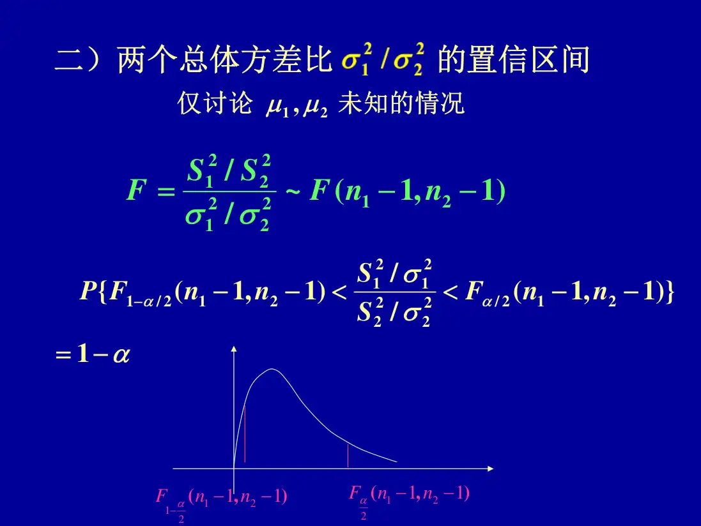

原文：

二） 两个总体方差比 $\frac { 2 } { 1 0 } \times \frac { 2 } { 1 0 } = \frac { 2 } { 1 0 }$ 的置信区 间仅讨论 $\textcircled { 1 } \textcircled { 1 } \textcircled { 2 } \textcircled { 1 } \textcircled { 2 } \textcircled { 2 }$ 未知的情况

$$
F = \frac {S _ {1} ^ {2} / S _ {2} ^ {2}}{\sigma_ {1} ^ {2} / \sigma_ {2} ^ {2}} \sim F (n _ {1} - 1, n _ {2} - 1)
$$

$$
P \{F _ {1 - \alpha / 2} (n _ {1} - 1, n _ {2} - 1) <   \frac {S _ {1} ^ {2} / \sigma_ {1} ^ {2}}{S _ {2} ^ {2} / \sigma_ {2} ^ {2}} <   F _ {\alpha / 2} (n _ {1} - 1, n _ {2} - 1) \}
$$

### $$

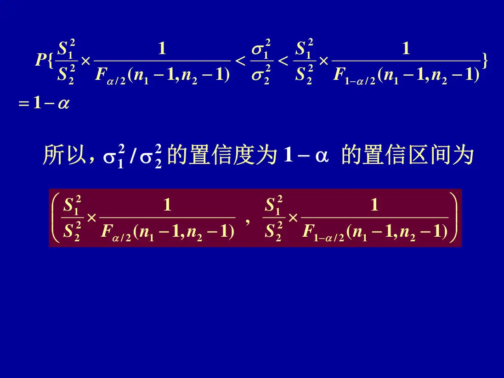

原文：

$$
\begin{array}{l} P \{\frac {S _ {1} ^ {2}}{S _ {2} ^ {2}} \times \frac {1}{F _ {\alpha / 2} (n _ {1} - 1 , n _ {2} - 1)} <   \frac {\sigma_ {1} ^ {2}}{\sigma_ {2} ^ {2}} <   \frac {S _ {1} ^ {2}}{S _ {2} ^ {2}} \times \frac {1}{F _ {1 - \alpha / 2} (n _ {1} - 1 , n _ {2} - 1)} \} \\ = 1 - \alpha \end{array}
$$

所以 ， $\mathtt { G } \mathtt { M } \mathtt { G }$ 的置信度为 的置信区 间为1 − α

$$
\left(\frac {S _ {1} ^ {2}}{S _ {2} ^ {2}} \times \frac {1}{F _ {\alpha / 2} (n _ {1} - 1 , n _ {2} - 1)} \right., \left. \frac {S _ {1} ^ {2}}{S _ {2} ^ {2}} \times \frac {1}{F _ {1 - \alpha / 2} (n _ {1} - 1 , n _ {2} - 1)}\right)
$$

### 第 17 页

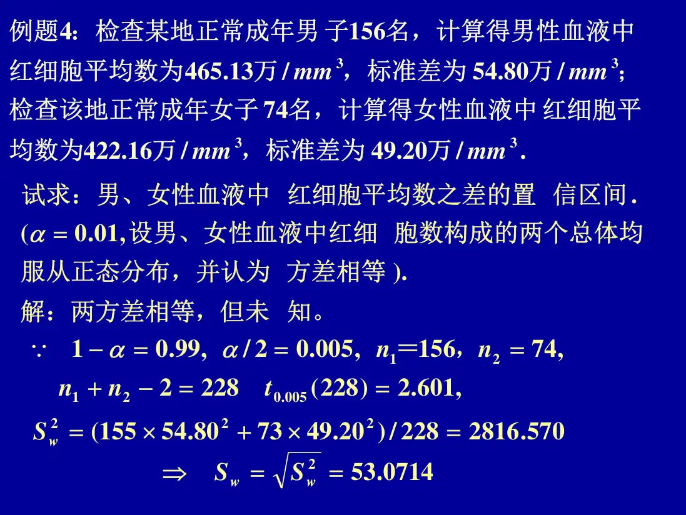

原文：

4 156例题 ： 检查某地正常成年男 子 名 ， 计算得男性血液中13.465红细胞平均数为 万 $1 0 0 m ^ { 3 }$ 80.54标准差为 万 $1 5 7 \times 1 7 = 1 9$ 74检查该地正常成年女子 名 ， 计算得女性血液中 红细胞平16.422均 数为 万 $1 0 0 0 0 0$ 20.49标准差为 万 $1 0 0 0 0$ .试求： 男、 女性血液中 红细胞平均数之差的置 信区间$( \cos \theta , \sin \theta , \sin \theta )$ 设男 女性血液中红细 胞数构成的两个总体均).服从正态分布， 并认为 方差相等解： 两方差相等， 但未 知。$\angle B = \angle C A B \angle C A D = \angle B A C = \angle C A B = \angle C A B = \angle C A B = \angle C A B = 9 0 ^ { \circ }$ $1 1 5 - 1 1 5 - 5 1 = 1 9 4 3$ $( \mathrm { L R } ( \mathrm { L D } ) \mathrm  { _ { o f f } ( \psi ) \it = \it { \Psi ( \psi ) \it = \Psi ( \psi ) \it = \Psi ( \psi ) \it = \Psi ( \psi ) \it = \Psi ( \psi ) \it = \Psi ( \psi ) \it = \Psi ( \psi ) \it = \Psi ( \psi ) \it = \Psi ( \psi ) \it = \Psi ( \psi ) \it = \Psi ( \psi ) \it = \Psi ( \psi ) \it = \Psi ( \psi ) \it = \Psi ( \psi ) \it = \Psi ( \psi ) \it = \Psi ( \psi ) \it = \Psi ( \psi ) \it = \Psi ( \psi ) \it = \Psi ( \psi ) \it = \Psi ( \psi ) \it = \Psi ( \psi ) \it } }$ $S _ { 2 } = ( 1 5 5 ) \times ( 2 5 \times 1 ) \times ( 2 5 \times 1 ) \times ( 2 5 \times 1 ) \times ( 2 5 \times 1 ) = 2 5 5 ( 1 5 \times 1 )$ $\angle B = \angle A B C = \angle B A D = \angle C$

### $$

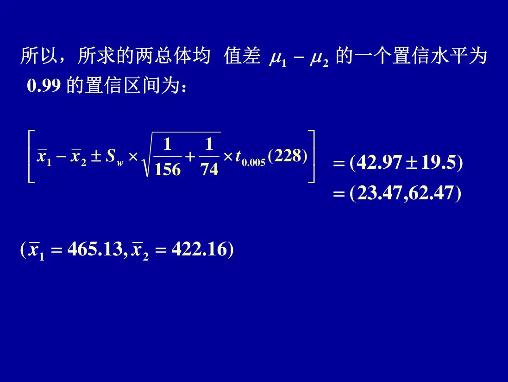

原文：

所以， 所求的两总体均 值差 $\textcircled { 1 } \textcircled { 2 }$ 的一个置信水平为的置信区 间为：99.0

$$
\left[ \begin{array}{l} \overline {{x}} _ {1} - \overline {{x}} _ {2} \pm S _ {w} \times \sqrt {\frac {1}{1 5 6} + \frac {1}{7 4}} \times t _ {0. 0 0 5} (2 2 8) \\ = (4 2. 9 7 \pm 1 9. 5) \\ = (2 3. 4 7, 6 2. 4 7) \end{array} \right]
$$

$$
(\overline {{x}} _ {1} = 4 6 5. 1 3, \overline {{x}} _ {2} = 4 2 2. 1 6)
$$

### 第 19 页

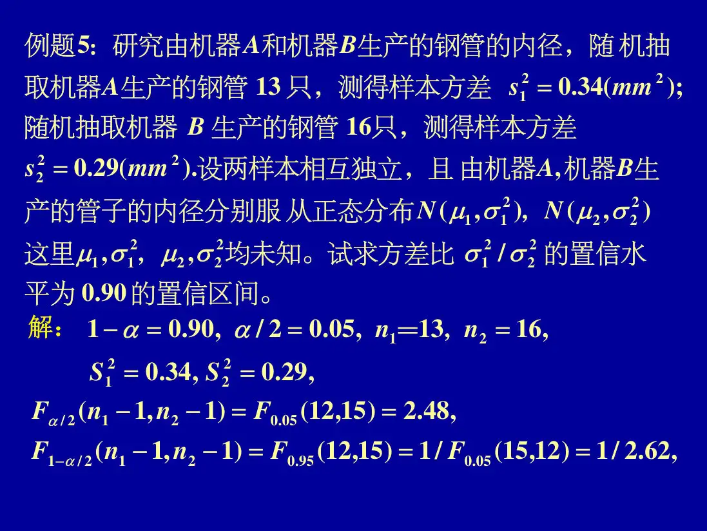

原文：

例题 ： 研究由机器 和机器 生产的钢管的内径 随机抽5 BA取机器 生产的钢管 只， 测得样本方差13 A $S _ { \Delta } A B C = ( 1 ) \times \frac { 1 } { 2 } ( \angle C A B - \angle C ) \times$ 随机抽取机器 生产的钢管 只， 测得样本方差16B$\times 3 = ( 1 ) \times 3 = ( 1 ) \times 3 = ( 1 ) \times 3 = ( 1 )$ 设两样本相互独立 且 由机器 机器 生. BA产的管子的内径分别服从正态分布N $( 1 ) ( 1 0 - 1 0 ) \times ( 1 0 - 2 ) \times ( 2 0 - 2 )$ 这里 $1 2 \times 2 \times 2 = 1 2 \times 2 \times 2$ 均未知。 试求方差比 $\textcircled { \bullet } \textcircled { < } \frac { 3 } { 2 }$ 的置信水平为 的置信区间。90.0解 ： $\angle C _ { 2 } = ( 1 8 0 ^ { \circ } ) \angle B = \angle D C E = \angle B A C = \angle E B C = 1 8 0 ^ { \circ }$ $\times 4 = ( 1 ) \times 2 . 5 \times 3 = ( 1 ) \times 2 . 5$ $1 2 \sqrt { 1 6 } ( 1 - \sqrt { 1 6 } ) = 1 1 \sqrt { 1 6 } ( 1 6 \sqrt { 1 6 } ) = 1 \sqrt { 1 6 } ( 1 2 \sqrt { 1 6 } )$ $\angle C = \angle C _ { 1 } = \angle C _ { 2 } = \angle C _ { 2 } = \angle C _ { 3 } = \angle C _ { 2 } = \angle C _ { 3 } = \angle C _ { 2 } = \angle C _ { 3 } = \angle C _ { 2 } = \angle C _ { 3 } = \angle C _ { 2 } = \angle C _ { 3 } = \angle C _ { 2 } = 9 0 ^ { \circ }$

### $$

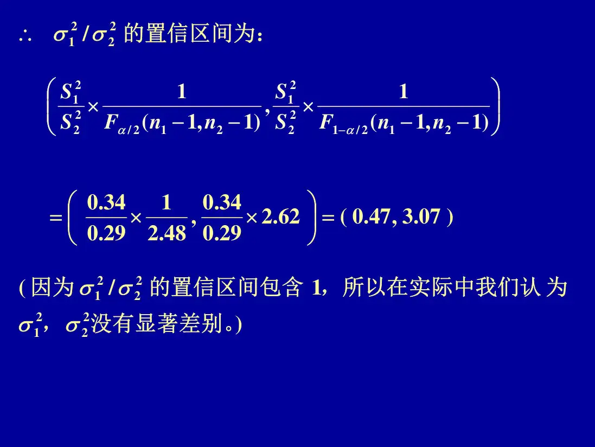

原文：

$0 . 7 \times 1 0 ^ { 3 } k g / m ^ { 3 }$ 的置信区 间为：

$$
\left(\frac {S _ {1} ^ {2}}{S _ {2} ^ {2}} \times \frac {1}{F _ {\alpha / 2} (n _ {1} - 1 , n _ {2} - 1)}, \frac {S _ {1} ^ {2}}{S _ {2} ^ {2}} \times \frac {1}{F _ {1 - \alpha / 2} (n _ {1} - 1 , n _ {2} - 1)}\right)
$$

$$
= \left(\frac {0 . 3 4}{0 . 2 9} \times \frac {1}{2 . 4 8}, \frac {0 . 3 4}{0 . 2 9} \times 2. 6 2\right) = (0. 4 7, 3. 0 7)
$$

( 因 为 $\textcircled { \bullet } \textcircled { < } \frac { \cdot } { \cdot } \textcircled { < } \frac { \cdot } { \cdot }$ 1的置信区间包含 ， 所以在实际中我们认 为$\textcircled { \bullet }$ ● $\textcircled { \bullet } \frac { \cdot } { \cdot }$ )没有显著差别 。

### .7§ 单侧置信区 间

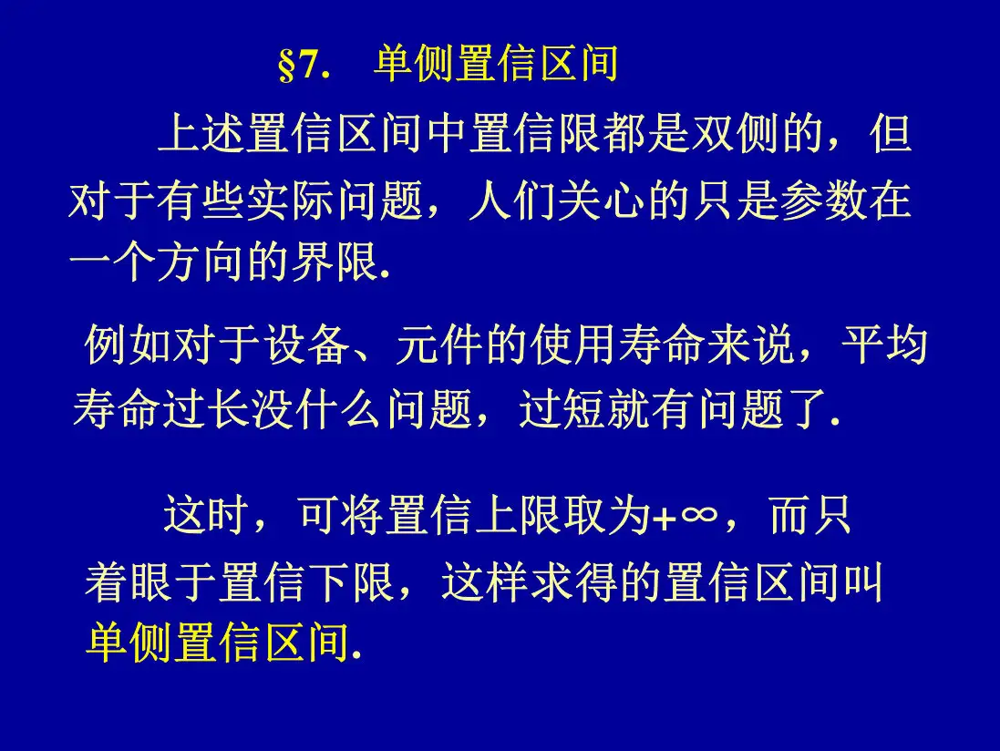

原文：

.7§ 单侧置信区 间

上述置信区间 中置信限都是双侧的 但对于有些实际问题， 人们关心的只是参数在一个方向 的界限.

例如对于设备、 元件的使用寿命来说， 平均寿命过长没什么 问题， 过短就有问题了

这时， 可将置信上限取为+∞， 而只着眼于置信下限， 这样求得的置信区间叫单侧置信区间.

### 于是引入单侧置信区间和置信限的定义：

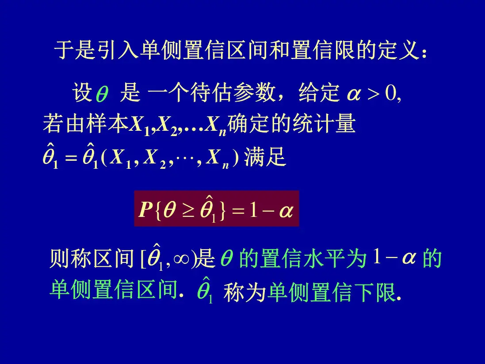

原文：

于是引入单侧置信区间和置信限的定义：

θ设 是 一个待估参数， 给定 $[ \pmb { \theta } ] ^ { 2 } > [ \pmb { 0 } ]$ 若由样本 $: \frac { 1 } { 2 } \times \frac { 1 } { 3 } \times \frac { 1 } { 3 } \times \frac { 1 } { 3 } = \frac { 1 } { 3 } \times \frac { 1 } { 3 }$ 确定的统计量$\textcircled { 2 } - \textcircled { 2 } \textcircled { 1 } \cdots \textcircled { 2 } \cdots \textcircled { 2 } \cdots \textcircled { 2 }$ 满足

$$
P \{\theta \geq \hat {\theta} _ {1} \} = 1 - \alpha
$$

则称区间 $\textcircled { 1 0 } \textcircled { \cdot }$ 是 的置信水平为 的) θ 1 −α单侧置信区间. $\textcircled { 9 }$ 称为单侧置信下限.

### $$

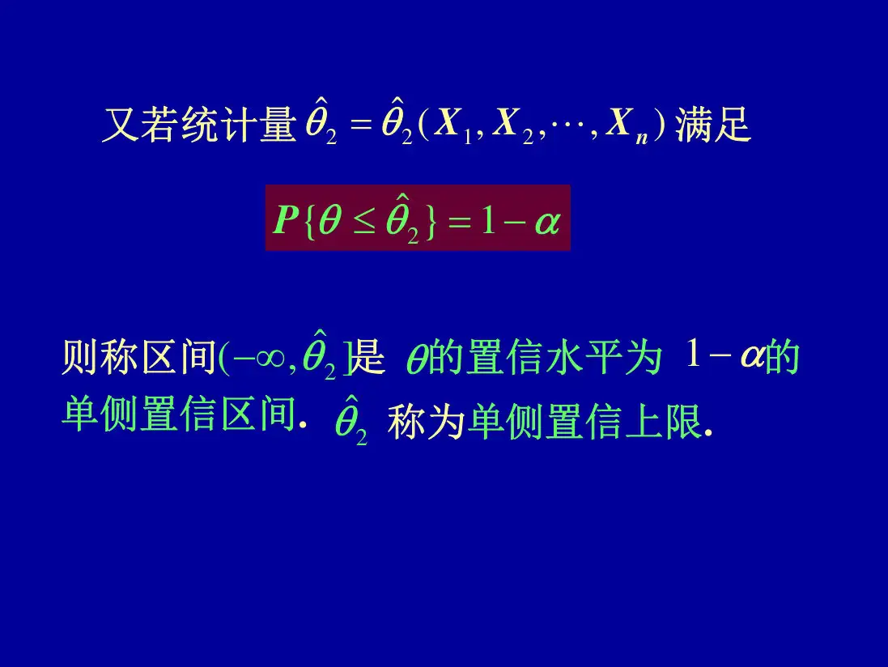

原文：

又若统计量 $\textcircled { 6 } \frac { 1 } { 6 } = \textcircled { 6 } \frac { 1 } { 6 } \textcircled { 1 0 } \frac { 1 } { 6 } \times \frac { 1 } { 6 } \times \frac { 1 } { 6 } \times \frac { 1 } { 6 } \times \frac { 1 } { 6 } \times \frac { 1 } { 6 } \times \frac { 1 } { 6 } \times \frac { 1 } { 6 }$ 满足

$$
P \{\theta \leq \hat {\theta} _ {2} \} = 1 - \alpha
$$

则称区间 $\textcircled { 1 } \textcircled { 2 } \textcircled { 1 }$ 是 的置信水平为 的] θ 1 −α单侧置信区间. $\textcircled { 1 }$ 称为单侧置信上限.

### 第 24 页

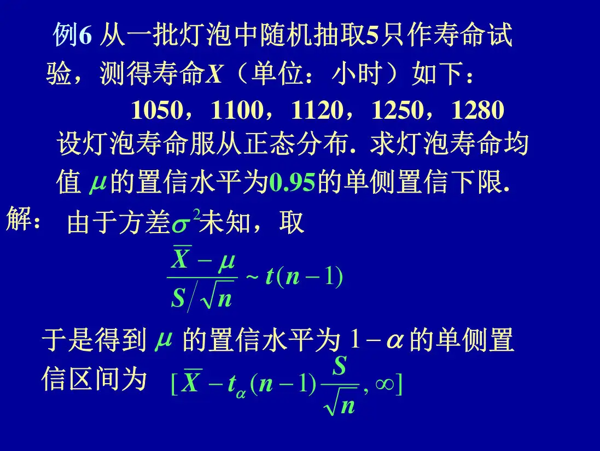

原文：

例6 从一批灯泡中随机抽取5只作寿命试验， 测得寿命X （单位： 小时） 如下：1050 ， 1 100 ， 1 120 ， 1250 ， 1280设灯泡寿命服从正态分布 求灯泡寿命均值 的置信水平为0.95的单侧置信下限.μ由于方差解： $\boxed { \bullet }$ 未知 ， 取2$\frac { 3 } { 4 } \times \frac { 1 } { 1 2 } = \frac { 1 } { 2 } ( c m ^ { 2 } )$ 于是得到 的置信水平为 的单侧置μ 1 −α信区间为 $\vert \vert \overrightarrow { b } + \vert \overrightarrow { b } + \vert \overrightarrow { b } - \vert \overrightarrow { b } \vert \vert = 0 .$

### $$

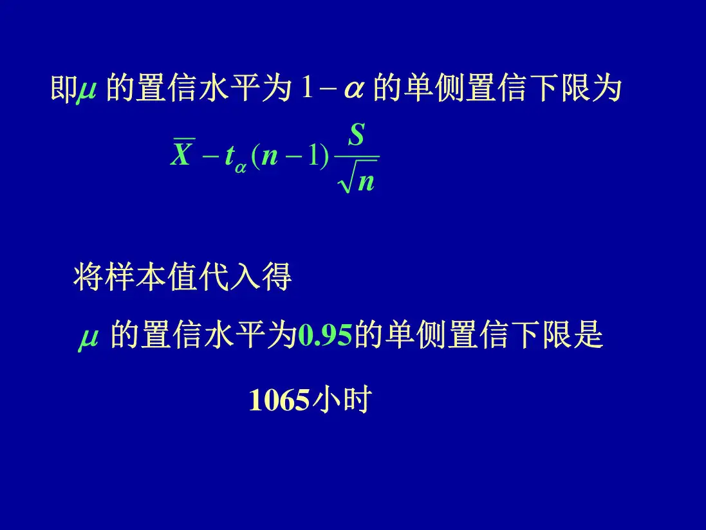

原文：

$$
\overline {{X}} - t _ {\alpha} (n - 1) \frac {S}{\sqrt {n}}
$$

将样本值代入得

μ 的置信水平为0.95的单侧置信下限是

1065小 时
