# 《概率论与数理统计》第7章 参数估计 2. 估计量的评选标准（课件）

原件的每一页，下面附识别出的文字。

### 解得

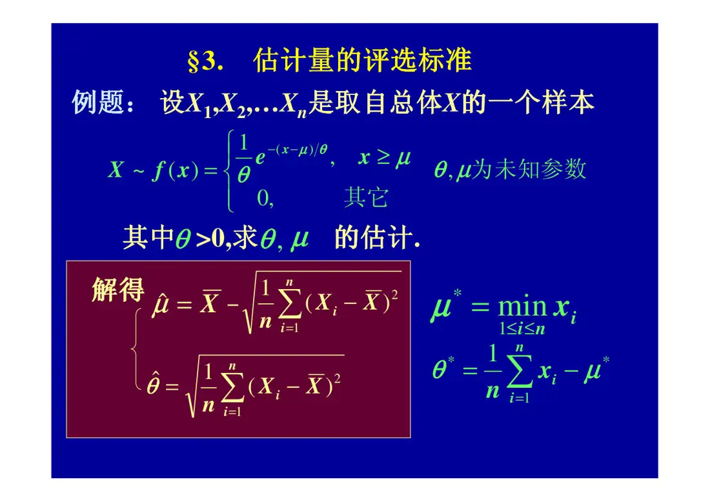

原文：

§ .3 估计量的评选标准例题： 设 $1 : ( 1 0 0 ) : ( 1 0 0 ) : ( 1 0 0 ) : ( 1 0 0 ) : ( 1 0 0 ) : ( 1 0 0 ) : ( 1 0 0 ) : ( 1 0 0 ) : ( 1 0 0 ) : ( 1 0 0 ) : ( 1 0 0 ) = : ( 1 0 0 0 ) : ( 1 0 0 )$ 是取自总体X的一个样本

$\angle A C O = \angle C O B = \angle C$ 为未知参数 ,

其中 $1 0 2 0$ 求 $\textcircled { \bullet }$ 的估计 .

解得

$$
\hat {\mu} = \overline {{X}} - \sqrt {\frac {1}{n} \sum_ {i = 1} ^ {n} (X _ {i} - \overline {{X}}) ^ {2}}
$$

$$
\hat {\theta} = \sqrt {\frac {1}{n} \sum_ {i = 1} ^ {n} (X _ {i} - \overline {{X}}) ^ {2}}
$$

$$
\mu^ {*} = \min _ {1 \leq i \leq n} x _ {i}
$$

$$
\theta^ {*} = \frac {1}{n} \sum_ {i = 1} ^ {n} x _ {i} - \mu^ {*}
$$

### 第 2 页

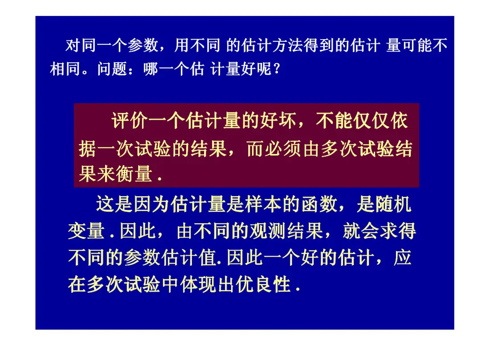

原文：

对同一个参数，用不同 的估计方法得到的估计 量可能不相同。问题：哪一个估 计量好呢？

评价一个估计量的好坏，不能仅仅依 据一次试验的结果，而必须由多次试验结 果来衡量.

这是因为估计量是样本的函数 是随机变量. 因此，由不同的观测结果，就会求得不同的参数估计值. 因此一个好的估计，应在多次试验中体现出优良性.

### 常用的几条标准是：

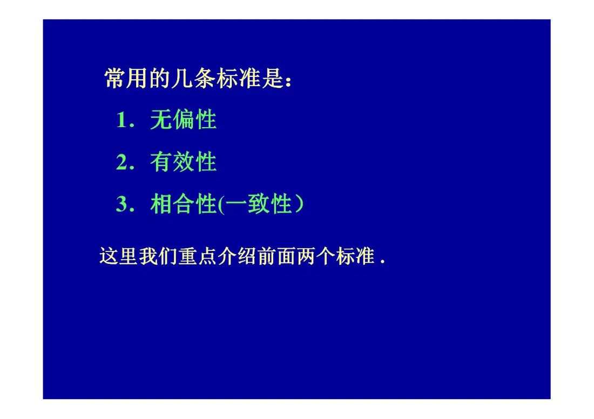

原文：

常用的几条标准是：

1．无偏性

2．有效性

3．相合性(一致性）

这里我们重点介绍前面两个标准.

### 1．无偏性

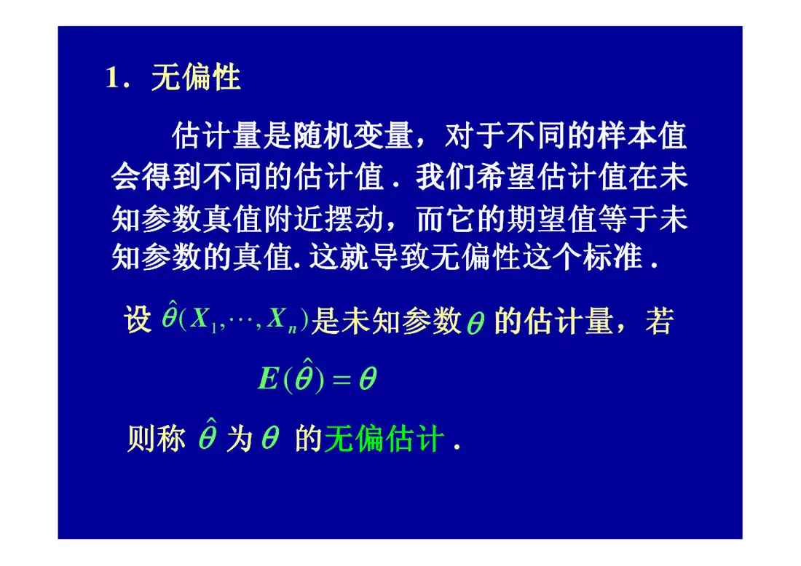

原文：

1．无偏性

估计量是随机变量，对于不同的样本值会得到不同的估计值. 我们希望估计值在未知参数真值附近摆动，而它的期望值等于未知参数的真值. 这就导致无偏性这个标准.

设 $\textcircled { 2 } \textcircled { + } \textcircled { + } \textcircled { + } \textcircled { + } \textcircled { + } \textcircled { + } \textcircled { + } \textcircled { + }$ 是未知参数θ的估计量，若

) = ˆE(

则称 θ为 的无偏估计.ˆ

### 无偏性是对估计量的一个常见而重要的要求.

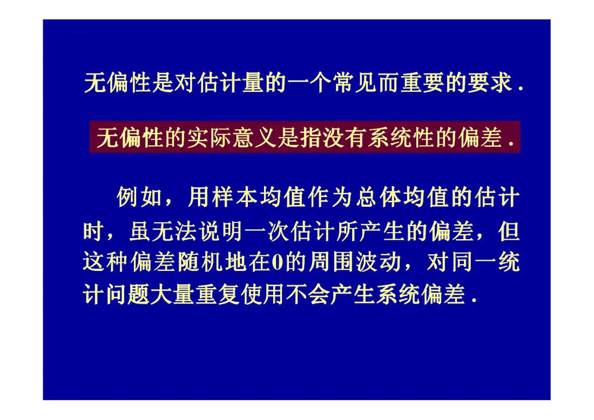

原文：

无偏性是对估计量的一个常见而重要的要求.

无偏性的实际意义是指没有系统性的偏差.

例如，用样本均值作为总体均值的估计时，虽无法说明一次估计所产生的偏差，但这种偏差随机地在0的周围波动，对同一统计问题大量重复使用不会产生系统偏差.

### 很明显

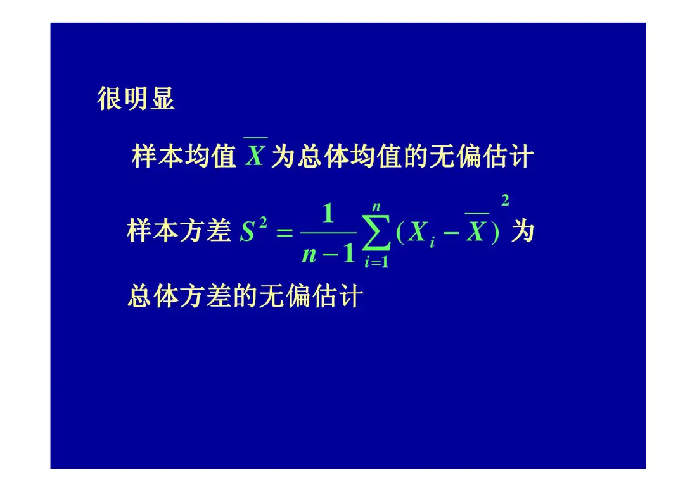

原文：

很明显

样本均值 X为总体均值的无偏估计 样本方差 $x _ { 1 } = - \frac { 1 } { 2 } \times 2 \sqrt { 2 } = - \frac { 1 } { 2 } \times 2 \sqrt { 2 }$ 总体方差的无偏估计

### $$

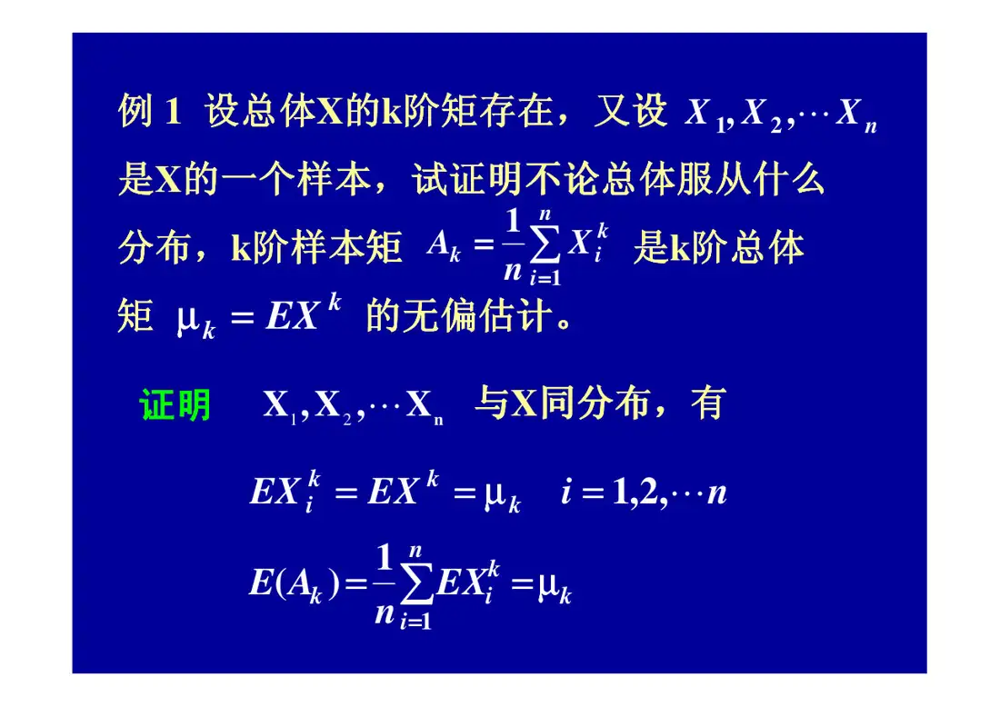

原文：

例1 设总体X的k阶矩存在，又设 $\because \frac { 1 } { 2 } \leq \frac { 1 } { 2 } \leq \frac { 1 } { 2 } \leq \frac { 1 } { 2 } \leq \frac { 1 } { 2 }$ 是X的一个样本，试证明不论总体服从什么分布，k阶样本矩 $: \frac { 1 } { 2 } = \frac { 1 } { 2 } : \frac { 1 } { 2 } = \frac { 1 } { 2 }$ 是k阶总体矩 $\angle B A C = 1 0 0 ^ { \circ }$ 的无偏估计。

证明 $\because \frac { 1 } { 1 6 } : \frac { 1 } { 1 6 } = \frac { 1 } { 1 6 } : \frac { 1 } { 1 6 }$ 与X同分布，有

$$
E X _ {i} ^ {k} = E X ^ {k} = \mu_ {k} i = 1, 2, \dots n
$$

1 n kkk EXiE A = ∑ = µ( ) in =1

### 例 2 设总体X服从指数分布，其概率密度为

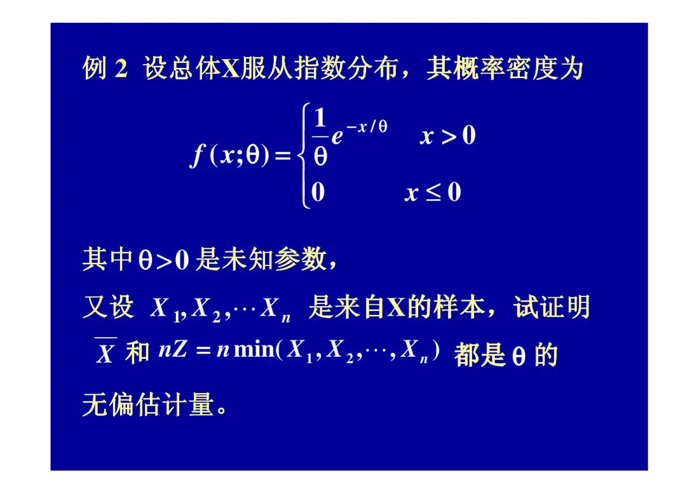

原文：

例 2 设总体X服从指数分布，其概率密度为

$$
f (x; \theta) = \left\{ \begin{array}{l l} \frac {1}{\theta} e ^ {- x / \theta} & x > 0 \\ 0 & x \leq 0 \end{array} \right.
$$

其中 是未知参数，θ>0又设 $\because \frac { 1 } { 2 } \frac { 1 } { 3 } \frac { 1 } { 3 } \frac { 1 } { 3 } \frac { 1 } { 3 } \frac { 1 } { 3 } \frac { 1 } { 3 } \frac { 1 } { 3 } \frac { 1 } { 3 } \frac { 1 } { 3 } \frac { 1 } { 3 } \frac { 1 } { 3 } \frac { 1 } { 3 } \frac { 1 } { 3 } \frac { 1 } { 3 } \frac { 1 } { 3 } \frac { 1 } { 3 } \frac { 1 } { 3 } \frac { 1 } { 3 } \frac { 1 } { 3 } \frac { 1 } { 3 } \frac { 1 } { 3 } \frac { 1 } { 3 } \frac { 1 } { 3 } \frac { 1 } { 3 } \frac { 1 } { 3 } \frac { 1 } { 3 } \frac { 1 } { 3 } \frac { 1 } { 3 } \frac { 1 } { 3 } \frac { 1 } { 3 } \frac { 1 } { 3 } \frac { 1 } { 3 } \frac { 1 } { 3 } \frac { 1 } { 3 } \frac { 1 } { 3 } \frac { 1 } { 3 } \frac { 1 } { 3 } \frac { 1 } { 3 } \frac { 1 } { 3 } \frac { 1 } { 3 } \frac { 1 } { 3 } \frac { 1 } { 3 } \frac { 1 } { 3 } \frac { 1 } { 3 } \frac { 1 } { 3 } \frac { 1 } { 3 } \frac { 1 } { 3 } \frac { 1 } { 3 } \frac { 1 } { 3 } \frac { 1 } { 3 } \frac { 1 } { 3 } \frac { 1 } { 3 } \frac { 1 } { 3 } \frac { 1 } { 3 } \frac { 1 } { 3 } \frac { 1 } { 3 } \frac { 1 } \frac { } 1  \frac { 1 } { 3 } \frac { 1 } \frac { 1 } { 3 } \frac { 1 } \frac { } 1 \frac { } 1 \frac { } 1 $ 是来自X的样本，试证明X 和 $( 1 ) ( 2 \times 1 0 0 0 ) \times 1 1 1 1 1 0 \times 1 0 0 \times 1 0 0 = 1 0 0 0 ( c m )$ 都是 的θ无偏估计量。

### 所以, X是 的无偏估计量θ .

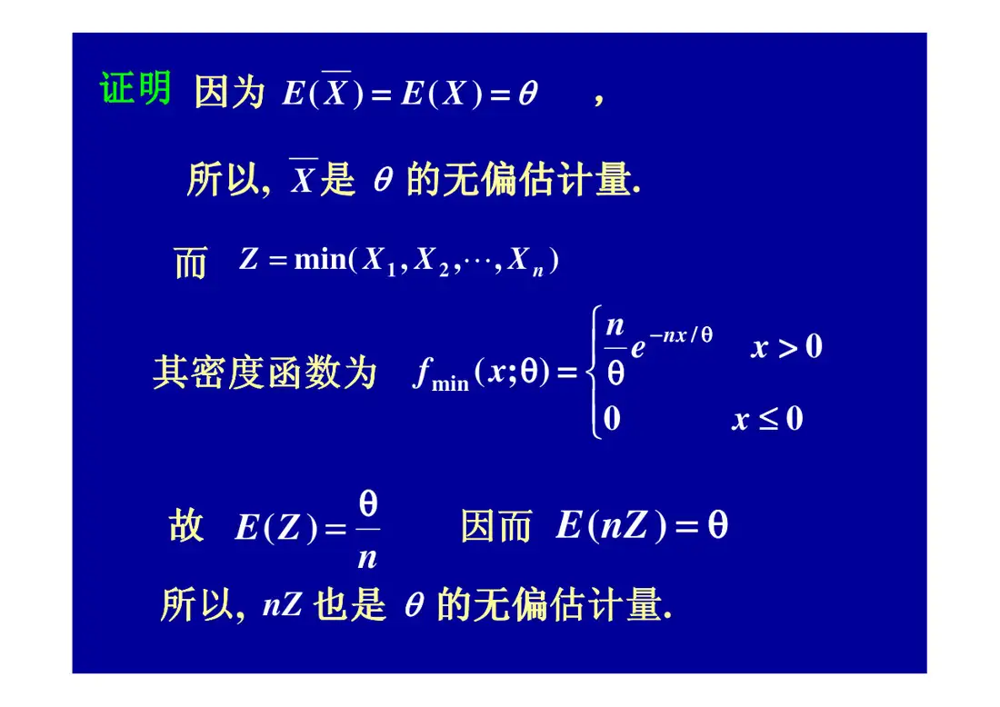

原文：

证明 因为 $| x ( 0 , 0 ) - y ( 0 , 0 ) - ( 0 )$ ，

所以, X是 的无偏估计量θ .

而 $V _ { \square A } = \square \cdots \square \cdots \square \cdots \square \cdots \square \cdots \square \cdots \square \cdots \square \cdots \square \cdots \square \cdots \square \cdots \square \cdots \square \cdots \square \cdots \square \cdots \square \cdots \square \cdots \square \cdots \square \cdots \square \cdots \square \cdots \square \cdots \square \cdots \square \cdots \square \cdots \square \cdots \square \cdots \square \cdots \square \cdots \square \cdots \square \cdots \square \cdots \square \cdots \square \cdots \square \cdots \square \cdots \square \cdots \square \cdots \square \cdots \square \cdots \square \cdots \square \cdots \square \cdots \square \cdots \square \cdots \square \cdots \square \cdots \square \cdots \square \cdots \square \cdots \square \cdots \square \cdots \square \cdots \square \cdots \square \cdots \square \cdots \square \cdots \cdots \square \cdots \square \cdots \cdots \square \cdots \square \cdots \cdots \square \cdots \cdots \square \cdots \cdots \square \cdots \cdots \square \cdots \cdots \square \cdots \cdots \cdots \square \cdots \cdots \cdots \square \cdots \cdots \cdots \square \cdots \cdots \cdots \cdots \square \cdots \cdots \cdots \cdots \cdots \square \cdots \cdots \cdots \cdots \cdots \cdots \cdots \cdots \square \cdots \cdots \cdots \cdots \cdots \cdots \cdots \cdots \cdots \cdots \cdots \cdots \cdots \cdots \cdots \cdots \cdots \cdots \cdots \cdots \cdots \cdots \cdots \cdots \cdots \cdots \cdots \cdots \cdots \cdots \cdots \cdots \cdots \cdots \cdots \cdots \cdots \cdots \cdots \cdots \cdots \cdots \cdots \cdots \cdots \cdots \cdots \cdots \cdots \cdots \cdots \cdots \cdots \cdots \cdots \cdots \cdots \cdots \cdots \cdots \cdots \cdots \cdots \cdots \cdots \cdots \cdots \cdots \cdots \cdots \cdots \cdots \cdots \cdots \cdots \cdots \cdots \cdots \cdots \cdots \cdots \cdots \cdots \cdots \cdots \cdots \cdots \cdots \cdots \cdots \cdots \cdots \cdots \cdots \cdots \cdots \cdots \cdots \cdots \cdots \cdots \cdots \cdots \cdots \cdots \cdots \cdots \cdots \cdots \cdots \cdots \cdots \cdots \cdots \cdots \cdots \cdots \cdots \cdots \cdots \cdots \cdots \cdots \cdots \cdots \cdots \cdots \cdots \cdots \cdots \cdots \cdots \cdots \cdots \cdots \cdots \cdots \cdots \cdots \cdots \cdots \cdots \cdots \cdots \cdots \cdots \cdots \cdots \cdots \cdots \cdots \cdots \cdots \cdots \cdots \cdots \cdots \cdots \cdots \cdots \cdots \cdots \cdots \cdots \cdots \cdots \cdots  \cdots  \cdots  \cdots                                  \ c \ c \ c $

其密度函数为 $\angle \mathrm { m } ( \mathrm { e } + \mathrm { o } ) = \frac { \vert \mathrm { e } - \mathrm { o } \vert } { \vert \mathrm { o } - \mathrm { o } \vert } , \mathrm { e } - \frac { \vert \mathrm { o } - \mathrm { o } \vert } { \vert \mathrm { o } - \mathrm { o } \vert }$

故 $D ( \psi _ { 1 } ) = \frac { \psi _ { 1 } } { \psi _ { 1 } }$ 因而 $\begin{array} { r } { | \mathscr { P } ( 0 ; \mathscr { P } \mathscr { A } ) = \mathscr { \left( \frac { 0 } { \theta } \right) } } \end{array}$ 所以, nZ 也是 θ 的无偏估计量.

### 由于

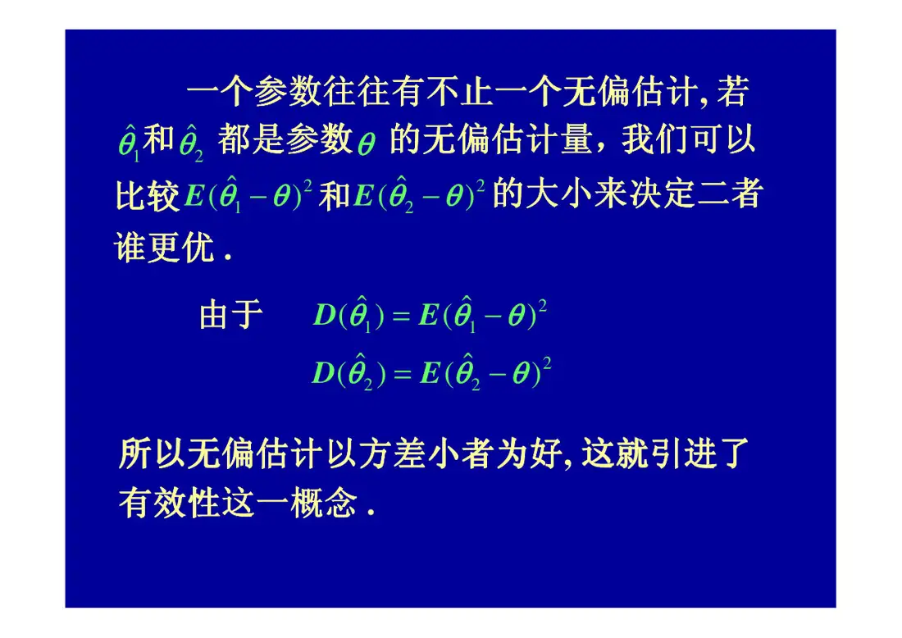

原文：

一个参数往往有不止一个无偏估计, 若ˆθˆ和 都是参数 的无偏估计量，我们可以比较 $| \mathscr { P } ( \mathscr { G } ) - \mathscr { P } ( \mathscr { P } ) |$ 和E $\textcircled { 1 0 }$ 的大小来决定二者谁更优 .

由于

$$
D (\hat {\theta} _ {1}) = E (\hat {\theta} _ {1} - \theta) ^ {2}
$$

$$
D (\hat {\theta} _ {2}) = E (\hat {\theta} _ {2} - \theta) ^ {2}
$$

所以无偏估计以方差小者为好, 这就引进了有效性这一概念 .

### 2．有效性

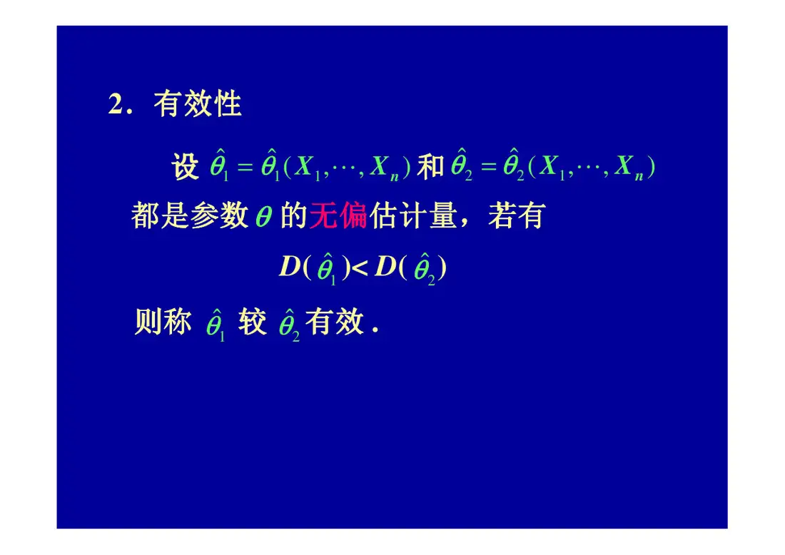

原文：

2．有效性

设 $\textcircled { 2 } = \textcircled { 2 } \textcircled { 1 0 } \textcircled { 2 } \textcircled { 2 } \textcircled { 2 } \textcircled { 2 }$ 和 $\textcircled { 2 } - \textcircled { 2 } \textcircled { 1 } \textcircled { 2 } \textcircled { 2 } \textcircled { 2 } \textcircled { 2 } \textcircled { 2 }$ 都是参数 $\textcircled { \bullet }$ 的无偏估计量，若有

$$
D (\hat {\theta} _ {1}) <   D (\hat {\theta} _ {2})
$$

则称 $\textcircled { 4 }$ 较 $\textcircled { 4 }$ 有效

### $$

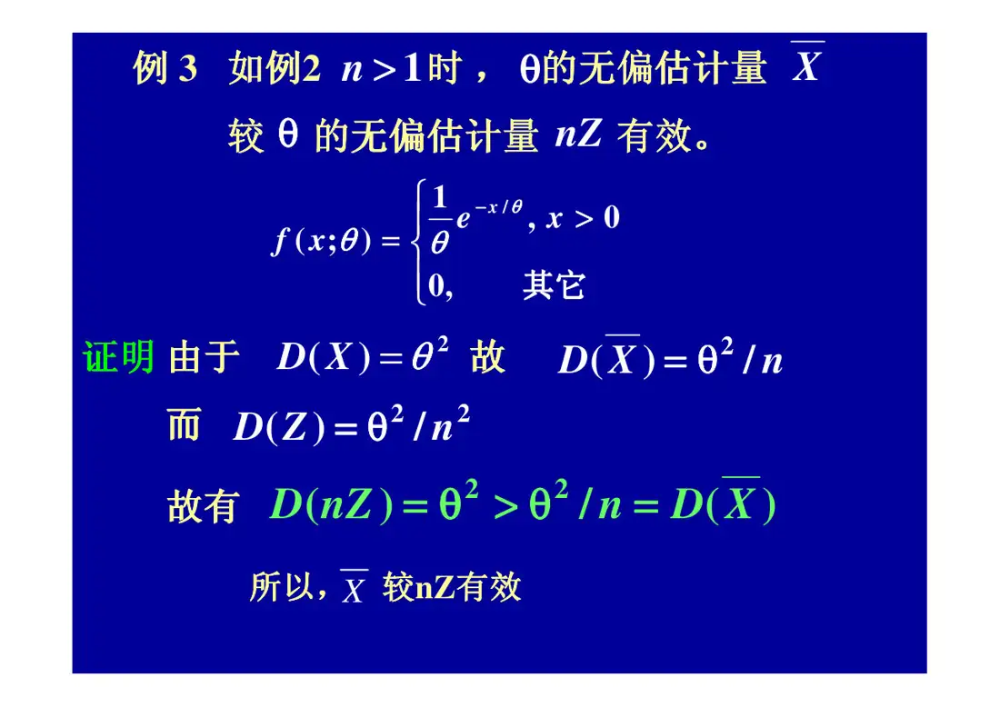

原文：

例 3 如例2 $m > 1$ 时 ， 的无偏估计量θ X较 的无偏估计量 有效。θ nZ

$$
f (x; \theta) = \left\{ \begin{array}{l l} \frac {1}{\theta} e ^ {- x / \theta}, & x > 0 \\ 0, & \text {其它} \end{array} \right.
$$

$$
D (X) = \theta^ {2}
$$

$$
D (\overline {{X}}) = \theta^ {2} / n
$$

而 $| m ( \ell \lambda ) | = 0 ^ { \prime } | m ^ { \prime }$

故有 $( \lambda ( \Gamma ( \lambda ) ) = ( \lambda ( \Gamma ( \lambda ) ) + ( \lambda ( \Gamma ( \lambda ) )$

所以， 较 X nZ有效

### 在数理统计中常用到最小方差无偏估计.它的定义是:

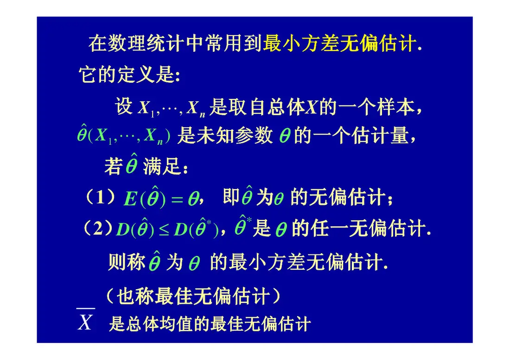

原文：

在数理统计中常用到最小方差无偏估计.它的定义是:

设 $1 3 \div \cdots 1 0$ 是取自总体X的一个样本，$\textcircled { 3 } \textcircled { + } \textcircled { + } \textcircled { + } \textcircled { - } \textcircled { - } \textcircled { + } \textcircled { - } \textcircled { - } \textcircled { - } \textcircled { - }$ 是未知参数 的一个估计量，若 满足ˆ ：

（1） $| \mathscr { P } ( \mathscr { G } ) - \mathscr { Q } ( \mathscr { P } )$ ˆ 即 为 的无偏估计；

（2） $| D ( \cdot ) | = | D ( \cdot )$ ) ， ˆ\* 是 的任一无偏估计 .

则称θ为 的最小方差无偏估计θ .ˆ

（也称最佳无偏估计）

X 是总体均值的最佳无偏估计

### 则称 的相合估计量。θ为θˆ

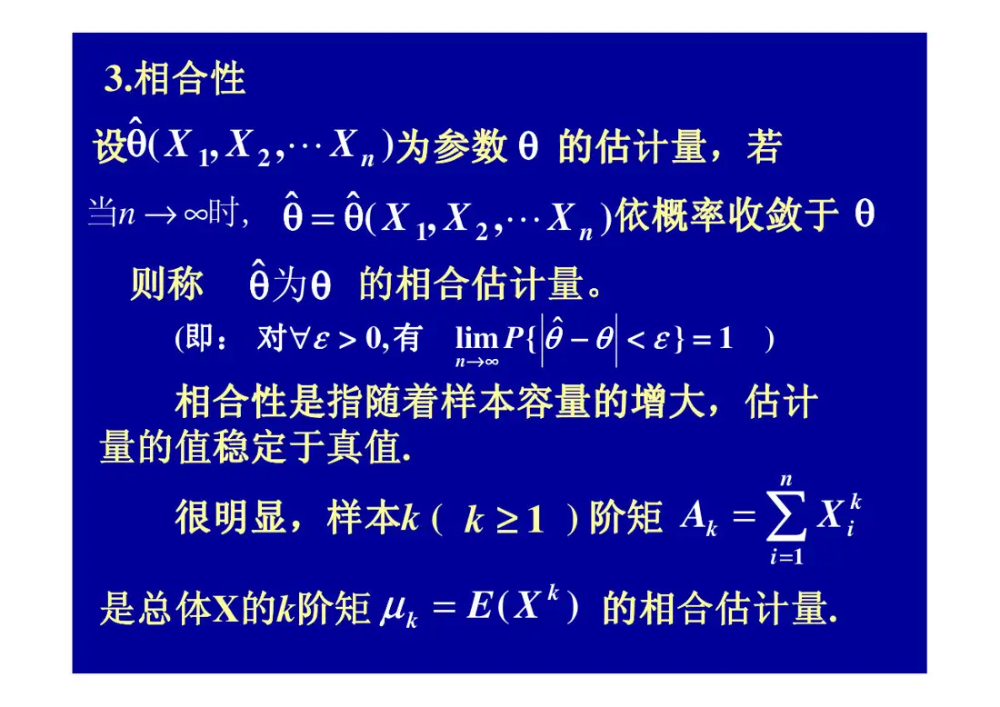

原文：

设 (ˆθ $\mathrm { B } ^ { \prime } ( \frac { 1 } { 2 } , \frac { 1 } { 2 } ) = \frac { 1 } { 2 } ( \frac { 1 } { 2 } + \frac { 1 } { 2 } )$ 为参数 的估计量，若θ)

当 $\pmb { \mathbb { m } } = \pmb { \mathbb { m } } \pmb { \mathbb { o } } \mathbf { \mathbb { I } }$ $\textcircled { 6 } - \textcircled { 4 } \textcircled { 6 } \textcircled { < } \textcircled { < } \textcircled { < } \textcircled { < } \textcircled { < } \textcircled { < } \textcircled { < } \textcircled { < } \textcircled { < } \textcircled { < } \textcircled { < }$ 依概率收敛于) θ

则称 的相合估计量。θ为θˆ

( 即： 对 $v = \frac { 1 } { 2 }$ 有 $1 1 1 1 2 2 1 0 2 2 0 2 2 0 2 0 2 0$

相合性是指随着样本容量的增大，估计量的值稳定于真值.

很明显，样本k ( $l : \boxed { 2 } \boxed { 1 }$ ) 阶矩 $\frac { 2 } { 3 } - \frac { 3 } { 2 } = \frac { 3 } { 2 }$ 是总体X的k阶矩 $\angle B = \angle D C B = 9 0 ^ { \circ }$ 的相合估计量.

### 例4： 已知总体

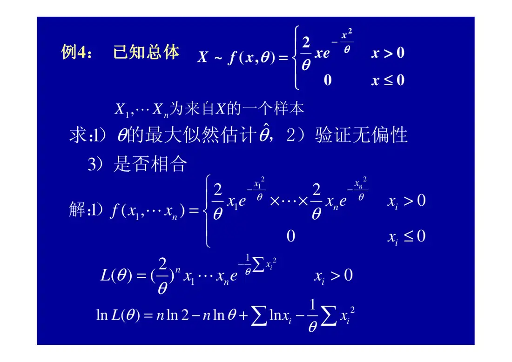

原文：

例4： 已知总体

$$
X \sim f (x, \theta) = \left\{ \begin{array}{c c} \frac {2}{\theta} x e ^ {- \frac {x ^ {2}}{\theta}} & x > 0 \\ 0 & x \leq 0 \end{array} \right.
$$

$V _ { 4 } ( m ) ^ { 2 } = \frac { 1 } { 2 } ( m ) ^ { 2 } = \frac { 1 } { 2 } ( m )$ X 为来自 的一个样本

ˆ1求：） 的最大似然估计 ，2）验证无偏 θ θ 性

3）是否相合

$$
\text {解:1)} f \left(x _ {1}, \dots x _ {n}\right) = \left\{ \begin{array}{c c} \frac {2}{\theta} x _ {1} e ^ {- \frac {x _ {1} ^ {2}}{\theta}} \times \dots \times \frac {2}{\theta} x _ {n} e ^ {- \frac {x _ {n} ^ {2}}{\theta}} & x _ {i} > 0 \\ 0 & x _ {i} \leq 0 \end{array} \right.
$$

$$
L (\theta) = (\frac {2}{\theta}) ^ {n} x _ {1} \dots x _ {n} e ^ {- \frac {1}{\theta} \sum x _ {i} ^ {2}} \qquad x _ {i} > 0
$$

$$
\ln L (\theta) = n \ln 2 - n \ln \theta + \sum \ln x _ {i} - \frac {1}{\theta} \sum x _ {i} ^ {2}
$$

### $$

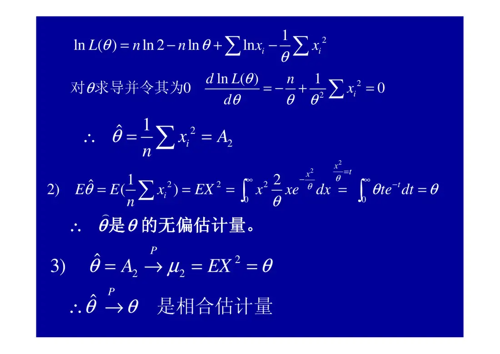

原文：

$$
\ln L (\theta) = n \ln 2 - n \ln \theta + \sum \ln x _ {i} - \frac {1}{\theta} \sum x _ {i} ^ {2}
$$

0对 求导并令其为 $\frac { ( 1 1 0 ) ( 1 0 ) } { ( 1 0 ) } = \frac { ( 1 1 ) } { ( 2 ) } = \frac { ( 1 1 0 ) ( 1 0 ) } { ( 2 ) } = 0$

$$
\therefore \hat {\theta} = \frac {1}{n} \sum x _ {i} ^ {2} = A _ {2}
$$

2) $( 2 ) ( 2 ) ( 2 ) ( 2 + 1 ) ( 2 + 1 ) ( 2 + 1 ) ( 2 + 1 ) ( 2 + 1 ) ( 2 + 1 ) ( 2 + 1 )$ 是 的无偏估计量。

3) $\textcircled { 2 } - \textcircled { 2 } - \textcircled { 2 } + \textcircled { 2 } + \textcircled { 2 } - \textcircled { 2 } + \textcircled { 2 } - \textcircled { 2 }$

$\frac { 1 } { 2 } \times \textcircled { 2 } \frac { 1 } { 2 } \times \textcircled { 2 }$ 是相合估计量
