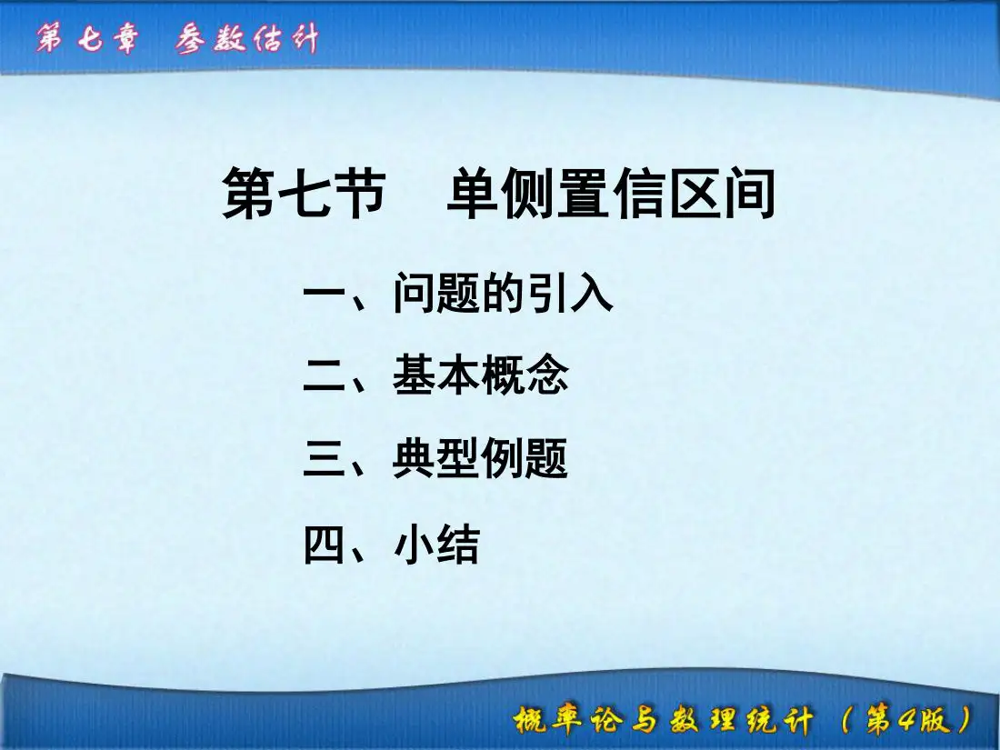
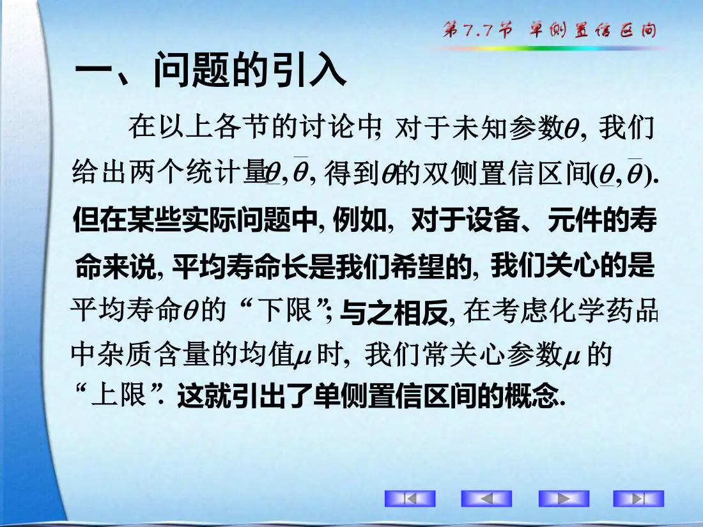
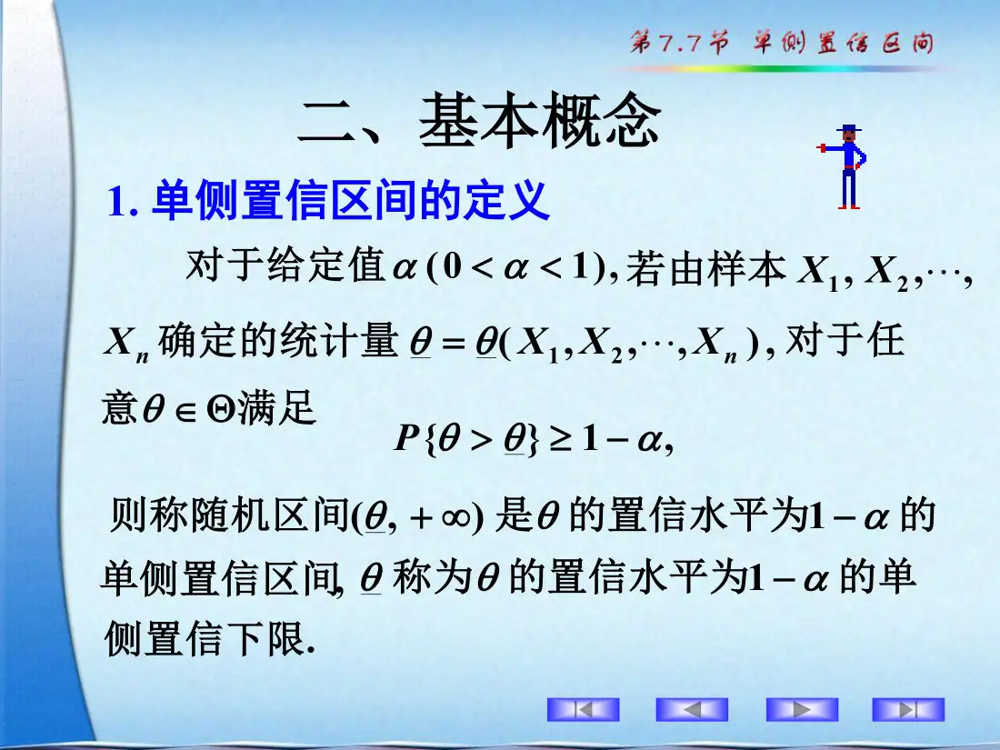
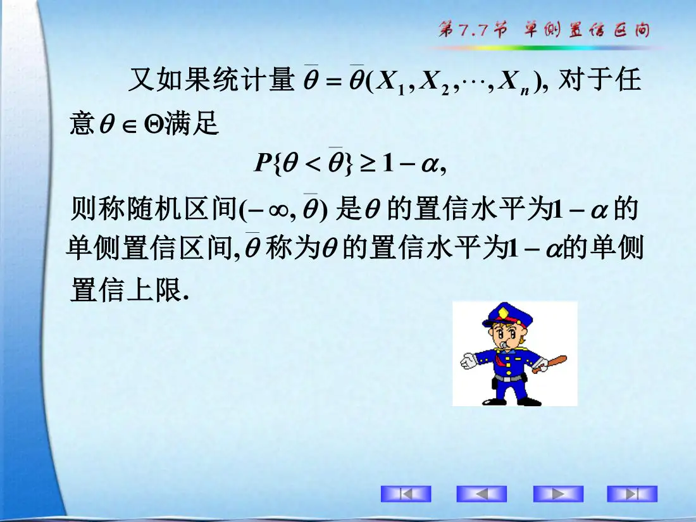
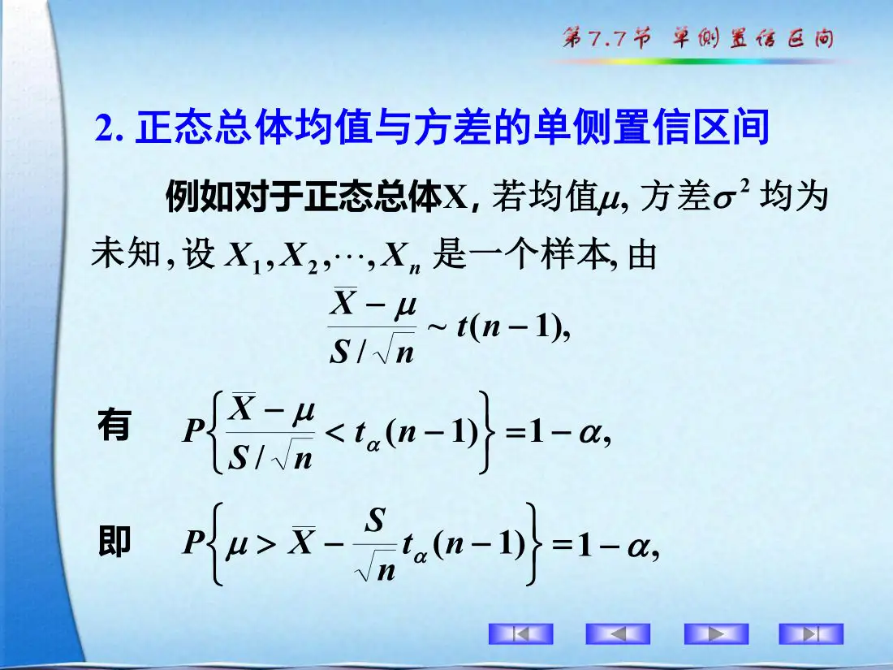
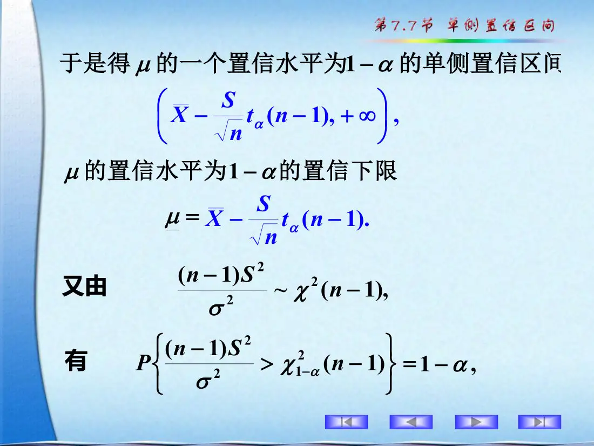
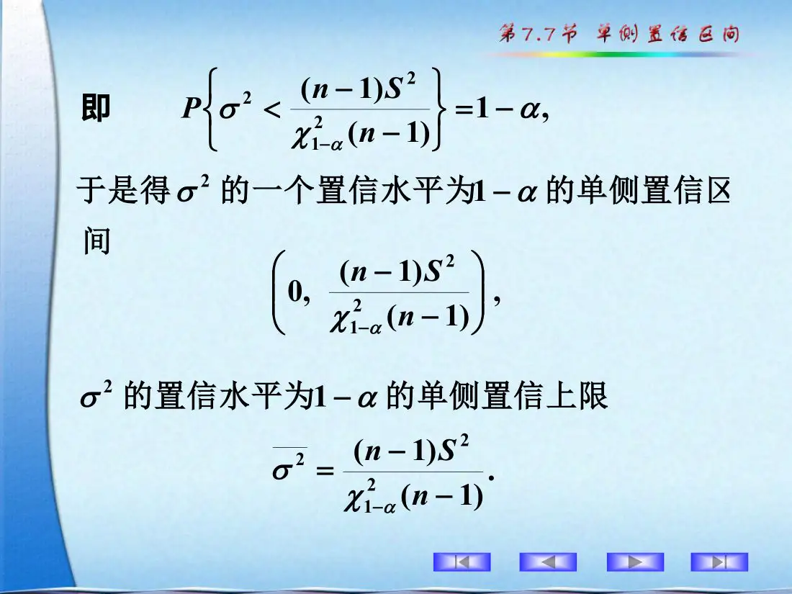
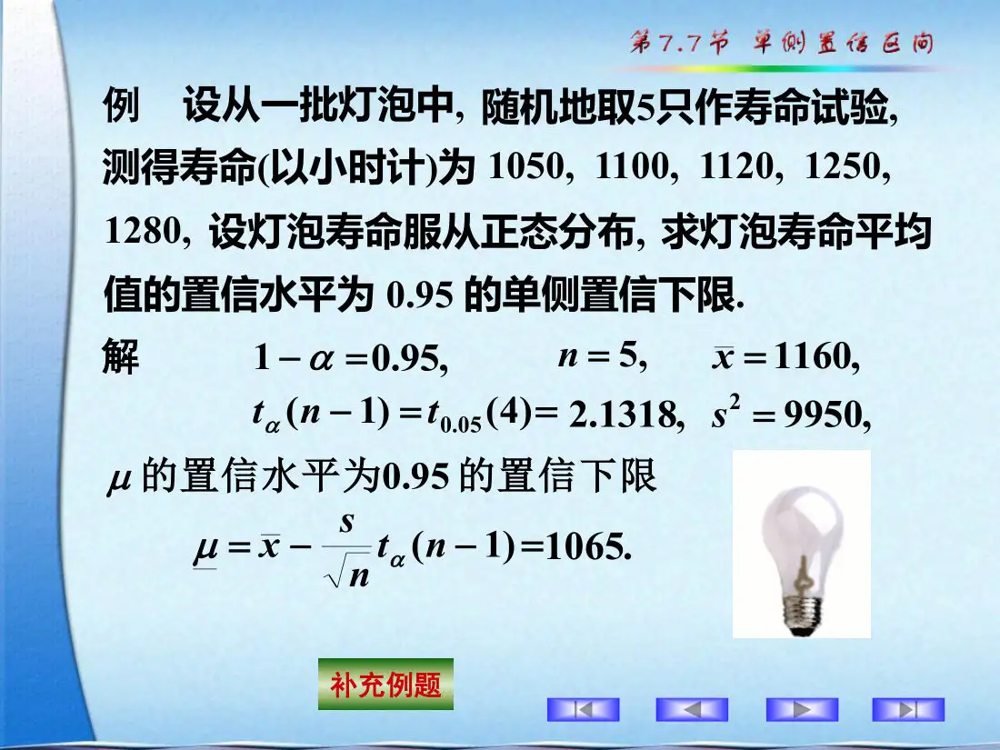
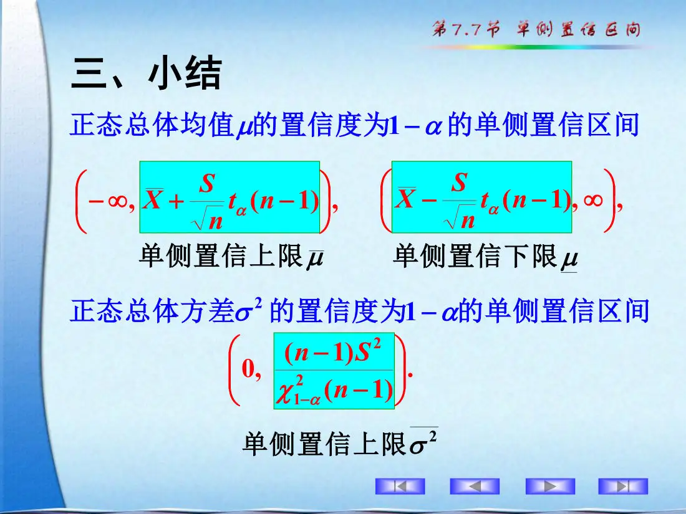

# 《概率论与数理统计》第7章 参数估计 第7节 单侧置信区间（课件）

原件的每一页，下面附识别出的文字。

### 第七节 单侧置信区间

原文：

第七节 单侧置信区间
一、问题的引入
二、基本概念
三、典型例题
四、小结

第七章 参数估计

概率论与数理统计（第4版）

### 一、问题的引入

原文：

一、问题的引入

在以上各节的讨论中, 对于未知参数 $\theta$ , 我们给出两个统计量 $\theta, \bar{\theta}$ , 得到 $\theta$ 的双侧置信区间 $(\underline{\theta}, \bar{\theta})$ . 但在某些实际问题中, 例如, 对于设备、元件的寿命来说, 平均寿命长是我们希望的, 我们关心的是平均寿命 $\theta$ 的 “下限”; 与之相反, 在考虑化学药品中杂质含量的均值 $\mu$ 时, 我们常关心参数 $\mu$ 的 “上限”. 这就引出了单侧置信区间的概念.

第7.7节 单侧置信区间

◀◀◀◀◀

### 二、基本概念

原文：

二、基本概念

1. 单侧置信区间的定义

对于给定值 $\alpha(0<\alpha<1)$ ，若由样本 $X_{1}, X_{2}, \cdots, X_{n}$ 确定的统计量 $\theta=\theta(X_{1}, X_{2}, \cdots, X_{n})$ ，对于任意 $\theta \in \Theta$ 满足 $P\{\theta > \underline{\theta}\} \geq 1 - \alpha,$

则称随机区间 $(\theta, +\infty)$ 是 $\theta$ 的置信水平为 $1 - \alpha$ 的单侧置信区间, $\theta$ 称为 $\theta$ 的置信水平为 $1 - \alpha$ 的单侧置信下限.

第7.7节 单侧置信区间

### $$

原文：

又如果统计量 $\bar{\theta} = \bar{\theta}(X_{1}, X_{2}, \cdots, X_{n})$ ，对于任意 $\theta \in \Theta$ 满足

$$
P \{\theta <   \bar {\theta} \} \geq 1 - \alpha ,
$$

则称随机区间 $(- \infty, \bar{\theta})$ 是 $\theta$ 的置信水平为 $1 - \alpha$ 的单侧置信区间, $\bar{\theta}$ 称为 $\theta$ 的置信水平为 $1 - \alpha$ 的单侧置信上限.

第7.7节 单侧置信区间

◀◀◀◀◀

### 2. 正态总体均值与方差的单侧置信区间

原文：

2. 正态总体均值与方差的单侧置信区间

例如对于正态总体X, 若均值 $\mu$ , 方差 $\sigma^{2}$ 均为未知, 设 $X_{1}, X_{2}, \cdots, X_{n}$ 是一个样本, 由

$$
\frac {\overline {{X}} - \mu}{S / \sqrt {n}} \sim t (n - 1),
$$

有 $P\left\{\frac{\overline{X} - \mu}{S / \sqrt{n}} < t_{\alpha}(n - 1)\right\} = 1 - \alpha ,$

即 $P\left\{\mu > \overline{X} - \frac{S}{\sqrt{n}} t_{\alpha}(n - 1)\right\} = 1 - \alpha,$

第7.7节 单侧置信区间

### 于是得 $\mu$ 的一个置信水平为 $1 - \alpha$ 的单侧置信区间

原文：

于是得 $\mu$ 的一个置信水平为 $1 - \alpha$ 的单侧置信区间

$$
\left(\overline {{X}} - \frac {S}{\sqrt {n}} t _ {\alpha} (n - 1), + \infty\right),
$$

$\mu$ 的置信水平为 $1 - \alpha$ 的置信下限

$$
\underline {{\mu}} = \overline {{X}} - \frac {S}{\sqrt {n}} t _ {\alpha} (n - 1).
$$

又由

$$
\frac {(n - 1) S ^ {2}}{\sigma^ {2}} \sim \chi^ {2} (n - 1),
$$

有

$$
P \left\{\frac {(n - 1) S ^ {2}}{\sigma^ {2}} > \chi_ {1 - \alpha} ^ {2} (n - 1) \right\} = 1 - \alpha ,
$$

◀◀◀◀◀

第7.7节 单侧置信区间

### $$

原文：

即

$$
P \left\{\sigma^ {2} <   \frac {(n - 1) S ^ {2}}{\chi_ {1 - \alpha} ^ {2} (n - 1)} \right\} = 1 - \alpha ,
$$

于是得 $\sigma^2$ 的一个置信水平为 $1 - \alpha$ 的单侧置信区间

$$
\left(0, \frac {(n - 1) S ^ {2}}{\chi_ {1 - \alpha} ^ {2} (n - 1)}\right),
$$

$\sigma^2$ 的置信水平为 $1 - \alpha$ 的单侧置信上限

$$
\overline {{\sigma^ {2}}} = \frac {(n - 1) S ^ {2}}{\chi_ {1 - \alpha} ^ {2} (n - 1)}.
$$

◀◀◀◀◀

第7.7节 单侧置信区间

### $$

原文：

例 设从一批灯泡中, 随机地取5只作寿命试验, 测得寿命(以小时计)为 1050, 1100, 1120, 1250, 1280, 设灯泡寿命服从正态分布, 求灯泡寿命平均值的置信水平为 0.95 的单侧置信下限.

解

$$
\begin{array}{l l l} 1 - \alpha = 0. 9 5, & n = 5, & \bar {x} = 1 1 6 0, \\ t _ {\alpha} (n - 1) = t _ {0. 0 5} (4) = 2. 1 3 1 8, & s ^ {2} = 9 9 5 0, \end{array}
$$

$\mu$ 的置信水平为0.95的置信下限

$$
\underline {{\mu}} = \overline {{x}} - \frac {s}{\sqrt {n}} t _ {\alpha} (n - 1) = 1 0 6 5.
$$

补充例题

第7.7节 单侧置信区间

◀◀◀◀◀

### 三、小结

原文：

三、小结

正态总体均值 $\mu$ 的置信度为 $1 - \alpha$ 的单侧置信区间

$$
\left(- \infty , \bar {X} + \frac {S}{\sqrt {n}} t _ {\alpha} (n - 1)\right),
$$

$$
\left(\bar {X} - \frac {S}{\sqrt {n}} t _ {\alpha} (n - 1), \infty\right),
$$

单侧置信上限 $\overline{\mu}$

单侧置信下限 $\mu$

正态总体方差 $\sigma^2$ 的置信度为 $1 - \alpha$ 的单侧置信区间

$$
\left(0, \begin{array}{c c} & (n - 1) S ^ {2} \\ \hline & \chi_ {1 - \alpha} ^ {2} (n - 1) \end{array} \right).
$$

单侧置信上限 $\sigma^2$

第7.7节 单侧置信区间
