# 《概率论与数理统计》第7章 参数估计——区间估计（课件）

原件的每一页，下面附识别出的文字。

### .4§ 区 间估计

原文：

.4§ 区 间估计

引 言

前面， 我们讨论了参数点估计. 它是用样本算得的一个值去估计未知参数但是， 点估计值仅仅是未知参数的一个近似值， 它没有反映出这个近似值的误差范围， 使用起来把握不大. 区间估计正好弥补了点估计的这个缺陷 .

### 实际上， N的真值可能大于10000条，也可能小于10000条.

原文：

譬如， 在估计湖中鱼数的 问题中， 若我们根据一个实际样本， 得到鱼数N的最大似然估计为10000条.

实际上， N的真值可能大于10000条，也可能小于10000条.

若我们能给出一个区间， 在此区间内我们合理地相信 N 的真值位于其中 这样对鱼数的估计就有把握多了.

### 这里所说的 “可靠程度” 是用概率来度量的， 称为置信度或置信水平.

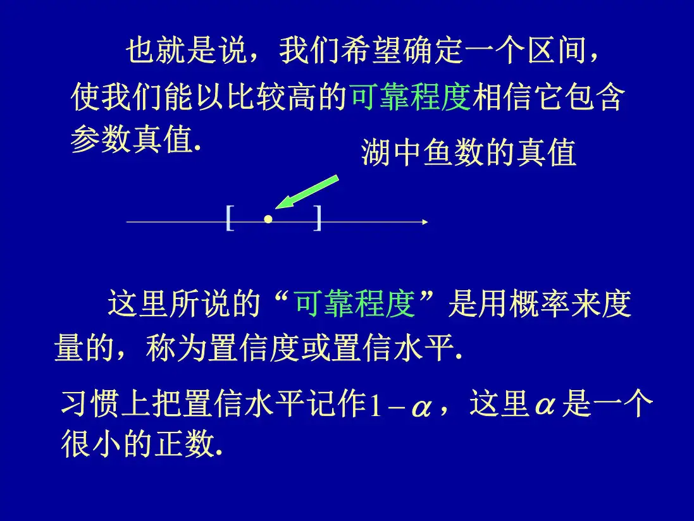

原文：

也就是说， 我们希望确定一个区间，使我们能以 比较高的可靠程度相信它包含参数真值. 湖中鱼数的真值

这里所说的 “可靠程度” 是用概率来度量的， 称为置信度或置信水平.

习惯上把置信水平记作1 −α， 这里 是一个α很小的正数.

### 第 4 页

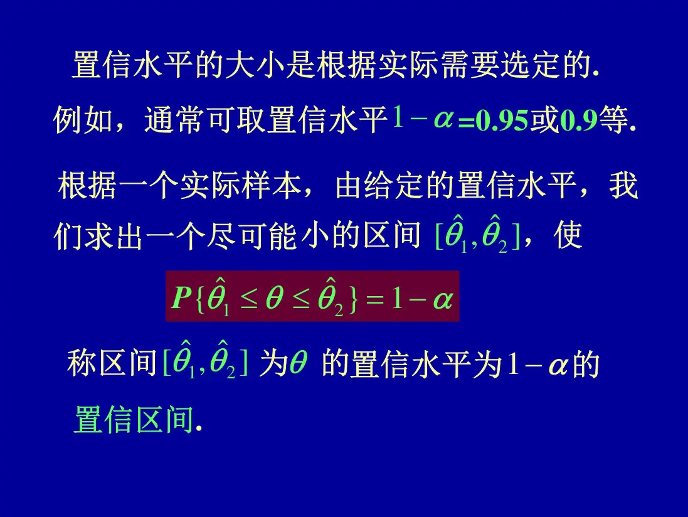

原文：

置信水平的大小是根据实际需要选定的.例如， 通常可取置信水平 $1 - \cos \equiv 0 . 0 2$ 5或0.9等.根据一个实际样本， 由给定的置信水平， 我们求出一个尽可能小的区间 $\boxed { 1 0 } \boxed { 7 }$ ， 使$1 2 ( 2 - 7 ) \div ( 2 ) = ( 2 )$ 称区 间 $\boxed { 1 0 } \boxed { 6 }$ 为 的θ 置信水平为 1 −α的置信区 间.

### 第 5 页

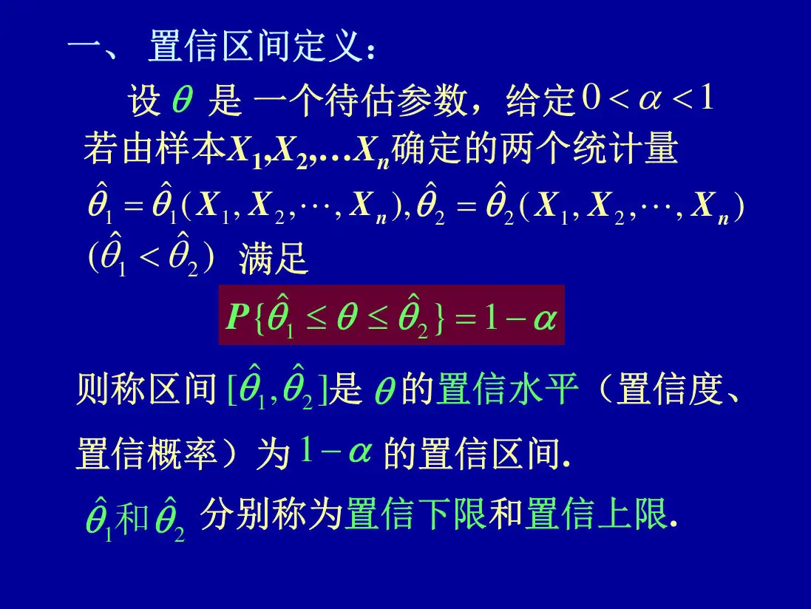

原文：

置信区间定义：θ设 是 一个待估参数， 给定 $\textcircled { 1 } 2 \textcircled { 2 } 2 5 0 \textcircled { 1 } 2$ 若由样本 $: ( 1 0 0 \% ) \times ( 1 0 0 \% ) = 0 . 1 4 2 \%$ 确定的两个统计量$( x ) = ( x - \frac { 1 } { 2 } , x - \frac { 1 } { 2 } , x - \frac { 1 } { 2 } , x - \frac { 1 } { 2 } , x - \frac { 1 } { 2 } , x - \frac { 1 } { 2 } , x - \frac { 1 } { 2 } , x - \frac { 1 } { 2 } , x - \frac { 1 } { 2 } , x - \frac { 1 } { 2 } , x - \frac { 1 } { 2 } , x - \frac { 1 } { 2 } , x - \frac { 1 } { 2 } , x - \frac { 1 } { 2 } , x - \frac { 1 } { 2 } , x - \frac { 1 } { 2 } , x - \frac { 1 } { 2 } , x - \frac { 1 } { 2 } , x - \frac { 1 } { 2 } , x - \frac { 1 } { 2 } , x$ $\textcircled { 6 } \textcircled { < } \textcircled { 0 }$ 满足$1 2 ( 2 - 7 ) \div ( 2 ) = ( 2 )$ 则称区间 $\boxed { 1 0 } \boxed { 6 }$ 是 的置信水平 （置信度、] θ置信概率） 为 的置信区 间.1 −α$\textcircled { 4 }$ $\textcircled { 1 }$ 分别称为置信下限和置信上限.

### 可见，

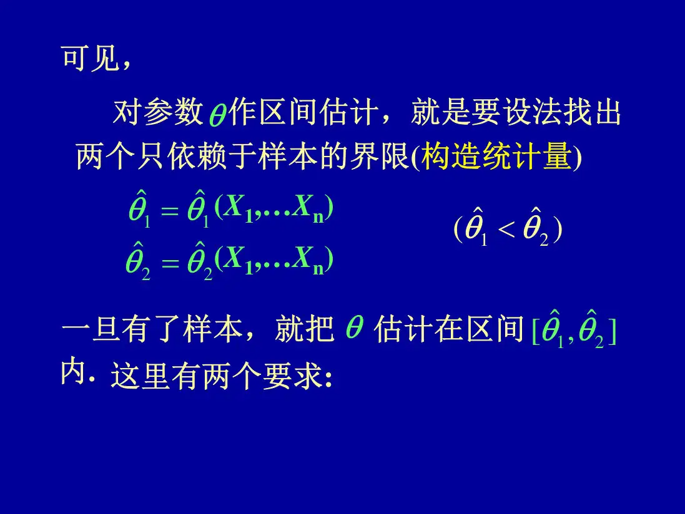

原文：

可见，

对参数 作区间估计， 就是要设法找出θ两个只依赖于样本的界限(构造统计量)

$$
\hat {\theta} _ {1} = \hat {\theta} _ {1} (X _ {1}, \dots X _ {n})
$$

$$
\hat {\theta} _ {2} = \hat {\theta} _ {2} (X _ {1}, \dots X _ {\mathrm{n}})
$$

$$
(\hat {\theta} _ {1} <   \hat {\theta} _ {2})
$$

一旦有了样本， 就把 估计在区间θ $\boxed { 1 0 } \boxed { 7 }$ 内. 这里有两个要求:

### 可靠度与精度是一对矛盾，一般是在保证可靠度的条件下尽可能提高精度.

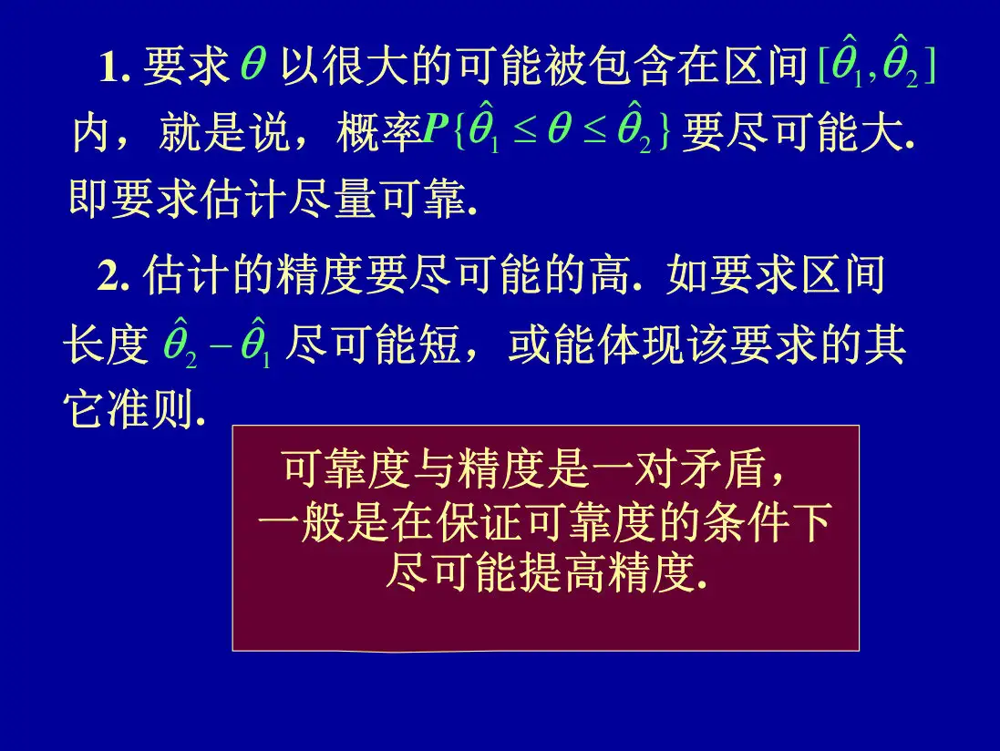

原文：

],[ 1. 要求 以很大的可能被包含在区 间θ θθ 21内 ， 就是说， 概率P $2 0 \times 0 . 2 = 0 . 2 ( c m )$ 要尽可能大.即要求估计尽量可靠.

2. 估计的精度要尽可能的高. 如要求区间长度 $\textcircled { 1 }$ 尽可能短， 或能体现该要求的其它准则.

可靠度与精度是一对矛盾，一般是在保证可靠度的条件下尽可能提高精度.

### 二、 置信区间的求法

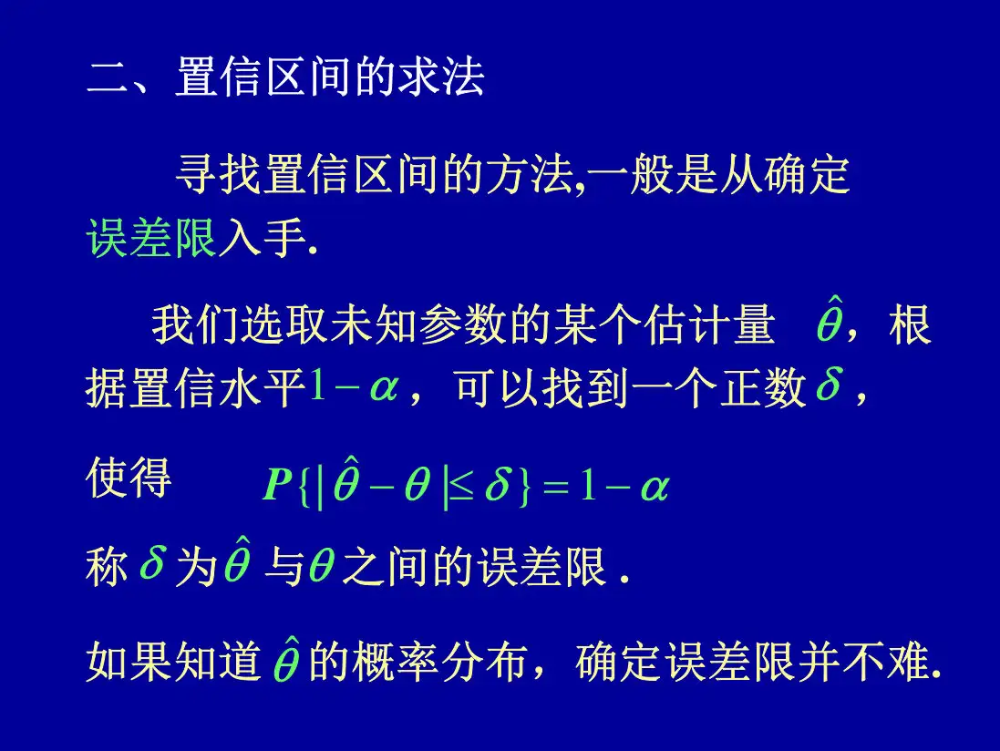

原文：

二、 置信区间的求法

寻找置信区间的方法 一般是从确定误差限入手.

我们选取未知参数的某个估计量 ， 根θ据置信水平 ， 可以找到一个正数 ，1 −α δ

使得 $1 2 4 0 - 2 2 = 2 2 2 = 1 2$

称 为 与 之间 的误差限θ .δ θ

如果知道 的概率分布， 确定误差限并不难θ .

### +≤≤− δθθδθ

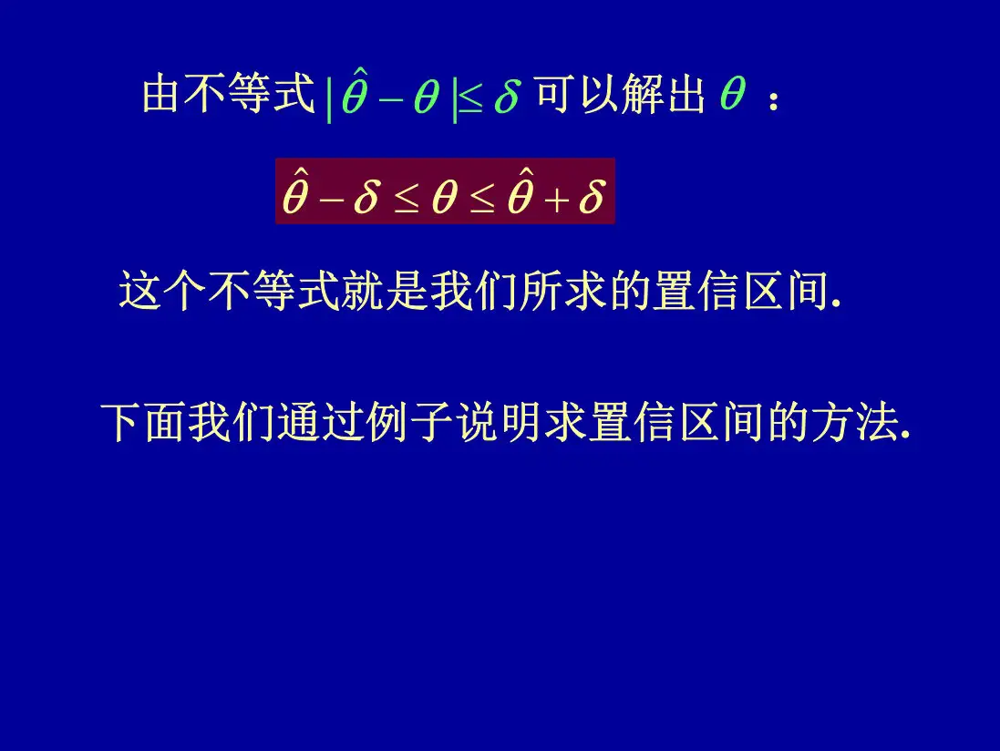

原文：

由不等式 | $\textcircled { 1 } \textcircled { 2 }$ 可 以解出 ：θ

+≤≤− δθθδθ

这个不等式就是我们所求的置信区间.

下面我们通过例子说明求置信区间的方法.例1 设X $\frac { 1 } { 1 6 } \times \frac { 1 } { 1 6 } \times \frac { 1 } { 1 6 } = \frac { 1 } { 1 6 }$ 是取 自 $\mathbb { N } ( \mathbb { m } , \mathbb { o } )$ 的样本，) σ2已知求参数 的置信度为 的置信区 间.μ 1 −α

### 选 的点估计为μ X解：

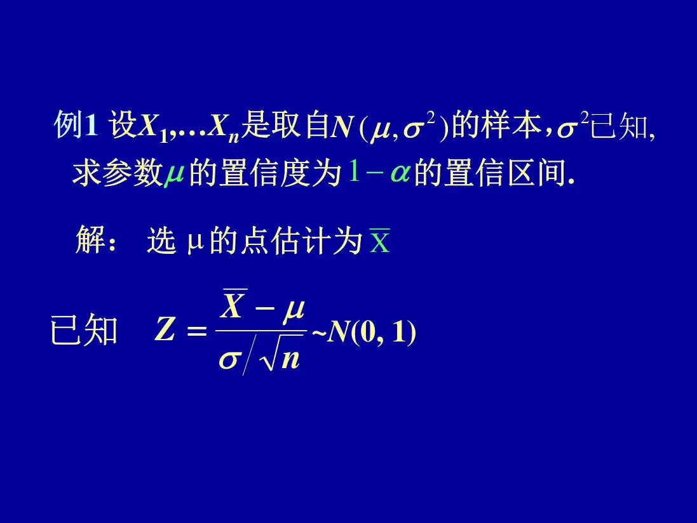

原文：

选 的点估计为μ X解：

已知 $V _ { 1 } = \frac { P _ { 2 } } { \sqrt { 1 0 } } = \frac { \sqrt { 1 0 } } { 1 0 } \times ( 1 0 \sqrt { 1 0 } )$

### 对给定的置信水平 −α1

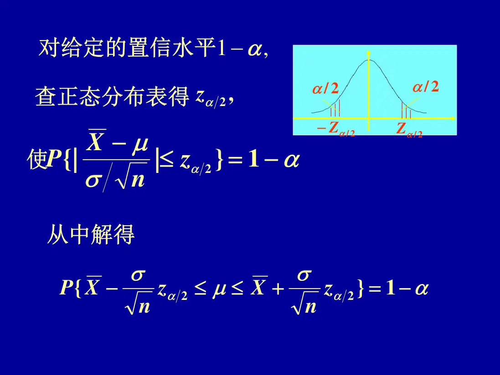

原文：

对给定的置信水平 −α1

查正态分布表得 $5 0 \textcircled { < } 5 0 \textcircled { > } 5 0 0$

{ | 使P $\frac { 1 } { 6 } \times \frac { 1 } { 7 } \times \frac { 1 } { 1 2 } = 1 5 . 0$

从中解得

$$
P \{\overline {{X}} - \frac {\sigma}{\sqrt {n}} z _ {\alpha / 2} \leq \mu \leq \overline {{X}} + \frac {\sigma}{\sqrt {n}} z _ {\alpha / 2} \} = 1 - \alpha
$$

### 于是所求 的 置信度为 置信区间为μ 1−α

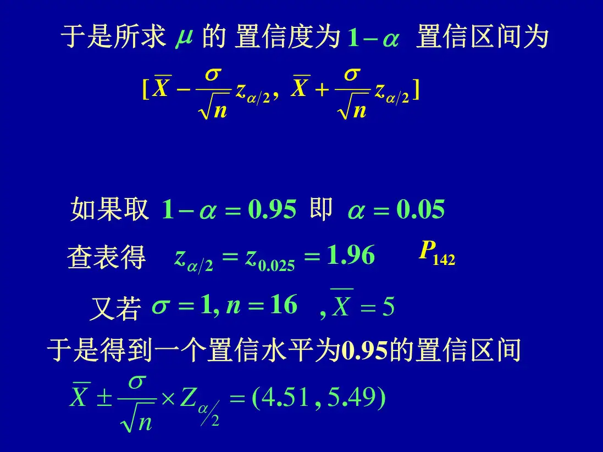

原文：

于是所求 的 置信度为 置信区间为μ 1−α

$$
[ \overline {{X}} - \frac {\sigma}{\sqrt {n}} z _ {\alpha / 2}, \overline {{X}} + \frac {\sigma}{\sqrt {n}} z _ {\alpha / 2} ]
$$

如果取 $1 1 - 1 0 3 = 1 1 0 3$ 即 $\mathrm { c m } = \mathrm { m a l s }$

查表得 $\langle \langle \langle \mathcal { I } | \hat { e } \rangle - \langle \langle \mathcal { I } | \langle | \mathcal { D } | \hat { e } \rangle - | \langle \mathcal { I } | \langle \mathcal { I } | \hat { e } \rangle \langle | \mathcal { I } | \rangle$ P142

又若 $\cos \angle B C D = \sin \angle C = \angle C = \angle C ( 2 \cos \angle C = \angle 2 )$

于是得到一个置信水平为0.95的置信区间

±X × Z 4955 14 ).,.(= α n 2

### 第 13 页

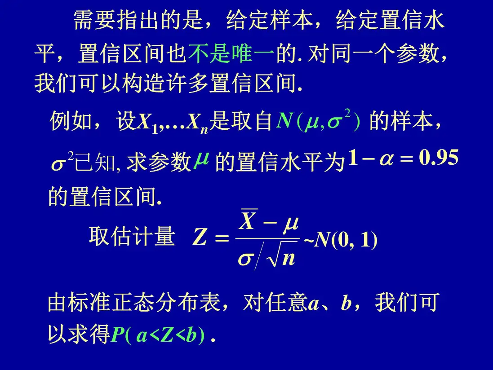

原文：

需要指出 的是， 给定样本， 给定置信水平， 置信区间也不是唯一的 对同一个参数，我们可以构造许多置信区间.例如， 设 $\pm \sqrt { 4 \pm \frac { 3 } { 4 } } = \pm \frac { 3 } { 4 }$ 是取 自 $\mathbb { N } ( \mathbb { m } , \mathbb { 0 } )$ 的样本，$\circledcirc$ 2已知 求参数 的置信水平为μ $1 1 - 1 0 0 = 1 1 0 0 =$ 的置信区 间.取估计量 $\mu _ { 2 } = \frac { \mu _ { 2 } } { \nu } \mu _ { 2 } \sim \alpha ( 0 . 5 )$ 由标准正态分布表， 对任意a、 b， 我们可以求得P( $\angle C = \angle C = \angle D$

### 第 14 页

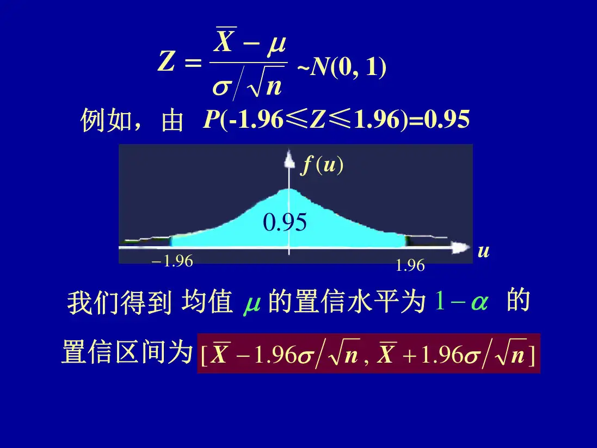

原文：

Z X − μ \~N(0, 1 )σ n例如， 由 $1 2 ( 1 0 - 1 0 ) \times 1 0 = 1 0 0 ( 1 0 - 1 ) \times 1 0 = 1 0 ( 1 0 - 1 ) \times 1 0$

我们得到 均值 的置信水平为μ 1 −α 的置信区间为 $\textcircled { 1 } \textcircled { 2 } \textcircled { 1 0 } \textcircled { 2 } \textcircled { 2 } \textcircled { 2 } \textcircled { 2 } \textcircled { 2 } \textcircled { 1 0 } \textcircled { 2 } \textcircled { 2 } \textcircled { 2 } \textcircled { 2 } \textcircled { 2 } \textcircled { 2 } \textcircled { 2 } \textcircled { 2 }$

### 由 $) \Delta B ( A ( - 1 , 1 3 )$

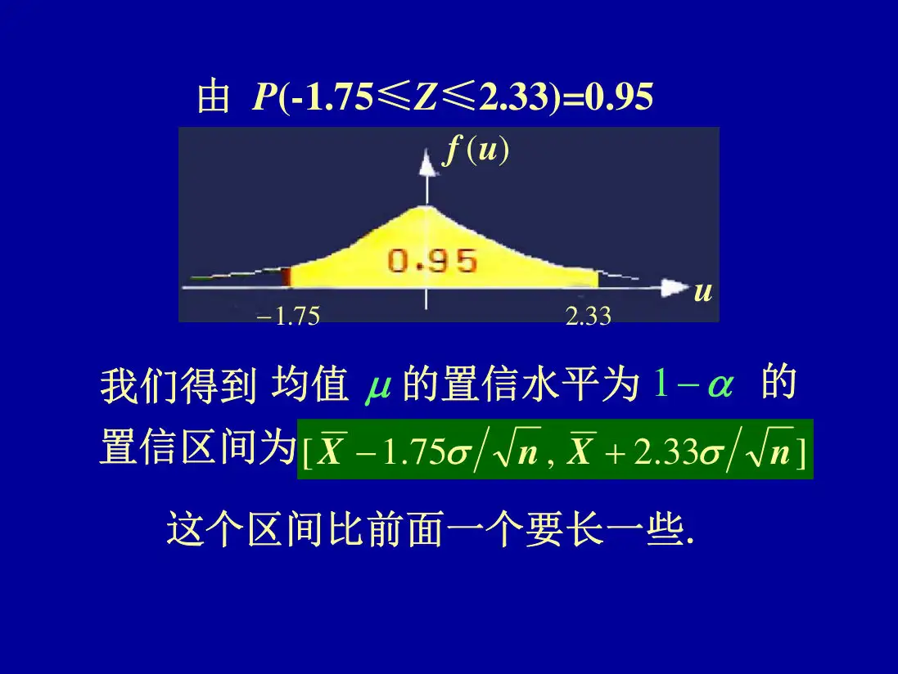

原文：

由 $) \Delta B ( A ( - 1 , 1 3 )$

我们得到 均值 的置信水平为μ 1 −α 的置信区间为 $\textcircled { 1 } N a ( O H ) = N a ( O H ) = N a S O _ { 4 } = N a C O _ { 4 } ( O H ) _ { 2 } \downarrow + N a O H ( O H ) _ { 2 } \downarrow$ 这个区间 比前面一个要长一些

### 类似地， 我们可得到若干个不同的置信区 间.

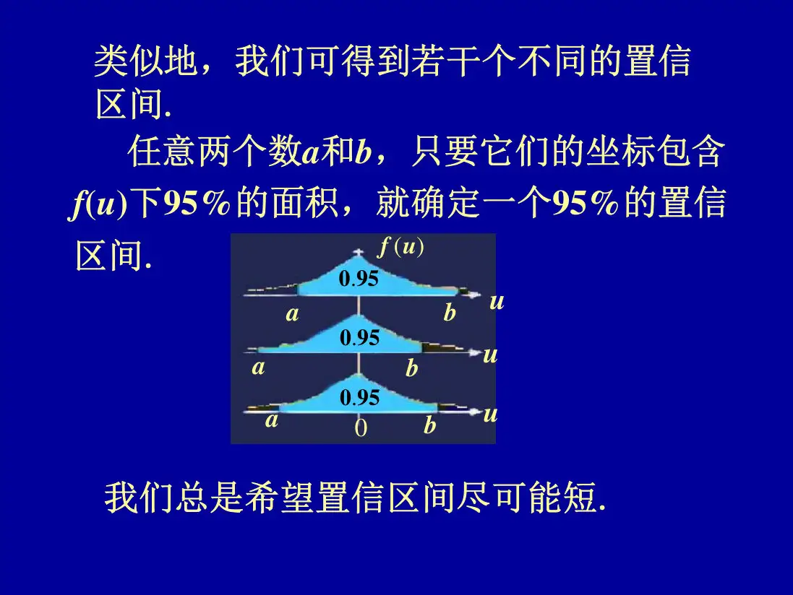

原文：

类似地， 我们可得到若干个不同的置信区 间.

任意两个数a和b， 只要它们的坐标包含f(u)下95%的面积， 就确定一个95%的置信

我们总是希望置信区间尽可能短.在概率密度为单峰且对称的情形， 当a =-b时求得的置信区间的长度为最短.

### 第 17 页

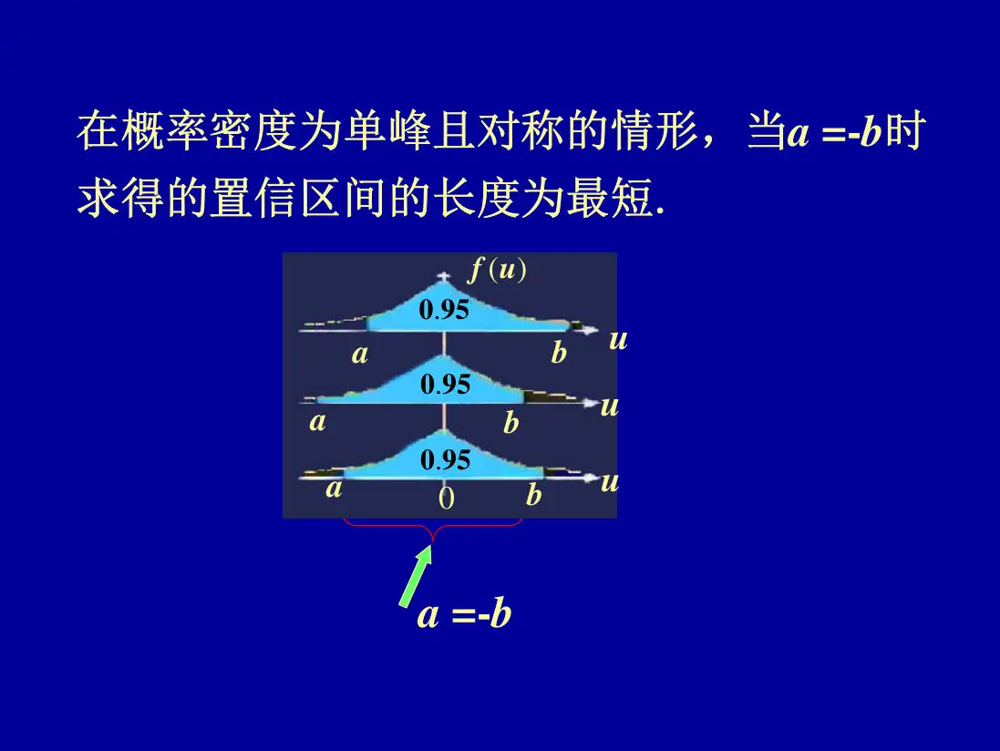

### 第 18 页

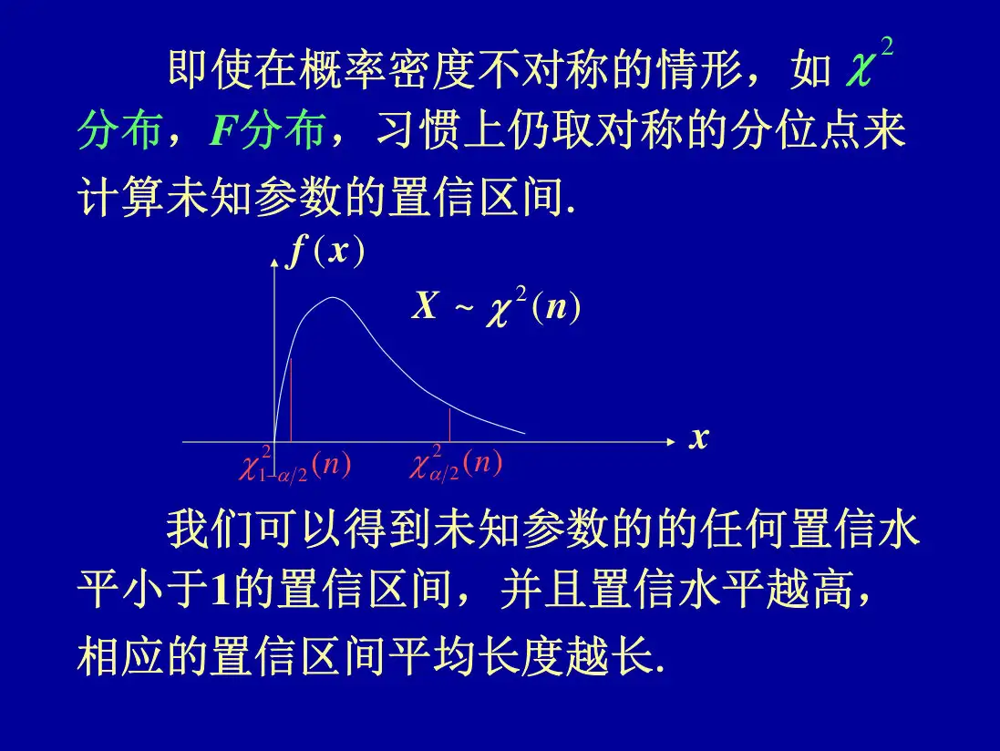

原文：

即使在概率密度不对称的情形， 如 χ分布， F分布， 习惯上仍取对称的分位点来计算未知参数的置信区间.

我们可以得到未知参数的的任何置信水平小于1的置信区间， 并且置信水平越高，相应的置信区间平均长度越长.

### 从例1解题的过程， 我们归纳出求置信区间 的一般步骤如下:

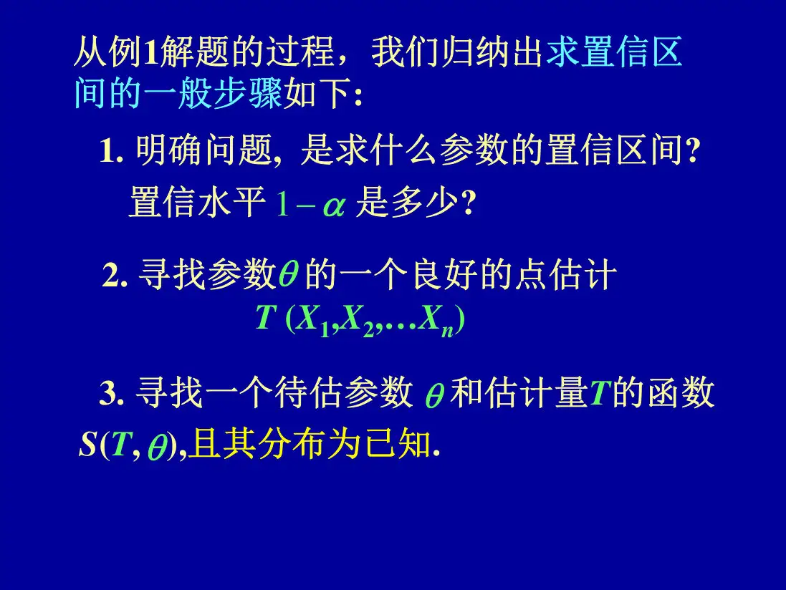

原文：

从例1解题的过程， 我们归纳出求置信区间 的一般步骤如下:

1. 明确 问题 是求什么参数的置信区间?置信水平 是多少1 −α ?

2. 寻找参数 的一个 良好的点估计θT (X1 ,X2, …Xn)

3. 寻找一个待估参数 和估计量T的函数θS(T )θ 且其分布为 已知.

### $$

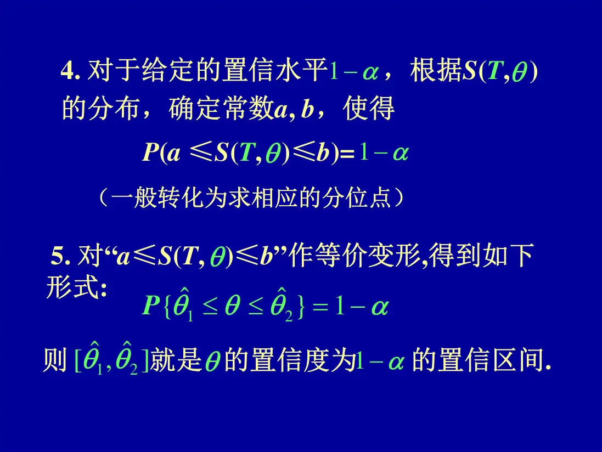

原文：

4. 对于给定 的置信水平 ， 根据S(T, )1 − α θ的分布， 确定常数 $\textcircled { \prime } \textcircled { \prime }$ ， 使得

$$
P (a \leqslant S (T, \theta) \leqslant b) = 1 - \alpha
$$

（一般转化为求相应的分位点）

5. 对 $( 1 ) ( 1 1 - 1 ) ( 1 1 + 1 1 ) ( 2 )$ 作等价变形 得到如下形式:$1 2 ( 2 ) - ( 6 ) = ( 2 ) - ( 2 ) = ( 2 )$

则 $\textcircled { 1 0 } \textcircled { 1 }$ 就是 的置信度为 的置信区 间] .θ 1 −α

### 第 21 页

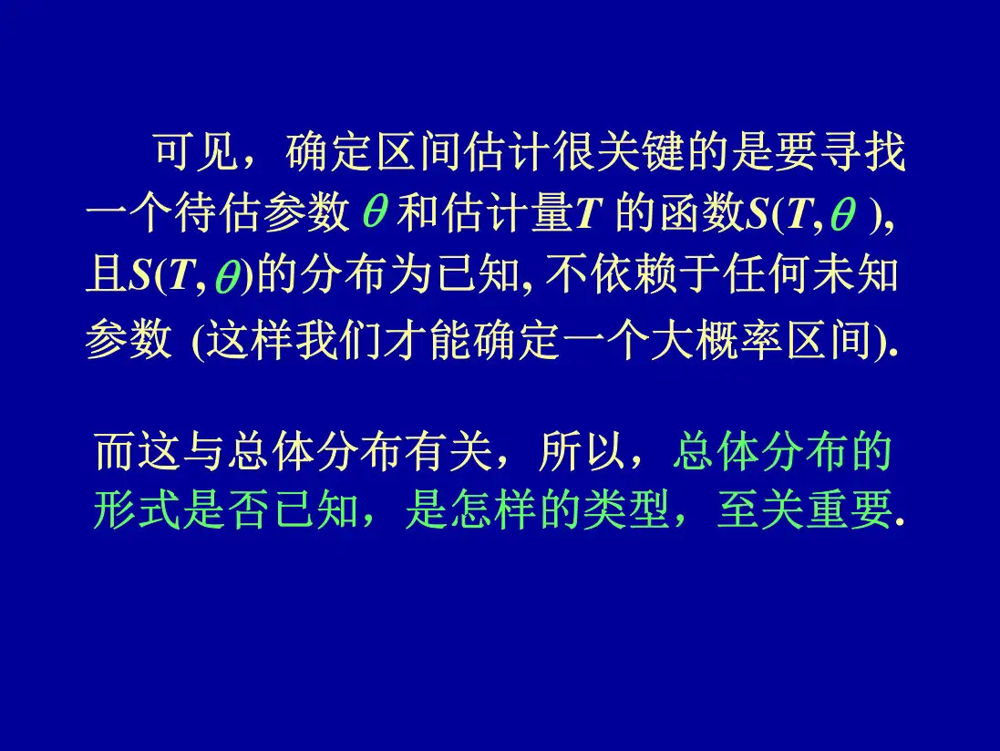

原文：

可见， 确定区间估计很关键的是要寻找一个待估参数 和估计量T 的函数S(T )θ θ且S(T )的分布为已知 不依赖于任何未知θ参数 (这样我们才能确定一个大概率区间).

而这与总体分布有关， 所以， 总体分布的形式是否已知， 是怎样的类型， 至关重要.
