# 《概率论与数理统计》第7章 参数估计（课件）

原件的每一页，下面附识别出的文字。

### 第7章 参数估计

原文：

第7章 参数估计

第6章，我们介绍了总体、样本、简单随机样本、统计量和抽样分布的概念，介绍了统计中常用的三大分布，给出了几个重要的抽样分布定理。它们是进一步学习统计推断的基础。

参数估计

统计推断

假设检验

南京邮电大学
Nanjing University of Posts and Telecommunications

### 7.1 点估计

原文：

7.1 点估计

7.1.1 点估计

7.1.2 最大似然估计法

小结

南京邮电大学
Nanjing University of Posts and Telecommunications

### 点估计问题的一般提法

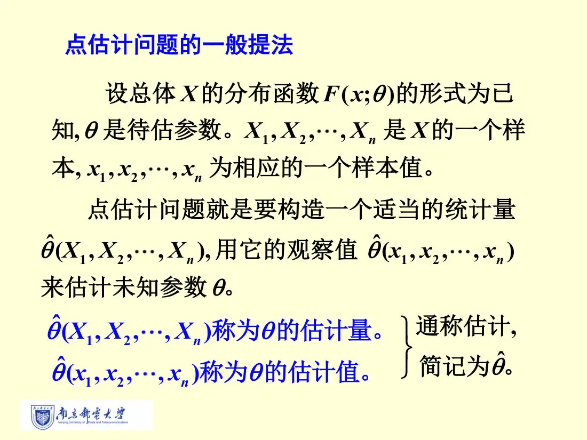

原文：

点估计问题的一般提法

设总体 X 的分布函数 $F(x;\theta)$ 的形式为已知, $\theta$ 是待估参数。 $X_{1}, X_{2}, \cdots, X_{n}$ 是 X 的一个样本, $x_{1}, x_{2}, \cdots, x_{n}$ 为相应的一个样本值。

点估计问题就是要构造一个适当的统计量 $\hat{\theta}(X_{1},X_{2},\cdots,X_{n})$ ，用它的观察值 $\hat{\theta}(x_{1},x_{2},\cdots,x_{n})$ 来估计未知参数 $\theta$ 。

$\hat{\theta}(X_1, X_2, \cdots, X_n)$ 称为 $\theta$ 的估计量。 $\left. \begin{array}{l} \theta(X_1, X_2, \cdots, X_n) \text{称为} \theta \text{的估计量。} \\ \hat{\theta}(x_1, x_2, \cdots, x_n) \text{称为} \theta \text{的估计值。} \end{array} \right\}$ 通称估计， $\left. \begin{array}{l} \theta(X_1, X_2, \cdots, X_n) \text{称为} \theta \text{的估计量。} \\ \hat{\theta}(x_1, x_2, \cdots, x_n) \text{称为} \theta \text{的估计值。} \end{array} \right\}$ 简记为 $\hat{\theta}$ 。

南京邮电大学
Nanjing University of Posts and Telecommunications

### 南京邮电大学

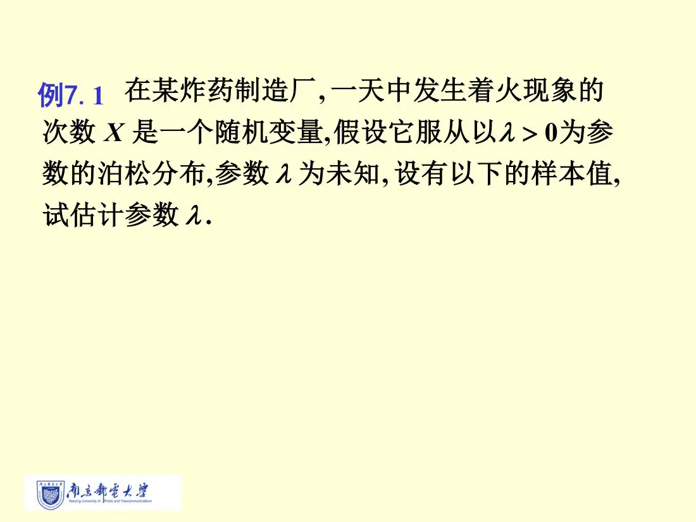

原文：

例7.1 在某炸药制造厂,一天中发生着火现象的次数 X 是一个随机变量,假设它服从以 $\lambda > 0$ 为参数的泊松分布,参数 $\lambda$ 为未知,设有以下的样本值,试估计参数 $\lambda$ .

南京邮电大学
Nanjing University of Posts and Telecommunications

### 着火次数k0123456发生k次着火的天数nk75905422621Σ=250

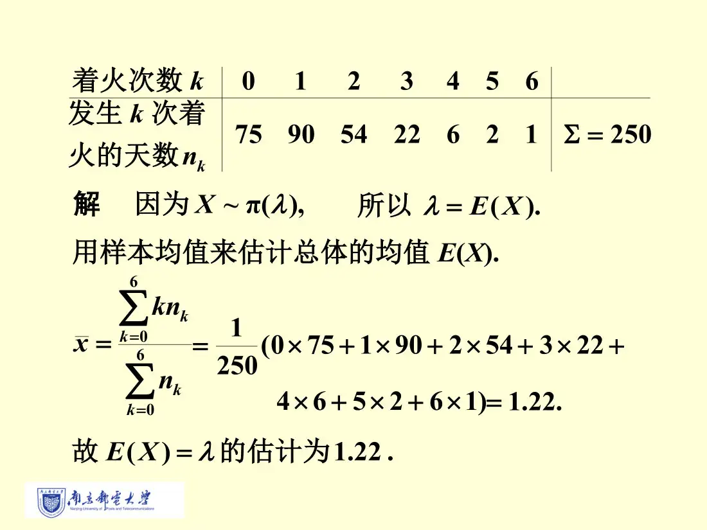

原文：

<table><tr><td>着火次数k</td><td>0</td><td>1</td><td>2</td><td>3</td><td>4</td><td>5</td><td>6</td><td></td></tr><tr><td>发生k次着火的天数nk</td><td>75</td><td>90</td><td>54</td><td>22</td><td>6</td><td>2</td><td>1</td><td>Σ=250</td></tr></table>

解 因为 $X \sim \pi(\lambda)$ ，所以 $\lambda = E(X)$ .

用样本均值来估计总体的均值 $E(X)$ .

$$
\bar {x} = \frac {\sum_ {k = 0} ^ {6} k n _ {k}}{\sum_ {k = 0} ^ {6} n _ {k}} = \frac {1}{2 5 0} (0 \times 7 5 + 1 \times 9 0 + 2 \times 5 4 + 3 \times 2 2 + 4 \times 6 + 5 \times 2 + 6 \times 1) = 1. 2 2.
$$

故 $E(X) = \lambda$ 的估计为1.22.

南京邮电大学
Nanjing University of Posts and Telecommunications

### 7.1.1 矩估计法

原文：

7.1.1 矩估计法

它是基于一种简单的“替换”思想建立起来的一种估计方法。

其基本思想是用样本矩估计总体矩。

理论依据: 大数定律

用相应的样本矩去估计总体矩的估计方法就称为矩估计法。

南京邮电大学
Nanjing University of Posts and Telecommunications

### 南京邮电大学

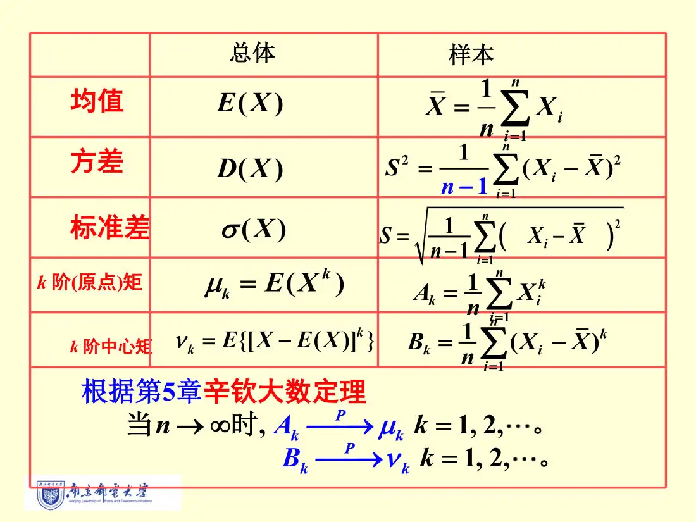

原文：

<table><tr><td></td><td>总体</td><td>样本</td></tr><tr><td>均值</td><td> $E(X)$ </td><td> $\bar{X} = \frac{1}{n} \sum_{i=1}^{n} X_i$ </td></tr><tr><td>方差</td><td> $D(X)$ </td><td> $S^2 = \frac{1}{n-1} \sum_{i=1}^{n} (X_i - \bar{X})^2$ </td></tr><tr><td>标准差</td><td> $\sigma(X)$ </td><td> $S = \sqrt{\frac{1}{n-1} \sum_{i=1}^{n} (X_i - \bar{X})^2}$ </td></tr><tr><td>k阶(原点)矩</td><td> $\mu_k = E(X^k)$ </td><td> $A_k = \frac{1}{n} \sum_{i=1}^{n} X_i^k$ </td></tr><tr><td>k阶中心矩</td><td> $\nu_k = E\{[X - E(X)]^k\}$ </td><td> $B_k = \frac{1}{n} \sum_{i=1}^{n} (X_i - \bar{X})^k$ </td></tr><tr><td colspan="3">根据第5章辛钦大数定理当 $n \to \infty$ 时, $A_k \xrightarrow{P} \mu_k k = 1, 2, \cdots$  $B_k \xrightarrow{P} \nu_k k = 1, 2, \cdots$ 。</td></tr></table>

南京邮电大学
Nanjing University of Posts and Telecommunications

### 样本矩的连续函数依概率收敛于相应的总体矩的连续函数。

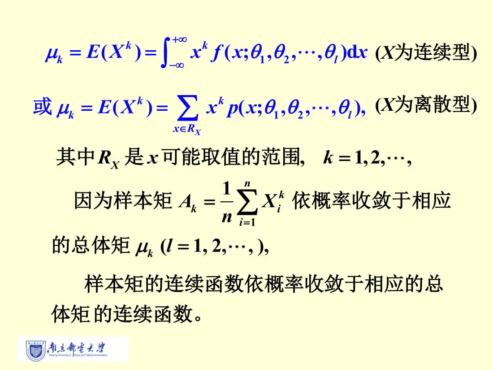

原文：

$\mu_{k}=E(X^{k})=\int_{-\infty}^{+\infty}x^{k}f(x;\theta_{1},\theta_{2},\cdots,\theta_{l})dx$ (X为连续型)
或 $\mu_{k}=E(X^{k})=\sum_{x\in R_{X}}x^{k}p(x;\theta_{1},\theta_{2},\cdots,\theta_{l})$ ，(X为离散型)
其中 $R_{X}$ 是 x 可能取值的范围， $k=1,2,\cdots,$ 因为样本矩 $A_{k}=\frac{1}{n}\sum_{i=1}^{n}X_{i}^{k}$ 依概率收敛于相应的总体矩 $\mu_{k}(l=1,2,\cdots,)$ ,

样本矩的连续函数依概率收敛于相应的总体矩的连续函数。

南京邮电大学
Nanjing University of Posts and Telecommunications

### 矩估计法的定义

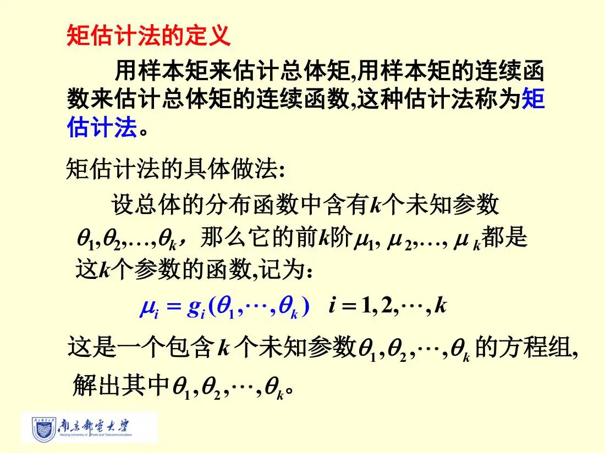

原文：

矩估计法的定义

用样本矩来估计总体矩,用样本矩的连续函数来估计总体矩的连续函数,这种估计法称为矩估计法。

矩估计法的具体做法:

设总体的分布函数中含有k个未知参数 $\theta_{1},\theta_{2},\ldots,\theta_{k}$ ，那么它的前k阶 $\mu_{1},\mu_{2},\ldots,\mu_{k}$ 都是这k个参数的函数,记为:

$$
\mu_ {i} = g _ {i} (\theta_ {1}, \dots , \theta_ {k}) i = 1, 2, \dots , k
$$

这是一个包含 k 个未知参数 $\theta_{1}, \theta_{2}, \cdots, \theta_{k}$ 的方程组，解出其中 $\theta_{1}, \theta_{2}, \cdots, \theta_{k}$ 。

南京邮电大学
Nanjing University of Posts and Telecommunications

### 从这 $k$ 个方程中解出

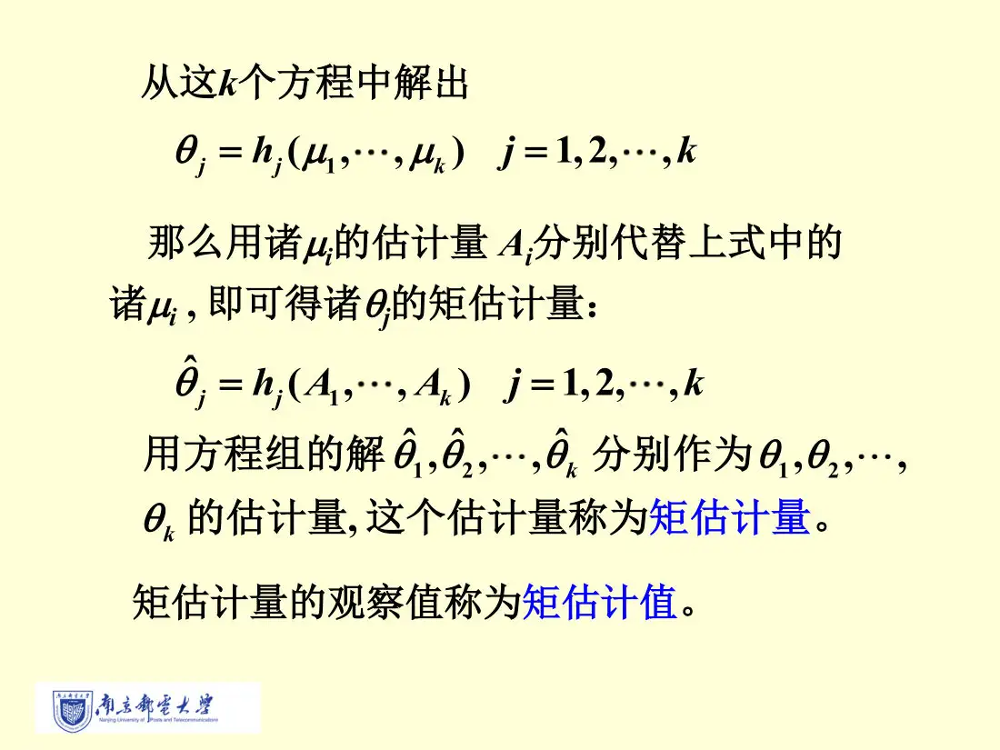

原文：

从这 $k$ 个方程中解出

$$
\theta_ {j} = h _ {j} (\mu_ {1}, \dots , \mu_ {k}) j = 1, 2, \dots , k
$$

那么用诸 $\mu_{i}$ 的估计量 $A_{i}$ 分别代替上式中的诸 $\mu_{i}$ ，即可得诸 $\theta_{j}$ 的矩估计量：

$$
\hat {\theta} _ {j} = h _ {j} (A _ {1}, \dots , A _ {k}) j = 1, 2, \dots , k
$$

用方程组的解 $\hat{\theta}_{1},\hat{\theta}_{2},\cdots,\hat{\theta}_{k}$ 分别作为 $\theta_{1},\theta_{2},\cdots,\theta_{k}$ 的估计量, 这个估计量称为矩估计量。

矩估计量的观察值称为矩估计值。

南京邮电大学
Nanjing University of Posts and Telecommunications

### 解 因为 $X$ 的分布律为

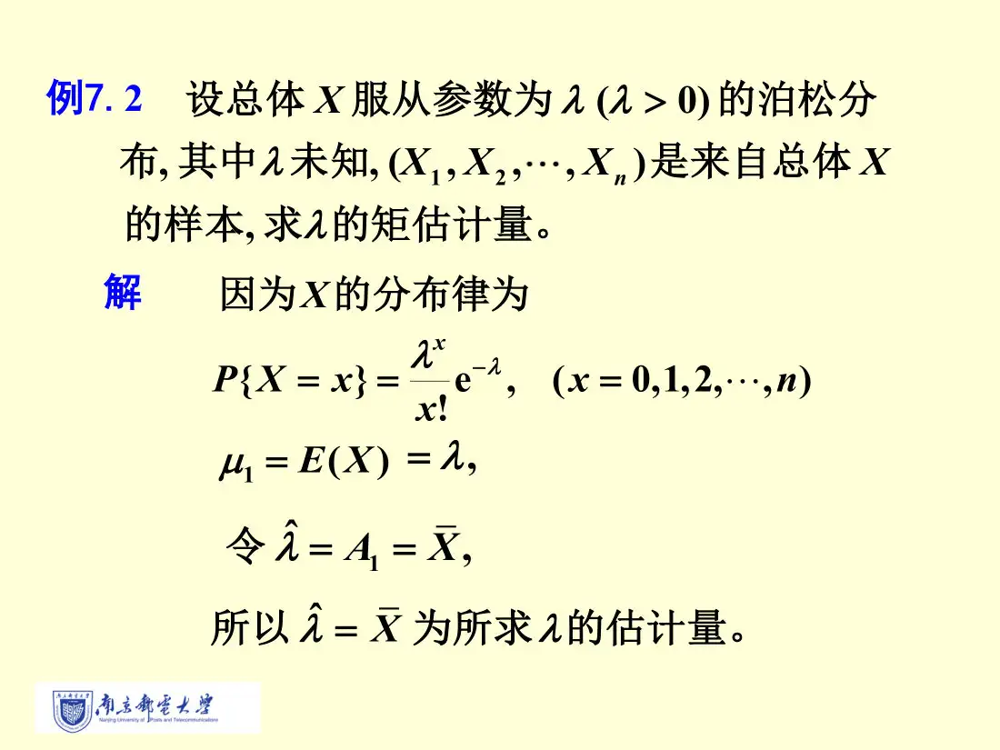

原文：

例7.2 设总体 X 服从参数为 $\lambda (\lambda > 0)$ 的泊松分布, 其中 $\lambda$ 未知, $(X_{1}, X_{2}, \cdots, X_{n})$ 是来自总体 X 的样本, 求 $\lambda$ 的矩估计量。

解 因为 $X$ 的分布律为

$$
P \{X = x \} = \frac {\lambda^ {x}}{x !} \mathrm{e} ^ {- \lambda}, (x = 0, 1, 2, \dots , n)
$$

$$
\mu_ {1} = E (X) = \lambda ,
$$

令 $\hat{\lambda} = A_{1} = \bar{X}$

所以 $\hat{\lambda} = \bar{X}$ 为所求 $\lambda$ 的估计量。

南京邮电大学
Nanjing University of Posts and Telecommunications

### 南京邮电大学

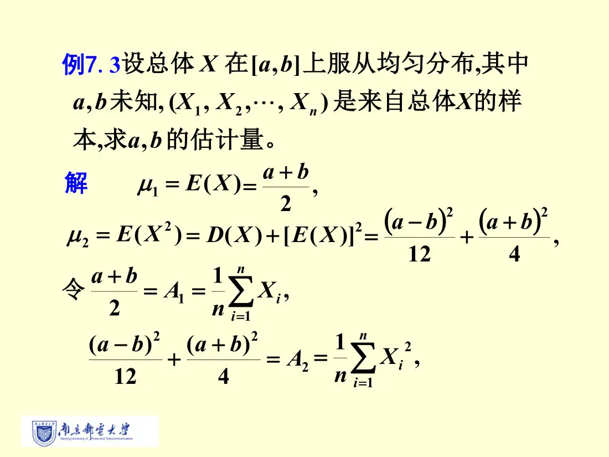

原文：

例7.3设总体 X 在 $[a,b]$ 上服从均匀分布, 其中 a, b 未知, $(X_{1}, X_{2}, \cdots, X_{n})$ 是来自总体 X 的样本, 求 a, b 的估计量。

解 $\mu_{1}=E(X)=\frac{a+b}{2},$ $\mu_{2}=E(X^{2})=D(X)+[E(X)]^{2}=\frac{(a-b)^{2}}{12}+\frac{(a+b)^{2}}{4},$ 令 $\frac{a+b}{2}=A_{1}=\frac{1}{n}\sum_{i=1}^{n}X_{i},$ $\frac{(a-b)^{2}}{12}+\frac{(a+b)^{2}}{4}=A_{2}=\frac{1}{n}\sum_{i=1}^{n}X_{i}^{2},$

南京邮电大学
Nanjing University of Posts and Telecommunications

### 解方程组得到a, b的矩估计量分别为

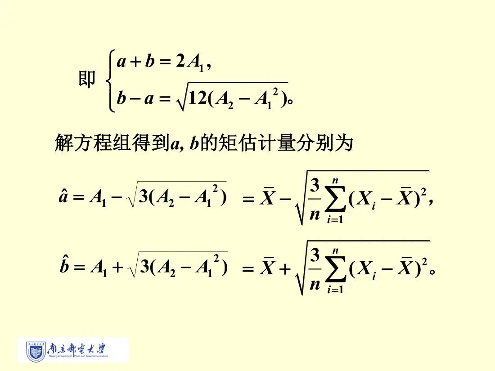

原文：

即 $\left\{\begin{aligned}a+b=2A_{1},\\ b-a=\sqrt{12(A_{2}-A_{1}^{2})}\circ\end{aligned}\right.$

解方程组得到a, b的矩估计量分别为

$$
\hat {a} = A _ {1} - \sqrt {3 (A _ {2} - A _ {1} ^ {2})} = \bar {X} - \sqrt {\frac {3}{n} \sum_ {i = 1} ^ {n} (X _ {i} - \bar {X}) ^ {2}},
$$

$$
\hat {b} = A _ {1} + \sqrt {3 (A _ {2} - A _ {1} ^ {2})} = \bar {X} + \sqrt {\frac {3}{n} \sum_ {i = 1} ^ {n} (X _ {i} - \bar {X}) ^ {2}}.
$$

南京邮电大学
Nanjing University of Posts and Telecommunications

### 解 $\mu_{1}=E(X)=\mu,$

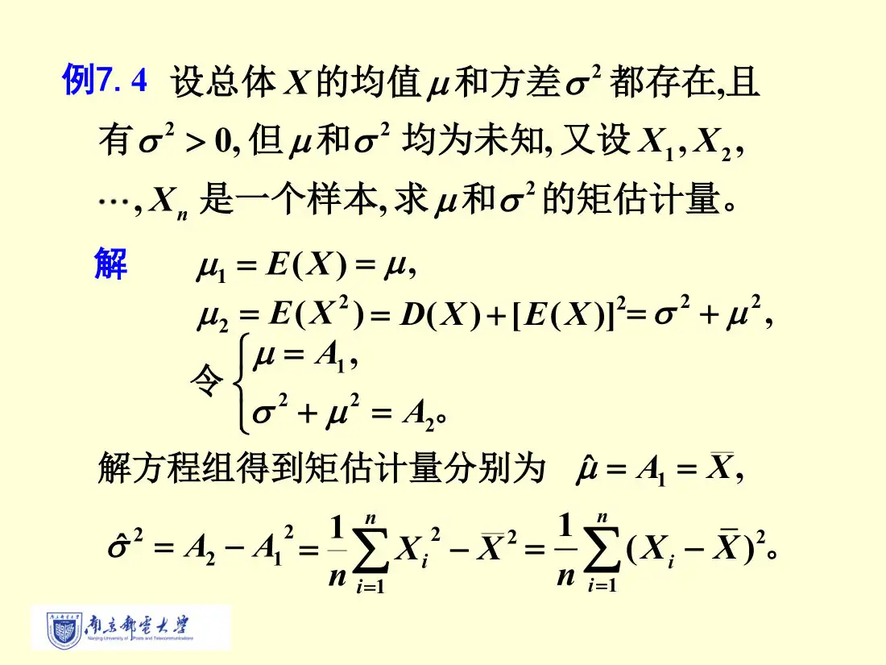

原文：

例7.4 设总体 X 的均值 $\mu$ 和方差 $\sigma^{2}$ 都存在, 且有 $\sigma^{2} > 0$ , 但 $\mu$ 和 $\sigma^{2}$ 均为未知, 又设 $X_{1}, X_{2}, \cdots, X_{n}$ 是一个样本, 求 $\mu$ 和 $\sigma^{2}$ 的矩估计量。

解 $\mu_{1}=E(X)=\mu,$

$$
\begin{array}{l} {\mu_ {1} = E (X) = \mu ,} \\ {\mu_ {2} = E (X ^ {2}) = D (X) + [ E (X) ] ^ {2} = \sigma^ {2} + \mu^ {2},} \\ {\text {令} \left\{ \begin{array}{l l} {\mu = A _ {1},} \\ {\sigma^ {2} + \mu^ {2} = A _ {2}.} \end{array} \right.} \end{array}
$$

解方程组得到矩估计量分别为 $\hat{\mu}=A_{1}=\bar{X},$

$$
\hat {\sigma} ^ {2} = A _ {2} - A _ {1} ^ {2} = \frac {1}{n} \sum_ {i = 1} ^ {n} X _ {i} ^ {2} - \bar {X} ^ {2} = \frac {1}{n} \sum_ {i = 1} ^ {n} (X _ {i} - \bar {X}) ^ {2} 。
$$

南京邮电大学
Nanjing University of Posts and Telecommunications

### 上例表明:

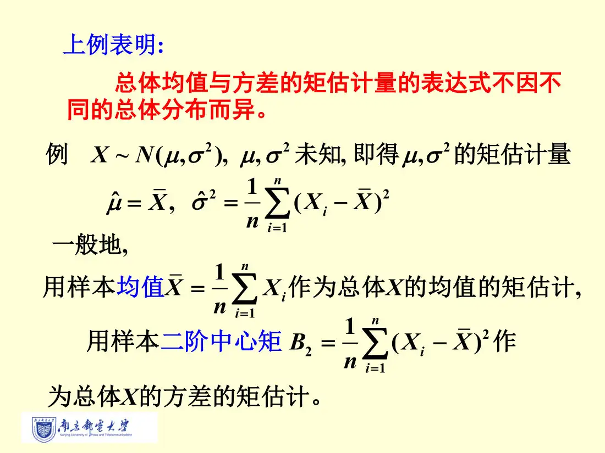

原文：

上例表明:

总体均值与方差的矩估计量的表达式不因不同的总体分布而异。

例 $X \sim N(\mu, \sigma^2)$ , $\mu, \sigma^2$ 未知, 即得 $\mu, \sigma^2$ 的矩估计量

$$
\hat {\mu} = \bar {X}, \hat {\sigma} ^ {2} = \frac {1}{n} \sum_ {i = 1} ^ {n} (X _ {i} - \bar {X}) ^ {2}
$$

用样本均值 $\bar{X} = \frac{1}{n}\sum_{i=1}^{n} X_i$ 作为总体 $X$ 的均值的矩估计，用样本二阶中心矩 $B_2 = \frac{1}{n}\sum_{i=1}^{n}(X_i - \bar{X})^2$ 作为总体 $X$ 的方差的矩估计。

南京邮电大学
Nanjing University of Posts and Telecommunications

### 7.1.2 最大似然估计法

原文：

7.1.2 最大似然估计法

是在总体类型已知条件下使用的一种参数估计方法。

最大似然法的基本思想

一次随机实验中概率最大的实验最可能发生。

南京邮电大学
Nanjing University of Posts and Telecommunications

### 最大似然估计原理

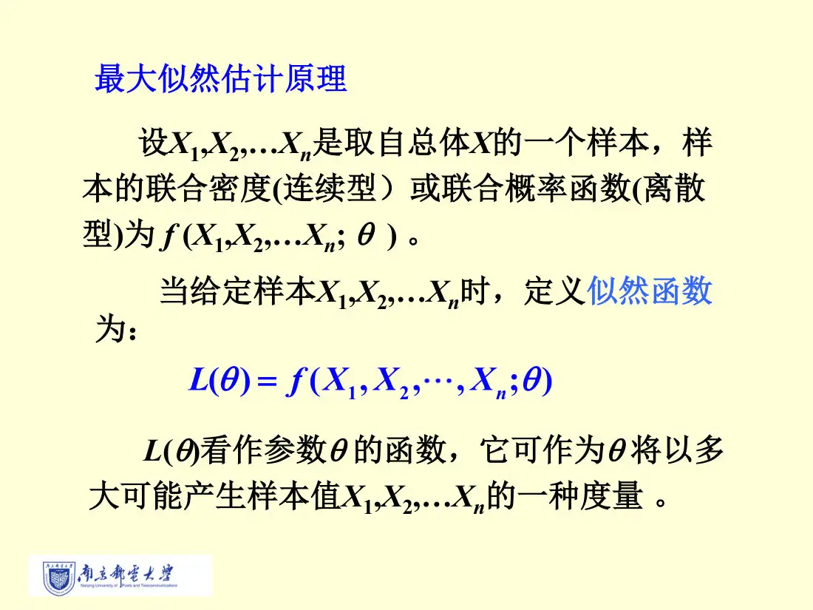

原文：

最大似然估计原理

设 $X_{1},X_{2},\ldots,X_{n}$ 是取自总体X的一个样本，样本的联合密度(连续型)或联合概率函数(离散型)为 $f(X_{1},X_{2},\ldots,X_{n};\theta)$ 。

当给定样本 $X_{1},X_{2},\ldots,X_{n}$ 时，定义似然函数为：

$$
L (\theta) = f (X _ {1}, X _ {2}, \dots , X _ {n}; \theta)
$$

$L(\theta)$ 看作参数 $\theta$ 的函数，它可作为 $\theta$ 将以多大可能产生样本值 $X_{1},X_{2},\ldots,X_{n}$ 的一种度量。

南京邮电大学
Nanjing University of Posts and Telecommunications

### $$

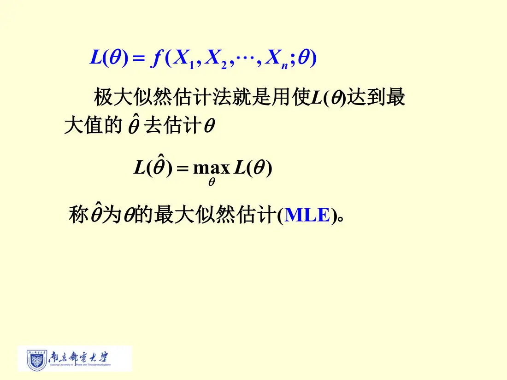

原文：

$$
L (\theta) = f (X _ {1}, X _ {2}, \dots , X _ {n}; \theta)
$$

极大似然估计法就是用使 $L(\theta)$ 达到最大值的 $\hat{\theta}$ 去估计 $\theta$

$$
L (\hat {\theta}) = \max _ {\theta} L (\theta)
$$

称 $\hat{\theta}$ 为 $\theta$ 的最大似然估计(MLE)。

南京邮电大学
Nanjing University of Posts and Telecommunications

### 最大似然函数的定义

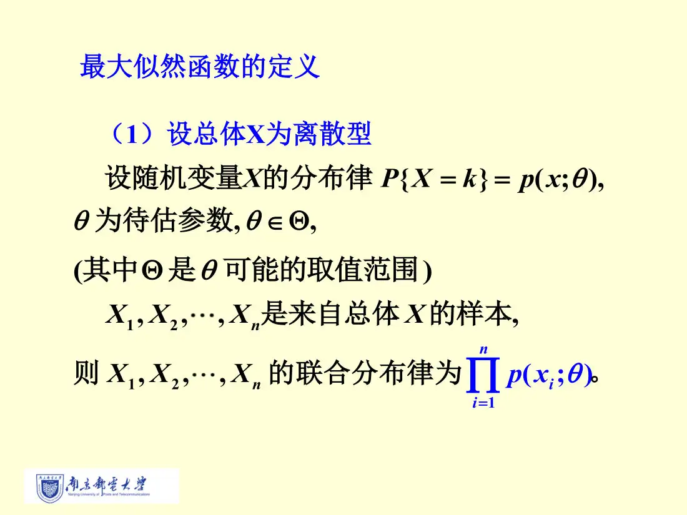

原文：

最大似然函数的定义

(1) 设总体X为离散型

设随机变量X的分布律 $P\{X=k\}=p(x;\theta)$ , $\theta$ 为待估参数, $\theta\in\Theta$ ,

(其中 $\Theta$ 是 $\theta$ 可能的取值范围)

$X_{1},X_{2},\cdots,X_{n}$ 是来自总体X的样本,则 $X_{1},X_{2},\cdots,X_{n}$ 的联合分布律为 $\prod_{i=1}^{n}p(x_{i};\theta)$ 。

南京邮电大学
Nanjing University of Posts and Telecommunications

### $$

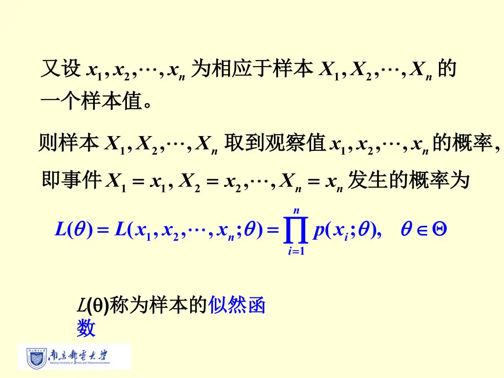

原文：

又设 $x_{1}, x_{2}, \cdots, x_{n}$ 为相应于样本 $X_{1}, X_{2}, \cdots, X_{n}$ 的一个样本值。

则样本 $X_{1}, X_{2}, \cdots, X_{n}$ 取到观察值 $x_{1}, x_{2}, \cdots, x_{n}$ 的概率，
即事件 $X_{1}=x_{1}, X_{2}=x_{2}, \cdots, X_{n}=x_{n}$ 发生的概率为

$$
L (\theta) = L (x _ {1}, x _ {2}, \dots , x _ {n}; \theta) = \prod_ {i = 1} ^ {n} p (x _ {i}; \theta), \quad \theta \in \Theta
$$

$L(\theta)$ 称为样本的似然函数

南京邮电大学
Nanjing University of Posts and Telecommunications

### (2) 设总体X为连续型

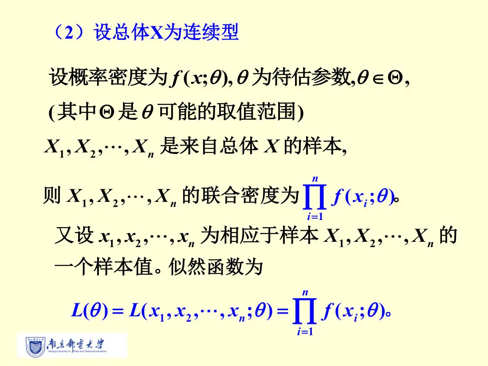

原文：

(2) 设总体X为连续型

设概率密度为 $f(x;\theta)$ ， $\theta$ 为待估参数， $\theta\in\Theta$ ，
(其中 $\Theta$ 是 $\theta$ 可能的取值范围) $X_{1},X_{2},\cdots,X_{n}$ 是来自总体X的样本，
则 $X_{1},X_{2},\cdots,X_{n}$ 的联合密度为 $\prod_{i=1}^{n}f(x_{i};\theta)$ 。
又设 $x_{1},x_{2},\cdots,x_{n}$ 为相应于样本 $X_{1},X_{2},\cdots,X_{n}$ 的一个样本值。似然函数为

$$
L (\theta) = L (x _ {1}, x _ {2}, \dots , x _ {n}; \theta) = \prod_ {i = 1} ^ {n} f (x _ {i}; \theta) 。
$$

南京邮电大学
Nanjing University of Posts and Telecommunications

### 求最大似然估计量的步骤:

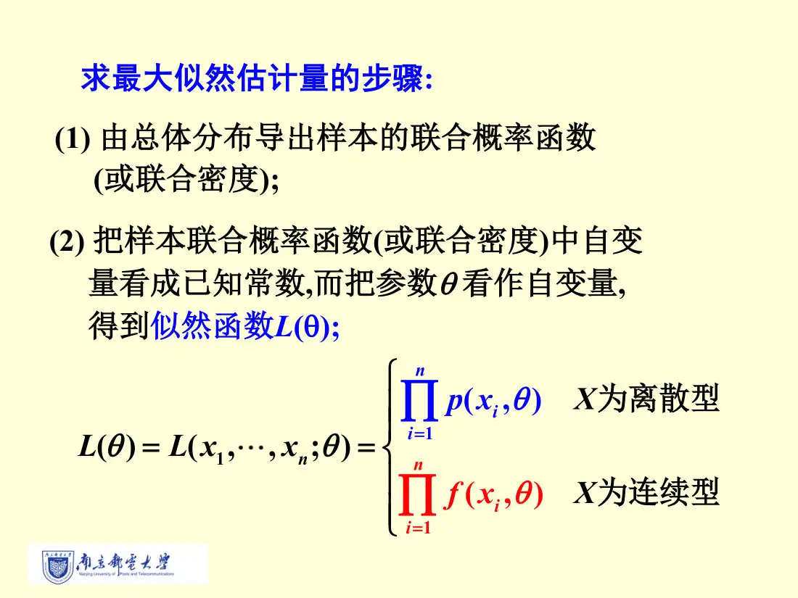

原文：

求最大似然估计量的步骤:

(1) 由总体分布导出样本的联合概率函数 (或联合密度);

(2) 把样本联合概率函数(或联合密度)中自变量看成已知常数,而把参数 $\theta$ 看作自变量,得到似然函数 $L(\theta)$ ;

$L(\theta)=L(x_{1},\cdots,x_{n};\theta)=\left\{\begin{aligned}\prod_{i=1}^{n}p(x_{i},\theta) & \text{X为离散型}\\ \prod_{i=1}^{n}f(x_{i},\theta) & \text{X为连续型}\end{aligned}\right.$

南京邮电大学
Nanjing University of Posts and Telecommunications

### (3) 取对数

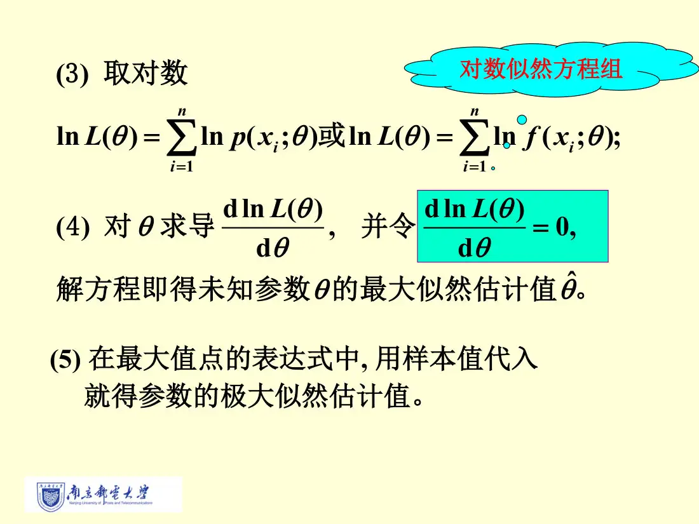

原文：

(3) 取对数

对数似然方程组

$\ln L(\theta) = \sum_{i=1}^{n} \ln p(x_i; \theta)$ 或 $\ln L(\theta) = \sum_{i=1}^{n} \ln f(x_i; \theta)$ ;

(4) 对 $\theta$ 求导 $\frac{\mathrm{d}\ln L(\theta)}{\mathrm{d}\theta}$ , 并令 $\frac{\mathrm{d}\ln L(\theta)}{\mathrm{d}\theta} = 0$ , 解方程即得未知参数 $\theta$ 的最大似然估计值 $\hat{\theta}$ 。

(5) 在最大值点的表达式中, 用样本值代入就得参数的极大似然估计值。

南京邮电大学
Nanjing University of Posts and Telecommunications

### 三点说明

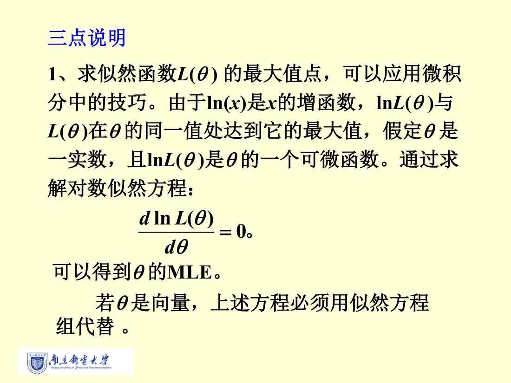

原文：

三点说明

1、求似然函数 $L(\theta)$ 的最大值点，可以应用微积分中的技巧。由于 $\ln(x)$ 是x的增函数， $\ln L(\theta)$ 与 $L(\theta)$ 在 $\theta$ 的同一值处达到它的最大值，假定 $\theta$ 是一实数，且 $\ln L(\theta)$ 是 $\theta$ 的一个可微函数。通过求解对数似然方程：

$$
\frac {d \ln L (\theta)}{d \theta} = 0 _ {\circ}
$$

可以得到 $\theta$ 的MLE。

若 $\theta$ 是向量，上述方程必须用似然方程组代替。

南京邮电大学
Nanjing University of Posts and Telecommunications

### 2、最大似然估计法也适用于分布中含有多个未知参数的情况。此时只需令

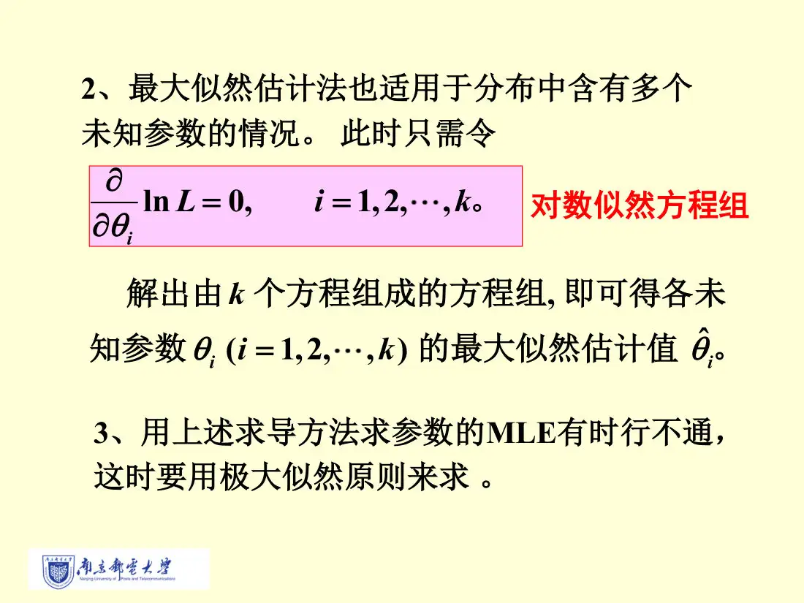

原文：

2、最大似然估计法也适用于分布中含有多个未知参数的情况。此时只需令

$$
\frac {\partial}{\partial \theta_ {i}} \ln L = 0, \quad i = 1, 2, \dots , k _ {\circ}
$$

对数似然方程组

解出由 k 个方程组成的方程组, 即可得各未知参数 $\theta_{i} (i=1,2,\cdots,k)$ 的最大似然估计值 $\hat{\theta}_{i}$ 。

3、用上述求导方法求参数的MLE有时行不通，这时要用极大似然原则来求。

南京邮电大学
Nanjing University of Posts and Telecommunications

### 解 因为 $X$ 的分布律为

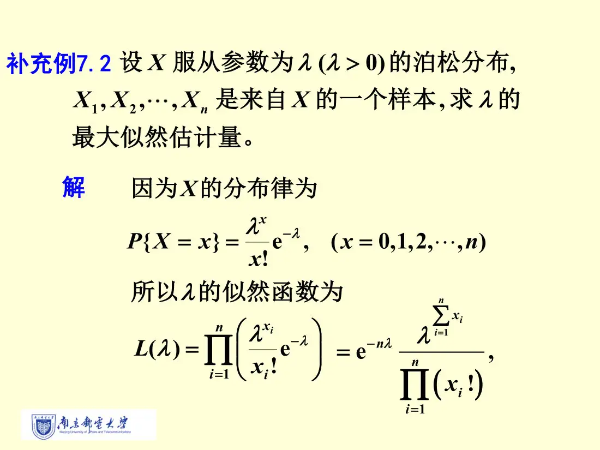

原文：

补充例7.2 设 X 服从参数为 $\lambda (\lambda > 0)$ 的泊松分布, $X_{1}, X_{2}, \cdots, X_{n}$ 是来自 X 的一个样本, 求 $\lambda$ 的最大似然估计量。

解 因为 $X$ 的分布律为

$$
P \{X = x \} = \frac {\lambda^ {x}}{x !} \mathrm{e} ^ {- \lambda}, (x = 0, 1, 2, \dots , n)
$$

所以 $\lambda$ 的似然函数为

$$
L (\lambda) = \prod_ {i = 1} ^ {n} \left(\frac {\lambda^ {x _ {i}}}{x _ {i} !} \mathrm{e} ^ {- \lambda}\right) = \mathrm{e} ^ {- n \lambda} \frac {\lambda^ {\sum_ {i = 1} ^ {n} x _ {i}}}{\prod_ {i = 1} ^ {n} (x _ {i} !)},
$$

南京邮电大学
Nanjing University of Posts and Telecommunications

### 对数似然函数 $\ln L(\lambda)$

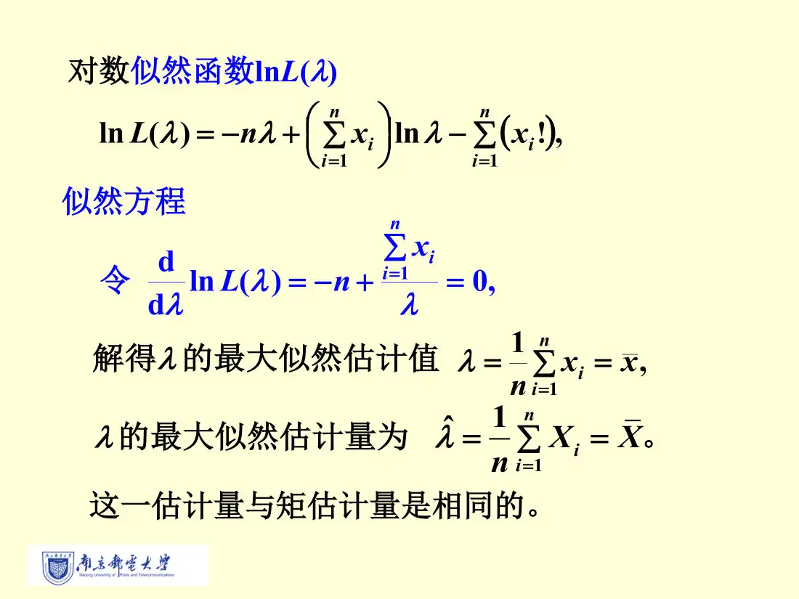

原文：

对数似然函数 $\ln L(\lambda)$

$$
\ln L (\lambda) = - n \lambda + \left(\sum_ {i = 1} ^ {n} x _ {i}\right) \ln \lambda - \sum_ {i = 1} ^ {n} (x _ {i}!),
$$

似然方程

令 $\frac{d}{d\lambda}\ln L(\lambda)=-n+\frac{\sum_{i=1}^{n}x_{i}}{\lambda}=0,$ 解得 $\lambda$ 的最大似然估计值 $\lambda=\frac{1}{n}\sum_{i=1}^{n}x_{i}=\bar{x},$ $\lambda$ 的最大似然估计量为 $\hat{\lambda}=\frac{1}{n}\sum_{i=1}^{n}X_{i}=\bar{X}$ 这一估计量与矩估计量是相同的。

南京邮电大学
Nanjing University of Posts and Telecommunications

### 南京邮电大学

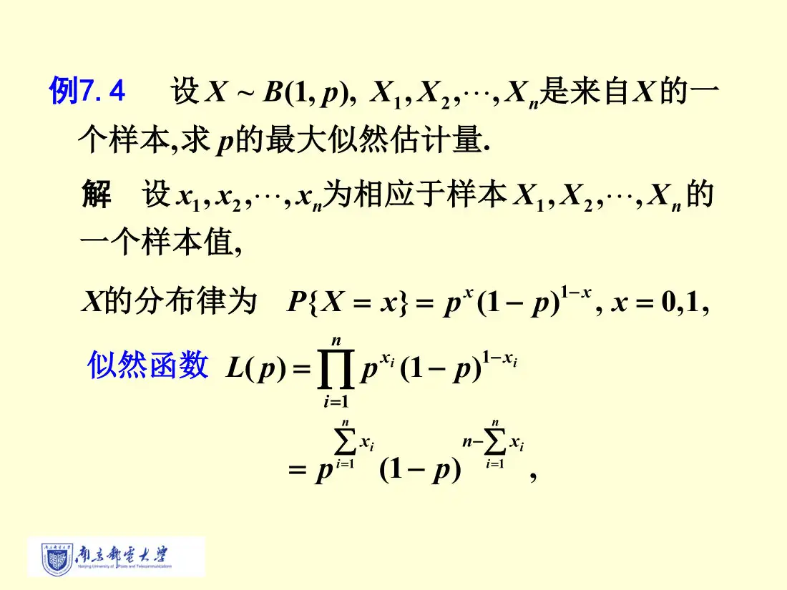

原文：

例7.4 设 $X \sim B(1, p)$ , $X_{1}, X_{2}, \cdots, X_{n}$ 是来自 X 的一个样本, 求 p 的最大似然估计量.

解 设 $x_{1}, x_{2}, \cdots, x_{n}$ 为相应于样本 $X_{1}, X_{2}, \cdots, X_{n}$ 的一个样本值，

X的分布律为 $P\{X=x\}=p^{x}(1-p)^{1-x}, x=0,1,$ 似然函数 $L(p)=\prod_{i=1}^{n}p^{x_{i}}(1-p)^{1-x_{i}}$ $=p^{\sum_{i=1}^{n}x_{i}}(1-p)^{n-\sum_{i=1}^{n}x_{i}},$

南京邮电大学
Nanjing University of Posts and Telecommunications

### 南京邮电大学

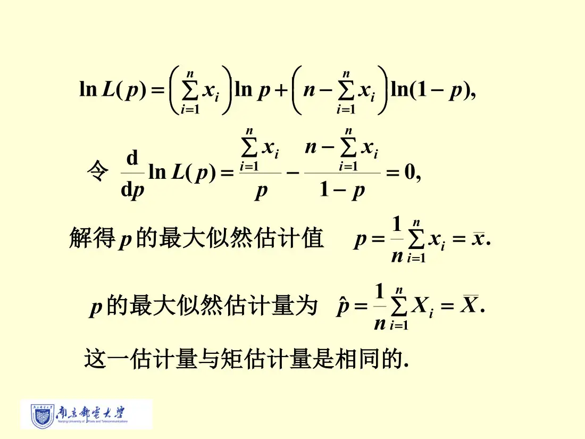

原文：

$\ln L(p) = \left(\sum_{i=1}^{n} x_i\right) \ln p + \left(n - \sum_{i=1}^{n} x_i\right) \ln (1 - p)$ , 令 $\frac{\mathrm{d}}{\mathrm{d}p} \ln L(p) = \frac{\sum_{i=1}^{n} x_i}{p} - \frac{n - \sum_{i=1}^{n} x_i}{1 - p} = 0,$ 解得 $p$ 的最大似然估计值 $p = \frac{1}{n} \sum_{i=1}^{n} x_i = \bar{x}$ . $p$ 的最大似然估计量为 $\hat{p} = \frac{1}{n} \sum_{i=1}^{n} X_i = \bar{X}$ . 这一估计量与矩估计量是相同的.

南京邮电大学
Nanjing University of Posts and Telecommunications

### 解 $X$ 的概率密度为

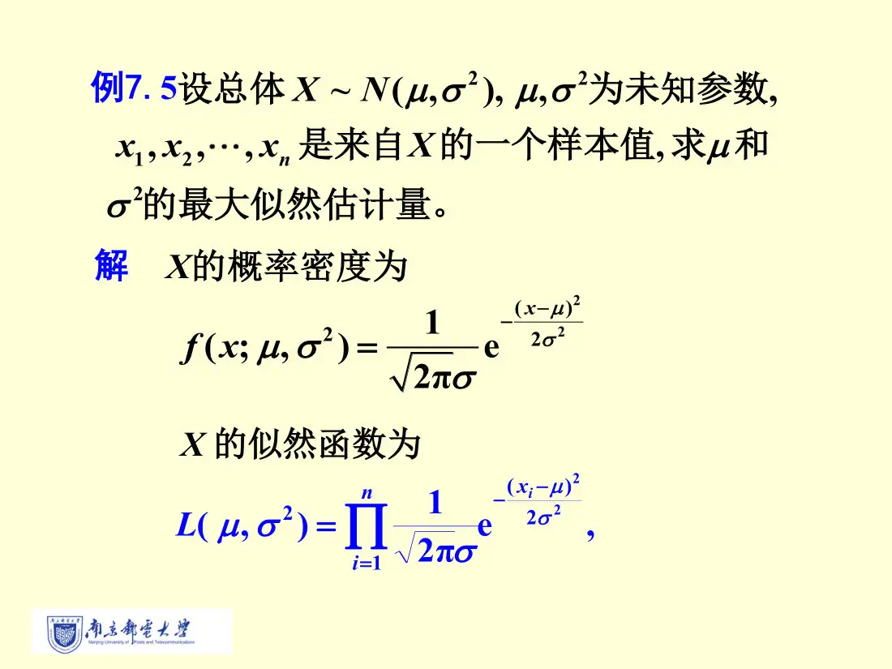

原文：

例7.5设总体 $X \sim N(\mu, \sigma^{2})$ , $\mu, \sigma^{2}$ 为未知参数, $x_{1}, x_{2}, \cdots, x_{n}$ 是来自 X 的一个样本值, 求 $\mu$ 和 $\sigma^{2}$ 的最大似然估计量。

解 $X$ 的概率密度为

$$
f (x; \mu , \sigma^ {2}) = \frac {1}{\sqrt {2 \pi} \sigma} \mathrm{e} ^ {- \frac {(x - \mu) ^ {2}}{2 \sigma^ {2}}}
$$

$X$ 的似然函数为

$$
L (\mu , \sigma^ {2}) = \prod_ {i = 1} ^ {n} \frac {1}{\sqrt {2 \pi} \sigma} \mathrm{e} ^ {- \frac {(x _ {i} - \mu) ^ {2}}{2 \sigma^ {2}}},
$$

南京邮电大学
Nanjing University of Posts and Telecommunications

### $$

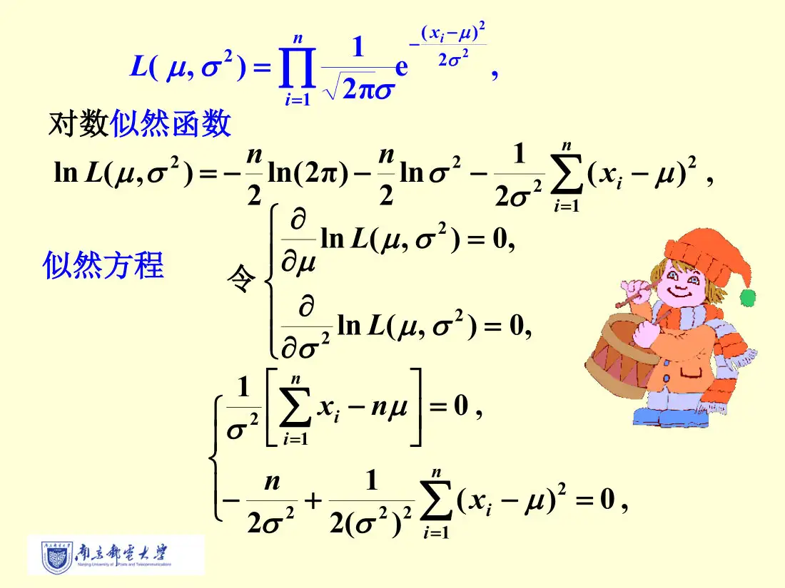

原文：

$$
L (\mu , \sigma^ {2}) = \prod_ {i = 1} ^ {n} \frac {1}{\sqrt {2 \pi} \sigma} \mathrm{e} ^ {- \frac {(x _ {i} - \mu) ^ {2}}{2 \sigma^ {2}}},
$$

对数似然函数

似然方程

$$
\text {令} \left\{ \begin{array}{l} \frac {\partial}{\partial \mu} \ln L (\mu , \sigma^ {2}) = 0, \\ \frac {\partial}{\partial \sigma^ {2}} \ln L (\mu , \sigma^ {2}) = 0, \end{array} \right.
$$

$$
\left\{ \begin{array}{l} \frac {1}{\sigma^ {2}} \left[ \sum_ {i = 1} ^ {n} x _ {i} - n \mu \right] = 0, \\ - \frac {n}{2 \sigma^ {2}} + \frac {1}{2 (\sigma^ {2}) ^ {2}} \sum_ {i = 1} ^ {n} (x _ {i} - \mu) ^ {2} = 0, \end{array} \right.
$$

南京邮电大学
Nanjing University of Posts and Telecommunications

### 南京邮电大学

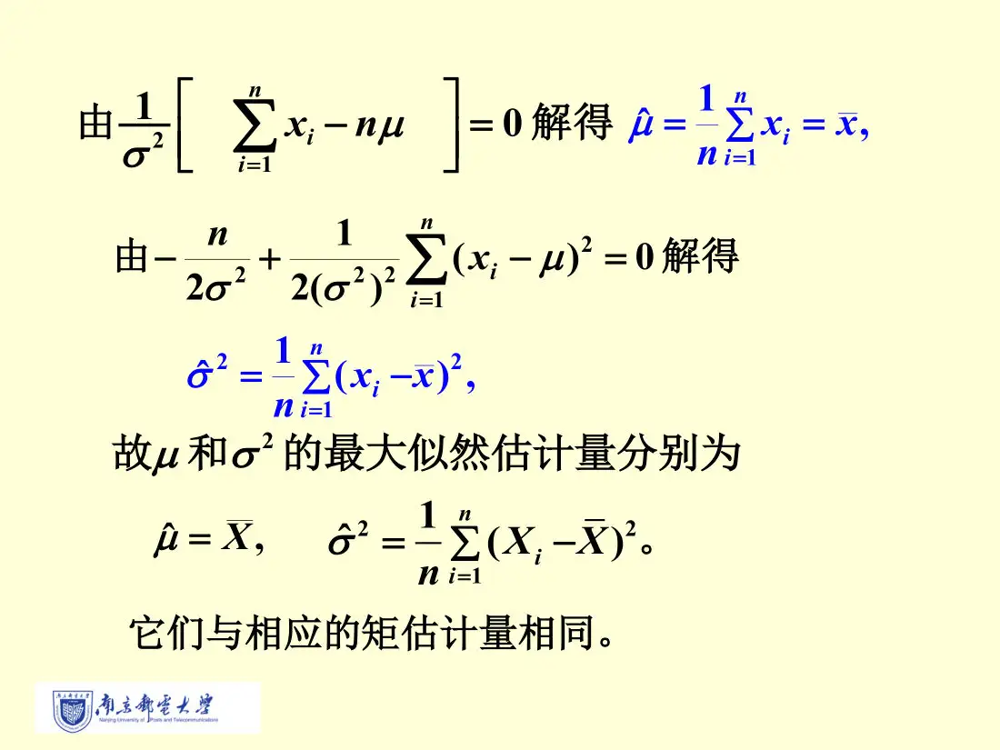

原文：

由 $\frac{1}{\sigma^2}\left[\sum_{i=1}^{n} x_i - n\mu\right] = 0$ 解得 $\hat{\mu} = \frac{1}{n}\sum_{i=1}^{n} x_i = \bar{x}$ , 由 $-\frac{n}{2\sigma^2} + \frac{1}{2(\sigma^2)^2}\sum_{i=1}^{n}(x_i - \mu)^2 = 0$ 解得 $\hat{\sigma}^2 = \frac{1}{n}\sum_{i=1}^{n}(x_i - \bar{x})^2,$ 故 $\mu$ 和 $\sigma^2$ 的最大似然估计量分别为 $\hat{\mu} = \bar{X}, \quad \hat{\sigma}^2 = \frac{1}{n}\sum_{i=1}^{n}(X_i - \bar{X})^2$ 。它们与相应的矩估计量相同。

南京邮电大学
Nanjing University of Posts and Telecommunications

### $$

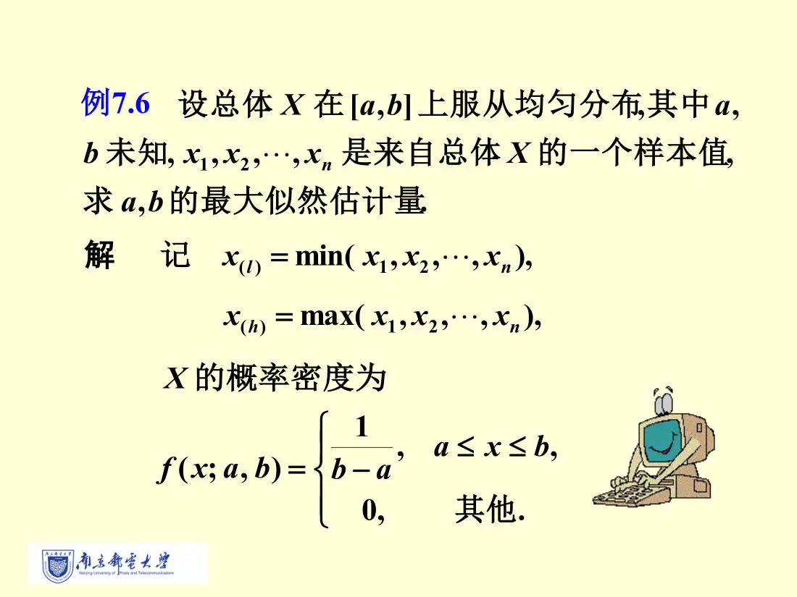

原文：

例7.6 设总体 X 在 $[a,b]$ 上服从均匀分布, 其中 a, b 未知, $x_{1}, x_{2}, \cdots, x_{n}$ 是来自总体 X 的一个样本值, 求 a, b 的最大似然估计量.

解 记 $x_{(l)}=\min(x_{1},x_{2},\cdots,x_{n})$ ,

$$
x _ {(h)} = \max (x _ {1}, x _ {2}, \dots , x _ {n}),
$$

X 的概率密度为

$f(x;a,b) = \left\{ \begin{array}{ll}\frac{1}{b - a}, & a\leq x\leq b,\\ 0, & \text{其他.} \end{array} \right.$

南京邮电大学
Nanjing University of Posts and Telecommunications

### $$

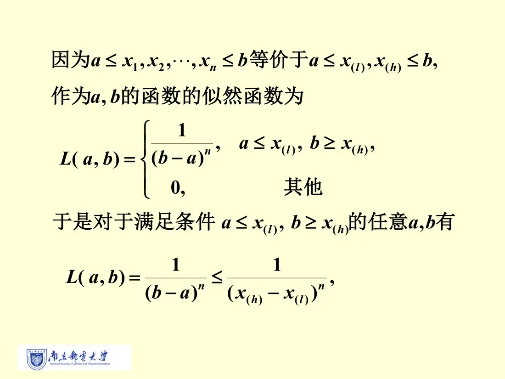

原文：

因为 $a \leq x_{1}, x_{2}, \cdots, x_{n} \leq b$ 等价于 $a \leq x_{(l)}, x_{(h)} \leq b$ , 作为a,b的函数的似然函数为

$$
L (a, b) = \left\{ \begin{array}{c c} \frac {1}{(b - a) ^ {n}}, & a \leq x _ {(l)}, b \geq x _ {(h)}, \\ 0, & \text {其他} \end{array} \right.
$$

于是对于满足条件 $a \leq x_{(l)}, b \geq x_{(h)}$ 的任意 $a, b$ 有

$$
L (a, b) = \frac {1}{(b - a) ^ {n}} \leq \frac {1}{\left(x _ {(h)} - x _ {(l)}\right) ^ {n}},
$$

南京邮电大学
Nanjing University of Posts and Telecommunications

### $$

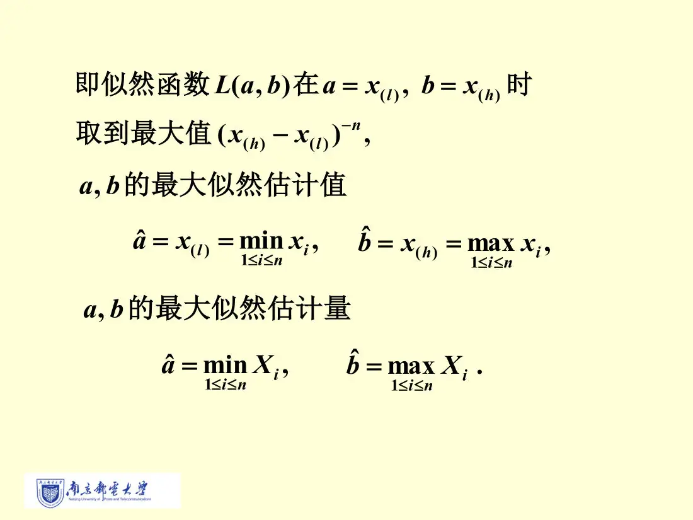

原文：

即似然函数 $L(a,b)$ 在 $a = x_{(l)}, b = x_{(h)}$ 时取到最大值 $(x_{(h)} - x_{(l)})^{-n}$ , $a,b$ 的最大似然估计值

$$
\hat {a} = x _ {(l)} = \min _ {1 \leq i \leq n} x _ {i}, \quad \hat {b} = x _ {(h)} = \max _ {1 \leq i \leq n} x _ {i},
$$

a,b的最大似然估计量

$$
\hat {a} = \min _ {1 \leq i \leq n} X _ {i}, \quad \hat {b} = \max _ {1 \leq i \leq n} X _ {i}.
$$

南京邮电大学
Nanjing University of Posts and Telecommunications

### $$

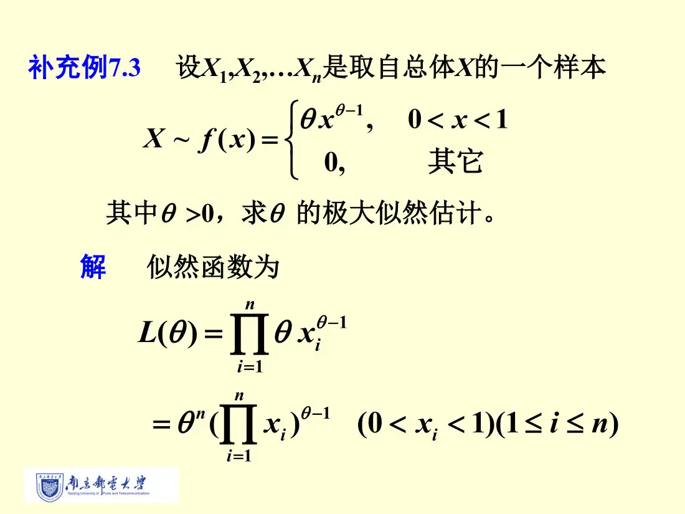

原文：

补充例7.3 设 $X_{1}, X_{2}, \ldots, X_{n}$ 是取自总体 $X$ 的一个样本

$$
X \sim f (x) = \left\{ \begin{array}{c c} \theta x ^ {\theta - 1}, & 0 <   x <   1 \\ 0, & \text {其它} \end{array} \right.
$$

其中 $\theta > 0$ ，求 $\theta$ 的极大似然估计。

解 似然函数为

$$
\begin{array}{l} {L (\theta) = \prod_ {i = 1} ^ {n} \theta x _ {i} ^ {\theta - 1}} \\ {= \theta^ {n} (\prod_ {i = 1} ^ {n} x _ {i}) ^ {\theta - 1} (0 <   x _ {i} <   1) (1 \leq i \leq n)} \end{array}
$$

南京邮电大学
Nanjing University of Posts and Telecommunications

### 对数似然函数为

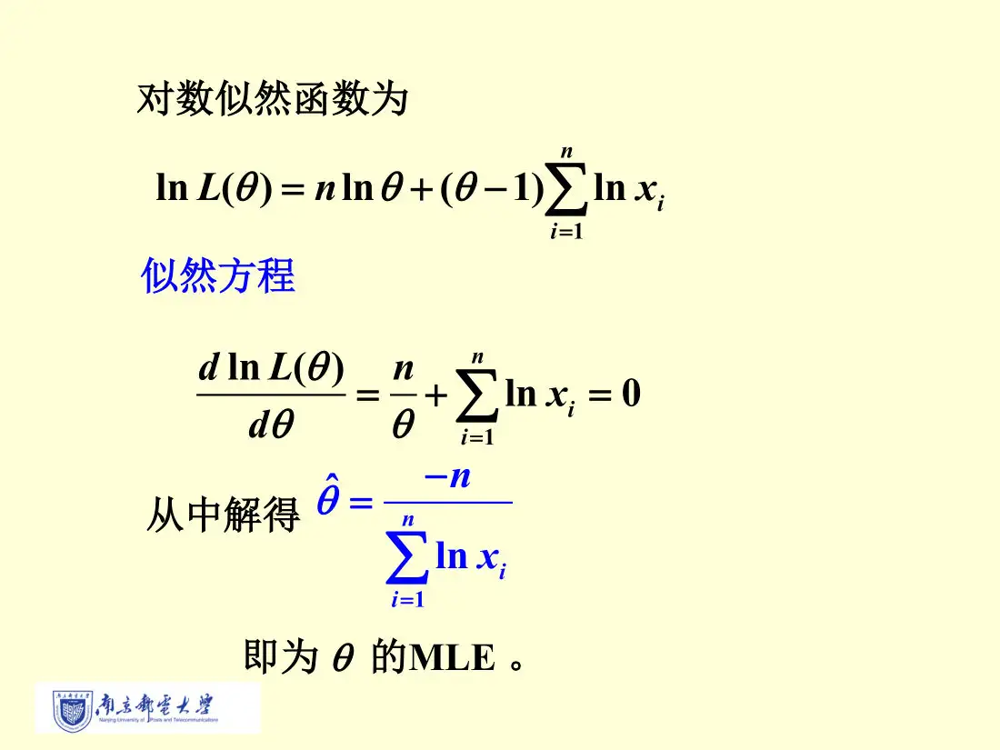

原文：

对数似然函数为

$$
\ln L (\theta) = n \ln \theta + (\theta - 1) \sum_ {i = 1} ^ {n} \ln x _ {i}
$$

似然方程

$\frac{d \ln L(\theta)}{d \theta} = \frac{n}{\theta} + \sum_{i=1}^{n} \ln x_i = 0$ 从中解得 $\hat{\theta} = \frac{-n}{\sum_{i=1}^{n} \ln x_i}$

即为 $\theta$ 的MLE。

南京邮电大学
Nanjing University of Posts and Telecommunications

### 本节小结

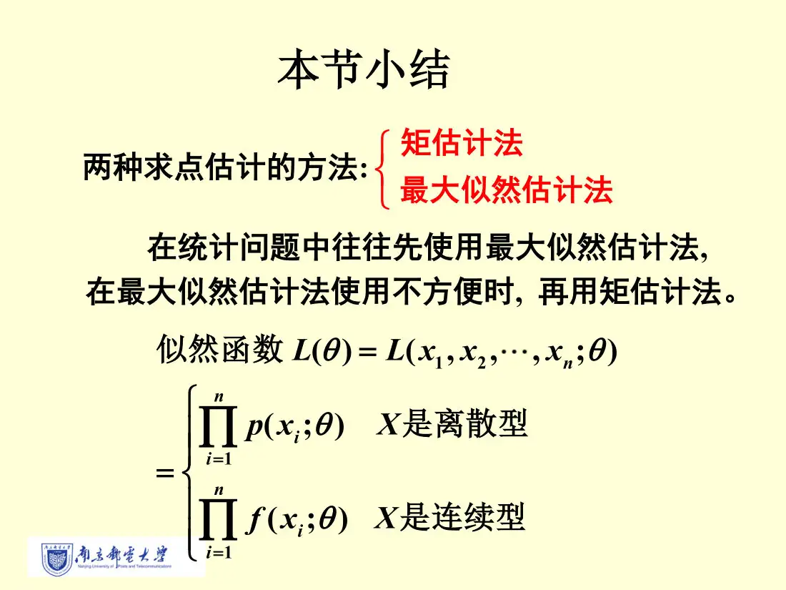

原文：

本节小结

两种求点估计的方法: { 矩估计法
最大似然估计法 }

在统计问题中往往先使用最大似然估计法，在最大似然估计法使用不方便时，再用矩估计法。

似然函数 $L(\theta)=L(x_{1},x_{2},\cdots,x_{n};\theta)$

$$
= \left\{ \begin{array}{l} {{\prod_ {i = 1} ^ {n} p (x _ {i}; \theta)}} \\ {{\prod_ {i = 1} ^ {n} f (x _ {i}; \theta)}} \end{array} \right.
$$

$X$ 是离散型

南京邮电大学
Nanjing University of Posts and Telecommunications

### 7.2 估计量的评选标准

原文：

7.2 估计量的评选标准

7.2.1无偏性

7.2.2有效性

7.2.3相合性

小结

南京邮电大学
Nanjing University of Posts and Telecommunications

### 问题的提出

原文：

问题的提出

从前一节可以看到, 对于同一个参数, 用不同的估计方法求出的估计量可能不相同, 。

评价一个估计量的好坏，不能仅仅依据一次试验的结果，而必须由多次试验结果来衡量。

这是因为估计量是样本的函数，是随机变量。因此，由不同的观测结果，就会求得不同的参数估计值。因此一个好的估计，应在多次试验中体现出优良性。

南京邮电大学
Nanjing University of Posts and Telecommunications

### 常用的几条标准是:

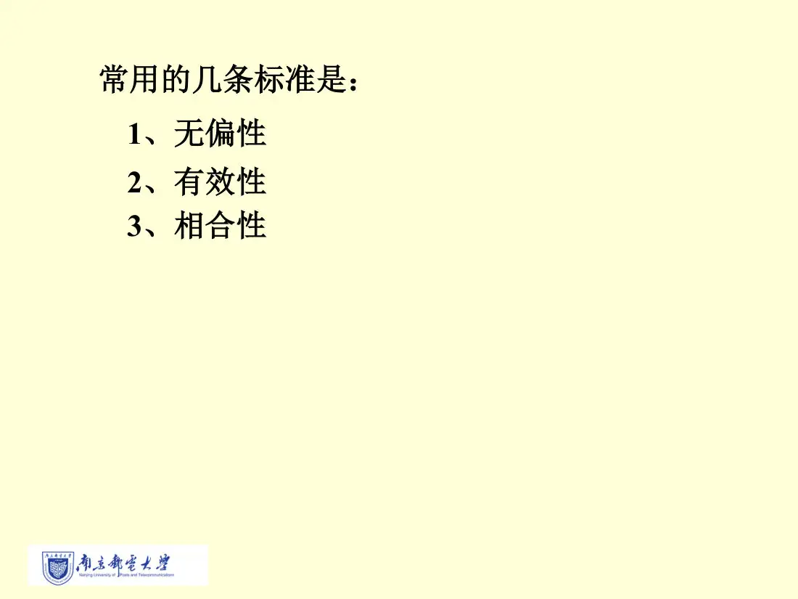

原文：

常用的几条标准是:

1、无偏性

2、有效性

3、相合性

南京邮电大学
Nanjing University of Posts and Telecommunications

### 7.2.1 无偏性

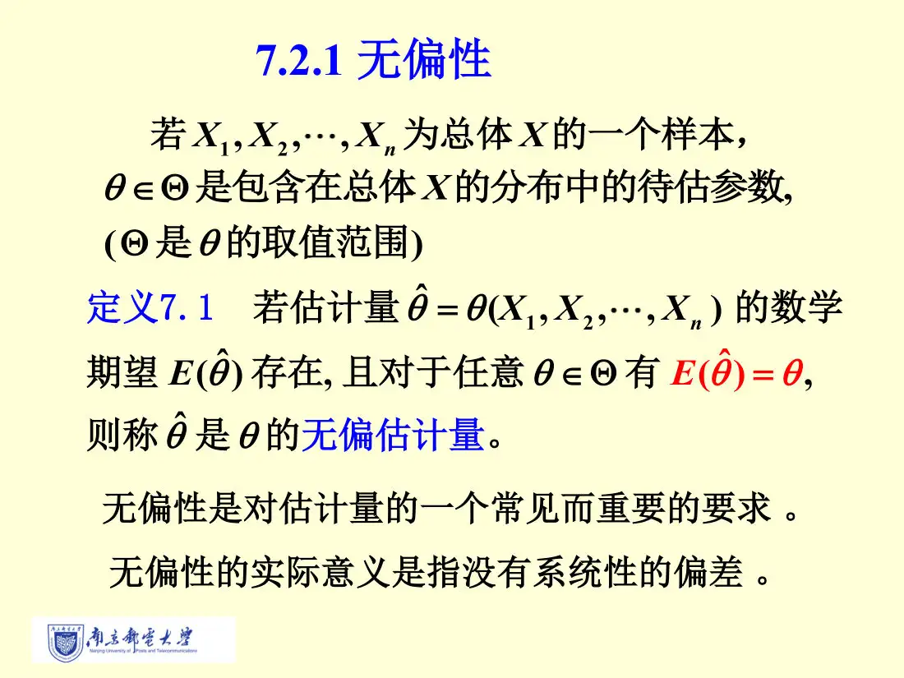

原文：

7.2.1 无偏性

若 $X_{1},X_{2},\cdots,X_{n}$ 为总体X的一个样本， $\theta\in\Theta$ 是包含在总体X的分布中的待估参数，

(Θ 是 θ 的取值范围)

定义7.1 若估计量 $\hat{\theta} = \theta(X_{1}, X_{2}, \cdots, X_{n})$ 的数学期望 $E(\hat{\theta})$ 存在, 且对于任意 $\theta \in \Theta$ 有 $E(\hat{\theta}) = \theta$ , 则称 $\hat{\theta}$ 是 $\theta$ 的无偏估计量。

无偏性是对估计量的一个常见而重要的要求。

无偏性的实际意义是指没有系统性的偏差。

南京邮电大学
Nanjing University of Posts and Telecommunications

### 证 因为 $X_{1},X_{2},\cdots,X_{n}$ 与X同分布，

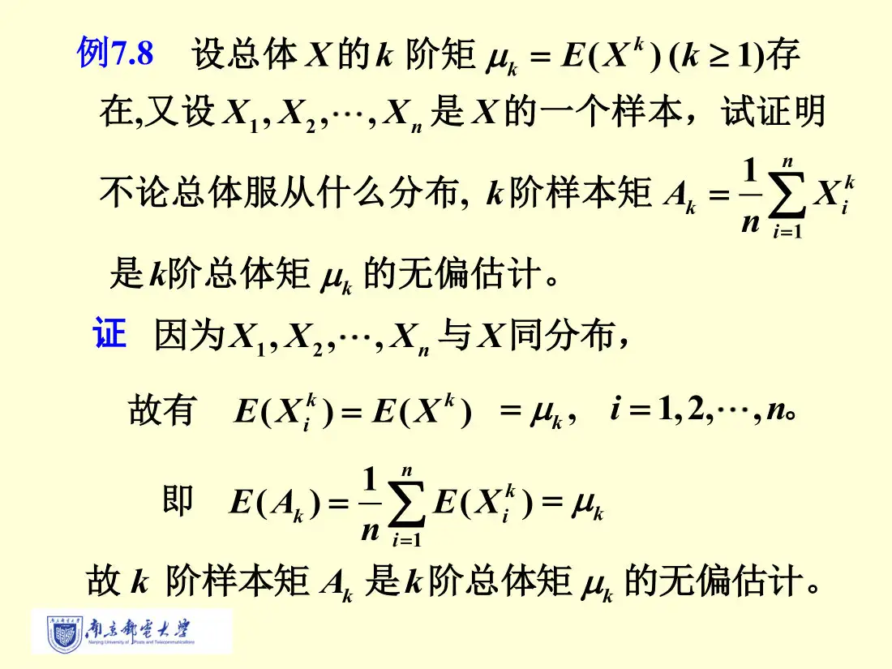

原文：

例7.8 设总体 X 的 k 阶矩 $\mu_{k}=E(X^{k})(k\geq1)$ 存在, 又设 $X_{1},X_{2},\cdots,X_{n}$ 是 X 的一个样本, 试证明不论总体服从什么分布, k 阶样本矩 $A_{k}=\frac{1}{n}\sum_{i=1}^{n}X_{i}^{k}$ 是 k 阶总体矩 $\mu_{k}$ 的无偏估计。

证 因为 $X_{1},X_{2},\cdots,X_{n}$ 与X同分布，

故有 $E(X_{i}^{k})=E(X^{k})=\mu_{k},\quad i=1,2,\cdots,n$

即 $E(A_{k}) = \frac{1}{n}\sum_{i = 1}^{n}E(X_{i}^{k}) = \mu_{k}$

$$
A _ {k}
$$

$$
\mu_ {k}
$$

南京邮电大学
Nanjing University of Posts and Telecommunications

### 例7.9 设总体 X 服从参数为 $\theta$ 的指数分布, 概率密度

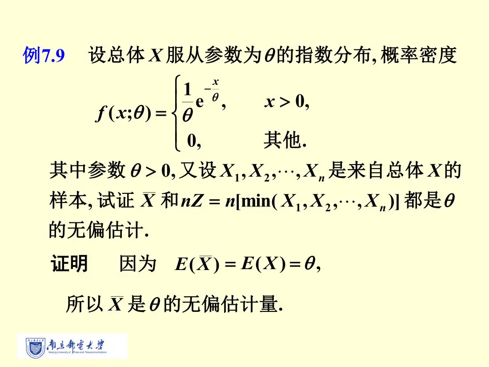

原文：

例7.9 设总体 X 服从参数为 $\theta$ 的指数分布, 概率密度

$$
f (x; \theta) = \left\{ \begin{array}{l l} \frac {1}{\theta} \mathrm{e} ^ {- \frac {x}{\theta}}, & x > 0, \\ 0, & \text {其他.} \end{array} \right.
$$

其中参数 $\theta > 0$ , 又设 $X_{1}, X_{2}, \cdots, X_{n}$ 是来自总体 X 的样本, 试证 $\bar{X}$ 和 $nZ = n[\min(X_{1}, X_{2}, \cdots, X_{n})]$ 都是 $\theta$ 的无偏估计.

证明 因为 $E(\bar{X}) = E(X) = \theta,$

所以 $\bar{X}$ 是 $\theta$ 的无偏估计量.

南京邮电大学
Nanjing University of Posts and Telecommunications

### 由以上两例可知,一个参数可以有不同的无偏估计量.

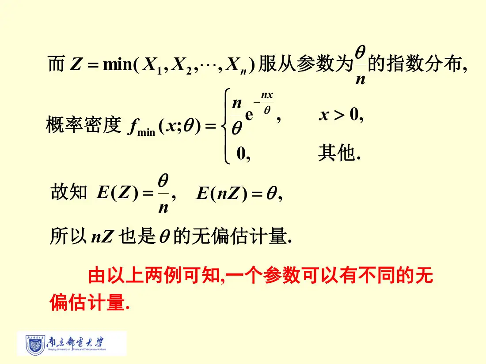

原文：

而 $Z = \min(X_{1}, X_{2}, \cdots, X_{n})$ 服从参数为 $\frac{\theta}{n}$ 的指数分布，
概率密度 $f_{\min}(x;\theta)=\left\{\begin{aligned}&\frac{n}{\theta}\mathrm{e}^{-\frac{nx}{\theta}},&x>0,\\ &0,& 其他.\end{aligned}\right.$ 故知 $E(Z)=\frac{\theta}{n},\quad E(nZ)=\theta,$ 所以 nZ 也是 $\theta$ 的无偏估计量.

由以上两例可知,一个参数可以有不同的无偏估计量.

南京邮电大学
Nanjing University of Posts and Telecommunications

### 第 46 页

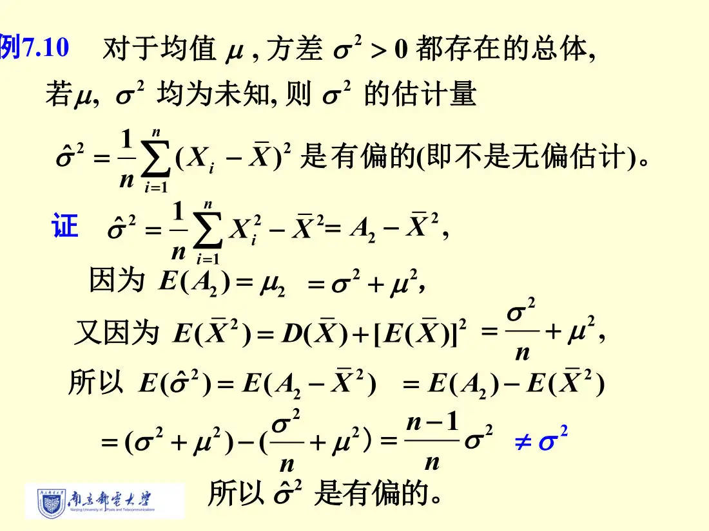

原文：

例7.10 对于均值 $\mu$ ，方差 $\sigma^2 > 0$ 都存在的总体，若 $\mu, \sigma^2$ 均为未知，则 $\sigma^2$ 的估计量 $\hat{\sigma}^2 = \frac{1}{n} \sum_{i=1}^{n} (X_i - \bar{X})^2$ 是有偏的（即不是无偏估计）

证 $\hat{\sigma}^2 = \frac{1}{n} \sum_{i=1}^{n} X_i^2 - \bar{X}^2 = A_2 - \bar{X}^2,$ 因为 $E(A_2) = \mu_2 = \sigma^2 + \mu^2,$ 又因为 $E(\bar{X}^2) = D(\bar{X}) + [E(\bar{X})]^2 = \frac{\sigma^2}{n} + \mu^2,$ 所以 $E(\hat{\sigma}^2) = E(A_2 - \bar{X}^2) = E(A_2) - E(\bar{X}^2)$ $= (\sigma^2 + \mu^2) - (\frac{\sigma^2}{n} + \mu^2) = \frac{n-1}{n} \sigma^2 \neq \sigma^2$ 所以 $\hat{\sigma}^2$ 是有偏的。

### (这种方法称为无偏化)。

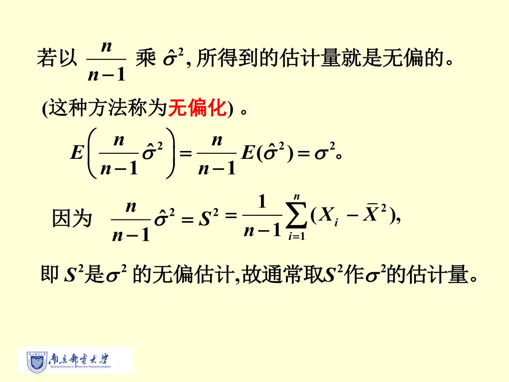

原文：

若以 $\frac{n}{n-1}$ 乘 $\hat{\sigma}^{2}$ ，所得到的估计量就是无偏的。
(这种方法称为无偏化)。

$$
E \left(\frac {n}{n - 1} \hat {\sigma} ^ {2}\right) = \frac {n}{n - 1} E (\hat {\sigma} ^ {2}) = \sigma^ {2} 。
$$

因为 $\frac{n}{n - 1}\hat{\sigma}^2 = S^2 = \frac{1}{n - 1}\sum_{i = 1}^{n}(X_i - \bar{X}^2),$

即 $S^{2}$ 是 $\sigma^{2}$ 的无偏估计, 故通常取 $S^{2}$ 作 $\sigma^{2}$ 的估计量。

南京邮电大学
Nanjing University of Posts and Telecommunications

### 重要结论

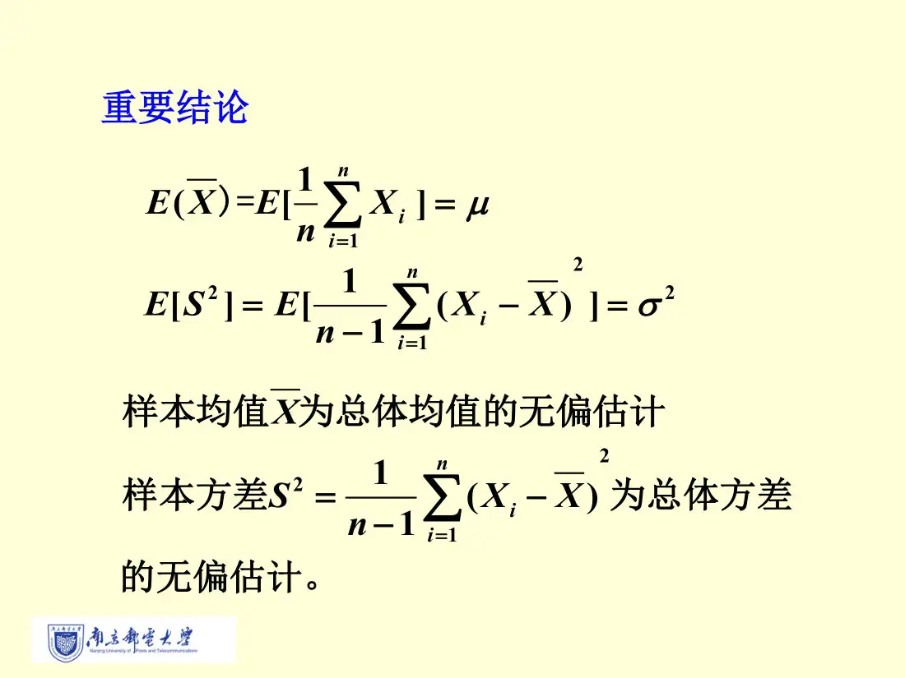

原文：

重要结论

$$
E (\overline {{X}}) = E [ \frac {1}{n} \sum_ {i = 1} ^ {n} X _ {i} ] = \mu
$$

$$
E [ S ^ {2} ] = E [ \frac {1}{n - 1} \sum_ {i = 1} ^ {n} (X _ {i} - \overline {{X}}) ^ {2} ] = \sigma^ {2}
$$

样本均值 $\overline{X}$ 为总体均值的无偏估计
样本方差 $S^{2}=\frac{1}{n-1}\sum_{i=1}^{n}(X_{i}-\overline{X})^{2}$ 为总体方差的无偏估计。

南京邮电大学
Nanjing University of Posts and Telecommunications

### 7.2.2 有效性

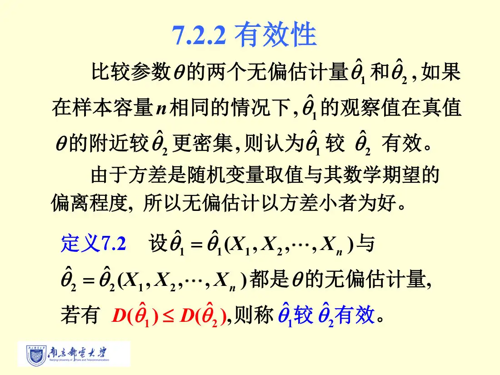

原文：

7.2.2 有效性

比较参数 $\theta$ 的两个无偏估计量 $\hat{\theta}_1$ 和 $\hat{\theta}_2$ , 如果在样本容量 $n$ 相同的情况下, $\hat{\theta}_1$ 的观察值在真值 $\theta$ 的附近较 $\hat{\theta}_2$ 更密集, 则认为 $\hat{\theta}_1$ 较 $\hat{\theta}_2$ 有效。

由于方差是随机变量取值与其数学期望的偏离程度，所以无偏估计以方差小者为好。

定义7.2 设 $\hat{\theta}_{1}=\hat{\theta}_{1}(X_{1},X_{2},\cdots,X_{n})$ 与 $\hat{\theta}_{2}=\hat{\theta}_{2}(X_{1},X_{2},\cdots,X_{n})$ 都是 $\theta$ 的无偏估计量，
若有 $D(\hat{\theta}_{1}) \leq D(\hat{\theta}_{2})$ ，则称 $\hat{\theta}_{1}$ 较 $\hat{\theta}_{2}$ 有效。

南京邮电大学
Nanjing University of Posts and Telecommunications

### $$

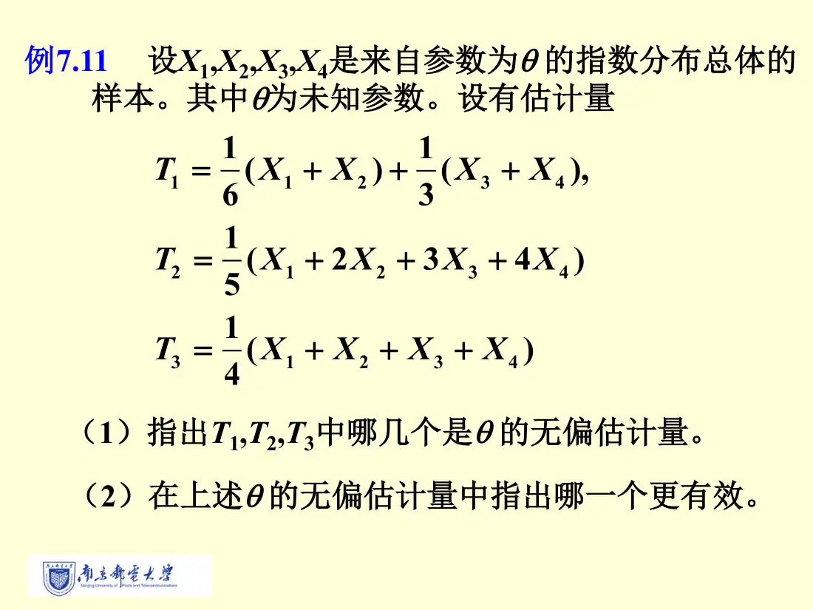

原文：

例7.11 设 $X_{1}, X_{2}, X_{3}, X_{4}$ 是来自参数为 $\theta$ 的指数分布总体的样本。其中 $\theta$ 为未知参数。设有估计量

$$
T _ {1} = \frac {1}{6} (X _ {1} + X _ {2}) + \frac {1}{3} (X _ {3} + X _ {4}),
$$

$$
T _ {2} = \frac {1}{5} (X _ {1} + 2 X _ {2} + 3 X _ {3} + 4 X _ {4})
$$

$$
T _ {3} = \frac {1}{4} (X _ {1} + X _ {2} + X _ {3} + X _ {4})
$$

(1) 指出 $T_{1}, T_{2}, T_{3}$ 中哪几个是 $\theta$ 的无偏估计量。

(2) 在上述 $\theta$ 的无偏估计量中指出哪一个更有效。

南京邮电大学
Nanjing University of Posts and Telecommunications

### 解 因为 $X_{1},X_{2},\cdots,X_{4}$ 与X同分布，

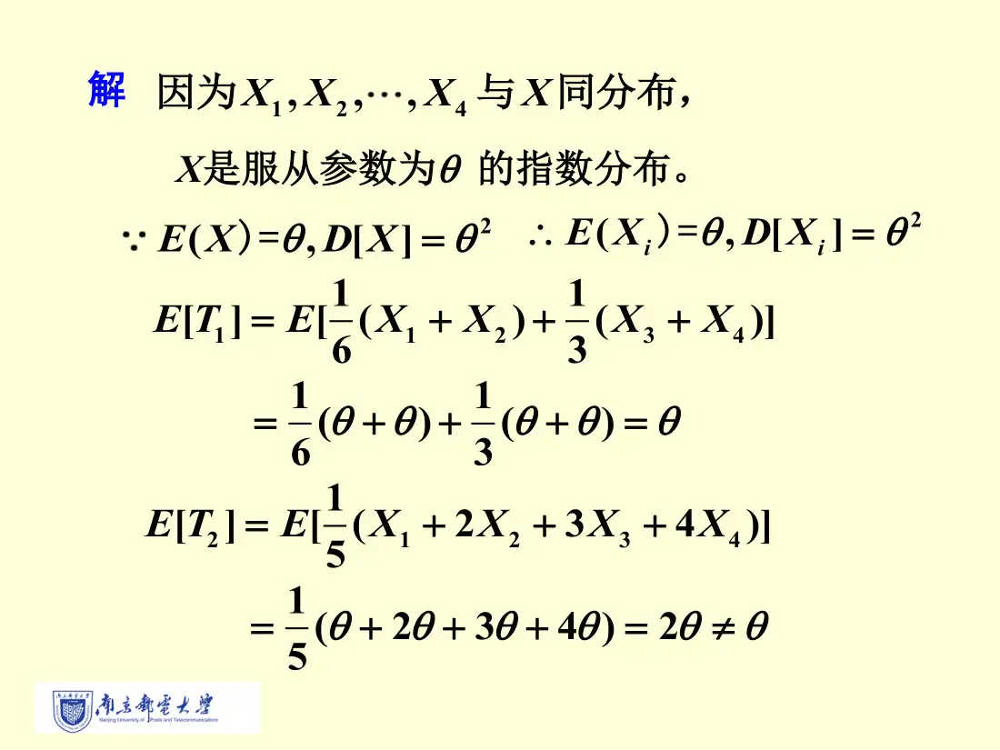

原文：

解 因为 $X_{1},X_{2},\cdots,X_{4}$ 与X同分布，

X是服从参数为 $\theta$ 的指数分布。

$$
\because E (X) = \theta , D [ X ] = \theta^ {2} \quad \therefore E (X _ {i}) = \theta , D [ X _ {i} ] = \theta^ {2}
$$

$$
\begin{array}{r l} E [ T _ {1} ] & = E \left[ \frac {1}{6} (X _ {1} + X _ {2}) + \frac {1}{3} (X _ {3} + X _ {4}) \right] \\ & = \frac {1}{6} (\theta + \theta) + \frac {1}{3} (\theta + \theta) = \theta \end{array}
$$

$$
\begin{array}{r l} E [ T _ {2} ] & = E \left[ \frac {1}{5} (X _ {1} + 2 X _ {2} + 3 X _ {3} + 4 X _ {4}) \right] \\ & = \frac {1}{5} (\theta + 2 \theta + 3 \theta + 4 \theta) = 2 \theta \neq \theta \end{array}
$$

南京邮电大学
Nanjing University of Posts and Telecommunications

### $$

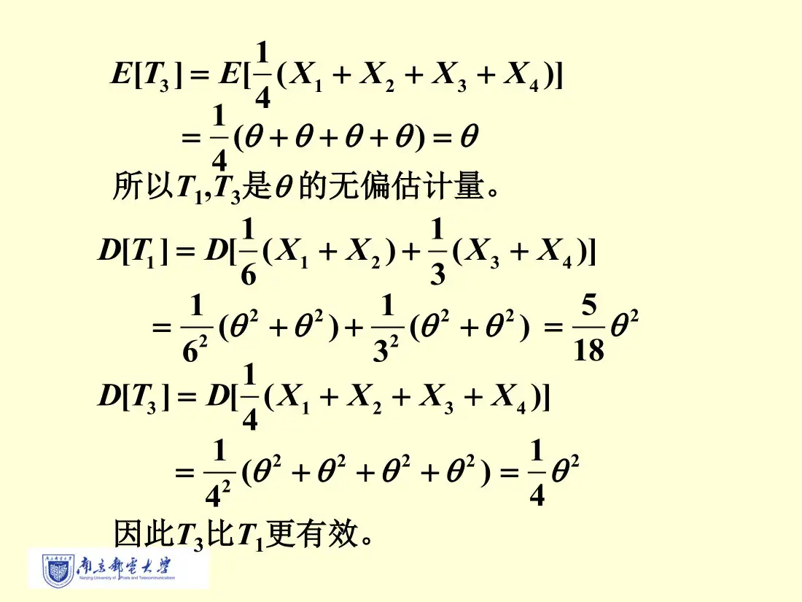

原文：

$$
\begin{array}{r l} & E [ T _ {3} ] = E [ \frac {1}{4} (X _ {1} + X _ {2} + X _ {3} + X _ {4}) ] \\ & = \frac {1}{4} (\theta + \theta + \theta + \theta) = \theta \end{array}
$$

所以 $T_{1},\bar{T}_{3}$ 是 $\theta$ 的无偏估计量。

$$
\begin{array}{r l} & D [ T _ {1} ] = D [ \frac {1}{6} (X _ {1} + X _ {2}) + \frac {1}{3} (X _ {3} + X _ {4}) ] \\ & \qquad = \frac {1}{6 ^ {2}} (\theta^ {2} + \theta^ {2}) + \frac {1}{3 ^ {2}} (\theta^ {2} + \theta^ {2}) = \frac {5}{1 8} \theta^ {2} \\ & D [ T _ {3} ] = D [ \frac {1}{4} (X _ {1} + X _ {2} + X _ {3} + X _ {4}) ] \\ & \qquad = \frac {1}{4 ^ {2}} (\theta^ {2} + \theta^ {2} + \theta^ {2} + \theta^ {2}) = \frac {1}{4} \theta^ {2} \end{array}
$$

因此 $T_{3}$ 比 $T_{1}$ 更有效。

南京邮电大学
Nanjing University of Posts and Telecommunications

### 在数理统计中常用到最小方差无偏估计。它的定义是：

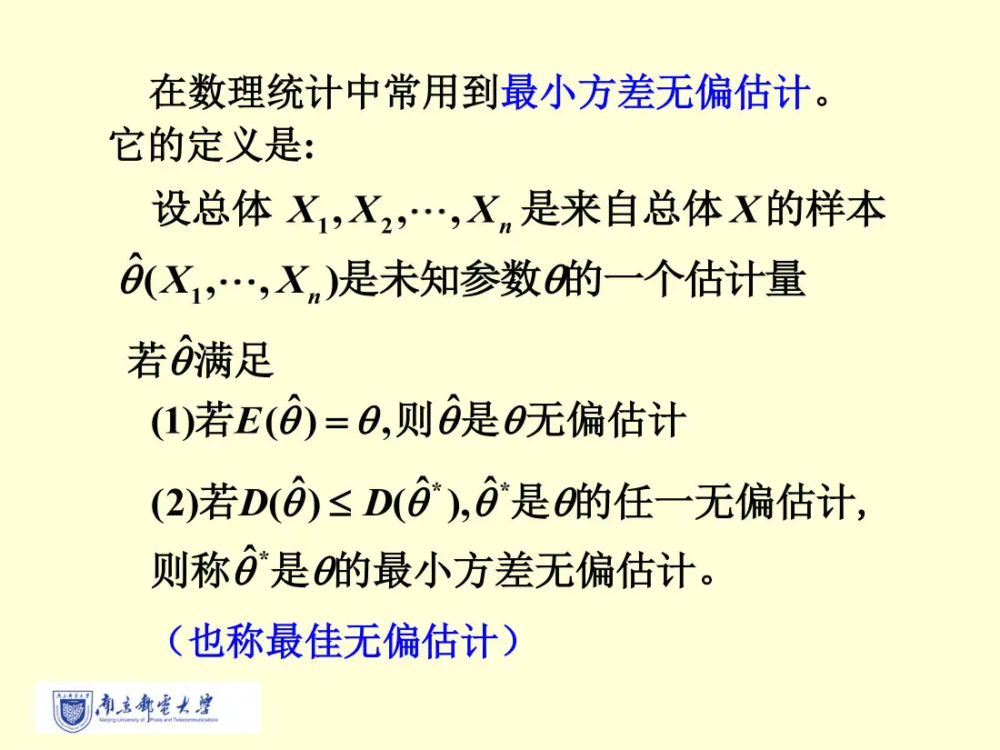

原文：

在数理统计中常用到最小方差无偏估计。它的定义是：

设总体 $X_{1}, X_{2}, \cdots, X_{n}$ 是来自总体 X 的样本 $\hat{\theta}(X_{1},\cdots,X_{n})$ 是未知参数 $\theta$ 的一个估计量
若 $\hat{\theta}$ 满足

(1)若 $E(\hat{\theta})=\theta$ ,则 $\hat{\theta}$ 是 $\theta$ 无偏估计

(2)若 $D(\hat{\theta}) \leq D(\hat{\theta}^{*}), \hat{\theta}^{*}$ 是 $\theta$ 的任一无偏估计，则称 $\hat{\theta}^{*}$ 是 $\theta$ 的最小方差无偏估计。

(也称最佳无偏估计)

南京邮电大学
Nanjing University of Posts and Telecommunications

### 7.2.3 相合性

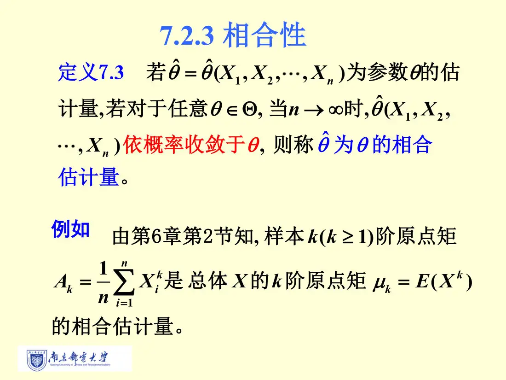

原文：

7.2.3 相合性

定义7.3 若 $\hat{\theta}=\hat{\theta}(X_{1},X_{2},\cdots,X_{n})$ 为参数 $\theta$ 的估计量, 若对于任意 $\theta\in\Theta$ , 当 $n\to\infty$ 时, $\hat{\theta}(X_{1},X_{2},\cdots,X_{n})$ 依概率收敛于 $\theta$ , 则称 $\hat{\theta}$ 为 $\theta$ 的相合估计量。

例如 由第6章第2节知, 样本 $k(k \geq 1)$ 阶原点矩 $A_{k}=\frac{1}{n}\sum_{i=1}^{n}X_{i}^{k}$ 是总体 X 的 k 阶原点矩 $\mu_{k}=E(X^{k})$ 的相合估计量。

南京邮电大学
Nanjing University of Posts and Telecommunications

### 例 试证：

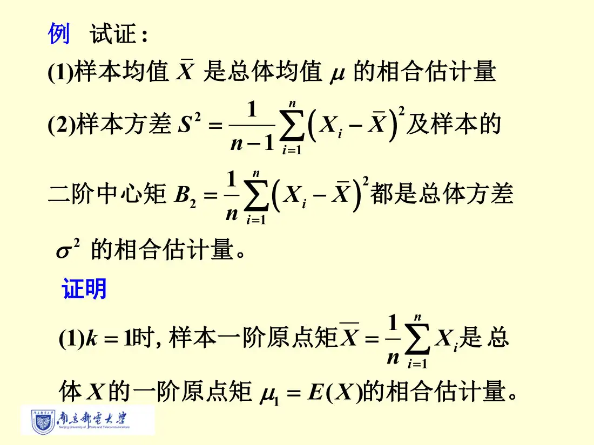

原文：

例 试证：

(1)样本均值 $\bar{X}$ 是总体均值 $\mu$ 的相合估计量  
(2)样本方差 $S^2 = \frac{1}{n - 1} \sum_{i=1}^{n} (X_i - \bar{X})^2$ 及样本的二阶中心矩 $B_2 = \frac{1}{n} \sum_{i=1}^{n} (X_i - \bar{X})^2$ 都是总体方差 $\sigma^2$ 的相合估计量。

证明

(1) $k = 1$ 时, 样本一阶原点矩 $\overline{X} = \frac{1}{n} \sum_{i=1}^{n} X_i$ 是总体 $X$ 的一阶原点矩 $\mu_1 = E(X)$ 的相合估计量。

南京邮电大学
Nanjing University of Posts and Telecommunications

### 第 56 页

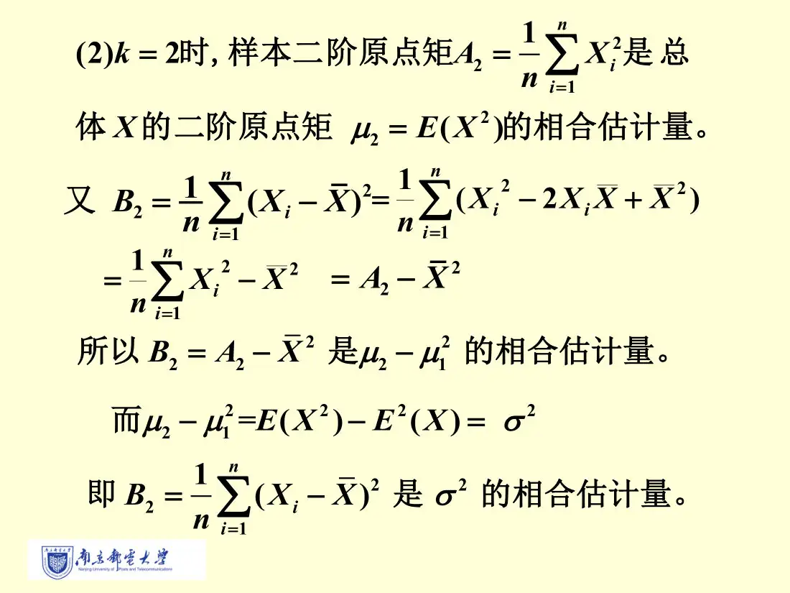

原文：

(2) $k = 2$ 时, 样本二阶原点矩 $A_{2} = \frac{1}{n}\sum_{i=1}^{n}X_{i}^{2}$ 是总体 $X$ 的二阶原点矩 $\mu_{2} = E(X^{2})$ 的相合估计量。又 $B_{2} = \frac{1}{n}\sum_{i=1}^{n}(X_{i} - \bar{X})^{2} = \frac{1}{n}\sum_{i=1}^{n}(X_{i}^{2} - 2X_{i}\bar{X} +\bar{X}^{2})$ $= \frac{1}{n}\sum_{i=1}^{n}X_{i}^{2} - \bar{X}^{2} = A_{2} - \bar{X}^{2}$ 所以 $B_{2} = A_{2} - \bar{X}^{2}$ 是 $\mu_{2}-\mu_{1}^{2}$ 的相合估计量。而 $\mu_{2}-\mu_{1}^{2}=E(X^{2})-E^{2}(X)=\sigma^{2}$ 即 $B_{2}=\frac{1}{n}\sum_{i=1}^{n}(X_{i}-\bar{X})^{2}$ 是 $\sigma^{2}$ 的相合估计量。

### 相合性是指随着样本容量的增大，估计量的值稳定于真值。

原文：

所以 $S^{2}=\frac{n}{n-1}B_{2}$ 也是 $\sigma^{2}$ 的相合估计量。

相合性是指随着样本容量的增大，估计量的值稳定于真值。

又 $\lim_{n\to \infty}\frac{n}{n - 1} = 1,$

南京邮电大学
Nanjing University of Posts and Telecommunications

### 7.3 区间估计

原文：

7.3 区间估计
7.3.1区间估计的基本概念
7.3.2 典型例题

南京邮电大学
Nanjing University of Posts and Telecommunications

### 7.3.1 区间估计的基本概念

原文：

7.3.1 区间估计的基本概念

定义7.5 置信区间

设总体 X 的分布函数 $F(x;\theta)$ 含有一个未知参数 $\theta$ ，对于给定值 $\alpha(0<\alpha<1)$ ，若由样本 $X_{1}, X_{2}, \cdots, X_{n}$ 确定的两个统计量 $\underline{\theta}=\underline{\theta}(X_{1}, X_{2}, \cdots, X_{n})$ 和 $\overline{\theta}=\overline{\theta}(X_{1}, X_{2}, \cdots, X_{n})$ 满足 $P\{\underline{\theta}(X_{1}, X_{2}, \cdots, X_{n})<\theta<\overline{\theta}(X_{1}, X_{2}, \cdots, X_{n})\}=1-\alpha$ 则称随机区间 $(\underline{\theta}, \overline{\theta})$ 是 $\theta$ 的置信度为 $1-\alpha$ 的置信区间。

南京邮电大学
Nanjing University of Posts and Telecommunications

### $$

原文：

$$
P \{\underline {{\theta}} (X _ {1}, X _ {2}, \dots , X _ {n}) <   \theta <   \overline {{\theta}} (X _ {1}, X _ {2}, \dots , X _ {n}) \} = 1 - \alpha ,
$$

$\underline{\theta}$ 和 $\overline{\theta}$ 分别称为置信度为 $1-\alpha$ 的双侧置信区间的置信下限和置信上限。

$1 - \alpha$ 称为置信水平。

可见，对参数 $\theta$ 作区间估计，就是要设法找出两个只依赖于样本的界限(构造统计量)

$$
\begin{array}{l} \underline {{\theta}} = \underline {{\theta}} (X _ {1}, X _ {2}, \dots , X _ {n}) \\ \overline {{\theta}} = \overline {{\theta}} (X _ {1}, X _ {2}, \dots , X _ {n}) \end{array} \qquad (\underline {{\theta}} <   \overline {{\theta}})
$$

一旦有了样本, 就把 $\theta$ 估计在区间 $[\underline{\theta}, \overline{\theta}]$ 内。

南京邮电大学
Nanjing University of Posts and Telecommunications

### 关于定义的说明

原文：

关于定义的说明

1、被估计的参数 $\theta$ 虽然未知,但它是一个常数没有随机性,而区间 $(\underline{\theta},\bar{\theta})$ 是随机的。

$P\{\underline{\theta}(X_{1},X_{2},\cdots,X_{n})<\theta<\bar{\theta}(X_{1},X_{2},\cdots,X_{n})\}=1-\alpha$ 本质是:

随机区间 $(\underline{\theta}, \overline{\theta})$ 以 $1 - \alpha$ 的概率包含着参数 $\theta$ 的真值。而不能说参数 $\theta$ 以 $1 - \alpha$ 的概率落入随机区间 $(\underline{\theta}, \overline{\theta})$ 。

南京邮电大学
Nanjing University of Posts and Telecommunications

### $$

原文：

$$
P \{\underline {{\theta}} (X _ {1}, X _ {2}, \dots , X _ {n}) <   \theta <   \overline {{\theta}} (X _ {1}, X _ {2}, \dots , X _ {n}) \} = 1 - \alpha
$$

2、公式还可以描述为:

若反复抽样多次(各次得到的样本容量相等,都是n)

每个样本值确定一个区间( $\theta,\bar{\theta}$ ),

每个这样的区间或包含 $\theta$ 的真值或不包含 $\theta$ 的真值,

按伯努利大数定理, 在这样多的区间中,

包含θ真值的约占100(1-α)%, 不包含的约占100α%。

南京邮电大学
Nanjing University of Posts and Telecommunications

### $$

原文：

$$
P \{\underline {{\theta}} (X _ {1}, X _ {2}, \dots , X _ {n}) <   \theta <   \overline {{\theta}} (X _ {1}, X _ {2}, \dots , X _ {n}) \} = 1 - \alpha
$$

3、这里有两个要求:可信程度与区间估计精度。

(1)要求估计尽量可靠。

要求 $\theta$ 以很大有可能被包含在区间 $[\underline{\theta},\overline{\theta}]$ 内, 就是说, 概率 $P\{\underline{\theta}_1 \leq \theta \leq \overline{\theta}\}$ 要尽可能的大。

(2) 估计的精度要尽可能的高。

要求区间 $[\underline{\theta},\overline{\theta} ]$ 长度 $(\overline{\theta} -\underline{\theta})$ 要尽可能的短。或能体现该要求的其它准则。

南京邮电大学
Nanjing University of Posts and Telecommunications

### 可信程度与精度是一对矛盾，一般是在保证可信程度的条件下尽可能提高精度。

原文：

可信程度与精度是一对矛盾，一般是在保证可信程度的条件下尽可能提高精度。

样本容量 n 固定, 置信水平 $1 - \alpha$ 增大, 置信区间长度增大, 可信程度增大, 区间估计精度降低。

置信水平 $1-\alpha$ 固定,样本容量n增大,置信区间长度减小,可信程度不变,区间估计精度提高。

南京邮电大学
Nanjing University of Posts and Telecommunications

### 2. 求置信区间的一般步骤(共3步)

原文：

2. 求置信区间的一般步骤(共3步)

(1) 寻求一个样本 $X_{1}, X_{2}, \cdots, X_{n}$ 的函数

$$
Z = Z (X _ {1}, X _ {2}, \dots , X _ {n}; \theta)
$$

其中仅包含待估参数 $\theta$ ，并且 Z 的分布已知且不依赖于任何未知参数 (包括 $\theta$ )。

(2) 对于给定的置信度 $1-\alpha$ , 定出两个常数 a, b,
使 $P\{a < Z(X_{1}, X_{2}, \cdots, X_{n}; \theta) < b\} = 1 - \alpha.$

(3) 若能从 $a < Z(X_{1}, X_{2}, \cdots, X_{n}; \theta) < b$ 得到等价的不等式 $\underline{\theta} < \theta < \overline{\theta}$ ，其中 $\underline{\theta} = \underline{\theta}(X_{1}, X_{2}, \cdots, X_{n})$ ， $\overline{\theta} = \overline{\theta}(X_{1}, X_{2}, \cdots, X_{n})$ 都是统计量，那么 $(\underline{\theta}, \overline{\theta})$ 就是 $\theta$ 的一个置信度为 $1 - \alpha$ 的置信区间。

南京邮电大学
Nanjing University of Posts and Telecommunications

### 7.3.2 典型例题

原文：

7.3.2 典型例题

例7.6 设 $X_{1}, X_{2}, \cdots, X_{n}$ 是来自正态总体 $N(\mu, \sigma^{2})$ 的样本, 其中 $\sigma^{2}$ 为已知, $\mu$ 为未知, 求 $\mu$ 的置信水平为 $1 - \alpha$ 的置信区间。

解 因为 $\bar{X}$ 是 $\mu$ 的无偏估计,

且 $U=\frac{\bar{X}-\mu}{\sigma/\sqrt{n}}\sim N(0,1)$ ,

$\frac{\bar{X}-\mu}{\sigma/\sqrt{n}}\sim N(0,1)$ 是不依赖于任何未知参数的,

南京邮电大学
Nanjing University of Posts and Telecommunications

### 由标准正态分布的上 $\alpha$ 分位点的定义知

原文：

由标准正态分布的上 $\alpha$ 分位点的定义知

$$
P \left\{\left| \frac {\bar {X} - \mu}{\sigma / \sqrt {n}} \right| <   z _ {\alpha / 2} \right\} = 1 - \alpha ,
$$

即

$$
P \left\{\bar {X} - \frac {\sigma}{\sqrt {n}} z _ {\alpha / 2} <   \mu <   \bar {X} + \frac {\sigma}{\sqrt {n}} z _ {\alpha / 2} \right\} = 1 - \alpha ,
$$

南京邮电大学
Nanjing University of Posts and Telecommunications

### 于是得 $\mu$ 的一个置信水平为 $1 - \alpha$ 的置信区间

原文：

于是得 $\mu$ 的一个置信水平为 $1 - \alpha$ 的置信区间

$$
\left(\bar {X} - \frac {\sigma}{\sqrt {n}} z _ {\alpha / 2}, \bar {X} + \frac {\sigma}{\sqrt {n}} z _ {\alpha / 2}\right) 。
$$

这样的置信区间常写成 $\left(\bar{X}\pm\frac{\sigma}{\sqrt{n}}z_{\alpha/2}\right)$ 。

其置信区间的长度为 $2 \times \frac{\sigma}{\sqrt{n}} z_{\alpha/2^{\circ}}$

南京邮电大学
Nanjing University of Posts and Telecommunications

### 7.4 正态总体均值与方差的 区间估计

原文：

7.4 正态总体均值与方差的 区间估计

7.4.1 单个总体的情况

7.4.2 两个总体的情况

小结

南京邮电大学
Nanjing University of Posts and Telecommunications

### 我们主要讨论以下几种情形:

原文：

我们主要讨论以下几种情形:

1. 单个正态总体均值 $\mu$ 和方差 $\sigma^{2}$ 的区间估计

2.两个正态总体均值差 $\mu_{1}-\mu_{2}$ 与方差比 $\frac{\sigma_{1}^{2}}{\sigma_{2}^{2}}$ 的区间估计。

南京邮电大学
Nanjing University of Posts and Telecommunications

### 7.4.1 单个总体 $N(\mu,\sigma^{2})$ 的情况

原文：

7.4.1 单个总体 $N(\mu,\sigma^{2})$ 的情况

1. 单个正态总体均值 $\mu$ 的置信区间。

由上一节可以得到，单个正态总体当方差 $\sigma^{2}$ 已知时，均值 $\mu$ 的置信区间。

当方差 $\sigma^2$ 已知时，均值 $\mu$ 的 $1 - \alpha$ 置信区间为：

$$
(\bar {X} - \frac {\sigma}{\sqrt {n}} z _ {\alpha / 2}, \bar {X} + \frac {\sigma}{\sqrt {n}} z _ {\alpha / 2})
$$

南京邮电大学
Nanjing University of Posts and Telecommunications

### 查表得 $z_{\alpha/2}=z_{0.05}=1.645,$

原文：

例7.16 包糖机某日开工包了12包糖, 称得质量(单位: 克)分别为506, 500, 495, 488, 504, 486, 505, 513, 521, 520, 512, 485. 假设重量服从正态分布, 且标准差为 $\sigma = 10$ , 试求糖包的平均质量 $\mu$ 的 $1 - \alpha$ 置信区间(分别取 $\alpha = 0.10$ 和 $\alpha = 0.05$ ).

解 $\sigma=10,\quad n=12,$ 计算得 $\bar{x}=502.92,$

(1) 当 $\alpha = 0.10$ 时, $1 - \frac{\alpha}{2} = 0.95$ ,
查表得 $z_{\alpha/2}=z_{0.05}=1.645,$

附表2

南京邮电大学
Nanjing University of Posts and Telecommunications

### $$

原文：

$$
\bar {x} - \frac {\sigma}{\sqrt {n}} z _ {\alpha / 2} = 5 0 2. 9 2 - \frac {1 0}{\sqrt {1 2}} \times 1. 6 4 5 = 4 9 8. 1 7,
$$

$$
\bar {x} + \frac {\sigma}{\sqrt {n}} z _ {\alpha / 2} = 5 0 2. 9 2 + \frac {1 0}{\sqrt {1 2}} \times 1. 6 4 5 = 5 0 7. 6 7,
$$

即 $\mu$ 的置信度为 $90\%$ 的置信区间为

(498.17, 507.67).

(2) 当 $\alpha = 0.05$ 时， $1 - \frac{\alpha}{2} = 0.975$ ,

南京邮电大学
Nanjing University of Posts and Telecommunications

### $$

原文：

$$
z _ {\alpha / 2} = z _ {0. 0 2 5} = 1. 9 6,
$$

同理可得 $\mu$ 的置信度为 $95\%$ 的置信区间为

(497.26, 508.58).

从此例可以看出

当置信度 $1-\alpha$ 较大时, 置信区间也较大;

当置信度 $1-\alpha$ 较小时, 置信区间也较小.

查表得

附表2-2

南京邮电大学
Nanjing University of Posts and Telecommunications

### 南京邮电大学

原文：

(2) $\sigma^2$ 为未知, $\mu$ 的置信度为 $1 - \alpha$ 的置信区间 $\left(\bar{X} \pm \frac{S}{\sqrt{n}} t_{\alpha / 2}(n - 1)\right)$ . 推导过程如下: 由于区间 $\left(\bar{X} \pm \frac{\sigma}{\sqrt{n}} z_{\alpha / 2}\right)$ 中含有未知参数 $\sigma$ , 不能直接使用此区间, 但因为 $S^2$ 是 $\sigma^2$ 的无偏估计, 可用 $S = \sqrt{S^2}$ 替换 $\sigma$ ,因方差未知，考虑到 $S^{2}$ 是 $\sigma^{2}$ 的无偏估计

南京邮电大学
Nanjing University of Posts and Telecommunications

### 对于给定的置信度 $1-\alpha,$

原文：

取 $t=\frac{X-\mu}{S/\sqrt{n}}\sim t(n-1)$

对于给定的置信度 $1-\alpha,$

确定分位数 $t_{\alpha/2}(n-1)$ ,

使 $P\{|t|\leq t_{\alpha /2}(n - 1)\} = 1 - \alpha$

即 $P\{| \frac{\bar{X} - \mu}{S / \sqrt{n}} | \leq t_{\alpha / 2}(n - 1)\} = 1 - \alpha$

$$
P \{\bar {X} - \frac {S}{\sqrt {n}} t _ {\alpha / 2} (n - 1) \leq \mu \leq \bar {X} + \frac {S}{\sqrt {n}} t _ {\alpha / 2} (n - 1) \} = 1 - \alpha
$$

所以均值 $\mu$ 的置信水平为 $1 - \alpha$ 的区间估计为

$$
[ \bar {X} - \frac {S}{\sqrt {n}} t _ {\alpha / 2} (n - 1), \bar {X} + \frac {S}{\sqrt {n}} t _ {\alpha / 2} (n - 1) ]
$$

南京邮电大学
Nanjing University of Posts and Telecommunications

### 例7.15 有一大批糖果,现从中随机地取16袋,称得重量(克)如下:

原文：

例7.15 有一大批糖果,现从中随机地取16袋,称得重量(克)如下:

$$
\begin{array}{c c c c c c c c} 5 0 6 & 5 0 8 & 4 9 9 & 5 0 3 & 5 0 4 & 5 1 0 & 4 9 7 & 5 1 2 \\ 5 1 4 & 5 0 5 & 4 9 3 & 4 9 6 & 5 0 6 & 5 0 2 & 5 0 9 & 4 9 6 \end{array}
$$

设袋装糖果的重量服从正态分布, 试求总体均值 $\mu$ 的置信度为 0.95 的置信区间。

解 当方差 $\sigma^2$ 未知时，均值 $\mu$ 的 $1 - \alpha$ 置信区间为：

$$
[ \bar {X} - \frac {S}{\sqrt {n}} t _ {\alpha / 2} (n - 1), \bar {X} + \frac {S}{\sqrt {n}} t _ {\alpha / 2} (n - 1) ]
$$

$$
\alpha = 0. 0 5, n - 1 = 1 5, \bar {x} = 5 0 3. 7 5, s = 6. 2 0 2 2,
$$

查 $t(n - 1)$ 分布表可知: $t_{0.025}(15) = 2.1315$ 得 $\mu$ 的置信度为 $95\%$ 的置信区间 $\left(503.75 - \frac{6.2022}{\sqrt{16}} \times 2.1315, 503.75 + \frac{6.2022}{\sqrt{16}} \times 2.1315\right)$ 即 (500.4, 507.1)。

南京邮电大学
Nanjing University of Posts and Telecommunications

### 若依此区间内任一值作为 $\mu$ 的近似值,

原文：

就是说估计袋装糖果重量的均值在500.4克与507.1克之间, 这个估计的可信程度为95%。
若依此区间内任一值作为 $\mu$ 的近似值,
其误差不大于 $\frac{6.2022}{\sqrt{16}} \times 2.1315 \times 2 = 6.61$ (克)。
这个误差的可信度为95%。

南京邮电大学
Nanjing University of Posts and Telecommunications

### 从此例可以看出,

原文：

即 $\mu$ 的置信度为 $90\%$ 的置信区间为 (498.17, 507.67)。

同理可得 $\mu$ 的置信度为95%的置信区间为(497.26, 508.58)。

从此例可以看出,

当置信度 $1 - \alpha$ 较大时, 置信区间也较大; 当置信度 $1 - \alpha$ 较小时, 置信区间也较小。

南京邮电大学
Nanjing University of Posts and Telecommunications

### 第 80 页

原文：

2 单个正态总体方差 $\sigma^2$ 的置信水平为 $1 - \alpha$ 的区间估计取随机变量 $\frac{(n - 1)S^2}{\sigma^2} \sim \chi^2(n - 1)$ 对于给定的置信度 $1 - \alpha$ ，确定分位数 $\chi_{1 - \alpha / 2}^2(n - 1), \chi_{\alpha / 2}^2(n - 1)$ ，使 $P\{\chi_{1 - \alpha / 2}^2(n - 1) \leq \frac{(n - 1)S^2}{\sigma^2} \leq \chi_{\alpha / 2}^2(n - 1)\} = 1 - \alpha$ 即 $P\{\frac{(n - 1)S^2}{\chi_{\alpha / 2}^2(n - 1)} \leq \sigma^2 \leq \frac{(n - 1)S^2}{\chi_{1 - \alpha / 2}^2(n - 1)}\} = 1 - \alpha$ 于是 $[\frac{(n - 1)S^2}{\chi_{\alpha / 2}^2(n - 1)}, \frac{(n - 1)S^2}{\chi_{1 - \alpha / 2}^2(n - 1)}]$ 即为所求。

### 例7.17 有一大批糖果,现从中随机地取16袋,称得重量(克)如下:

原文：

例7.17 有一大批糖果,现从中随机地取16袋,称得重量(克)如下:

$$
\begin{array}{c c c c c c c c} 5 0 6 & 5 0 8 & 4 9 9 & 5 0 3 & 5 0 4 & 5 1 0 & 4 9 7 & 5 1 2 \\ 5 1 4 & 5 0 5 & 4 9 3 & 4 9 6 & 5 0 6 & 5 0 2 & 5 0 9 & 4 9 6 \end{array}
$$

设袋装糖果的重量服从正态分布, 试求总体均方差 $\sigma$ 的置信度为0.95的置信区间。

解 $\sigma^{2}$ 的 $1-\alpha$ 置信区间为: $\left[\frac{(n-1)S^{2}}{\chi_{\alpha/2}^{2}(n-1)},\frac{(n-1)S^{2}}{\chi_{1-\alpha/2}^{2}(n-1)}\right]$ 计算得, $\bar{x}=503.75,\quad s=6.2022,$

$$
\alpha = 0. 0 5, \frac {\alpha}{2} = 0. 0 2 5, 1 - \frac {\alpha}{2} = 0. 9 7 5, n - 1 = 1 5,
$$

南京邮电大学
Nanjing University of Posts and Telecommunications

### 查 $\chi^{2}(n-1)$ 分布表可知:

原文：

查 $\chi^{2}(n-1)$ 分布表可知:

$$
\chi_ {0. 0 2 5} ^ {2} (1 5) = 2 7. 4 8 8, \quad \chi_ {0. 9 7 5} ^ {2} (1 5) = 6. 2 6 2,
$$

代入公式 $\left[\sqrt{\frac{(n-1)S^{2}}{\chi_{\alpha/2}^{2}(n-1)}},\sqrt{\frac{(n-1)S^{2}}{\chi_{1-\alpha/2}^{2}(n-1)}}\right]$

得标准差 $\sigma$ 的置信区间 (4.58, 9.60)。

南京邮电大学
Nanjing University of Posts and Telecommunications

### 归纳一下单个正态总体均值 $\mu$ 和方差 $\sigma^2$ 的区间估计。

原文：

归纳一下单个正态总体均值 $\mu$ 和方差 $\sigma^2$ 的区间估计。

1、均值 $\mu$ 的置信区间

$\sigma^{2}$ 已知时， $\mu$ 的1- $\alpha$ 置信区间为：

$$
(\bar {X} - \frac {\sigma}{\sqrt {n}} z _ {\alpha / 2}, \bar {X} + \frac {\sigma}{\sqrt {n}} z _ {\alpha / 2})
$$

$\sigma^{2}$ 未知时， $\mu$ 对称的1- $\alpha$ 置信区间为：

$$
[ \bar {X} - \frac {S}{\sqrt {n}} t _ {\alpha / 2} (n - 1), \bar {X} + \frac {S}{\sqrt {n}} t _ {\alpha / 2} (n - 1) ]
$$

2、方差 $\sigma^2$ 的置信区间

$\sigma^2$ 的 $1 - \alpha$ 置信区间为： $[\frac{(n - 1)S^2}{\chi_{\alpha / 2}^2(n - 1)},\frac{(n - 1)S^2}{\chi_{1 - \alpha / 2}^2(n - 1)}]$

南京邮电大学
Nanjing University of Posts and Telecommunications

### 讨论两个整体总体均值差和方差比的估计问题。

原文：

7.4.2 两个总体 $N(\mu_{1},\sigma_{1}^{2})N(\mu_{2},\sigma_{2}^{2})$ 的情况

设给定置信度为 $1-\alpha$ ，并设 $X_{1},X_{2},\cdots,X_{n}$ 为第一个总体 $N(\mu_{1},\sigma_{1}^{2})$ 的样本， $Y_{1},Y_{2},\cdots,Y_{n}$ 为第二个总体 $N(\mu_{2},\sigma_{2}^{2})$ 的样本， $\bar{X},\bar{Y}$ 分别是第一、二个总体的样本均值， $S_{1}^{2},S_{2}^{2}$ 分别是第一、二个总体的样本方差。

讨论两个整体总体均值差和方差比的估计问题。

南京邮电大学
Nanjing University of Posts and Telecommunications

### 1. 两个总体均值差 $\mu_{1} - \mu_{2}$ 的置信区间

原文：

1. 两个总体均值差 $\mu_{1} - \mu_{2}$ 的置信区间

(1) $\sigma_{1}^{2}$ 和 $\sigma_{2}^{2}$ 均为已知

$\mu_{1} - \mu_{2}$ 的一个置信度为 $1 - \alpha$ 的置信区间

$$
\left(\bar {X} - \bar {Y} \pm z _ {\alpha / 2} \sqrt {\frac {\sigma_ {1} ^ {2}}{n _ {1}} + \frac {\sigma_ {2} ^ {2}}{n _ {2}}}\right).
$$

推导过程如下:

因为 $\bar{X}, \bar{Y}$ 分别是 $\mu_{1}, \mu_{2}$ 的无偏估计，
所以 $\bar{X}-\bar{Y}$ 是 $\mu_{1}-\mu_{2}$ 的无偏估计，由 $\bar{X},\bar{Y}$ 的独立性及

南京邮电大学
Nanjing University of Posts and Telecommunications

### $$

原文：

$$
\overline {{X}} \sim N \left(\mu_ {1}, \frac {\sigma_ {1} {} ^ {2}}{n _ {1}}\right), \quad \overline {{Y}} \sim N \left(\mu_ {2}, \frac {\sigma_ {2} {} ^ {2}}{n _ {2}}\right),
$$

可知 $\overline{X}-\overline{Y}\sim N\left(\mu_{1}-\mu_{2},\frac{\sigma_{1}^{2}}{n_{1}}+\frac{\sigma_{2}^{2}}{n_{2}}\right)$ ,

或 $\frac{(\bar{X}-\bar{Y})-(\mu_{1}-\mu_{2})}{\sqrt{\frac{\sigma_{1}^{2}}{n_{1}}+\frac{\sigma_{2}^{2}}{n_{2}}}}\sim N(0,1),$

南京邮电大学
Nanjing University of Posts and Telecommunications

### $$

原文：

于是得 $\mu_{1} - \mu_{2}$ 的一个置信度为 $1 - \alpha$ 的置信区间

$$
\left(\bar {X} - \bar {Y} \pm z _ {\alpha / 2} \sqrt {\frac {\sigma_ {1} ^ {2}}{n _ {1}} + \frac {\sigma_ {2} ^ {2}}{n _ {2}}}\right).
$$

(2) $\sigma_{1}^{2}$ 和 $\sigma_{2}^{2}$ 均为未知,

只要 $n_{1}$ 和 $n_{2}$ 都很大(实用上>50即可),则有 $\mu_{1}-\mu_{2}$ 的一个置信度为1- $\alpha$ 的近似置信区间

$$
\left(\bar {X} - \bar {Y} \pm z _ {\alpha / 2} \sqrt {\frac {S _ {1} ^ {2}}{n _ {1}} + \frac {S _ {2} ^ {2}}{n _ {2}}}\right).
$$

南京邮电大学
Nanjing University of Posts and Telecommunications

### $$

原文：

(3) $\sigma_{1}^{2} = \sigma_{2}^{2} = \sigma^{2}$ , 但 $\sigma^{2}$ 为未知,

$\mu_{1} - \mu_{2}$ 的一个置信度为 $1 - \alpha$ 的置信区间

$$
\left(\bar {X} - \bar {Y} \pm t _ {\alpha / 2} \left(n _ {1} + n _ {2} - 2\right) S _ {w} \sqrt {\frac {1}{n _ {1}} + \frac {1}{n _ {2}}}\right).
$$

其中 $S_{w}^{2} = \frac{(n_{1} - 1)S_{1}^{2} + (n_{2} - 1)S_{2}^{2}}{n_{1} + n_{2} - 2},\quad S_{w} = \sqrt{S_{w}^{2}}.$

南京邮电大学
Nanjing University of Posts and Telecommunications

### 解 由题意,两总体样本独立且方差相等(但未知),

原文：

例7.18为比较I, II两种型号步枪子弹的枪口速度, 随机地取I型子弹10发, 得到枪口速度的平均值为 $\bar{x}_1 = 500(\mathrm{m/s})$ , 标准差 $s_1 = 1.10(\mathrm{m/s})$ , 随机地取II型子弹20发, 得枪口速度平均值为 $\bar{x}_2 = 496(\mathrm{m/s})$ , 标准差 $s_2 = 1.20(\mathrm{m/s})$ , 假设两总体都可认为近似地服从正态分布, 且由生产过程可认为它们的方差相等, 求两总体均值差 $\mu_1 - \mu_2$ 的置信度为0.95的置信区间.

解 由题意,两总体样本独立且方差相等(但未知),

南京邮电大学
Nanjing University of Posts and Telecommunications

### $$

原文：

$$
\frac {\alpha}{2} = 0. 0 2 5, \quad n _ {1} = 1 0, \quad n _ {2} = 2 0, \quad n _ {1} + n _ {2} - 2 = 2 8,
$$

查 $t(n - 1)$ 分布表可知： $t_{0.025}(28) = 2.0484,$

$$
s _ {w} ^ {2} = \frac {9 \times 1 . 1 0 ^ {2} + 1 9 \times 1 . 2 0 ^ {2}}{2 8}, s _ {w} = \sqrt {S _ {w} ^ {2}} = 1. 1 6 8 8,
$$

于是得 $\mu_{1} - \mu_{2}$ 的一个置信度为0.95的置信区间

$$
\left(\bar {x} _ {1} - \bar {x} _ {2} \pm S _ {w} \times t _ {0. 0 2 5} (2 8) \sqrt {\frac {1}{1 0} + \frac {1}{2 0}}\right) = (4 \pm 0. 9 3),
$$

即所求置信区间为(3.07, 4.93).

南京邮电大学
Nanjing University of Posts and Telecommunications

### 南京邮电大学

原文：

例7.19 为提高某一化学生产过程的得率, 试图采用一种新的催化剂, 为慎重起见, 在试验工厂先进行试验. 设采用原来的催化剂进行了 $n_1 = 8$ 次试验, 得到得率的平均值 $\bar{x}_1 = 91.73$ . 样本方差 $s_1^2 = 3.89$ , 又采用新的催化剂进行了 $n_2 = 8$ 次试验, 得到得率的平均值 $\bar{x}_2 = 93.75$ , 样本方差 $s_2^2 = 4.02$ , 假设两总体都可认为近似地服从正态分布, 且方差相等, 求两总体均值差 $\mu_1 - \mu_2$ 的置信水平为0.95的置信区间. 解由题意, 两总体样本独立且方差相等(但未知),

南京邮电大学
Nanjing University of Posts and Telecommunications

### $$

原文：

且 $s_w^2 = \frac{(n_1 - 1)S_1^2 + (n_2 - 1)S_2^2}{n_1 + n_2 - 2} = 3.96,$

于是得 $\mu_{1} - \mu_{2}$ 的一个置信水平为0.95的置信区间

$$
\left(\bar {x} _ {1} - \bar {x} _ {2} \pm s _ {w} \times t _ {0. 0 2 5} (1 4) \sqrt {\frac {1}{8} + \frac {1}{8}}\right) = (- 2. 0 2 \pm 2. 1 3),
$$

即所求置信区间为 $(-4.15, 0.11)$ .

南京邮电大学
Nanjing University of Posts and Telecommunications

### $$

原文：

$$
\begin{array}{c} \sigma_ {1} ^ {2} \\ \hline 2 \end{array}
$$

$$
\begin{array}{c} \sigma_ {2} \\ \mu_ {1}, \mu_ {2} \end{array}
$$

$\frac{\sigma_1^2}{\sigma_2^2}$ 的一个置信度为 $1 - \alpha$ 的置信区间

$$
\left(\frac {S _ {1} ^ {2}}{S _ {2} ^ {2}} \frac {1}{F _ {\alpha / 2} (n _ {1} - 1 , n _ {2} - 1)}, \frac {S _ {1} ^ {2}}{S _ {2} ^ {2}} \frac {1}{F _ {1 - \alpha / 2} (n _ {1} - 1 , n _ {2} - 1)}\right).
$$

推导过程如下:

由于 $\frac{(n_1 - 1)S_1^2}{\sigma_1^2}\sim \chi^2 (n_1 - 1),\frac{(n_2 - 1)S_2^2}{\sigma_2^2}\sim \chi^2 (n_2 - 1),$ 且由假设知 $\frac{(n_1 - 1)S_1^2}{\sigma_1^2}$ 与 $\frac{(n_2 - 1)S_2^2}{\sigma_2^2}$ 相互独立，根据 $F$ 分布的定义, 知 $\frac{S_1^2 / \sigma_1^2}{S_2^2 / \sigma_2^2} \sim F(n_1 - 1, n_2 - 1)$ , 即 $\frac{S_1^2 / \sigma_1^2}{S_2^2 / \sigma_2^2} = \frac{\frac{(n_1 - 1)S_1^2}{\sigma_1^2}}{\frac{(n_2 - 1)S_2^2}{\sigma_2^2}} / (n_1 - 1) \sim F(n_1 - 1, n_2 - 1)$ ,

南京邮电大学
Nanjing University of Posts and Telecommunications

### 南京邮电大学

原文：

南京邮电大学
Nanjing University of Posts and Telecommunications

### $$

原文：

$$
P \left\{F _ {1 - \alpha / 2} \left(n _ {1} - 1, n _ {2} - 1\right) <   \frac {S _ {1} ^ {2} / \sigma_ {1} ^ {2}}{S _ {2} ^ {2} / \sigma_ {2} ^ {2}} <   F _ {\alpha / 2} \left(n _ {1} - 1, n _ {2} - 1\right) \right\}
$$

$$
\begin{array}{l} P \left\{\frac {S _ {1} ^ {2}}{S _ {2} ^ {2}} \frac {1}{F _ {\alpha / 2} (n _ {1} - 1 , n _ {2} - 1)} <   \frac {\sigma_ {1} ^ {2}}{\sigma_ {2} ^ {2}} <   \frac {S _ {1} ^ {2}}{S _ {2} ^ {2}} \frac {1}{F _ {1 - \alpha / 2} (n _ {1} - 1 , n _ {2} - 1)} \right\} \\ = 1 - \alpha , \end{array}
$$

于是得 $\frac{\sigma_1^2}{\sigma_2^2}$ 的一个置信度为 $1 - \alpha$ 的置信区间

$$
\left(\frac {S _ {1} ^ {2}}{S _ {2} ^ {2}} \frac {1}{F _ {\alpha / 2} (n _ {1} - 1 , n _ {2} - 1)}, \frac {S _ {1} ^ {2}}{S _ {2} ^ {2}} \frac {1}{F _ {1 - \alpha / 2} (n _ {1} - 1 , n _ {2} - 1)}\right).
$$

南京邮电大学
Nanjing University of Posts and Telecommunications

### $$

原文：

例7.20 研究由机器 A 和机器 B 生产的钢管内径, 随机抽取机器 A 生产的管子 18 只, 测得样本方差为 $s_{1}^{2}=0.34(\mathrm{mm}^{2})$ ; 抽取机器 B 生产的管子 13 只, 测得样本方差为 $s_{2}^{2}=0.29(\mathrm{mm}^{2})$ . 设两样本相互独立, 且设由机器 A 和机器 B 生产的钢管内径分别服从正态分布 $N(\mu_{1},\sigma_{1}^{2}), N(\mu_{2},\sigma_{2}^{2}), \mu_{i}, \sigma_{i}^{2}(i=1,2)$ 均未知, 求方差比 $\sigma_{1}^{2}/\sigma_{2}^{2}$ 的置信度为 0.90 的置信区间.

解 $n_1 = 18, \quad n_2 = 13, \quad \alpha = 0.10,$

$$
s _ {1} ^ {2} = 0. 3 4 \left(\mathrm{mm} ^ {2}\right), \quad s _ {2} ^ {2} = 0. 2 9 \left(\mathrm{mm} ^ {2}\right),
$$

南京邮电大学
Nanjing University of Posts and Telecommunications

### $$

原文：

$$
F _ {\alpha / 2} (n _ {1} - 1, n _ {2} - 1) = F _ {0. 0 5} (1 7, 1 2) = 2. 5 9,
$$

$$
F _ {1 - \alpha / 2} (1 7, 1 2) = F _ {0. 9 5} (1 7, 1 2) = \frac {1}{F _ {0 . 0 5} (1 2 , 1 7)} = \frac {1}{2 . 3 8},
$$

于是得 $\frac{\sigma_1^2}{\sigma_2^2}$ 的一个置信度为0.90的置信区间

$$
\left(\frac {0 . 3 4}{0 . 2 9} \times \frac {1}{2 . 5 9}, \frac {0 . 3 4}{0 . 2 9} \times 2. 3 8\right) = (0. 4 5, 2. 7 9).
$$

南京邮电大学
Nanjing University of Posts and Telecommunications

### $$

原文：

例7.21 甲、乙两台机床加工同一种零件, 在机床甲加工的零件中抽取9个样品, 在机床乙加工的零件中抽取6个样品, 并分别测得它们的长度(单位:mm), 由所给数据算得 $s_1^2 = 0.245$ , $s_2^2 = 0.357$ , 在置信度 0.98下, 试求这两台机床加工精度之比 $\sigma_1 / \sigma_2$ 的置信区间. 假定测量值都服从正态分布, 方差分别为 $\sigma_1^2, \sigma_2^2$ .

解

$$
n _ {1} = 9, \quad n _ {2} = 6, \quad \alpha = 0. 0 2,
$$

$$
F _ {1 - \alpha / 2} (n _ {1} - 1, n _ {2} - 1) = F _ {0. 9 9} (8, 5) = 1 0. 3,
$$

南京邮电大学
Nanjing University of Posts and Telecommunications

### $$

原文：

$$
F _ {\alpha / 2} (8, 5) = F _ {0. 0 1} (8, 5) = \frac {1}{F _ {0 . 9 9} (5 , 8)} = \frac {1}{6 . 6 3},
$$

于是得 $\frac{\sigma_1}{\sigma_2}$ 的一个置信度为0.98的置信区间

$$
\left(\sqrt {\frac {S _ {1} ^ {2}}{S _ {2} ^ {2}} \frac {1}{F _ {\alpha / 2} (n _ {1} - 1 , n _ {2} - 1)}}, \sqrt {\frac {S _ {1} ^ {2}}{S _ {2} ^ {2}} \frac {1}{F _ {1 - \alpha / 2} (n _ {1} - 1 , n _ {2} - 1)}}\right)
$$

$$
= \left(\sqrt {\frac {0 . 2 4 5}{0 . 3 5 7 \times 1 0 . 3}}, \sqrt {\frac {0 . 2 4 5 \times 6 . 6 3}{0 . 3 5 7}}\right) = (0. 2 5 8, 2. 1 3 3).
$$

南京邮电大学
Nanjing University of Posts and Telecommunications

### 三、小结

原文：

三、小结

1. 单个总体均值 $\mu$ 的置信区间

(1) $\sigma^2$ 为已知, $\left(\overline{X} \pm \frac{\sigma}{\sqrt{n}} z_{\alpha / 2}\right)$ .

$l_{(2)} \sigma^{2}$ 为未知, $\left(\bar{X}\pm\frac{S}{\sqrt{n}}t_{\alpha/2}(n-1)\right)$ .

2. 单个总体方差 $\sigma^{2}$ 的置信区间

$$
\left(\frac {(n - 1) S ^ {2}}{\chi_ {\alpha / 2} ^ {2} (n - 1)}, \frac {(n - 1) S ^ {2}}{\chi_ {1 - \alpha / 2} ^ {2} (n - 1)}\right).
$$

南京邮电大学
Nanjing University of Posts and Telecommunications

### $$

原文：

3. 两个总体均值差 $\mu_1 - \mu_2$ 的置信区间 $\sigma_1^2$ 和 $\sigma_2^2$ 均为已知， $\left(\bar{X} - \bar{Y} \pm z_{\alpha / 2} \sqrt{\frac{\sigma_1^2}{n_1} + \frac{\sigma_2^2}{n_2}}\right)$ . $\sigma_1^2$ 和 $\sigma_2^2$ 均为未知， $\left(\bar{X} - \bar{Y} \pm z_{\alpha / 2} \sqrt{\frac{S_1^2}{n_1} + \frac{S_2^2}{n_2}}\right)$ . $\sigma_1^2 = \sigma_2^2 = \sigma^2$ ，但 $\sigma^2$ 为未知，

$$
\left(\bar {X} - \bar {Y} \pm t _ {\alpha / 2} \left(n _ {1} + n _ {2} - 2\right) S _ {w} \sqrt {\frac {1}{n _ {1}} + \frac {1}{n _ {2}}}\right).
$$

南京邮电大学
Nanjing University of Posts and Telecommunications

### $$

原文：

4. 两个总体方差比 $\frac{\sigma_1^2}{\sigma_2^2}$ 的置信区间总体均值 $\mu_1, \mu_2$ 为未知

$$
\left(\frac {S _ {1} ^ {2}}{S _ {2} ^ {2}} \frac {1}{F _ {\alpha / 2} (n _ {1} - 1 , n _ {2} - 1)}, \frac {S _ {1} ^ {2}}{S _ {2} ^ {2}} \frac {1}{F _ {1 - \alpha / 2} (n _ {1} - 1 , n _ {2} - 1)}\right).
$$

南京邮电大学
Nanjing University of Posts and Telecommunications

### 正态总体参数的区间估计

原文：

正态总体参数的区间估计

<table><tr><td>待估参数</td><td>条件</td><td>所用函数及分布 $g(X_1,\dots,X_n;\theta)$ 不包含除θ外的未知参数,服从特定分布,分布和θ值无关</td></tr><tr><td>均值μ</td><td>方差σ2已知</td><td> $Z \triangleq \frac{\sqrt{n}(\bar{X}-\mu)}{\sigma} \sim N(0,1)$ </td></tr><tr><td>均值μ</td><td>方差σ2未知</td><td> $T \triangleq \frac{\sqrt{n}(\bar{X}-\mu)}{S} \sim t(n-1)$ </td></tr><tr><td>方差σ2</td><td>均值μ未知</td><td> $\chi^2 \triangleq (n-1)S^2/\sigma^2 \sim \chi^2(n-1)$ </td></tr><tr><td>均值差μ1-μ2</td><td>方差σ12,σ22已知</td><td> $U \triangleq \frac{(\bar{X}-\bar{Y})-(\mu_1-\mu_2)}{\sqrt{\sigma_1^2/n_1+\sigma_2^2/n_2}} \sim N(0,1)$ </td></tr><tr><td>均值差μ1-μ2</td><td>方差未知,但σ12=σ22=σ2</td><td> $\frac{(\bar{X}-\bar{Y})-(\mu_1-\mu_2)}{\sqrt{\frac{(n_1-1)S_1^2+(n_2-1)S_2^2}{n_1+n_2-2}\left(\frac{1}{n_1}+\frac{1}{n_2}\right)}} \sim t(n_1+n_2-2)$ </td></tr><tr><td>方差比σ12/σ22</td><td>均值μ1,μ2未知</td><td> $F \triangleq \frac{S_1^2/\sigma_1^2}{S_2^2/\sigma_2^2} \sim F(n_1-1,n_2-1)$ </td></tr></table>

南京邮电大学
Nanjing University of Posts and Telecommunications

### 7.4 单侧置信区间

原文：

7.4 单侧置信区间

7.4.1 问题的引入

7.4.2 基本概念

7.4.3 典型例题

南京邮电大学
Nanjing University of Posts and Telecommunications

### 7.4.1 问题的引入

原文：

7.4.1 问题的引入

在以上各节的讨论中, 对于未知参数θ, 我们给出两个统计量θ, θ, 得到θ的双侧置信区间(θ, θ). 但在某些实际问题中, 例如, 对于设备、元件的寿命来说, 平均寿命长是我们希望的, 我们关心的是平均寿命θ的“下限”; 与之相反, 在考虑化学药品中杂质含量的均值μ时, 我们常关心参数μ的“上限”. 这就引出了单侧置信区间的概念.

南京邮电大学
Nanjing University of Posts and Telecommunications

### 7.4.2 基本概念

原文：

7.4.2 基本概念

1. 单侧置信区间的定义

对于给定值 $\alpha(0<\alpha<1)$ ，若由样本 $X_{1}, X_{2}, \cdots, X_{n}$ 确定的统计量 $\theta = \theta(X_{1}, X_{2}, \cdots, X_{n})$ ，对于任意 $\theta \in \Theta$ 满足 $P\{\theta > \theta\} \geq 1 - \alpha,$

则称随机区间 $(\theta, +\infty)$ 是 $\theta$ 的置信水平为 $1 - \alpha$ 的单侧置信区间, $\theta$ 称为 $\theta$ 的置信水平为 $1 - \alpha$ 的单侧置信下限.

南京邮电大学
Nanjing University of Posts and Telecommunications

### $$

原文：

又如果统计量 $\bar{\theta} = \bar{\theta}(X_{1}, X_{2}, \cdots, X_{n})$ ，对于任意 $\theta \in \Theta$ 满足

$$
P \{\theta <   \bar {\theta} \} \geq 1 - \alpha ,
$$

则称随机区间 $(-∞, θ)$ 是θ的置信水平为1-α的单侧置信区间, $θ$ 称为θ的置信水平为1-α的单侧置信上限.

南京邮电大学
Nanjing University of Posts and Telecommunications

### 2. 正态总体均值与方差的单侧置信区间

原文：

2. 正态总体均值与方差的单侧置信区间

例如对于正态总体X, 若均值 $\mu$ , 方差 $\sigma^{2}$ 均为未知, 设 $X_{1}, X_{2}, \cdots, X_{n}$ 是一个样本, 由

$$
\frac {\overline {{X}} - \mu}{S / \sqrt {n}} \sim t (n - 1),
$$

有 $P\left\{\frac{\bar{X}-\mu}{S/\sqrt{n}}<t_{\alpha}(n-1)\right\}=1-\alpha,$

即 $P\left\{\mu > \bar{X} - \frac{S}{\sqrt{n}} t_{\alpha}(n - 1)\right\} = 1 - \alpha,$

南京邮电大学
Nanjing University of Posts and Telecommunications

### 于是得 $\mu$ 的一个置信水平为 $1 - \alpha$ 的单侧置信区间

原文：

于是得 $\mu$ 的一个置信水平为 $1 - \alpha$ 的单侧置信区间

$$
\left(\bar {X} - \frac {S}{\sqrt {n}} t _ {\alpha} (n - 1), + \infty\right),
$$

$\mu$ 的置信水平为 $1 - \alpha$ 的置信下限

$$
\underline {{\mu}} = \overline {{X}} - \frac {S}{\sqrt {n}} t _ {\alpha} (n - 1).
$$

又由

$$
\frac {(n - 1) S ^ {2}}{\sigma^ {2}} \sim \chi^ {2} (n - 1),
$$

有

$$
P \left\{\frac {(n - 1) S ^ {2}}{\sigma^ {2}} > \chi_ {1 - \alpha} ^ {2} (n - 1) \right\} = 1 - \alpha ,
$$

南京邮电大学
Nanjing University of Posts and Telecommunications

### $$

原文：

即

$$
P \left\{\sigma^ {2} <   \frac {(n - 1) S ^ {2}}{\chi_ {1 - \alpha} ^ {2} (n - 1)} \right\} = 1 - \alpha ,
$$

于是得 $\sigma^2$ 的一个置信水平为 $1 - \alpha$ 的单侧置信区间

$$
\left(0, \frac {(n - 1) S ^ {2}}{\chi_ {1 - \alpha} ^ {2} (n - 1)}\right),
$$

$\sigma^2$ 的置信水平为 $1 - \alpha$ 的单侧置信上限

$$
\overline {{\sigma^ {2}}} = \frac {(n - 1) S ^ {2}}{\chi_ {1 - \alpha} ^ {2} (n - 1)}.
$$

南京邮电大学
Nanjing University of Posts and Telecommunications

### $$

原文：

例7.22 设从一批灯泡中, 随机地取5只作寿命试验, 测得寿命(以小时计)为 1050, 1100, 1120, 1250, 1280, 设灯泡寿命服从正态分布, 求灯泡寿命平均值的置信水平为 0.95 的单侧置信下限.

解

$$
\begin{array}{l} 1 - \alpha = 0. 9 5, \qquad n = 5, \quad \bar {x} = 1 1 6 0, \\ t _ {\alpha} (n - 1) = t _ {0. 0 5} (4) = 2. 1 3 1 8, \quad s ^ {2} = 9 9 5 0, \end{array}
$$

$\mu$ 的置信水平为0.95的置信下限

$$
\underline {{\mu}} = \overline {{x}} - \frac {s}{\sqrt {n}} t _ {\alpha} (n - 1) = 1 0 6 5.
$$

南京邮电大学
Nanjing University of Posts and Telecommunications

### 小结

原文：

小结

正态总体均值 $\mu$ 的置信度为 $1 - \alpha$ 的单侧置信区间

$$
\left(- \infty , \bar {X} + \frac {S}{\sqrt {n}} t _ {\alpha} (n - 1)\right),
$$

$$
\left(\bar {X} - \frac {S}{\sqrt {n}} t _ {\alpha} (n - 1), \infty\right),
$$

单侧置信上限 $\bar{\mu}$

单侧置信下限 $\mu$

正态总体方差 $\sigma^{2}$ 的置信度为1- $\alpha$ 的单侧置信区间

$$
\left(0, \begin{array}{c} (n - 1) S ^ {2} \\ \hline \chi_ {1 - \alpha} ^ {2} (n - 1) \end{array} \right).
$$

单侧置信上限 $\sigma^{2}$

南京邮电大学
Nanjing University of Posts and Telecommunications
