# 《概率论与数理统计》第8章 假设检验习题课（课件）

原件的每一页，下面附识别出的文字。

### 第8章 假设检验

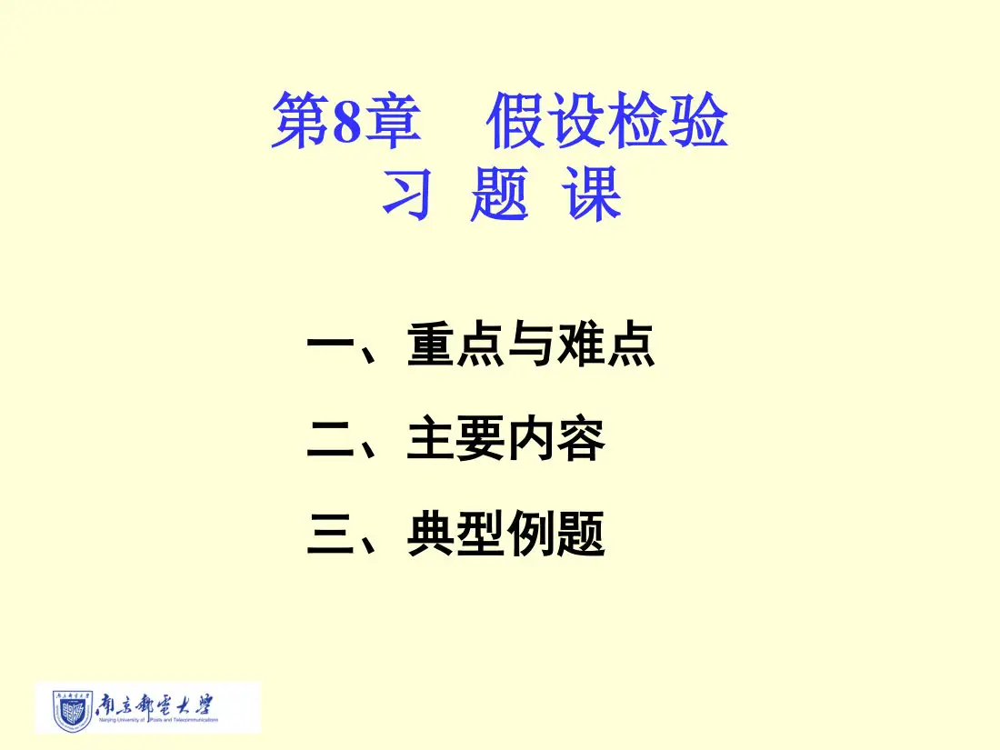

原文：

第8章 假设检验
习题课
一、重点与难点
二、主要内容
三、典型例题

南京邮电大学
Nanjing University of Posts and Telecommunications

### 一、重点与难点

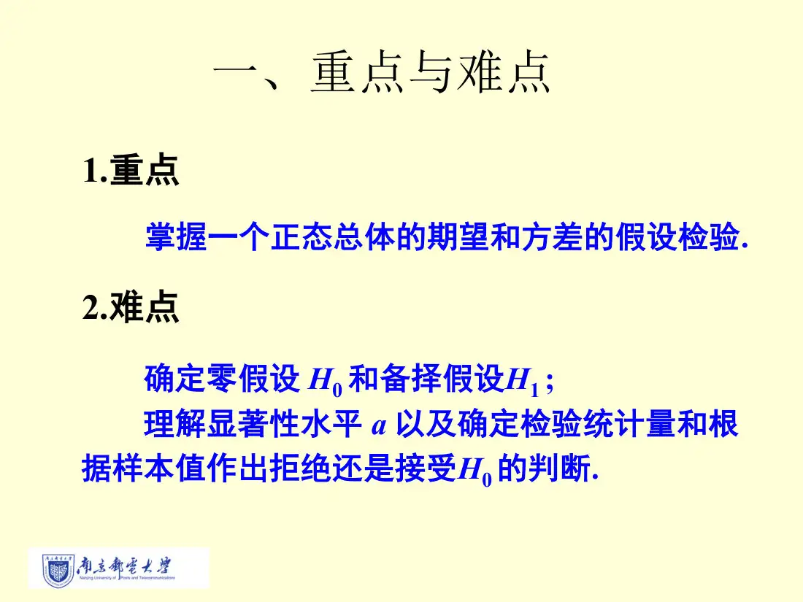

原文：

一、重点与难点

1.重点

掌握一个正态总体的期望和方差的假设检验.

2.难点

确定零假设 $H_{0}$ 和备择假设 $H_{1}$ ;

理解显著性水平 a 以及确定检验统计量和根据样本值作出拒绝还是接受 $H_{0}$ 的判断.

南京邮电大学
Nanjing University of Posts and Telecommunications

### 二、主要内容

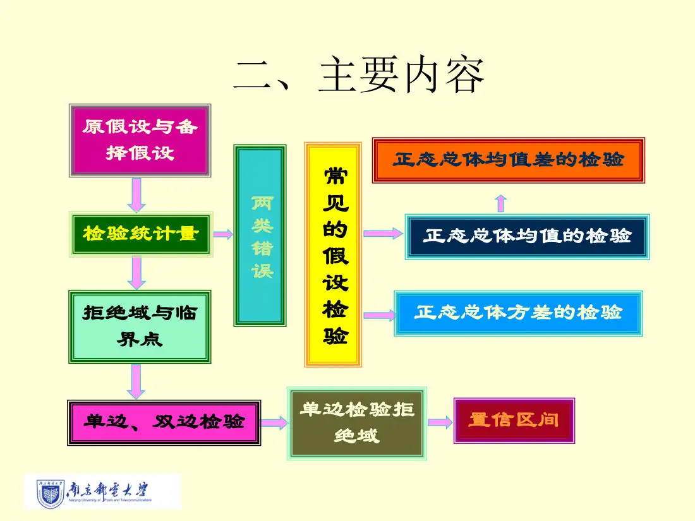

原文：

二、主要内容

原假设与备
择假设

常见的假设检验

正态总体均值差的检验

检验统计量

两类错误

拒绝域与临界点

↑

正态总体均值的检验

正态总体方差的检验

单边、双边检验单边检验拒绝域

置信区间

南京邮电大学
Nanjing University of Posts and Telecommunications

### 原假设与备择假设

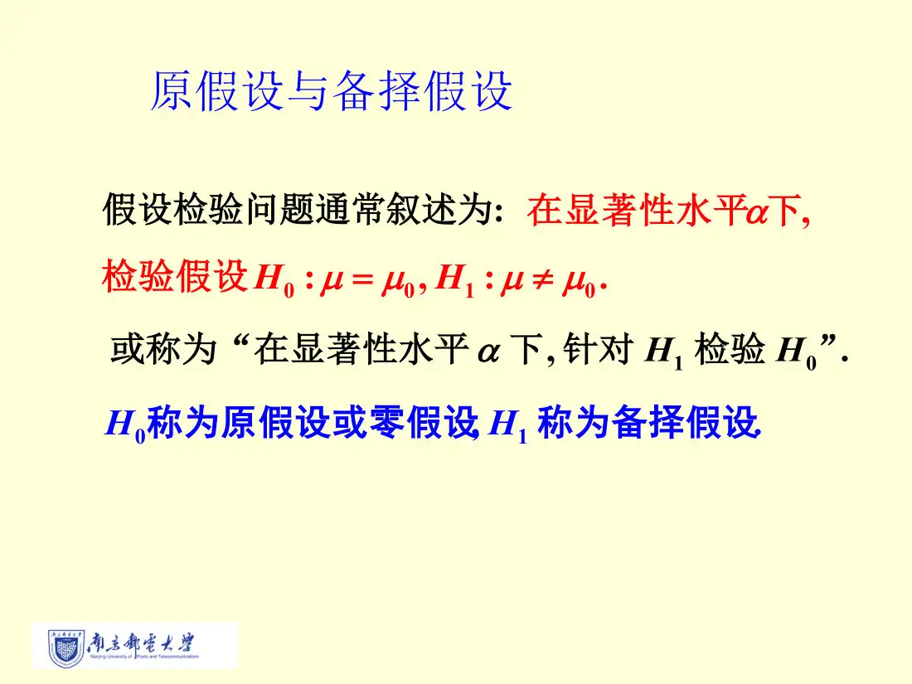

原文：

原假设与备择假设

假设检验问题通常叙述为: 在显著性水平 $\alpha$ 下, 检验假设 $H_{0}:\mu=\mu_{0}, H_{1}:\mu\neq\mu_{0}$ .

或称为 “在显著性水平 $\alpha$ 下, 针对 $H_{1}$ 检验 $H_{0}$ ”

$H_{0}$ 称为原假设或零假设, $H_{1}$ 称为备择假设

南京邮电大学
Nanjing University of Posts and Telecommunications

### 检验统计量

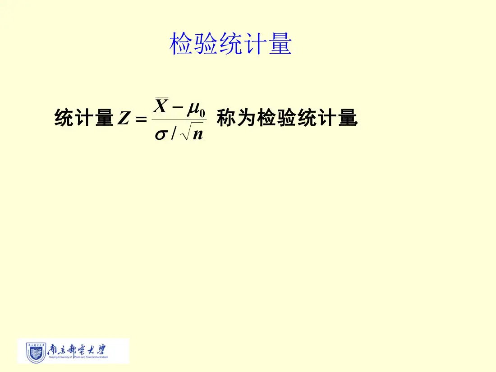

原文：

检验统计量

统计量 $Z = \frac{\bar{X} - \mu_{0}}{\sigma / \sqrt{n}}$ 称为检验统计量.

南京邮电大学
Nanjing University of Posts and Telecommunications

### 拒绝域与临界点

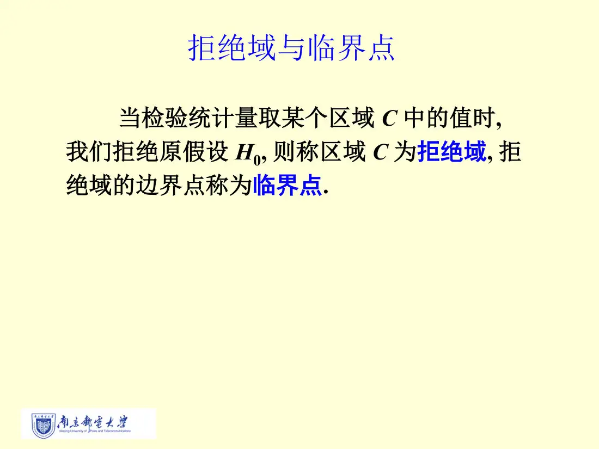

原文：

拒绝域与临界点

当检验统计量取某个区域 C 中的值时, 我们拒绝原假设 $H_{0}$ , 则称区域 C 为拒绝域, 拒绝域的边界点称为临界点.

南京邮电大学
Nanjing University of Posts and Telecommunications

### 两类错误

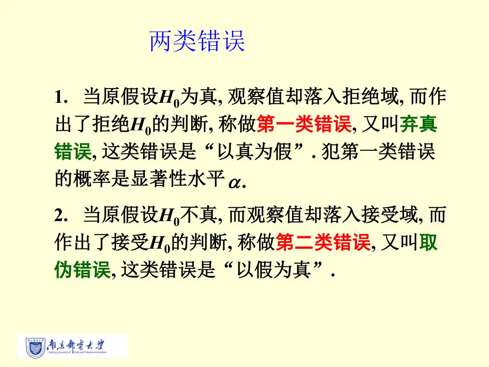

原文：

两类错误

1. 当原假设 $H_{0}$ 为真, 观察值却落入拒绝域, 而作出了拒绝 $H_{0}$ 的判断, 称做第一类错误, 又叫弃真错误, 这类错误是 “以真为假”. 犯第一类错误的概率是显著性水平 $\alpha$ .

2. 当原假设 $H_{0}$ 不真, 而观察值却落入接受域, 而作出了接受 $H_{0}$ 的判断, 称做第二类错误, 又叫取伪错误, 这类错误是 “以假为真”.

南京邮电大学
Nanjing University of Posts and Telecommunications

### 正态总体均值的检验

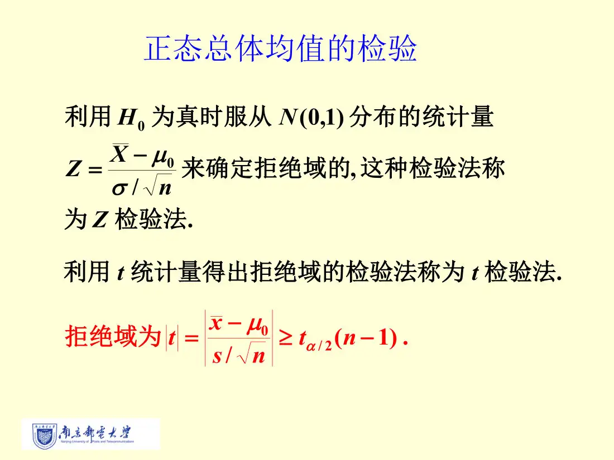

原文：

正态总体均值的检验

利用 $H_{0}$ 为真时服从 $N(0,1)$ 分布的统计量 $Z=\frac{\bar{X}-\mu_{0}}{\sigma/\sqrt{n}}$ 来确定拒绝域的,这种检验法称为Z检验法.

利用 t 统计量得出拒绝域的检验法称为 t 检验法.

拒绝域为 $|t| = \left|\frac{\bar{x} - \mu_0}{s / \sqrt{n}}\right| \geq t_{\alpha/2}(n-1)$ .

南京邮电大学
Nanjing University of Posts and Telecommunications

### 正态总体均值差的检验

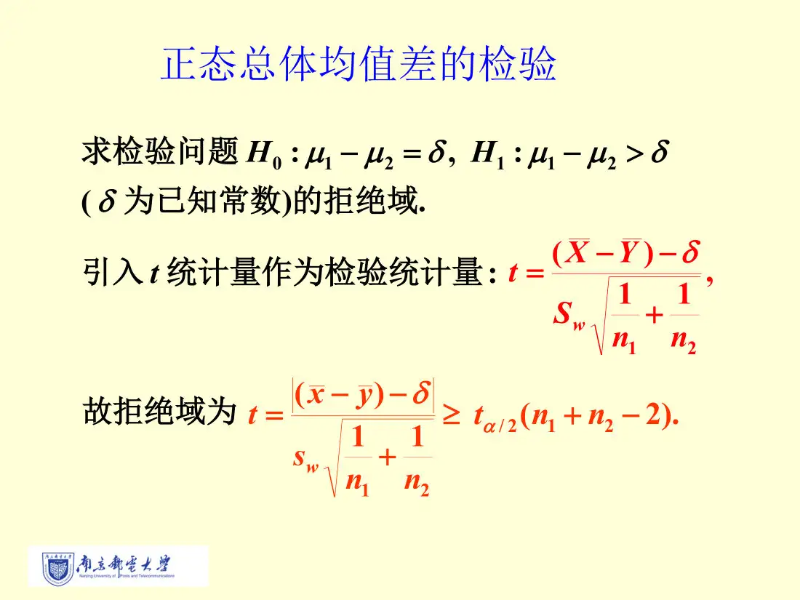

原文：

正态总体均值差的检验

求检验问题 $H_{0}:\mu_{1}-\mu_{2}=\delta,\quad H_{1}:\mu_{1}-\mu_{2}>\delta$ ( $\delta$ 为已知常数)的拒绝域.

引入 $t$ 统计量作为检验统计量： $t = \frac{(\bar{X} - \bar{Y}) - \delta}{S_w\sqrt{\frac{1}{n_1} + \frac{1}{n_2}}}$ 故拒绝域为 $t = \frac{|\bar{x} - \bar{y}) - \delta|}{S_w\sqrt{\frac{1}{n_1} + \frac{1}{n_2}}} \geq t_{\alpha / 2}(n_1 + n_2 - 2)$ .

南京邮电大学
Nanjing University of Posts and Telecommunications

### 正态总体方差的检验

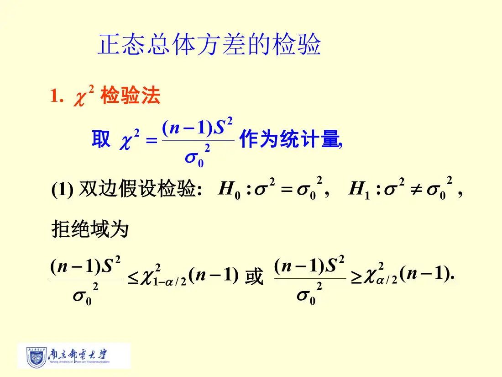

原文：

正态总体方差的检验

1. $\chi^2$ 检验法

取 $\chi^{2}=\frac{(n-1)S^{2}}{\sigma_{0}^{2}}$ 作为统计量,

(1) 双边假设检验: $H_{0}: \sigma^{2} = \sigma_{0}^{2}, H_{1}: \sigma^{2} \neq \sigma_{0}^{2}$ , 拒绝域为 $\frac{(n - 1)S^{2}}{\sigma_{0}^{2}} \leq \chi_{1 - \alpha / 2}^{2}(n - 1)$ 或 $\frac{(n - 1)S^{2}}{\sigma_{0}^{2}} \geq \chi_{\alpha / 2}^{2}(n - 1)$ .

南京邮电大学
Nanjing University of Posts and Telecommunications

### 南京邮电大学

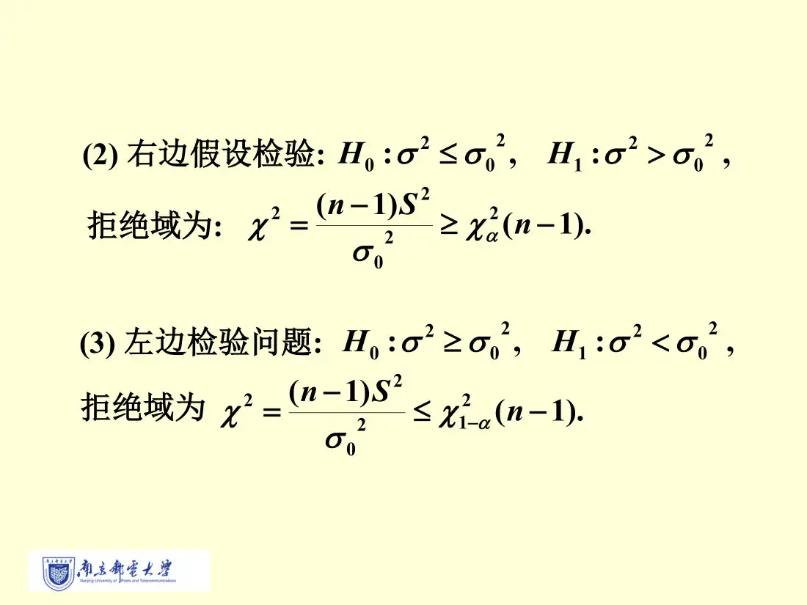

原文：

(2) 右边假设检验: $H_{0}: \sigma^{2} \leq \sigma_{0}^{2}, H_{1}: \sigma^{2} > \sigma_{0}^{2}$ , 拒绝域为: $\chi^{2} = \frac{(n - 1)S^{2}}{\sigma_{0}^{2}} \geq \chi_{\alpha}^{2}(n - 1)$ .

(3) 左边检验问题: $H_{0}: \sigma^{2} \geq \sigma_{0}^{2}, H_{1}: \sigma^{2} < \sigma_{0}^{2}$ , 拒绝域为 $\chi^{2} = \frac{(n - 1)S^{2}}{\sigma_{0}^{2}} \leq \chi_{1 - \alpha}^{2}(n - 1)$ .

南京邮电大学
Nanjing University of Posts and Telecommunications

### 南京邮电大学

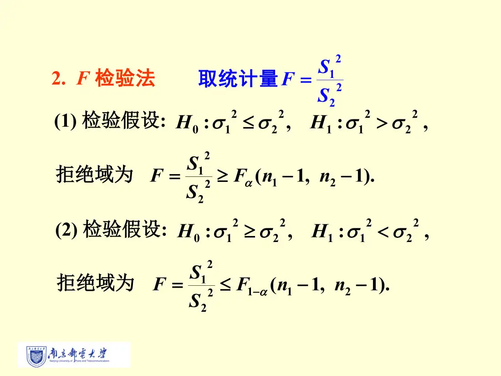

原文：

2. $F$ 检验法 取统计量 $F = \frac{S_1^2}{S_2^2}$

(1) 检验假设: $H_{0}: \sigma_{1}^{2} \leq \sigma_{2}^{2}, H_{1}: \sigma_{1}^{2} > \sigma_{2}^{2}$ , 拒绝域为 $F = \frac{S_{1}^{2}}{S_{2}^{2}} \geq F_{\alpha}(n_{1} - 1, n_{2} - 1)$ .

(2) 检验假设: $H_{0}: \sigma_{1}^{2} \geq \sigma_{2}^{2}, H_{1}: \sigma_{1}^{2} < \sigma_{2}^{2}$ , 拒绝域为 $F = \frac{S_{1}^{2}}{S_{2}^{2}} \leq F_{1 - \alpha}(n_{1} - 1, n_{2} - 1)$ .

南京邮电大学
Nanjing University of Posts and Telecommunications

### 南京邮电大学

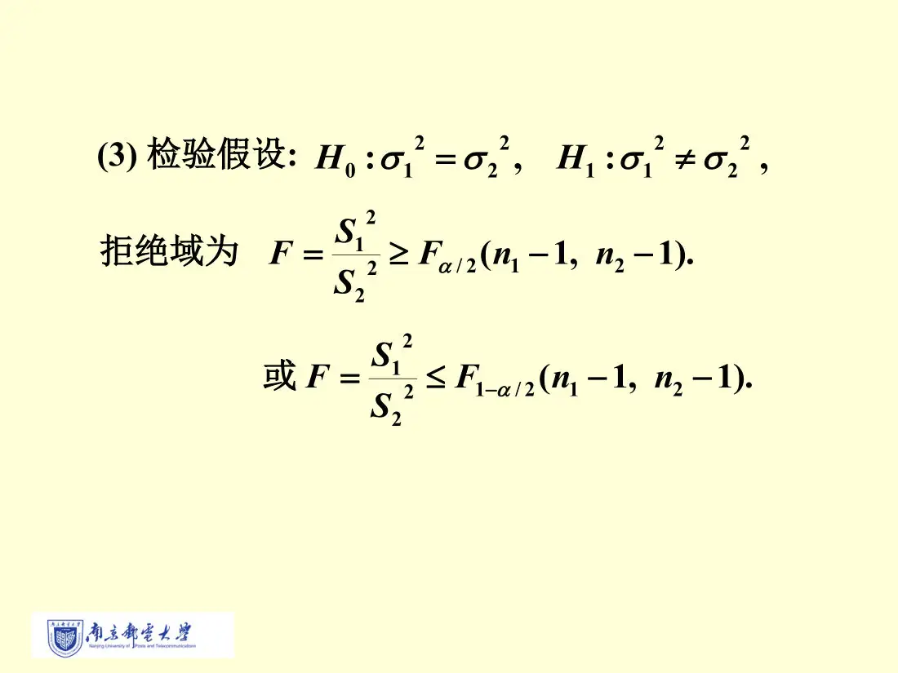

原文：

(3) 检验假设: $H_{0}: \sigma_{1}^{2} = \sigma_{2}^{2}, H_{1}: \sigma_{1}^{2} \neq \sigma_{2}^{2}$ , 拒绝域为 $F = \frac{S_{1}^{2}}{S_{2}^{2}} \geq F_{\alpha / 2}(n_{1} - 1, n_{2} - 1)$ . 或 $F = \frac{S_{1}^{2}}{S_{2}^{2}} \leq F_{1 - \alpha / 2}(n_{1} - 1, n_{2} - 1)$ .

南京邮电大学
Nanjing University of Posts and Telecommunications

### 置信区间

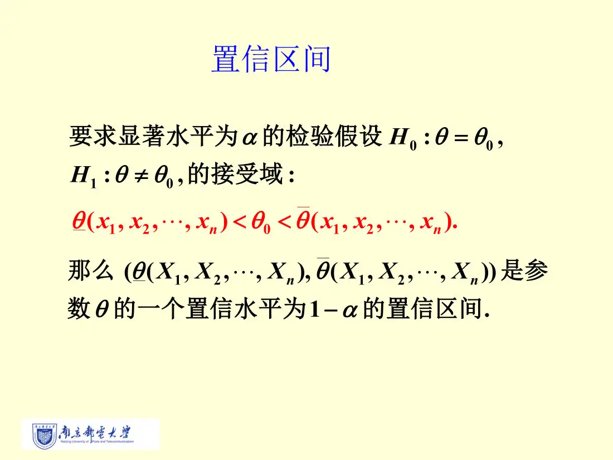

原文：

置信区间

要求显著水平为 $\alpha$ 的检验假设 $H_{0}:\theta=\theta_{0}$ , $H_{1}:\theta\neq\theta_{0}$ ，的接受域：

$$
\underline {{\theta}} (x _ {1}, x _ {2}, \dots , x _ {n}) <   \theta_ {0} <   \overline {{\theta}} (x _ {1}, x _ {2}, \dots , x _ {n}).
$$

那么 $(\theta(X_{1},X_{2},\cdots,X_{n}),\bar{\theta}(X_{1},X_{2},\cdots,X_{n}))$ 是参数 $\theta$ 的一个置信水平为 $1-\alpha$ 的置信区间.

南京邮电大学
Nanjing University of Posts and Telecommunications

### 单边、双边假设检验

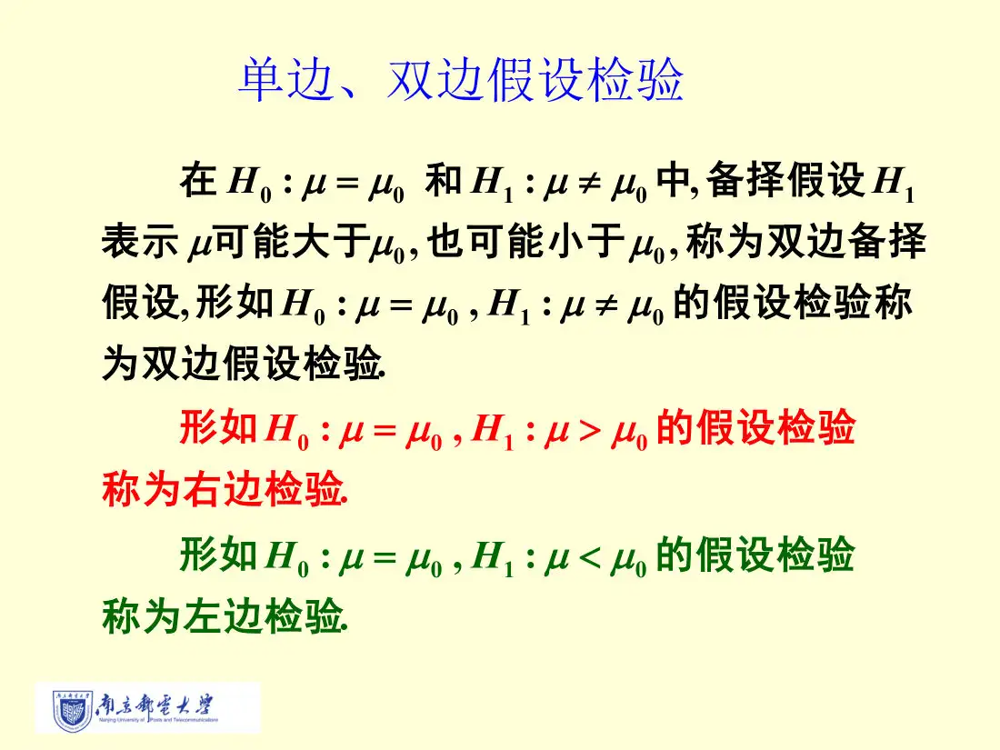

原文：

单边、双边假设检验

在 $H_{0}:\mu=\mu_{0}$ 和 $H_{1}:\mu\neq\mu_{0}$ 中, 备择假设 $H_{1}$ 表示 $\mu$ 可能大于 $\mu_{0}$ , 也可能小于 $\mu_{0}$ , 称为双边备择假设, 形如 $H_{0}:\mu=\mu_{0}, H_{1}:\mu\neq\mu_{0}$ 的假设检验称为双边假设检验.

形如 $H_{0}:\mu=\mu_{0},H_{1}:\mu>\mu_{0}$ 的假设检验称为右边检验.

形如 $H_{0}:\mu=\mu_{0},H_{1}:\mu<\mu_{0}$ 的假设检验称为左边检验.

南京邮电大学
Nanjing University of Posts and Telecommunications

### 单边检验的拒绝域

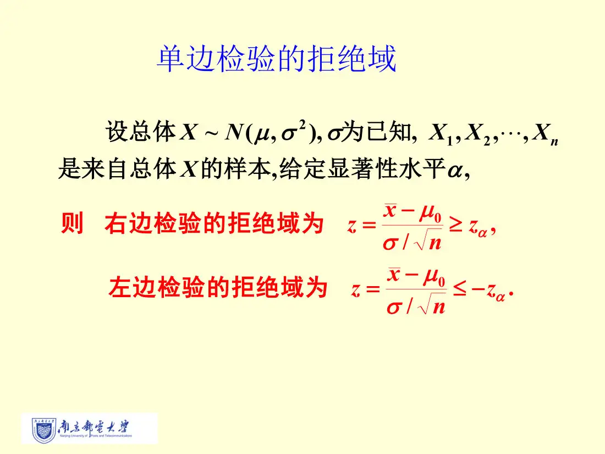

原文：

单边检验的拒绝域

设总体 $X \sim N(\mu, \sigma^{2})$ ， $\sigma$ 为已知， $X_{1}, X_{2}, \cdots, X_{n}$ 是来自总体X的样本，给定显著性水平 $\alpha$ ，

则 右边检验的拒绝域为 $z=\frac{\bar{x}-\mu_{0}}{\sigma/\sqrt{n}}\geq z_{\alpha}$ ,

左边检验的拒绝域为 $z=\frac{\bar{x}-\mu_{0}}{\sigma/\sqrt{n}}\leq-z_{\alpha}$

南京邮电大学
Nanjing University of Posts and Telecommunications

### 用 F 检验法，当 $H_{0}$ 为真时，

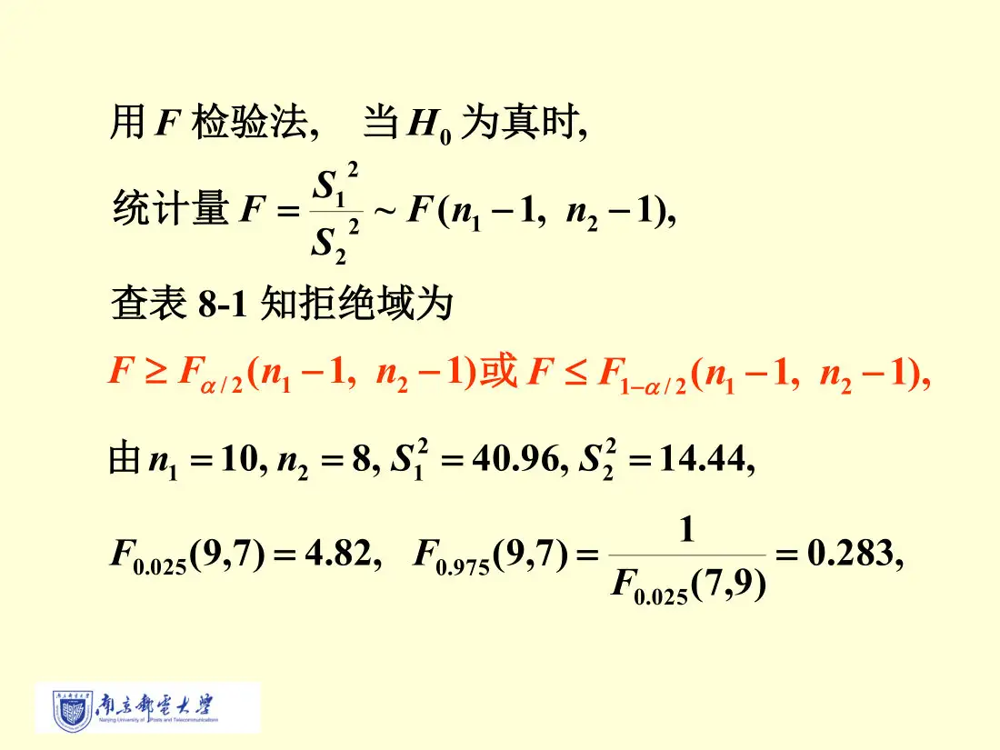

原文：

用 F 检验法，当 $H_{0}$ 为真时，

统计量 $F = \frac{S_{1}^{2}}{S_{2}^{2}} \sim F(n_{1}-1, n_{2}-1)$ ,

查表 8-1 知拒绝域为

$F \geq F_{\alpha/2}(n_1 - 1, n_2 - 1)$ 或 $F \leq F_{1-\alpha/2}(n_1 - 1, n_2 - 1)$ ,

由 $n_1 = 10, n_2 = 8, S_1^2 = 40.96, S_2^2 = 14.44,$

$$
F _ {0. 0 2 5} (9, 7) = 4. 8 2, \quad F _ {0. 9 7 5} (9, 7) = \frac {1}{F _ {0 . 0 2 5} (7 , 9)} = 0. 2 8 3,
$$

南京邮电大学
Nanjing University of Posts and Telecommunications

### 所以接受 $H_{0}$ ，认为抗折强度的方差没有显著差异。

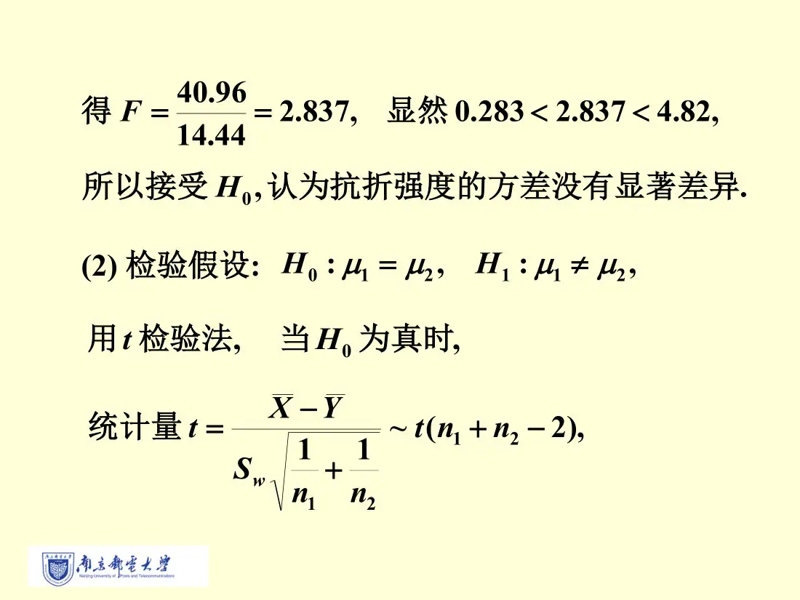

原文：

得 $F=\frac{40.96}{14.44}=2.837$ ，显然 0.283<2.837<4.82，
所以接受 $H_{0}$ ，认为抗折强度的方差没有显著差异。

(2) 检验假设: $H_{0}: \mu_{1} = \mu_{2}, H_{1}: \mu_{1} \neq \mu_{2}$ , 用 $t$ 检验法, 当 $H_{0}$ 为真时,

统计量 $t=\frac{\bar{X}-\bar{Y}}{S_{w}\sqrt{\frac{1}{n_{1}}+\frac{1}{n_{2}}}}\sim t(n_{1}+n_{2}-2)$ ,

南京邮电大学
Nanjing University of Posts and Telecommunications

### 一．填空题：

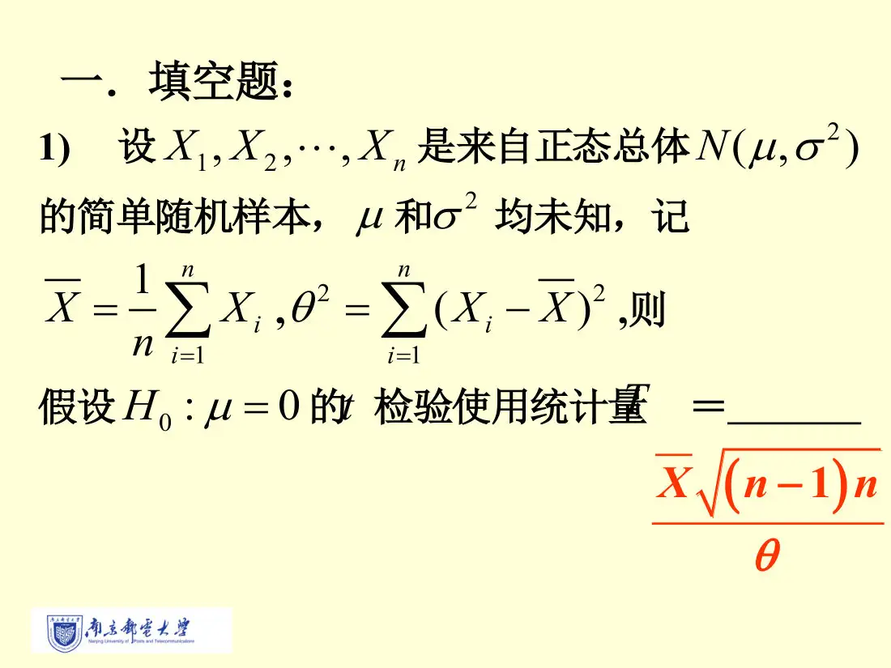

原文：

一．填空题：

1) 设 $X_{1}, X_{2}, \cdots, X_{n}$ 是来自正态总体 $N(\mu, \sigma^{2})$ 的简单随机样本， $\mu$ 和 $\sigma^{2}$ 均未知，记 $\overline{X} = \frac{1}{n} \sum_{i=1}^{n} X_{i}, \theta^{2} = \sum_{i=1}^{n} (X_{i} - \overline{X})^{2}$ ，则

假设 $H_{0}: \mu = 0$ 的 t 检验使用统计量 = \_\_\_\_ $\frac{\overline{X} \sqrt{(n-1)n}}{\theta}$ 解 $\because T=\frac{\overline{X}-\mu}{S/\sqrt{n}}\sim t(n-1)$ ，而 $S=\frac{\theta}{\sqrt{n-1}},\therefore T=\frac{\overline{X}-\mu}{\theta/\sqrt{n(n-1)}}$ 若 $H_{0}$ 为真,则 $T=\frac{\overline{X}}{\theta/\sqrt{n(n-1)}}=\frac{\overline{X}\sqrt{n(n-1)}}{\theta}\sim t(n-1)$

南京邮电大学
Nanjing University of Posts and Telecommunications

### 南京邮电大学

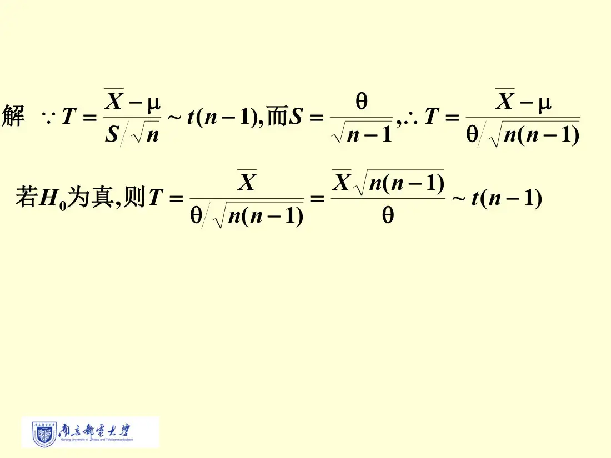

原文：

南京邮电大学
Nanjing University of Posts and Telecommunications

### 南京邮电大学

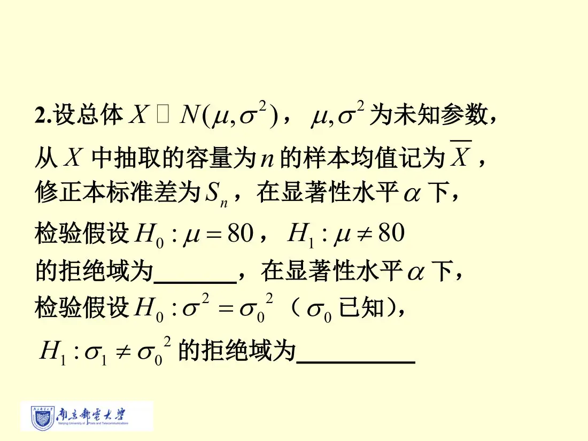

原文：

2. 设总体 $X \square N(\mu, \sigma^2)$ , $\mu, \sigma^2$ 为未知参数,从 $X$ 中抽取的容量为 $n$ 的样本均值记为 $\overline{X}$ ,修正本标准差为 $S_n$ , 在显著性水平 $\alpha$ 下,检验假设 $H_0: \mu = 80$ , $H_1: \mu \neq 80$ 的拒绝域为 , 在显著性水平 $\alpha$ 下,检验假设 $H_0: \sigma^2 = \sigma_0^2$ ( $\sigma_0$ 已知), $H_1: \sigma_1 \neq \sigma_0^2$ 的拒绝域为

南京邮电大学
Nanjing University of Posts and Telecommunications

### $$

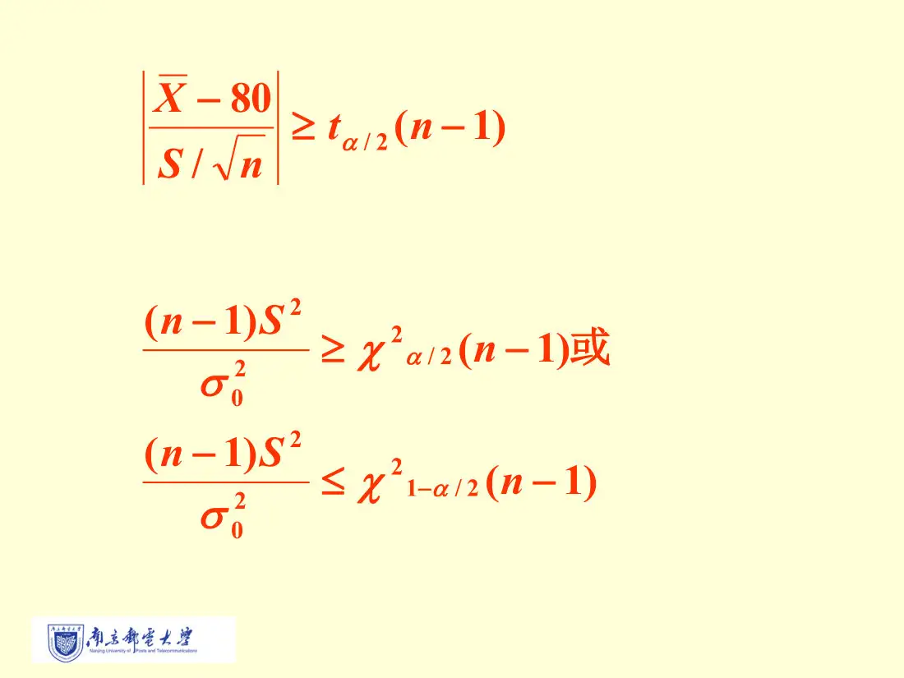

原文：

$$
\left| \frac {\overline {{X}} - 8 0}{S / \sqrt {n}} \right| \geq t _ {\alpha / 2} (n - 1)
$$

$$
\begin{array}{r l} & {\frac {(n - 1) S ^ {2}}{\sigma_ {0} ^ {2}} \geq \chi^ {2} _ {\alpha / 2} (n - 1) \text {或}} \\ & {\frac {(n - 1) S ^ {2}}{\sigma_ {0} ^ {2}} \leq \chi^ {2} _ {1 - \alpha / 2} (n - 1)} \end{array}
$$

南京邮电大学
Nanjing University of Posts and Telecommunications

### 二、选择题：

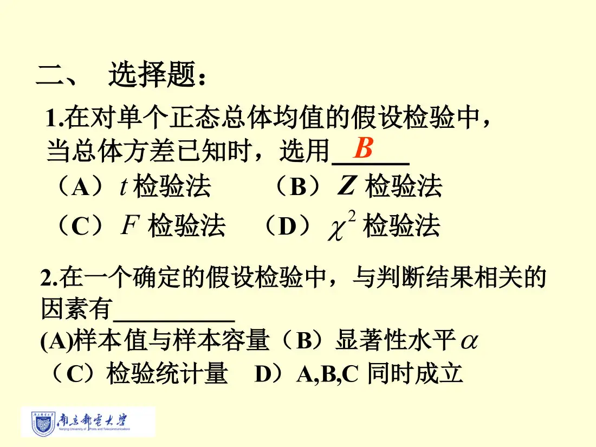

原文：

二、选择题：

1. 在对单个正态总体均值的假设检验中, 当总体方差已知时, 选用 $\underline{B}$ (A) $t$ 检验法 (B) $Z$ 检验法 (C) $F$ 检验法 (D) $\chi^{2}$ 检验法

2.在一个确定的假设检验中, 与判断结果相关的因素有\_(A)样本值与样本容量 (B) 显著性水平 $\alpha$ (C) 检验统计量 D) A,B,C 同时成立

南京邮电大学
Nanjing University of Posts and Telecommunications

### 三.解答题

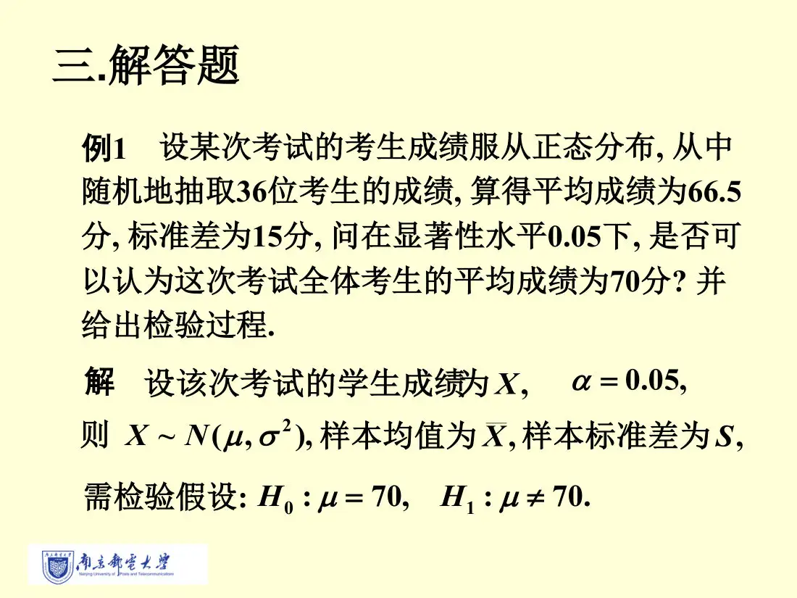

原文：

三.解答题

例1 设某次考试的考生成绩服从正态分布, 从中随机地抽取36位考生的成绩, 算得平均成绩为66.5分, 标准差为15分, 问在显著性水平0.05下, 是否可以认为这次考试全体考生的平均成绩为70分? 并给出检验过程.

解 设该次考试的学生成绩为 X, $\alpha = 0.05$ ,
则 $X \sim N(\mu, \sigma^{2})$ ，样本均值为 $\bar{X}$ ，样本标准差为 S，
需检验假设: $H_{0}: \mu = 70,\quad H_{1}: \mu \neq 70.$

南京邮电大学
Nanjing University of Posts and Telecommunications

### 南京邮电大学

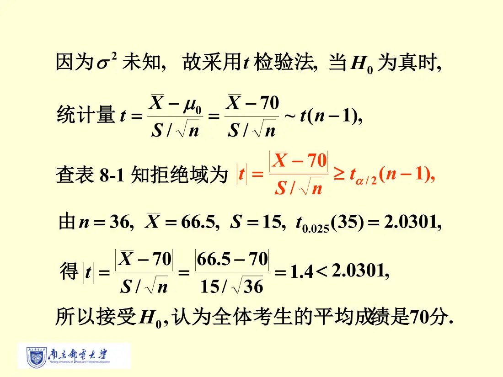

原文：

因为 $\sigma^2$ 未知，故采用 $t$ 检验法，当 $H_0$ 为真时，统计量 $t = \frac{\overline{X} - \mu_0}{S / \sqrt{n}} = \frac{\overline{X} - 70}{S / \sqrt{n}} \sim t(n - 1)$ ，查表8-1知拒绝域为 $|t| = \frac{|\overline{X} - 70|}{S / \sqrt{n}} \geq t_{\alpha / 2}(n - 1)$ ，由 $n = 36, \overline{X} = 66.5, S = 15, t_{0.025}(35) = 2.0301,$ 得 $|t| = \frac{|\overline{X} - 70|}{S / \sqrt{n}} = \frac{|66.5 - 70|}{15 / \sqrt{36}} = 1.4 < 2.0301,$ 所以接受 $H_0$ ，认为全体考生的平均成绩是70分。

南京邮电大学
Nanjing University of Posts and Telecommunications

### 南京邮电大学

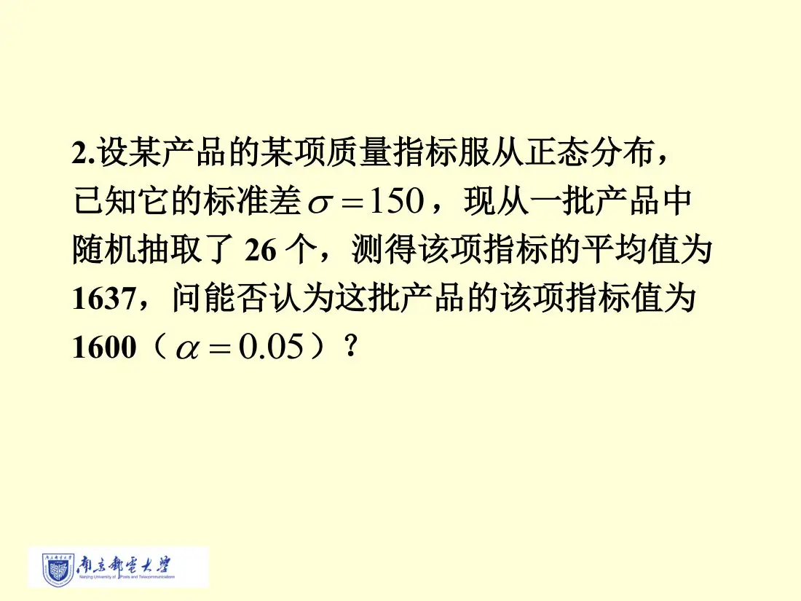

原文：

2. 设某产品的某项质量指标服从正态分布，已知它的标准差 $\sigma = 150$ ，现从一批产品中随机抽取了26个，测得该项指标的平均值为1637，问能否认为这批产品的该项指标值为 $1600 (\alpha = 0.05)$ ?

南京邮电大学
Nanjing University of Posts and Telecommunications

### 第 27 页

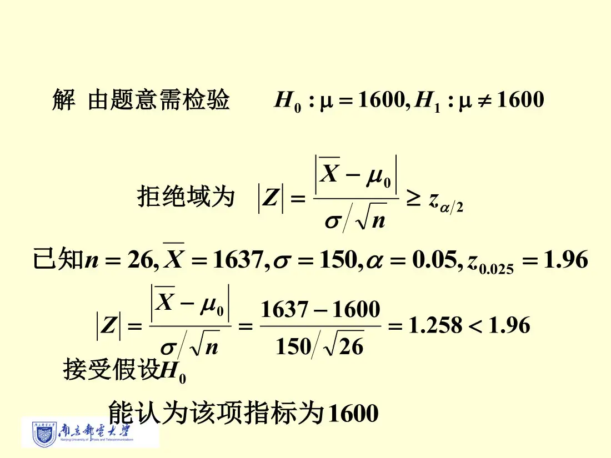

原文：

解 由题意需检验 $H_{0}:\mu = 1600,H_{1}:\mu \neq 1600$

拒绝域为 $\left|Z\right|=\frac{\left|\overline{X}-\mu_{0}\right|}{\sigma/\sqrt{n}}\geq z_{\alpha/2}$ 已知n=26, $\overline{X}=1637,\sigma=150,\alpha=0.05,z_{0.025}=1.96$ $\left|Z\right|=\frac{\left|\overline{X}-\mu_{0}\right|}{\sigma/\sqrt{n}}=\frac{1637-1600}{150/\sqrt{26}}=1.258<1.96$ 接受假设 $H_{0}$ 能认为该项指标为1600

### 南京邮电大学

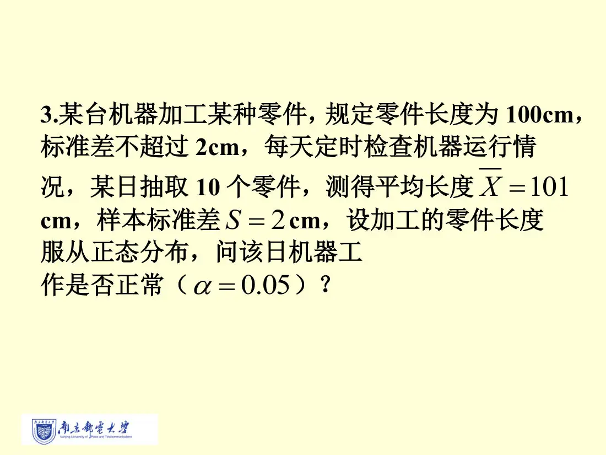

原文：

3. 某台机器加工某种零件, 规定零件长度为 $100 \mathrm{~cm}$ , 标准差不超过 $2 \mathrm{~cm}$ , 每天定时检查机器运行情况, 某日抽取 10 个零件, 测得平均长度 $\overline{X} = 101 \mathrm{~cm}$ , 样本标准差 $S = 2 \mathrm{~cm}$ , 设加工的零件长度服从正态分布, 问该日机器工作是否正常 ( $\alpha = 0.05$ )?

南京邮电大学
Nanjing University of Posts and Telecommunications

### 南京邮电大学

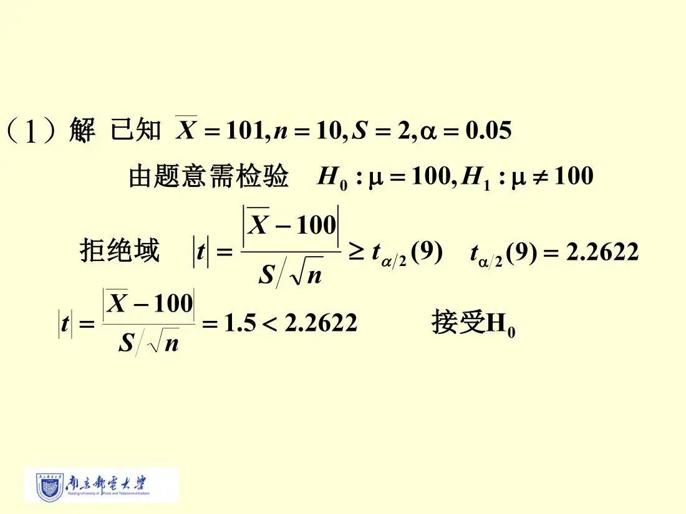

原文：

(1) 解 已知 $\overline{X} = 101, n = 10, S = 2, \alpha = 0.05$ 由题意需检验 $H_0: \mu = 100, H_1: \mu \neq 100$ 拒绝域 $|t| = \frac{|\overline{X} - 100|}{S / \sqrt{n}} \geq t_{\alpha/2}(9) \quad t_{\alpha/2}(9) = 2.2622$ $|t| = \frac{|\overline{X} - 100|}{S / \sqrt{n}} = 1.5 < 2.2622$ 接受 $\mathrm{H}_0$

南京邮电大学
Nanjing University of Posts and Telecommunications

### $$

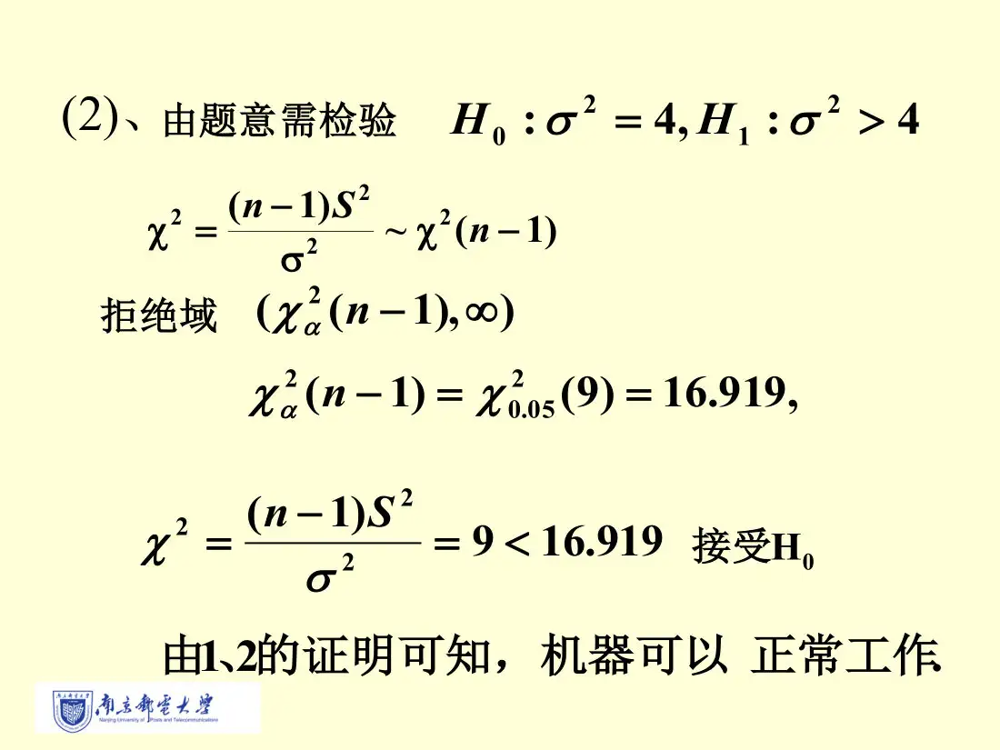

原文：

(2)、由题意需检验 $H_0:\sigma^2 = 4,H_1:\sigma^2 >4$

$$
\chi^ {2} = \frac {(n - 1) S ^ {2}}{\sigma^ {2}} \sim \chi^ {2} (n - 1)
$$

拒绝域 $(\chi_{\alpha}^{2}(n-1),\infty)$

$$
\chi_ {\alpha} ^ {2} (n - 1) = \chi_ {0. 0 5} ^ {2} (9) = 1 6. 9 1 9,
$$

$\chi^{2} = \frac{(n - 1)S^{2}}{\sigma^{2}} = 9 <   16.919$ 接受 $\mathrm{H_0}$

由1、2的证明可知，机器可以正常工作

南京邮电大学
Nanjing University of Posts and Telecommunications

### 南京邮电大学

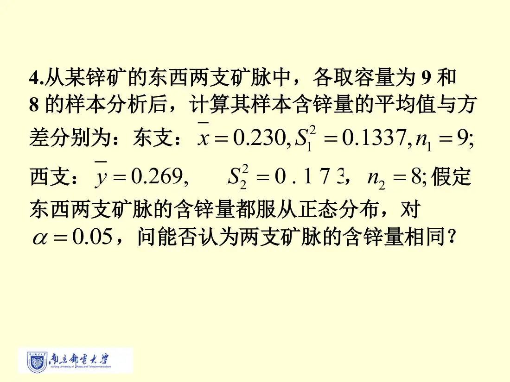

原文：

4.从某锌矿的东西两支矿脉中，各取容量为9和8的样本分析后，计算其样本含锌量的平均值与方差分别为：东支： $\bar{x}=0.230, S_{1}^{2}=0.1337, n_{1}=9;$ 西支： $\bar{y}=0.269,\quad S_{2}^{2}=0.173,\quad n_{2}=8;$ 假定东西两支矿脉的含锌量都服从正态分布，对 $\alpha=0.05$ ，问能否认为两支矿脉的含锌量相同？

南京邮电大学
Nanjing University of Posts and Telecommunications

### 当 $H_{0}$ 成立时，检验统计量

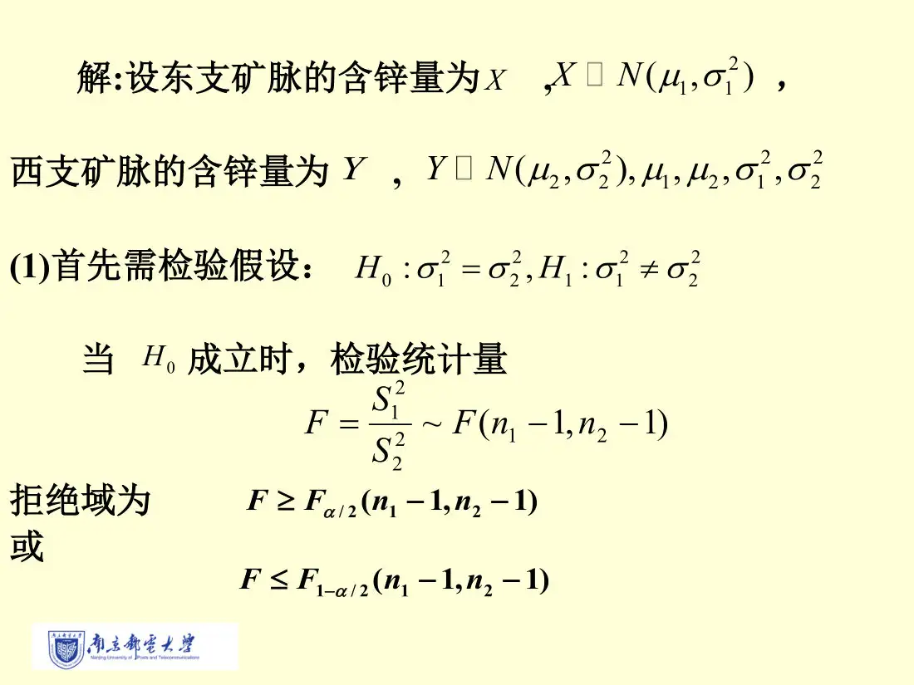

原文：

解:设东支矿脉的含锌量为X， $X \square N(\mu_{1}, \sigma_{1}^{2})$ ，
西支矿脉的含锌量为 Y， $Y \square N(\mu_{2}, \sigma_{2}^{2}), \mu_{1}, \mu_{2}, \sigma_{1}^{2}, \sigma_{2}^{2}$

(1)首先需检验假设： $H_{0}:\sigma_{1}^{2} = \sigma_{2}^{2},H_{1}:\sigma_{1}^{2}\neq \sigma_{2}^{2}$

当 $H_{0}$ 成立时，检验统计量

$$
F = \frac {S _ {1} ^ {2}}{S _ {2} ^ {2}} \sim F (n _ {1} - 1, n _ {2} - 1)
$$

拒绝域为或

$$
F \geq F _ {\alpha / 2} (n _ {1} - 1, n _ {2} - 1)
$$

$$
F \leq F _ {1 - \alpha / 2} (n _ {1} - 1, n _ {2} - 1)
$$

南京邮电大学
Nanjing University of Posts and Telecommunications

### \- 由F一分布表查得

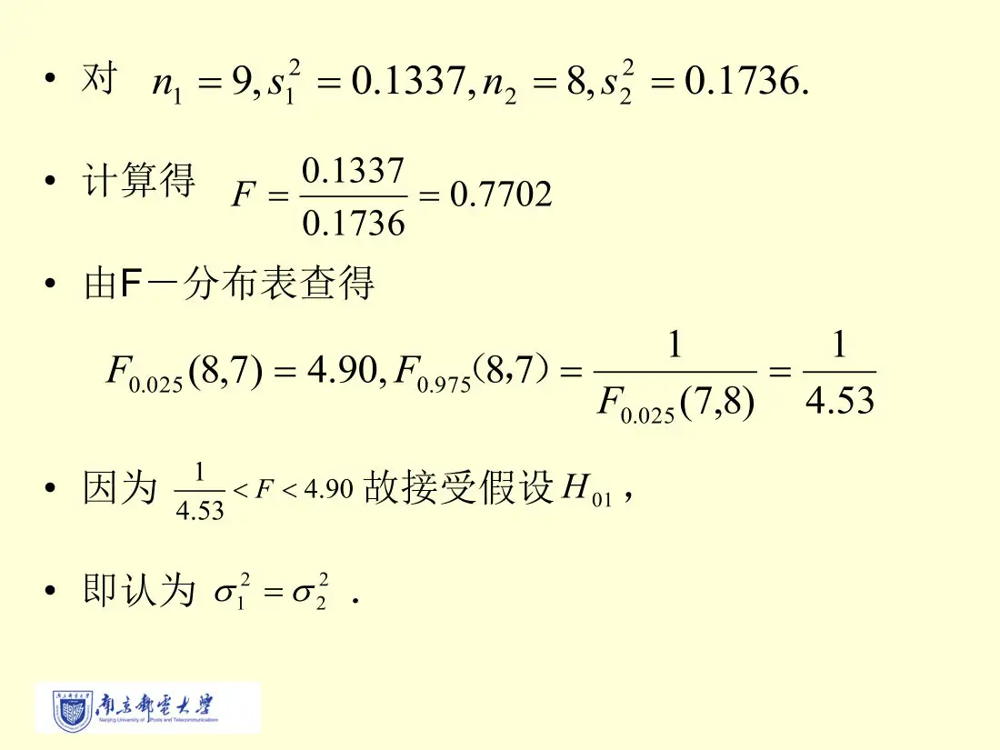

原文：

\- 对 $n_1 = 9, s_1^2 = 0.1337, n_2 = 8, s_2^2 = 0.1736$ .

\- 计算得 $F = \frac{0.1337}{0.1736} = 0.7702$

\- 由F一分布表查得

$$
F _ {0. 0 2 5} (8, 7) = 4. 9 0, F _ {0. 9 7 5} (8, 7) = \frac {1}{F _ {0 . 0 2 5} (7 , 8)} = \frac {1}{4 . 5 3}
$$

\- 因为 $\frac{1}{4.53} < F < 4.90$ 故接受假设 $H_{01}$ ,

\- 即认为 $\sigma_{1}^{2} = \sigma_{2}^{2}$

南京邮电大学
Nanjing University of Posts and Telecommunications

### \- 这属于 $t-$ 检验，检验统计量为

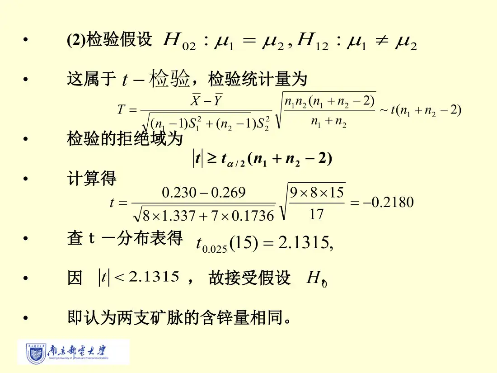

原文：

(2)检验假设 $H_{02}:\mu_1 = \mu_2,H_{12}:\mu_1\neq \mu_2$

\- 这属于 $t-$ 检验，检验统计量为

$$
T = \frac {\bar {X} - \bar {Y}}{\sqrt {(n _ {1} - 1) S _ {1} ^ {2} + (n _ {2} - 1)} S _ {2} ^ {2}} \sqrt {\frac {n _ {1} n _ {2} (n _ {1} + n _ {2} - 2)}{n _ {1} + n _ {2}}} \sim t (n _ {1} + n _ {2} - 2)
$$

\- 检验的拒绝域为

$$
\left| t \right| \geq t _ {\alpha / 2} (n _ {1} + n _ {2} - 2)
$$

\- 计算得

$$
t = \frac {0 . 2 3 0 - 0 . 2 6 9}{\sqrt {8 \times 1 . 3 3 7 + 7 \times 0 . 1 7 3 6}} \sqrt {\frac {9 \times 8 \times 1 5}{1 7}} = - 0. 2 1 8 0
$$

\- 查 t 一分布表得 $t_{0.025}(15) = 2.1315,$

因 $|t| < 2.1315$ ，故接受假设 $H_{0}$

\- 即认为两支矿脉的含锌量相同。

南京邮电大学
Nanjing University of Posts and Telecommunications

### 四、证明题

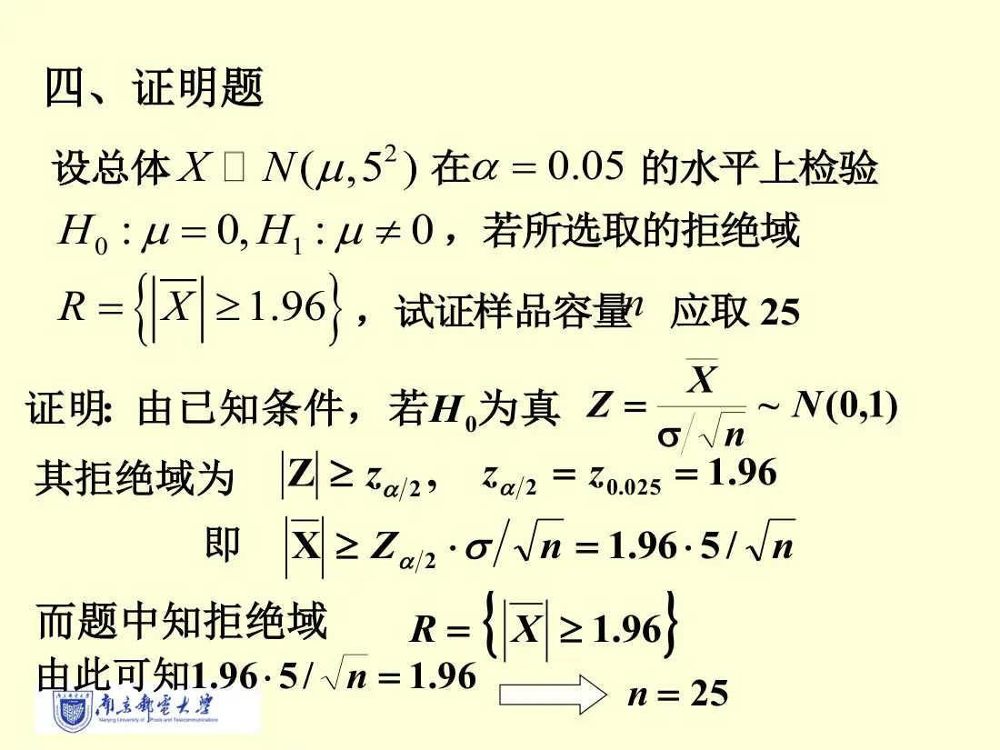

原文：

四、证明题

设总体 $X \square N(\mu, 5^2)$ 在 $\alpha = 0.05$ 的水平上检验 $H_0: \mu = 0, H_1: \mu \neq 0$ , 若所选取的拒绝域 $R = \left\{ \left| \overline{X} \right| \geq 1.96 \right\}$ , 试证样品容量 $^n$ 应取 25

证明: 由已知条件, 若 $H_0$ 为真 $Z = \frac{\overline{X}}{\sigma / \sqrt{n}} \sim N(0,1)$ 其拒绝域为 $|Z| \geq z_{\alpha/2}, z_{\alpha/2} = z_{0.025} = 1.96$ 即 $|\overline{X}| \geq Z_{\alpha/2} \cdot \sigma / \sqrt{n} = 1.96 \cdot 5 / \sqrt{n}$ 而题中知拒绝域 $R = \left\{ |\overline{X}| \geq 1.96 \right\}$ 由此可知 $1.96 \cdot 5 / \sqrt{n} = 1.96$ $\Longrightarrow n = 25$
