# 《概率论与数理统计》第8章 正态总体的假设检验（课件）

原件的每一页，下面附识别出的文字。

### 正态总体的均值和方差的假设检验

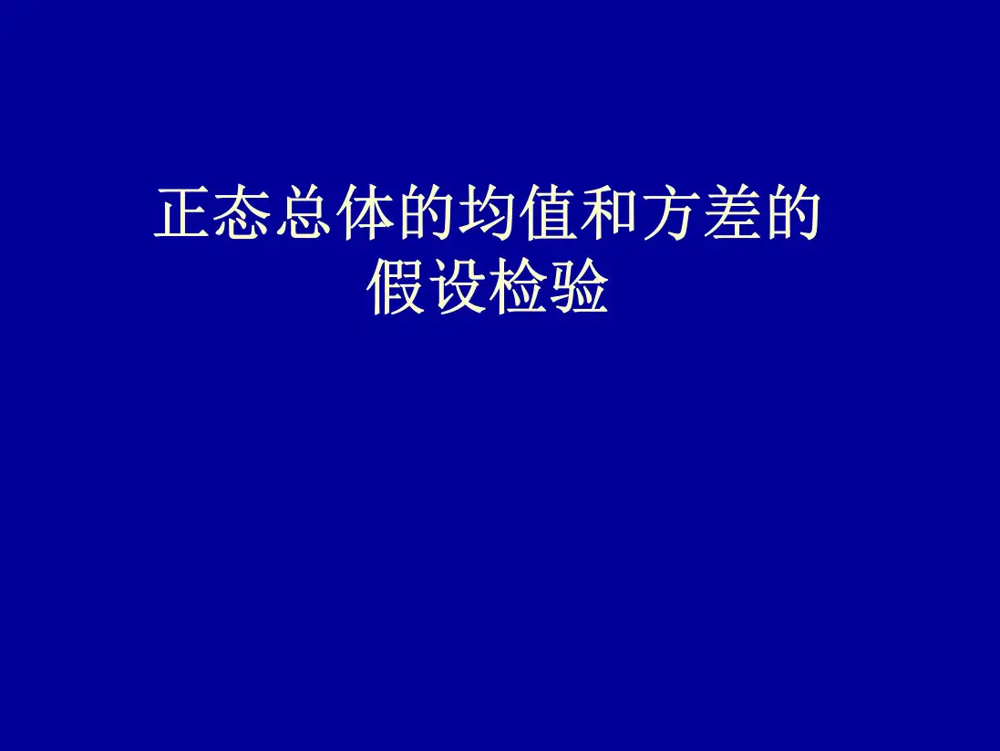

原文：

正态总体的均值和方差的假设检验

### 假设检验的一般步骤：

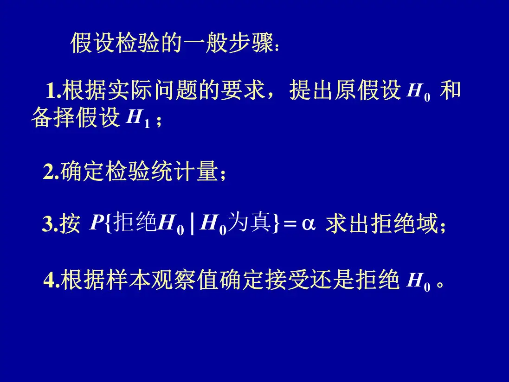

原文：

假设检验的一般步骤：

1.根据实际问题的要求， 提出原假设 $\textcircled { 1 } \textcircled { 1 }$ 和备择假设 $1 \pmb { \mu }$ ；

2.确定检验统计量；

3.按 拒绝 HHP 00 为真}|{ α= 求 出 拒绝域 ；

4.根据样本观察值确定接受还是拒绝 $| \pmb { \mu } | _ { 0 }$

### 一、 单个正态总体 $w ( 0 , 1 )$ 均值的假设检验)

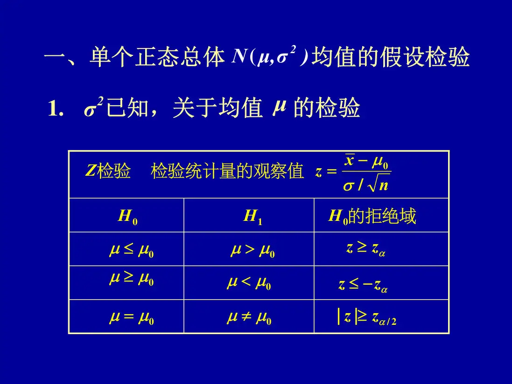

原文：

一、 单个正态总体 $w ( 0 , 1 )$ 均值的假设检验)

1 . $\textcircled { \bullet }$ 已知， 关于均值 $\mathbb { Z }$ 的检验

Z 检验 检验统计量的观察值 $x = \frac { 1 2 } { 1 0 }$

$$
H _ {0}
$$

$$
H _ {1}
$$

$| \pmb { \mu } | _ { 0 }$ 的拒绝域

$$
\mu \leq \mu_ {0}
$$

$$
\mu > \mu_ {0}
$$

$$
z \ge z _ {\alpha}
$$

$$
\mu \geq \mu_ {0}
$$

$$
\mu <   \mu_ {0}
$$

$$
z \leq - z _ {\alpha}
$$

$$
\mu = \mu_ {0}
$$

$$
\mu \neq \mu_ {0}
$$

$$
| z | \geq z _ {\alpha / 2}
$$

### 2. σ2未知， 关于均值 的检验μ

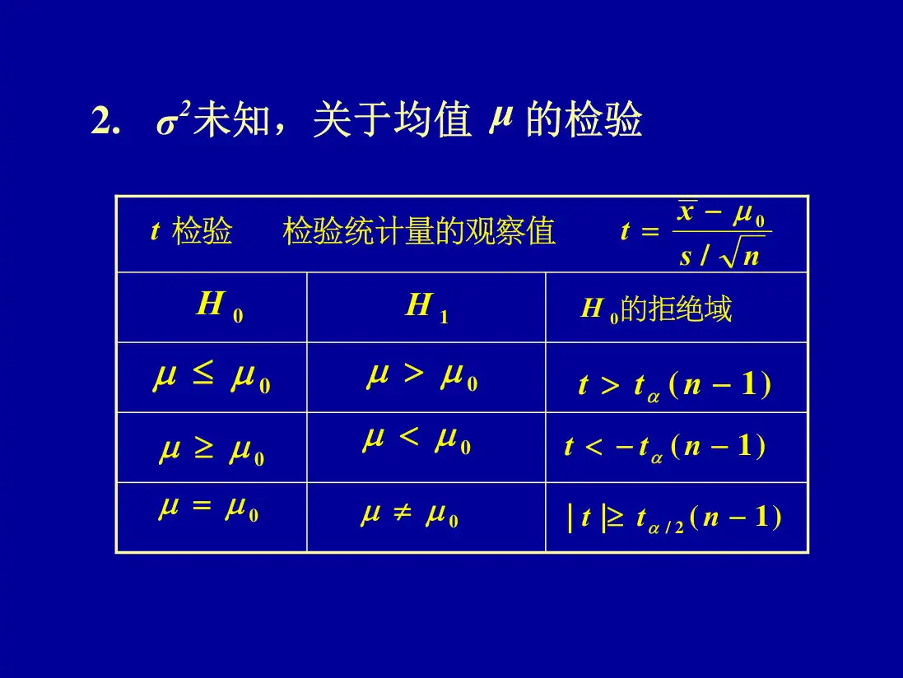

原文：

2. σ2未知， 关于均值 的检验μ

检验 检验统计量的观察值

$$
t = \frac {\overline {{x}} - \mu_ {0}}{s / \sqrt {n}}
$$

$$
H _ {0}
$$

$$
H _ {1}
$$

H 0的拒绝域

$$
\mu \leq \mu_ {0}
$$

$$
\mu > \mu_ {0}
$$

$$
t > t _ {\alpha} (n - 1)
$$

$$
\mu \geq \mu_ {0}
$$

$$
\mu <   \mu_ {0}
$$

$$
t <   - t _ {\alpha} (n - 1)
$$

$$
\mu = \mu_ {0}
$$

$$
\mu \neq \mu_ {0}
$$

$$
| t | \geq t _ {\alpha / 2} (n - 1)
$$

### 拒绝域 $y = \frac { 1 } { 2 }$

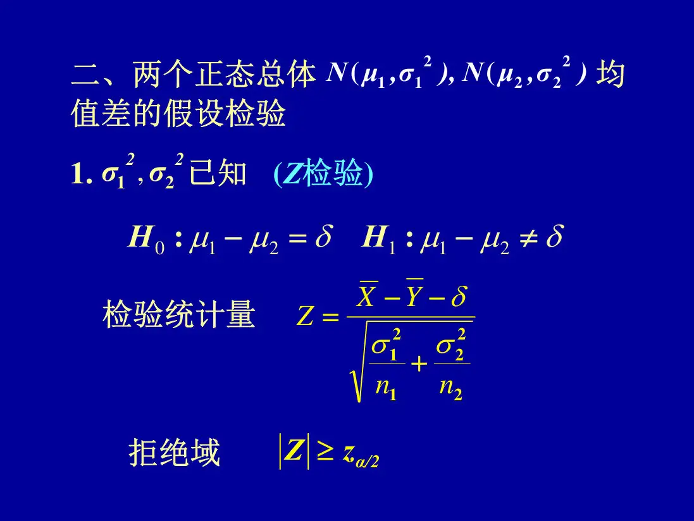

原文：

二、 两个正态总体 $\Delta A C D \cong \Delta B D C ( A A S )$ 均值差的假设检验

1 . $\textcircled { 9 } \textcircled { < } \textcircled { < } \textcircled { < } \textcircled { > }$ 已知 (Z检验)

H : μ − μ210 = δ H : μ − μ211 ≠ δ 检验统计量 $\frac { 1 } { 4 } = \frac { 1 } { 4 } = \frac { 1 } { 4 }$

拒绝域 $y = \frac { 1 } { 2 }$

### $$

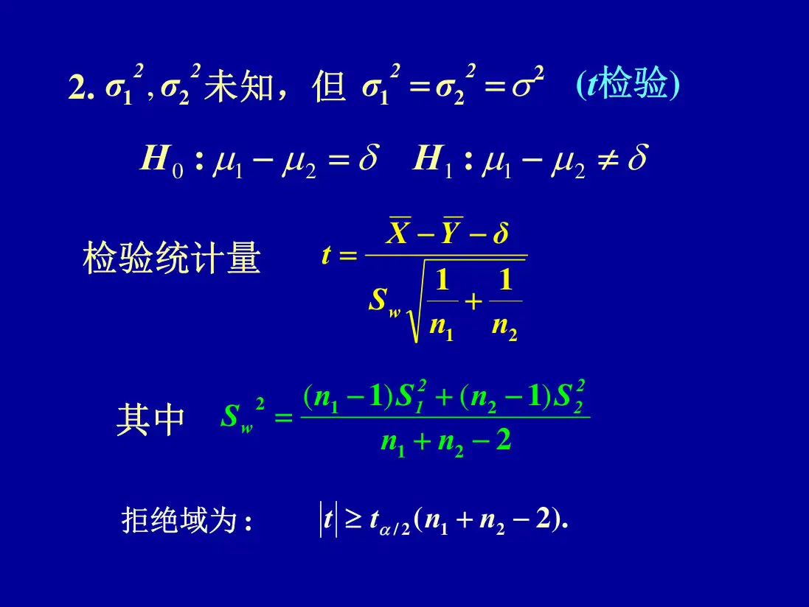

原文：

2 . $\textcircled { 9 } \textcircled { < } \textcircled { < } \textcircled { < }$ 未知， 但 $0 . 7 \times 1 0 ^ { 3 } k g = 0 . 6 2 ( c m ^ { 3 } )$ (t检 验)

$$
H _ {0}: \mu_ {1} - \mu_ {2} = \delta H _ {1}: \mu_ {1} - \mu_ {2} \neq \delta
$$

检验统计量 $= \frac { 1 } { 2 } \sqrt { \frac { 1 } { 2 } }$

其中 $( 2 ) ( 1 0 - 1 ) \times 2 = ( 1 0 - 1 ) ( 1 0 - 1 )$

拒绝域为 : $y = \frac { 1 } { ( 1 0 0 0 ) } ( 1 0 0 - \frac { 1 } { ( 1 0 0 0 ) } - \frac { 1 } { ( 1 0 0 0 ) } )$

### 按题意 检验假设

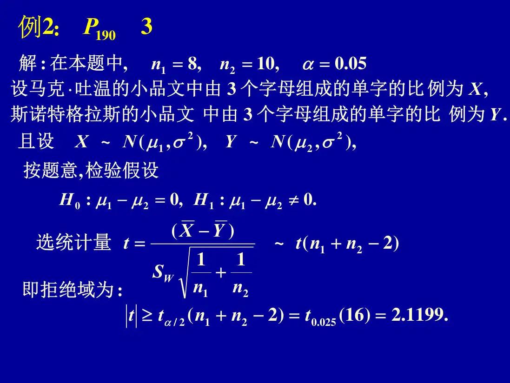

原文：

：例2 $| \frac { \eta } { \vert \mathbf { v } \vert } |$ 3

:解 在本题中 $\angle A = \angle A = 4 0 ^ { \circ } - \angle A = 3 0 ^ { \circ } - \angle A = 1 8 0 ^ { \circ } - \angle C = 1 8 0 ^ { \circ } - \angle C = 1 8 0 ^ { \circ }$ 设马克 ⋅ 吐温的小品文中 由 3 个字母组成的单字的 比 例为 X斯诺特格拉斯的小品文 中 由 3 个字母组成的单字的 比 例为 Y.且设 $- \frac { 1 } { 2 } \times ( \frac { 1 } { 2 } \times ( - \frac { 1 } { 2 } ) ) = \frac { 1 } { 2 } \times ( \frac { 1 } { 2 } \times ( - \frac { 1 } { 2 } ) )$

按题意 检验假设

$1 1 0 0 \times 1 0 0 = 1 1 0 0 ( c m ) = 1 1 0 0 ( c m )$ 选统计量 $1 0 \times 1 0 = 1 0 ( c m )$ 即拒绝域为$[ 1 2 , 1 3 , 1 4 , 1 5 , 2 , 1 5 , 1 5 , 1 5 , 1 5 , 1 5 , 1 5 , 2 ]$ : 经计算得 $\mathrm  ( 1 ) ( 1 ) ( 1 ) ( 1 ) ( 1 ) ( 1 ) ( 1 ) ( 1 ) ( 1 ) ( 1 ) ( 1 ) ( 1 ) ( 1 ) ( 1 ) ( 1 ) ( 1 ) ( 1 ) ( 1 ) ( 1 ) ( 1 ) ( 1 ) ( 1 ) ( 1 ) ( 1 ) ( 1 ) ( 1 ) ( 1 ) ( 1 ) ( 1 ) ( 1 ) ( 1 ) ( 1 ) ( 1 ) ( 1 ) ( 1 ) ( 1 ) ( 1 ) ( 1 ) ( 1 ) ( 1 ) ( 1 ) ( 1 ) ( 1 ) ( 1 ) ( 1 ) ( 1 ) ( 1 ) ( 1 ) ( 1 ) ( 1 ) ( 1 ) ( 1 ) ( 1 ) ( 1 ) ( 1 ) ( 1 ) ( ) ( 1 ) ( ) ( 1 ) ( ) ( 1 ) ( ) ( 1 ) ( ) ( 1 ) ( ) ( 1 ) ( ) ( 1 ) ( ) ( 1 ) ( ) ( 1 ) ( ) ( 1 ) ( ) ( 1 ) ( ) ( 1 ) ( ) ( 1 ) ( ) ( 1 ) ( ) ( 1 ) ( ) ( 1 ) ( ) ( 1 ) ( ) ( 1 ) ( ) ( 1 ) ( ) ( 1 ) ( ) ( ) ( 1 ) ( ) ( 1 ) ( ) ( ) ( 1 ) ( ) ( ) ( 1 ) ( ) ( ) ( 1 ) ( ) ( ) ( 1 ) ( ) ( ) ( 1 ) ( ) ( ) ( 1 ) ( ) ( ) ( 1 ) ( ) ( ) ( 1 ) ( ) ( ) ( 1 ) ( ) ( ) ( 1 ) ( ) ( ) ( 1 ) ( ) ( ) ( ) ( 1 ) ( ) ( ) ( ) ( 1 ) ( ) ( ) ( ) ( 1 ) ( ) ( ) ( ) ( 1 ) ( ) ( ) ( ) ) ( ) ( 1 ) ( ) ( ) ( ) ( ) = 0 ( ) ( 1 ) ) ( ) ( ) ( ) ( 1 ) ( ) ( ) ( ) ( ) 1 ) ( ) ( ) ( ) ( ) ( 1 ) ( ) ( ) ) ( ) ( ) ( 1 ) ( ) ( ) ( ) ( ) 1 ) ( ) ( ) ( ) ( ) ( ) 1 ) ( ) ( ) ( ) ( ) 1 ) ( ) ( ) ( ) ( ) 1 ) ( ) ( ) ( ) ( ) 1 ) ( ) ( ) ( ) ( ) 1 ) ( ) ( ) ( ) ( ) 1 ) ( ) ( ) ( ) = 0 ( ) 1 ) ( ) ( ) ( ) 1 ) ( ) ( ) ( ) ( ) 1 ) ( ) ( ) ( ) ( ) $ ,

### $$

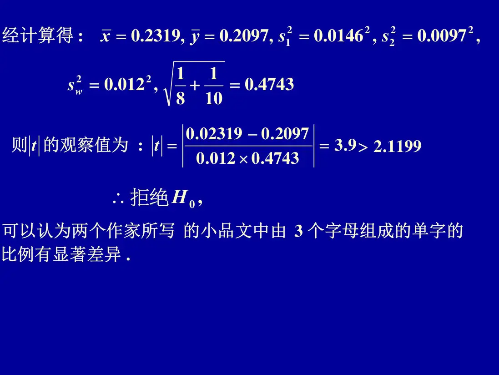

原文：

$$
s _ {w} ^ {2} = 0. 0 1 2 ^ {2}, \sqrt {\frac {1}{8} + \frac {1}{1 0}} = 0. 4 7 4 3
$$

: 则 t 的观察值为 $\mathrm { ~ U ~ } = \frac { ( 1 \times 1 ) \times 3 ( 1 ) \times 3 ( 1 ) \times 3 ( 1 ) \times 3 } { ( 1 \times 1 ) ( 1 ) \times 3 ( 1 ) \times 3 ( 1 ) \times 3 } = 1 \times 3 \times 1 = 3 \times 1 ( 1 ) \times 3 ( 1 )$

$\mathbf { a }$ 拒绝 $| \pmb { \mu } | _ { \pmb { \mu } }$ ,

3可以认为两个作家所写 的小品文中 由 个字母组成的单字的.比例有显著差异

### 第 9 页

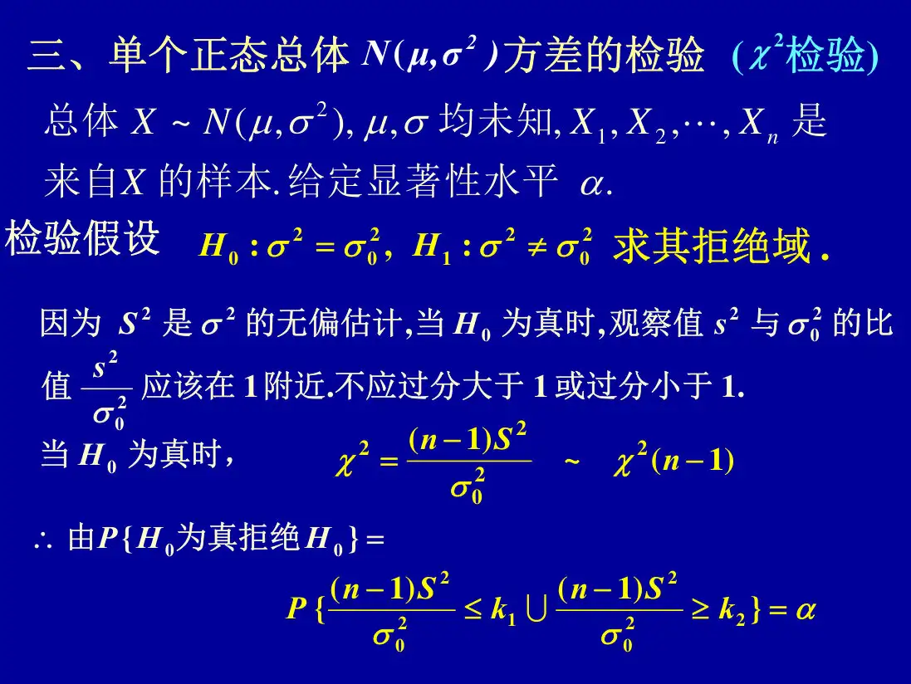

原文：

三、 单个正态总体 $\Delta C ( C E G )$ 方差 的检验) ( 检验)2 χ总体 $\because \angle A C = \angle A C = \angle A B C = 9 0 ^ { \circ }$ ,均未知 $\because \angle B = \angle C A C = \angle C$ 是X来 自 的样本 给定显著性水平 $\textcircled { \bullet }$ 检验假设 $1 8 8 0 - 1 0 0 0 0 0 0 0 0 0 0 0 0 0 0 0 0 0 0 0 0 0 0 0 0 0 0 0 0 0 0 0 0 0 0 0 0 0 0 0 0 0 0 0 0 0 0 0 0 0 0 0 0 0 0 0 0 0 0 0 0 0 0 0 0 0 0 0 0 0 0 0 0 0 0 0 0 0 0 0 0 0 0 0 0 0 0 0 0 0 0 0 0 0 0 0 0 0 0 0 0 0 0 0 0 0 0 0 0 0 0 0 0 0 0 0 0 0 0 0 0 0 0 0 0 0 0 0 0 0 0 0 0 0 0 0 0 0 0 0 0 0 0 0 0 0 0 0 0 0 0 0 0 0 0 0 0 0 0 0 0 0 0 0 0 0 0 0 0 0 0 0 0 0 0 0 0 0 0 0 0 0 0 0 0 0 0 0 0 0 0 0 0 0 0 0 0 0 0 0 0 0 0 0 0 0 0 0 0 0 0 0 0 0 0 0 0 0 0 0 0 0 0 0 0 0 0 0 0 0 0 0 0 0 0 0 0 0 0 0 0 0 0 0 0 0 0 0 0 0 0 0 0 0 0 0 0 0 0 0 0 0 0 0 0 0 0 0 0 0 0 0 0 0 0 0 0 0 0 0 0 0 0 0 0 0 0 0 0 0 0 0 0 0 0 0 0 0 0 0 0 0 0 0 0 0 0 0 0 0 0 0 0 0 0 0 0 0 0 0 0 0 0 0 0 0 0 0 0 0 0 0 0 0 0 0 0 0 0 0 0 0 0 0 0 0 0 0 0 0 0 0 0 0 0 0 0 0 0 0 0 0 0 0 0 0 0 0 0 0 0 0 0 0 0 0 0 0 0 0 0 0 0 0 0 0 0 0 0 0 0 0 0 0 0 0 0 0 0 0 0 0 0 0 0 0 0 0 0 0 0 0 0 0 0 0 0 0 0 0 0 0 0 0 0 0 0 0 0 0 0 0 0 0 0 0 0 0 0 0 0 0 0 0 0 0 0 0 0 0 0 0 0 0 0 0 0 0 0 0 0 0 0 0 0 0 0 0 0 0 0 0 0 0 0 0 0 0 0 0 0 0 0 0 0 0 0 0 0 0 0 0 0 0 0 0 0 0 0 0 0 0 0 0 0 0 0 0 0 0 0 0 0 0 0 0 0 0 0 0 0 0 0 0 0 0 0 0 0 0 0 0 0 0 0 0 0 0 0 0 0 0 0 0 0 0 0 0 0 0 0 0 0 0 0 0 0 0 0 0 0 0 0 0 0 0 0 0 0 0 0$ 求其拒绝域 .因为 $\textcircled { \bullet }$ 是 $\textcircled { \bullet }$ 的无偏估计 当 $| \pmb { \bar { \mu } } | _ { 0 }$ 为真时 观察值 $\frac { 2 } { 5 } = \frac { 3 } { 5 }$ 与 $\%$ 的 比值 $\frac { 5 } { 6 0 } = \frac { 1 } { 2 0 }$ .1 1 .1应该在 附近 不应过分大于 或过分小于当 $| \pmb { \mu } | _ { 0 }$ 为真时， $\frac { 1 } { 2 } \times \frac { ( 1 + \frac { 1 } { 2 } ) x ^ { 2 } } { ( 2 \times 2 ) } = \frac { 1 } { 2 } ( 1 + \frac { 1 } { 2 } )$ $\frac { a } { a } = \frac { 1 } { 2 }$ 由 $1 2 8 \textcircled { 1 } 1 0 0 0$ 为真拒绝 $| \pmb { \bar { \mu } } ( \pmb { \mathrm { w } } ) | =$ $\angle A = \frac { ( 1 ) A ^ { 2 } } { ( 2 ) } = \frac { ( 1 ) A ^ { 2 } } { ( 2 ) } = \frac { ( 2 ) A ^ { 2 } } { ( 2 ) } = \frac { ( 2 ) A ^ { 2 } } { ( 2 ) } = \frac { ( 2 ) A ^ { 2 } } { ( 2 ) } = \frac { ( 2 ) A ^ { 2 } } { ( 2 ) } = \frac { ( 2 ) A ^ { 2 } } { ( 2 ) } = \frac { ( 2 ) A ^ { 2 } } { ( 2 ) }$

### ⇒ 拒绝域为：

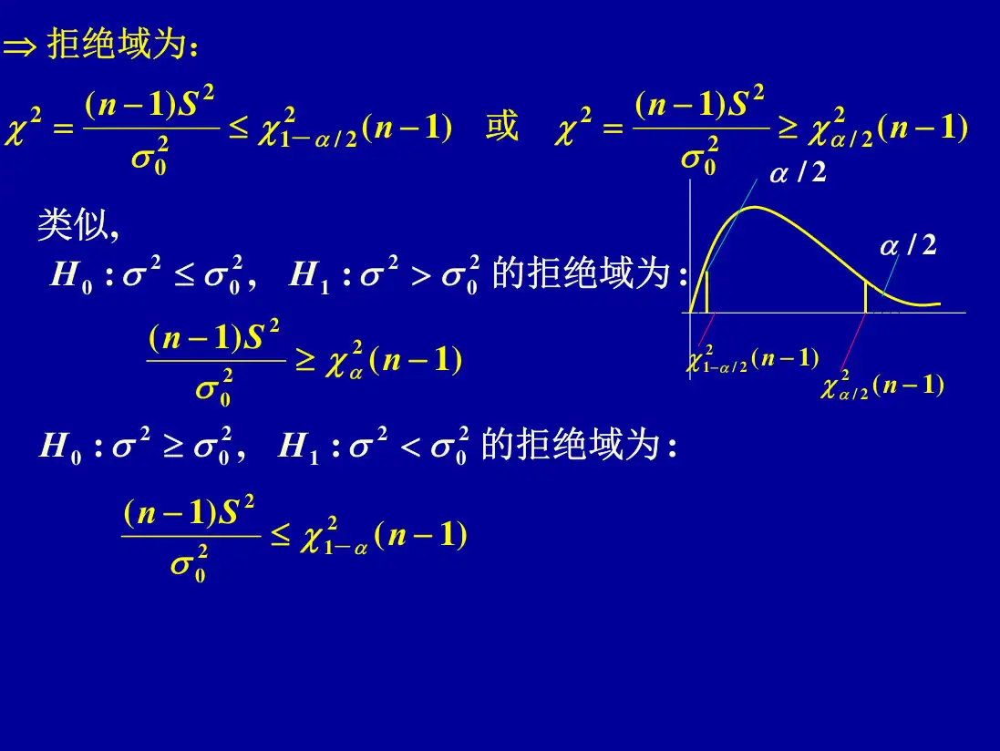

原文：

⇒ 拒绝域为：

$\frac { 1 } { 2 } \times \frac { ( 1 1 - 1 1 ) \times ( 1 1 ) } { ( 2 1 ) } = \frac { 1 } { 2 } \times ( 1 1 - 1 ) \times ( 1 1 - 1 ) \times ( 1 1 - 1 )$ 或 $\frac { 1 } { 2 } \times \frac { 1 } { 3 } = \frac { 1 1 \times 3 } { 1 1 } = \frac { 1 } { 3 } ( c m ^ { 2 } )$

,类似

$1 8 \% 1 0 \% = 1 0 \% 1 8 \% 1 0 \% = 2 0 \%$ :的拒绝域为

$$
\frac {(n - 1) S ^ {2}}{\sigma_ {0} ^ {2}} \geq \chi_ {\alpha} ^ {2} (n - 1)
$$

$1 8 0 0 0 0 0 0 0 0 0 0 0 0 0 0 0 0 0 0 0 0 0 0 0 0 0 0 0$ : 的拒绝域为

$$
\frac {(n - 1) S ^ {2}}{\sigma_ {0} ^ {2}} \leq \chi_ {1 - \alpha} ^ {2} (n - 1)
$$

### 第 11 页

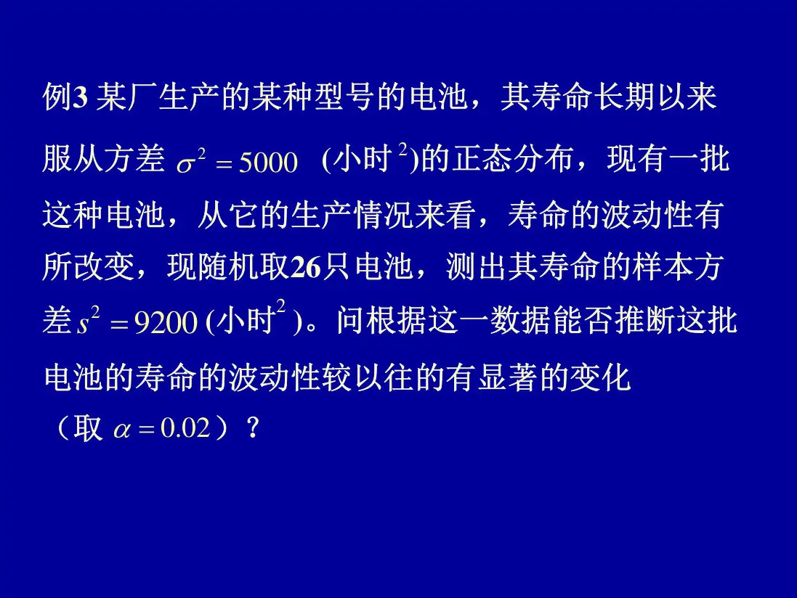

原文：

例3 某厂生产的某种型号的 电池， 其寿命长期以来服从方差 $\bf \delta \boxed { 9 } \times \bf { \boxdot { 5 } } \boxed { 9 } \boxed { 9 }$ (小时 )的正态分布， 现有一批2这种 电池， 从它的生产情况来看， 寿命的波动性有所改变， 现随机取26只 电池， 测出其寿命的样本方差 $0 . 0 2 \times 0 . 0 2 0 1 0$ (小时 )。 问根据这一数据能否推断这批2电池的寿命的波动性较以往的有显著的变化（ 取 $\textcircled { 4 } \textcircled { = } \textcircled { 1 } \textcircled { 1 } \textcircled { 2 }$ ？

### ,在本题中 $1 1 2 = 1 1 1 2 0 ( c m )$

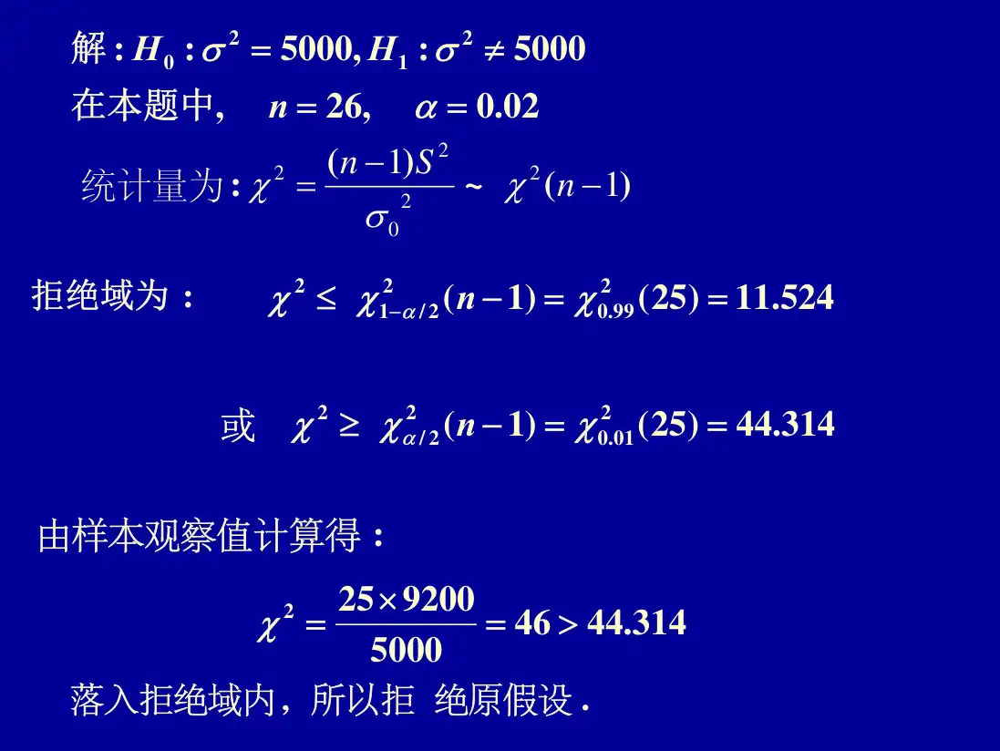

原文：

解 $3 . 3 \times 1 0 ^ { 3 } = 3 . 3 \times 1 1 1 1 0 \times 1 0 ^ { 3 } = 3 . 3 \times 1 1 1 1 1$

,在本题中 $1 1 2 = 1 1 1 2 0 ( c m )$

统计量为 $\frac { ( 1 ) ( 1 ) ( 1 ) ( 1 ) }  ( 2 ) ( 1 ) ( 1 ) ( 2 ) ( 1 ) ( 2 ) ( 1 ) ( 2 ) ( 1 ) ( 2 ) ( 1 ) ( 2 ) ( 1 ) ( 2 ) ( 1 ) ( 2 ) ( 1 ) ( 2 ) ( 1 ) ( 2 ) ( 1 ) ( 2 ) ( 1 ) ( 2 ) ( 1 ) ( 2 ) ( 1 ) ( 2 ) ( 1 ) ( 2 ) ( 1 ) ( 2 ) ( 1 ) ( 2 ) ( 1 ) ( 2 ) ( 1 ) ( 2 )$

拒绝域为 : $\frac { 1 } { 2 } \times \frac { 1 } { 3 } \times \frac { 1 } { 2 } \times \frac { 1 } { 3 } \times \frac { 1 } { 2 } \times \frac { 1 } { 3 } \times \frac { 1 } { 2 } \times \frac { 1 } { 3 } \times \frac { 1 } { 2 } \times \frac { 1 } { 3 } \times \frac { 1 } { 2 } \times \frac { 1 } { 3 } \times \frac { 1 } { 2 } \times \frac { 1 } { 3 }$

或 $\angle A = \angle B = \angle C = \angle A = \angle C A ( \theta , \angle \theta ) = \angle C A ( \theta , \angle \theta ) = \angle B = 9 0 ^ { \circ }$

由样本观察值计算得 :

$$
\chi^ {2} = \frac {2 5 \times 9 2 0 0}{5 0 0 0} = 4 6 > 4 4. 3 1 4
$$

落入拒绝域内 ， 所以拒 绝原假设 .四、 两个正态总体 $\Delta C ( A ) . C ( A ) \sim \Delta C ( A ) . C ( A ) .$ )方差的检验(F检验)设 $\angle B = \angle A B C = \angle C A B = \angle C$ 与 $1 8 0 \% m = 1 0 0 0 0 0 \%$ 分别是来 自总体$\therefore \angle A ( 1 , 2 , 3 , 2 , 3 , 4 , 5 , 6 , 7 )$ 的样本， 且设两样本独 立，和 分别它们的样本均值，YX $\bigtriangledown$ 和 $\textcircled { \times } \frac { 3 } { 2 }$ 分别是它们的样本. 方差 设 $1 2 \times 1 2 \times 2 \times 1 2 \times 2 \times 2 \times 2 \times 2 \times 2 \times 2 \times 2 \times 2 \times 2 \times 2 \times 2 \times 2 \times 2 \times 2 \times 2 \times 2 \times 2 \times 2 \times 2 \times 2 \times 2 \times 2 \times 2 \times 2 \times 2 \times 2 \times 2 \times 2 \times 2 \times 2 \times 2 \times 2 \times 2 \times 2 \times 2 \times 2 \times 2 \times 2 \times 2 \times 2 \times 2 \times 2 \times 2 \times 2 \times 2 \times 2 \times 2 \times 2 \times 2 \times 2 \times 2 \times 2 \times 2 \times 2 \times 2 \times 2 \times 2 \times 2 \times 2 \times 2 \times 2 \times 2 \times 2 \times 2 \times 2 \times 2 \times 2 \times 2 \times 2 \times 2 \times 2 \times 2 \times 2 \times 2 \times 2 \times 2 \times 2 \times 2 \times 2 \times 2 \times 2 \times 2 \times 2 \times 2 \times 2 \times 2 \times 2 \times 2 \times 2 \times 2 \times \times 2 \times 2 \times 2 \times 2 \times 2 \times \times 2 \times 2 \times 2 \times 2 \times \times 2 \times 2 \times 2 \times \times 2 \times 2 \times 2 \times \times 2 \times 2 \times \times 2 \times 2 \times \times 2 \times 2 \times \times 2 \times 2 \times \times 2 \times \times 2 \times 2 \times \times 2 \times \times 2 \times 2 \times \times 2 \times \times 2 \times \times 2 \times \times 2 \times \times 2 \times \times 2 \times \times 2 \times \times 2 \times \times 2 \times \times \times 2 \times \times 2 \times \times 2 \times \times 2 \times \times \times \times 2 \times 2 \times \times \times 2 \times \times 2 \times \times \times 2 \times \times \times 2 \times \times \times 2 \times \times \times 2 \times \times 2 \times \times \times \times \times 2 \times \times \times \times 2 \times \times \times \times 2 \times \times \times \times 2 \times \times \times \times 2 \times \times \times \times \times 2 \times \times \times \times \times \times 2 \times \times \times \times \times \times \ c \ c \ c \ c \ c \ c \ c \ c \ c \ c \ c \ c \ c \ c \ c \ c \ c \ c \ c \ c \ c \ c \ c \ c \ c \ c \ c \ c \ c \ c \ c \ c \ c \ c \ c \ c \ c \ c \ c \ c \ c \ c \ c \ c \ c \ c \ c \ c \ c \ c \ c \ c \ c \ c \ c \ c \ c $ . .α均未知 给定显著性水平检验假设 $1 0 0 0 0 0 0 0 0 0 0 0 0 0 0 0 0 0 0 0 0 0 0 0 0 0 0 0 0 0 0 0 0 0$ 求其拒绝域.解 : 选 $1 2 = \frac { 1 . 4 } { 1 . 4 }$ ,作为统计量 α 2/α 2/当 $\textcircled { \bullet }$ 为真时 $1 2 = \frac { 6 4 } { 6 4 } = 1 2 ( c m ^ { 2 } ) = 1 2 ( c m ^ { 2 } )$ 拒绝域为： $1 2 + 2 1 = 2 1 2 ( c m ^ { 2 } )$ )1,1(−α 12/1 − nnF 2 −)1,1(α 12/ − nnF 2 −或 $1 2 \times 1 2 = 1 2 ( c m ) = 1 2 ( c m )$ $\frac { 1 4 } { 9 } = \frac { 1 8 } { 9 } = \frac { 1 2 } { 9 } = \frac { 1 4 } { 9 } = \frac { 1 4 } { 9 } = \frac { 1 4 } { 9 }$

### 第 13 页

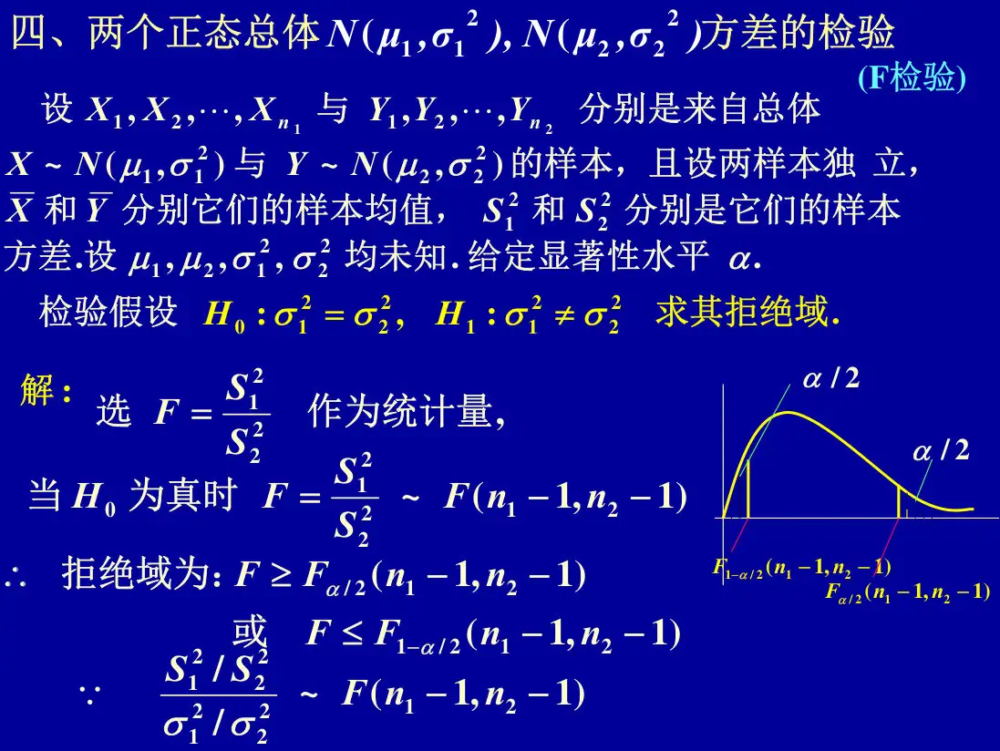

### ,类似

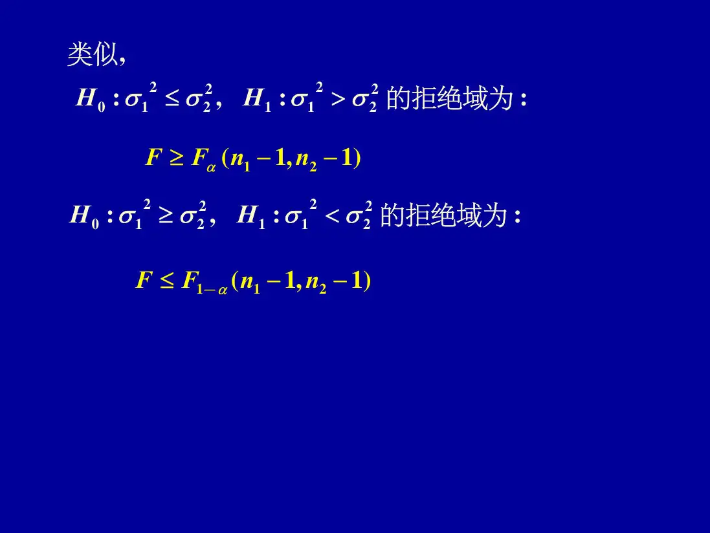

原文：

,类似

$$
H _ {0}: \sigma_ {1} ^ {2} \leq \sigma_ {2} ^ {2}, H _ {1}: \sigma_ {1} ^ {2} > \sigma_ {2} ^ {2} \text {的拒绝域为：}
$$

$$
F \geq F _ {\alpha} (n _ {1} - 1, n _ {2} - 1)
$$

$1 8 . 9 8 \times 0 . 7 5 = 0 . 0 2 5 ( m o d x )$ : 的拒绝域为

$$
F \leq F _ {1 - \alpha} (n _ {1} - 1, n _ {2} - 1)
$$

### 第 15 页

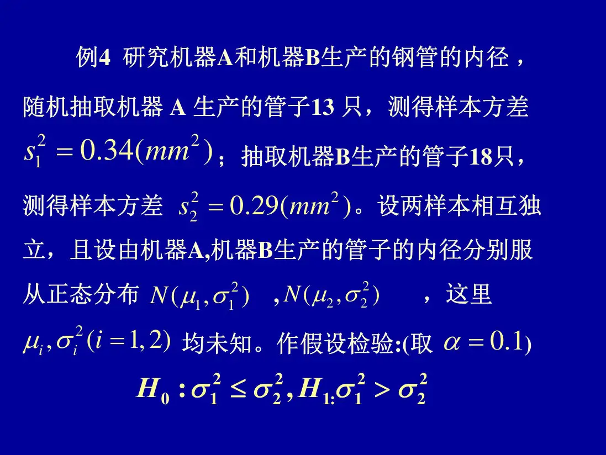

原文：

例4 研究机器A和机器B生产的钢管的 内径 ，随机抽取机器 A 生产的管子13 只 ， 测得样本方差$\because \angle A C B = \angle A C B = \angle C A B = 3 0 ^ { \circ }$ 抽取机器B生产的管子18只 ，测得样本方差 $\times 3 = ( 1 ) \times 2 = ( 1 \times 2 ) ( c m ^ { 2 } + 1 )$ 。 设两样本相互独立， 且设由机器A 机器B生产的管子的 内径分别服从正态分布 $\therefore \angle C D B = 9 0 ^ { \circ }$ $W ( \phi , z ) = 0 . 5 2$ ， 这里$1 2 \times 2 \times ( 0 . 2 5 - 1 . 5 )$ 均未知。 作假设检验:(取 $\langle \pmb { \theta } | \pmb { \theta } | = \pmb { \left( 0 \pmb { \theta } \pmb { \theta } \right) }$ $1 8 \div ( 0 . 7 \times 0 . 5 ) = 1 8 \times 0 . 5 \times 0 . 5 \times 0 . 5$

### 第 16 页

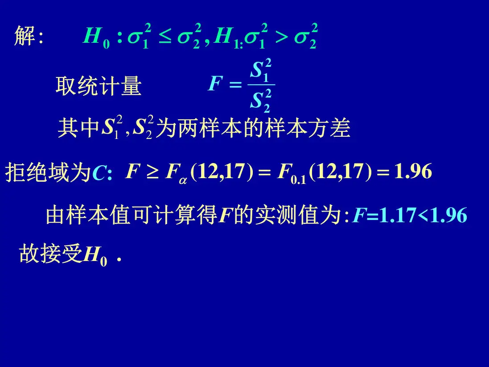

原文：

解 : $1 8 . 1 4 \times 2 . 5 \times 2 . 6 \times 2 . 5 \times 2 . 5 \times 2 . 5 \times 2 . 5 \times 2 . 5 \times 2 . 5 \times 2 . 5 \times 2 . 5 \times 2 . 5 \times 2 . 5 \times 2 . 5 \times 2 . 5 \times 2 . 5 \times 2 . 5 \times 2 . 5 \times 2 . 5 \times 2 . 5 \times 2 . 5 \times 2 . 5 \times 2 . 5 \times 2 . 5 \times 2 . 5 \times 2 . 5 \times 2 . 5 \times 2 . 5 \times 2 . 5 \times 2 . 5 \times 2 . 5 \times 2 . 5 \times 2 . 5 \times 2 . 5 \times 2 . 5 \times 2 . 5 \times 2 . 5 \times 2 . 5 \times 2 . 5 \times 2 . 5 \times 2 . 5 \times 2 . 5 \times 2 . 5 \times 2 . 5 \times 2 . 5 \times 2 . 5 \times 2 . 5 \times 2 .$ 取统计量 $1 2 - \frac { 1 4 } { 1 5 }$ 其中 $\frac { \sqrt { 3 } } { 2 } = \frac { \sqrt { 3 } } { 2 }$ 为两样本的样本方差拒绝域为C: $1 2 + 2 \times ( 1 0 + 2 5 + 2 ) = 1 2 0 ( 1 0 + 2 ) = 1 8 ( 1 0 - 2 ) ( 1 0 - 2 )$ 由样本值可计算得F的实测值为 $\mathrm { o } e a = \mathrm { i } \mathrm { e } e \in \mathrm { o } \left( \mathrm { o } e \right)$ 故接受 $| \pmb { \bar { \mu } } |$
