# 《概率论与数理统计》第9章 随机过程：独立增量过程（课件）

原件的每一页，下面附识别出的文字。

### 9.3 几类重要过程

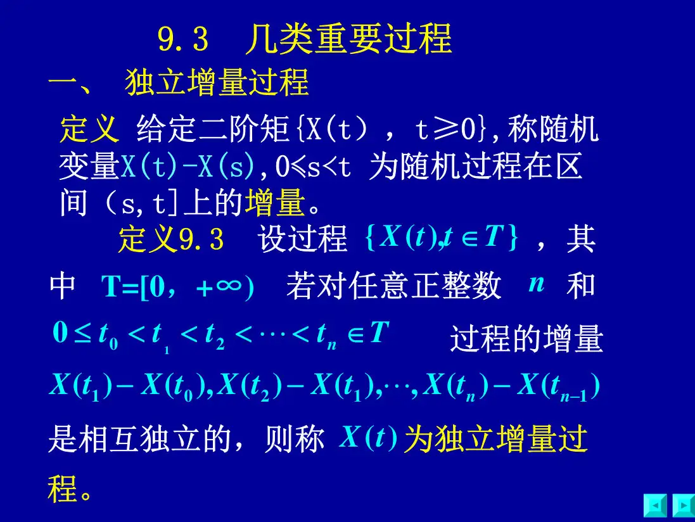

原文：

9.3 几类重要过程
一、独立增量过程
定义 给定二阶矩 $\{X(t), t \geqslant 0\}$ ，称随机变量 $X(t) - X(s)$ ， $0 \leqslant s < t$ 为随机过程在区间 $(s, t]$ 上的增量。
定义9.3 设过程 $\{X(t), t \in T\}$ ，其中 $T = [0, +\infty)$ 若对任意正整数 n 和 $0 \leq t_{0} < t_{1} < t_{2} < \cdots < t_{n} \in T$ 过程的增量 $X(t_{1}) - X(t_{0}), X(t_{2}) - X(t_{1}), \cdots, X(t_{n}) - X(t_{n-1})$ 是相互独立的，则称 $X(t)$ 为独立增量过程。

### 独立增量过程的特点是：在互不重叠的时间间隔上, 状态的增量是相互独立的。注:

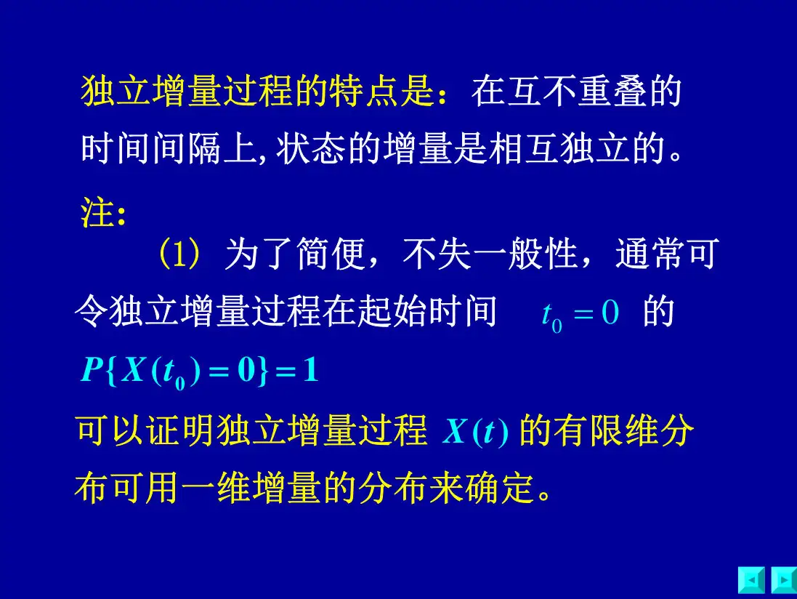

原文：

独立增量过程的特点是：在互不重叠的时间间隔上, 状态的增量是相互独立的。注:

(1) 为了简便, 不失一般性, 通常可令独立增量过程在起始时间 $t_{0} = 0$ 的 $P \{X(t_{0}) = 0\} = 1$ 可以证明独立增量过程 $X(t)$ 的有限维分布可用一维增量的分布来确定。

### (2) 若对任意实数h和 $0 \leq s + h < t + h$ ，

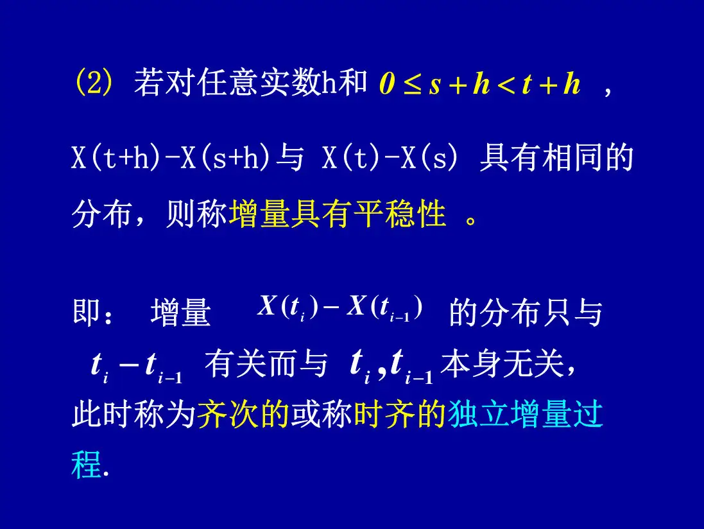

原文：

(2) 若对任意实数h和 $0 \leq s + h < t + h$ ，

$X(t+h)-X(s+h)$ 与 $X(t)-X(s)$ 具有相同的分布，则称增量具有平稳性。

即：增量 $X(t_{i}) - X(t_{i-1})$ 的分布只与 $t_{i} - t_{i-1}$ 有关而与 $t_{i}, t_{i-1}$ 本身无关，此时称为齐次的或称时齐的独立增量过程.

### (3) 独立增量过程的协方差函数

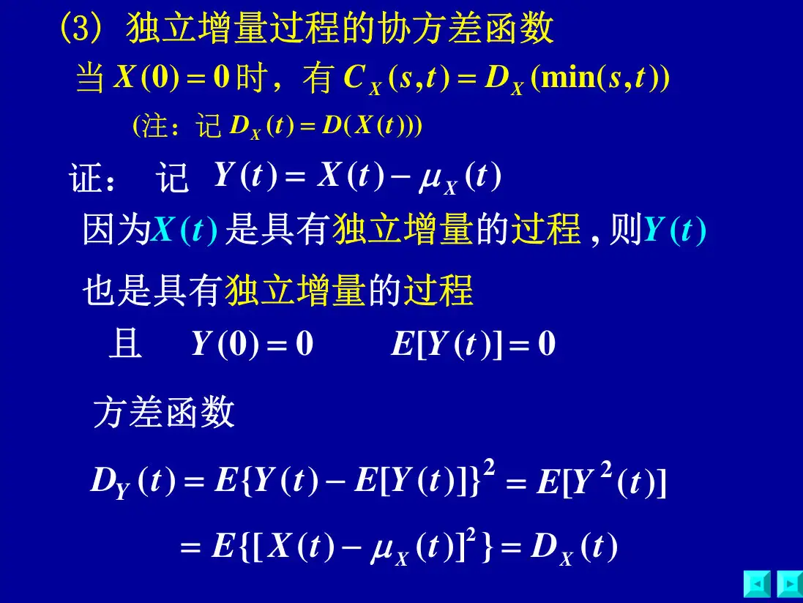

原文：

(3) 独立增量过程的协方差函数
当 X(0)=0 时，有 C\_X(s,t)=D\_X(min(s,t))
(注：记 D\_X(t)=D(X(t)))
证：记 Y(t)=X(t)-μ\_X(t)
因为X(t)是具有独立增量的过程，则Y(t)
也是具有独立增量的过程
且 Y(0)=0 E[Y(t)]=0
方差函数
D\_Y(t)=E{Y(t)-E[Y(t)]}^2=E[Y^2(t)]
=E{[X(t)-μ\_X(t)]^2}=D\_X(t)

### 当 $0 \leq t_{1} < t_{2}$ 时, 就有

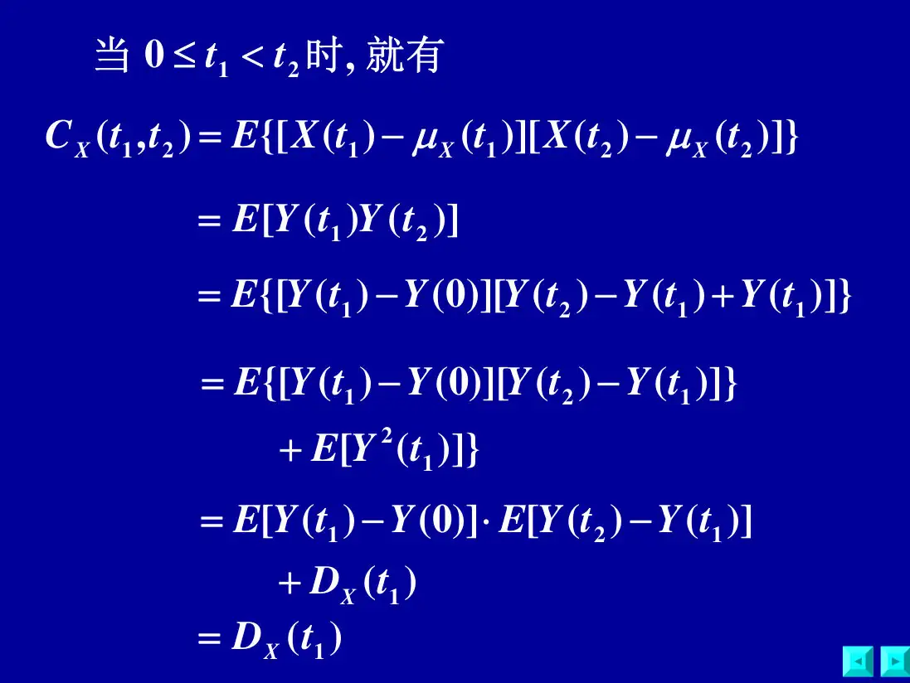

原文：

当 $0 \leq t_{1} < t_{2}$ 时, 就有

$$
\begin{array}{r l} & C _ {X} (t _ {1}, t _ {2}) = E \{[ X (t _ {1}) - \mu_ {X} (t _ {1}) ] [ X (t _ {2}) - \mu_ {X} (t _ {2}) ] \} \\ & \qquad = E [ Y (t _ {1}) Y (t _ {2}) ] \\ & \qquad = E \{[ Y (t _ {1}) - Y (0) ] [ Y (t _ {2}) - Y (t _ {1}) + Y (t _ {1}) ] \} \\ & \qquad = E \{[ Y (t _ {1}) - Y (0) ] [ Y (t _ {2}) - Y (t _ {1}) ] \} \\ & \qquad \qquad + E [ Y ^ {2} (t _ {1}) ] \} \\ & \qquad = E [ Y (t _ {1}) - Y (0) ] \cdot E [ Y (t _ {2}) - Y (t _ {1}) ] \\ & \qquad \qquad + D _ {X} (t _ {1}) \\ & \qquad = D _ {X} (t _ {1}) \end{array}
$$

### $$

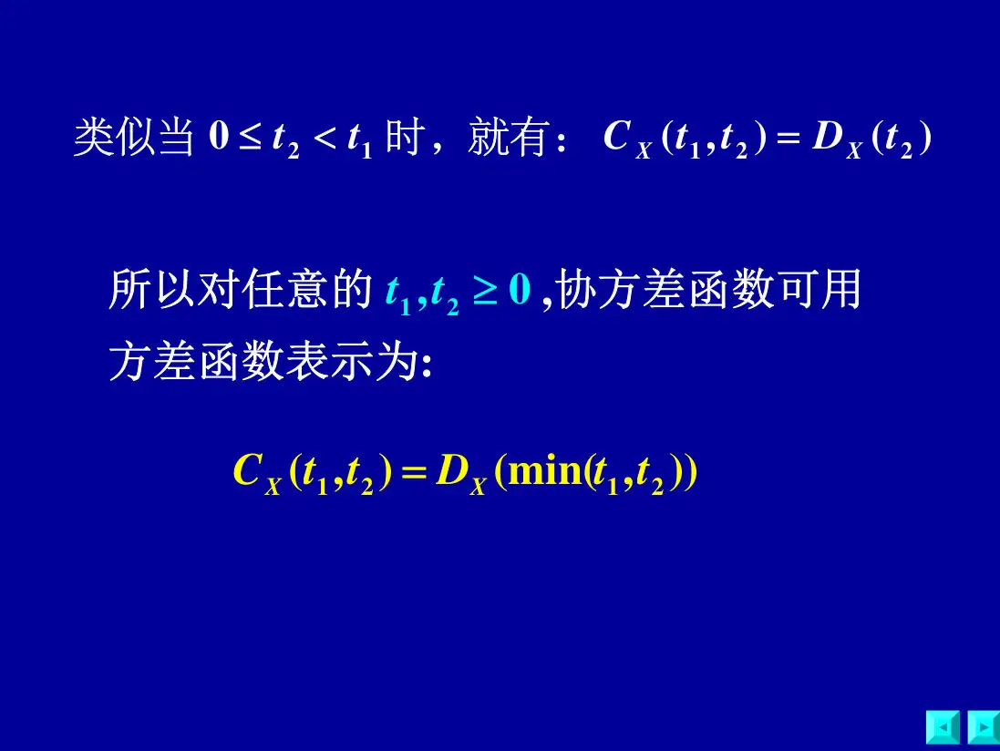

原文：

类似当 $0 \leq t_{2} < t_{1}$ 时，就有： $C_{X}(t_{1}, t_{2}) = D_{X}(t_{2})$

所以对任意的 $t_{1}, t_{2} \geq 0$ ，协方差函数可用方差函数表示为：

$$
C _ {X} (t _ {1}, t _ {2}) = D _ {X} (\min (t _ {1}, t _ {2}))
$$

### 二、泊松过程

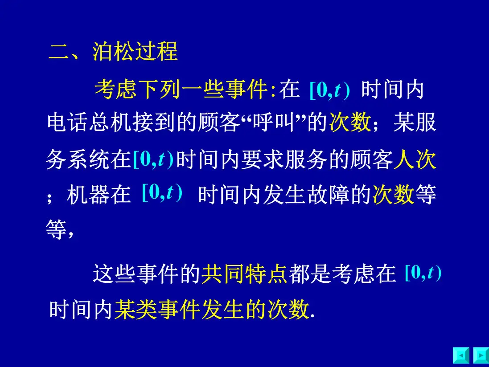

原文：

二、泊松过程

考虑下列一些事件: 在 $[0,t)$ 时间内电话总机接到的顾客“呼叫”的次数; 某服务系统在 $[0,t)$ 时间内要求服务的顾客人次; 机器在 $[0,t)$ 时间内发生故障的次数等等,

这些事件的共同特点都是考虑在 $[0, t)$ 时间内某类事件发生的次数.

### 1、计数过程定义

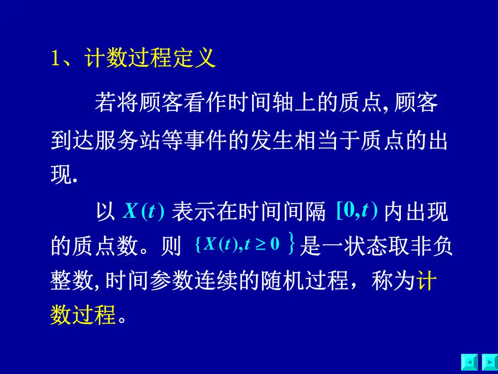

原文：

1、计数过程定义

若将顾客看作时间轴上的质点,顾客到达服务站等事件的发生相当于质点的出现.

以 $X(t)$ 表示在时间间隔 $[0, t)$ 内出现的质点数。则 $\{X(t), t \geq 0\}$ 是一状态取非负整数, 时间参数连续的随机过程, 称为计数过程。

### 计数过程 $\{X(t),t\geq0\}$ 满足：

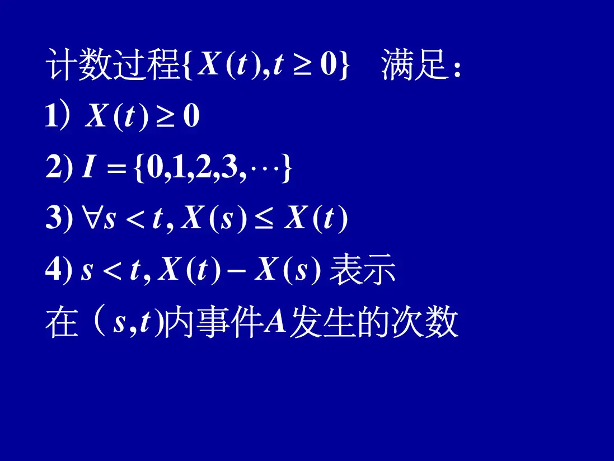

原文：

计数过程 $\{X(t),t\geq0\}$ 满足：
1) $X(t)\geq0$ 2) $I=\{0,1,2,3,\cdots\}$ 3) $\forall s<t, X(s)\leq X(t)$ 4) $s<t, X(t)-X(s)$ 表示
在 $(s,t)$ 内事件 A 发生的次数它的状态空间 $I = \{0,1,2\cdots\}$ ; 它的样本函数都是递增的阶梯函数; 它的一个典型的样本函数如图所示, 使 $X(t)$ 的值发生跃变的时刻 $t_{i}, i = 1,2\cdots$ 也就是某类事件发生的时刻。

### 第 10 页

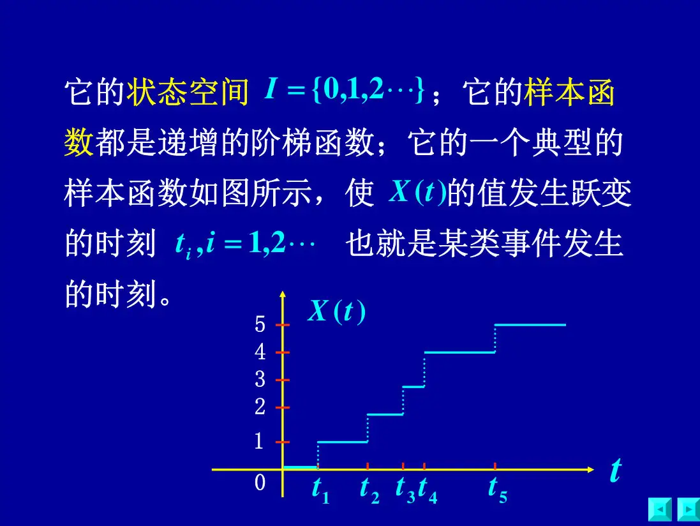

### $$

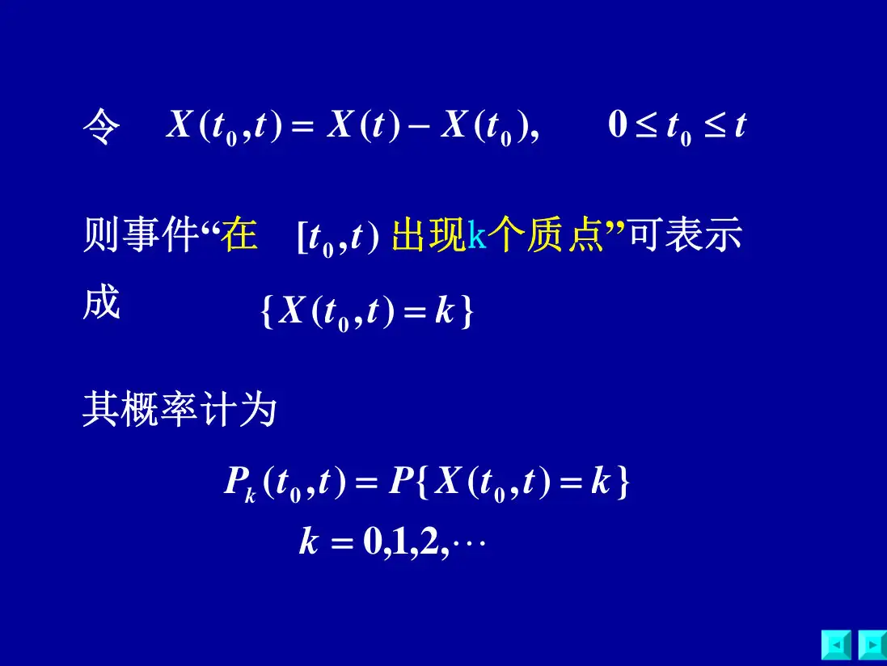

原文：

$$
\text {令} \quad X (t _ {0}, t) = X (t) - X (t _ {0}), \quad 0 \leq t _ {0} \leq t
$$

则事件“在 $[t_{0},t)$ 出现k个质点”可表示成 $\{X(t_{0},t)=k\}$

其概率计为

$$
P _ {k} (t _ {0}, t) = P \{X (t _ {0}, t) = k \}
$$

$$
k = 0, 1, 2, \dots
$$

### 定义9.4 称满足以下条件的计数过程为泊松过程

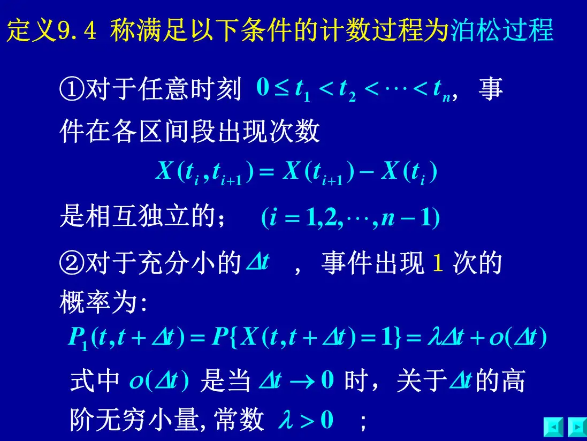

原文：

定义9.4 称满足以下条件的计数过程为泊松过程
①对于任意时刻 $0 \leq t_{1} < t_{2} < \cdots < t_{n}$ ，事件在各区间段出现次数 $X(t_{i}, t_{i+1}) = X(t_{i+1}) - X(t_{i})$ 是相互独立的； $(i = 1, 2, \cdots, n-1)$ ②对于充分小的 $\Delta t$ ，事件出现 1 次的概率为： $P_{1}(t,t+\Delta t)=P\{X(t,t+\Delta t)=1\}=\lambda\Delta t+o(\Delta t)$ 式中 $o(\Delta t)$ 是当 $\Delta t \rightarrow 0$ 时，关于 $\Delta t$ 的高阶无穷小量，常数 $\lambda > 0$ ；

### ③对充分小的 $\Delta t$ 有

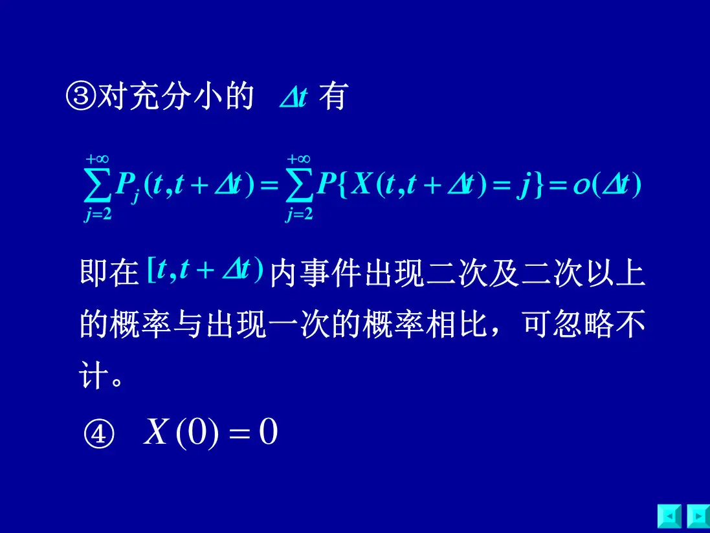

原文：

③对充分小的 $\Delta t$ 有

$$
\sum_ {j = 2} ^ {+ \infty} P _ {j} (t, t + \Delta t) = \sum_ {j = 2} ^ {+ \infty} P \{X (t, t + \Delta t) = j \} = o (\Delta t)
$$

即在 $[t, t + \Delta t)$ 内事件出现二次及二次以上的概率与出现一次的概率相比，可忽略不计。

④ $X(0)=0$

### 3、泊松过程的等价定义

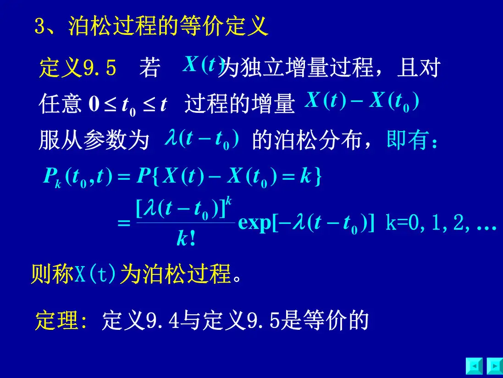

原文：

3、泊松过程的等价定义

定义9.5 若 $X(t)$ 为独立增量过程，且对

任意 $0 \leq t_{0} \leq t$ 过程的增量 $X(t) - X(t_{0})$

服从参数为 $\lambda (t - t_0)$ 的泊松分布，即有：

$P_{k}(t_{0},t)=P\{X(t)-X(t_{0})=k\}$ $=\frac{[\lambda(t-t_{0})]^{k}}{k!}\exp[-\lambda(t-t_{0})]\quad k=0,1,2,\ldots$ 则称X(t)为泊松过程。

定理：定义9.4与定义9.5是等价的

### 4、泊松过程的统计特性

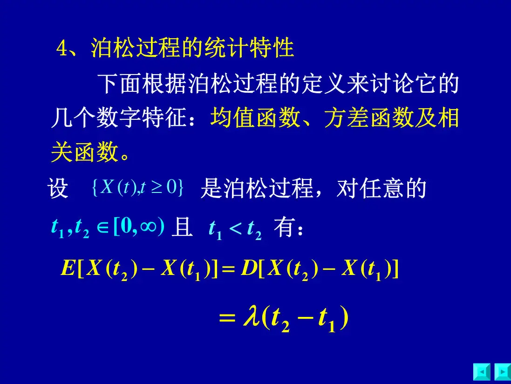

原文：

4、泊松过程的统计特性

下面根据泊松过程的定义来讨论它的几个数字特征：均值函数、方差函数及相关函数。

设 $\{X(t), t \geq 0\}$ 是泊松过程，对任意的 $t_1, t_2 \in [0, \infty)$ 且 $t_1 < t_2$ 有： $E[X(t_2) - X(t_1)] = D[X(t_2) - X(t_1)] = \lambda(t_2 - t_1)$

### 由于 $X(0) = 0$

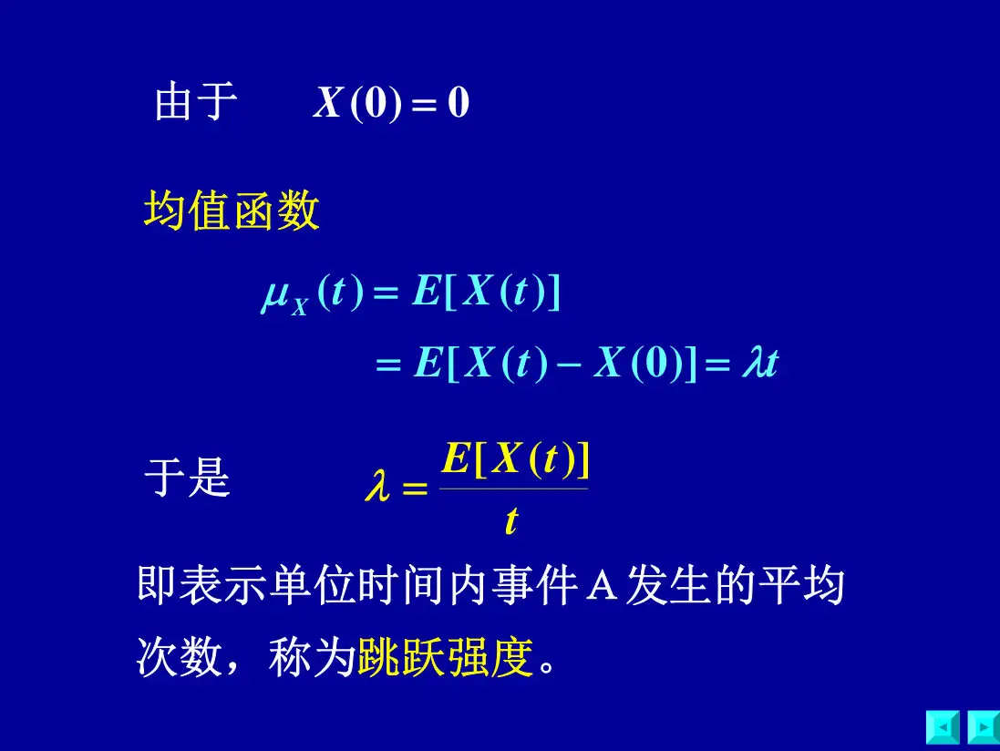

原文：

由于 $X(0) = 0$

均值函数

$$
\begin{array}{r l} \mu_ {X} (t) & = E [ X (t) ] \\ & = E [ X (t) - X (0) ] = \lambda t \end{array}
$$

于是

$$
\lambda = \frac {E [ X (t) ]}{t}
$$

即表示单位时间内事件 A 发生的平均次数，称为跳跃强度。

### 方差函数:

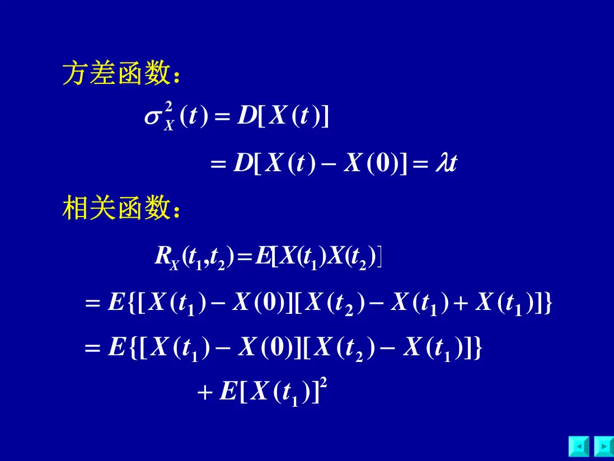

原文：

方差函数:

$$
\begin{array}{r l} \sigma_ {X} ^ {2} (t) & = D [ X (t) ] \\ & = D [ X (t) - X (0) ] = \lambda t \end{array}
$$

相关函数:

$$
\begin{array}{c} R _ {X} (t _ {1}, t _ {2}) = E [ X (t _ {1}) X (t _ {2}) ] \\ = E \{[ X (t _ {1}) - X (0) ] [ X (t _ {2}) - X (t _ {1}) + X (t _ {1}) ] \} \\ = E \{[ X (t _ {1}) - X (0) ] [ X (t _ {2}) - X (t _ {1}) ] \} \\ + E [ X (t _ {1}) ] ^ {2} \end{array}
$$

### $$

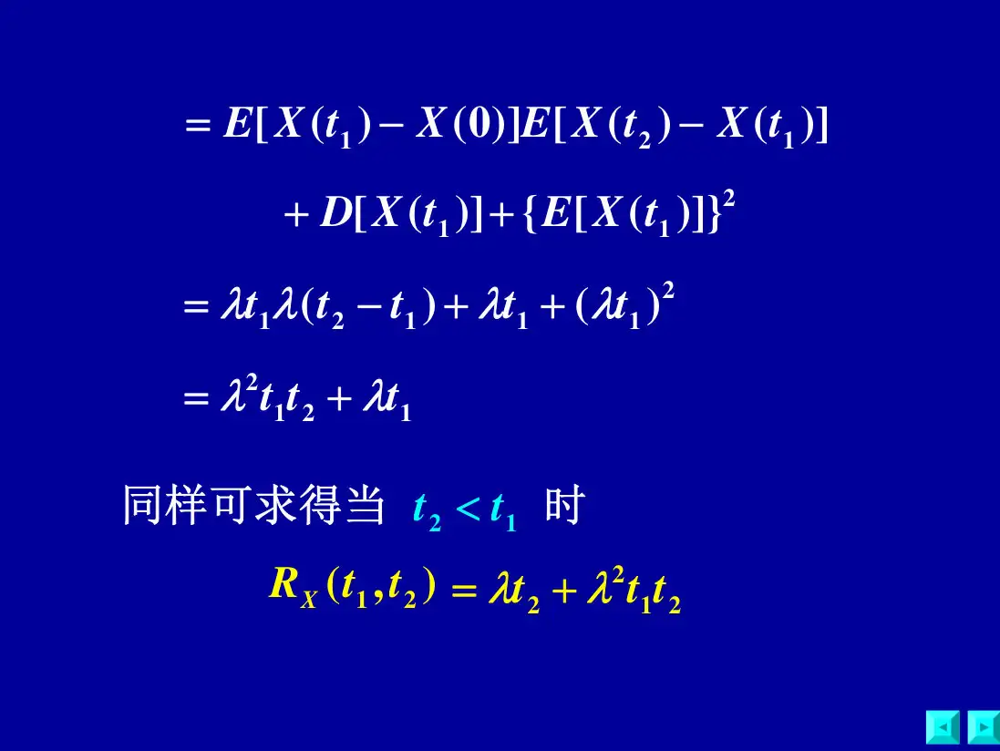

原文：

$$
\begin{array}{r l} & = E [ X (t _ {1}) - X (0) ] E [ X (t _ {2}) - X (t _ {1}) ] \\ & \qquad + D [ X (t _ {1}) ] + \{E [ X (t _ {1}) ] \} ^ {2} \\ & = \lambda t _ {1} \lambda (t _ {2} - t _ {1}) + \lambda t _ {1} + (\lambda t _ {1}) ^ {2} \\ & = \lambda^ {2} t _ {1} t _ {2} + \lambda t _ {1} \end{array}
$$

同样可求得当 $t_{2} < t_{1}$ 时

$$
R _ {X} (t _ {1}, t _ {2}) = \lambda t _ {2} + \lambda^ {2} t _ {1} t _ {2}
$$

### 所以一般地

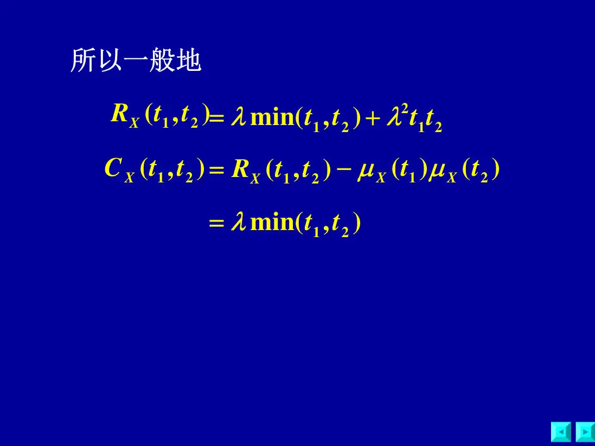

原文：

所以一般地

$$
R _ {X} (t _ {1}, t _ {2}) = \lambda \min (t _ {1}, t _ {2}) + \lambda^ {2} t _ {1} t _ {2}
$$

$$
\begin{array}{c} C _ {X} (t _ {1}, t _ {2}) = R _ {X} (t _ {1}, t _ {2}) - \mu_ {X} (t _ {1}) \mu_ {X} (t _ {2}) \\ = \lambda \min (t _ {1}, t _ {2}) \end{array}
$$

### 分析：只要证明对任意 $t_2 > t_1 > 0$ 及整数 $k$ 有：

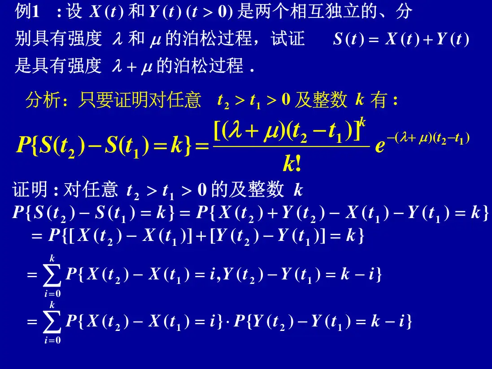

原文：

例1：设 $X(t)$ 和 $Y(t)$ (t > 0) 是两个相互独立的、分别具有强度 $\lambda$ 和 $\mu$ 的泊松过程，试证 $S(t) = X(t) + Y(t)$ 是具有强度 $\lambda + \mu$ 的泊松过程。

分析：只要证明对任意 $t_2 > t_1 > 0$ 及整数 $k$ 有：

$P\{S(t_2) - S(t_1) = k\} = \frac{[(\lambda + \mu)(t_2 - t_1)]^k}{k!} e^{-(\lambda + \mu)(t_2 - t_1)}$

证明：对任意 $t_2 > t_1 > 0$ 的及整数 $k$ $P\{S(t_2) - S(t_1) = k\} = P\{X(t_2) + Y(t_2) - X(t_1) - Y(t_1) = k\}$ $= P\{[X(t_2) - X(t_1)] + [Y(t_2) - Y(t_1)] = k\}$ $= \sum_{i=0}^{k} P\{X(t_2) - X(t_1) = i, Y(t_2) - Y(t_1) = k - i\}$ $= \sum_{i=0}^{k} P\{X(t_2) - X(t_1) = i\} \cdot P\{Y(t_2) - Y(t_1) = k - i\}$

### $$

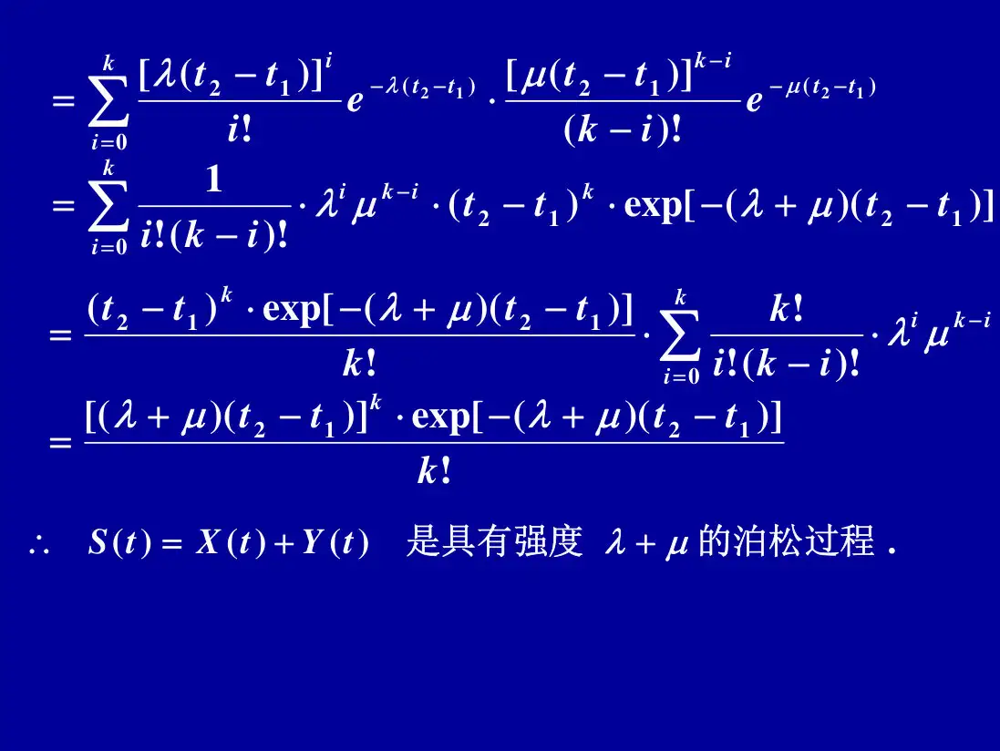

原文：

$$
\begin{array}{r l} & {= \sum_ {i = 0} ^ {k} \frac {[ \lambda (t _ {2} - t _ {1}) ] ^ {i}}{i !} e ^ {- \lambda (t _ {2} - t _ {1})} \cdot \frac {[ \mu (t _ {2} - t _ {1}) ] ^ {k - i}}{(k - i) !} e ^ {- \mu (t _ {2} - t _ {1})}} \\ & {= \sum_ {i = 0} ^ {k} \frac {1}{i ! (k - i) !} \cdot \lambda^ {i} \mu^ {k - i} \cdot (t _ {2} - t _ {1}) ^ {k} \cdot \exp [ - (\lambda + \mu) (t _ {2} - t _ {1}) ]} \\ & {= \frac {(t _ {2} - t _ {1}) ^ {k} \cdot \exp [ - (\lambda + \mu) (t _ {2} - t _ {1}) ]}{k !} \cdot \sum_ {i = 0} ^ {k} \frac {k !}{i ! (k - i) !} \cdot \lambda^ {i} \mu^ {k - i}} \\ & {= \frac {[ (\lambda + \mu) (t _ {2} - t _ {1}) ] ^ {k} \cdot \exp [ - (\lambda + \mu) (t _ {2} - t _ {1}) ]}{k !}} \\ {\therefore S (t) = X (t) + Y (t)} & {\text {是具有强度} \lambda + \mu \text {的泊松过程}.} \end{array}
$$

### 第 22 页

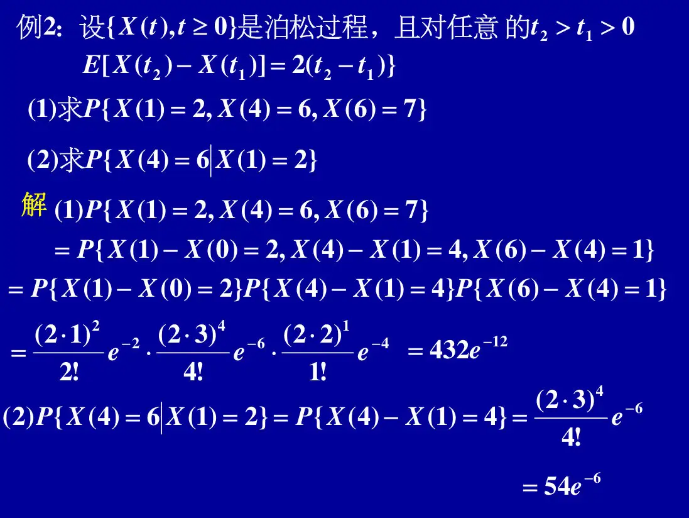

原文：

例2: 设 $\{X(t), t \geq 0\}$ 是泊松过程，且对任意的 $t_{2} > t_{1} > 0$ $E[X(t_{2}) - X(t_{1})] = 2(t_{2} - t_{1})\}$ (1)求 $P\{X(1) = 2, X(4) = 6, X(6) = 7\}$ (2)求 $P\{X(4) = 6 | X(1) = 2\}$ 解 (1) $P\{X(1) = 2, X(4) = 6, X(6) = 7\}$ $= P\{X(1) - X(0) = 2, X(4) - X(1) = 4, X(6) - X(4) = 1\}$ $= P\{X(1) - X(0) = 2\} P\{X(4) - X(1) = 4\} P\{X(6) - X(4) = 1\}$ $= \frac{(2 \cdot 1)^{2}}{2!} e^{-2} \cdot \frac{(2 \cdot 3)^{4}}{4!} e^{-6} \cdot \frac{(2 \cdot 2)^{1}}{1!} e^{-4} = 432e^{-12}$ (2) $P\{X(4) = 6 | X(1) = 2\} = P\{X(4) - X(1) = 4\} = \frac{(2 \cdot 3)^{4}}{4!} e^{-6}$ $= 54e^{-6}$

### 三、维纳过程

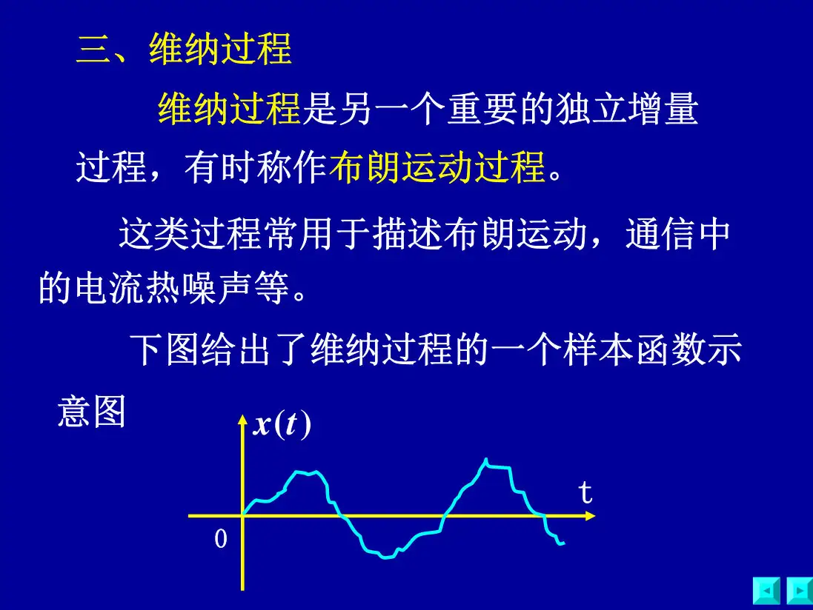

原文：

三、维纳过程

维纳过程是另一个重要的独立增量过程，有时称作布朗运动过程。

这类过程常用于描述布朗运动，通信中的电流热噪声等。

下图给出了维纳过程的一个样本函数示

意图

### 1、维纳过程的定义：

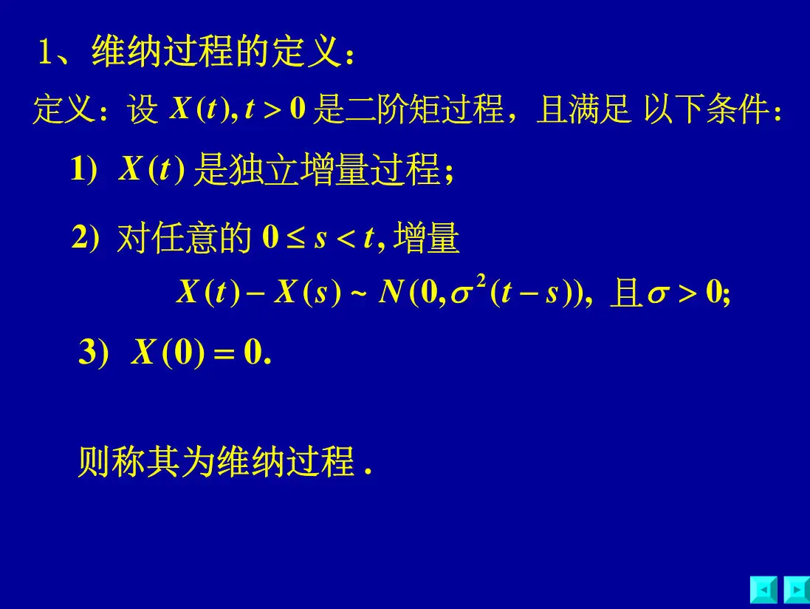

原文：

1、维纳过程的定义：

定义: 设 $X(t), t > 0$ 是二阶矩过程, 且满足以下条件:

1) $X(t)$ 是独立增量过程;

2) 对任意的 $0 \leq s < t$ , 增量

$X(t)-X(s)\sim N(0,\sigma^{2}(t-s))$ ，且 $\sigma>0;$

3) $X(0)=0.$

则称其为维纳过程.

### 2、维纳过程的统计特性根据定义，对任意

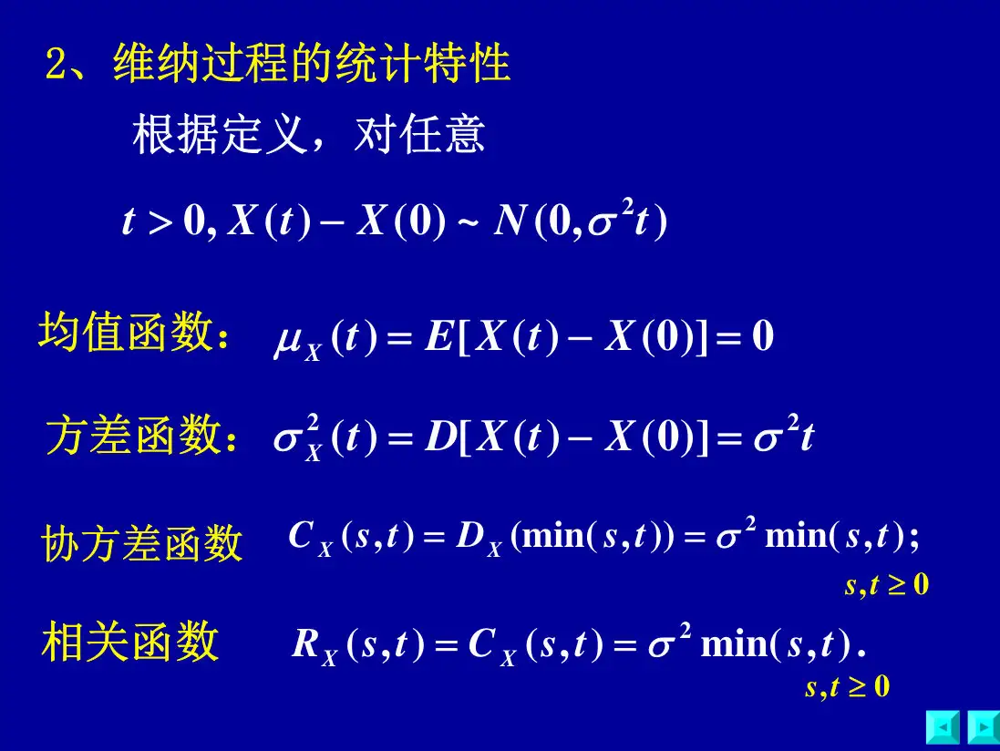

原文：

2、维纳过程的统计特性根据定义，对任意

$$
t > 0, X (t) - X (0) \sim N (0, \sigma^ {2} t)
$$

均值函数: $\mu_{X}(t) = E[X(t) - X(0)] = 0$

方差函数： $\sigma_{X}^{2}(t) = D[X(t) - X(0)] = \sigma^{2}t$

协方差函数 $C_{X}(s,t)=D_{X}(\min(s,t))=\sigma^{2}\min(s,t);$

相关函数 $R_{X}(s,t) = C_{X}(s,t) = \sigma^{2}\min (s,t).$

### 四、正态过程

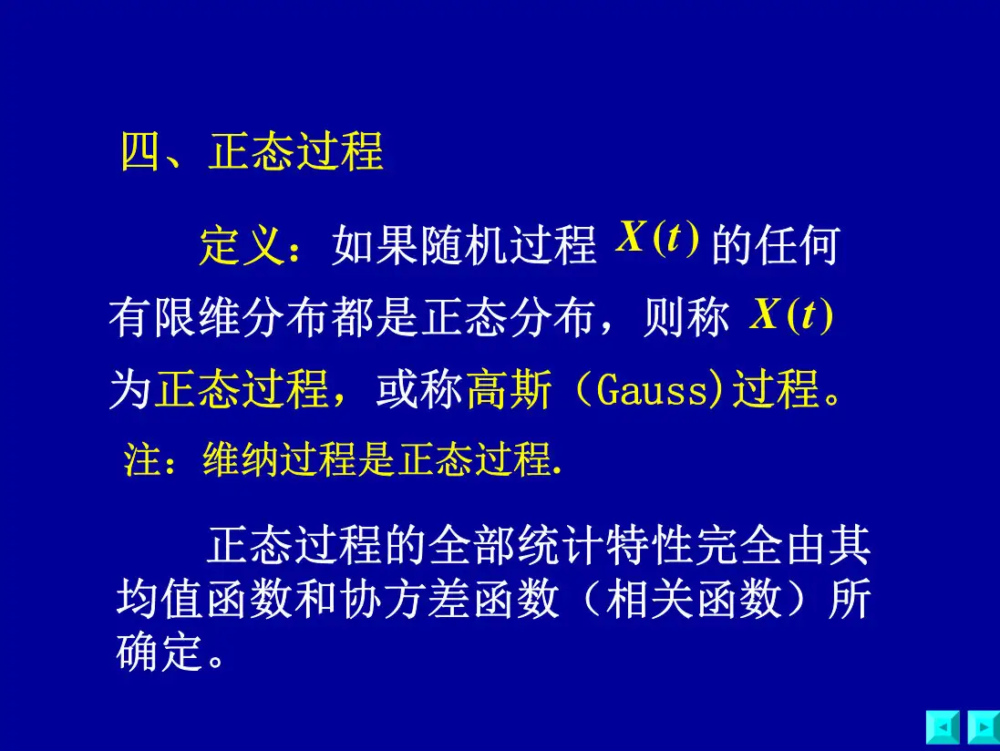

原文：

四、正态过程

定义: 如果随机过程 $X(t)$ 的任何有限维分布都是正态分布, 则称 $X(t)$ 为正态过程, 或称高斯 (Gauss) 过程。

注：维纳过程是正态过程.

正态过程的全部统计特性完全由其均值函数和协方差函数（相关函数）所确定。

### 所以 $X(t)$ 是正态过程。

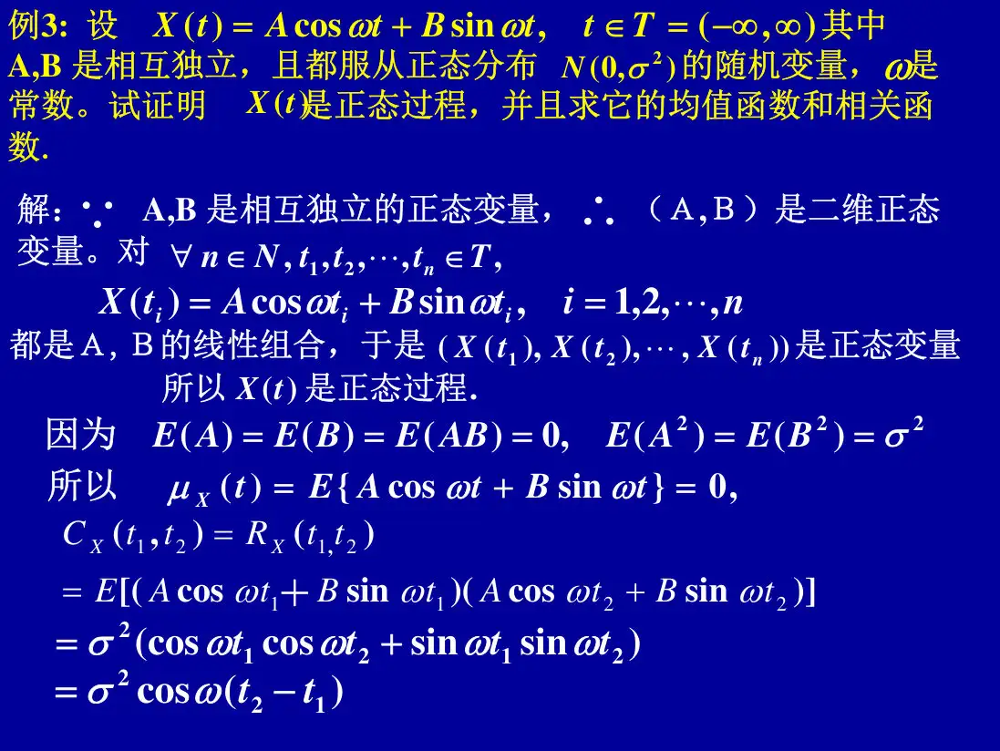

原文：

例3: 设 $X(t) = A \cos \omega t + B \sin \omega t, \quad t \in T = (-\infty, \infty)$ 其中 A,B 是相互独立，且都服从正态分布 $N(0, \sigma^{2})$ 的随机变量， $\omega$ 是常数。试证明 $X(t)$ 是正态过程，并且求它的均值函数和相关函数。

解：∵ A,B 是相互独立的正态变量，∴（A,B）是二维正态变量。对 $\forall n \in N, t_{1}, t_{2}, \cdots, t_{n} \in T,$ $X(t_{i}) = A \cos \omega t_{i} + B \sin \omega t_{i}, \quad i = 1, 2, \cdots, n$ 都是 A, B 的线性组合，于是 $(X(t_{1}), X(t_{2}), \cdots, X(t_{n}))$ 是正态变量

所以 $X(t)$ 是正态过程。

因为 $E(A) = E(B) = E(AB) = 0, \quad E(A^{2}) = E(B^{2}) = \sigma^{2}$ 所以 $\mu_{X}(t) = E\{A \cos \omega t + B \sin \omega t\} = 0,$ $C_{X}(t_{1}, t_{2}) = R_{X}(t_{1}, t_{2})$ $= E[(A \cos \omega t_{1} + B \sin \omega t_{1})(A \cos \omega t_{2} + B \sin \omega t_{2})]$ $= \sigma^{2}(\cos \omega t_{1} \cos \omega t_{2} + \sin \omega t_{1} \sin \omega t_{2})$ $= \sigma^{2} \cos \omega(t_{2} - t_{1})$
