# 《概率论与数理统计》第一章 随机事件与概率（课件）

原件的每一页，下面附识别出的文字。

### 1. 概率论的应用

原文：

1. 概率论的应用

概率论是数学的一个分支，它研究随机现象的数量规律，概率论的应用几乎遍及所有的科学领域，例如天气预报、地震预报、产品的抽样调查，在通讯工程中概率论可用以提高信号的抗干扰性、分辨率等等。

南京邮电大学
Nanjing University of Press and Telecommunications

2. 随机现象

在一定条件下可能出现也可能不出现的现象称为随机现象。

实例1 在相同条件下掷一枚均匀的硬币，观察正反两面出现的情况。

实例2 抛掷一枚骰子,观察出现的点数。

实例3 从一批含有正品和次品的产品中任意抽取一个产品。

随机现象的特征 ■ 条件不能完全决定结果。

南京邮电大学
Nanjing University of Physics and Telecommunications

一、随机现象

自然界所观察到的现象：确定性现象 随机现象1.确定性现象

在一定条件下必然发生的现象称为确定性现象。实例

“太阳不会从西边升起”，“水从高处流向低处”，“同性电荷必然互斥”，

确定性现象的特征 ■条件完全决定结果。

南京邮电大学
Nanjing University of Posts and Telecommunications

概率论与数理统计

主讲：叶军

职称：副教授

联系方式：13601587306

答疑地点：教2-528

答疑时间：每周三

南京邮电大学
Nanjing University of Physics and Telecommunications

第一节 随机试验

一、随机现象

二、随机试验

三、小结

南京邮电大学
Nanjing University of Physics and Telecommunications

说明

1. 随机现象揭示了条件和结果之间的非确定性联系，其数量关系无法用函数加以描述。

2. 随机现象在一次观察中出现什么结果具有偶然性,但在大量试验或观察中,这种结果的出现具有一定的统计规律性。

概率论就是研究随机现象这种本质规律的一门数学学科。

如何来研究随机现象？

随机现象是通过随机试验来研究的。

南京邮电大学
Nanjing University of Physics and Telecommunications

### 第二节 样本空间、随机事件

原文：

第二节 样本空间、随机事件

一、样本空间 样本点

二、随机事件的概念

三、随机事件间的关系及运算

四、小结

实例1 抛掷一枚硬币,观察字面,花面出现的情况。

$H\to$ 字面朝上 $T\to$ 花面朝上

则样本空间为 $S_{1} = \{H,T\}$

则样本空间为 $S_{2} = \{1,2,3,4,5,6\}$ 。

定义 随机试验 E 的所有可能结果组成的集合称为 E 的样本空间, 记为 S。

样本空间的元素, 即试验 E 的每一个结果, 称为样本点。

实例2 抛掷一枚骰子,观察出现的点数.

说明 1. 试验不同,对应的样本空间也不同。

南京航空航天大学
Nanjing University of Physics and Telecommunications

一、样本空间 样本点

问题 随机试验的结果？

$$
S _ {4} = \{0, 1, 2, 3 \} 。
$$

$$
N D D, D D N, D N D, D D D \}.
$$

南京邮电大学
Nanjing University of Physics and Telecommunications

二、随机试验

定义

在概率论中,把具有以下三个特征的试验称为随机试验。

1. 重复性 --- 可以在相同的条件下重复地进行；

2. 多样性 --- 每次试验的可能结果不止一个, 并且能事先明确试验的所有可能结果;

3.随机性---进行一次试验之前不能确定哪一个结果会出现。

随机试验通常用 $E$ 来表示。

实例1 在相同条件下掷一枚均匀的硬币，观察正反两面出现的情况。

实例2 在相同条件下抛掷一枚均匀骰子, 观察出现的点数。

实例3 从一批含有正品和次品的产品中,依次任选三件,记录出现正品与次品的件数。

实例4 记录某公共汽车站某日上午某一时段的等车人数。

实例5 考察某地区2月份的平均气温。

实例6 一批灯泡中任取一只,测试其寿命。

南京邮电大学
Nanjing University of Press and Telecommunications

10

实例3 从一批产品(次品数多于三件)中,依次

任选三件。记 $N\to$ 正品， $D\to$ 次品

若观察出现次品的个数，则样本空间为

若观察记录出现正品与次品的情况, 则样本空间为

$S_{3} = \{NNN, NND, NDN, DNN,$

说明 2. 同一试验, 若试验目的不同, 则对应的样本空间也不同。

南京邮电大学
Nanjing University of Posts and Telecommunications

### 所谓某事件 A 发生，当且仅当它所包含的某个样本点出现。

原文：

假设： $\mathbf{A} = \{6\}$ $\mathbf{C} = \{1,2\}$

$\mathbf{B} = \{2,4,6\}$ $\mathbf{D} = \{1,2,4,5,6\}$

所谓某事件 A 发生，当且仅当它所包含的某个样本点出现。

假定在掷骰子前约定，出现偶数点（事件B）就中奖。若掷的结果出现4点，你就中奖了（即事件B发生了），若掷出2点或6点，你也中奖了。这说明，事件B虽由三个基本结果组成，但只要其中任一个样本点出现就说事件B发生了。

南京邮电大学
Nanjing University of Press and Telecommunications

从集合的观点看，必然事件与样本空间 S 没有差异，不可能事件与不含 S 中的任一元素的空集 $\Phi$ 没有差异。

样本空间S本身及其空集 $\Phi$ 也可看作样本空间S的二个子集，一个是最大子集，一个是最小子集。

必然事件和不可能事件本质上是确定性结果，但概率论离不开这二个事件，就象计算机中离不开0与1一样，把这两个事件看作随机试验的二个极端情况是很合理的。

2、必然事件与不可能事件

由于样本空间 S 包含了全部可能的结果，因此在每次试验中 S 都会发生，故称 S 为必然事件。

相反，空集中不含任何样本点，每次试验必定不发生，故称 $\Phi$ 为不可能事件。

例如：在掷一颗骰子的试验中，“出现点数不超过6”就是一个必然事件，“出现7点”就是一个不可能事件。

上海银行

南京邮电大学
Nanjing University of Physics and Telecommunications

13

实例4 记录某公共汽车站某日上午某时刻的等车

人数。样本空间为 $S_{4}=\{0,1,2,\cdots\}$ 。

$S_{4} = \{0,1,2,\dots\}$

实例5 考察某地区2月份的平均气温。

样本空间为 $S_{5} = \{t\mid T_{1} <   t <   T_{2}\} 。$

$S_{5} = \{t|T_{1} < t < T_{2}\}$

说明 3.样本空间S可以是数集，也可以是抽象的集合；

可以是有限集，也可以是可列集；

可以是一维的，也可以是多维集合；

二、随机事件的概念

我们常常会关心试验的某一部分可能结果是否出现，称这种由部分样本点组成的试验结果为随机事件，简称为事件，常用大写字母 A、B、C 等表示。

1. 基本概念

随机事件 随机试验 $E$ 的样本空间 $S$ 的子集称为 $E$ 的随机事件, 简称事件。

实例 抛掷一枚骰子, 观察出现的点数。

试验中,骰子“出现1点”,“出现2点”,…,“出现6点”,“点数不大于4”,“点数为偶数”等都为随机事件。

A

南京邮电大学
Nanjing University of Press and Telecommunications

三、随机事件间的关系及运算

$(k=1,2,\cdots)$

设试验 E 的样本空间为 S，而 A, B, $A_{k}$ ( $k=1,2,\cdots$ ) 是 S 的子集。

1、包含关系若事件 A 出现, 必然导致 B 出现, 则称事件 B 包含事件 A, 记作 $B \supset A$ 或 $A \subset B$ .

图示 B 包含 A。

2、A等于B 若事件 A 包含事件 B，而且事件 B 包含事件 A，则称事件 A 与事件 B 相等，记作 A=B。

### 3、事件 $A$ 与 $B$ 的并(和事件)

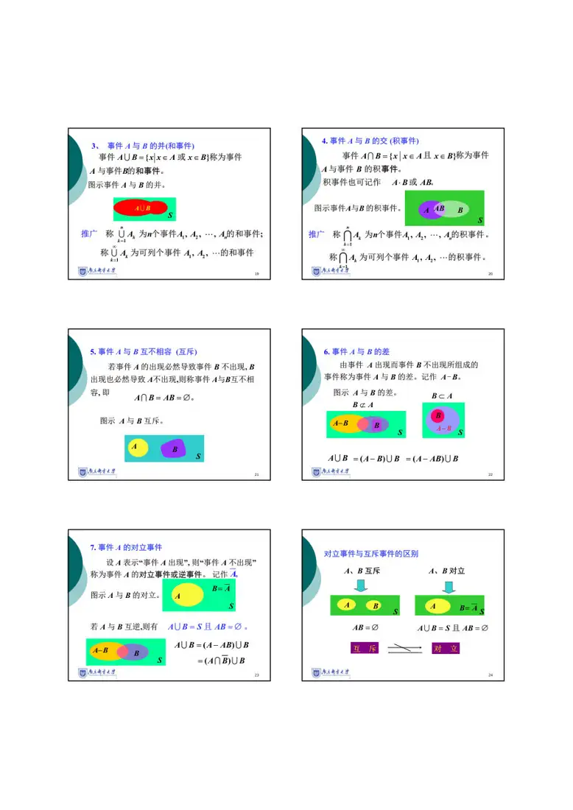

原文：

3、事件 $A$ 与 $B$ 的并(和事件)

事件 $A \cup B = \{x \mid x \in A \text{ 或 } x \in B\}$ 称为事件

$A$ 与事件 $B$ 的和事件。

图示事件 $A$ 与 $B$ 的并。

$A \cup B$

推广 称 $\bigcup_{k=1}^{n}A_{k}$ 为 n 个事件 $A_{1}, A_{2}, \cdots, A_{n}$ 的和事件；

$$
\bigcup_ {k = 1} ^ {\infty} A _ {k}
$$

$$
A _ {1}, A _ {2},
$$

5. 事件 $A$ 与 $B$ 互不相容 (互斥)

若事件 A 的出现必然导致事件 B 不出现, B 出现也必然导致 A 不出现, 则称事件 A 与 B 互不相容, 即 $A \cap B = AB = \varnothing$ 。

图示 $A$ 与 $B$ 互斥。

7. 事件 $A$ 的对立事件

设 A 表示“事件 A 出现”，则“事件 A 不出现”称为事件 A 的对立事件或逆事件。记作 $\overline{A}$ 。

图示 $A$ 与 $B$ 的对立。

若 $A$ 与 $B$ 互逆, 则有

$A \cup B = S$ 且 $AB = \varnothing$ 。

$A\bigcup B = (A - AB)\bigcup B$ $= (A\cap \overline{B})\bigcup B$

4. 事件 $A$ 与 $B$ 的交 (积事件)

事件 $A \cap B = \{x \mid x \in A \text{ 且 } x \in B\}$ 称为事件 $A$ 与事件 $B$ 的积事件。

积事件也可记作 $A \cdot B$ 或 $AB$ 。

图示事件 $A$ 与 $B$ 的积事件。

推广 称 $\bigcap_{k=1}^{n}A_{k}$ 为 n 个事件 $A_{1}, A_{2}, \cdots, A_{n}$ 的积事件。

称 $\bigcap_{k=1}^{\infty}A_{k}$ 为可列个事件 $A_{1}, A_{2}, \cdots$ 的积事件。

6. 事件 $A$ 与 $B$ 的差

由事件 A 出现而事件 B 不出现所组成的事件称为事件 A 与 B 的差。记作 A-B。

图示 $A$ 与 $B$ 的差。

$$
A \bigcup B = (A - B) \bigcup B = (A - A B) \bigcup B
$$

$A$ 、 $B$ 互斥

$A$ 、 $B$ 对立

$$
A B = \emptyset
$$

$$
A \bigcup B = S   \text {且}   A B = \emptyset
$$

24

南京邮电大学
Nanjing University of Private and Telecommunications

19

南京邮电大学
Nanjing University of Physics and Telecommunications

对立事件与互斥事件的区别

A B S

南京邮电大学
Nanjing University of Physics and Telecommunications

20

22

### (1) $A$ 出现, $B, C$ 不出现;

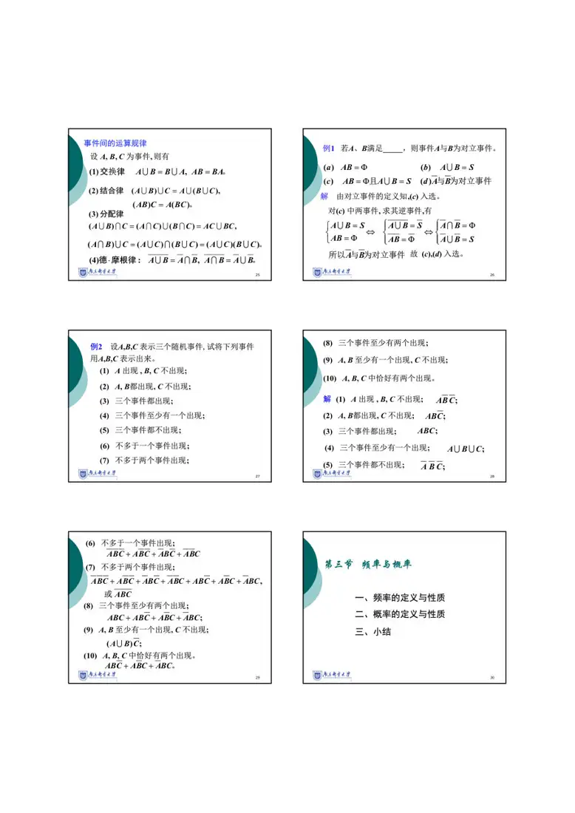

原文：

例2 设 $A, B, C$ 表示三个随机事件, 试将下列事件用 $A, B, C$ 表示出来。

(1) $A$ 出现, $B, C$ 不出现;

(2) $A, B$ 都出现, $C$ 不出现;

(3) 三个事件都出现;

(4) 三个事件至少有一个出现；

(5) 三个事件都不出现；

(6) 不多于一个事件出现;

(7) 不多于两个事件出现;

(8) 三个事件至少有两个出现；

(9) $A, B$ 至少有一个出现, $C$ 不出现;

(10) $A, B, C$ 中恰好有两个出现。

解 (1) $A$ 出现, $B, C$ 不出现; $A\overline{B}\overline{C}$ ;

(2) $A, B$ 都出现, $C$ 不出现; $AB\overline{C}$ ;

(3) 三个事件都出现; $ABC$ ;

(4) 三个事件至少有一个出现； $A \cup B \cup C;$

(5) 三个事件都不出现； $\overline{A}\overline{B}\overline{C}$ ;

第三节 频率与概率

一、频率的定义与性质

二、概率的定义与性质

三、小结

26

事件间的运算规律

设 $A, B, C$ 为事件, 则有

$A \cup B = B \cup A, AB = BA.$

(1) 交换律 $A \cup B = B \cup A, AB = BA$ 。

$(A \cup B) \cup C = A \cup (B \cup C),$

(2) 结合律 $(A \cup B) \cup C = A \cup (B \cup C)$ ,

$(AB)C = A(BC)$ 。

(3) 分配律

$(A \cup B) \cap C = (A \cap C) \cup (B \cap C) = AC \cup BC,$

$\bigcup B)\cap C = (A\cap C)\bigcup (B\cap C) = AC\cup BC,$

$(A \cap B) \cup C = (A \cup C) \cap (B \cup C) = (A \cup C)(B \cup C)$ .

(4)德·摩根律： $\overline{A\bigcup B} = \overline{A}\cap \overline{B},\overline{A\bigcap B} = \overline{A}\bigcup \overline{B}$

$\overline{A \cup B} = \overline{A} \cap \overline{B}, \overline{A \cap B} = \overline{A} \cup \overline{B}$ 。

25

南京邮电大学
Nanjing University of Physics and Telecommunications

$\overline{A}\overline{B}\overline{C} + A\overline{B}\overline{C} + \overline{A}B\overline{C} + \overline{A}B\overline{C}$

(7) 不多于两个事件出现;

$\overline{BC} + A\overline{B}\overline{C} + \overline{A}B\overline{C} + \overline{A}\overline{B}C + AB\overline{C} + A\overline{B}C + \overline{A}BC,$

$\overline{A}\overline{B}\overline{C}+\overline{A}\overline{B}\overline{C}+\overline{A}\overline{B}\overline{C}+\overline{A}\overline{B}C+\overline{A}\overline{B}\overline{C}+\overline{A}\overline{B}C+\overline{A}BC,$ 或 $\overline{ABC}$

(8) 三个事件至少有两个出现；

$ABC + AB\overline{C} + A\overline{B}C + \overline{A}BC;$

(9) A, B 至少有一个出现, C 不出现; $(A\cup B)\overline{C};$

$(A \cup B) \overline{C};$

A, B, C

(10) A, B, C 中恰好有两个出现。 $AB\overline{C} + A\overline{B}C + \overline{A}BC$ 。

$ABC + ABC + \overline{ABC}$

南京邮电大学
Nanjing University of Private and Telecommunications

例1 若 $A$ 、 $B$ 满足\_\_\_\_，则事件 $A$ 与 $B$ 为对立事件。

$\boldsymbol{AB} = \boldsymbol{\Phi}$

(a) $AB = \Phi$

(b) $A \cup B = S$

$A \bigcup B = S$

(c) $AB = \Phi$ 且 $A \cup B = S$ (d) $\overline{A}$ 与 $\overline{B}$ 为对立事件解 由对立事件的定义知, (c) 入选。

对 $(c)$ 中两事件, 求其逆事件, 有

$\left\{ \begin{array}{l} A \cup B = S \\ AB = \Phi \end{array} \right. \Leftrightarrow \left\{ \begin{array}{l} \overline{A \cup B} = \overline{S} \\ \overline{AB} = \overline{\Phi} \end{array} \right. \Leftrightarrow \left\{ \begin{array}{l} \overline{A} \cap \overline{B} = \Phi \\ \overline{A} \cup \overline{B} = S \end{array} \right.$

所以 $\overline{A}$ 与 $\overline{B}$ 为对立事件故 $(c),(d)$ 入选。

南京邮电大学
Nanjing University of Press and Telecommunications

南京邮电大学
Nanjing University of Physics and Telecommunications

### 2. 性质

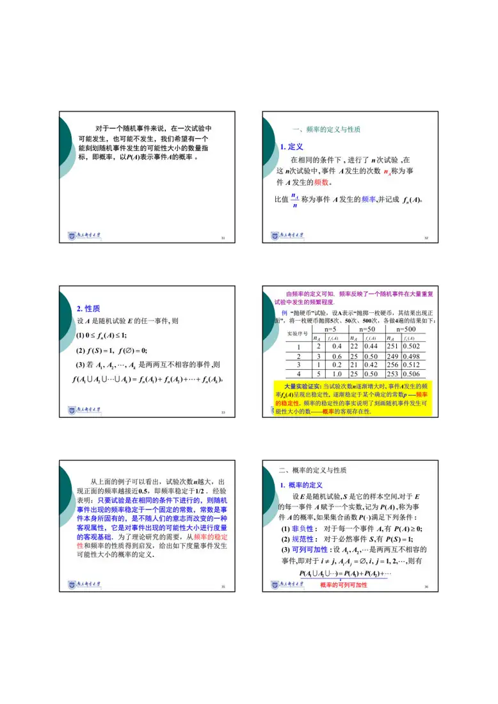

原文：

2. 性质

设 $A$ 是随机试验 $\pmb{E}$ 的任一事件, 则

(1) $0 \leq f_{n}(A) \leq 1$ ;

(2) $f(S) = 1$ , $f(\varnothing) = 0$ ;

(3) 若 $A_{1}, A_{2}, \cdots, A_{k}$ 是两两互不相容的事件，则 $f(A_{1} \cup A_{2} \cup \cdots \cup A_{k}) = f_{n}(A_{1}) + f_{n}(A_{2}) + \cdots + f_{n}(A_{k})$ 。

从上面的例子可以看出，试验次数 $n$ 越大，出现正面的频率越接近0.5，即频率稳定于1/2．经验表明：只要试验是在相同的条件下进行的，则随机事件出现的频率稳定于一个固定的常数，常数是事件本身所固有的，是不随人们的意志而改变的一种客观属性，它是对事件出现的可能性大小进行度量的客观基础．为了理论研究的需要，从频率的稳定性和频率的性质得到启发，给出如下度量事件发生可能性大小的概率的定义.

由频率的定义可知，频率反映了一个随机事件在大量重复试验中发生的频繁程度.

例“抛硬币”试验，设A表示“抛掷一枚硬币，其结果出现正面”，将一枚硬币抛掷5次、50次、500次，各做4遍的结果如下：

南京邮电大学
Nanjing University of Press and Telecommunications
<table><tr><td rowspan="2">实验序号</td><td colspan="2">n=5</td><td colspan="2">n=50</td><td colspan="2">n=500</td></tr><tr><td> $n_A$ </td><td> $f_n(A)$ </td><td> $n_A$ </td><td> $f_n(A)$ </td><td> $n_A$ </td><td> $f_n(A)$ </td></tr><tr><td>1</td><td>2</td><td>0.4</td><td>22</td><td>0.44</td><td>251</td><td>0.502</td></tr><tr><td>2</td><td>3</td><td>0.6</td><td>25</td><td>0.50</td><td>249</td><td>0.498</td></tr><tr><td>3</td><td>1</td><td>0.2</td><td>21</td><td>0.42</td><td>256</td><td>0.512</td></tr><tr><td>4</td><td>5</td><td>1.0</td><td>25</td><td>0.50</td><td>253</td><td>0.506</td></tr></table>

大量实验证实: 当试验次数n逐渐增大时, 事件A发生的频率 $f_{n}(4)$ 呈现出稳定性, 逐渐稳定于某个确定的常数p---频率的稳定性. 频率的稳定性的事实说明了刻画随机事件发生可能性大小的数——概率的客观存在性.

二、概率的定义与性质

1. 概率的定义

设 $E$ 是随机试验, $S$ 是它的样本空间. 对于 $E$ 的每一事件 $A$ 赋予一个实数, 记为 $P(A)$ , 称为事件 $A$ 的概率, 如果集合函数 $P(\cdot)$ 满足下列条件:

(1) 非负性：对于每一个事件 $A$ ，有 $P(A) \geq 0$ ;

(2) 规范性：对于必然事件 $S$ ，有 $P(S) = 1$ ;

(3) 可列可加性: 设 $A_{1}, A_{2}, \cdots$ 是两两互不相容的事件, 即对于 $i \neq j, A_{i}A_{j} = \varnothing, i, j = 1, 2, \cdots$ , 则有

$$
P \left(A _ {1} \cup A _ {2} \cup \dots\right) = P \left(A _ {1}\right) + P \left(A _ {2}\right) + \dots
$$

南京新電大學
Nanjing University of Physics and Telecommunications

32

南京新電大學
Nanjing University of Physics and Telecommunications

31

对于一个随机事件来说，在一次试验中可能发生，也可能不发生，我们希望有一个能刻划随机事件发生的可能性大小的数量指标，即概率，以 $P(A)$ 表示事件 $A$ 的概率。

南京邮电大学
Nanjing University of Posts and Telecommunications

一、频率的定义与性质

1. 定义

在相同的条件下, 进行了 n 次试验, 在这 n 次试验中, 事件 A 发生的次数 $n_{A}$ 称为事件 A 发生的频数。

$\frac{n_A}{n}$

$n_{A}$

比值 $\frac{n_A}{n}$ 称为事件 $A$ 发生的频率, 并记成 $f_n(A)$ 。

$f_{n}(A)$

### (3) 设 $A, B$ 为两个事件, 且 $A \subset B$ , 则

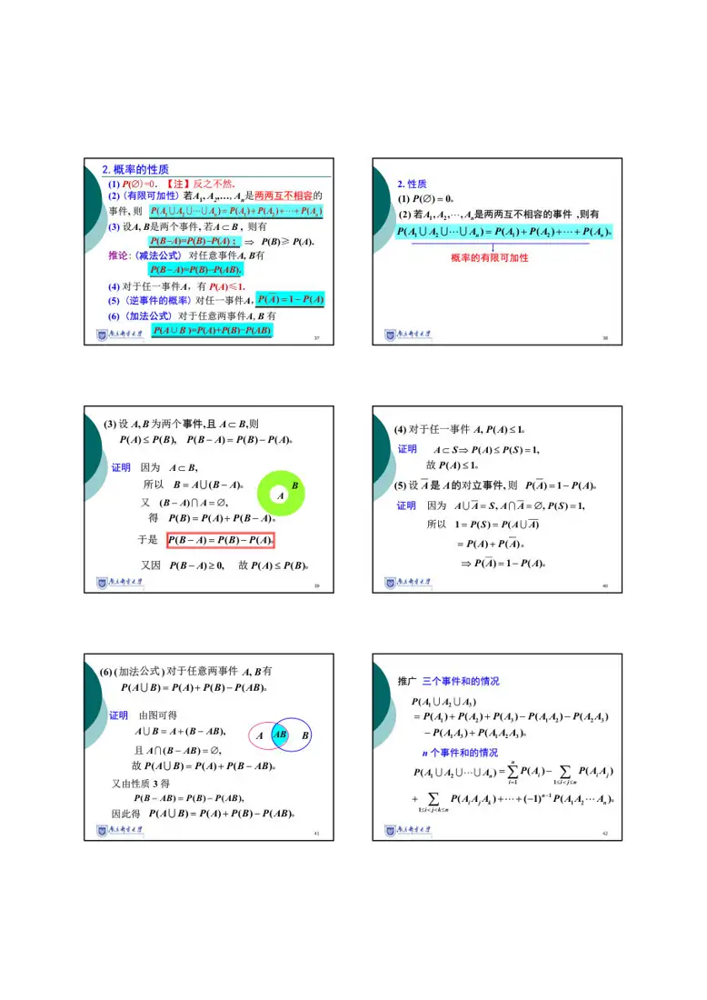

原文：

(3) 设 $A, B$ 为两个事件, 且 $A \subset B$ , 则

$$
P (A) \leq P (B), \quad P (B - A) = P (B) - P (A) 。
$$

证明 因为 $A \subset B$ ,

所以 $B = A\bigcup (B - A)$ 。

又 $(B - A)\cap A = \emptyset ,$

得 $P(B)=P(A)+P(B-A)$ 。

于是 $P(B - A) = P(B) - P(A)$ 。

又因 $P(B - A) \geq 0$ ，故 $P(A) \leq P(B)$ 。

南京邮电大学
Nanjing University of Press and Telecommunications

(4) 对于任一事件 $A, P(A) \leq 1$ 。

证明 $A \subset S \Rightarrow P(A) \leq P(S) = 1,$ 故 $P(A) \leq 1$ 。

(5) 设 $\overline{A}$ 是 $A$ 的对立事件, 则 $P(\overline{A}) = 1 - P(A)$ 。

证明 因为 $A \cup \overline{A} = S, A \cap \overline{A} = \emptyset, P(S) = 1,$

所以 $1 = P(S) = P(A \cup \overline{A})$ $= P(A) + P(\overline{A})$ 。 $\Rightarrow P(\overline{A}) = 1 - P(A)$ 。

(6)(加法公式)对于任意两事件 $A, B$ 有

$$
P (A \bigcup B) = P (A) + P (B) - P (A B) 。
$$

证明 由图可得

$A \cup B = A + (B - AB)$ ,

且 $A \cap (B - AB) = \varnothing$ ,

故 $P(A \cup B) = P(A) + P(B - AB)$ 。

又由性质3得

$$
P (B - A B) = P (B) - P (A B),
$$

因此得 $P(A \cup B) = P(A) + P(B) - P(AB)$ 。

南京新電大學
Nanjing University of Physics and Telecommunications

$n$ 个事件和的情况

37

2. 概率的性质

(1) $P(\emptyset) = 0$ 【注】反之不然.

$P(\emptyset) = 0$

$A_{1}, A_{2}, \ldots, A_{n}$

$P(A_{1} \cup A_{2} \cup \cdots \cup A_{n}) = P(A_{1}) + P(A_{2}) + \cdots + P(A_{n})$

(2)（有限可加性）若 $A_{1}, A_{2}, \ldots, A_{n}$ 是两两互不相容的事件，则 $P(A_{1} \cup A_{2} \cup \cdots \cup A_{n}) = P(A_{1}) + P(A_{2}) + \cdots + P(A_{n})$

(3) 设 $A, B$ 是两个事件, 若 $A \subset B$ , 则有

$A\subset B$

$P(B-A)=P(B)-P(A); \Rightarrow P(B)\geqslant P(A).$

推论：（减法公式）对任意事件A, B有 $P(B-A)=P(B)-P(AB)$ .

38

(4) 对于任一事件 $A$ ，有 $P(A) \leqslant 1$ .

$P(A) \leqslant 1.$

(5)（逆事件的概率）对任一事件A， $P(\overline{A})=1-P(A)$

$P(A \cup B) = P(A) + P(B) - P(AB)$

$P(\overline{A}) = 1 - P(A)$

(6)（加法公式）对于任意两事件 $A, B$ 有

2. 性质

(1) $P(\emptyset) = 0$

$P(\emptyset) = 0$

$A_{1}, A_{2}, \cdots, A_{n}$

(2) 若 $A_{1}, A_{2}, \cdots, A_{n}$ 是两两互不相容的事件，则有

$P(A_{1}\bigcup A_{2}\bigcup \dots \bigcup A_{n}) = P(A_{1}) + P(A_{2}) + \dots +P(A_{n})$

概率的有限可加性

南京新電大學
Nanjing University of Private and Telecommunications

南京邮电大学
Nanjing University of Press and Telecommunications

推广 三个事件和的情况

$P(A_{1}\cup A_{2}\cup A_{3})$ $= P(A_{1}) + P(A_{2}) + P(A_{3}) - P(A_{1}A_{2}) - P(A_{2}A_{3})$ $-P(A_{1}A_{3}) + P(A_{1}A_{2}A_{3})$

$P(A_{1} \cup A_{2} \cup \cdots \cup A_{n}) = \sum_{i=1}^{n} P(A_{i}) - \sum_{1 \leq i < j \leq n} P(A_{i} A_{j})$

$+\sum_{1\leq i<j<k\leq n}P(A_{i}A_{j}A_{k})+\cdots+(-1)^{n-1}P(A_{1}A_{2}\cdots A_{n})$

南京邮电大学
Nanjing University of Science and Telecommunications

### 第四节 等可能概型(古典概型)

原文：

第四节 等可能概型(古典概型)

一、等可能概型

二、典型例题

三、几何概率

四、小结

南京邮电大学
Nanjing University of Physics and Telecommunications

2. 古典概型中事件概率的计算公式

设试验 $E$ 的样本空间由 $n$ 个样本点构成， $A$ 为 $E$ 的任意一个事件，且包含 $m$ 个样本点，则事件 $A$ 出现的概率记为：

$P(A)=\frac{m}{n}=\frac{A \text{所包含样本点的个数}}{\text{样本点总数}}$ 。

称此为概率的古典定义。

一、等可能概型(古典概型)

1. 定义

(1) 试验的样本空间只包含有限个元素；

$$
s = \left\{e _ {1}, e _ {2}, \dots , e _ {n} \right\}
$$

(2) 试验中每个基本事件发生的可能性相同。

$$
P \left(e _ {1}\right) = P \left(e _ {2}\right) = \dots = P \left(e _ {n}\right) = \frac {1}{n}
$$

具有以上两个特点的试验称为等可能概型或古典概型。

例1 小王参加“智力大冲浪”游戏，他能答出甲、乙二类问题的概率分别为0.7和0.2，两类问题都能答出的概率为0.1. 求小王

(1) 答出甲类而答不出乙类问题的概率;

(2) 至少有一类问题能答出的概率;

(3) 两类问题都答不出的概率.

解 事件A, B分别表示“能答出甲,乙类问题”,由题设 $P(A)=0.7,\quad P(B)=0.2,\quad P(AB)=0.1,$

$P(A) = 0.7, P(B) = 0.2, P(AB) = 0.1,$

(1) $P(A\overline{B}) = P(A) - P(AB) = 0.7 - 0.1 = 0.6$

$P(A\overline{B}) = P(A) - P(AB) = 0.7 - 0.1 = 0.6$

(2) $P(A \cup B) = P(A) + P(B) - P(AB) = 0.8$

$P(A\cup B) = P(A) + P(B) - P(AB) = 0.8$

(3) $P(\overline{A} \overline{B}) = P(\overline{A \cup B}) = 1 - P(A \cup B) = 0.2$

$\overline{B}) = P(\overline{A \cup B}) = 1 - P(A \cup B) = 0.2$

南京邮电大学
Nanjing University of Physics and Telecommunications

43

例2 (1) 已知 $P(AB) = 0$ ，求 $P(ABC)$ ;

$P(AB)=0$ ，求 $P(ABC)$ ;

$P(A) = 0.4, P(B) = 0.3, P(A \cup B) = 0.6,$

(2) 已知 $P(A)=0.4, P(B)=0.3, P(A \cup B)=0.6$ , 求 $P(A \overline{B})$ ;

$P(A\overline{B})$

(3) 已知 $P(\bar{A}\bar{B}) = P(AB), P(A) = p$ ，求 $P(B)$ .

$P(\bar{A}\bar{B})=P(AB), P(A)=p,$

$P(B)$

$ABC \subset AB,$

解：(1) 因为 $ABC \subset AB$ ，由性质3知 $0 \leq P(ABC) \leq P(AB) = 0$ ，所以 $P(ABC) = 0$

$0 \leq P(ABC) \leq P(AB) = 0$ ,

(2) $P(A\overline{B}) = P(A) - P(AB) = P(A \cup B) - P(B) = 0.3$

$P(A\overline{B}) = P(A) - P(AB) = P(A\cup B) - P(B) = 0.3$

(3) $P(AB) = P(\overline{A}\overline{B}) = P(\overline{A\cup B}) = 1 - P(A\cup B)$ $= 1 - P(A) - P(B) + P(AB)$

$\Rightarrow P(B) = 1 - P(A) = 1 - p$

南京邮电大学
Nanjing University of Private and Telecommunication

南京邮电大学
Nanjing University of Press and Telecommunications

计算事件 $A$ 的概率，关键在于弄清楚什么是样本点，样本空间中包含样本点的总数以及 $A$ 所包含的样本点数，当样本点较多时，很难将它们一一列出，需用排列、组合的知识进行分析。

① 从 $n$ 个不同元素中取出 $r$ 个元素且考虑其顺序称为排列，其排列总数为：

$A_{n}^{r} = n(n - 1)\dots (n - r + 1)$

南京新電大學
Nanjing University of Private and Telecommunications

### (1) $A =$ "指定 $\pmb{n}$ 个盒子各含一个球"

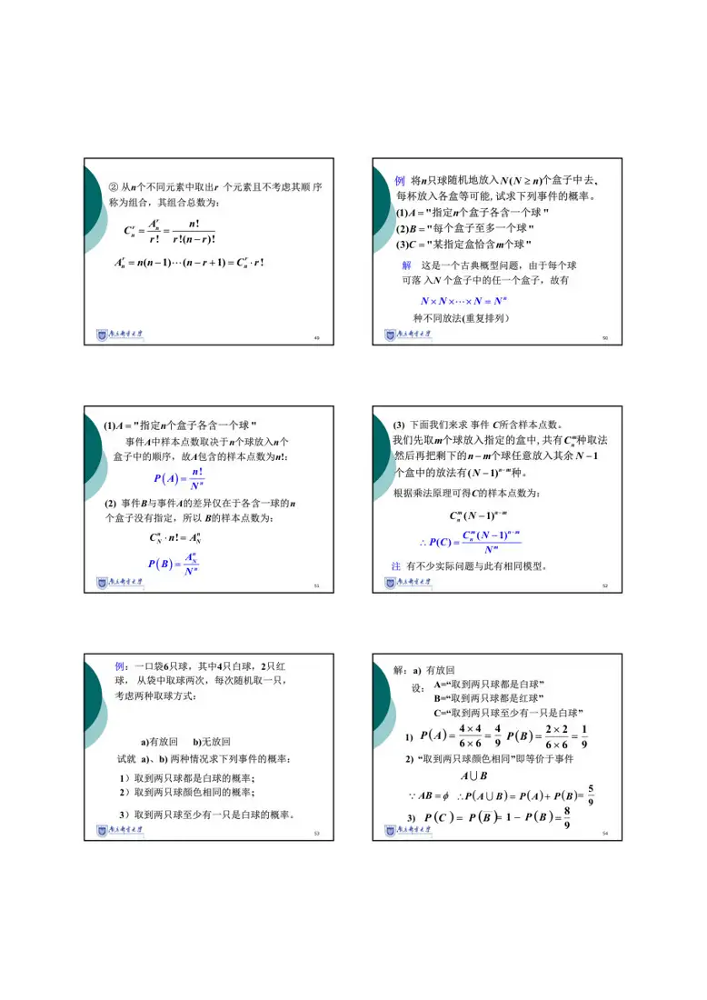

原文：

(1) $A =$ "指定 $\pmb{n}$ 个盒子各含一个球"

事件A中样本点数取决于n个球放入n个盒子中的顺序，故A包含的样本点数为 $n!$ :

$$
P (A) = \frac {n !}{N ^ {n}}
$$

(2) 事件 $B$ 与事件 $A$ 的差异仅在于各含一球的 $n$ 个盒子没有指定，所以 $B$ 的样本点数为：

$$
C _ {N} ^ {n} \cdot n! = A _ {N} ^ {n}
$$

$$
P (B) = \frac {A _ {N} ^ {n}}{N ^ {n}}
$$

南京邮电大学
Nanjing University of Physics and Telecommunications

例：一口袋6只球，其中4只白球，2只红球，从袋中取球两次，每次随机取一只，考虑两种取球方式：

a)有放回 b)无放回

试就 a)、b) 两种情况求下列事件的概率：

1）取到两只球都是白球的概率；

2）取到两只球颜色相同的概率；

3）取到两只球至少有一只是白球的概率。

(3) 下面我们来求事件 $C$ 所含样本点数。

我们先取 $m$ 个球放入指定的盒中，共有 $C_n^m$ 种取法然后再把剩下的 $n - m$ 个球任意放入其余 $N - 1$ 个盒中的放法有 $(N - 1)^{n - m}$ 种。

根据乘法原理可得 $C$ 的样本点数为：

$$
C _ {n} ^ {m} (N - 1) ^ {n - m}
$$

$$
\therefore P (C) = \frac {C _ {n} ^ {m} (N - 1) ^ {n - m}}{N ^ {m}}
$$

注 有不少实际问题与此有相同模型。

B=“取到两只球都是红球”

C=“取到两只球至少有一只是白球”

$$
A \cup B
$$

南京邮电大学
Nanjing University of Physics and Telecommunications

49

南京邮电大学
Nanjing University of Physics and Telecommunications

50

② 从 $n$ 个不同元素中取出 $r$ 个元素且不考虑其顺序称为组合，其组合总数为：

$C_n^r = \frac{A_n^r}{r!} = \frac{n!}{r!(n - r)!}$

$A_{n}^{r} = n(n - 1)\dots (n - r + 1) = C_{n}^{r}\cdot r!$

南京新電大學
Nanjing University of Physics and Telecommunications

种不同放法(重复排列)

例 将 $n$ 只球随机地放入 $N(N \geq n)$ 个盒子中去，

$N\times N\times \dots \times N = N^n$

$N(N\geq n$

每杯放入各盒等可能, 试求下列事件的概率。

(1) $A =$ "指定 $n$ 个盒子各含一个球"

) $B =$ "

(2) $B =$ "每个盒子至多一个球"

解 这是一个古典概型问题，由于每个球可落入 $N$ 个盒子中的任一个盒子，故有

(3) $C =$

(3) $C =$ "某指定盒恰含 $m$ 个球"

南京邮电大学
Nanjing University of Press and Telecommunications

解：a) 有放回

设：A=“取到两只球都是白球”

1) $P(A) = \frac{4 \times 4}{6 \times 6} = \frac{4}{9} P(B) = \frac{2 \times 2}{6 \times 6} = \frac{1}{9}$

2) “取到两只球颜色相同”即等价于事件

$\because AB = \phi \therefore P(A \cup B) = P(A) + P(B) = \frac{5}{9}$

3) $P(C) = P(\overline{B}) = 1 - P(B) = \frac{8}{9}$

南京邮电大学
Nanjing University of Press and Telecommunications

### 四、小结

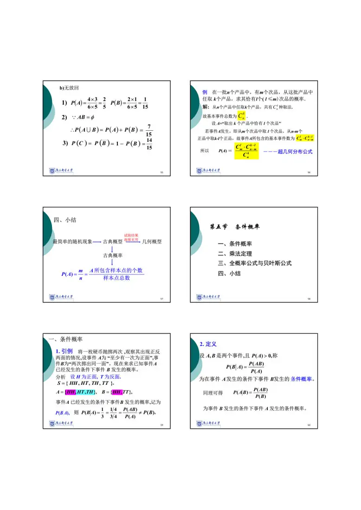

原文：

四、小结

最简单的随机现象 $\longrightarrow$ 古典概型 $\xrightarrow{\text{试验结果连续无穷}}$ 几何概型 $\downarrow$ 古典概率 $\downarrow$ $P(A) = \frac{m}{n} = \frac{A\text{所包含样本点的个数}}{\text{样本点总数}}$

南京邮电大学
Nanjing University of Physics and Telecommunications

一、条件概率

1. 引例 将一枚硬币抛掷两次, 观察其出现正反两面的情况, 设事件 A 为 “至少有一次为正面”, 事件 B 为 “两次掷出同一面”。现在来求已知事件 A 已经发生的条件下事件 B 发生的概率。

分析 设 H 为正面, T 为反面.

$$
S = \{H H, H T, T H, T T \} 。
$$

$$
A = \{H H, H T, T H \}, \quad B = \{H H, T T \},
$$

事件A 已经发生的条件下事件B 发生的概率,记为 $P(B|A)$ ，则 $P(B|A)=\frac{1}{3}=\frac{1/4}{3/4}=\frac{P(AB)}{P(A)}\neq P(B)$ 。

南京新電大學
Nanjing University of Physics and Telecommunications

第五节 条件概率

一、条件概率

二、乘法定理

三、全概率公式与贝叶斯公式

四、小结

南京邮电大学
Nanjing University of Physics and Telecommunications

2. 定义

设 $A, B$ 是两个事件, 且 $P(A) > 0$ , 称

$$
P (B \mid A) = \frac {P (A B)}{P (A)}
$$

为在事件 $A$ 发生的条件下事件 $B$ 发生的条件概率。

同理可得

$$
P (A | B) = \frac {P (A B)}{P (B)}
$$

为事件 B 发生的条件下事件 A 发生的条件概率。

南京邮电大学
Nanjing University of Physics and Telecommunications

56

南京邮电大学
Nanjing University of Physics and Telecommunications

55

b)无放回

$P(A) = \frac{4\times 3}{6\times 5} = \frac{2}{5}$ $P(B) = \frac{2\times 1}{6\times 5} = \frac{1}{15}$

1) $P(A) = \frac{4\times 3}{6\times 5} = \frac{2}{5}$ $P(B) = \frac{2\times 1}{6\times 5} = \frac{1}{15}$

2) $\because AB = \phi$

$\because AB = \phi$

$\therefore P(A \cup B) = P(A) + P(B) = \frac{7}{15}$

3) $P(C) = P(\overline{B}) = 1 - P(B) = \frac{14}{15}$

南京航空航天大学
Nanjing University of Physics and Telecommunications

例 在一批 $n$ 个产品中，有 $m$ 个次品，从这批产品中任取 $k$ 个产品，求其恰有 $l$ 个 $(l \leqslant m)$ 次品的概率.

解：从 $n$ 个产品中任取 $k$ 个产品，共有 $C_n^k$ 种取法.

故基本事件总数为 $C_n^k$

设 $A =$ “取出 $k$ 个产品中恰有 $l$ 个次品”

若事件A发生，即从m个次品中取l个次品，从n-m个正品中取k-l个正品，故事件A所包含的基本事件数为 $C_{m}^{l}\cdot C_{n-m}^{k-l}$

所以

$$P(A)=\frac{C\_{m}^{l}\cdot C\_{n-m}^{k-l}}{C\_{n}^{k}}$$

从 $n - m$ 个

- 超几何分布公式

### 二、乘法定理

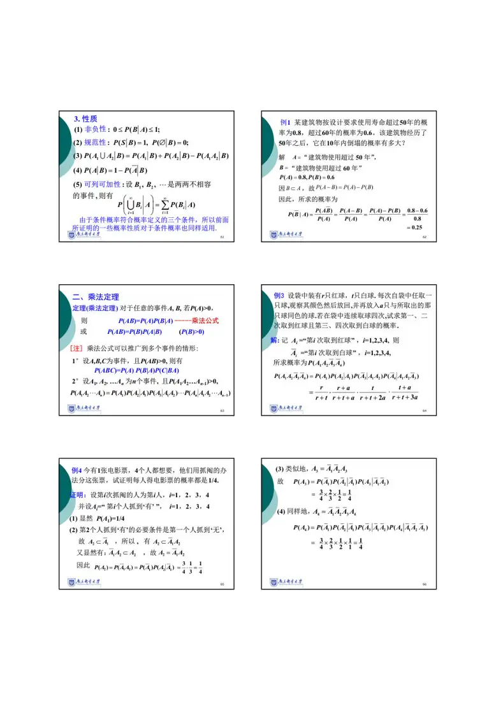

原文：

由于条件概率符合概率定义的三个条件，所以前面所证明的一些概率性质对于条件概率也同样适用。

二、乘法定理

定理(乘法定理)对于任意的事件A, B, 若 $P(A)>0$ ,

则 $P(AB) = P(A)P(B|A)$ ——乘法公式或 $P(AB) = P(B)P(A|B)\quad (P(B) > 0)$

[注] 乘法公式可以推广到多个事件的情形:

$1^{\circ}$ 设 $A, B, C$ 为事件，且 $P(AB) > 0$ ，则有

$$
P (A B C) = P (A) P (B | A) P (C | B A)
$$

$2^{\circ}$ 设 $A_{1}, A_{2}, \ldots, A_{n}$ 为 $n$ 个事件，且 $P(A_{1}A_{2} \ldots A_{n-1}) > 0$

$$
P \left(A _ {1} A _ {2} \dots A _ {n}\right) = P \left(A _ {1}\right) P \left(A _ {2} \mid A _ {1}\right) P \left(A _ {3} \mid A _ {1} A _ {2}\right) \dots P \left(A _ {n} \mid A _ {1} A _ {2} \dots A _ {n - 1}\right)
$$

南京邮电大学
Nanjing University of Physics and Telecommunications

例4 今有1张电影票，4个人都想要，他们用抓阄的办法分这张票，试证明每人得电影票的概率都是1/4.

证明：设第i次抓阄的人为第i人，i=1，2，3，4
并设 $A_{i}$ =“第i个人抓到‘有’”，i=1，2，3，4

(1) 显然 $P(A_{1}) = 1 / 4$

(2) 第2个人抓到‘有’的必要条件是第一个人抓到‘无’，故 $A_{2} \subset \overline{A}_{1}$ ，所以，有 $A_{2} \subset \overline{A}_{1} A_{2}$

又显然有： $\overline{A}_1A_2\subset A_2$ ，故 $A_{2} = \overline{A}_{1}A_{2}$

因此 $P(A_{2}) = P(\overline{A}_{1}A_{2}) = P(\overline{A}_{1})P(A_{2}\big|\overline{A}_{1}) = \frac{3}{4}\cdot \frac{1}{3} = \frac{1}{4}$

南京新電大學
Nanjing University of Physics and Telecommunications

例3 设袋中装有 $r$ 只红球， $t$ 只白球。每次自袋中任取一只球。观察其颜色然后放回，并再放入 $a$ 只与所取出的那只球同色的球。若在袋中连续取球四次，试求第一、二次取到红球且第三、四次取到白球的概率。

解: 记 $A_{i}=$ “第i次取到红球”，i=1,2,3,4，则

$$
\overline {{{A}}} _ {i} = “ \text {第} i \text {次取到白球} ”, i = 1, 2, 3, 4,
$$

所求概率为 $P(A_{1}A_{2}\overline{A}_{3}\overline{A}_{4})$

$$
\begin{array}{r l} P (A _ {1} A _ {2} \overline {{{A}}} _ {3} \overline {{{A}}} _ {4}) & = P (A _ {1}) P (A _ {2} | A _ {1}) P (\overline {{{A}}} _ {3} | A _ {1} A _ {2}) P (\overline {{{A}}} _ {4} | A _ {1} A _ {2} \overline {{{A}}} _ {3}) \\ & = \frac {r}{r + t} \cdot \frac {r + a}{r + t + a} \cdot \frac {t}{r + t + 2 a} \cdot \frac {t + a}{r + t + 3 a} \end{array}
$$

3. 性质

(1) 非负性： $0 \leq P(B|A) \leq 1;$

$0 \leq P(B | A) \leq 1;$

$P(S|B) = 1, P(\emptyset | B) = 0;$

(2) 规范性： $P(S|B)=1,\ P(\varnothing|B)=0;$

$P(A_{1}\bigcup A_{2}|B) = P(A_{1}|B) + P(A_{2}|B) - P(A_{1}A_{2}|B)$

(3) $P(A_{1}\bigcup A_{2}|B) = P(A_{1}|B) + P(A_{2}|B) - P(A_{1}A_{2}|B)$

(4) $P(A|B) = 1 - P(\overline{A}|B)$

$P(A|B) = 1 - P(\overline{A}|B)$

(5) 可列可加性: 设 $B_{1}, B_{2}, \cdots$ 是两两不相容

$B_{1}, B_{2}, \cdots$

的事件,则有 $P\left(\bigcup_{i=1}^{\infty}B_{i}\Big|A\right)=\sum_{i=1}^{\infty}P(B_{i}\Big|A)$

$P\left(\bigcup_{i=1}^{\infty} B_i \mid A\right) = \sum_{i=1}^{\infty} P(B_i \mid A)$

例1 某建筑物按设计要求使用寿命超过50年的概率为0.8，超过60年的概率为0.6。该建筑物经历了50年之后，它在10年内倒塌的概率有多大？

南京航空航天大学
Nanjing University of Physics and Telecommunications

A = “

解 $A =$ “建筑物使用超过50年”，

50年",

B = “

$B =$ “建筑物使用超过60年”

$P(A) = 0.8, P(B) = 0.6$

$B\subset A$

因 $B \subset A$ ，故 $P(A - B) = P(A) - P(B)$

$P(A - B) = P(A) - P(B)$

因此，所求的概率为

$P(\overline{B} \mid A) = \frac{P(A\overline{B})}{P(A)} = \frac{P(A - B)}{P(A)} = \frac{P(A) - P(B)}{P(A)} = \frac{0.8 - 0.6}{0.8}$

62

南京邮电大学
Nanjing University of Press and Telecommunications

(3) 类似地， $A_{3}=\bar{A}_{1}\bar{A}_{2}A_{3}$

故 $P(A_{3}) = P(\overline{A}_{1})P(\overline{A}_{2}|\overline{A}_{1})P(A_{3}|\overline{A}_{1}\overline{A}_{2})$ $= \frac{3}{4}\times \frac{2}{3}\times \frac{1}{2} = \frac{1}{4}$

(4) 同样地， $A_{4}=\overline{A}_{1}\overline{A}_{2}\overline{A}_{3}A_{4}$

$P(A_{4}) = P(\overline{A}_{1})P(\overline{A}_{2}|\overline{A}_{1})P(\overline{A}_{3}|\overline{A}_{1}\overline{A}_{2})P(A_{4}|\overline{A}_{1}\overline{A}_{2}\overline{A}_{3})$ $= \frac{3}{4}\times \frac{2}{3}\times \frac{1}{2}\times \frac{1}{1} = \frac{1}{4}$

南京邮电大学
Nanjing University of Science and Telecommunications

### 1. 样本空间的划分

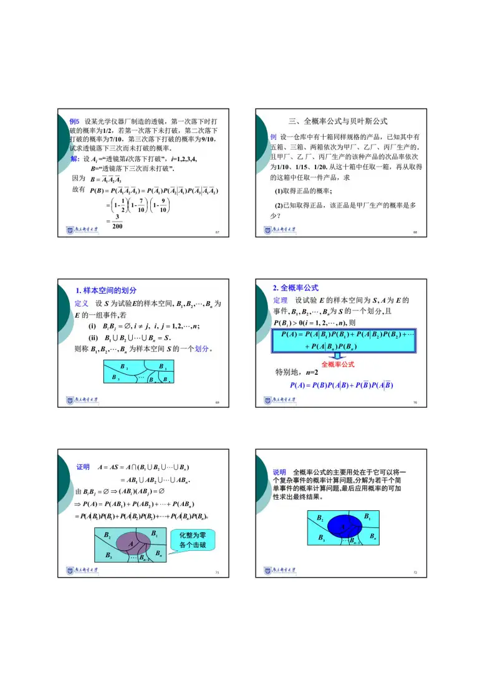

原文：

1. 样本空间的划分

定义 设 S 为试验 E 的样本空间, $B_{1}, B_{2}, \cdots, B_{n}$ 为 E 的一组事件, 若

(i) $B_{i}B_{j}=\varnothing, i\neq j, i, j=1,2,\cdots,n;$

(ii) $B_{1} \cup B_{2} \cup \cdots \cup B_{n} = S.$

则称 $B_{1}, B_{2}, \cdots, B_{n}$ 为样本空间 S 的一个划分。

证明 $A = AS = A \cap (B_{1} \cup B_{2} \cup \dots \cup B_{n})$

$$
= A B _ {1} \cup A B _ {2} \cup \dots \cup A B _ {n}
$$

由 $B_{i}B_{j} = \emptyset \Rightarrow (AB_{i})(AB_{j}) = \emptyset$

$$
\Rightarrow P (A) = P \left(A B _ {1}\right) + P \left(A B _ {2}\right) + \dots + P \left(A B _ {n}\right)
$$

$$
= P (A \mid B _ {1}) P (B _ {1}) + P (A \mid B _ {2}) P (B _ {2}) + \dots + P (A \mid B _ {n}) P (B _ {n}).
$$

2. 全概率公式

定理 设试验 E 的样本空间为 S, A 为 E 的事件, $B_{1}, B_{2}, \cdots, B_{n}$ 为 S 的一个划分, 且

$P(B_{i})>0(i=1,2,\cdots,n)$ ，则

$$
\begin{array}{r l} P (A) & = P (A \mid B _ {1}) P (B _ {1}) + P (A \mid B _ {2}) P (B _ {2}) + \dots \\ & + P (A \mid B _ {n}) P (B _ {n}) \end{array}
$$

全概率公式

特别地， $n = 2$

$$
P (A) = P (B) P (A | B) + P (\overline {{B}}) P (A | \overline {{B}})
$$

例5 设某光学仪器厂制造的透镜，第一次落下时打破的概率为 $1 / 2$ ，若第一次落下未打破，第二次落下打破的概率为7/10，第三次落下打破的概率为9/10，试求透镜落下三次而未打破的概率.

$A_{i} =$

解：设 $A_{i}=$ “透镜第i次落下打破”，i=1,2,3,4，

i=1,2,3,4,

B=“透镜落下三次而未打破”.

因为 $B = \overline{A}_1\overline{A}_2\overline{A}_3$

$B = \overline{A}_1\overline{A}_2\overline{A}_3$

故有 $P(B) = P(\overline{A}_1\overline{A}_2\overline{A}_3) = P(\overline{A}_1)P(\overline{A}_2|\overline{A}_1)P(\overline{A}_3|\overline{A}_1\overline{A}_2)$

$P(B) = P(\overline{A}_1\overline{A}_2\overline{A}_3) = P(\overline{A}_1)P(\overline{A}_2|\overline{A}_1)P(\overline{A}_3|\overline{A}_1\overline{A}_2)$

$= \left(1 - \frac{1}{2}\right)\left(1 - \frac{7}{10}\right)\left(1 - \frac{9}{10}\right)$ $= \frac{3}{200}$

67

三、全概率公式与贝叶斯公式

例 设一仓库中有十箱同样规格的产品，已知其中有五箱、三箱、两箱依次为甲厂、乙厂、丙厂生产的。且甲厂、乙厂、丙厂生产的该种产品的次品率依次为1/10、1/15、1/20。从这十箱中任取一箱，再从取得的这箱中任取一件产品，求

南京邮电大学
Nanjing University of Private and Telecommunication

(1)取得正品的概率;

(2)已知取得正品，该正品是甲厂生产的概率是多少？

68

南京邮电大学
Nanjing University of Press and Telecommunications

说明 全概率公式的主要用处在于它可以将一个复杂事件的概率计算问题,分解为若干个简单事件的概率计算问题,最后应用概率的可加性求出最终结果。

南京邮电大学
Nanjing University of Science and Telecommunications

70

72

### (1)取得正品的概率;

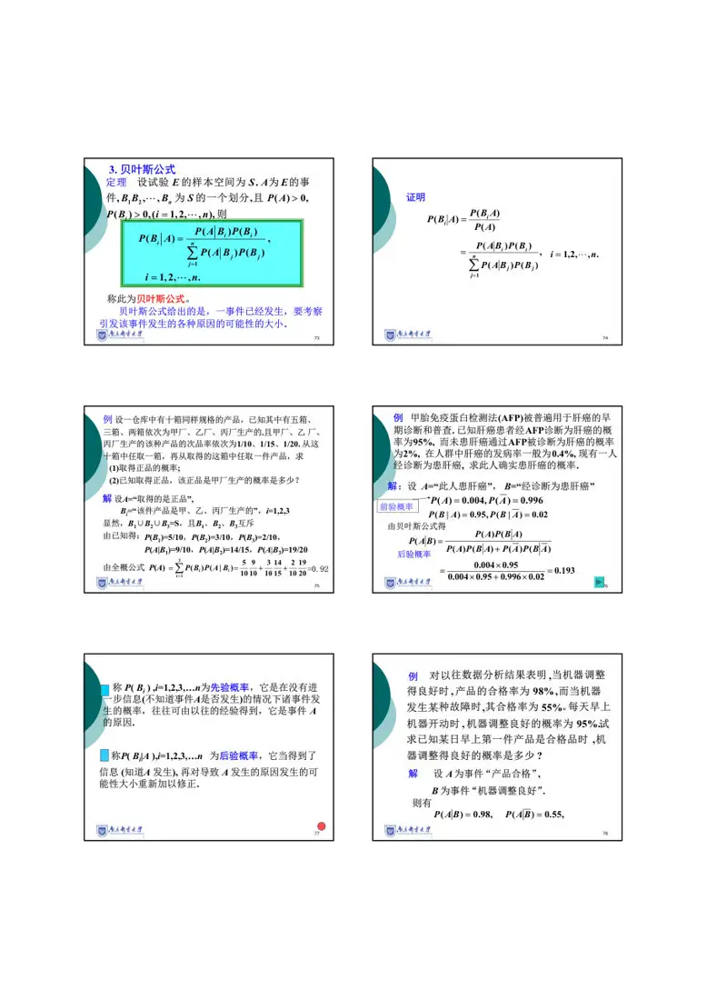

原文：

贝叶斯公式给出的是，一事件已经发生，要考察引发该事件发生的各种原因的可能性的大小.

例设一仓库中有十箱同样规格的产品，已知其中有五箱、三箱、两箱依次为甲厂、乙厂、丙厂生产的.且甲厂、乙厂、丙厂生产的该种产品的次品率依次为1/10、1/15、1/20.从这十箱中任取一箱，再从取得的这箱中任取一件产品，求

(1)取得正品的概率;

(2)已知取得正品，该正品是甲厂生产的概率是多少？

解设 $A =$ “取得的是正品”，

$B_{i}=$ “该件产品是甲、乙、丙厂生产的”，i=1,2,3

显然， $B_{1}\cup B_{2}\cup B_{3} = \mathbf{S}$ ，且 $B_{1}$ 、 $B_{2}$ 、 $B_{3}$ 互斥

由已知得： $P(B_{1}) = 5 / 10$ ， $P(B_{2}) = 3 / 10$ ， $P(B_{3}) = 2 / 10$

$$
P (A | B _ {1}) = 9 / 1 0, P (A | B _ {2}) = 1 4 / 1 5, P (A | B _ {3}) = 1 9 / 2 0
$$

由全概公式 $P(A)=\sum_{i=1}^{3}P(B_{i})P(A|B_{i})=\frac{5}{10}\frac{9}{10}+\frac{3}{10}\frac{14}{15}+\frac{2}{10}\frac{19}{20}=0.92$

称 $P(B_{i}), i = 1,2,3,\ldots n$ 为先验概率，它是在没有进一步信息(不知道事件 $A$ 是否发生)的情况下诸事件发生的概率，往往可由以往的经验得到，它是事件 $A$ 的原因.

称 $P(B_{i}|A), i=1,2,3,\ldots,n$ 为后验概率，它当得到了信息(知道A发生)，再对导致A发生的原因发生的可能性大小重新加以修正.

例 甲胎免疫蛋白检测法(AFP)被普遍用于肝癌的早期诊断和普查. 已知肝癌患者经AFP诊断为肝癌的概率为95%, 而未患肝癌通过AFP被诊断为肝癌的概率为2%, 在人群中肝癌的发病率一般为0.4%, 现有一人经诊断为患肝癌, 求此人确实患肝癌的概率.

解：设 A=“此人患肝癌”，B=“经诊断为患肝癌”

前验概率

$$
\begin{array}{c} \nearrow P (A) = 0. 0 0 4, P (\overline {{A}}) = 0. 9 9 6 \\ P (B \mid A) = 0. 9 5, P (B \mid \overline {{A}}) = 0. 0 2 \end{array}
$$

由贝叶斯公式得

后验概率

南京邮电大学
Nanjing University of Press and Telecommunications

$$
= \frac {0 . 0 0 4 \times 0 . 9 5}{0 . 0 0 4 \times 0 . 9 5 + 0 . 9 9 6 \times 0 . 0 2} = 0. 1 9 3
$$

例 对以往数据分析结果表明,当机器调整得良好时,产品的合格率为98%,而当机器发生某种故障时,其合格率为55%。每天早上机器开动时,机器调整良好的概率为95%.试求已知某日早上第一件产品是合格品时,机器调整得良好的概率是多少?

解 设 A 为事件 “产品合格”，

B 为事件 “机器调整良好”.

则有

$$
P (A | B) = 0. 9 8, \quad P (A | \overline {{{B}}}) = 0. 5 5,
$$

74

3. 贝叶斯公式

$B_{1}B_{2},\cdots,B_{n}$

定理 设试验 E 的样本空间为 S. A 为 E 的事件, $B_{1}B_{2}, \cdots, B_{n}$ 为 S 的一个划分, 且 $P(A) > 0$ , $P(B_{i}) > 0, (i = 1, 2, \cdots, n)$ , 则

$P(B_{i})>0,(i=1,2,\cdots,n),$

$P(A) > 0,$

$P(B_{i}|A)=\frac{P(A|B_{i})P(B_{i})}{\sum_{j=1}^{n}P(A|B_{j})P(B_{j})},$ $i=1,2,\cdots,n.$

称此为贝叶斯公式。

证明

$P(B_{i}|A) = \frac{P(B_{i}A)}{P(A)}$ $= \frac{P(A|B_i)P(B_i)}{\sum_{j = 1}^{n}P(A|B_j)P(B_j)}, i = 1,2,\dots ,n.$

南京邮电大学
Nanjing University of Private and Telecommunications

南京邮电大学
Nanjing University of Science and Telecommunications

### 2. 条件概率 $P(A|B)$ 与积事件概率 $P(AB)$ 的区别。

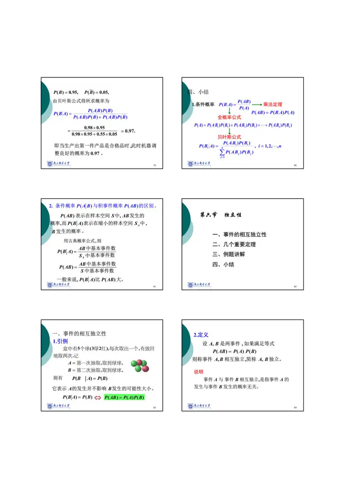

原文：

2. 条件概率 $P(A|B)$ 与积事件概率 $P(AB)$ 的区别。

$P(AB)$ 表示在样本空间 S 中, AB 发生的概率, 而 $P(B|A)$ 表示在缩小的样本空间 $S_{A}$ 中, B 发生的概率。

用古典概率公式,则

$$
P (B \mid A) = \frac {A B \text {中基本事件数}}{S _ {A} \text {中基本事件数}}
$$

$$
P (A B) = \frac {A B \text {   中基本事件数   }}{S \text {   中基本事件数   }}
$$

一般来说, $P(B|A)$ 比 $P(AB)$ 大。

一、事件的相互独立性

1.引例

盒中有5个球(3绿2红),每次取出一个,有放回地取两次.记

$A =$ 第一次抽取，取到绿球，

$B =$ 第二次抽取，取到绿球，

则有 $P(B\mid A) = P(B)$

它表示 $A$ 的发生并不影响 $B$ 发生的可能性大小。

$$
P (B | A) = P (B) \iff P (A B) = P (A) P (B)
$$

南京新電大學
Nanjing University of Physics and Telecommunications

第六节 独立性

一、事件的相互独立性

二、几个重要定理

三、例题讲解

四、小结

南京航空航天大学
Nanjing University of Physics and Telecommunications

79

$P(B) = 0.95,\quad P(\overline{B}) = 0.05,$

由贝叶斯公式得所求概率为

$P(B|A) = \frac{P(A|B)P(B)}{P(A|B)P(B) + P(A|\overline{B})P(\overline{B})}$ $= \frac{0.98\times 0.95}{0.98\times 0.95 + 0.55\times 0.05} = 0.97.$

即当生产出第一件产品是合格品时,此时机器调整良好的概率为0.97。

80

南京邮电大学
Nanjing University of Press and Telecommunications

南京邮电大学
Nanjing University of Press and Telecommunications

四、小结

$P(B|A)=\frac{P(AB)}{P(A)}$

1. 条件概率 $P(B|A)=\frac{P(AB)}{P(A)}$ → 乘法定理
↓ 全概率公式 $P(AB)=P(B|A)P(A)$

$P(A)=P(A|B_{1})P(B_{1})+P(A|B_{2})P(B_{2})+\cdots+P(A|B_{n})P(B_{n})$ 贝叶斯公式

$P(B_{i}|A)=\frac{P(A|B_{i})P(B_{i})}{\sum_{j=1}^{n}P(A|B_{j})P(B_{j})}, i=1,2,\cdots,n$

南京邮电大学
Nanjing University of Press and Telecommunications

82

2. 定义

设 A, B 是两事件, 如果满足等式 $P(AB)=P(A)P(B)$

则称事件 A, B 相互独立, 简称 A, B 独立。

说明

事件 A 与事件 B 相互独立,是指事件 A 的发生与事件 B 发生的概率无关。

南京新電大學
Nanjing University of Private and Telecommunications

### 由此可见两事件相互独立，但两事件不互斥。

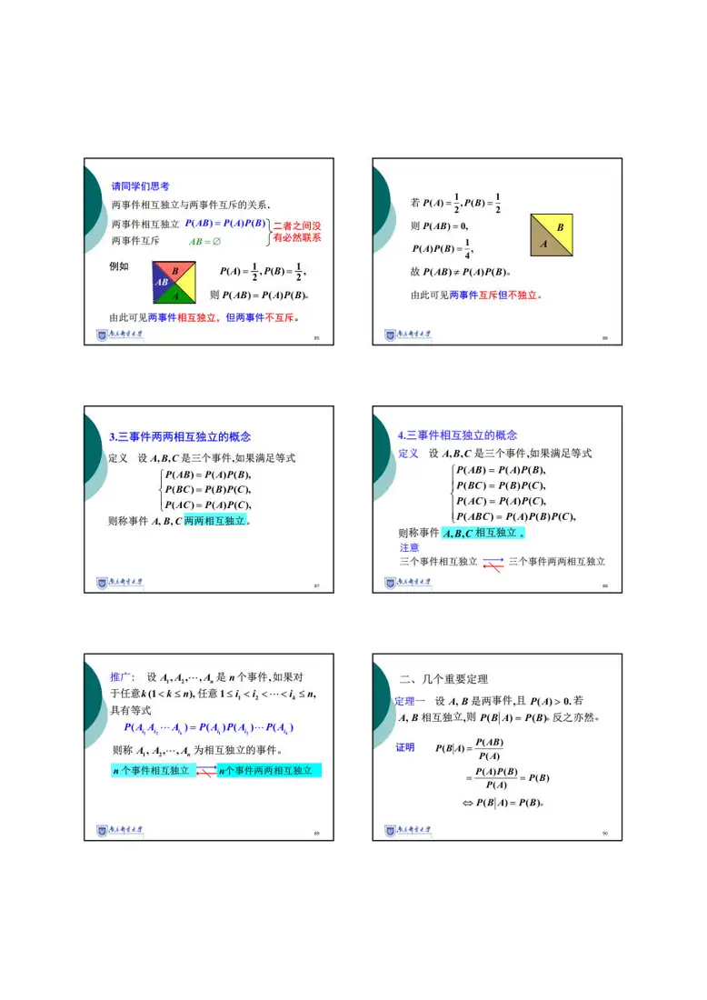

原文：

由此可见两事件相互独立，但两事件不互斥。

3.三事件两两相互独立的概念

定义 设 $A, B, C$ 是三个事件, 如果满足等式

$$
\left\{ \begin{array}{l} P (A B) = P (A) P (B), \\ P (B C) = P (B) P (C), \\ P (A C) = P (A) P (C), \end{array} \right.
$$

则称事件 $A, B, C$ 两两相互独立。

南京邮电大学
Nanjing University of Physics and Telecommunications

推广：设 $A_{1}, A_{2}, \cdots, A_{n}$ 是 n 个事件，如果对于任意 $k (1 < k \leq n)$ ，任意 $1 \leq i_{1} < i_{2} < \cdots < i_{k} \leq n$ ，具有等式

$$
P \left(A _ {i _ {1}} A _ {i _ {2}} \dots A _ {i _ {k}}\right) = P \left(A _ {i _ {1}}\right) P \left(A _ {i _ {2}}\right) \dots P \left(A _ {i _ {k}}\right)
$$

则称 $A_{1}, A_{2}, \cdots, A_{n}$ 为相互独立的事件。

n个事件相互独立 $\leftarrow$ n个事件两两相互独立

4.三事件相互独立的概念

定义 设 $A, B, C$ 是三个事件, 如果满足等式

$$
\left\{ \begin{array}{l} P (A B) = P (A) P (B), \\ P (B C) = P (B) P (C), \\ P (A C) = P (A) P (C), \\ P (A B C) = P (A) P (B) P (C), \end{array} \right.
$$

则称事件 $A, B, C$ 相互独立。

注意

三个事件相互独立 $\rightarrow$ 三个事件两两相互独立

$$
\begin{array}{r l} P (B | A) & = \frac {P (A B)}{P (A)} \\ & = \frac {P (A) P (B)}{P (A)} = P (B) \\ & \Leftrightarrow P (B | A) = P (B). \end{array}
$$

88

86

请同学们思考

两事件相互独立与两事件互斥的关系.

$P(AB) = P(A)P(B)$

两事件相互独立 $P(AB)=P(A)P(B)$ 二者之间没有必然联系
两事件互斥 $AB = \varnothing$

$AB = \emptyset$

例如

AB
B
A

$P(A) = \frac{1}{2}, P(B) = \frac{1}{2},$

则 $P(AB) = P(A)P(B)$ 。

85

若 $P(A) = \frac{1}{2}, P(B) = \frac{1}{2}$

$P(A) = \frac{1}{2}, P(B) = \frac{1}{2}$

则 $P(AB) = 0$

$P(AB) = 0,$

$P(A)P(B) = \frac{1}{4},$

B
A

故 $P(AB) \neq P(A)P(B)$ 。

$P(AB)\neq P(A)P(B)$

由此可见两事件互斥但不独立。

南京新電大學
Nanjing University of Private and Telecommunications

南京邮电大学
Nanjing University of Press and Telecommunications

二、几个重要定理

定理一 设 $A, B$ 是两事件, 且 $P(A) > 0$ . 若

$A, B$ 相互独立, 则 $P(B|A) = P(B)$ 。反之亦然。

证明

### 两个结论

原文：

两个结论

1. 若事件 $A_{1}, A_{2}, \cdots, A_{n} (n \geq 2)$ 相互独立，则其中任意 $k (2 \leq k \leq n)$ 个事件也是相互独立。

2. 若 n 个事件 $A_{1}, A_{2}, \cdots, A_{n} (n \geq 2)$ 相互独立，则将 $A_{1}, A_{2}, \cdots, A_{n}$ 中任意多个事件换成它们的对立事件，所得的 n 个事件仍相互独立。

三、例题讲解

射击问题

例1 设每一名机枪射击手击落飞机的概率都是0.2, 若10名机枪射击手同时向一架飞机射击, 问击落飞机的概率是多少?

解设事件 $A_{i}$ 为“第 $i$ 名射手击落飞机”，

事件 B 为“击落飞机”， $i=1,2,\cdots,10$ 。

则 $B = A_{1} \cup A_{2} \cup \cdots \cup A_{10}$ ,

例2 甲、乙、丙三人同时对飞机进行射击，三人击中的概率分别为0.4, 0.5, 0.7，飞机被一人击中而被击落的概率为0.2，被两人击中而被击落的概率为0.6，若三人都击中飞机必定被击落，求飞机被击落的概率。

解设 $A_{i}$ 表示有 $i$ 个人击中飞机， $i = 0,1,2,3$

A, B, C 分别表示甲、乙、丙击中飞机 D 表示飞机被击落。

则 $P(A) = 0.4, P(B) = 0.5, P(C) = 0.7,$

$P(D|A_{0})=0, P(D|A_{1})=0.2, P(D|A_{2})=0.6, P(D|A_{3})=1$

92

A, B

定理二 若 $A, B$ 相互独立, 则下列各对事件, $\overline{A}$ 与 $B$ , $A$ 与 $\overline{B}, \overline{A}$ 与 $\overline{B}$ 也相互独立。

B, A

B

B

证明 先证 $A$ 与 $\overline{B}$ 独立。

$\overline{B}$

$A = AB\cup A\overline{B}$

因为 $A = AB \cup A\overline{B}$ 且 $(AB)(A\overline{B}) = \emptyset,$

$(AB)(A\overline{B}) = \emptyset ,$

所以 $P(A)=P(AB)+P(A\overline{B})$ ,

$P(A) = P(AB) + P(A\overline{B}),$

即 $P(A\overline{B}) = P(A) - P(AB)$ 。

$P(A\overline{B}) = P(A) - P(AB)$

南京邮电大学
Nanjing University of Physics and Telecommunications

91

$P(A\overline{B}) = P(A) - P(A)P(B)$ $= P(A)(1 - P(B))$ $= P(A)P(\overline{B})_{\circ}$

$P(AB) = P(A)P(B),$

从而 $A$ 与 $\overline{B}$ 相互独立。

$\overline{B}$

南京航空航天大学
Nanjing University of Physics and Telecommunications

因而

又因为 $A$ 、 $B$ 相互独立, 所以有

南京邮电大学
Nanjing University of Physics and Telecommunications

南京新電大學
Nanjing University of Physics and Telecommunications

$P(B)=P(A_{1}\bigcup A_{2}\bigcup\cdots\bigcup A_{10})$ $=1-P(\overline{A_{1}}\bigcup A_{2}\bigcup\cdots\bigcup A_{10})$ $=1-P(\overline{A_{1}}\bigcap\overline{A_{2}}\bigcap\cdots\bigcap\overline{A_{10}})$ $=1-P(\overline{A_{1}})P(\overline{A_{2}})\cdots P(\overline{A_{10}})$ $=1-(0.8)^{10}=0.893$ 。

南京邮电大学
Nanjing University of Press and Telecommunications

### 因而,由全概率公式得飞机被击落的概率为

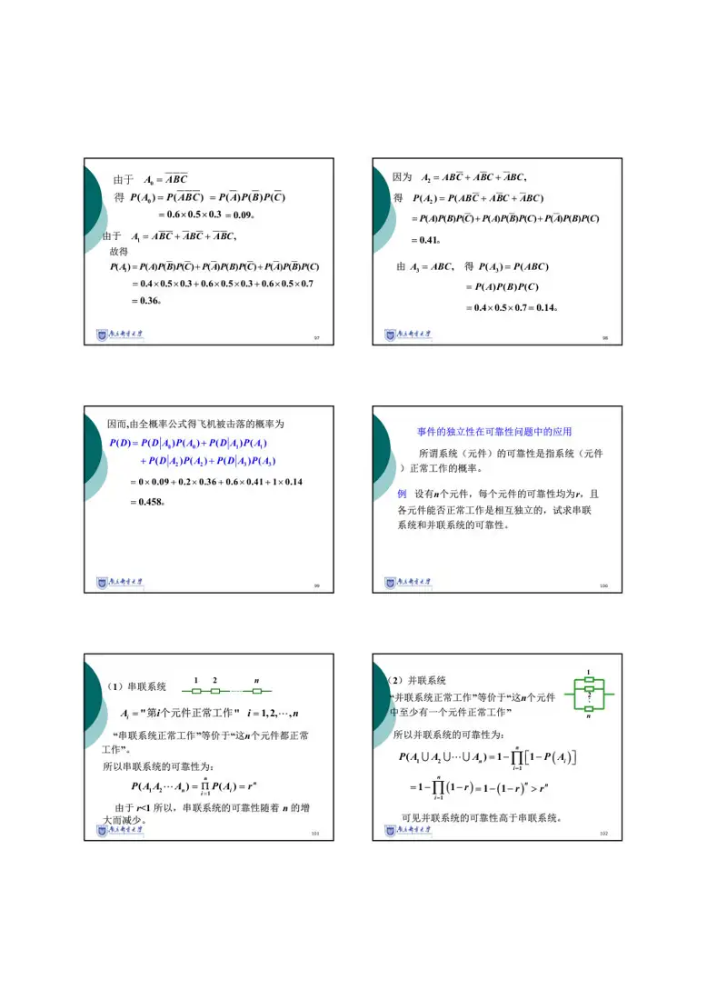

原文：

因而,由全概率公式得飞机被击落的概率为

$$
\begin{array}{r l} P (D) & = P (D \mid A _ {0}) P (A _ {0}) + P (D \mid A _ {1}) P (A _ {1}) \\ & \quad + P (D \mid A _ {2}) P (A _ {2}) + P (D \mid A _ {3}) P (A _ {3}) \\ & = 0 \times 0. 0 9 + 0. 2 \times 0. 3 6 + 0. 6 \times 0. 4 1 + 1 \times 0. 1 4 \\ & = 0. 4 5 8 。 \end{array}
$$

$A_{i}=$ "第i个元件正常工作" $i=1,2,\cdots,n$

$$
\begin{array}{c c c c c} 1 & 2 \\ \hline \end{array} \dots \dots \begin{array}{c c c c c} n \\ \hline \end{array}
$$

“串联系统正常工作”等价于“这n个元件都正常工作”。

(1) 串联系统

所以串联系统的可靠性为：

$$
P (A _ {1} A _ {2} \dots A _ {n}) = \prod_ {i = 1} ^ {n} P (A _ {i}) = r ^ {n}
$$

由于 $r < 1$ 所以，串联系统的可靠性随着 $n$ 的增大而减少。

南京邮电大学
Nanjing University of Private and Telecommunications

事件的独立性在可靠性问题中的应用

所谓系统（元件）的可靠性是指系统（元件）正常工作的概率。

例 设有 n 个元件，每个元件的可靠性均为 r，且各元件能否正常工作是相互独立的，试求串联系统和并联系统的可靠性。

南京邮电大学
Nanjing University of Private and Telecommunications

由于 $A_0 = \overline{A}\overline{B}\overline{C}$

$A_{0} = \overline{A}\overline{B}\overline{C}$

得 $P(A_{0})=P(\overline{A}\overline{B}\overline{C})=P(\overline{A})P(\overline{B})P(\overline{C})$ $=0.6\times0.5\times0.3=0.09。$

$P(A_0) = P(\overline{A}\overline{B}\overline{C}) = P(\overline{A})P(\overline{B})P(\overline{C})$ $= 0.6\times 0.5\times 0.3 = 0.09_{\circ}$

由于 $A_{1} = A\overline{B}\overline{C} +\overline{A} B\overline{C} +\overline{A}\overline{B} C,$

$A_{1} = A\overline{B}\overline{C} + \overline{A} B\overline{C} + \overline{A}\overline{B} C,$

故得

$P(A_{1}) = P(A)P(\overline{B})P(\overline{C}) + P(\overline{A})P(B)P(\overline{C}) + P(\overline{A})P(\overline{B})P(C)$ $= 0.4\times 0.5\times 0.3 + 0.6\times 0.5\times 0.3 + 0.6\times 0.5\times 0.7$ $= 0.36_{\circ}$

南京邮电大学
Nanjing University of Physics and Telecommunications

97

得 $P(A_{2}) = P(AB\overline{C} +A\overline{B} C + \overline{A} BC)$ $= P(A)P(B)P(\overline{C}) + P(A)P(\overline{B})P(C) + P(\overline{A})P(B)P(C)$ $= 0.41$

98

$A_{3} = ABC,$

由 $A_{3}=ABC$ ，得 $P(A_{3})=P(ABC)$ $=P(A)P(B)P(C)$ $=0.4\times0.5\times0.7=0.14。$

因为 $A_{2} = AB\overline{C} + A\overline{B} C + \overline{A} BC,$

$A_{2} = AB\overline{C} + A\overline{B} C + \overline{A} BC,$

100

南京邮电大学
Nanjing University of Physics and Telecommunications

南京邮电大学
Nanjing University of Private and Telecommunication

(2) 并联系统

“并联系统正常工作”等价于“这n个元件中至少有一个元件正常工作”

所以并联系统的可靠性为：

$P(A_{1}\bigcup A_{2}\bigcup \dots \bigcup A_{n}) = 1 - \prod_{i = 1}^{n}\left[1 - P(A_{i})\right]$

$= 1 - \prod_{i = 1}^{n}(1 - r) = 1 - (1 - r)^{n} > r^{n}$

可见并联系统的可靠性高于串联系统。

### 以 $A_{i}$ (i=1,2,3,4) 表示事件第 i 个元件正常工作，

原文：

以 $A_{i}$ (i=1,2,3,4) 表示事件第 i 个元件正常工作，

贝努利试验和二项概率

将某一试验独立地重复进行n次，我们只关心每次试验某个事件A是否发生，这种试验称为贝努利试验，相应的数学模型称为贝努利概型。

它具有如下四个特征

(1) 在相同条件下进行 $n$ 次重复试验;

(2) 每次试验结果有且仅有两种: $A$ 或 $\overline{A}$

(3) 每次试验是相互独立的;

(4) 每次试验中 $P(A)=p, P(\overline{A})=1-p$

由于这种指定方式有 $C_n^k$ 种，且它们是两两互不相容的

$$
P _ {n} (k) = P \left(B _ {k}\right) = C _ {n} ^ {k} p ^ {k} (1 - p) ^ {n - k}
$$

$$
k = 0, 1, 2, \dots , n
$$

因为 $C_{n}^{k}p^{k}(1-p)^{n-k}\quad(k=0,1,2,\cdots,n)$ 恰好是 $\left|\left(1-p\right)+p\right|^{n}$ 按二项公式展开的各项，所以上述公式称为二项概率公式。

在 $n$ 重贝努里试验中，我们主要研究事件 $A$ 恰好出现 $k$ 次的概率 $P_{n}(k)$

设事件 $B_{k}$ “在 $n$ 重贝努里试验中事件 $A$ 恰好发生了 $k$ 次”，其中 $0 \leq k \leq n$

由于 n 次试验是相互独立的，所以事件 A 在指定的 k 次试验中发生，而在其余 $(n-k)$ 次试验中不发生（如前 k 次试验中 A 都发生，而在后 $(n-k)$ 次试验中 A 都不发生）的概率为：

$$
P (A \cdot A \dots A \cdot \overline {{A}} \cdot \overline {{A}} \dots \overline {{A}}))
$$

$$
= p \cdot p \dots p \cdot (1 - p) \dots (1 - p) = p ^ {k} (1 - p) ^ {n - k}
$$

$$
P _ {n} (k) = P \left(B _ {k}\right) = C _ {n} ^ {k} p ^ {k} (1 - p) ^ {n - k}
$$

南京邮电大学
Nanjing University of Private and Telecommunication

南京新電大學
Nanjing University of Physics and Telecommunications

例3 一个元件(或系统)能正常工作的概率称为元件(或系统)的可靠性.如图所示,设有4个独立工作的元件1,2,3,4按先串联再并联的方式联结(称为串并联系统),设第i个元件的可靠性为 $p_{i}$ (i=1,2,3,4).试求系统的可靠性。

$p_i$

$(i = 1,2,3,4)$

1 2
3 4

解

$A_{i}(i = 1,2,3,4)$

以 $A$ 表示系统正常工作.则有 $A = A_{1}A_{2}\cup A_{3}A_{4}$

$A = A_{1}A_{2}\cup A_{3}A_{4}$

1 2
3 4

由事件的独立性,得系统的可靠性:

$P(A) = P(A_{1}A_{2}) + P(A_{3}A_{4}) - P(A_{1}A_{2}A_{3}A_{4})$

$= P(A_{1})P(A_{2}) + P(A_{3})P(A_{4}) - P(A_{1})P(A_{2})P(A_{3})P(A_{4})$

$= p_{1}p_{2} + p_{3}p_{4} - p_{1}p_{2}p_{3}p_{4}\circ$

南京邮电大学
Nanjing University of Press and Telecommunications

因此我们有如下定理：

定理 在 $n$ 重贝努利试验中, 若设 $P(A) = p$ ,

$P(\overline{A}) = 1 - p,$

$P(\overline{A})=1-p,$ 则事件A恰好出现 $k(0\leq k\leq n)$ 次的概率是

$(k=0,1,2,\cdots n)$

104

106

南京邮电大学
Nanjing University of Science and Telecommunications

108

### (3)至多有3个设备被使用的概率是多少？

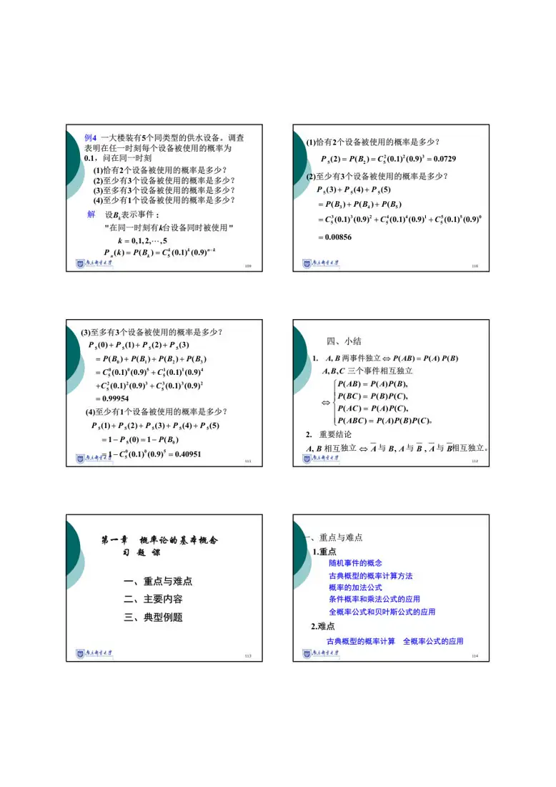

原文：

(3)至多有3个设备被使用的概率是多少？

$$
P _ {5} (0) + P _ {5} (1) + P _ {5} (2) + P _ {5} (3)
$$

$$
= P (B _ {0}) + P (B _ {1}) + P (B _ {2}) + P (B _ {3})
$$

$$
= C _ {5} ^ {0} (0. 1) ^ {0} (0. 9) ^ {5} + C _ {5} ^ {1} (0. 1) ^ {1} (0. 9) ^ {4}
$$

$$
\begin{array}{l} + C _ {5} ^ {2} (0. 1) ^ {2} (0. 9) ^ {3} + C _ {5} ^ {3} (0. 1) ^ {3} (0. 9) ^ {2} \\ = 0. 9 9 9 5 4 \end{array}
$$

(4)至少有1个设备被使用的概率是多少？

$$
P _ {5} (1) + P _ {5} (2) + P _ {5} (3) + P _ {5} (4) + P _ {5} (5)
$$

$$
= 1 - P _ {5} (0) = 1 - P \left(B _ {0}\right)
$$

$$
= 1 - C _ {5} ^ {0} (0. 1) ^ {0} (0. 9) ^ {5} = 0. 4 0 9 5 1
$$

四、小结

1. $A, B$ 两事件独立 $\Leftrightarrow P(AB) = P(A)P(B)$

$A,B,C$ 三个事件相互独立

$$
\Leftrightarrow \left\{ \begin{array}{l} P (A B) = P (A) P (B), \\ P (B C) = P (B) P (C), \\ P (A C) = P (A) P (C), \\ P (A B C) = P (A) P (B) P (C). \end{array} \right.
$$

2. 重要结论

A, B 相互独立 $\Leftrightarrow \overline{A}$ 与 B, A 与 $\overline{B}$ , $\overline{A}$ 与 $\overline{B}$ 相互独立。
南立邮管大学
112

第一章 概率论的基本概念

习题课

一、重点与难点

二、主要内容

三、典型例题

、重点与难点

1.重点

随机事件的概念

古典概型的概率计算方法

概率的加法公式

条件概率和乘法公式的应用

全概率公式和贝叶斯公式的应用

2.难点

古典概型的概率计算 全概率公式的应用

南京邮电大学
Nanjing University of Physics and Telecommunications

南京邮电大学
Nanjing University of Physics and Telecommunications

例4 一大楼装有5个同类型的供水设备。调查

表明在任一时刻每个设备被使用的概率为

0.1，问在同一时刻

(1)恰有2个设备被使用的概率是多少？

(2)至少有3个设备被使用的概率是多少？

(3)至多有3个设备被使用的概率是多少？

(4)至少有1个设备被使用的概率是多少？

解 设 $B_{k}$ 表示事件：

$B_{k}$

"在同一时刻有 $k$ 台设备同时被使用"

$k = 0,1,2,\dots ,5$

$P_{n}(k) = P(B_{k}) = C_{5}^{k}(0.1)^{k}(0.9)^{n - k}$

109

(1)恰有2个设备被使用的概率是多少？

$P_{5}(2) = P(B_{2}) = C_{5}^{2}(0.1)^{2}(0.9)^{3} = 0.0729$

(2)至少有3个设备被使用的概率是多少？

南京邮电大学
Nanjing University of Physics and Telecommunications

$P_{5}(3) + P_{5}(4) + P_{5}(5)$ $= P(B_3) + P(B_4) + P(B_5)$ $= C_5^3 (0.1)^3 (0.9)^2 +C_5^4 (0.1)^4 (0.9)^1 +C_5^5 (0.1)^5 (0.9)^0$ $= 0.00856$

110

### ![南京邮电大学

原文：

二、主要内容

随机试验

在概率论中，把具有以下三个特征的试验称为随机试验.

$1^{\circ}$ 可以在相同的条件下重复地进行；

$2^{\circ}$ 每次试验的可能结果不止一个，并且能事先明确试验的所有可能结果；

$3^{\circ}$ 进行一次试验之前不能确定哪一个结果会出现。

随机现象

在一定条件下可能出现也可能不出现的现象称为随机现象。

南京邮电大学 Nanjing University of Physics and Telecommunications

随机事件

$1^{\circ}$ 随机试验 $E$ 的所有可能结果组成的集合称为样本空间,记为 $S$ 。

$2^{\circ}$ 样本空间的元素, 即试验 $E$ 的每一个结果, 称为样本点。

$3^{\circ}$ 随机试验 $E$ 的样本空间 $S$ 的子集称为 $E$ 的随机事件, 简称事件。

重要的随机事件

基本事件 由一个样本点组成的单点集。

必然事件 随机试验中必然会出现的结果。

不可能事件 随机试验中不可能出现的结果。

必然事件的对立面是不可能事件,不可能事件的对立面是必然事件,它们互称为对立事件。

事件的关系和运算

设试验E的样本空间为S,而A,B, $A_{k}(k=1,2,\cdots)$ 是S的子集。

(1) 包含关系

若事件 A 出现，必然导致事件 B 出现，则称事件 B 包含事件 A，记作 $B \supset A$ 或 $A \subset B$ .

图示 B 包含 A。

南京邮电大学 Nanjing University of Physics and Telecommunications

120

115

南京邮电大学
Nanjing University of Physics and Telecommunications

116

118

### (5) 事件 $A$ 与 $B$ 互不相容 (互斥)

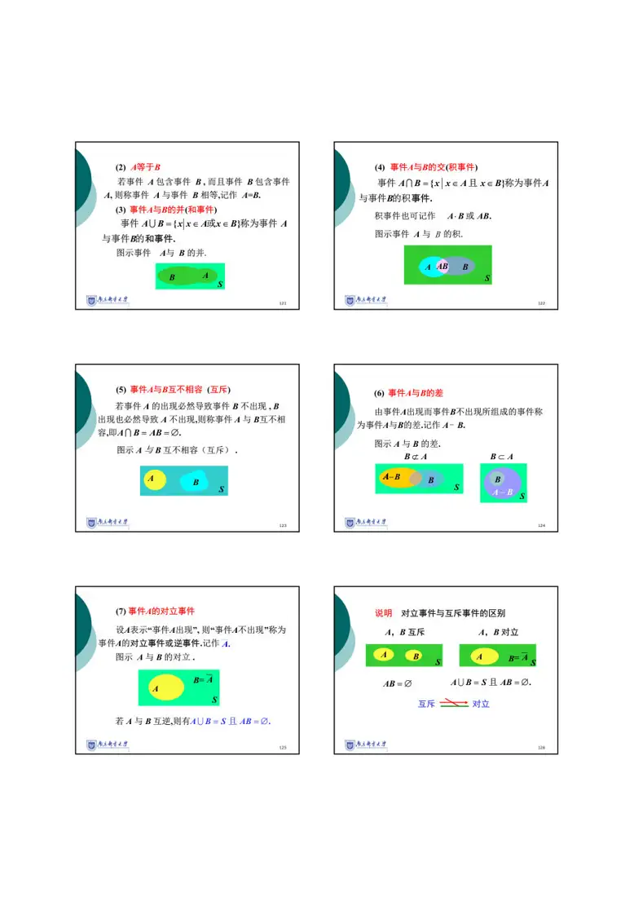

原文：

(5) 事件 $A$ 与 $B$ 互不相容 (互斥)

若事件 A 的出现必然导致事件 B 不出现，B 出现也必然导致 A 不出现，则称事件 A 与 B 互不相容，即 $A \cap B = AB = \varnothing$ .

图示 $A$ 与 $B$ 互不相容（互斥）.

(7) 事件 $A$ 的对立事件

设A表示“事件A出现”，则“事件A不出现”称为事件A的对立事件或逆事件.记作 $\overline{A}$ .

图示 $A$ 与 $B$ 的对立.

若 $A$ 与 $B$ 互逆, 则有 $A \cup B = S$ 且 $AB = \emptyset$ .

(6) 事件 $A$ 与 $B$ 的差

由事件A出现而事件B不出现所组成的事件称为事件A与B的差.记作 A - B.

图示 A 与 B 的差.

$A$ ， $B$ 互斥

$A$ ， $B$ 对立

$$
A B = \emptyset
$$

$A \cup B = S$ 且 $AB = \emptyset$ .

南京航空航天大学
Nanjing University of Physics and Telecommunications

121

(2) $A$ 等于 $B$

若事件 A 包含事件 B，而且事件 B 包含事件 A，则称事件 A 与事件 B 相等，记作 A=B.

(3) 事件 $A$ 与 $B$ 的并(和事件)

事件 $A \cup B = \{x \mid x \in A \text{或} x \in B\}$ 称为事件 $A$ 与事件 $B$ 的和事件.

$B = \{x|x\in$

南京邮电大学
Nanjing University of Physics and Telecommunications

图示事件 A 与 B 的并.

B A S

122

(4) 事件 $A$ 与 $B$ 的交(积事件)

$B = \{x\mid x\in A$

事件 $A \cap B = \{x \mid x \in A \text{ 且 } x \in B\}$ 称为事件 $A$ 与事件 $B$ 的积事件.

积事件也可记作 $A \cdot B$ 或 $AB$ .

南京邮电大学
Nanjing University of Physics and Telecommunications

图示事件 A 与 B 的积.

A AB B

A AB B
S

南京邮电大学
Nanjing University of Physics and Telecommunications

说明 对立事件与互斥事件的区别

A B S

南京邮电大学
Nanjing University of Posts and Telecommunications

### (2)频率的性质

原文：

(2)频率的性质

设 $A$ 是随机试验 $\pmb{E}$ 的任一事件, 则

$$
1 ^ {0} 0 \leq f _ {n} (A) \leq 1;
$$

$$
2 ^ {0} f (S) = 1, f (\emptyset) = 0;
$$

$3^{0}$ 若 $A_{1}, A_{2}, \cdots, A_{k}$ 是两两互不相容的事件, 则

$$
f \left(A _ {1} \bigcup A _ {2} \bigcup \dots \bigcup A _ {k}\right) = f _ {n} \left(A _ {1}\right) + f _ {n} \left(A _ {2}\right) + \dots + f _ {n} \left(A _ {k}\right).
$$

概率的性质

概率的有限可加性

概率的定义

设 E 是随机试验, S 是它的样本空间. 对于 E 的每一事件 A 赋予一个实数, 记为 $P(A)$ , 称为事件 A 的概率, 如果集合函数 $P(\cdot)$ 满足下列条件: $1^{0}$ 非负性: 对于每一个事件 A, 有 $P(A) \geq 0$ ; $2^{0}$ 规范性: 对于必然事件 S, 有 $P(S) = 1$ ; $3^{0}$ 可列可加性: 设 $A_{1}, A_{2}, \cdots$ 是两两互不相容的事件, 即对于 $i \neq j, A_{i}A_{j} = \varnothing, i, j = 1, 2, \cdots$ , 则有

$$
P \left(A _ {1} \cup A _ {2} \cup \dots\right) = P \left(A _ {1}\right) + P \left(A _ {2}\right) + \dots
$$

概率的可列可加性

$5^{0}$ 设 $\overline{A}$ 是 $A$ 的对立事件, 则 $P(\overline{A}) = 1 - P(A)$ .

$6^{0}$ (加法公式) 对于任意两事件 $A, B$ 有

$$
P (A \bigcup B) = P (A) + P (B) - P (A B).
$$

$n$ 个事件和的情况

$$
P \left(A _ {1} \bigcup A _ {2} \bigcup \dots \bigcup A _ {n}\right) = \sum_ {i = 1} ^ {n} P \left(A _ {i}\right) - \sum_ {1 \leq i <   j \leq n} P \left(A _ {i} A _ {j}\right)
$$

$$
+ \sum_ {1 \leq i <   j <   k \leq n} P (A _ {i} A _ {j} A _ {k}) + \dots + (- 1) ^ {n - 1} P (A _ {1} A _ {2} \dots A _ {n}).
$$

南京邮电大学 Nanjing University of Science and Telecommunications

南京邮电大学
Nanjing University of Physics and Telecommunications

南京邮电大学
Nanjing University of Physics and Telecommunications

127

南京新電大學
Nanjing University of Private and Telecommunications

128

事件运算的性质

设 $A, B, C$ 为事件, 则有

$1^{\circ}$ 交换律 $A \cup B = B \cup A, AB = BA.$

$A \cup B = B \cup A, AB = BA.$

$4^{\circ}$ 德·摩根律： $\overline{A\cup B} = \overline{A}\cap \overline{B},\quad \overline{A\cap B} = \overline{A}\cup \overline{B}.$

$\overline{A \cup B} = \overline{A} \cap \overline{B}, \quad \overline{A \cap B} = \overline{A} \cup \overline{B}$ .

$2^{\circ}$ 结合律 $(A\cup B)\cup C = A\cup (B\cup C),$

$(A \cup B) \cup C = A \cup (B \cup C)$ ,

$(AB)C = A(BC).$

$(A \cap B) \cup C = (A \cup C) \cap (B \cup C) = (A \cup C)(B \cup C)$ .

$3^{\circ}$ 分配律

$(A \cup B) \cap C = (A \cap C) \cup (B \cap C) = AC \cup BC,$

$1^{0} P(\emptyset) = 0.$

$2^{0}$ 若 $A_{1}, A_{2}, \cdots, A_{n}$ 是两两互不相容的事件，则有

$P(A_{1} \cup A_{2} \cup \cdots \cup A_{n}) = P(A_{1}) + P(A_{2}) + \cdots + P(A_{n}).$

$3^{0}$ 设 $A, B$ 为两个事件, 且 $A \subset B$ , 则

$P(A)\leq P(B),\quad P(B - A) = P(B) - P(A).$

$4^{0}$ 对于任一事件 $A, P(A) \leq 1$ .

南京新電大學
Nanjing University of Physics and Telecommunications

频率

(1)频率的定义

在相同的条件下,进行了 n 次试验,在这 n 次试验中,事件 A 发生的次数 $n_{A}$ 称为事件 A 发生的频数比值 $\frac{n_{A}}{n}$ 称为事件 A 发生的频率,并记成 $f_{n}(A)$ .

$f_{n}(A)$

$\frac{n_A}{n}$

n

南京邮电大学
Nanjing University of Physics and Telecommunications

130

### 几何概型

原文：

几何概型

当随机试验的样本空间是某个区域,并且任意一点落在度量(长度,面积,体积)相同的子区域是等可能的,则事件A的概率可定义为

$$
P (A) = \frac {S _ {A}}{S} 。
$$

(其中 S 是样本空间的度量, $S_{A}$ 是构成事件 A 的子区域的度量)。

这样借助于几何上的度量来合理规定的概率称为几何概型。

南京邮电大学
Nanjing University of Press and Telecommunications

条件概率

$$
P (B \mid A) = \frac {P (A B)}{P (A)}
$$

(1) 条件概率的定义

$1^{0}$ 非负性： $P(B|A)\geq 0;$

(2) 条件概率的性质

为在事件 A 发生的条件下事件 B 发生的条件概率.
同理可得 $P(A|B)=\frac{P(AB)}{P(B)}$ ,

$$
4 ^ {0} P (A | B) = 1 - P (\overline {{{A}}} | B);
$$

为在事件 $B$ 发生的条件下事件 $A$ 发生的条件概率。

$2^{0}$ 规范性： $P(S|B) = 1$ ， $P(\varnothing |B) = 0;$

$$
3 ^ {0} P (A _ {1} \bigcup A _ {2} | B) = P (A _ {1} | B) + P (A _ {2} | B) - P (A _ {1} A _ {2} | B);
$$

设 $A, B$ 是两个事件, 且 $P(A) > 0$ , 称

南京新電大學 Nanjing University of Physics and Telecommunications

$5^{0}$ 可加可列性: 设 $B_{1}, B_{2}, \cdots$ 是两两不相容的事件,

则有

$$
P \left(\bigcup_ {i = 1} ^ {\infty} B _ {i} \mid A\right) = \sum_ {i = 1} ^ {\infty} P (B _ {i} | A).
$$

乘法定理

$$
P (A B C) = P (C | A B) P (B | A) P (A).
$$

$$
P \left(A _ {n - 1} \mid A _ {1} A _ {2} \dots A _ {n - 2}\right) \times \dots \times P \left(A _ {2} \mid A _ {1}\right) P \left(A _ {1}\right).
$$

南京邮电大学
Nanjing University of Physics and Telecommunications

133

南京新電大學
Nanjing University of Private and Telecommunications

134

等可能概型 (古典概型)

定义

(2)试验中每个基本事件发生的可能性相同.具有以上两个特点的试验称为等可能概型或古典概型.

(1)试验的样本空间只包含有限个元素；

古典概型中事件概率的计算公式

设试验 $E$ 的样本空间由 $n$ 个样本点构成, $A$ 为 $E$ 的任意一个事件, 且包含 $m$ 个样本点, 则事件 $A$ 出现的概率记为:

$P(A)=\frac{m}{n}=\frac{A \text{所包含样本点的个数}}{\text{样本点总数}}$ 。

称此为概率的古典定义。

南京邮电大学
Nanjing University of Press and Telecommunications

$P(A) > 0,$

设 $P(A) > 0$ ，则有 $P(AB) = P(B|A)P(A)$

A,B,C

设 $A, B, C$ 为事件, 且 $P(AB) > 0$ , 则有

推广 设 $A_{1}, A_{2}, \cdots, A_{n}$ 为 n 个事件, $n \geq 2$ ,

且 $P(A_{1}A_{2}\dots A_{n - 1}) > 0$ ，则有

$P(A_{1}A_{2}\cdots A_{n-1})>0,$

$P(A_{1}A_{2}\dots A_{n}) = P(A_{n}|A_{1}A_{2}\dots A_{n - 1})\times$

南京邮电大学
Nanjing University of Physics and Telecommunications

### ![南京邮电大学

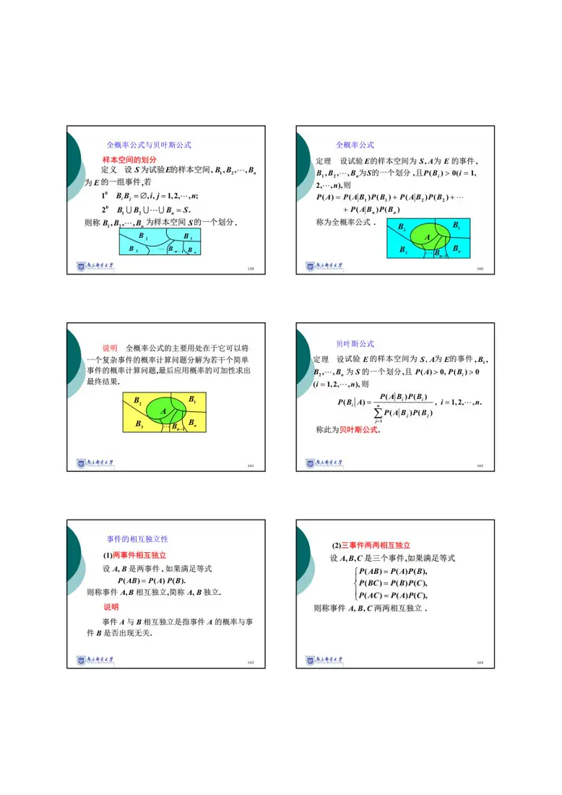

原文：

说明 全概率公式的主要用处在于它可以将一个复杂事件的概率计算问题分解为若干个简单事件的概率计算问题,最后应用概率的可加性求出最终结果.

事件的相互独立性

(1)两事件相互独立

设 A, B 是两事件, 如果满足等式

$$
P (A B) = P (A) P (B).
$$

则称事件 A, B 相互独立, 简称 A, B 独立.

说明

事件 A 与 B 相互独立是指事件 A 的概率与事件 B 是否出现无关.

贝叶斯公式

定理 设试验 E 的样本空间为 S. A 为 E 的事件, $B_{1}$ , $B_{2}, \cdots, B_{n}$ 为 S 的一个划分, 且 $P(A) > 0$ , $P(B_{i}) > 0$ $(i = 1, 2, \cdots, n)$ , 则

$$
P \left(B _ {i} \mid A\right) = \frac {P \left(A \mid B _ {i}\right) P \left(B _ {i}\right)}{\sum_ {j = 1} ^ {n} P \left(A \mid B _ {j}\right) P \left(B _ {j}\right)}, i = 1, 2, \dots , n.
$$

称此为贝叶斯公式.

$$
\left\{ \begin{array}{l} P (A B) = P (A) P (B), \\ P (B C) = P (B) P (C), \\ P (A C) = P (A) P (C), \end{array} \right.
$$

南京邮电大学
Nanjing University of Press and Telecommunications

南京新電大學
Nanjing University of Physics and Telecommunications

139

南京邮电大学
Nanjing University of Physics and Telecommunications

140

全概率公式与贝叶斯公式

样本空间的划分

定义 设 S 为试验 E 的样本空间, $B_{1}, B_{2}, \cdots, B_{n}$ 为 E 的一组事件, 若

$B_{1}, B_{2}, \cdots, B_{n}$

$1^{0}$ $B_{i}B_{j} = \emptyset ,i,j = 1,2,\dots ,n;$

$B_{2}$ $B_{1}$ $B_{3}$ $\cdots$ $B_{n-1}$ $B_{n}$

$2^{0}$ $B_{1}\bigcup B_{2}\bigcup \dots \bigcup B_{n} = S.$

$B_{1}, B_{2}, \cdots, B_{n}$

则称 $B_{1}, B_{2}, \cdots, B_{n}$ 为样本空间 S 的一个划分.

全概率公式

定理 设试验 E 的样本空间为 S, A 为 E 的事件, $B_{1}, B_{2}, \cdots, B_{n}$ 为 S 的一个划分, 且 $P(B_{i}) > 0 (i = 1, 2, \cdots, n)$ , 则

$B_{1}, B_{2}, \cdots, B_{n}$

2, $\cdots$ ,n)

$P(B_{i})>0(i=1,$

$P(A) = P(A|B_{1})P(B_{1}) + P(A|B_{2})P(B_{2}) + \dots$ $+P(A|B_n)P(B_n)$

称为全概率公式.

$B_{2}$ $B_{1}$ $A$ $B_{3}$ $B_{n-1}$

南京邮电大学
Nanjing University of Press and Telecommunications

(2)三事件两两相互独立

设 $A, B, C$ 是三个事件, 如果满足等式

则称事件 $A, B, C$ 两两相互独立.

南京邮电大学
Nanjing University of Science and Telecommunications

### 重要定理及结论

原文：

重要定理及结论

定理一

设 A, B 是两事件, 且 $P(A) > 0$ . 若 A, B 相互独立, 则 $P(B|A) = P(B)$ . 反之亦然.

定理二

若 $A, B$ 是相互独立的两个事件，则下列各对事件， $\overline{A}$ 与 $B, A$ 与 $\overline{B}, \overline{A}$ 与 $\overline{B}$ 也相互独立.

两个结论

(1) 若事件 $A_{1}, A_{2}, \cdots, A_{n} (n \geq 2)$ 相互独立，则其中任意 $k (2 \leq k \leq n)$ 个事件也是相互独立.

(2)若 n 个事件 $A_{1}, A_{2}, \cdots, A_{n} (n \geq 2)$ 相互独立，则将 $A_{1}, A_{2}, \cdots, A_{n}$ 中任意多个事件换成它们的对立事件，所得的 n 个事件仍相互独立.

148

南京邮电大学
Nanjing University of Press and Telecommunications

(3)三事件相互独立

设 $A, B, C$ 是三个事件, 如果满足等式

$\left\{ \begin{array}{l}P(AB) = P(A)P(B),\\ P(BC) = P(B)P(C),\\ P(AC) = P(A)P(C),\\ P(ABC) = P(A)P(B)P(C), \end{array} \right.$

145

则称事件 A, B, C 相互独立.
注意

三个事件相互独立 $\Leftrightarrow$ 三个事件两两相互独立

$A_{1}, A_{2}, \cdots, A_{n}$

推广 设 $A_{1}, A_{2}, \cdots, A_{n}$ 是 n 个事件, 如果对于任意 k ( $1 < k \leq n$ ), 任意 $1 \leq i_{1} < i_{2} < \cdots < i_{k} \leq n$ , 具有等式

$k(1 < k \leq n)$

$1 \leq i_{1} < i_{2} < \cdots < i_{k} \leq n$ .

$P(A_{i_1}A_{i_2}\dots A_{i_k}) = P(A_{i_1})P(A_{i_2})\dots P(A_{i_k})$

$A_{1}, A_{2}, \cdots, A_{n}$

则称 $A_{1}, A_{2}, \cdots, A_{n}$ 为相互独立的事件。

n个事件相互独立 $\rightarrow$ n个事件两两相互独立

146

南京邮电大学
Nanjing University of Press and Telecommunications

南京邮电大学
Nanjing University of Private and Telecommunications
