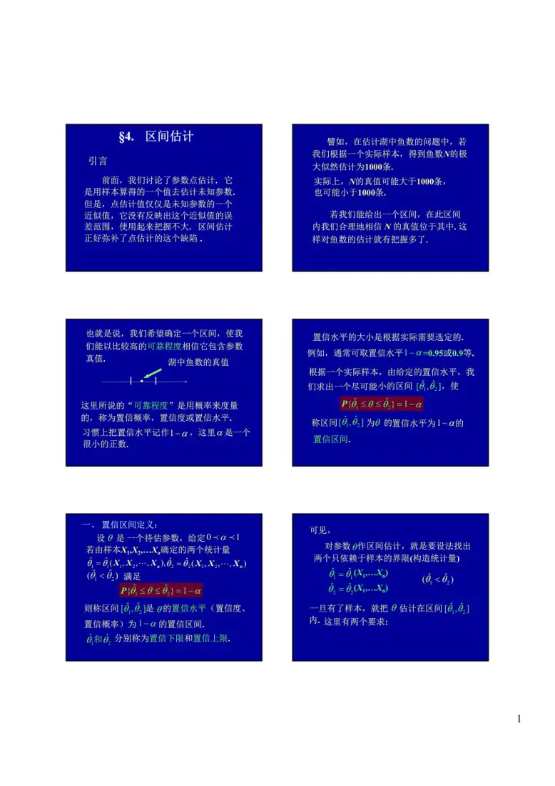

# 《概率论与数理统计》第七章 区间估计（课件）

原件的每一页，下面附识别出的文字。

### §4. 区间估计

原文：

§4. 区间估计

引言

前面，我们讨论了参数点估计。它是用样本算得的一个值去估计未知参数。但是，点估计值仅仅是未知参数的一个近似值，它没有反映出这个近似值的误差范围，使用起来把握不大。区间估计正好弥补了点估计的这个缺陷。

也就是说，我们希望确定一个区间，使我们能以比较高的可靠程度相信它包含参数真值. 湖中鱼数的真值

这里所说的“可靠程度”是用概率来度量的，称为置信概率，置信度或置信水平.
习惯上把置信水平记作 $1-\alpha$ ，这里 $\alpha$ 是一个很小的正数.

一、置信区间定义：

设 $\theta$ 是一个待估参数，给定 $0 \prec \alpha \prec 1$ 若由样本 $X_{1}, X_{2}, \ldots, X_{n}$ 确定的两个统计量 $\hat{\theta}_{1} = \hat{\theta}_{1}(X_{1}, X_{2}, \cdots, X_{n}), \hat{\theta}_{2} = \hat{\theta}_{2}(X_{1}, X_{2}, \cdots, X_{n}) (\hat{\theta}_{1} < \hat{\theta}_{2})$ 满足

$$
P \{\hat {\theta} _ {1} \leq \theta \leq \hat {\theta} _ {2} \} = 1 - \alpha
$$

则称区间 $[\hat{\theta}_1, \hat{\theta}_2]$ 是 $\theta$ 的置信水平（置信度、置信概率）为 $1 - \alpha$ 的置信区间. $\hat{\theta}_1$ 和 $\hat{\theta}_2$ 分别称为置信下限和置信上限.

譬如，在估计湖中鱼数的问题中，若我们根据一个实际样本，得到鱼数 $N$ 的极大似然估计为1000条.

实际上，N的真值可能大于1000条，也可能小于1000条.

若我们能给出一个区间，在此区间内我们合理地相信 $N$ 的真值位于其中.这样对鱼数的估计就有把握多了.

置信水平的大小是根据实际需要选定.例如，通常可取置信水平 $1 - \alpha = 0.95$ 或0.9等.根据一个实际样本，由给定的置信水平，我们求出一个尽可能小的区间 $[\hat{\theta}_1,\hat{\theta}_2]$ ，使

$$
P \left\{\hat {\theta} _ {1} \leq \theta \leq \hat {\theta} _ {2} \right\} = 1 - \alpha
$$

称区间 $[\hat{\theta}_1, \hat{\theta}_2]$ 为 $\theta$ 的置信水平为 $1 - \alpha$ 的置信区间.

可见，

对参数 $\theta$ 作区间估计，就是要设法找出两个只依赖于样本的界限(构造统计量)

$$
\hat {\theta} _ {1} = \hat {\theta} _ {1} (X _ {1}, \dots X _ {n})
$$

$$
(\hat {\theta} _ {1} <   \hat {\theta} _ {2})
$$

$$
\hat {\theta} _ {2} = \hat {\theta} _ {2} (X _ {1}, \dots X _ {n})
$$

一旦有了样本，就把 $\theta$ 估计在区间 $[\hat{\theta}_1, \hat{\theta}_2]$ 内. 这里有两个要求：

1

### 可靠度与精度是一对矛盾，一般是在保证可靠度的条件下尽可能提高精度.

原文：

1. 要求 $\theta$ 以很大的可能被包含在区间 $[\hat{\theta}_{1}, \hat{\theta}_{2}]$ 内，就是说，概率 $P\{\hat{\theta}_{1} \leq \theta \leq \hat{\theta}_{2}\}$ 要尽可能大。即要求估计尽量可靠。

2. 估计的精度要尽可能的高. 如要求区间长度 $\hat{\theta}_{2} - \hat{\theta}_{1}$ 尽可能短, 或能体现该要求的其它准则.

可靠度与精度是一对矛盾，一般是在保证可靠度的条件下尽可能提高精度.

由不等式 $|\hat{\theta} - \theta| \leq \delta$ 可以解出 $\theta$ ：

$$
\hat {\theta} - \delta \leq \theta \leq \hat {\theta} + \delta
$$

这个不等式就是我们所求的置信区间.

下面我们通过例子说明求置信区间的方法.

对给定的置信水平 $1 - \alpha$

查正态分布表得 $z_{\alpha /2}$

$$
\text {使} P \{\mid \frac {\bar {X} - \mu}{\sigma / \sqrt {n}} \mid \leq z _ {\alpha / 2} \} = 1 - \alpha
$$

从中解得

$$
P \{\overline {{{X}}} - \frac {\sigma}{\sqrt {n}} z _ {\alpha / 2} \leq \mu \leq \overline {{{X}}} + \frac {\sigma}{\sqrt {n}} z _ {\alpha / 2} \} = 1 - \alpha
$$

二、置信区间的求法

寻找置信区间的方法,一般是从确定误差限入手.

我们选取未知参数的某个估计量 $\hat{\theta}$ ，根据置信水平 $1 - \alpha$ ，可以找到一个正数 $\delta$ ，

使得 $P\{|\hat{\theta} - \theta |\leq \delta \} = 1 - \alpha$

称 $\delta$ 为 $\hat{\theta}$ 与 $\theta$ 之间的误差限.

只要知道 $\hat{\theta}$ 的概率分布，确定误差限并不难.

例1 设 $X_{1}, \ldots, X_{n}$ 是取自 $N(\mu, \sigma^{2})$ 的样本， $\sigma^{2}$ 已知，求参数 $\mu$ 的置信度为 $1 - \alpha$ 的置信区间.

解：选 $\mu$ 的点估计为 $\overline{\mathbf{X}}$

$$
\text {已知} U = \frac {\overline {{{X}}} - \mu}{\sigma / \sqrt {n}} \sim N (\mathbf {0}, \mathbf {1})
$$

于是所求 $\mu$ 的置信区间为

$$
[ \bar {X} - \frac {\sigma}{\sqrt {n}} z _ {\alpha / 2}, \bar {X} + \frac {\sigma}{\sqrt {n}} z _ {\alpha / 2} ]
$$

如果取 $\alpha = 0.05$ 即 $1 - \alpha = 0.95$

查表得 $z_{\alpha/2}=z_{0.025}=1.96$

又若 $\sigma = 1, n = 16$

于是得到一个置信水平为0.95的置信区间

$$
\overline {{X}} \pm \frac {1}{\sqrt {1 6}} \times 1. 9 6
$$

2

### 需要指出的是，给定样本，给定置信水平，置信区间也不是唯一的.

原文：

需要指出的是，给定样本，给定置信水平，置信区间也不是唯一的.

对同一个参数，我们可以构造许多置信区间.

我们得到均值 $\mu$ 的置信水平为 $1 - \alpha$ 的置信区间为 $[\overline{X} - 1.96\sigma / \sqrt{n}, \overline{X} + 1.96\sigma / \sqrt{n}]$

类似地，我们可得到若干个不同的置信区间.

任意两个数 $a$ 和 $b$ ，只要它们的纵标包含 $f(u)$ 下 $95\%$ 的面积，就确定一个 $95\%$ 的置信区间.

例如，设 $X_{1},\ldots X_{n}$ 是取自 $N(\mu ,\sigma^2)$ 的样本， $\sigma^2$ 已知，求参数 $\mu$ 的置信水平为 $1 - \alpha$ 的置信区间.

取估计量 $U=\frac{\bar{X}-\mu}{\sigma/\sqrt{n}}\sim N(0,1)$

由标准正态分布表，对任意 $a$ 、 $b$ ，我们可以求得 $P(a < U < b)$ ：

我们得到均值 $\mu$ 的置信水平为 $1-\alpha$ 的置信区间为 $[\overline{X}-1.75\sigma/\sqrt{n},\overline{X}+2.33\sigma/\sqrt{n}]$ 这个区间比前面一个要长一些.

在概率密度为单峰且对称的情形，当 $a = -b$ 时求得的置信区间的长度为最短.

3

### 从例1解题的过程，我们归纳出求置信区间的一般步骤如下：

原文：

即使在概率密度不对称的情形，如 $\chi^2$ 分布， $F$ 分布，习惯上仍取对称的分位点来计算未知参数的置信区间.

我们可以得到未知参数的的任何置信水平小于1的置信区间，并且置信水平越高，相应的置信区间平均长度越长.

从例1解题的过程，我们归纳出求置信区间的一般步骤如下：

1. 明确问题, 是求什么参数的置信区间? 置信水平 $1 - \alpha$ 是多少?

2. 寻找参数 $\theta$ 的一个良好的点估计 $T(X_{1}, X_{2}, \ldots, X_{n})$

3. 寻找一个待估参数 $\theta$ 和估计量 $T$ 的函数 $S(T, \theta)$ , 且其分布为已知.

可见，确定区间估计很关键的是要寻找一个待估参数 $\theta$ 和估计量 T 的函数 $S(T, \theta)$ ，且 $S(T, \theta)$ 的分布为已知，不依赖于任何未知参数（这样我们才能确定一个大概率区间）.

而这与总体分布有关，所以，总体分布的形式是否已知，是怎样的类型，至关重要.

也就是说，要想得到的区间估计可靠度高，区间长度就长，估计的精度就差。这是一对矛盾。

实用中应在保证足够可靠的前提下，尽量使得区间的长度短一些。

4. 对于给定的置信水平 $1 - \alpha$ ，根据 $S(T, \theta)$ 的分布，确定常数 $a, b$ ，使得 $P(a \leqslant S(T, \theta) \leqslant b) = 1 - \alpha$

5. 对“ $a \leqslant S(T, \theta) \leqslant b$ ”作等价变形, 得到如下形式: $P\left\{\hat{\theta}_{1} \leq \theta \leq \hat{\theta}_{2}\right\} = 1 - \alpha$

则 $[\hat{\theta}_1, \hat{\theta}_2]$ 就是 $\theta$ 的置信度为 $1 - \alpha$ 的置信区间.

4
